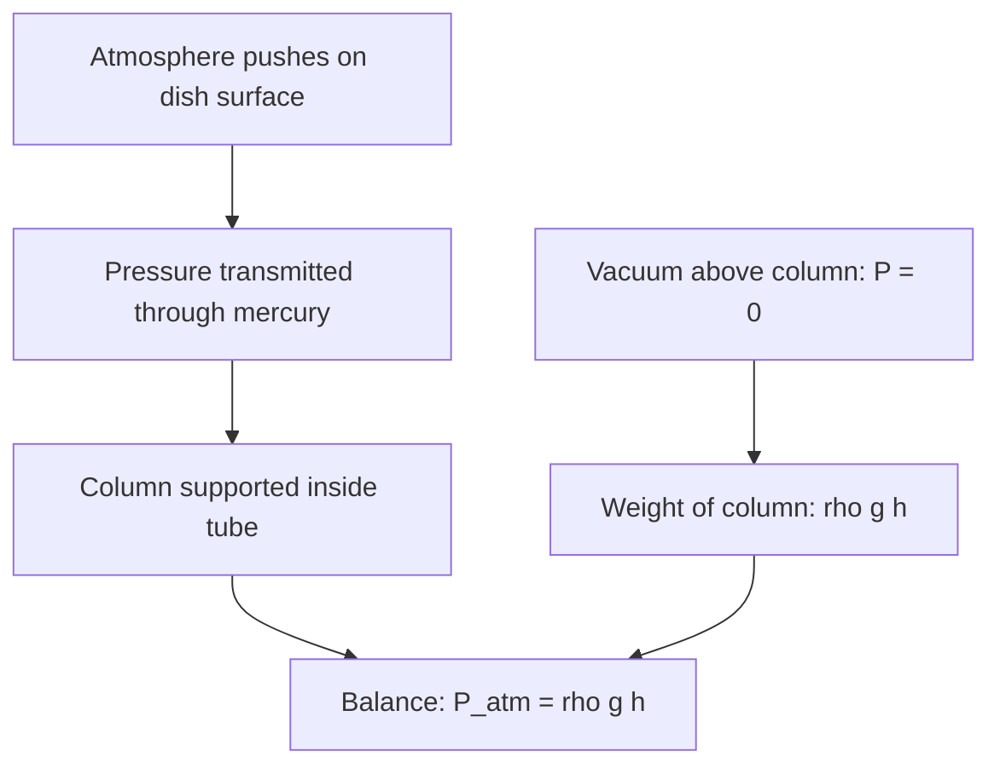

# Concept-Book Run

domain: /home/papagame/projects/digital-duck/cb-college-physics/public/domains/college_physics_ch11/input/graph.yaml
target: barometer
started: 2026-11-23T23:17:12

## Teaching order (11 concepts)

- force
- area
- mass
- pressure
- volume
- density
- fluid
- gravitational_acceleration
- atmospheric_pressure
- pressure_depth_relation
- barometer

### force (0.8s)

## Force

A force is any push or pull exerted on an object as a result of its interaction with another object. Because a force has both a size and a direction, it is a **vector quantity**: pushing a box with $10\text{ N}$ to the right produces a completely different outcome than pushing it with $10\text{ N}$ downward, even though the magnitude is identical. Forces are measured in newtons ($1\text{ N} = 1\text{ kg·m/s}^2$), and their effect on motion is governed by Newton's second law, $\vec{F}_{net} = m\vec{a}$, where $\vec{F}_{net}$ is the vector sum of every force acting on the object.

Because forces add like vectors, not like plain numbers, two forces acting on the same object combine by components. Suppose a $50\text{ N}$ force pulls east and a $30\text{ N}$ force pulls north on the same crate. The net force is not $80\text{ N}$; it is the vector sum:
$$
\vec{F}_{net} = (50\,\hat{x} + 30\,\hat{y})\ \text{N}, \qquad |\vec{F}_{net}| = \sqrt{50^2 + 30^2} \approx 58.3\ \text{N}
$$
directed at $\arctan(30/50) \approx 31^\circ$ north of east. This is why resolving forces into perpendicular ($x$- and $y$-) components before adding them is the standard first move in any force problem — it converts a geometric vector-addition problem into simple arithmetic on each axis.

**Problem-solving application:** A $2\text{ kg}$ block sits on a frictionless table. A rope pulls it with $12\text{ N}$ at $30^\circ$ above the horizontal, while a second rope pulls it with $8\text{ N}$ purely horizontally in the opposite direction. Find the block's acceleration.

Step 1 — resolve into components: rope 1 gives $F_{1x} = 12\cos30^\circ \approx 10.39\text{ N}$, $F_{1y} = 12\sin30^\circ = 6\text{ N}$; rope 2 gives $F_{2x} = -8\text{ N}$.
Step 2 — sum by axis: $F_{net,x} \approx 2.39\text{ N}$, $F_{net,y} = 6\text{ N}$ (a normal force and gravity cancel vertically only if the block stays on the table — here the vertical pull would need to be checked against the normal force, but treating this as a pure horizontal-plane problem gives $a_x = F_{net,x}/m \approx 1.2\text{ m/s}^2$).
Step 3 — interpret: the block accelerates predominantly in the direction of the stronger, more aligned force — illustrating that "adding forces" always means adding components, never magnitudes directly.

### area (13.0s)

## Area

**Area** measures how much two-dimensional surface a region covers. It is expressed in square units, such as square meters ($\text{m}^2$), because it counts how many unit squares (each 1 m by 1 m) fit inside the region. Area is additive: if a region is cut into non-overlapping pieces, the total area is the sum of the pieces' areas. Almost every area formula comes from this idea.

**Basic formulas**

| Shape | Area |
|---|---|
| Rectangle (length $l$, width $w$) | $A = lw$ |
| Triangle (base $b$, height $h$) | $A = \tfrac{1}{2}bh$ |
| Circle (radius $r$) | $A = \pi r^2$ |
| Trapezoid (parallel sides $a, b$, height $h$) | $A = \tfrac{1}{2}(a+b)h$ |

The height must be measured perpendicular to the base. It is not the length of a slanted side.

**Worked example**

A garden is a rectangle 8 m long and 5 m wide, with a semicircular flower bed attached to one of the 5 m sides. Find the total area.

1. Rectangle: $A_1 = 8 \times 5 = 40\ \text{m}^2$.
2. The semicircle has diameter 5 m, so $r = 2.5$ m:
$$A_2 = \tfrac{1}{2}\pi r^2 = \tfrac{1}{2}\pi(2.5)^2 \approx 9.82\ \text{m}^2.$$
3. By additivity, $A = 40 + 9.82 \approx 49.8\ \text{m}^2$.

**Problem-solving application: curved regions**

Not every region splits into simple shapes. When a boundary is a curve $y = f(x)$ with $f(x) \ge 0$, we slice the region into thin vertical strips of width $\Delta x$. Each strip is approximately a rectangle of area $f(x_i)\,\Delta x$. Adding the strips and letting their width shrink to zero gives the definite integral:

$$A = \int_a^b f(x)\,dx.$$

*Example:* Find the area under $f(x) = x^2$ from $x = 0$ to $x = 3$.

$$A = \int_0^3 x^2\,dx = \left[\frac{x^3}{3}\right]_0^3 = \frac{27}{3} - 0 = 9\ \text{square units}.$$

*Check:* The region fits inside a $3 \times 9$ rectangle of area 27, and the curve is low for most of the interval. An area of 9, one third of the rectangle, is reasonable.

When the region lies between two curves, with $f(x) \ge g(x)$ on $[a,b]$, subtract the lower curve from the upper one:

$$A = \int_a^b \big[f(x) - g(x)\big]\,dx.$$

**Strategy for any area problem**

1. Sketch the region and label the known lengths.
2. Decide whether it splits into familiar shapes (use additivity) or has a curved boundary (use an integral).
3. Keep units consistent. Convert before computing, since $1\ \text{m}^2 = 10{,}000\ \text{cm}^2$, not 100.
4. Check that the answer is reasonable by comparing it with an enclosing or enclosed simple shape.

**Common mistake:** Doubling a side length multiplies the area by 4, not 2, because area scales with the square of the linear scale factor.

### mass (0.9s)

## Mass

Mass is the quantity of matter in an object, measured in kilograms (SI) or, at the atomic scale, in atomic mass units (u). One atomic mass unit is defined as $\frac{1}{12}$ the mass of a carbon-12 atom, equal to approximately $1.6605 \times 10^{-27}\,\text{kg}$. Because protons and neutrons each contribute roughly 1 u to an atom's mass while electrons add a negligible amount (about 1/1836 of a proton's mass), an atom's total mass in u is closely approximated just by adding up its protons and neutrons — a quantity called the mass number.

**Worked example:** An unknown atom has 8 protons and a mass number of 18. Since mass number = protons + neutrons, the neutron count is $18 - 8 = 10$. This atom, oxygen-18, has the same 8 protons as ordinary oxygen-16 but two extra neutrons; atoms that share a proton count while differing in neutron count — and therefore in mass — are called isotopes. Oxygen-18 is stable but rare, making up about 0.2% of natural oxygen, and its slightly greater mass causes it to evaporate and react marginally more slowly than oxygen-16, a property exploited in paleoclimate research, where the ratio of oxygen-18 to oxygen-16 in ice cores and ocean sediments reveals past temperatures.

**Problem-solving application:** Suppose a sample of chlorine contains two isotopes: chlorine-35 (mass 34.97 u, abundance 75.8%) and chlorine-37 (mass 36.97 u, abundance 24.2%). To find the element's average atomic mass — the value listed on the periodic table — calculate the weighted average:
$$
(34.97 \times 0.758) + (36.97 \times 0.242) = 26.51 + 8.95 = 35.45\ \text{u}
$$
This matches chlorine's periodic table mass, confirming that atomic mass values reported for elements are abundance-weighted averages across all naturally occurring isotopes, not the mass of any single atom.

### pressure (23.9s)

## Pressure

**Pressure** is the force per unit area acting perpendicular to a surface:

$$P = \frac{F_\perp}{A}$$

The SI unit is the pascal: $1\ \text{Pa} = 1\ \text{N/m}^2$. Pressure is a scalar. It has no direction of its own, but the force it produces on a surface always acts perpendicular to that surface. Only the component of force perpendicular to the surface counts.

Pressure measures how concentrated a force is, which is why the same force can do very different things. A person pressing a thumbtack pushes with the same force on both ends. The point has a tiny area, so the pressure there is enormous.

### Worked example

A 60 kg person stands on one foot, and the contact area is $A = 0.020\ \text{m}^2$. Find the pressure on the floor.

The force is the person's weight:

$$F = mg = (60)(9.8) = 588\ \text{N}$$

$$P = \frac{588\ \text{N}}{0.020\ \text{m}^2} \approx 2.9\times10^{4}\ \text{Pa}$$

Now suppose the same person wears a stiletto heel with contact area $A = 1.0\times10^{-4}\ \text{m}^2$, and all the weight rests on that heel:

$$P = \frac{588}{1.0\times10^{-4}} = 5.9\times10^{6}\ \text{Pa}$$

The pressure is about 200 times larger, because the area is 200 times smaller. This is why stiletto heels dent wooden floors that bare feet don't mark.

### Problem-solving application

**Problem.** A pressure of $1.96\times10^{5}\ \text{Pa}$ acts on a circular viewing window of radius $0.05\ \text{m}$ on a diver's equipment. Find the force on the window.

**Step 1: Area.** Use consistent SI units.

$$A = \pi r^2 = \pi(0.05)^2 = 7.85\times10^{-3}\ \text{m}^2$$

**Step 2: Force.** Rearrange the definition to $F = PA$:

$$F = (1.96\times10^{5})(7.85\times10^{-3}) \approx 1.5\times10^{3}\ \text{N}$$

This is about 1500 N, roughly the weight of a 160 kg mass, pressing on a window the size of a small coaster. A strategy that works for most pressure problems:

1. Identify the force and the surface it acts on. Use only the component perpendicular to the surface.
2. Find the area in $\text{m}^2$. Convert from $\text{cm}^2$ by multiplying by $10^{-4}$.
3. Use $P = F/A$ to find pressure, or $F = PA$ to find force.
4. Check units: $\text{N}/\text{m}^2$ gives pascals.

Note how the two forms connect. If the same 1500 N were spread over a window ten times larger in area, the pressure would drop to one tenth. Comparing two situations by their area ratio, as in the stiletto example, is often faster than computing each pressure separately.

### volume (20.9s)

## Volume

**Volume** is the amount of three-dimensional space an object or substance occupies. It is measured in cubic units (m³, cm³, L), where 1 L = 1000 cm³ = 10⁻³ m³. Volume is the three-dimensional analog of area: it counts how many unit cubes fit inside a region.

**Volume by slicing.** Suppose a solid lies along an axis from $x = a$ to $x = b$, and the cross-sectional area $A(x)$ at each position $x$ is known. Stack thin slices of thickness $dx$ and add their volumes:

$$V = \int_a^b A(x)\,dx.$$

This is Cavalieri's principle expressed as an integral.

**Standard formulas.**

| Solid | Volume |
|---|---|
| Rectangular box | $V = \ell w h$ |
| Cylinder | $V = \pi r^2 h$ |
| Cone | $V = \tfrac{1}{3}\pi r^2 h$ |
| Sphere | $V = \tfrac{4}{3}\pi r^3$ |

### Worked example: deriving the sphere

Place a sphere of radius $R$ centered at the origin. Slicing perpendicular to the $x$-axis gives a circular cross-section of radius $\sqrt{R^2 - x^2}$, so

$$A(x) = \pi (R^2 - x^2).$$

Then

$$V = \int_{-R}^{R} \pi (R^2 - x^2)\,dx = \pi\left[R^2 x - \frac{x^3}{3}\right]_{-R}^{R} = \pi\left(2R^3 - \frac{2R^3}{3}\right) = \frac{4}{3}\pi R^3.$$

### Problem-solving application

**Problem.** A cylindrical tank of radius 2 m and height 5 m is filled with water. How many liters does it hold, and how much does the water weigh? (Water density is 1000 kg/m³.)

1. Volume: $V = \pi r^2 h = \pi (2)^2(5) = 20\pi \approx 62.8\ \text{m}^3$.
2. Convert units: $62.8\ \text{m}^3 \times 1000\ \text{L/m}^3 \approx 62{,}800\ \text{L}$.
3. Mass: $m = \rho V = 1000 \times 62.8 \approx 62{,}800\ \text{kg}$.

**Strategies for any volume problem:**

- **Decompose.** Split irregular objects into boxes, cylinders, cones, or spheres, then add (or subtract for hollow parts).
- **Check units.** Lengths must share a unit before multiplying. Scaling every length by $k$ scales volume by $k^3$, so doubling a radius makes a sphere 8 times larger.
- **Use displacement.** An irregular object's volume equals the volume of fluid it displaces when fully submerged. This is Archimedes' method.
- **Sanity-check.** A sphere's volume should be less than its bounding cube's, $(2R)^3 = 8R^3$. Here $\tfrac{4}{3}\pi R^3 \approx 4.19R^3$, which passes.

### density (13.5s)

## Density

**Definition.** Density is the mass per unit volume of a substance:

$$\rho = \frac{m}{V}$$

Here $m$ is mass (kg or g) and $V$ is volume (m³ or cm³ or mL). Typical units are kg/m³ and g/cm³, where $1\ \text{g/cm}^3 = 1000\ \text{kg/m}^3$. Density is an *intensive* property. A gram of iron and a tonne of iron have the same density, because the mass and the volume grow together. This makes density useful for identifying materials.

Some reference values:

| Substance | $\rho$ (g/cm³) |
|---|---|
| Air (20 °C) | 0.0012 |
| Ethanol | 0.79 |
| Water (4 °C) | 1.00 |
| Aluminum | 2.70 |
| Iron | 7.87 |
| Gold | 19.3 |

The same relation can be rearranged to $m = \rho V$ and $V = m/\rho$. Use whichever form isolates your unknown.

**Worked example.** A metal block measures $2.0\ \text{cm} \times 3.0\ \text{cm} \times 5.0\ \text{cm}$ and has a mass of $81\ \text{g}$. What is it made of?

1. Compute the volume: $V = 2.0 \times 3.0 \times 5.0 = 30\ \text{cm}^3$.
2. Apply the definition: $\rho = \dfrac{81\ \text{g}}{30\ \text{cm}^3} = 2.7\ \text{g/cm}^3$.

This matches aluminum in the table. Identifying a material by density is only suggestive. Several alloys can share similar values, so treat the match as evidence, not proof.

**Problem-solving application.** Density lets you find a quantity you cannot measure directly.

*Irregular objects.* A small stone has mass $56\ \text{g}$. When it is lowered into a graduated cylinder, the water level rises from $40.0\ \text{mL}$ to $48.0\ \text{mL}$. Since $1\ \text{mL} = 1\ \text{cm}^3$, the displaced water gives the stone's volume, $V = 8.0\ \text{cm}^3$. Then
$$\rho = \frac{56}{8.0} = 7.0\ \text{g/cm}^3.$$

*Mass from size.* How much does a $2.0\ \text{m}^3$ tank of ethanol hold? Convert first: $0.79\ \text{g/cm}^3 = 790\ \text{kg/m}^3$. Then
$$m = \rho V = (790)(2.0) = 1580\ \text{kg}.$$

*Floating and sinking.* An object floats in a fluid if its average density is less than the fluid's density. Iron ($7.87\ \text{g/cm}^3$) sinks in water, yet a steel ship floats. Its hull encloses a large volume of air, so the ship's *average* density, total mass divided by total enclosed volume, is below $1.00\ \text{g/cm}^3$.

**Common pitfalls.**
- Mixing units, such as grams with $\text{m}^3$. Convert before dividing.
- Treating density as fixed. It changes with temperature and pressure, especially for gases. Water is densest near 4 °C.
- Using the object's total volume when it is hollow or porous. Then $m/V$ gives an average density, not the density of the material itself.

**Check your understanding.** A $0.50\ \text{kg}$ sample of an unknown liquid fills $625\ \text{mL}$. Is it ethanol? (Answer: $\rho = 500/625 = 0.80\ \text{g/cm}^3$, which is consistent with ethanol.)

### fluid (29.3s)

## Fluid

A **fluid** is a liquid or a gas that cannot sustain a static shear stress. Push sideways on a block of steel and it resists with a restoring force. Push sideways on water and it keeps deforming, which is to say it *flows*. Because a fluid cannot hold a sideways force, the only force it exerts on a surface at rest is perpendicular to that surface. This is why the key quantity for fluids at rest is **pressure**, the normal force per unit area:

$$P = \frac{F}{A}$$

Pressure is measured in pascals ($1\ \text{Pa} = 1\ \text{N/m}^2$). At a given point in a fluid at rest, pressure acts equally in all directions.

### Pressure in a static fluid

Take a fluid of constant density $\rho$ at rest. Pressure increases linearly with depth $h$:

$$P = P_0 + \rho g h$$

Here $P_0$ is the pressure at the surface. The result comes from balancing forces on a column of fluid. The extra pressure at depth $h$ must support the weight of the fluid above it, $\rho g h$ per unit area.

Two consequences matter in practice:

- Pressure depends only on depth, not on the container's shape or width. A narrow tube and a wide lake give the same pressure at the same depth.
- The term $\rho g h$ is the **gauge pressure**, the pressure above what the surface already supplies.

Liquids are nearly incompressible, so treating $\rho$ as constant works well. This is not true over large depth ranges in a gas.

### Worked example

A diver is at depth $h = 10.0\ \text{m}$ in fresh water ($\rho = 1000\ \text{kg/m}^3$) under atmospheric pressure $P_0 = 1.01\times10^5\ \text{Pa}$. What is the absolute pressure?

$$P = 1.01\times10^5 + (1000)(9.8)(10.0) = 1.99\times10^5\ \text{Pa}$$

This is nearly twice atmospheric pressure. Every 10 m of water adds about one atmosphere.

### Problem-solving application

A submarine hatch has area $A = 0.50\ \text{m}^2$ and sits at depth $h = 50\ \text{m}$ in seawater ($\rho = 1025\ \text{kg/m}^3$). The cabin is held at atmospheric pressure. What net force does the water exert on the hatch?

**Step 1: Choose the right pressure.** Atmospheric pressure acts on both sides of the hatch (the surface pushes down on the water, and the cabin air pushes outward), so those contributions cancel. Only the gauge pressure produces a net force:

$$P_{\text{gauge}} = \rho g h = (1025)(9.8)(50) = 5.0\times10^5\ \text{Pa}$$

**Step 2: Convert pressure to force.**

$$F = P_{\text{gauge}}\,A = (5.0\times10^5)(0.50) = 2.5\times10^5\ \text{N}$$

This is about 25 tonnes of force, roughly the weight of 25,000 kg. It explains why submarine hatches are sealed by pressing inward, so the water pressure itself helps hold them shut. The same method applies to dam walls, diving windows, and any submerged surface: find the gauge pressure at the right depth, then multiply by area.

### gravitational_acceleration (23.1s)

## Gravitational Acceleration

**Definition.** Gravitational acceleration, written $g$, is the acceleration of an object that falls under gravity alone, with air resistance ignored. Near Earth's surface its value is approximately

$$g \approx 9.80\ \text{m/s}^2,$$

directed toward Earth's center. Every freely falling object gains about $9.80\ \text{m/s}$ of downward speed each second, whatever its mass. This is why a hammer and a feather dropped together in a vacuum land at the same time. Because $g$ is constant, the constant-acceleration equations you already know apply directly, with $a = \pm g$.

**Worked example.** A ball is dropped from rest from the top of a 45 m building. How long does it take to land, and how fast is it moving on impact? Take downward as positive and use $g = 9.80\ \text{m/s}^2$.

With $v_0 = 0$, the displacement is $y = \tfrac12 g t^2$. Solving for $t$:

$$t = \sqrt{\frac{2y}{g}} = \sqrt{\frac{2(45)}{9.80}} \approx 3.03\ \text{s}.$$

The impact speed is

$$v = gt \approx (9.80)(3.03) \approx 29.7\ \text{m/s}.$$

As a check, $v^2 = 2gy$ gives $v = \sqrt{2(9.80)(45)} \approx 29.7\ \text{m/s}$, which matches.

**Problem-solving application.** Suppose a ball is thrown straight up at $v_0 = 20.0\ \text{m/s}$. How high does it go, and when does it return to the thrower's hand?

Choose upward as positive, so the acceleration is $-g$. At the peak, $v = 0$:

$$0 = v_0^2 - 2g h \;\Rightarrow\; h = \frac{v_0^2}{2g} = \frac{400}{19.6} \approx 20.4\ \text{m}.$$

The time to reach the peak is $t_{\text{up}} = v_0/g \approx 2.04\ \text{s}$. By symmetry the descent takes the same time, so the ball returns after about $4.08\ \text{s}$. It arrives with speed $20.0\ \text{m/s}$, the same as its launch speed but directed downward.

**Strategy.** To solve a free-fall problem:

1. Pick a positive direction and use it consistently. Then $a = \pm g$.
2. List the knowns: $v_0$, $y$, $t$, $v$.
3. Choose the constant-acceleration equation that contains your unknown and avoids the quantities you don't have.
4. Check that the answer is reasonable. Free fall from a few meters should take about a second, not a minute.

**Common pitfall.** At the top of its flight the ball's *velocity* is zero, but its *acceleration* is still $-9.80\ \text{m/s}^2$. Gravity does not turn off at the peak.

### atmospheric_pressure (21.5s)

## Atmospheric Pressure

**Definition.** Atmospheric pressure is the pressure exerted by the weight of the air above a given point. At sea level its standard value is

$$P_{\text{atm}} = 1.01\times 10^{5}\ \text{N/m}^2 = 101\ \text{kPa}.$$

Pressure is force per unit area, $P = F/A$. Air has mass, and gravity pulls it down. A column of air resting on a surface therefore presses on that surface with a force equal to the column's weight. Pressure in a fluid acts equally in all directions, so the atmosphere pushes sideways and upward on objects as well as downward. Atmospheric pressure decreases with altitude because less air lies above you.

**Worked example: the weight of the air.** How much force does the atmosphere exert on the top of a desk of area $1.5\ \text{m}^2$?

$$F = P A = (1.01\times10^{5}\ \text{N/m}^2)(1.5\ \text{m}^2) \approx 1.5\times10^{5}\ \text{N}.$$

This is about the weight of a 15,000 kg object, yet the desk does not collapse. Air also presses upward on the underside of the desk with nearly the same force, so the forces cancel. Pressure differences, not pressure alone, produce a net force.

**Problem-solving application: a suction cup.** A suction cup of radius 4.0 cm is pressed on a smooth wall. Air is pumped out until the pressure inside is essentially zero. What is the maximum force holding the cup on?

1. Find the area: $A = \pi r^2 = \pi (0.040\ \text{m})^2 = 5.0\times10^{-3}\ \text{m}^2$.
2. The net force comes from the pressure difference: $\Delta P = P_{\text{atm}} - P_{\text{inside}} \approx 1.01\times10^5\ \text{N/m}^2$.
3. Compute $F = \Delta P\,A = (1.01\times10^{5})(5.0\times10^{-3}) \approx 5.1\times10^{2}\ \text{N}$.

The cup can in principle support about 500 N. Real cups hold less because they never reach a perfect vacuum.

**Check your understanding.** Suppose the cup's radius is doubled. By what factor does the maximum holding force change? (Area scales with $r^2$, so the force becomes four times larger, about 2,000 N.)

**Key takeaways.**
- $P_{\text{atm}} \approx 1.01\times10^{5}$ N/m² at sea level and falls with altitude.
- Large forces from the atmosphere cancel unless a pressure difference exists.
- To solve problems, identify the pressure difference, multiply by the area, and check the units (N/m² × m² = N).

### pressure_depth_relation (21.0s)

## Pressure Depth Relation

**Definition.** A fluid at rest pushes on every surface it touches. Because the fluid below must support the weight of the fluid above, pressure increases with depth. For a fluid of uniform density $\rho$ in a gravitational field $g$, the pressure due to the fluid at depth $h$ is

$$P = \rho g h$$

where $\rho$ is in kg/m³, $g \approx 9.8\ \text{m/s}^2$, $h$ is in meters, and $P$ is in pascals (1 Pa = 1 N/m²). The relation is linear in $h$ only when $\rho$ is constant. This is a good model for liquids, which are nearly incompressible, but not for gases over large height changes.

**Why it holds.** Imagine a vertical column of fluid with cross-sectional area $A$ and height $h$. Its volume is $Ah$, its mass is $\rho A h$, and its weight is $\rho A h g$. In equilibrium, the fluid beneath must push up with a force equal to this weight. Pressure is force per area:

$$P = \frac{\rho A h g}{A} = \rho g h$$

The area cancels, so pressure depends only on depth, not on the width or shape of the container.

**Worked example.** A scuba diver descends to 20 m in seawater ($\rho = 1025\ \text{kg/m}^3$). Find the pressure due to the water alone.

$$P = (1025)(9.8)(20) \approx 2.01\times 10^{5}\ \text{Pa}$$

This is about 2 atm, taking 1 atm $\approx 1.01\times10^5$ Pa. Every 10 m or so of water adds about one atmosphere, a useful rule of thumb.

**Problem-solving application.** A gate in a reservoir wall is 4.0 m below the surface and has area $0.50\ \text{m}^2$. Atmospheric pressure acts on both sides of the gate, so it cancels and we use only the water's pressure. Estimate the force on the gate.

1. Pressure at the gate: $P = (1000)(9.8)(4.0) = 3.92\times10^{4}\ \text{Pa}$.
2. Force: $F = PA = (3.92\times10^{4})(0.50) \approx 1.96\times10^{4}\ \text{N}$.

That is roughly the weight of a 2000 kg object, which is why dams are built thicker at the base. For a gate that spans a range of depths, pressure varies across it, so the exact force requires integrating $\rho g h\,dA$ over the surface. For a vertical rectangle, using the pressure at the gate's center gives the correct total force.

**Common pitfalls.**
- Use *vertical* depth below the surface, not distance along a slanted pipe.
- Do not add atmospheric pressure when it acts equally on both sides of a surface.
- Convert units before computing (e.g., cm to m, g/cm³ to kg/m³).
- Pressure acts in all directions at a point, so the force on a surface is always perpendicular to it.

**Check your understanding.** At what depth in fresh water is the pressure due to the water equal to 1 atm ($1.01\times10^5$ Pa)? Solving $h = P/(\rho g)$ gives $h \approx 10.3$ m, which matches the rule of thumb above.

### barometer (12.8s)

## Barometer

### Definition

A **barometer** measures atmospheric pressure by balancing it against the weight of a liquid column. In the mercury barometer, a glass tube sealed at one end is filled with mercury and inverted into an open dish of mercury. Some mercury drains out, leaving a column of height $h$ with a near-vacuum above it (the "Torricellian vacuum"). Atmospheric pressure pushing on the dish surface holds the column up.

Why the column stops at a fixed height: the fluid at the dish level must have the same pressure inside and outside the tube. Outside, that pressure is $P_{\text{atm}}$. Inside, it is the pressure at the top of the column plus the hydrostatic pressure of the mercury. The vacuum contributes essentially zero pressure, so

$$P_{\text{atm}} = \rho g h$$

where $\rho$ is the mercury density, $g$ is gravitational acceleration, and $h$ is the column height. The height of the column therefore reads out the pressure directly.

### Worked example

Standard atmospheric pressure is $101{,}325\ \text{Pa}$. Use $\rho_{\text{Hg}} = 13{,}595\ \text{kg/m}^3$ and $g = 9.807\ \text{m/s}^2$. Solving for $h$:

$$h = \frac{P_{\text{atm}}}{\rho g} = \frac{101{,}325}{(13{,}595)(9.807)} \approx 0.760\ \text{m}$$

The column stands about $760\ \text{mm}$, which is why $1\ \text{atm} = 760\ \text{mmHg}$.

### Problem-solving application

**Why mercury?** Repeat the calculation with water ($\rho = 1000\ \text{kg/m}^3$):

$$h = \frac{101{,}325}{(1000)(9.807)} \approx 10.3\ \text{m}$$

A water barometer would need a tube over 10 m tall. Mercury's high density makes a benchtop instrument practical. Mercury also has a very low vapor pressure at room temperature. That keeps the "vacuum" close to a true vacuum.

**Weather and altitude.** A storm system drops the reading from $760$ to $735\ \text{mmHg}$. The pressure change is

$$\Delta P = \rho g\,\Delta h = (13{,}595)(9.807)(-0.025) \approx -3{,}300\ \text{Pa}$$

so the pressure fell by about $3.3\ \text{kPa}$. Falling readings usually signal approaching low-pressure weather. Rising readings signal fair weather.

Altitude has a similar effect. Near sea level, pressure falls roughly $12\ \text{Pa}$ per meter of climb. A hiker who sees the column drop by $60\ \text{mmHg}$ (about $8{,}000\ \text{Pa}$) can estimate the climb:

$$\Delta z \approx \frac{8{,}000}{12} \approx 670\ \text{m}$$

This is only an approximation, because air density decreases with height.

**Common errors.**
- **Tube width:** the column height does not depend on the tube's cross-section. Pressure depends on height, not volume.
- **Tilting:** tilting the tube lengthens the mercury inside but leaves the *vertical* height unchanged.
- **Air in the tube:** trapped air adds pressure at the top and makes the reading too low.

*The atmosphere's push on the dish balances the column's weight, so the column height gives the pressure.*

## Run complete

total: 203.3s
