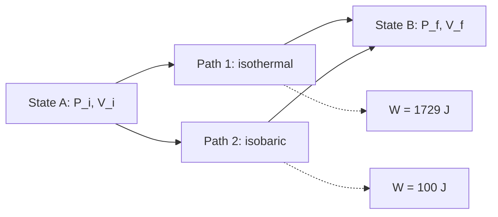
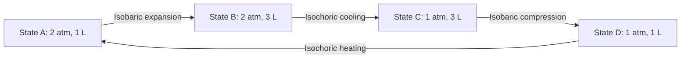
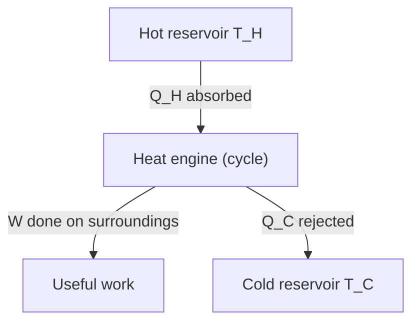
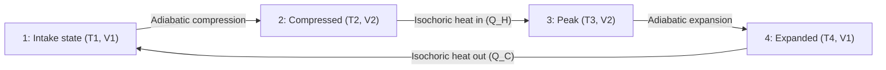

# Concept-Book Run

domain: /home/papagame/projects/digital-duck/cb-college-physics/public/domains/college_physics_ch15/input/graph.yaml
target: otto_cycle
started: 2026-11-23T23:26:21

## Teaching order (16 concepts)

- kinetic_energy
- pressure
- volume
- potential_energy
- temperature
- thermodynamic_work
- conservation_of_energy
- heat_transfer
- internal_energy
- first_law_of_thermodynamics
- pv_diagram
- cyclical_process
- adiabatic_process
- heat_engine
- isochoric_process
- otto_cycle

### kinetic_energy (0.7s)

## Kinetic Energy

Kinetic energy is the energy an object possesses because it is moving. For an object of mass $m$ translating at speed $v$ (with $v \ll c$, so relativistic effects are negligible), the kinetic energy is

$$KE = \frac{1}{2}mv^2$$

This expression follows directly from the work-energy theorem: the net work done on an object equals its change in kinetic energy, $W_{net} = \Delta KE$. Starting from Newton's second law, $F = ma$, and integrating force over displacement,

$$W = \int F\,dx = \int ma\,dx = \int m\frac{dv}{dt}\,dx = \int mv\,dv = \frac{1}{2}mv^2 - \frac{1}{2}mv_0^2$$

using the substitution $dx/dt = v$. This derivation shows that $KE = \frac{1}{2}mv^2$ is not an arbitrary definition — it is the quantity whose change exactly tracks the work done by a net force, which is why kinetic energy is so useful for solving motion problems without tracking time explicitly.

**Worked example.** A 1200 kg car accelerates from rest to 25 m/s. Its kinetic energy at that speed is

$$KE = \frac{1}{2}(1200\text{ kg})(25\text{ m/s})^2 = \frac{1}{2}(1200)(625) = 375{,}000\text{ J} = 375\text{ kJ}$$

By the work-energy theorem, this is exactly the net work the engine (net of friction and drag) must have delivered to reach that speed, regardless of how long the acceleration took or whether it was uniform.

**Problem-solving application.** Kinetic energy's real power is in problems where forces are known but time is not. Suppose the same 1200 kg car, moving at 25 m/s, brakes to a stop under a constant friction force of 6000 N. Rather than solving for acceleration and time separately, apply the work-energy theorem directly: the net work done by friction over stopping distance $d$ must equal the negative of the car's kinetic energy, $-Fd = 0 - KE_i$. Solving,

$$d = \frac{KE_i}{F} = \frac{375{,}000\text{ J}}{6000\text{ N}} = 62.5\text{ m}$$

This illustrates a key problem-solving strategy: whenever a force and a change in speed are known but the time of interaction is not, relate them through work and kinetic energy rather than through kinematics. Also note the quadratic dependence on $v$: doubling the initial speed would quadruple $KE_i$, and therefore quadruple the stopping distance for the same braking force — a fact central to vehicle safety engineering, since it explains why small increases in speed produce disproportionately larger stopping distances and collision severity.

### pressure (0.5s)

## Pressure

**Pressure** is the force per unit area acting perpendicular to a surface:

$$P = \frac{F_\perp}{A}$$

The SI unit is the pascal: $1\ \text{Pa} = 1\ \text{N/m}^2$. Pressure is a scalar. It has no direction of its own, but the force it produces on a surface always acts perpendicular to that surface. Only the component of force perpendicular to the surface counts.

Pressure measures how concentrated a force is, which is why the same force can do very different things. A person pressing a thumbtack pushes with the same force on both ends. The point has a tiny area, so the pressure there is enormous.

### Worked example

A 60 kg person stands on one foot, and the contact area is $A = 0.020\ \text{m}^2$. Find the pressure on the floor.

The force is the person's weight:

$$F = mg = (60)(9.8) = 588\ \text{N}$$

$$P = \frac{588\ \text{N}}{0.020\ \text{m}^2} \approx 2.9\times10^{4}\ \text{Pa}$$

Now suppose the same person wears a stiletto heel with contact area $A = 1.0\times10^{-4}\ \text{m}^2$, and all the weight rests on that heel:

$$P = \frac{588}{1.0\times10^{-4}} = 5.9\times10^{6}\ \text{Pa}$$

The pressure is about 200 times larger, because the area is 200 times smaller. This is why stiletto heels dent wooden floors that bare feet don't mark.

### Problem-solving application

**Problem.** A pressure of $1.96\times10^{5}\ \text{Pa}$ acts on a circular viewing window of radius $0.05\ \text{m}$ on a diver's equipment. Find the force on the window.

**Step 1: Area.** Use consistent SI units.

$$A = \pi r^2 = \pi(0.05)^2 = 7.85\times10^{-3}\ \text{m}^2$$

**Step 2: Force.** Rearrange the definition to $F = PA$:

$$F = (1.96\times10^{5})(7.85\times10^{-3}) \approx 1.5\times10^{3}\ \text{N}$$

This is about 1500 N, roughly the weight of a 160 kg mass, pressing on a window the size of a small coaster. A strategy that works for most pressure problems:

1. Identify the force and the surface it acts on. Use only the component perpendicular to the surface.
2. Find the area in $\text{m}^2$. Convert from $\text{cm}^2$ by multiplying by $10^{-4}$.
3. Use $P = F/A$ to find pressure, or $F = PA$ to find force.
4. Check units: $\text{N}/\text{m}^2$ gives pascals.

Note how the two forms connect. If the same 1500 N were spread over a window ten times larger in area, the pressure would drop to one tenth. Comparing two situations by their area ratio, as in the stiletto example, is often faster than computing each pressure separately.

### volume (0.6s)

## Volume

**Volume** is the amount of three-dimensional space an object or substance occupies. It is measured in cubic units (m³, cm³, L), where 1 L = 1000 cm³ = 10⁻³ m³. Volume is the three-dimensional analog of area: it counts how many unit cubes fit inside a region.

**Volume by slicing.** Suppose a solid lies along an axis from $x = a$ to $x = b$, and the cross-sectional area $A(x)$ at each position $x$ is known. Stack thin slices of thickness $dx$ and add their volumes:

$$V = \int_a^b A(x)\,dx.$$

This is Cavalieri's principle expressed as an integral.

**Standard formulas.**

| Solid | Volume |
|---|---|
| Rectangular box | $V = \ell w h$ |
| Cylinder | $V = \pi r^2 h$ |
| Cone | $V = \tfrac{1}{3}\pi r^2 h$ |
| Sphere | $V = \tfrac{4}{3}\pi r^3$ |

### Worked example: deriving the sphere

Place a sphere of radius $R$ centered at the origin. Slicing perpendicular to the $x$-axis gives a circular cross-section of radius $\sqrt{R^2 - x^2}$, so

$$A(x) = \pi (R^2 - x^2).$$

Then

$$V = \int_{-R}^{R} \pi (R^2 - x^2)\,dx = \pi\left[R^2 x - \frac{x^3}{3}\right]_{-R}^{R} = \pi\left(2R^3 - \frac{2R^3}{3}\right) = \frac{4}{3}\pi R^3.$$

### Problem-solving application

**Problem.** A cylindrical tank of radius 2 m and height 5 m is filled with water. How many liters does it hold, and how much does the water weigh? (Water density is 1000 kg/m³.)

1. Volume: $V = \pi r^2 h = \pi (2)^2(5) = 20\pi \approx 62.8\ \text{m}^3$.
2. Convert units: $62.8\ \text{m}^3 \times 1000\ \text{L/m}^3 \approx 62{,}800\ \text{L}$.
3. Mass: $m = \rho V = 1000 \times 62.8 \approx 62{,}800\ \text{kg}$.

**Strategies for any volume problem:**

- **Decompose.** Split irregular objects into boxes, cylinders, cones, or spheres, then add (or subtract for hollow parts).
- **Check units.** Lengths must share a unit before multiplying. Scaling every length by $k$ scales volume by $k^3$, so doubling a radius makes a sphere 8 times larger.
- **Use displacement.** An irregular object's volume equals the volume of fluid it displaces when fully submerged. This is Archimedes' method.
- **Sanity-check.** A sphere's volume should be less than its bounding cube's, $(2R)^3 = 8R^3$. Here $\tfrac{4}{3}\pi R^3 \approx 4.19R^3$, which passes.

### potential_energy (0.8s)

## Potential Energy

Potential energy, $U$, is energy a system stores by virtue of the relative positions or configuration of its parts, released as work when that configuration is allowed to change. It is defined only for **conservative forces** — forces for which the work done moving between two points is independent of the path taken. For such a force $\vec{F}$, the potential energy change is defined as the negative of the work the force does:

$$\Delta U = -W_{\text{conservative}} = -\int_{\vec{r}_i}^{\vec{r}_f} \vec{F} \cdot d\vec{r}$$

Equivalently, the force is recovered from $U$ by $\vec{F} = -\nabla U$ (in one dimension, $F = -dU/dx$): the force always points toward decreasing potential energy. This is why potential energy is only well-defined for conservative forces — friction, for instance, dissipates energy as heat depending on path length, so no consistent $U(x)$ can be assigned to it.

**Worked example.** Near Earth's surface, gravity is (to excellent approximation) constant, $F = -mg$ acting downward. Choosing $U = 0$ at height $y = 0$:

$$U(y) = -\int_0^y (-mg)\,dy' = mgy$$

For a spring obeying Hooke's law, $F = -kx$, so

$$U(x) = -\int_0^x (-kx')\,dx' = \tfrac{1}{2}kx^2$$

Both results confirm the physical intuition: raising a mass or stretching a spring stores energy equal to the work done against the restoring force.

**Problem-solving application.** A 2 kg block slides from rest down a frictionless incline, dropping 1.5 m in height, then compresses a spring ($k = 800\ \text{N/m}$) at the bottom. Because gravity is conservative and the incline is frictionless, mechanical energy is conserved:

$$mgh = \tfrac{1}{2}kx^2 \implies x = \sqrt{\frac{2mgh}{k}} = \sqrt{\frac{2(2)(9.8)(1.5)}{800}} \approx 0.271\ \text{m}$$

This illustrates the core problem-solving strategy: potential energy converts a force/motion problem into an algebraic energy-balance equation, avoiding the need to solve the incline's equations of motion directly. The reference point ($U=0$) is arbitrary — only differences $\Delta U$ carry physical meaning — but once chosen, it must be held fixed throughout a single calculation.

### temperature (1.0s)

## Temperature

**Definition.** Temperature is the quantity a thermometer measures. Operationally, two objects have the same temperature if no net heat flows between them when they are placed in thermal contact (the zeroth law of thermodynamics). A thermometer exploits this. It reaches equilibrium with the object, and a physical property that varies with temperature, such as the length of a mercury column, then gives a reading.

Microscopically, temperature measures the average random translational kinetic energy of particles. For an ideal monatomic gas:

$$\langle K \rangle = \tfrac{3}{2} k_B T$$

where $k_B = 1.381\times10^{-23}\ \text{J/K}$ is Boltzmann's constant and $T$ is the absolute temperature in kelvin. The Kelvin scale starts at absolute zero, so $T_K = T_C + 273.15$. Use kelvin in any formula where $T$ appears directly.

Temperature is not the same as heat or total thermal energy. Temperature is an intensive quantity that does not depend on how much material you have. Heat is energy transferred because of a temperature difference.

**Worked example.** Find the average kinetic energy of a helium atom at room temperature, $27^\circ\text{C}$.

1. Convert to kelvin: $T = 27 + 273.15 \approx 300\ \text{K}$.
2. Apply the formula:

$$\langle K \rangle = \tfrac{3}{2}(1.381\times10^{-23})(300) \approx 6.2\times10^{-21}\ \text{J}$$

This is about $0.039\ \text{eV}$, tiny per atom, but a mole of atoms carries thousands of joules.

**Problem-solving application.** Because $\langle K \rangle = \tfrac12 m\langle v^2\rangle$, the formula also gives a typical particle speed. The root-mean-square speed is

$$v_{\text{rms}} = \sqrt{\frac{3k_BT}{m}}$$

*Problem:* Compare $v_{\text{rms}}$ for helium ($m = 6.64\times10^{-27}$ kg) and nitrogen ($m = 4.65\times10^{-26}$ kg) at 300 K.

Helium:

$$v_{\text{rms}} = \sqrt{\frac{3(1.381\times10^{-23})(300)}{6.64\times10^{-27}}} \approx 1.37\times10^{3}\ \text{m/s}$$

Nitrogen:

$$v_{\text{rms}} = \sqrt{\frac{3(1.381\times10^{-23})(300)}{4.65\times10^{-26}}} \approx 517\ \text{m/s}$$

At the same temperature the two gases have the same average kinetic energy, but the lighter helium atoms move about 2.6 times faster. Since $v_{\text{rms}}\propto\sqrt{1/m}$, the speed ratio is $\sqrt{28/4}\approx 2.6$, which matches. This is why helium escapes Earth's atmosphere far more readily than nitrogen.

**Check your understanding.** If the Kelvin temperature doubles, by what factor does $\langle K\rangle$ change, and by what factor does $v_{\text{rms}}$ change? (Answer: $\langle K\rangle$ doubles, and $v_{\text{rms}}$ increases by $\sqrt{2}$.) Note that doubling from $20^\circ\text{C}$ to $40^\circ\text{C}$ does *not* double the kinetic energy. You must convert to kelvin first, and $293\ \text{K}\to313\ \text{K}$ is only a 7% increase.

### thermodynamic_work (23.6s)

## Thermodynamic Work

**Definition.** In thermodynamics, *work* is energy transferred between a system and its surroundings by a macroscopic, organized process: a force acting through a displacement. Unlike heat, which moves because of a temperature difference and involves random molecular motion, work corresponds to coordinated motion, such as a piston moving. For a gas pushing on a piston, the work done *by* the gas is

$$W = \int_{V_i}^{V_f} P \, dV$$

This follows from $dW = F\,dx = (PA)\,dx = P\,dV$. Expansion ($dV>0$) gives $W>0$, so the gas loses energy. Compression gives $W<0$. (Some chemistry texts use the opposite sign convention, so always check which one a problem uses.)

Work is **path dependent**. It is not a property of the system's state. It depends on the process that connects the initial and final states. On a $P$–$V$ diagram, $W$ is the area under the curve, and different curves between the same two points enclose different areas.

**Worked example.** One mole of ideal gas at $T = 300\ \text{K}$ expands from $V_i = 1.0\ \text{L}$ to $V_f = 2.0\ \text{L}$. Compare two paths.

*Path A: isothermal, reversible.* Here $P = nRT/V$, so

$$W_A = nRT\ln\frac{V_f}{V_i} = (1)(8.314)(300)\ln 2 \approx 1729\ \text{J}.$$

*Path B: constant pressure.* Suppose the gas expands against a constant $P = 1.0\times10^{5}\ \text{Pa}$:

$$W_B = P\,\Delta V = (1.0\times10^{5})(1.0\times10^{-3}) = 100\ \text{J}.$$

The gas starts and ends at the volumes given, yet $W_A \ne W_B$. The difference comes entirely from the path, since the pressure was different at each stage.

**Problem-solving application.** A gas is taken around a closed cycle: it expands at high pressure $P_1 = 4\times10^5\ \text{Pa}$ from $1\ \text{L}$ to $3\ \text{L}$, then returns to $1\ \text{L}$ at the lower pressure $P_2 = 1\times10^5\ \text{Pa}$. The constant-pressure segments contribute

$$W_{\text{out}} = P_1\Delta V = 800\ \text{J}, \qquad W_{\text{back}} = P_2(-\Delta V) = -200\ \text{J},$$

so the net work is $+600\ \text{J}$, the area enclosed by the loop. (The vertical legs at constant volume contribute zero.) Over a full cycle the gas returns to its starting state, so its internal energy is unchanged, and the energy balance gives $Q_{\text{net}} = W_{\text{net}} = 600\ \text{J}$. This is the principle behind every heat engine. If work depended only on the endpoints, the net over a cycle would be zero and no engine could run.

**Strategy checklist.**
1. Identify the process (isothermal, isobaric, isochoric, adiabatic).
2. Write $P$ as a function of $V$ for that process.
3. Integrate, or use the area under the curve for simple shapes.
4. Check the sign against the direction of the volume change.

*Two paths connect the same pair of states, but each transfers a different amount of work, so work depends on the path.*

### conservation_of_energy (1.0s)

## Conservation Of Energy

**Definition.** In a closed system, with no energy entering or leaving, the total energy stays constant:

$$E_{\text{total}} = K + U + E_{\text{other}} = \text{constant}.$$

Energy changes form (kinetic $K$, potential $U$, thermal, and so on) but is never created or destroyed. When non-conservative forces such as friction act, the energy lost from the mechanical terms appears as thermal energy. If external work $W_{\text{ext}}$ is done on the system, the statement becomes

$$\Delta K + \Delta U + \Delta E_{\text{thermal}} = W_{\text{ext}}.$$

If $W_{\text{ext}}=0$ and no thermal energy is produced, mechanical energy $K+U$ is conserved by itself.

**Worked example.** A 2.0 kg ball is dropped from rest at height $h = 5.0\ \text{m}$. Find its speed just before impact, taking $g = 9.8\ \text{m/s}^2$ and ignoring air resistance.

Take the ground as $U=0$. At the top, $K_i = 0$ and $U_i = mgh$. At the bottom, $U_f = 0$ and $K_f = \tfrac12 mv^2$. Conservation gives

$$mgh = \tfrac12 m v^2 \quad\Rightarrow\quad v = \sqrt{2gh} = \sqrt{2(9.8)(5.0)} \approx 9.9\ \text{m/s}.$$

The mass cancels, so any object falls with the same speed. The energy method needs no knowledge of the time of fall or the forces along the way, which is why it is so efficient.

**Problem-solving application.** A block of mass $m = 1.5\ \text{kg}$ slides down a frictionless ramp from height $1.2\ \text{m}$, then crosses a rough horizontal patch of length $d = 2.0\ \text{m}$ with kinetic friction coefficient $\mu_k = 0.20$. What is its speed after the patch?

1. *Choose the system and states.* Initial: at rest at the top. Final: just after the patch.
2. *Account for non-conservative work.* Friction converts energy to heat: $E_{\text{thermal}} = \mu_k m g d$.
3. *Write the balance:*
$$mgh = \tfrac12 m v^2 + \mu_k m g d.$$
4. *Solve:* the mass cancels, so
$$v = \sqrt{2g(h-\mu_k d)} = \sqrt{2(9.8)(1.2-0.40)} \approx 4.0\ \text{m/s}.$$

**Extension: a fluid parcel.** The same bookkeeping applies to flowing fluid. Consider a small parcel of incompressible fluid of density $\rho$ moving along a streamline with no thermal losses. Per unit volume its energy is kinetic, $\tfrac12\rho v^2$, plus gravitational potential, $\rho g y$. If the parcel's speed or height changes with no external work and no heat, then $\tfrac12\rho v^2 + \rho g y$ would be conserved, exactly as $K+U$ was for the ball. The one thing a flowing fluid adds is that neighboring fluid does work on the parcel through pressure, so the pressure $P$ must be included in the balance. This is the starting point for Bernoulli's equation, which you will derive in the next section.

**Strategy summary.** Define the system, pick a zero for potential energy, list all energy forms at the initial and final states, include any heat or external work, then solve the single balance equation.

### heat_transfer (14.6s)

## Heat Transfer

**Heat** is energy transferred between systems because of a temperature difference. It is a *process*, not a property: a body does not "contain" heat, it contains internal energy. Heat appears only while energy crosses a boundary. Because it arises from random molecular motion and depends on the path taken, $Q$ is not a state function. Heat flows spontaneously from hot to cold.

By the first law of thermodynamics, $\Delta U = Q - W$, where $Q$ is heat added to the system and $W$ is work done by it.

**Three mechanisms**

- **Conduction:** energy passes through direct molecular collisions, with no bulk motion of material. For a slab of area $A$, thickness $L$, and faces at temperatures $T_h > T_c$:
$$\frac{Q}{t} = \frac{kA\,(T_h - T_c)}{L}$$
Here $k$ is the thermal conductivity.
- **Convection:** energy is carried by moving fluid. Newton's law of cooling gives $\dfrac{Q}{t} = hA\,(T_s - T_\infty)$.
- **Radiation:** energy is carried by electromagnetic waves and needs no medium. The Stefan–Boltzmann law gives $\dfrac{Q}{t} = \varepsilon\sigma A T^4$, with $\sigma = 5.67\times10^{-8}\ \text{W/(m}^2\text{K}^4)$.

**Heating a substance**

Within a single phase, $Q = mc\,\Delta T$, where $c$ is specific heat capacity. During a phase change, $Q = mL$, and the temperature stays constant.

**Worked example (conduction)**

A glass window has $A = 1.5\ \text{m}^2$ and $L = 5.0\ \text{mm}$, with $k = 0.80\ \text{W/(m·K)}$. The inside surface is $20^\circ\text{C}$ and the outside is $0^\circ\text{C}$. The heat flow rate is

$$\frac{Q}{t} = \frac{(0.80)(1.5)(20)}{0.0050} = 4800\ \text{W}.$$

This is large. In practice, still air films on both surfaces add resistance, which is why double-pane windows with a gas gap, a poor conductor, cut losses sharply.

**Problem-solving application (calorimetry)**

A $0.200\ \text{kg}$ block of copper at $150^\circ\text{C}$ ($c = 390\ \text{J/(kg·K)}$) is dropped into $0.500\ \text{kg}$ of water at $20^\circ\text{C}$ ($c = 4186\ \text{J/(kg·K)}$) in an insulated container. Find the final temperature $T_f$.

With no heat lost to the surroundings, the heat the copper loses equals the heat the water gains:

$$m_{\text{Cu}}c_{\text{Cu}}(150 - T_f) = m_w c_w (T_f - 20)$$

$$(0.200)(390)(150 - T_f) = (0.500)(4186)(T_f - 20)$$

$$78(150 - T_f) = 2093(T_f - 20)$$

$$11700 - 78T_f = 2093T_f - 41860$$

$$53560 = 2171\,T_f \;\Rightarrow\; T_f \approx 24.7^\circ\text{C}.$$

The result is plausible. Water has a much larger heat capacity, so its temperature barely rises.

**Path dependence**

Suppose a gas goes from state A to state B. Along one path it absorbs $500\ \text{J}$ of heat while doing $200\ \text{J}$ of work, so $\Delta U = 300\ \text{J}$. Along another path with the same endpoints, $\Delta U$ must still be $300\ \text{J}$, but $Q$ and $W$ can each take different values. For example, $Q = 400\ \text{J}$ and $W = 100\ \text{J}$. Only the difference $Q - W$ is fixed. This is why heat is described as path-dependent.

**Check your understanding:** How long does it take the window above to lose $1.0\ \text{MJ}$ of heat?

(Answer: $t = 10^6/4800 \approx 208\ \text{s}$.)

### internal_energy (21.4s)

## Internal Energy

**Definition.** The internal energy $U$ of a system is the total of the kinetic and potential energies of its atoms and molecules, measured in the system's own frame of reference. The kinetic part includes translation, rotation, and vibration of the particles. The potential part comes from the forces between particles, such as intermolecular attractions and chemical bonds. It does not include the energy of the system as a whole moving or sitting in a gravitational field.

$U$ is a **state function**. Its value depends only on the current state of the system (for example, $T$, $P$, and amount of substance), not on how the system got there. Because of this, only *changes* in $U$ can be measured, and the change between two states is the same along any path:

$$\Delta U = U_f - U_i$$

For an ideal monatomic gas, the particles have only translational kinetic energy and no interaction potential energy, so

$$U = \tfrac{3}{2}nRT$$

and $U$ depends on temperature alone. Heat and work, which change $U$, are treated in the next section.

**Worked example.** One mole of a monatomic ideal gas ($R = 8.314\ \text{J/(mol·K)}$) is heated from 300 K to 400 K. Find $\Delta U$.

$$\Delta U = \tfrac{3}{2}nR\,\Delta T = \tfrac{3}{2}(1.00)(8.314)(100) \approx 1.25\times10^{3}\ \text{J}$$

The gas gains about 1250 J of internal energy.

**Problem-solving application: path independence.** Suppose the same gas is taken from 300 K to 400 K by two different processes:

- *Process A:* the gas is heated in a rigid container, so its volume stays fixed.
- *Process B:* the gas is heated while it expands against a piston, so its pressure stays fixed.

The two processes use different amounts of heat and do different amounts of work. Does $\Delta U$ differ? No. Both start at 300 K and end at 400 K, and for an ideal monatomic gas $U$ depends only on $T$. So both give $\Delta U \approx 1250$ J, exactly the value computed above. The path never enters the calculation, only the initial and final temperatures.

**Cyclic processes.** Because $U$ is a state function, $\Delta U = 0$ over any complete cycle that returns the system to its starting state. For the ideal gas above, this means the gas has the same temperature at the end of a cycle as at the start, no matter how complicated the intermediate steps were.

**Check your understanding.** A monatomic ideal gas (2.00 mol) cools from 500 K to 350 K. Find $\Delta U$.

$$\Delta U = \tfrac{3}{2}(2.00)(8.314)(-150) \approx -3.74\times10^{3}\ \text{J}$$

The internal energy falls by about 3740 J. The sign is negative because $T$ decreased, and the answer would be the same whatever path the gas took between the two states.

### first_law_of_thermodynamics (27.0s)

## First Law Of Thermodynamics

### Definition

The first law of thermodynamics is conservation of energy applied to a gas or other system. The system's internal energy $E_{\text{int}}$, the total microscopic energy of its particles, changes only when heat crosses its boundary or work is done on or by it:

$$\Delta E_{\text{int}} = Q - W$$

**Sign convention:** $Q > 0$ when heat flows *into* the system. $W > 0$ when the system does work *on its surroundings*, for example by expanding. Some chemistry texts define $W$ as work done *on* the system, which gives $\Delta E_{\text{int}} = Q + W$. Always check which convention a problem uses.

For a gas at constant pressure, the work is

$$W = P\,\Delta V.$$

### Worked example

A gas in a piston absorbs $Q = 500\ \text{J}$ of heat while expanding at a constant pressure of $P = 2.0\times10^{5}\ \text{Pa}$. Its volume rises from $1.0\times10^{-3}\ \text{m}^3$ to $2.0\times10^{-3}\ \text{m}^3$. Find $\Delta E_{\text{int}}$.

1. Work done by the gas:
$W = P\,\Delta V = (2.0\times10^{5})(1.0\times10^{-3}) = 200\ \text{J}$.
2. Apply the first law:
$\Delta E_{\text{int}} = Q - W = 500 - 200 = 300\ \text{J}$.

Of the 500 J of heat absorbed, 200 J leaves as expansion work and 300 J is stored as internal energy.

### Problem-solving application

Many problems become easy when one term in the first law is zero.

- **The volume does not change.** Then $W = P\,\Delta V = 0$, so $\Delta E_{\text{int}} = Q$. All the heat goes into internal energy.
- **No heat enters or leaves.** Then $Q = 0$, so $\Delta E_{\text{int}} = -W$. If the gas expands and does work, its internal energy falls.

**Problem.** A sealed rigid container holds a gas. It releases $Q = 150\ \text{J}$ of heat to the surroundings. What is $\Delta E_{\text{int}}$?

*Solution.* The container is rigid, so $\Delta V = 0$ and $W = 0$. Heat leaves the system, so $Q = -150\ \text{J}$. Then

$$\Delta E_{\text{int}} = Q - W = -150 - 0 = -150\ \text{J}.$$

The internal energy drops by 150 J.

**Strategy for any problem:**
1. Decide whether the volume is fixed, or whether heat flow is blocked. This tells you whether $W$ or $Q$ is zero.
2. Fix the sign convention before you substitute numbers.
3. Compute $W$ (here, $P\,\Delta V$).
4. Solve for the unknown in $\Delta E_{\text{int}} = Q - W$.
5. Check the signs. Heat released by the system makes $Q$ negative, and compression makes $W$ negative.

The first law only tracks the *accounting* of energy. It does not say which processes can occur or in which direction. That limit is the job of the second law.

### pv_diagram (13.5s)

## Pv Diagram

A **PV diagram** plots a system's pressure $P$ (vertical axis) against its volume $V$ (horizontal axis). Each point is an equilibrium state, and a curve is a quasi-static process connecting states. Its key property is that the **area under the curve equals the work** done by the gas:

$$W_{\text{by}} = \int_{V_i}^{V_f} P\,dV$$

- Expansion ($V_f > V_i$, moving right): the gas does positive work, $W_{\text{by}} > 0$.
- Compression (moving left): $W_{\text{by}} < 0$, so work is done on the gas.
- The work done on the gas is $W_{\text{on}} = -W_{\text{by}}$.

The area depends on the **path**, not just the endpoints. Work is therefore not a state function.

Common processes:

| Process | Condition | Work by gas |
|---|---|---|
| Isobaric | $P$ constant | $P\,\Delta V$ |
| Isochoric | $V$ constant | $0$ |
| Isothermal (ideal gas) | $T$ constant | $nRT\ln\dfrac{V_f}{V_i}$ |
| Adiabatic | $Q=0$ | $-\Delta U$ |

For the isothermal case, $P = nRT/V$ is substituted into the integral.

*A rectangular cycle on a PV diagram, built from two isobaric and two isochoric steps.*

### Worked example

An ideal gas expands isobarically at $P = 2.0\ \text{atm}$ from $V_i = 1.0\ \text{L}$ to $V_f = 3.0\ \text{L}$. Find the work done by the gas.

Convert units first, using $1\ \text{atm} = 1.013\times10^5\ \text{Pa}$ and $1\ \text{L} = 10^{-3}\ \text{m}^3$:

$$W = P\,\Delta V = (2.0)(1.013\times10^5)(2.0\times10^{-3}) \approx 405\ \text{J}$$

This is the area of a rectangle of height $P$ and width $\Delta V$.

### Problem-solving application: cycles

For a closed cycle, the **net work equals the area enclosed by the loop**.

- A clockwise loop gives $W_{\text{net}} > 0$. The system acts as a heat engine.
- A counterclockwise loop gives $W_{\text{net}} < 0$. The system acts as a refrigerator.

Take the cycle $A\to B\to C\to D\to A$ in the diagram above.

1. $A\to B$ is an isobaric expansion at 2 atm. Its work is $+405\ \text{J}$.
2. $B\to C$ is isochoric, so its work is $0$.
3. $C\to D$ is an isobaric compression at 1 atm. Its work is $-(1)(1.013\times10^5)(2.0\times10^{-3}) \approx -203\ \text{J}$.
4. $D\to A$ is isochoric, so its work is $0$.

$$W_{\text{net}} \approx 405 - 203 = 202\ \text{J}$$

This matches the enclosed rectangle: $(1\ \text{atm})(2\ \text{L}) \approx 203\ \text{J}$, with the small difference due to rounding.

Because the cycle returns to its starting state, $\Delta U = 0$. The first law then gives $Q_{\text{net}} = W_{\text{net}}$, so about $202\ \text{J}$ of net heat is absorbed per cycle.

**Strategy:** To solve a PV problem, (1) identify each process, (2) compute the area under each segment with the sign set by the direction of travel, and (3) sum the segments. For a closed loop, find the enclosed area and use the direction to set the sign.

### cyclical_process (13.8s)

## Cyclical Process

A **cyclical process** is a thermodynamic process in which a system, after passing through a sequence of intermediate states, returns to exactly its initial state. Because internal energy $U$ is a state function, depending only on the current state and not on the path taken, a complete cycle gives

$$\Delta U_{\text{cycle}} = 0.$$

The first law, $\Delta U = Q - W$ (with $W$ the work done *by* the system), then gives the central result:

$$Q_{\text{net}} = W_{\text{net}}.$$

Over one full cycle, the net heat absorbed equals the net work done by the system. Every heat engine and refrigerator operates on this principle.

### Worked example

One mole of an ideal gas goes through a rectangular cycle on a $P$–$V$ diagram with $P_1 = 2.0\times10^5$ Pa, $P_2 = 1.0\times10^5$ Pa, $V_1 = 1.0\times10^{-2}\ \text{m}^3$ and $V_2 = 3.0\times10^{-2}\ \text{m}^3$.

1. $A\to B$: expand at $P_1$ from $V_1$ to $V_2$.
2. $B\to C$: lower the pressure at constant $V_2$ to $P_2$.
3. $C\to D$: compress at $P_2$ from $V_2$ back to $V_1$.
4. $D\to A$: raise the pressure at constant $V_1$ to $P_1$.

Work is done only on the constant-pressure legs, since $W=\int P\,dV$ is zero at constant volume:

$$W_{AB} = P_1(V_2-V_1) = +4000\ \text{J}, \qquad W_{CD} = P_2(V_1-V_2) = -2000\ \text{J}.$$

$$W_{\text{net}} = 4000 - 2000 = 2000\ \text{J}.$$

This equals the area enclosed by the loop, $(P_1-P_2)(V_2-V_1) = 2000$ J. The cycle runs clockwise, so the net work is positive. The gas absorbs net heat $Q_{\text{net}} = 2000$ J, and $\Delta U = 0$.

### Problem-solving application

**Problem.** An engine absorbs $Q_h = 800$ J from a hot reservoir each cycle and rejects $Q_c = 500$ J to a cold reservoir. Find the work per cycle and the efficiency.

**Solution.** The engine returns to its initial state each cycle, so $\Delta U = 0$ and

$$W = Q_h - Q_c = 800 - 500 = 300\ \text{J}.$$

$$\eta = \frac{W}{Q_h} = \frac{300}{800} = 0.375 = 37.5\%.$$

**Strategy for cycle problems:**

- Set $\Delta U_{\text{cycle}} = 0$ immediately. You don't need to compute $\Delta U$ for each leg.
- Compute $Q$ or $W$ for each leg, and use the sum of either to get the other.
- Clockwise loops on a $P$–$V$ diagram give $W_{\text{net}}>0$ (engine). Counterclockwise loops give $W_{\text{net}}<0$ (refrigerator or heat pump).
- Individual legs can have $\Delta U\neq 0$. Only the sum over the full cycle vanishes.

A common mistake is to conclude that $Q$ and $W$ also vanish over a cycle. They are path-dependent quantities and generally do not. The enclosed area on the $P$–$V$ diagram is exactly the net work.

*A cycle returns to its starting state A, so the net change in internal energy is zero, while the net heat and net work need not be.*

### adiabatic_process (23.2s)

## Adiabatic Process

An **adiabatic process** is a thermodynamic process in which no heat is exchanged with the surroundings:

$$Q = 0.$$

The First Law, $\Delta U = Q - W$ (with $W$ the work done *by* the system), then reduces to

$$\Delta U = -W.$$

When a gas expands adiabatically, it does work only by spending its internal energy, so it cools. When it is compressed adiabatically, the work done on it raises its internal energy, so it warms. Adiabatic behavior occurs when a system is thermally insulated, or when the process is so fast that heat has no time to flow, as in a sound wave or a bicycle pump stroke.

### Governing relation

For a quasi-static (reversible) adiabatic process of an ideal gas, with $\gamma = C_p/C_V$ (about $1.40$ for air), the temperature and volume obey

$$TV^{\gamma-1} = \text{constant}.$$

*Derivation sketch.* With $dQ=0$, $nC_V\,dT = -P\,dV$. Using $PV = nRT$ gives $C_V\,dT = -\dfrac{RT}{V}\,dV$. Since $R = C_p - C_V$, separating variables gives $\dfrac{dT}{T} = -(\gamma-1)\dfrac{dV}{V}$. Integrating gives $TV^{\gamma-1}=\text{const}$.

Because the gas cools as it expands, its pressure falls faster than along an isotherm, so on a $P$–$V$ diagram the adiabat is steeper. The work done by the gas follows directly from the First Law:

$$W = -\Delta U = nC_V(T_1 - T_2).$$

### Worked example

Air ($\gamma = 1.40$) at $T_1 = 300\ \text{K}$ is compressed adiabatically and reversibly to $\tfrac{1}{10}$ of its original volume, as in a diesel engine cylinder. Find $T_2$.

$$T_2 = T_1\left(\frac{V_1}{V_2}\right)^{\gamma-1} = 300 \,(10)^{0.40} \approx 300(2.51) \approx 754\ \text{K}.$$

That is about $480^\circ\text{C}$, hot enough to ignite diesel fuel without a spark.

### Problem-solving application

**Problem.** One mole of a monatomic ideal gas ($\gamma = 5/3$, $C_V = \tfrac32 R$) at $400\ \text{K}$ expands adiabatically and reversibly until its volume doubles. Find the final temperature and the work done.

1. Final temperature:
$$T_2 = 400\left(\tfrac12\right)^{2/3} \approx 400(0.630) \approx 252\ \text{K}.$$

2. Work done by the gas:
$$W = nC_V(T_1 - T_2) = (1)(1.5)(8.314)(400-252) \approx 1.8\times10^3\ \text{J}.$$

3. Check: $\Delta U = nC_V(T_2-T_1) \approx -1.8\times10^3$ J, so $\Delta U = -W$, as required for $Q=0$.

**Strategy.** To solve an adiabatic problem:
- Confirm that $Q=0$ and that the process is reversible. The $TV^{\gamma-1}$ relation fails for sudden free expansions.
- Relate the two states with $TV^{\gamma-1}=\text{const}$.
- Get the work from the temperature change, $W = nC_V(T_1-T_2)$.
- Verify that the sign of $\Delta T$ matches expansion (cooling) or compression (heating).

**Common pitfall.** Adiabatic does not mean constant temperature. That describes an isothermal process, in which heat flows to keep $T$ fixed. In an adiabatic process the temperature changes, and the energy accounting happens entirely through work.

### heat_engine (12.3s)

## Heat Engine

A **heat engine** is a device that converts heat into work by operating in a cycle. It absorbs heat $Q_H$ from a hot reservoir at temperature $T_H$, does net work $W$, and must reject some heat $Q_C$ to a cold reservoir at temperature $T_C$. Because the engine returns to its initial state after each cycle, its internal energy does not change, so the first law gives

$$W = Q_H - Q_C.$$

The **thermal efficiency** measures how much of the input heat becomes useful work:

$$e = \frac{W}{Q_H} = 1 - \frac{Q_C}{Q_H}.$$

The second law (Kelvin–Planck statement) says no cyclic engine can convert heat entirely into work. So $Q_C > 0$ and $e < 1$ always. The best possible efficiency belongs to a reversible (Carnot) engine, whose efficiency depends only on the reservoir temperatures, in kelvin:

$$e_{\text{Carnot}} = 1 - \frac{T_C}{T_H}.$$

Any real engine operating between the same two temperatures has $e \le e_{\text{Carnot}}$.

*Energy flow in a heat engine: heat $Q_H$ enters, work $W$ leaves, and the remainder $Q_C$ must be rejected to the cold reservoir.*

### Worked example

A power plant's engine absorbs $Q_H = 800\ \text{MJ}$ of heat per cycle from steam at $T_H = 600\ \text{K}$ and rejects $Q_C = 560\ \text{MJ}$ to a river at $T_C = 300\ \text{K}$.

1. Work per cycle: $W = 800 - 560 = 240\ \text{MJ}$.
2. Actual efficiency: $e = 240/800 = 0.30$, or 30%.
3. Carnot limit: $e_{\text{Carnot}} = 1 - 300/600 = 0.50$.

The engine achieves 30%, below the 50% ceiling, which is consistent with the second law.

### Problem-solving application

**Problem.** An inventor claims an engine that operates between 500 K and 300 K, absorbs 1000 J per cycle, and delivers 450 J of work. Is the claim possible?

**Solution.** Compute the claimed efficiency: $e = 450/1000 = 0.45$. The Carnot limit is

$$e_{\text{Carnot}} = 1 - \frac{300}{500} = 0.40.$$

Since $0.45 > 0.40$, the engine would violate the second law. The claim is impossible.

**Strategy for heat-engine problems:**

- Convert all temperatures to kelvin before using $T_C/T_H$.
- Use $W = Q_H - Q_C$ to find any missing energy quantity.
- Compute $e = W/Q_H$ and compare it with $1 - T_C/T_H$. If $e$ exceeds the Carnot value, the scenario is impossible.
- To improve efficiency, raise $T_H$ or lower $T_C$. Even then, $Q_C$ never reaches zero.

The takeaway is that waste heat is not a design flaw to be engineered away. It is a fundamental cost of turning thermal energy into work.

### isochoric_process (24.6s)

## Isochoric Process

An **isochoric process** is a thermodynamic process in which the system's volume stays constant:

$$\Delta V = 0.$$

This section assumes the first law, $\Delta U = Q - W$, and the ideal gas law, $PV = nRT$. It also assumes that for a monatomic ideal gas, $\Delta U = \tfrac{3}{2}nR\,\Delta T$.

The work done by the gas is $W = \int_{V_i}^{V_f} P\,dV$. Since $dV = 0$ throughout, the work is zero:

$$W = 0.$$

The first law then reduces to

$$Q = \Delta U.$$

All heat added at constant volume goes into internal energy, so the temperature rises. Because $V$ and $n$ are fixed, the ideal gas law also gives

$$\frac{P_i}{T_i} = \frac{P_f}{T_f}.$$

Pressure is therefore proportional to absolute temperature.

### Worked example

A rigid container holds $2.00$ mol of monatomic ideal gas at $T_i = 300\ \text{K}$ and $P_i = 1.00\times10^5\ \text{Pa}$. Heat is added until the temperature reaches $450\ \text{K}$. Find $Q$ and the final pressure.

**Heat.** The container is rigid, so $W = 0$ and $Q = \Delta U$:

$$Q = \tfrac{3}{2}nR\,\Delta T = \tfrac{3}{2}(2.00)(8.314)(150) \approx 3.74\times10^3\ \text{J}.$$

**Pressure.**

$$P_f = P_i\frac{T_f}{T_i} = (1.00\times10^5)\frac{450}{300} = 1.50\times10^5\ \text{Pa}.$$

### Problem-solving application

A sealed steel tank holds gas at $P_i = 2.0\times10^5$ Pa and $T_i = 280$ K. In a fire, the temperature rises to $T_f = 560$ K. The tank is rated for $3.5\times10^5$ Pa. Will it withstand the fire?

The tank is rigid, so the process is isochoric:

$$P_f = P_i\frac{T_f}{T_i} = (2.0\times10^5)\,\frac{560}{280} = 4.0\times10^5\ \text{Pa}.$$

This exceeds the rating, so the tank is at risk of rupture. Doubling the absolute temperature doubles the pressure. This is why pressurized containers carry warnings against heating.

**Strategy for isochoric problems:**

1. Confirm that $V$ is constant (rigid container, fixed piston).
2. Set $W = 0$, so $Q = \Delta U$.
3. Find the heat from the change in internal energy, for example $\Delta U = \tfrac{3}{2}nR\,\Delta T$ for a monatomic gas.
4. Find the pressure from $P/T = \text{constant}$.
5. Use kelvin for every temperature in the pressure relation.

**Common pitfall:** Using Celsius in $P_i/T_i = P_f/T_f$. Going from $7\,^\circ\text{C}$ to $287\,^\circ\text{C}$ is a factor of $560/280 = 2$ in kelvin, not a factor of $41$. Always convert to kelvin first.

### otto_cycle (15.8s)

## Otto Cycle

### Definition

The **Otto cycle** is the idealized thermodynamic cycle of a spark-ignition (gasoline) engine. It treats the working fluid as an ideal gas with constant heat capacities and consists of four reversible processes:

1. **1→2: Adiabatic compression** (compression stroke), $Q=0$, so $T V^{\gamma-1}=\text{const}$.
2. **2→3: Isochoric heat addition** (combustion at constant volume), $Q_H = n C_V (T_3 - T_2)$.
3. **3→4: Adiabatic expansion** (power stroke), $Q=0$.
4. **4→1: Isochoric heat rejection** (exhaust and cooling), $Q_C = n C_V (T_4 - T_1)$.

Here $\gamma = C_P/C_V$. The **compression ratio** is $r = V_1/V_2$, where $V_1$ is the largest volume and $V_2$ the smallest.

### Deriving the efficiency

The net work is $W = Q_H - Q_C$, so the thermal efficiency is

$$
\eta = 1 - \frac{Q_C}{Q_H} = 1 - \frac{T_4 - T_1}{T_3 - T_2}.
$$

For the two adiabats, $T_1 V_1^{\gamma-1} = T_2 V_2^{\gamma-1}$ and $T_4 V_1^{\gamma-1} = T_3 V_2^{\gamma-1}$. This gives $T_2 = T_1 r^{\gamma-1}$ and $T_3 = T_4 r^{\gamma-1}$. Subtracting,

$$
T_3 - T_2 = r^{\gamma-1}(T_4 - T_1).
$$

The temperature differences cancel, leaving

$$
\boxed{\eta_{\text{Otto}} = 1 - \frac{1}{r^{\gamma-1}}}
$$

The efficiency depends only on the compression ratio and the gas, not on how much fuel is burned.

### Worked example

A gasoline engine has $r = 9$. Model the air–fuel mixture with $\gamma = 1.4$, with intake at $T_1 = 300\ \text{K}$ and $P_1 = 100\ \text{kPa}$.

**Efficiency:**
$$
\eta = 1 - 9^{-0.4} = 1 - 0.415 = 0.585 \approx 58.5\%.
$$

**End of compression:**
$$
T_2 = 300 \cdot 9^{0.4} = 300(2.41) \approx 723\ \text{K}, \qquad P_2 = P_1 r^{\gamma} = 100(9)^{1.4} \approx 2160\ \text{kPa}.
$$

### Problem-solving application

**Problem.** Combustion adds $Q_H = 1500\ \text{J}$ per cycle to the gas in the engine above. Find the work per cycle. Then find the work if $r$ is raised to 11.

**Solution.** Work is $W = \eta Q_H$.

- At $r = 9$: $W = 0.585 \times 1500 \approx 878\ \text{J}$.
- At $r = 11$: $\eta = 1 - 11^{-0.4} = 1 - 0.383 = 0.617$, so $W \approx 925\ \text{J}$.

Raising the compression ratio gains about 3 percentage points of efficiency for the same fuel.

**Why not raise $r$ indefinitely?** Compression heats the mixture. At $r = 11$, $T_2 = 300 \cdot 11^{0.4} \approx 785\ \text{K}$. If the mixture ignites before the spark fires, the engine "knocks." Knock limits $r$ to roughly 8–12 for gasoline, and high-octane fuel resists it. Diesel engines compress only air, then inject fuel. This allows $r \approx 15$–$20$.

**Real engines.** Real efficiencies are about 25–35%, well below the ideal value. The reasons are:

- Heat leaks through the cylinder walls.
- Combustion takes finite time and is not instantaneous.
- Friction and pumping losses.
- Variable $\gamma$ at high temperature.

The Otto result is an upper bound, and it shows which design variable matters most.

*The four processes of the Otto cycle: two adiabats alternate with two constant-volume heat exchanges.*

## Run complete

total: 222.1s
