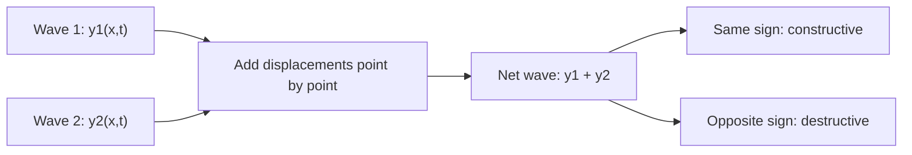
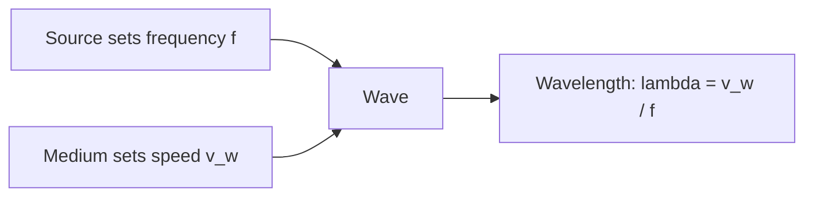

# Concept-Book Run

domain: /home/papagame/projects/digital-duck/cb-college-physics/public/domains/college_physics_ch16/input/graph.yaml
target: earthquake_wave_detection
started: 2026-11-23T23:30:05

## Teaching order (11 concepts)

- displacement
- energy
- wave
- periodic_motion
- frequency
- wavelength
- longitudinal_wave
- superposition
- transverse_wave
- wave_velocity
- earthquake_wave_detection

### displacement (1.0s)

## Displacement

Displacement is the vector quantity describing the change in an object's position, defined as $\Delta x = x_f - x_i$, where $x_i$ is the initial position and $x_f$ is the final position. Because displacement is a vector, it carries both magnitude (how far) and direction (which way), and it depends only on the starting and ending points — not on the path taken to get there. This distinguishes displacement from distance, the total length of the path traveled, regardless of direction. In one dimension, a positive or negative sign encodes direction (e.g., $+x$ for rightward, $-x$ for leftward); in two or three dimensions, displacement is expressed as an ordered pair of components, $\Delta x$ and $\Delta y$ along perpendicular axes.

**Worked example.** A runner starts at $x_i = 2\text{ m}$, jogs to $x = 10\text{ m}$, then turns back to $x_f = 6\text{ m}$. The distance traveled is $8\text{ m} + 4\text{ m} = 12\text{ m}$, but the displacement is $\Delta x = 6 - 2 = 4\text{ m}$ in the positive direction — much smaller than the distance because the return trip partially cancels the outward trip.

**Problem-solving application.** Displacement problems typically require tracking direction carefully through multiple stages of motion, then combining components rather than magnitudes. For a 2D case, suppose a hiker walks $3\text{ km}$ east then $4\text{ km}$ north. Using the Pythagorean theorem, the net displacement magnitude is $|\vec{\Delta x}| = \sqrt{3^2 + 4^2} = 5\text{ km}$, directed at $\theta = \tan^{-1}(4/3) \approx 53.1^\circ$ north of east — even though the hiker walked $7\text{ km}$ total. Resolving motion into perpendicular components, combining each axis separately, then recombining the result is the standard method for any multi-leg displacement problem, and the same approach will apply directly to velocity and acceleration vectors later in kinematics.

*Displacement is the straight-line vector from start to end, while distance follows the actual curved path traveled.*

### energy (23.1s)

## Energy

**Energy** is the capacity of a system to do work. Work is done when a force $F$ moves an object through a displacement $d$ along the force's direction: $W = Fd\cos\theta$. Energy and work share the SI unit, the joule ($1\ \text{J} = 1\ \text{N·m}$).

**Kinetic energy** is energy of motion:
$$K = \tfrac{1}{2}mv^2$$

**Gravitational potential energy** is energy stored by position in a gravitational field (near Earth's surface):
$$U_g = mgh$$

Other forms, such as thermal, chemical, electrical, and nuclear energy, can be understood as microscopic kinetic and potential energy.

### Conservation of energy

Energy is never created or destroyed. It is only transferred or converted. If only conservative forces (such as gravity) act, the total mechanical energy is constant:
$$K_i + U_i = K_f + U_f$$

With non-conservative forces such as friction, the work–energy relation applies:
$$K_i + U_i + W_{\text{nc}} = K_f + U_f$$
Here $W_{\text{nc}}$ is the work done by non-conservative forces. Friction makes it negative, and the "lost" mechanical energy becomes thermal energy.

### Worked example

A 2.0 kg ball is dropped from rest at a height of 20 m. How fast is it moving just before it hits the ground? Ignore air resistance.

Take the ground as $h = 0$. At the start, $K_i = 0$ and $U_i = mgh = (2.0)(9.8)(20) = 392\ \text{J}$. Just before impact, $U_f = 0$, so:
$$392 = \tfrac{1}{2}(2.0)v^2 \Rightarrow v = \sqrt{392} \approx 19.8\ \text{m/s}$$

The mass cancels in general ($v = \sqrt{2gh}$), so any dropped object reaches the same speed.

### Problem-solving application

A 0.50 kg block slides from rest down a frictionless ramp 3.0 m high. At the bottom it crosses a rough horizontal surface and stops after 6.0 m. Find the coefficient of kinetic friction $\mu_k$.

**Strategy:** Treat the whole motion as one system, from the top (at rest) to the final stop (at rest). Then $K_i = K_f = 0$ and $U_f = 0$, so:
$$U_i + W_{\text{nc}} = 0$$

Friction does work $W_{\text{nc}} = -\mu_k mg\,d$ over the distance $d = 6.0$ m. Then:
$$mgh = \mu_k mg\,d \Rightarrow \mu_k = \frac{h}{d} = \frac{3.0}{6.0} = 0.50$$

Check: the mass cancels again, and $\mu_k$ is dimensionless, as it should be.

**General method:**
1. Choose a system and define the initial and final states.
2. Set a reference height where $U = 0$.
3. List the energy terms at each state. Include non-conservative work if friction or drag is present.
4. Apply energy conservation and solve.

Energy methods avoid tracking forces and time. They only need the beginning and end states. This often makes them much simpler than Newton's second law for problems involving curved paths or changing forces.

*Energy is converted from potential to kinetic, then dissipated as thermal energy by friction. The total remains constant.*

### wave (21.6s)

## Wave

A **wave** is a disturbance that propagates through space (usually through a medium), transferring energy and information without any net transport of matter. A ripple on a pond moves outward, but a floating leaf only bobs up and down. In a **transverse** wave the medium oscillates perpendicular to the direction of travel (string waves). In a **longitudinal** wave it oscillates parallel to it (sound).

A periodic sinusoidal wave traveling in the $+x$ direction is described by

$$y(x,t) = A\sin(kx - \omega t + \phi)$$

where $A$ is the amplitude, $k = 2\pi/\lambda$ is the wave number ($\lambda$ = wavelength), $\omega = 2\pi f$ is the angular frequency, and $\phi$ is the phase constant. The period is $T = 1/f$. The wave pattern advances at the **wave speed**

$$v = \lambda f = \frac{\omega}{k}.$$

The speed depends on the medium, not on the source. For a string under tension $F_T$ with linear mass density $\mu$, $v = \sqrt{F_T/\mu}$. In general, any function $y = g(x - vt)$ solves the **wave equation**

$$\frac{\partial^2 y}{\partial t^2} = v^2 \frac{\partial^2 y}{\partial x^2}.$$

### Worked example

A wave on a string is given by $y(x,t) = 0.020\sin(4.0x - 60t)$ in SI units. Find $\lambda$, $f$, $v$, and the maximum transverse speed of a string element.

- $k = 4.0\ \text{m}^{-1}$, so $\lambda = 2\pi/k \approx 1.57\ \text{m}$.
- $\omega = 60\ \text{rad/s}$, so $f = \omega/2\pi \approx 9.5\ \text{Hz}$.
- $v = \omega/k = 60/4.0 = 15\ \text{m/s}$.
- A string element moves according to $\partial y/\partial t = -A\omega\cos(kx-\omega t)$, so its maximum speed is $A\omega = 0.020 \times 60 = 1.2\ \text{m/s}$.

Notice that the wave moves at 15 m/s while the string itself moves at most 1.2 m/s, and only up and down. The energy travels, but the matter stays.

### Problem-solving application

A string with $\mu = 0.010\ \text{kg/m}$ is stretched with tension $F_T = 4.0\ \text{N}$. A student shakes one end at $f = 20\ \text{Hz}$. What wavelength results, and what happens if the tension is quadrupled?

1. Wave speed: $v = \sqrt{4.0/0.010} = 20\ \text{m/s}$.
2. Wavelength: $\lambda = v/f = 20/20 = 1.0\ \text{m}$.
3. With $F_T = 16\ \text{N}$, $v = 40\ \text{m/s}$. The frequency is fixed by the source, so $\lambda = 40/20 = 2.0\ \text{m}$.

The general strategy is to identify what the **source** fixes (frequency) and what the **medium** fixes (speed). Then use $v = \lambda f$ to find the remaining quantity. Quadrupling the tension only doubles the speed, because $v \propto \sqrt{F_T}$, so the wavelength doubles while the frequency stays the same. The same logic explains why a wave's wavelength changes when it moves from one string section into a heavier one, while its frequency does not.

### periodic_motion (30.7s)

## Periodic Motion

**Definition.** Motion is *periodic* if the system returns to the same state, meaning the same position and the same velocity, after a fixed time. The shortest such time is the **period** $T$, measured in seconds. Mathematically, a position function is periodic if

$$x(t+T)=x(t)\quad\text{for all } t.$$

Planets in orbit, rotating wheels, pendulums, and masses on springs are all periodic. The number of cycles per second is $1/T$, so a period of $0.25\ \text{s}$ means 4 cycles each second.

**A period you can compute.** For a mass $m$ on an ideal spring of stiffness $k$, the period is

$$T = 2\pi\sqrt{\frac{m}{k}}.$$

We use this result as a given. Its derivation is a separate topic. Two features matter here. The period depends on $m$ and $k$ only, so pulling the block farther does not change $T$. And $T$ grows as the square root of $m$.

**Worked example.** A $0.50\ \text{kg}$ block sits on a spring with $k = 200\ \text{N/m}$. Find the period, then find how many cycles occur in $10\ \text{s}$.

1. $T = 2\pi\sqrt{0.50/200} = 2\pi\sqrt{0.0025} = 2\pi(0.05)\approx 0.314\ \text{s}$.
2. Number of cycles $= 10/T \approx 31.8$.
3. Check the units: $\sqrt{\text{kg}/(\text{N/m})}=\sqrt{\text{kg}\cdot\text{m}/(\text{kg}\cdot\text{m/s}^2)}=\sqrt{\text{s}^2}=\text{s}$. ✓

Pulling the block $0.05\ \text{m}$ or $0.20\ \text{m}$ gives the same $T$. A larger pull only makes each cycle cover more distance.

**Problem-solving application.** Suppose you want a spring-mass timekeeper that completes one cycle per second, so $T=1.00\ \text{s}$, using the same $k=200\ \text{N/m}$ spring. What mass is needed?

Solve $T=2\pi\sqrt{m/k}$ for $m$:

$$m=\frac{kT^2}{4\pi^2}=\frac{(200)(1.00)^2}{4\pi^2}\approx 5.07\ \text{kg}.$$

Now suppose the mass drifts $1\%$ heavy. Since $T\propto\sqrt{m}$, the period grows by about $0.5\%$. Each cycle then takes slightly longer than the clock assumes, so over one day ($86{,}400\ \text{s}$) the clock falls behind by about

$$0.005\times 86{,}400\approx 432\ \text{s}\approx 7.2\ \text{min}.$$

A small change in a parameter produces a small, predictable change in the period. This is why periodic systems make good timekeepers.

**Strategy summary.**
- Confirm that the motion repeats, then identify its period $T$.
- Find $T$ from the system's parameters, or measure it by timing many cycles and dividing by the count.
- Use proportionality such as $T\propto\sqrt{m}$ to estimate how small parameter changes shift the period.
- Check units to catch algebra errors.

### frequency (1.0s)

## Frequency

The **frequency** of a value in a data set is the number of times that value occurs. If a data set records the number of siblings for 20 students, and the value 2 appears 6 times, then the frequency of "2 siblings" is 6. Frequencies are typically organized into a **frequency table**, which lists each distinct value alongside its count, and often a **relative frequency** — the frequency divided by the total number of observations, expressed as a proportion or percentage.

**Worked example.** Suppose a teacher records the number of pets owned by 15 students:

$$1, 2, 0, 1, 3, 2, 1, 1, 0, 2, 2, 1, 4, 1, 2$$

Tallying each value gives the frequency table:

| Number of pets | Frequency | Relative frequency |
|---|---|---|
| 0 | 2 | $2/15 \approx 0.133$ |
| 1 | 6 | $6/15 = 0.400$ |
| 2 | 5 | $5/15 \approx 0.333$ |
| 3 | 1 | $1/15 \approx 0.067$ |
| 4 | 1 | $1/15 \approx 0.067$ |

The relative frequencies sum to 1 (allowing for rounding), since every observation is accounted for exactly once. This table immediately reveals the shape of the data: owning 1 pet is the most common outcome (the **mode**), while owning 3 or 4 pets is rare.

**Problem-solving application.** Frequency tables are the foundation for nearly every downstream statistical tool: histograms are built by plotting frequency against value, probability estimates from empirical data use relative frequency as a stand-in for probability, and measures like the mode are defined directly in terms of frequency. When solving a problem that asks "how often," "how many," or "what proportion," the first step is almost always to construct or consult a frequency table before computing anything else. For instance, to estimate the probability that a randomly selected student from this class owns at least 2 pets, sum the frequencies for 2, 3, and 4 pets ($5 + 1 + 1 = 7$) and divide by the total ($15$), giving an estimated probability of $7/15 \approx 0.467$. This illustrates the general principle: frequency counts convert raw, unordered data into a structured summary that supports both description (what does the data look like?) and inference (what can we predict from it?).

### wavelength (13.8s)

## Wavelength

**Definition.** The wavelength $\lambda$ of a periodic wave is the distance between adjacent identical points on the wave, such as crest to crest, trough to trough, or compression to compression. It is measured parallel to the direction of propagation and is expressed in meters (or nanometers, for light). Wavelength is tied to the wave's frequency $f$ and speed $v$ by

$$v = f\lambda$$

This relation follows from the definition. In one period $T = 1/f$, the wave pattern advances exactly one wavelength, so $v = \lambda/T = \lambda f$.

**What sets $\lambda$.** The source fixes the frequency, and the medium fixes the speed. Wavelength is whatever is left over: $\lambda = v/f$. When a wave enters a new medium, $f$ stays the same because the source is unchanged. The speed $v$ changes, so $\lambda$ changes in proportion.

**Worked example.** A middle-C tuning fork vibrates at $f = 262\ \text{Hz}$. Sound travels at $v = 343\ \text{m/s}$ in air at 20 °C. Find the wavelength in air, then in water, where $v = 1480\ \text{m/s}$.

In air:
$$\lambda_{\text{air}} = \frac{343\ \text{m/s}}{262\ \text{Hz}} \approx 1.31\ \text{m}$$

In water, the frequency is unchanged:
$$\lambda_{\text{water}} = \frac{1480\ \text{m/s}}{262\ \text{Hz}} \approx 5.65\ \text{m}$$

The wavelength is about 4.3 times longer in water, matching the ratio of the speeds ($1480/343 \approx 4.3$).

**Problem-solving application.** Wavelength determines how a wave interacts with its surroundings. Consider an FM radio station broadcasting at $f = 98.1\ \text{MHz}$. Electromagnetic waves in air travel at about $c = 3.00\times10^{8}\ \text{m/s}$, so

$$\lambda = \frac{c}{f} = \frac{3.00\times10^{8}}{98.1\times10^{6}} \approx 3.06\ \text{m}$$

An antenna works well when its length is a simple fraction of the wavelength. A quarter-wave antenna should therefore be about $\lambda/4 \approx 0.76\ \text{m}$ long. That is why car antennas are roughly this size.

A second use is diffraction. A wave bends noticeably around an opening or obstacle only when the size of the obstacle is comparable to or smaller than $\lambda$. The 1.31 m sound wave from the tuning fork spreads easily through a doorway about 1 m wide, so you can hear around corners. Visible light has $\lambda \sim 500\ \text{nm}$, far smaller than a doorway, so you cannot see around corners.

**Strategy for problems.**
1. Identify which quantity the source fixes ($f$) and which the medium fixes ($v$).
2. Apply $\lambda = v/f$, and convert prefixes (MHz $\to 10^6$ Hz, nm $\to 10^{-9}$ m) before computing.
3. When the medium changes, hold $f$ constant and scale $\lambda$ with $v$.
4. Compare $\lambda$ with the size of any opening, obstacle, or antenna to predict its behavior.

**Check your understanding.** A 440 Hz note travels from air into helium, where $v \approx 970\ \text{m/s}$. What is the new wavelength? (Answer: $970/440 \approx 2.20\ \text{m}$, compared with $343/440 \approx 0.78\ \text{m}$ in air.)

### longitudinal_wave (13.7s)

## Longitudinal Wave

A **longitudinal wave** is a wave in which particles of the medium oscillate *parallel* to the direction the wave travels. The disturbance appears as alternating regions of **compression** (particles crowded, high pressure) and **rarefaction** (particles spread out, low pressure). Sound in air is the standard example. Compare this with a transverse wave, where the motion is perpendicular to propagation.

For a harmonic longitudinal wave moving in the $+x$ direction, the displacement of a particle from equilibrium is

$$s(x,t) = s_{\max}\cos(kx - \omega t),$$

where $k = 2\pi/\lambda$ is the wave number and $\omega = 2\pi f$ is the angular frequency. The wave speed is $v = f\lambda = \omega/k$. Pressure variation is a quarter-cycle out of phase with displacement:

$$\Delta p(x,t) = -B\,\frac{\partial s}{\partial x} = B k s_{\max}\sin(kx - \omega t),$$

where $B$ is the bulk modulus. The speed depends on the medium:

$$v = \sqrt{\frac{B}{\rho}} \quad\text{(fluids)}, \qquad v = \sqrt{\frac{Y}{\rho}} \quad\text{(thin solid rods, Young's modulus } Y).$$

Pressure is maximal where displacement is zero, because that is where neighboring particles are being squeezed together most strongly.

*A longitudinal pulse: the pattern advances while each particle only oscillates about its equilibrium position.*

### Worked example

A speaker emits a 440 Hz tone in air at 20 °C, where $v = 343\ \text{m/s}$. Find the wavelength and the distance between a compression and the nearest rarefaction.

$$\lambda = \frac{v}{f} = \frac{343}{440} \approx 0.78\ \text{m}.$$

A compression and the adjacent rarefaction are half a wavelength apart: $\lambda/2 \approx 0.39\ \text{m}$.

### Problem-solving application

**Problem.** Sound travels through water ($B = 2.2\times10^9\ \text{Pa}$, $\rho = 1000\ \text{kg/m}^3$). A sonar pulse is sent to the seafloor and its echo returns after 0.80 s. How deep is the water?

**Step 1: Speed.**
$$v = \sqrt{\frac{2.2\times10^9}{1000}} \approx 1.5\times10^3\ \text{m/s}.$$

**Step 2: Path length.** The pulse travels down and back, so the total distance is $vt = (1.5\times10^3)(0.80) = 1.2\times10^3$ m.

**Step 3: Depth.** Divide by 2:
$$d = \frac{vt}{2} \approx 600\ \text{m}.$$

**Check.** The speed in water (~1500 m/s) is about 4 times that in air. This is reasonable, since water's much larger $B$ outweighs its larger density $\rho$.

**Key takeaways.** Identify the wave as longitudinal when particle motion is along the travel direction. Use $v = f\lambda$ for kinematics and $v=\sqrt{\text{stiffness}/\text{density}}$ for the medium. Remember that echo problems involve a round trip.

### superposition (13.2s)

## Superposition

**Definition.** Superposition is the principle that when two or more waves occupy the same point in a linear medium, the net disturbance is the sum of the individual disturbances at that point:

$$y_{\text{net}}(x,t) = y_1(x,t) + y_2(x,t) + \cdots + y_n(x,t)$$

The waves do not alter one another. Each continues as if the others were absent, and after passing through the overlap region each emerges unchanged. The principle holds when the medium responds linearly, meaning the restoring force is proportional to displacement. Small-amplitude sound, light in vacuum, and waves on a string all satisfy this. Very large amplitudes, such as shock waves, do not.

**Worked example.** Two pulses travel toward each other along a string. Pulse A has a peak height of $+3\ \text{cm}$ and pulse B has a peak height of $+2\ \text{cm}$. When the peaks coincide, the string's displacement is

$$y_{\text{net}} = 3 + 2 = 5\ \text{cm}$$

This is *constructive interference*. If B were inverted ($-2\ \text{cm}$), the peaks would give $3 + (-2) = 1\ \text{cm}$, which is *destructive interference*. In both cases the pulses separate afterward with their original shapes.

*Superposition adds waves point by point. The sign of the two disturbances decides whether the result is larger or smaller.*

**Problem-solving application.** Two sinusoidal waves of equal amplitude $A$ and frequency, differing only by a phase $\phi$, are

$$y_1 = A\sin(kx - \omega t), \qquad y_2 = A\sin(kx - \omega t + \phi)$$

Apply the identity $\sin a + \sin b = 2\sin\!\left(\tfrac{a+b}{2}\right)\cos\!\left(\tfrac{a-b}{2}\right)$:

$$y_{\text{net}} = 2A\cos\!\left(\frac{\phi}{2}\right)\sin\!\left(kx - \omega t + \frac{\phi}{2}\right)$$

The result is a wave of the same frequency with amplitude $2A\cos(\phi/2)$.

- If $\phi = 0$, the amplitude is $2A$ (fully constructive).
- If $\phi = \pi$, the amplitude is $0$ (fully destructive).
- If $\phi = \pi/2$, the amplitude is $2A\cos(\pi/4) = \sqrt{2}\,A$.

Intensity is proportional to amplitude squared, so for $\phi = 0$ the intensity is four times that of one wave, not two. This is the key to many interference problems.

*Check yourself:* two speakers emit the same tone in phase, and you stand $\lambda/2$ farther from one than the other. The path difference $\Delta r = \lambda/2$ gives a phase difference $\phi = 2\pi\,\Delta r/\lambda = \pi$. The amplitude is $2A\cos(\pi/2) = 0$, so you hear silence. Noise-cancelling headphones use this effect. They generate a wave that is the inverse of the ambient noise so that the sum is close to zero.

**Why it matters.** Superposition also underlies Fourier analysis. Any complicated periodic wave can be written as a sum of sinusoids, so you can analyze each sinusoid separately and add the results.

### transverse_wave (23.2s)

## Transverse Wave

A **transverse wave** is a wave in which the disturbance of the medium is perpendicular to the direction in which the wave travels. Examples include a pulse on a stretched string, electromagnetic waves, and S-waves in earthquakes. Mechanical transverse waves need a medium that resists shear, which is why they travel in solids but not in the bulk of a fluid.

For a sinusoidal wave moving in the $+x$ direction, the displacement $y$ at position $x$ and time $t$ is

$$y(x,t) = A\sin(kx - \omega t),$$

where $A$ is the amplitude, $k = 2\pi/\lambda$ is the wave number, and $\omega = 2\pi f$ is the angular frequency. The wave speed is

$$v = \lambda f = \frac{\omega}{k}.$$

On a string under tension $F_T$ with linear mass density $\mu$, the speed is

$$v = \sqrt{\frac{F_T}{\mu}}.$$

Each particle moves only up and down. The wave speed $v$ describes how fast the pattern travels along $x$, not how fast any piece of string moves.

### Worked example

A string has $\mu = 0.025\ \text{kg/m}$ and tension $F_T = 40\ \text{N}$. A source at one end oscillates at $f = 20\ \text{Hz}$. Find the wave speed, wavelength, and angular frequency.

1. Wave speed: $v = \sqrt{40/0.025} = \sqrt{1600} = 40\ \text{m/s}$.
2. Wavelength: $\lambda = v/f = 40/20 = 2.0\ \text{m}$.
3. Angular frequency: $\omega = 2\pi(20) \approx 125.7\ \text{rad/s}$.
4. Check: $k = 2\pi/\lambda \approx 3.14\ \text{rad/m}$, and $\omega/k \approx 40\ \text{m/s}$, matching step 1.

The pattern moves along the string at 40 m/s, while each piece of string only oscillates vertically.

### Problem-solving application

**Problem.** The tension in the string above is quadrupled to 160 N, and the source frequency stays at 20 Hz. What happens to the wavelength?

**Solution.** The frequency is set by the source, so it does not change. The speed becomes $v' = \sqrt{160/0.025} = 80\ \text{m/s}$, which is twice the old value. Then

$$\lambda' = \frac{v'}{f} = \frac{80}{20} = 4.0\ \text{m}.$$

Quadrupling the tension doubles the speed and doubles the wavelength.

**Strategy for these problems:**

- Identify what the source fixes (frequency) and what the medium fixes (speed).
- Compute $v$ from the medium's properties, then use $v = \lambda f$.
- For a wave written as $y = A\sin(kx-\omega t)$, read $k$ and $\omega$ from the coefficients and use $v=\omega/k$ as a check.

**Check yourself.** A wave is described by $y = 0.02\sin(3\pi x - 60\pi t)$ in SI units. Find $v$ and $\lambda$.

*Answer:* $k = 3\pi$ and $\omega = 60\pi$, so $v = \omega/k = 20\ \text{m/s}$ and $\lambda = 2\pi/k \approx 0.67\ \text{m}$.

*A transverse wave: the source and medium particles oscillate perpendicular to the direction in which the pattern and energy travel.*

### wave_velocity (13.6s)

## Wave Velocity

**Definition.** Wave velocity (or wave speed) $v_w$ is the rate at which a wave disturbance, such as a crest, propagates through a medium. It is not the speed of the individual particles, which oscillate about fixed positions. In one period $T$, a crest advances exactly one wavelength $\lambda$, so

$$v_w = \frac{\lambda}{T} = f\lambda,$$

where $f = 1/T$ is the frequency in hertz. This relation holds for every periodic wave: sound, light, water, and waves on a string.

**What determines $v_w$?** The medium sets the speed, and the source sets the frequency. When a wave passes from one medium to another, $f$ stays the same because the source is unchanged, but $v_w$ and $\lambda$ change together. For a stretched string with tension $F_T$ and linear mass density $\mu$,

$$v_w = \sqrt{\frac{F_T}{\mu}}.$$

Greater tension raises the speed, and a heavier string lowers it. For sound in air, $v_w \approx 331 + 0.6\,T_C$ m/s, where $T_C$ is the temperature in °C.

**Worked example.** A string vibrates at $f = 220\ \text{Hz}$, and the waves on it have wavelength $\lambda = 1.50\ \text{m}$.

$$v_w = f\lambda = (220\ \text{Hz})(1.50\ \text{m}) = 330\ \text{m/s}.$$

Check by period: $T = 1/220 \approx 4.55\ \text{ms}$, and $\lambda/T = 1.50/0.00455 \approx 330$ m/s. ✓

**Problem-solving application.** A speaker emits a 440 Hz tone. Find the wavelength in air at 20 °C, then in water, where $v_w \approx 1480$ m/s.

*Step 1: Air.* $v_w = 331 + 0.6(20) = 343$ m/s, so

$$\lambda_{\text{air}} = \frac{v_w}{f} = \frac{343}{440} \approx 0.780\ \text{m}.$$

*Step 2: Water.* The frequency is unchanged at 440 Hz, so

$$\lambda_{\text{water}} = \frac{1480}{440} \approx 3.36\ \text{m}.$$

The wavelength is about 4.3 times longer in water because the wave travels about 4.3 times faster there. This is the general pattern: with $f$ fixed, $\lambda \propto v_w$.

**Strategy for problems.**
1. Identify which quantity the source fixes ($f$) and which the medium fixes ($v_w$).
2. Use $v_w = f\lambda$, solving for the unknown.
3. For a boundary crossing, keep $f$ constant and recompute $\lambda$ from the new $v_w$.
4. Check units: Hz × m = m/s.

**Another case.** Doubling the tension on a string multiplies $v_w$ by $\sqrt{2} \approx 1.41$. If the string is still driven at the same $f$, then $\lambda$ also grows by $\sqrt{2}$. This is why tightening a guitar string changes its pitch. In that case the string's allowed standing-wave wavelengths stay fixed, so the speed change shifts the frequency instead.

*The source fixes the frequency and the medium fixes the speed. The wavelength follows from both.*

### earthquake_wave_detection (15.3s)

## Earthquake Wave Detection

### Definition

An earthquake releases energy as seismic waves. Two body waves matter most for locating the source:

- **P-waves** (primary) are compressional and travel fastest, typically $v_P \approx 6\ \text{km/s}$ in the crust.
- **S-waves** (secondary) are shear waves and travel more slowly, typically $v_S \approx 3.5\ \text{km/s}$.

The point underground where rupture begins is the **focus** (hypocenter). The point on the surface directly above it is the **epicenter**. A seismometer records both arrivals. The delay between them, the **S–P interval** $\Delta t = t_S - t_P$, grows with distance $d$ from the source:

$$
\Delta t = \frac{d}{v_S} - \frac{d}{v_P} \quad\Longrightarrow\quad d = \Delta t\,\frac{v_P v_S}{v_P - v_S}.
$$

This works because both waves leave the source at the same instant. The origin time is not needed, only the gap between arrivals.

### Worked example

A station records the P-wave at 10:00:12 and the S-wave at 10:00:30. Take $v_P = 6.0$ km/s and $v_S = 3.5$ km/s.

$$
\Delta t = 18\ \text{s}, \qquad d = 18\cdot\frac{6.0\times 3.5}{6.0-3.5} = 18\cdot 8.4 \approx 151\ \text{km}.
$$

The earthquake lies 151 km from this station, but the direction is unknown. The epicenter could be anywhere on a circle of that radius.

### Problem-solving application: triangulation

One station gives a circle. Two give two intersection points. A **third** station picks out one point, which is the epicenter. (Strictly this is trilateration, since it uses distances rather than angles.)

Suppose stations are at $A=(0,0)$, $B=(200,0)$ and $C=(0,200)$ km, with computed distances $d_A=100$, $d_B=141$ and $d_C=224$ km. Each station gives a circle equation $(x-x_i)^2+(y-y_i)^2=d_i^2$. Subtracting the equation for $A$ from the one for $B$ cancels the quadratic terms:

$$
-400x + 40000 = d_B^2 - d_A^2 = 19881 - 10000 \;\Rightarrow\; x \approx 75.3\ \text{km}.
$$

Subtracting $A$ from $C$ in the same way gives $-400y + 40000 = 50176 - 10000$, so $y \approx -0.4 \approx 0$ km. The epicenter is near $(75, 0)$ km. Check against $A$: $\sqrt{75^2+0^2}=75$ km, not 100 km. The three circles do not quite meet at one point, because the distances were rounded and the real crust is not uniform. In practice, analysts find the point that minimizes the total mismatch, such as a least-squares fit, and report an uncertainty region.

### Interference and structure

Waves reflect and refract at boundaries between rock layers. Where waves overlap, they interfere, and the combined signal is the superposition $u = u_1 + u_2$. Reflected arrivals appear as extra pulses after the direct P-wave. Their timing gives layer depths. A sudden jump in wave speed at the **Mohorovičić discontinuity** (about 30–50 km deep under continents) was found this way. S-waves cannot travel through liquid, so their absence on the far side of Earth showed that the outer core is liquid.

### Check your understanding

1. If $\Delta t = 40$ s, what is $d$? (Answer: about 336 km.)
2. Why can't one station find the epicenter?

## Run complete

total: 195.3s
