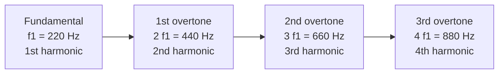

# Concept-Book Run

domain: /home/papagame/projects/digital-duck/cb-college-physics/public/domains/college_physics_ch17/input/graph.yaml
target: musical_instrument_resonance
started: 2026-11-23T23:33:21

## Teaching order (17 concepts)

- pressure
- simple_harmonic_motion
- wave
- sound
- amplitude
- interference
- wavelength
- frequency
- standing_wave
- density
- fundamental_frequency
- temperature
- overtones_and_harmonics
- speed_of_sound
- resonance_closed_tube
- resonance_open_tube
- musical_instrument_resonance

### pressure (0.8s)

## Pressure

**Pressure** is the force per unit area acting perpendicular to a surface:

$$P = \frac{F_\perp}{A}$$

The SI unit is the pascal: $1\ \text{Pa} = 1\ \text{N/m}^2$. Pressure is a scalar. It has no direction of its own, but the force it produces on a surface always acts perpendicular to that surface. Only the component of force perpendicular to the surface counts.

Pressure measures how concentrated a force is, which is why the same force can do very different things. A person pressing a thumbtack pushes with the same force on both ends. The point has a tiny area, so the pressure there is enormous.

### Worked example

A 60 kg person stands on one foot, and the contact area is $A = 0.020\ \text{m}^2$. Find the pressure on the floor.

The force is the person's weight:

$$F = mg = (60)(9.8) = 588\ \text{N}$$

$$P = \frac{588\ \text{N}}{0.020\ \text{m}^2} \approx 2.9\times10^{4}\ \text{Pa}$$

Now suppose the same person wears a stiletto heel with contact area $A = 1.0\times10^{-4}\ \text{m}^2$, and all the weight rests on that heel:

$$P = \frac{588}{1.0\times10^{-4}} = 5.9\times10^{6}\ \text{Pa}$$

The pressure is about 200 times larger, because the area is 200 times smaller. This is why stiletto heels dent wooden floors that bare feet don't mark.

### Problem-solving application

**Problem.** A pressure of $1.96\times10^{5}\ \text{Pa}$ acts on a circular viewing window of radius $0.05\ \text{m}$ on a diver's equipment. Find the force on the window.

**Step 1: Area.** Use consistent SI units.

$$A = \pi r^2 = \pi(0.05)^2 = 7.85\times10^{-3}\ \text{m}^2$$

**Step 2: Force.** Rearrange the definition to $F = PA$:

$$F = (1.96\times10^{5})(7.85\times10^{-3}) \approx 1.5\times10^{3}\ \text{N}$$

This is about 1500 N, roughly the weight of a 160 kg mass, pressing on a window the size of a small coaster. A strategy that works for most pressure problems:

1. Identify the force and the surface it acts on. Use only the component perpendicular to the surface.
2. Find the area in $\text{m}^2$. Convert from $\text{cm}^2$ by multiplying by $10^{-4}$.
3. Use $P = F/A$ to find pressure, or $F = PA$ to find force.
4. Check units: $\text{N}/\text{m}^2$ gives pascals.

Note how the two forms connect. If the same 1500 N were spread over a window ten times larger in area, the pressure would drop to one tenth. Comparing two situations by their area ratio, as in the stiletto example, is often faster than computing each pressure separately.

### simple_harmonic_motion (26.3s)

## Simple Harmonic Motion

**Definition.** An object undergoes simple harmonic motion (SHM) when the net force on it is a restoring force proportional to its displacement from equilibrium and directed opposite to it:

$$F = -kx \quad\Longrightarrow\quad \frac{d^2x}{dt^2} = -\omega^2 x, \qquad \omega = \sqrt{\frac{k}{m}}$$

The general solution is

$$x(t) = A\cos(\omega t + \phi)$$

Here $A$ is the amplitude (maximum displacement), $\omega$ is the angular frequency (rad/s), and $\phi$ is the phase constant set by the initial conditions. The period is $T = 2\pi/\omega$. Differentiating gives the velocity and acceleration:

$$v(t) = -A\omega\sin(\omega t+\phi), \qquad a(t) = -A\omega^2\cos(\omega t+\phi) = -\omega^2 x$$

Velocity is largest, $v_{\max}=A\omega$, at equilibrium. Acceleration is largest, $a_{\max}=A\omega^2$, at the turning points. The period does not depend on amplitude.

**Worked example.** A $0.50\ \text{kg}$ block on a spring with $k = 200\ \text{N/m}$ is pulled $0.10\ \text{m}$ from equilibrium and released from rest. Find the period, maximum speed, and position at $t = 0.10\ \text{s}$.

1. $\omega = \sqrt{200/0.50} = 20\ \text{rad/s}$, so $T = 2\pi/20 \approx 0.314\ \text{s}$.
2. Released from rest at $x = +A$, so $\phi = 0$ and $A = 0.10\ \text{m}$. Then $v_{\max} = A\omega = 2.0\ \text{m/s}$.
3. $x(0.10) = 0.10\cos(20\cdot 0.10) = 0.10\cos(2) \approx -0.042\ \text{m}$. The block has already passed equilibrium. (Calculator in radian mode.)

**Problem-solving application.** A $0.25\ \text{kg}$ mass hangs from a spring and is set oscillating. A stopwatch shows 10 complete oscillations in $7.0\ \text{s}$. Find the spring constant $k$, and the maximum speed if the amplitude is $0.040\ \text{m}$.

*Step 1: find the period.* $T = 7.0/10 = 0.70\ \text{s}$.

*Step 2: find $\omega$.* $\omega = 2\pi/T = 2\pi/0.70 \approx 8.98\ \text{rad/s}$.

*Step 3: solve $\omega=\sqrt{k/m}$ for $k$.*

$$k = m\omega^2 = (0.25)(8.98)^2 \approx 20\ \text{N/m}$$

*Step 4: maximum speed.* $v_{\max} = A\omega = (0.040)(8.98) \approx 0.36\ \text{m/s}$.

Timing the oscillations lets you find a spring's stiffness without ever stretching it by a known force.

**Strategy for any SHM problem:**

1. Identify the restoring force and write it as $F=-(\text{const})\times(\text{displacement})$. The constant gives $\omega^2 = \text{const}/m$.
2. Use the initial conditions to find $A$ and $\phi$.
3. Use the $x$, $v$, $a$ formulas for any time-dependent question.
4. Check the validity limit. If the force is not proportional to displacement, the motion is not SHM and these formulas do not apply.

### wave (1.0s)

## Wave

A **wave** is a disturbance that propagates through space (usually through a medium), transferring energy and information without any net transport of matter. A ripple on a pond moves outward, but a floating leaf only bobs up and down. In a **transverse** wave the medium oscillates perpendicular to the direction of travel (string waves). In a **longitudinal** wave it oscillates parallel to it (sound).

A periodic sinusoidal wave traveling in the $+x$ direction is described by

$$y(x,t) = A\sin(kx - \omega t + \phi)$$

where $A$ is the amplitude, $k = 2\pi/\lambda$ is the wave number ($\lambda$ = wavelength), $\omega = 2\pi f$ is the angular frequency, and $\phi$ is the phase constant. The period is $T = 1/f$. The wave pattern advances at the **wave speed**

$$v = \lambda f = \frac{\omega}{k}.$$

The speed depends on the medium, not on the source. For a string under tension $F_T$ with linear mass density $\mu$, $v = \sqrt{F_T/\mu}$. In general, any function $y = g(x - vt)$ solves the **wave equation**

$$\frac{\partial^2 y}{\partial t^2} = v^2 \frac{\partial^2 y}{\partial x^2}.$$

### Worked example

A wave on a string is given by $y(x,t) = 0.020\sin(4.0x - 60t)$ in SI units. Find $\lambda$, $f$, $v$, and the maximum transverse speed of a string element.

- $k = 4.0\ \text{m}^{-1}$, so $\lambda = 2\pi/k \approx 1.57\ \text{m}$.
- $\omega = 60\ \text{rad/s}$, so $f = \omega/2\pi \approx 9.5\ \text{Hz}$.
- $v = \omega/k = 60/4.0 = 15\ \text{m/s}$.
- A string element moves according to $\partial y/\partial t = -A\omega\cos(kx-\omega t)$, so its maximum speed is $A\omega = 0.020 \times 60 = 1.2\ \text{m/s}$.

Notice that the wave moves at 15 m/s while the string itself moves at most 1.2 m/s, and only up and down. The energy travels, but the matter stays.

### Problem-solving application

A string with $\mu = 0.010\ \text{kg/m}$ is stretched with tension $F_T = 4.0\ \text{N}$. A student shakes one end at $f = 20\ \text{Hz}$. What wavelength results, and what happens if the tension is quadrupled?

1. Wave speed: $v = \sqrt{4.0/0.010} = 20\ \text{m/s}$.
2. Wavelength: $\lambda = v/f = 20/20 = 1.0\ \text{m}$.
3. With $F_T = 16\ \text{N}$, $v = 40\ \text{m/s}$. The frequency is fixed by the source, so $\lambda = 40/20 = 2.0\ \text{m}$.

The general strategy is to identify what the **source** fixes (frequency) and what the **medium** fixes (speed). Then use $v = \lambda f$ to find the remaining quantity. Quadrupling the tension only doubles the speed, because $v \propto \sqrt{F_T}$, so the wavelength doubles while the frequency stays the same. The same logic explains why a wave's wavelength changes when it moves from one string section into a heavier one, while its frequency does not.

### sound (22.2s)

## Sound

**Definition.** Sound is a disturbance of matter that travels outward from its source as a **longitudinal pressure wave**. The particles of the medium (air, water, steel) oscillate *back and forth along the direction the wave travels*, creating alternating regions of compression (high pressure) and rarefaction (low pressure). The medium itself is not carried along. Only the pattern of disturbance moves. Because sound needs matter to compress, it cannot travel through a vacuum.

A periodic sound wave is described by its frequency $f$ (Hz), wavelength $\lambda$, and speed $v$, which are related by

$$v = f\lambda.$$

The speed depends on the *medium*, not on the source. In air, a good approximation is

$$v \approx 331 + 0.6\,T \ \text{m/s},$$

with $T$ the air temperature in °C. Sound moves faster in denser, stiffer media: about $1480$ m/s in water and about $5000$ m/s in steel. Pitch is set by frequency.

**Worked example.** A tuning fork vibrates at $f = 440$ Hz in air at $20\,^\circ\text{C}$. Find the wavelength.

1. Speed: $v \approx 331 + 0.6(20) = 343$ m/s.
2. Wavelength: $\lambda = \dfrac{v}{f} = \dfrac{343}{440} \approx 0.78$ m.

Now move the same fork into water. The frequency stays $440$ Hz, because it is set by the source. The speed rises to $1480$ m/s, so $\lambda = 1480/440 \approx 3.4$ m. The wavelength grows to match the faster medium.

**Problem-solving application.** *Echo ranging.* A ship sends a sonar pulse straight down. The echo returns after $0.80$ s. How deep is the water?

The pulse travels down and back, so the total path is $2d$:

$$d = \frac{vt}{2} = \frac{(1480)(0.80)}{2} \approx 592\ \text{m}.$$

The key step is recognizing the round trip. Forgetting the factor of $2$ is the most common error.

*Temperature check.* On a cold day at $-10\,^\circ\text{C}$, a hiker shouts toward a cliff and hears the echo $2.0$ s later. How far away is the cliff?

1. Speed: $v \approx 331 + 0.6(-10) = 325$ m/s.
2. Round trip: $d = \dfrac{vt}{2} = \dfrac{(325)(2.0)}{2} = 325$ m.

Using $343$ m/s instead would overestimate the distance by about $18$ m, so the temperature correction matters.

**Strategy summary.**
- Identify the medium (and the temperature, for air) and find $v$ before anything else.
- Hold $f$ fixed when a wave crosses between media, and let $\lambda$ change.
- For echoes, use $d = vt/2$.

*A vibrating source creates alternating compressions and rarefactions. The pressure pattern, not the matter itself, travels to the listener.*

### amplitude (23.8s)

## Amplitude

**Definition.** The *amplitude* of a wave is the maximum displacement (or pressure variation) of the wave from its equilibrium value. For a sinusoidal wave, the displacement at position $x$ and time $t$ is

$$y(x,t) = A\sin(kx - \omega t + \phi),$$

where $A \ge 0$ is the amplitude, $k$ is the wave number, $\omega$ the angular frequency, and $\phi$ the phase constant. Because $|\sin| \le 1$, the wave oscillates between $+A$ and $-A$. Amplitude is *not* the peak-to-peak value, which is $2A$. Its units match the quantity that oscillates: meters for a string, pascals for a sound wave, volts per meter for an electromagnetic wave.

**Why it matters.** Amplitude sets a wave's energy and intensity. For a mechanical wave in a given medium, with frequency and speed fixed, the energy carried is proportional to $A^2$. Intensity (power per unit area) therefore scales as

$$I \propto A^2.$$

Doubling the amplitude quadruples the intensity.

**Worked example.** A sound wave in air has the pressure variation
$$\Delta p(t) = 0.40\sin(2\pi \cdot 440\, t)\ \text{Pa}.$$
Reading off the coefficient, the pressure amplitude is $A = 0.40$ Pa, the frequency is $440$ Hz, and the pressure swings between $-0.40$ and $+0.40$ Pa, a peak-to-peak range of $0.80$ Pa. Now suppose the speaker volume is raised so the amplitude becomes $1.20$ Pa. The amplitude ratio is $1.20/0.40 = 3$, so the intensity increases by a factor of $3^2 = 9$.

**Problem-solving application.** Because intensity scales as $A^2$, we can compare two waves directly from their amplitudes. For the speaker above, the intensity ratio is

$$\frac{I_2}{I_1} = \left(\frac{A_2}{A_1}\right)^2 = 3^2 = 9.$$

The same reasoning applies to energy. Suppose a second wave on a string has amplitude $0.05$ m, and a first wave on the same string (same frequency and speed) has amplitude $0.02$ m. The energy ratio is

$$\frac{E_2}{E_1} = \left(\frac{0.05}{0.02}\right)^2 = 2.5^2 = 6.25.$$

So the larger wave carries 6.25 times as much energy, even though its amplitude is only 2.5 times larger. To solve problems of this type:

1. Identify $A$ for each wave, reading it from the coefficient of the sine.
2. Form the ratio $A_2/A_1$.
3. Square the ratio to get the energy or intensity ratio.

If a problem gives peak-to-peak values instead, halve them first, or note that the factor of 2 cancels in the ratio.

**Common pitfalls.**
- Confusing amplitude with peak-to-peak value, which is $2A$.
- Forgetting the square when relating amplitude to energy or intensity. Doubling $A$ quadruples $E$ and $I$.
- Treating amplitude as a measure of pitch. For sound, pitch depends on frequency and loudness on amplitude. For light, color depends on frequency and brightness on amplitude.

**Check yourself.** A water wave's amplitude drops from $0.50$ m to $0.25$ m as it spreads out. By what factor does its energy per unit length change? Since $E\propto A^2$, the energy falls by a factor of $(0.25/0.50)^2 = 1/4$.

### interference (25.4s)

## Interference

**Interference** is the combination of two or more waves in the same region of space. By the principle of superposition, the net displacement at any point and time is the sum of the individual displacements:

$$y_{\text{net}}(x,t) = y_1(x,t) + y_2(x,t)$$

Consider two waves of the same frequency $f$ and amplitude $A$, with a phase difference $\phi$:

$$y_1 = A\sin(kx - \omega t), \qquad y_2 = A\sin(kx - \omega t + \phi)$$

Using $\sin a + \sin b = 2\sin\frac{a+b}{2}\cos\frac{a-b}{2}$, the sum is

$$y_{\text{net}} = 2A\cos\!\left(\frac{\phi}{2}\right)\sin\!\left(kx - \omega t + \frac{\phi}{2}\right)$$

The resulting wave has the same frequency, but its amplitude is $2A\left|\cos(\phi/2)\right|$. This gives two limiting cases:

- **Constructive interference:** $\phi = 2\pi n$ gives amplitude $2A$, the maximum.
- **Destructive interference:** $\phi = (2n+1)\pi$ gives amplitude $0$, so the waves cancel.

For two sources, phase difference comes from the path difference $\Delta L = |L_1 - L_2|$:

$$\phi = \frac{2\pi\,\Delta L}{\lambda}$$

So constructive interference occurs when $\Delta L = n\lambda$, and destructive interference occurs when $\Delta L = \left(n+\tfrac{1}{2}\right)\lambda$, for $n = 0, 1, 2, \dots$

| Condition | Path difference | Phase difference | Result |
|---|---|---|---|
| Constructive | $n\lambda$ | $2\pi n$ | Amplitude $2A$ |
| Destructive | $(n+\tfrac12)\lambda$ | $(2n+1)\pi$ | Amplitude $0$ |

### Worked example

Two speakers, driven in phase, emit a 440 Hz tone. Take the speed of sound as $v = 343\ \text{m/s}$. A listener stands 4.00 m from one speaker and 5.75 m from the other. Is the sound loud or quiet?

1. Wavelength: $\lambda = v/f = 343/440 = 0.780\ \text{m}$.
2. Path difference: $\Delta L = 5.75 - 4.00 = 1.75\ \text{m}$.
3. Ratio: $\Delta L/\lambda = 1.75/0.780 \approx 2.24$.

This is neither an integer (constructive) nor a half-integer (destructive). The phase difference is $\phi = 2\pi(2.24) \approx 0.24 \cdot 2\pi \approx 1.5\ \text{rad}$ (mod $2\pi$). The amplitude factor is $|\cos(\phi/2)| = \cos(0.75) \approx 0.73$. The listener hears sound at about 73% of the maximum amplitude. Because intensity scales as amplitude squared, the intensity is about $0.73^2 \approx 53\%$ of the maximum.

### Problem-solving application: timing error in cancellation

Noise-cancelling headphones rely on destructive interference: a speaker emits a copy of the noise shifted by $\phi = \pi$ (an inverted signal). Suppose the noise is a 200 Hz hum and the cancelling signal arrives late by a time $\tau$. The extra phase error is $\delta = 2\pi f\tau$. The inverted copy then differs from perfect cancellation by $\delta$, so the residual amplitude is

$$A_{\text{res}} = 2A\sin\!\left(\frac{\delta}{2}\right)$$

For $\tau = 1$ ms at 200 Hz: $\delta = 2\pi(200)(0.001) \approx 1.26$ rad, so $A_{\text{res}} = 2A\sin(0.63) \approx 1.18A$. This is larger than the original amplitude $A$, so the "cancellation" makes the noise worse.

Now try a smaller error, $\tau = 0.1$ ms: $\delta \approx 0.126$ rad, so $A_{\text{res}} \approx 2A(0.063) \approx 0.13A$. The noise drops by about 87%.

Because $\delta$ grows with $f$ for a fixed delay, these systems cancel best at low frequencies, where a small timing error causes only a small phase error.

### wavelength (1.0s)

## Wavelength

**Definition.** The wavelength $\lambda$ of a periodic wave is the distance between adjacent identical points on the wave, such as crest to crest, trough to trough, or compression to compression. It is measured parallel to the direction of propagation and is expressed in meters (or nanometers, for light). Wavelength is tied to the wave's frequency $f$ and speed $v$ by

$$v = f\lambda$$

This relation follows from the definition. In one period $T = 1/f$, the wave pattern advances exactly one wavelength, so $v = \lambda/T = \lambda f$.

**What sets $\lambda$.** The source fixes the frequency, and the medium fixes the speed. Wavelength is whatever is left over: $\lambda = v/f$. When a wave enters a new medium, $f$ stays the same because the source is unchanged. The speed $v$ changes, so $\lambda$ changes in proportion.

**Worked example.** A middle-C tuning fork vibrates at $f = 262\ \text{Hz}$. Sound travels at $v = 343\ \text{m/s}$ in air at 20 °C. Find the wavelength in air, then in water, where $v = 1480\ \text{m/s}$.

In air:
$$\lambda_{\text{air}} = \frac{343\ \text{m/s}}{262\ \text{Hz}} \approx 1.31\ \text{m}$$

In water, the frequency is unchanged:
$$\lambda_{\text{water}} = \frac{1480\ \text{m/s}}{262\ \text{Hz}} \approx 5.65\ \text{m}$$

The wavelength is about 4.3 times longer in water, matching the ratio of the speeds ($1480/343 \approx 4.3$).

**Problem-solving application.** Wavelength determines how a wave interacts with its surroundings. Consider an FM radio station broadcasting at $f = 98.1\ \text{MHz}$. Electromagnetic waves in air travel at about $c = 3.00\times10^{8}\ \text{m/s}$, so

$$\lambda = \frac{c}{f} = \frac{3.00\times10^{8}}{98.1\times10^{6}} \approx 3.06\ \text{m}$$

An antenna works well when its length is a simple fraction of the wavelength. A quarter-wave antenna should therefore be about $\lambda/4 \approx 0.76\ \text{m}$ long. That is why car antennas are roughly this size.

A second use is diffraction. A wave bends noticeably around an opening or obstacle only when the size of the obstacle is comparable to or smaller than $\lambda$. The 1.31 m sound wave from the tuning fork spreads easily through a doorway about 1 m wide, so you can hear around corners. Visible light has $\lambda \sim 500\ \text{nm}$, far smaller than a doorway, so you cannot see around corners.

**Strategy for problems.**
1. Identify which quantity the source fixes ($f$) and which the medium fixes ($v$).
2. Apply $\lambda = v/f$, and convert prefixes (MHz $\to 10^6$ Hz, nm $\to 10^{-9}$ m) before computing.
3. When the medium changes, hold $f$ constant and scale $\lambda$ with $v$.
4. Compare $\lambda$ with the size of any opening, obstacle, or antenna to predict its behavior.

**Check your understanding.** A 440 Hz note travels from air into helium, where $v \approx 970\ \text{m/s}$. What is the new wavelength? (Answer: $970/440 \approx 2.20\ \text{m}$, compared with $343/440 \approx 0.78\ \text{m}$ in air.)

### frequency (1.0s)

## Frequency

The **frequency** of a value in a data set is the number of times that value occurs. If a data set records the number of siblings for 20 students, and the value 2 appears 6 times, then the frequency of "2 siblings" is 6. Frequencies are typically organized into a **frequency table**, which lists each distinct value alongside its count, and often a **relative frequency** — the frequency divided by the total number of observations, expressed as a proportion or percentage.

**Worked example.** Suppose a teacher records the number of pets owned by 15 students:

$$1, 2, 0, 1, 3, 2, 1, 1, 0, 2, 2, 1, 4, 1, 2$$

Tallying each value gives the frequency table:

| Number of pets | Frequency | Relative frequency |
|---|---|---|
| 0 | 2 | $2/15 \approx 0.133$ |
| 1 | 6 | $6/15 = 0.400$ |
| 2 | 5 | $5/15 \approx 0.333$ |
| 3 | 1 | $1/15 \approx 0.067$ |
| 4 | 1 | $1/15 \approx 0.067$ |

The relative frequencies sum to 1 (allowing for rounding), since every observation is accounted for exactly once. This table immediately reveals the shape of the data: owning 1 pet is the most common outcome (the **mode**), while owning 3 or 4 pets is rare.

**Problem-solving application.** Frequency tables are the foundation for nearly every downstream statistical tool: histograms are built by plotting frequency against value, probability estimates from empirical data use relative frequency as a stand-in for probability, and measures like the mode are defined directly in terms of frequency. When solving a problem that asks "how often," "how many," or "what proportion," the first step is almost always to construct or consult a frequency table before computing anything else. For instance, to estimate the probability that a randomly selected student from this class owns at least 2 pets, sum the frequencies for 2, 3, and 4 pets ($5 + 1 + 1 = 7$) and divide by the total ($15$), giving an estimated probability of $7/15 \approx 0.467$. This illustrates the general principle: frequency counts convert raw, unordered data into a structured summary that supports both description (what does the data look like?) and inference (what can we predict from it?).

### standing_wave (23.2s)

## Standing Wave

### Definition

A **standing wave** is the pattern produced when two waves of equal frequency and amplitude travel in opposite directions through the same medium and superpose. The pattern does not travel. Certain points, called **nodes**, never move, while points midway between them, called **antinodes**, oscillate with maximum amplitude.

Take a right-moving wave $y_1 = A\sin(kx - \omega t)$ and a left-moving wave $y_2 = A\sin(kx + \omega t)$. Here $k = 2\pi/\lambda$ is the wave number and $\omega = 2\pi f$ is the angular frequency. By superposition and the identity $\sin a + \sin b = 2\sin\frac{a+b}{2}\cos\frac{a-b}{2}$:

$$y(x,t) = y_1 + y_2 = 2A\sin(kx)\cos(\omega t)$$

The position $x$ and the time $t$ appear in separate factors, so the pattern does not travel. Each point oscillates in place with its own amplitude $2A|\sin kx|$.

- Nodes occur where $\sin kx = 0$, so $x = \dfrac{n\lambda}{2}$ for $n = 0, 1, 2, \dots$
- Antinodes occur where $|\sin kx| = 1$, so $x = \dfrac{(2n+1)\lambda}{4}$.

Adjacent nodes are therefore separated by $\lambda/2$.

### Worked example

A string of length $L = 0.80\ \text{m}$ is fixed at both ends, and waves travel along it at $v = 120\ \text{m/s}$. Which frequencies produce standing waves?

Fixed ends force nodes at $x = 0$ and $x = L$. The condition $\sin kL = 0$ requires $kL = n\pi$, so

$$L = n\,\frac{\lambda}{2}, \qquad \lambda_n = \frac{2L}{n}, \qquad f_n = \frac{v}{\lambda_n} = \frac{n v}{2L}, \quad n = 1, 2, 3,\dots$$

The fundamental (lowest) frequency is $f_1 = \dfrac{120}{2(0.80)} = 75\ \text{Hz}$. The higher modes are $150, 225, 300,\dots$ Hz. Only these discrete frequencies fit, which is why a string produces definite musical pitches.

### Problem-solving application

**Problem.** A second string of length $0.60\ \text{m}$ is fixed at both ends and has wave speed $90\ \text{m/s}$. A standing wave on it has exactly 3 antinodes. Find its frequency and the positions of the nodes.

**Solution.** Three antinodes means $n = 3$, so three half-wavelengths fit in $L$:

$$\lambda_3 = \frac{2L}{3} = \frac{2(0.60)}{3} = 0.40\ \text{m}, \qquad f_3 = \frac{v}{\lambda_3} = \frac{90}{0.40} = 225\ \text{Hz}$$

Nodes are spaced $\lambda/2 = 0.20\ \text{m}$ apart, starting at the fixed end: $x = 0,\ 0.20,\ 0.40,\ 0.60\ \text{m}$. The antinodes lie midway between them, at $0.10,\ 0.30,\ 0.50\ \text{m}$.

**Strategy for any such problem:**
1. Place nodes at the fixed ends.
2. Fit $n$ half-wavelengths into $L$, so $\lambda = 2L/n$.
3. Convert wavelength to frequency with $f = v/\lambda$.
4. Locate nodes at multiples of $\lambda/2$ and antinodes midway between them.

Boundary conditions create the standing wave. The reflected wave interferes with the incident wave, and only wavelengths matching the boundaries survive.

### density (1.0s)

## Density

**Definition.** Density is the mass per unit volume of a substance:

$$\rho = \frac{m}{V}$$

Here $m$ is mass (kg or g) and $V$ is volume (m³ or cm³ or mL). Typical units are kg/m³ and g/cm³, where $1\ \text{g/cm}^3 = 1000\ \text{kg/m}^3$. Density is an *intensive* property. A gram of iron and a tonne of iron have the same density, because the mass and the volume grow together. This makes density useful for identifying materials.

Some reference values:

| Substance | $\rho$ (g/cm³) |
|---|---|
| Air (20 °C) | 0.0012 |
| Ethanol | 0.79 |
| Water (4 °C) | 1.00 |
| Aluminum | 2.70 |
| Iron | 7.87 |
| Gold | 19.3 |

The same relation can be rearranged to $m = \rho V$ and $V = m/\rho$. Use whichever form isolates your unknown.

**Worked example.** A metal block measures $2.0\ \text{cm} \times 3.0\ \text{cm} \times 5.0\ \text{cm}$ and has a mass of $81\ \text{g}$. What is it made of?

1. Compute the volume: $V = 2.0 \times 3.0 \times 5.0 = 30\ \text{cm}^3$.
2. Apply the definition: $\rho = \dfrac{81\ \text{g}}{30\ \text{cm}^3} = 2.7\ \text{g/cm}^3$.

This matches aluminum in the table. Identifying a material by density is only suggestive. Several alloys can share similar values, so treat the match as evidence, not proof.

**Problem-solving application.** Density lets you find a quantity you cannot measure directly.

*Irregular objects.* A small stone has mass $56\ \text{g}$. When it is lowered into a graduated cylinder, the water level rises from $40.0\ \text{mL}$ to $48.0\ \text{mL}$. Since $1\ \text{mL} = 1\ \text{cm}^3$, the displaced water gives the stone's volume, $V = 8.0\ \text{cm}^3$. Then
$$\rho = \frac{56}{8.0} = 7.0\ \text{g/cm}^3.$$

*Mass from size.* How much does a $2.0\ \text{m}^3$ tank of ethanol hold? Convert first: $0.79\ \text{g/cm}^3 = 790\ \text{kg/m}^3$. Then
$$m = \rho V = (790)(2.0) = 1580\ \text{kg}.$$

*Floating and sinking.* An object floats in a fluid if its average density is less than the fluid's density. Iron ($7.87\ \text{g/cm}^3$) sinks in water, yet a steel ship floats. Its hull encloses a large volume of air, so the ship's *average* density, total mass divided by total enclosed volume, is below $1.00\ \text{g/cm}^3$.

**Common pitfalls.**
- Mixing units, such as grams with $\text{m}^3$. Convert before dividing.
- Treating density as fixed. It changes with temperature and pressure, especially for gases. Water is densest near 4 °C.
- Using the object's total volume when it is hollow or porous. Then $m/V$ gives an average density, not the density of the material itself.

**Check your understanding.** A $0.50\ \text{kg}$ sample of an unknown liquid fills $625\ \text{mL}$. Is it ethanol? (Answer: $\rho = 500/625 = 0.80\ \text{g/cm}^3$, which is consistent with ethanol.)

### fundamental_frequency (25.7s)

## Fundamental Frequency

The **fundamental frequency** $f_1$ is the lowest frequency at which a vibrating string, fixed at both ends, sustains a standing wave. This section uses a string of length $L$ and wave speed $v$. We treat $v$ as a known value and assume you already know the relation $f = v/\lambda$.

**Why it exists.** A wave on the string reflects at the fixed ends, which cannot move. Only wavelengths that leave a motionless point at each end produce a standing wave. The longest wavelength that fits is one in which the string holds exactly half a wavelength:

$$\lambda_1 = 2L.$$

Substituting into $f = v/\lambda$ gives the fundamental frequency:

$$f_1 = \frac{v}{2L}.$$

Shorter wavelengths also fit, as long as the string holds a whole number of half-wavelengths, $\lambda_n = 2L/n$. This gives frequencies $f_n = n f_1$ for $n = 1, 2, 3, \dots$. The fundamental is the $n=1$ case, and it is usually what we hear as the pitch.

**Worked example.** A string has $L = 0.65\ \text{m}$, and waves travel along it at $v = 158\ \text{m/s}$. Find $f_1$ and the next two resonant frequencies.

1. Fundamental: $f_1 = \dfrac{158}{2(0.65)} \approx 122\ \text{Hz}$.
2. Second resonance: $f_2 = 2f_1 \approx 244\ \text{Hz}$.
3. Third resonance: $f_3 = 3f_1 \approx 366\ \text{Hz}$.

**Problem-solving application.** A string carries waves at $v = 200\ \text{m/s}$. What length $L$ makes the fundamental $f_1 = 250\ \text{Hz}$? Solve $f_1 = v/(2L)$ for $L$:

$$L = \frac{v}{2f_1} = \frac{200}{2(250)} = 0.40\ \text{m}.$$

Check by working backward: $\lambda_1 = 2L = 0.80\ \text{m}$, and $f_1 = v/\lambda_1 = 200/0.80 = 250\ \text{Hz}$. ✓

Now suppose a player presses a finger at the midpoint of this 0.40 m string, so only half of it vibrates. The new length is $L' = 0.20\ \text{m}$, so

$$f_1' = \frac{200}{2(0.20)} = 500\ \text{Hz}.$$

Halving the length doubles the fundamental, which raises the pitch by one octave. In general, $f_1$ is inversely proportional to $L$ when $v$ stays fixed. This is why shorter strings sound higher.

**Check your understanding.** A string of fixed wave speed has fundamental $f_1 = 180\ \text{Hz}$. What is the fundamental if its vibrating length is cut to one third? (Answer: $f_1$ is inversely proportional to $L$, so the new fundamental is $3 \times 180 = 540\ \text{Hz}$.)

### temperature (0.9s)

## Temperature

**Definition.** Temperature is the quantity a thermometer measures. Operationally, two objects have the same temperature if no net heat flows between them when they are placed in thermal contact (the zeroth law of thermodynamics). A thermometer exploits this. It reaches equilibrium with the object, and a physical property that varies with temperature, such as the length of a mercury column, then gives a reading.

Microscopically, temperature measures the average random translational kinetic energy of particles. For an ideal monatomic gas:

$$\langle K \rangle = \tfrac{3}{2} k_B T$$

where $k_B = 1.381\times10^{-23}\ \text{J/K}$ is Boltzmann's constant and $T$ is the absolute temperature in kelvin. The Kelvin scale starts at absolute zero, so $T_K = T_C + 273.15$. Use kelvin in any formula where $T$ appears directly.

Temperature is not the same as heat or total thermal energy. Temperature is an intensive quantity that does not depend on how much material you have. Heat is energy transferred because of a temperature difference.

**Worked example.** Find the average kinetic energy of a helium atom at room temperature, $27^\circ\text{C}$.

1. Convert to kelvin: $T = 27 + 273.15 \approx 300\ \text{K}$.
2. Apply the formula:

$$\langle K \rangle = \tfrac{3}{2}(1.381\times10^{-23})(300) \approx 6.2\times10^{-21}\ \text{J}$$

This is about $0.039\ \text{eV}$, tiny per atom, but a mole of atoms carries thousands of joules.

**Problem-solving application.** Because $\langle K \rangle = \tfrac12 m\langle v^2\rangle$, the formula also gives a typical particle speed. The root-mean-square speed is

$$v_{\text{rms}} = \sqrt{\frac{3k_BT}{m}}$$

*Problem:* Compare $v_{\text{rms}}$ for helium ($m = 6.64\times10^{-27}$ kg) and nitrogen ($m = 4.65\times10^{-26}$ kg) at 300 K.

Helium:

$$v_{\text{rms}} = \sqrt{\frac{3(1.381\times10^{-23})(300)}{6.64\times10^{-27}}} \approx 1.37\times10^{3}\ \text{m/s}$$

Nitrogen:

$$v_{\text{rms}} = \sqrt{\frac{3(1.381\times10^{-23})(300)}{4.65\times10^{-26}}} \approx 517\ \text{m/s}$$

At the same temperature the two gases have the same average kinetic energy, but the lighter helium atoms move about 2.6 times faster. Since $v_{\text{rms}}\propto\sqrt{1/m}$, the speed ratio is $\sqrt{28/4}\approx 2.6$, which matches. This is why helium escapes Earth's atmosphere far more readily than nitrogen.

**Check your understanding.** If the Kelvin temperature doubles, by what factor does $\langle K\rangle$ change, and by what factor does $v_{\text{rms}}$ change? (Answer: $\langle K\rangle$ doubles, and $v_{\text{rms}}$ increases by $\sqrt{2}$.) Note that doubling from $20^\circ\text{C}$ to $40^\circ\text{C}$ does *not* double the kinetic energy. You must convert to kelvin first, and $293\ \text{K}\to313\ \text{K}$ is only a 7% increase.

### overtones_and_harmonics (23.4s)

## Overtones And Harmonics

**Definition.** When a string or air column vibrates in a steady pattern, the lowest frequency at which it can do so is the **fundamental**, $f_1$. Any higher resonant frequency is an **overtone**. For an ideal string fixed at both ends, the resonant frequencies are whole-number multiples of the fundamental:

$$f_n = n f_1, \qquad n = 1, 2, 3, \dots$$

Each $f_n$ is called the $n$th **harmonic**. The fundamental is the 1st harmonic, and the $n$th harmonic is the $(n-1)$th overtone, so the 2nd harmonic is the 1st overtone. For a string of length $L$, tension $T$, and linear mass density $\mu$, the wavelength of harmonic $n$ is $\lambda_n = 2L/n$. The wave speed is $v=\sqrt{T/\mu}$, so

$$f_n = \frac{n}{2L}\sqrt{\frac{T}{\mu}}.$$

**Worked example.** A guitar string has length $L = 0.65\ \text{m}$ and wave speed $v = 286\ \text{m/s}$. Find the fundamental and the first three overtones.

$$f_1 = \frac{v}{2L} = \frac{286}{2(0.65)} = 220\ \text{Hz}$$

The first three overtones are the 2nd, 3rd, and 4th harmonics: $440$, $660$, and $880\ \text{Hz}$.

**Problem-solving application.** A string has a 3rd harmonic at $390\ \text{Hz}$. Find its fundamental and its 2nd overtone.

1. Use $f_n = n f_1$ with $n = 3$. Then $f_1 = 390/3 = 130\ \text{Hz}$.
2. The 2nd overtone is the 3rd harmonic, since overtone number is harmonic number minus one. So the 2nd overtone is $390\ \text{Hz}$.
3. Check by listing the series: $130, 260, 390, 520, \dots$ Hz. The 1st overtone is $260\ \text{Hz}$ and the 2nd overtone is $390\ \text{Hz}$, which matches.

A common error is to treat overtone $k$ as harmonic $k$. Overtone numbering lags harmonic numbering by one, because the fundamental is a harmonic but not an overtone.

*Harmonic series for a 220 Hz string, showing how overtone numbering lags harmonic numbering by one.*

### speed_of_sound (20.9s)

## Speed Of Sound

**Definition.** Sound is a longitudinal pressure wave: particles of the medium are compressed and stretched, and the disturbance passes from neighbor to neighbor. The **speed of sound** $v$ is how fast this disturbance travels. It depends only on the medium, not on the loudness or pitch of the sound. A stiffer medium restores displaced particles faster, and a denser medium responds more sluggishly, so

$$v = \sqrt{\frac{B}{\rho}}$$

where $B$ is the bulk modulus (the medium's resistance to compression) and $\rho$ is the density.

For an ideal gas, the adiabatic bulk modulus is $B=\gamma P$, and $P/\rho = RT/M$. This gives

$$v = \sqrt{\frac{\gamma R T}{M}}$$

where $\gamma$ is the heat-capacity ratio ($1.40$ for air), $R = 8.314\ \text{J/(mol·K)}$, $T$ is absolute temperature in kelvin, and $M$ is the molar mass in kg/mol. Gas speed depends on temperature, not on pressure, because pressure and density change together and cancel. A useful approximation for air is

$$v \approx 331 + 0.60\,T_C \ \text{m/s}$$

with $T_C$ in °C.

**Worked example.** Find $v$ in air at $20^\circ\text{C}$ ($T = 293$ K, $M = 0.0290$ kg/mol):

$$v = \sqrt{\frac{(1.40)(8.314)(293)}{0.0290}} \approx 343\ \text{m/s}$$

The linear approximation gives $331 + 0.60(20) = 343$ m/s, which agrees.

Now compare water, with $B = 2.2\times10^9$ Pa and $\rho = 1000$ kg/m³:

$$v = \sqrt{\frac{2.2\times10^9}{1000}} \approx 1.5\times10^3\ \text{m/s}$$

Water is about 4 times faster than air. Its much greater stiffness outweighs its higher density.

**Problem-solving application.** *A hiker shouts toward a cliff and hears the echo 3.0 s later on a $30^\circ\text{C}$ day. How far away is the cliff?*

1. Find the speed: $v \approx 331 + 0.60(30) = 349$ m/s.
2. The sound travels to the cliff and back, so the total path is $2d$:
$$d = \frac{vt}{2} = \frac{(349)(3.0)}{2} \approx 520\ \text{m}$$

Using $343$ m/s instead of $349$ m/s would give $515$ m, about $1\%$ too low. Temperature matters.

*Common pitfalls:* use kelvin inside the square-root formula; convert $M$ to kg/mol; and remember that the echo covers the distance twice.

**Check your understanding.** Helium has $\gamma = 1.67$ and $M = 0.00400$ kg/mol. At $293$ K, $v \approx 1000$ m/s. This is why a helium voice sounds higher. The vocal tract resonates at higher frequencies because $v$ is larger, and the vocal folds' pitch is unchanged.

### resonance_closed_tube (23.6s)

## Resonance Closed Tube

### Definition

A tube **closed at one end** and open at the other supports standing sound waves only if the boundary conditions are met:

- At the **closed end**, air cannot move, so there is a displacement **node**.
- At the **open end**, air moves freely, so there is a displacement **antinode**.

A node-to-antinode distance is a quarter wavelength. The tube length must therefore hold an odd number of quarter wavelengths:

$$L = n\frac{\lambda_n}{4}, \qquad n = 1, 3, 5, \dots$$

Using $v_w = f\lambda$, the resonant frequencies are

$$\boxed{f_n = \frac{n\,v_w}{4L}, \quad n = 1, 3, 5, \dots}$$

Here $v_w$ is the speed of sound. The lowest frequency, $f_1 = v_w/(4L)$, is the **fundamental**. Only **odd multiples** of $f_1$ appear. An even $n$ would put a node at the open end or an antinode at the closed end, which violates the boundary conditions.

*Each allowed mode fits an odd number of quarter wavelengths between the closed end (node) and the open end (antinode).*

### Worked example

A tube is $L = 0.50\ \text{m}$ long, closed at one end, with $v_w = 343\ \text{m/s}$ (air at about 20 °C). Find the first three resonant frequencies.

$$f_1 = \frac{343}{4(0.50)} = 171.5\ \text{Hz}$$

$$f_3 = 3f_1 = 514.5\ \text{Hz}, \qquad f_5 = 5f_1 = 857.5\ \text{Hz}$$

The corresponding wavelengths are $\lambda_1 = 4L = 2.00\ \text{m}$, $\lambda_3 = 0.667\ \text{m}$, and $\lambda_5 = 0.400\ \text{m}$.

### Problem-solving application

**Problem.** A tuning fork of frequency 440 Hz is held over a vertical tube whose water level can be lowered. What are the first two water-column lengths (air column above the water) that produce resonance? Use $v_w = 343\ \text{m/s}$.

**Strategy.** The water surface acts as the closed end, so $f = n v_w/(4L)$ with $n$ odd. Solve for $L$:

$$L_n = \frac{n\,v_w}{4f}$$

**Solution.**

$$L_1 = \frac{343}{4(440)} = 0.195\ \text{m}, \qquad L_3 = \frac{3(343)}{4(440)} = 0.585\ \text{m}$$

The spacing between successive resonances is $L_3 - L_1 = \lambda/2 = 0.390\ \text{m}$. This gives a practical way to measure sound speed: measure the spacing $\Delta L$ between resonances, then compute $v_w = 2f\,\Delta L$.

**Common mistake.** Do not use $n = 2, 4, \dots$ for a closed tube. If a calculation gives an even $n$, you have applied open-tube conditions by mistake. For comparison, an open tube of the same length has twice the fundamental frequency, $v_w/(2L)$.

### resonance_open_tube (24.5s)

## Resonance Open Tube

**Definition.** A tube open at both ends has a pressure *node* (displacement *antinode*) at each end, because the air there is free to move and stays at atmospheric pressure. A standing wave fits only if an integer number of half-wavelengths spans the tube:

$$L = n\frac{\lambda_n}{2}, \qquad n = 1, 2, 3, \dots$$

Using $v_w = f\lambda$ for the speed of sound, the resonant frequencies are

$$f_n = \frac{n\,v_w}{2L} = n f_1, \qquad f_1 = \frac{v_w}{2L}.$$

Every integer multiple of the fundamental $f_1$ is allowed, so an open tube produces *all* harmonics. This is why open pipes such as flutes and organ pipes sound bright and full.

**Worked example.** A flute-like tube is $L = 0.600\ \text{m}$ long and open at both ends. Air temperature is $20^\circ\text{C}$, so $v_w = 343\ \text{m/s}$. Find the first three resonances.

$$f_1 = \frac{343}{2(0.600)} = 286\ \text{Hz}$$

$$f_2 = 2f_1 = 572\ \text{Hz}, \qquad f_3 = 3f_1 = 858\ \text{Hz}$$

The matching wavelengths are $\lambda_n = 2L/n$: $1.20\ \text{m}$, $0.600\ \text{m}$, and $0.400\ \text{m}$.

**Problem-solving application.** *A tube open at both ends must resonate at 440 Hz (concert A) as its fundamental when the air is at $20^\circ\text{C}$, so $v_w = 343\ \text{m/s}$. How long must it be?*

1. Solve $f_1 = v_w/(2L)$ for length:
$$L = \frac{v_w}{2f_1} = \frac{343}{2(440)} = 0.390\ \text{m}.$$
2. Check by finding the second resonance: $f_2 = 2(440) = 880\ \text{Hz}$, one octave above the fundamental.

**Useful strategies.**
- Draw the standing wave first: displacement antinodes at both ends, with $n$ half-wavelengths between them.
- Use ratios. If you know one resonance, the others follow from $f_n = nf_1$, and two adjacent resonances differ by exactly $f_1$.
- To find $n$ from two measured adjacent resonances $f_n$ and $f_{n+1}$, compute $f_1 = f_{n+1} - f_n$, then $n = f_n/f_1$.

**Check yourself.** A tube open at both ends resonates at 510 Hz and 612 Hz with no resonance between them. Then $f_1 = 612 - 510 = 102\ \text{Hz}$ and $n = 510/102 = 5$. The two resonances are the 5th and 6th harmonics. The tube length is $L = v_w/(2f_1) = 343/204 \approx 1.68\ \text{m}$ at $20^\circ\text{C}$.

### musical_instrument_resonance (28.3s)

## Musical Instrument Resonance

### Definition

A wind instrument makes sound in two stages. A source (a reed or the player's lips) creates a weak vibration containing many frequencies. An air column inside the instrument then reinforces only some of them. Waves reflect back and forth along the tube. Only those that fit the tube's length build up into a **standing wave**. Each frequency that fits is a **mode**, and the lowest mode sets the pitch you hear.

For an air column of length $L$ and speed of sound $v$, the allowed frequencies depend on the ends of the tube:

- **Open at both ends** (flute, open organ pipe):
$$f_n = \frac{n v}{2L}, \quad n = 1, 2, 3, \dots$$
- **Closed at one end** (clarinet, stopped organ pipe):
$$f_n = \frac{n v}{4L}, \quad n = 1, 3, 5, \dots$$

The open tube allows every whole-number mode. The closed tube allows only odd ones.

### Worked example

A clarinet is approximately a closed-open tube of length $L = 0.60\ \text{m}$. Take $v = 343\ \text{m/s}$. Find the lowest three modes.

$$f_1 = \frac{343}{4(0.60)} \approx 143\ \text{Hz}$$

The next modes are $f_3 = 3f_1 \approx 429\ \text{Hz}$ and $f_5 = 5f_1 \approx 715\ \text{Hz}$. An open tube of the same length gives $f_1 = 343/1.2 \approx 286\ \text{Hz}$, which is an octave higher. A closed tube therefore sounds lower than an open tube of equal length.

### Problem-solving application

**Problem.** An organ builder needs an open pipe whose lowest frequency is concert A, 440 Hz, in a hall where $v = 343\ \text{m/s}$. A second pipe, closed at one end, must give the same pitch. Find both lengths. Then predict the effect of the hall warming to $v = 350\ \text{m/s}$.

**Open pipe:** $L = \dfrac{v}{2f_1} = \dfrac{343}{880} \approx 0.39\ \text{m}$.

**Closed pipe:** $L = \dfrac{v}{4f_1} = \dfrac{343}{1760} \approx 0.19\ \text{m}$. The closed pipe is half as long, so stopped pipes are used where space is tight.

**Temperature effect.** For a fixed $L$, frequency is proportional to $v$. For the open pipe,
$$f_1' = \frac{350}{2(0.39)} \approx 449\ \text{Hz},$$
so the pitch rises by about 9 Hz. This is why ensembles retune as a room heats up.

**Reasoning strategy.**
1. Decide whether each end is open or closed. This picks the formula and the allowed values of $n$.
2. Solve for $L$ (or $f$) using the lowest mode.
3. If conditions change, scale the frequency by the ratio of the new to the old $v$.

*The air column keeps only the frequencies that fit its length. The lowest of these is the pitch.*

## Run complete

total: 300.4s
