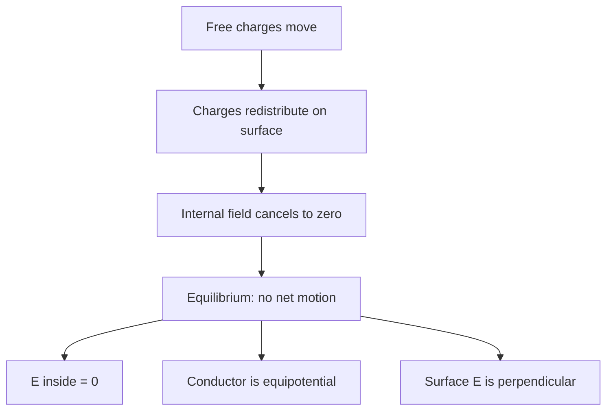

# Concept-Book Run

domain: /home/papagame/projects/digital-duck/cb-college-physics/public/domains/college_physics_ch18/input/graph.yaml
target: lightning_rod
started: 2026-11-23T23:38:23

## Teaching order (9 concepts)

- electric_charge
- electron
- conductor
- coulombs_law
- electric_field
- polarization
- charging_by_induction
- electrostatic_equilibrium
- lightning_rod

### electric_charge (1.1s)

## Electric Charge

Electric charge is a fundamental property of matter that comes in two types, conventionally labeled positive and negative. Protons carry positive charge, electrons carry negative charge, and neutrons carry none. Charge determines how particles interact electromagnetically: like charges repel, opposite charges attract. Charge is quantized — it exists only in whole-number multiples of the elementary charge, $e = 1.602 \times 10^{-19}$ coulombs — and it is conserved in every physical process, meaning the total charge of an isolated system never changes, even during chemical reactions, nuclear decay, or particle collisions.

An atom is electrically neutral when its number of protons equals its number of electrons. Ions form when atoms gain or lose electrons: a sodium atom (Na) loses one electron to become Na⁺, while a chlorine atom (Cl) gains one electron to become Cl⁻. This transfer of charge is what drives ionic bonding — the attraction between Na⁺ and Cl⁻ is a direct electromagnetic consequence of their opposite charges, and it explains why table salt (NaCl) holds together as a rigid crystal lattice. Because charge is conserved, the electron sodium loses is exactly the electron chlorine gains — nothing is created or destroyed, only transferred from one atom to the other.

To apply this concept in problem-solving: when analyzing a chemical reaction, always check that total charge balances on both sides of the equation, just as mass must balance — the sum of charges among reactants must equal the sum among products. When predicting whether a particular ion will form and remain stable, ask which arrangement of gained or lost electrons gives the atom a full outer electron shell, since that configuration minimizes the system's overall energy; sodium loses exactly one electron (not two) and chlorine gains exactly one electron (not two) because those specific transfers reach a stable, low-energy configuration. Electric charge — and the ions it produces — is the reason atoms bond into compounds, salts dissolve and conduct electricity in solution, and biological membranes maintain the voltage gradients that let neurons fire.

### electron (1.1s)

## Electron

An electron is a subatomic particle carrying a single negative elementary charge ($-1.602 \times 10^{-19}$ C) and a mass of about $9.11 \times 10^{-31}$ kg — roughly 1/1836 the mass of a proton. Electrons occupy the space surrounding the atomic nucleus, at characteristic distances and energies rather than moving on fixed paths. Because they carry charge and mass at once, electrons determine both an atom's chemical behavior (through bonding and reactivity) and its electrical properties (through conduction).

The electron's existence was established experimentally rather than predicted theoretically. In 1897, J. J. Thomson passed a high-voltage current through an evacuated glass tube, producing a glowing beam — a cathode ray. He found that the beam bent toward a positively charged plate and away from a negatively charged one, proving it was made of negatively charged particles rather than light or neutral matter. By measuring how much the beam deflected under known electric and magnetic fields, Thomson calculated the ratio of the particles' charge to their mass and found it was over a thousand times larger than that of the lightest known ion (hydrogen). This meant the particles were either highly charged or extremely light — and since the ratio stayed the same no matter what gas filled the tube or what metal made up the electrodes, Thomson concluded he had found a universal particle, a fundamental constituent of all atoms. This overturned the idea of the atom as an indivisible sphere and led Thomson to propose a model with electrons embedded in a diffuse positive charge.

For problem-solving, electrons matter most in balancing charge. An atom is electrically neutral because its number of electrons equals its number of protons. When an atom loses or gains electrons, that balance is broken, and the resulting charge equals the difference between protons and electrons. For example, a sodium atom (11 protons, 11 electrons) that loses one electron ends up with 11 protons and only 10 electrons, giving it a net charge of $+1$. This single relationship — count the protons, count the electrons, subtract — is the calculation you will use repeatedly whenever a problem asks you to determine the charge of a particle that has gained or lost electrons.

### conductor (13.8s)

## Conductor

A **conductor** is a material containing charges that are free to move through it, so that charge can flow in response to an electric field. Metals are the standard example: each atom contributes one or more outer electrons to a "sea" of mobile electrons, while the positive ion cores stay fixed in a lattice. Salt water is also a conductor, with mobile ions instead of electrons. By contrast, in an insulator such as glass, charges are bound to their atoms.

### Electrostatic equilibrium

Mobile charges respond to any field until the net force on them vanishes. Once charges stop moving (electrostatic equilibrium), a conductor has these properties:

1. $\vec{E} = 0$ everywhere inside the conductor. Otherwise, charges would keep moving.
2. Any net charge resides only on the surface. This follows from Gauss's law. Take a Gaussian surface just inside the conductor, where $\vec{E}=0$. Then $\oint \vec{E}\cdot d\vec{A} = 0 = Q_{\text{enc}}/\varepsilon_0$, so no net charge is enclosed.
3. The conductor is an equipotential. Since $\vec{E}=0$ inside, $V$ is the same at every interior point and on the surface.
4. Just outside the surface, $\vec{E}$ is perpendicular to the surface, with magnitude
$$E = \frac{\sigma}{\varepsilon_0},$$
where $\sigma$ is the local surface charge density. A tangential component would push surface charges along the surface.

Property 4 follows from a small Gaussian "pillbox" straddling the surface. Flux passes only through the outer face, so $EA = \sigma A/\varepsilon_0$.

### Worked example

A solid conducting sphere of radius $R = 0.10\ \text{m}$ carries a net charge $Q = 4.0\ \text{nC}$. Find the field just outside the surface and the potential of the sphere.

All charge sits on the surface, spread uniformly by symmetry:
$$\sigma = \frac{Q}{4\pi R^2} = \frac{4.0\times10^{-9}}{4\pi(0.10)^2} = 3.2\times10^{-8}\ \text{C/m}^2.$$
Then
$$E = \frac{\sigma}{\varepsilon_0} = \frac{3.2\times10^{-8}}{8.85\times10^{-12}} \approx 3.6\times10^{3}\ \text{N/C}.$$
Outside, the sphere acts like a point charge, so the potential at the surface (and throughout the sphere) is
$$V = \frac{kQ}{R} = \frac{(8.99\times10^{9})(4.0\times10^{-9})}{0.10} \approx 360\ \text{V}.$$

### Problem-solving application: a cavity and shielding

Suppose a conductor has a hollow cavity containing a point charge $+q$. Find the charge on the cavity wall and on the outer surface.

Draw a Gaussian surface inside the conducting material, around the cavity. Since $\vec{E}=0$ on it, the enclosed charge is zero. The cavity wall must therefore carry $-q$ to cancel the $+q$ inside. If the conductor is neutral overall, charge conservation puts $+q$ on the outer surface.

If the cavity is empty, the same argument shows that the field inside is zero. This is **electrostatic shielding**. It is why a car body or a Faraday cage protects its occupants from external electric fields, and why sensitive instruments are enclosed in metal.

**Key strategy:** for conductor problems, (1) set $\vec{E}=0$ in the material, (2) use Gauss's law to find enclosed charge, (3) place net charge on surfaces, and (4) treat the whole conductor as one potential.

### coulombs_law (15.9s)

## Coulombs Law

**Definition.** Two stationary point charges $q_1$ and $q_2$ separated by a distance $r$ exert equal and opposite forces on each other. The magnitude of each force is

$$F = \frac{k\,|q_1 q_2|}{r^2}, \qquad k = 8.99\times10^{9}\ \text{N·m}^2/\text{C}^2 .$$

The force acts along the line joining the charges. It is repulsive if the charges have the same sign and attractive if the signs are opposite. In vector form, the force on charge 1 due to charge 2 is

$$\vec F_{12} = k\,\frac{q_1 q_2}{r^2}\,\hat r_{21},$$

where $\hat r_{21}$ is the unit vector pointing from charge 2 to charge 1. A positive result means repulsion, and a negative result means attraction. Newton's third law gives $\vec F_{21} = -\vec F_{12}$. The law has the same inverse-square form as gravity, but electric force can push or pull, and it is far stronger. Two protons repel each other about $10^{36}$ times more strongly than they attract gravitationally.

**Worked example.** A charge $q_1 = +3.0\ \mu\text{C}$ sits at the origin, and $q_2 = -2.0\ \mu\text{C}$ sits at $x = 0.30$ m. Find the force on $q_2$.

$$F = \frac{(8.99\times10^{9})(3.0\times10^{-6})(2.0\times10^{-6})}{(0.30)^2} = \frac{5.39\times10^{-2}}{0.090} \approx 0.60\ \text{N}.$$

The charges have opposite signs, so the force is attractive. It acts on $q_2$ in the $-x$ direction, toward $q_1$. Doubling the separation to 0.60 m would cut the force to one quarter, about 0.15 N.

**Problem-solving application: superposition.** When several charges act on one, the net force is the vector sum of the individual Coulomb forces. This is the principle of superposition. Each pair interacts as if the others were absent.

Place $q_A = +4.0\ \mu\text{C}$ at $x=0$ and $q_B = +1.0\ \mu\text{C}$ at $x=0.30$ m. Where on the line between them can a third charge sit with zero net force? The two forces on it point in opposite directions, so they can cancel. They cancel when the magnitudes are equal. Let $x$ be the distance from $q_A$:

$$\frac{k q_A}{x^2} = \frac{k q_B}{(0.30-x)^2} \;\Rightarrow\; \frac{x}{0.30-x} = \sqrt{\frac{q_A}{q_B}} = 2.$$

Solving gives $x = 0.20$ m. The result does not depend on the third charge's size or sign, because it cancels from both sides.

**General strategy.**
1. Sketch the charges and draw each force with the correct direction, using attraction or repulsion from the signs.
2. Compute each magnitude with $F = k|q_1q_2|/r^2$. Convert units first: $\mu\text{C}=10^{-6}$ C and cm $=10^{-2}$ m.
3. Resolve the forces into components, using the geometry when the charges are not collinear.
4. Add the components, then recombine them into a magnitude and direction.

Check the result against your sketch. Opposite charges should pull the test charge toward them, and a closer charge should dominate.

### electric_field (13.8s)

## Electric Field

### Definition

The **electric field** at a point in space is the electric force that would act on a positive test charge placed there, divided by that test charge:

$$\vec{E} = \frac{\vec{F}}{q}, \qquad [E] = \text{N/C} = \text{V/m}.$$

Dividing by $q$ removes the test charge from the description. What remains depends only on the source charges and on the position of the point. The field is a property of space around the sources, whether or not a test charge is present. $\vec{E}$ is a vector, and it points in the direction a positive charge would be pushed.

For a point source $Q$, Coulomb's law gives the force on a test charge $q$ at distance $r$. Dividing by $q$ gives

$$E = \frac{k|Q|}{r^2}, \qquad k = 8.99\times10^{9}\ \text{N·m}^2/\text{C}^2.$$

The field points away from $Q$ if $Q>0$ and toward $Q$ if $Q<0$. It falls off as $1/r^2$.

**Superposition.** With several sources, the net field is the vector sum of each source's field:

$$\vec{E}_{\text{net}} = \sum_i \vec{E}_i.$$

### Worked example

A point charge $Q = +3.0\ \text{nC}$ sits at the origin. Find the field at $r = 0.30\ \text{m}$ along the $+x$ axis, then find the force on an electron placed there.

$$E = \frac{(8.99\times10^{9})(3.0\times10^{-9})}{(0.30)^2} = 300\ \text{N/C},$$

directed along $+x$, away from the positive charge.

The force on the electron ($q=-1.60\times10^{-19}\ \text{C}$) uses $\vec{F}=q\vec{E}$:

$$\vec{F} = (-1.60\times10^{-19})(300\,\hat{x}) = -4.8\times10^{-17}\,\hat{x}\ \text{N}.$$

The negative sign shows the force points opposite the field, toward the source. A negative charge is pulled against $\vec{E}$.

### Problem-solving application

**Two charges.** Place $+2.0\ \text{nC}$ at $x=0$ and $-2.0\ \text{nC}$ at $x=0.20\ \text{m}$. Find $\vec{E}$ at the midpoint, $x = 0.10\ \text{m}$.

1. Each charge is $0.10\ \text{m}$ from the midpoint, so each field has magnitude
$$E_i = \frac{(8.99\times10^{9})(2.0\times10^{-9})}{(0.10)^2} \approx 1800\ \text{N/C}.$$
2. The positive charge pushes a test charge away from itself, in the $+x$ direction. The negative charge pulls it toward itself, which is also the $+x$ direction.
3. The two fields point the same way, so they add:
$$\vec{E}_{\text{net}} \approx 3600\,\hat{x}\ \text{N/C}.$$

**Strategy for any problem:**
- Sketch the sources and the field point.
- For each source, find the magnitude $k|Q|/r^2$ and the direction (away from $+$, toward $-$).
- Resolve into components, then add the components. Do not add magnitudes unless the vectors are collinear.
- To get a force, compute $\vec{F}=q\vec{E}$. Check that its direction is along $\vec{E}$ for $q>0$ and opposite for $q<0$.

**Check your answer.** Far from a collection of charges with net charge $Q_{\text{net}}$, the field should look like that of a single point charge $Q_{\text{net}}$. At the midpoint above, the field is strong because the two charges are close and their fields reinforce. Far from a net-neutral pair, the fields nearly cancel, and the result falls off faster than $1/r^2$.

### polarization (13.3s)

## Polarization

**Definition.** Polarization is the separation of positive and negative charge within a neutral object, so that one region becomes slightly positive and another slightly negative, even though the net charge stays zero. There are two sources:

1. **Induced polarization:** a nearby charged object pushes or pulls charges. In a conductor, free electrons move across the object. In an insulator, charges only shift slightly within each atom or molecule.
2. **Permanent polarization:** polar molecules such as water have an asymmetric shape, so each molecule already has a separated positive and negative end.

The strength of a charge separation is measured by the **dipole moment**:

$$\vec{p} = q\,\vec{d}$$

where $q$ is the magnitude of the separated charge and $\vec{d}$ points from the negative charge to the positive charge, with length equal to their separation.

**Why a neutral object is attracted.** Suppose a negatively charged rod approaches a neutral insulator. The rod repels electrons in the insulator slightly away and attracts the positive nuclei slightly closer. The near side of the insulator becomes positive and the far side negative. Coulomb's force falls off as $1/r^2$, so the nearer positive charge feels a stronger attraction than the farther negative charge feels repulsion. The net force is attractive. This is why a charged comb picks up small bits of paper.

**Worked example.** A water molecule has a dipole moment of $p = 6.2\times10^{-30}\ \text{C·m}$. It sits in a uniform electric field $E = 1.0\times10^{5}\ \text{N/C}$, perpendicular to its dipole axis. Find the torque on it.

The torque on a dipole is

$$\tau = pE\sin\theta$$

With $\theta = 90^\circ$, $\sin\theta = 1$:

$$\tau = (6.2\times10^{-30})(1.0\times10^{5}) = 6.2\times10^{-25}\ \text{N·m}$$

The torque rotates the molecule until $\vec{p}$ lines up with $\vec{E}$ ($\theta = 0$), where the torque is zero. This alignment is why water responds strongly to electric fields.

**Problem-solving application.** A positively charged sphere is brought near a neutral aluminum can lying on a table. Predict the motion.

- *Step 1:* The sphere's positive charge attracts free electrons toward the near side. The near side becomes negative and the far side positive.
- *Step 2:* The near, negative charge is closer to the sphere, so the attraction exceeds the repulsion on the far, positive side.
- *Step 3:* The can has net attraction toward the sphere and rolls toward it.

If the sphere touches the can, some electrons transfer to the sphere. The can is now left with a net positive charge, and the force changes from attraction through polarization to repulsion between like charges.

**Key checks for any problem:**
- Is the object a conductor (charges move freely) or an insulator (charges only shift)?
- Is the object's net charge zero? Polarization redistributes charge but never changes the total.
- Does the field vary in space? In a uniform field, a dipole feels torque but no net force. A net force requires a non-uniform field, like the one near a point charge.

### charging_by_induction (13.7s)

## Charging By Induction

**Definition.** Charging by induction gives a neutral conductor a net charge *without touching it with a charged object*. A nearby charge rearranges the conductor's mobile electrons. Grounding the conductor then lets charge enter or leave, and removing the ground traps a net charge whose sign is **opposite** to that of the inducing object. Total charge is conserved throughout:

$$Q_{\text{total}} = \sum q_i = \text{constant}.$$

**The procedure.** Take two neutral metal spheres on insulating stands. Let a negatively charged rod be the inducer.

1. **Polarize.** Bring the rod near the sphere without touching it. Electrons in the sphere are repelled to the far side. The near side becomes positive and the far side negative. The net charge is still zero.
2. **Ground.** Connect the sphere to the earth with a wire. Repelled electrons flow into the earth, so the sphere now has a net deficit of electrons.
3. **Disconnect the ground first.** Remove the wire while the rod is still nearby. The sphere keeps its electron deficit.
4. **Remove the rod.** The remaining charge spreads uniformly over the sphere. It is **positive**, opposite to the rod.

*The order of steps determines the sign: ground, then disconnect the ground, then remove the rod.*

**Worked example.** A negative rod induces charge on a neutral sphere. While the sphere is grounded, $3.0\times10^{9}$ electrons flow to the earth. What is the sphere's final charge?

Each electron carries $e = 1.60\times10^{-19}\ \text{C}$, and the sphere lost electrons, so

$$Q = +Ne = (3.0\times10^{9})(1.60\times10^{-19}\ \text{C}) = +4.8\times10^{-10}\ \text{C}.$$

The sphere is positive, as expected for a negative inducer.

**Problem-solving application.** Two identical neutral spheres, $A$ and $B$, touch each other. A positive rod is brought near $A$. The spheres are then separated while the rod is still present, and the rod is removed.

*Reasoning.* The positive rod attracts electrons toward $A$, the side nearer the rod. Sphere $A$ therefore gains electrons, and $B$ is left short of electrons. Separating the spheres traps these charges, so $A$ is negative and $B$ is positive. If $A$ gained $N$ electrons, then

$$q_A = -Ne, \qquad q_B = +Ne, \qquad q_A + q_B = 0.$$

This confirms charge conservation. The inducer sets the sign pattern, and the nearer sphere always gets the sign opposite to the inducer.

**Common pitfalls.**
- *Touching the rod to the sphere* is charging by **conduction**. The sphere then gets the *same* sign as the rod.
- *Removing the rod before the ground* lets the electrons flow back, and the sphere ends up neutral.
- *In every case, only electrons move.* Positive charge "appears" because electrons leave.

**Check yourself.** Using a positive rod and a single grounded sphere, predict the direction of electron flow and the final sign. Electrons flow from the earth into the sphere, and the sphere ends up **negative**.

### electrostatic_equilibrium (15.3s)

## Electrostatic Equilibrium

**Definition.** A conductor is in *electrostatic equilibrium* when its free charges have stopped moving on average, so there is no net current anywhere inside it. Three consequences follow, and each can be used to solve problems:

1. The electric field inside the conductor material is zero: $\vec{E}_{\text{inside}} = \vec{0}$.
2. Any net charge resides entirely on the surface. Gauss's law gives this result directly. Choose a Gaussian surface just inside the conductor. Since $\vec{E}=\vec{0}$ on it, $\oint \vec{E}\cdot d\vec{A}=0$, so $Q_{\text{enc}}=0$.
3. Just outside the surface, the field is perpendicular to the surface, with magnitude
$$E_{\perp}=\frac{\sigma}{\varepsilon_0},$$
where $\sigma$ is the local surface charge density.

**Why these must hold.** If $\vec{E}$ were nonzero inside, free charges would feel a force $q\vec{E}$ and move, which contradicts equilibrium. If the field at the surface had a component parallel to it, surface charges would slide along the surface. Only a perpendicular component can persist. It is also true that the whole conductor is an *equipotential*. For any two points $a$ and $b$ in the conductor, $V_b-V_a=-\int_a^b \vec{E}\cdot d\vec{l}=0$.

**Worked example.** A conducting spherical shell of inner radius $a = 0.10\ \text{m}$ and outer radius $b = 0.12\ \text{m}$ surrounds a point charge $q=+5.0\ \text{nC}$ at its center. The shell itself is neutral. Find the charge on each surface and the field just outside.

- Take a Gaussian surface inside the shell material, where $E=0$. Then $Q_{\text{enc}}=0$, so the inner surface must carry $-q=-5.0\ \text{nC}$ to cancel the point charge.
- The shell is neutral, so the outer surface carries $+q=+5.0\ \text{nC}$.
- The outer surface charge density is
$$\sigma=\frac{q}{4\pi b^2}=\frac{5.0\times10^{-9}}{4\pi(0.12)^2}\approx 2.8\times10^{-8}\ \text{C/m}^2.$$
- The field just outside is
$$E=\frac{\sigma}{\varepsilon_0}=\frac{2.8\times10^{-8}}{8.85\times10^{-12}}\approx 3.1\times10^{3}\ \text{N/C},$$
directed radially outward. This matches $kq/b^2$, as it should.

**Problem-solving application.** Equilibrium conditions let you find charge distributions without solving for the field everywhere. Use this procedure:

1. Place a Gaussian surface inside the conductor material, where $E=0$, and conclude that $Q_{\text{enc}}=0$. This gives the induced charge on any cavity wall.
2. Use charge conservation for the total. The outer surface carries (total charge) − (cavity-wall charge).
3. Apply $E_\perp=\sigma/\varepsilon_0$ to find the field just outside.

*Check yourself.* Suppose the shell above is instead given a net charge of $+3.0\ \text{nC}$. The inner surface still carries $-5.0\ \text{nC}$, because the $E=0$ condition is unchanged. The outer surface now carries $+3.0-(-5.0)=+8.0\ \text{nC}$.

**Practical consequence.** Because $\vec{E}=\vec{0}$ in a cavity with no charge inside, the cavity is shielded from external fields. This is the principle of the Faraday cage, and it is why you are safe inside a car during a lightning storm. Charge also crowds onto sharp points, where $\sigma$ is largest, which is why lightning rods work.

*How free charges rearrange until the field inside vanishes, producing the three equilibrium properties.*

### lightning_rod (14.1s)

## Lightning Rod

A **lightning rod** (Franklin rod) is a sharply pointed, grounded metal conductor mounted at the highest point of a structure. It does two jobs. It bleeds off induced charge so the strike risk drops. If lightning does strike, it gives the current a low-resistance path to ground so the current bypasses the building.

**Why a point works.** Two conducting spheres of radii $r_1$ and $r_2$ are joined by a wire, so they sit at the same potential $V$. Each sphere has surface charge $q = 4\pi\varepsilon_0 r V$ and surface charge density

$$\sigma = \frac{q}{4\pi r^2} = \frac{\varepsilon_0 V}{r}.$$

The field just outside a conductor's surface is $E = \sigma/\varepsilon_0$, so

$$E = \frac{V}{r}.$$

At equal potential, the smaller radius of curvature gives the stronger field. A sharp tip acts like a very small sphere, so charge crowds there and the field is strongest there.

Air breaks down (ionizes) at about $E_{\text{break}} \approx 3\times10^{6}\ \text{V/m}$. Near the tip, the field can pass this value while the field elsewhere stays far below it. The ionized air carries charge away from the tip as a gentle "corona" discharge. Under a charged storm cloud, this reduces the net charge buildup near the structure.

**Worked example.** A rod tip has effective radius $r = 1\ \text{mm}$. Treating it as a sphere, at what potential does air break down at the tip?

$$V = E_{\text{break}}\, r = (3\times10^{6}\ \text{V/m})(1\times10^{-3}\ \text{m}) = 3\times10^{3}\ \text{V}.$$

Now take a rounded dome of radius $r = 0.5\ \text{m}$ at the same potential. Breakdown would need

$$V = (3\times10^{6})(0.5) = 1.5\times10^{6}\ \text{V}.$$

The point ionizes air at about $1/500$ of the potential the dome needs. This is why the point discharges first.

**Problem-solving application.** A storm cloud induces a potential of $V = 2\times10^{5}\ \text{V}$ on a rod system. Find the largest tip radius that still produces corona discharge.

Corona requires $E = V/r \ge E_{\text{break}}$, so

$$r \le \frac{V}{E_{\text{break}}} = \frac{2\times10^{5}}{3\times10^{6}} \approx 0.067\ \text{m} = 6.7\ \text{cm}.$$

A tip of radius a few millimeters easily meets this condition. A blunt 10 cm radius ball does not.

If a strike does occur, the rod's low resistance matters. A current of $I = 30\ \text{kA}$ through a grounding path of $R = 5\ \Omega$ dissipates its power in the conductor and the earth, not the building. The potential rise at the rod is

$$V = IR = (3\times10^{4})(5) = 1.5\times10^{5}\ \text{V}.$$

Lower resistance means a smaller potential rise, so good grounding (thick cable, deep ground rods) limits the risk of side flashes to nearby metal.

**Key takeaway.** At a fixed potential, the field at a conductor's surface scales as $1/r$. Sharp points concentrate field, ionize air first, and give lightning a preferred, safe path to ground.

One caveat: modern analyses suggest a rod does not reliably prevent strikes by corona alone. Its main protective value is the safe, grounded path for the strike current.

## Run complete

total: 125.4s
