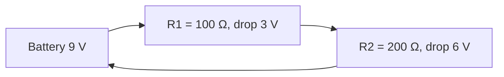
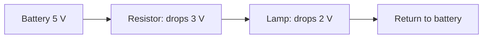
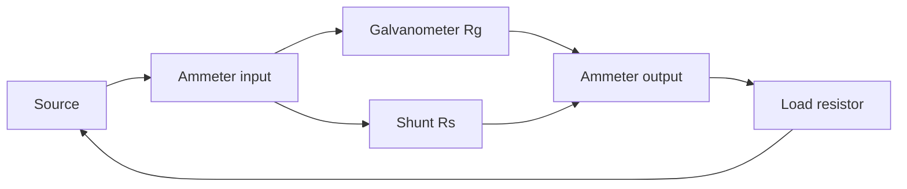

# Concept-Book Run

domain: /home/papagame/projects/digital-duck/cb-college-physics/public/domains/college_physics_ch21/input/graph.yaml
target: ammeter
started: 2026-11-23T23:41:38

## Teaching order (6 concepts)

- electric_current
- resistance
- voltage
- galvanometer
- ohms_law
- ammeter

### electric_current (2.4s)

## Electric Current

**Definition.** Electric current is the rate at which electric charge flows through a cross-sectional area of a conductor. If a net charge $\Delta Q$ passes a given cross section during a time interval $\Delta t$, the average current is

$$I = \frac{\Delta Q}{\Delta t}.$$

When the current varies in time, the instantaneous current is $I = \dfrac{dQ}{dt}$. The SI unit is the **ampere** (A), where $1\ \text{A} = 1\ \text{C/s}$. By convention, the direction of current is the direction positive charge would move. In metal wires the carriers are electrons, so they drift opposite to the conventional current.

**Microscopic view.** Current can also be written in terms of the charge carriers. If a conductor has $n$ carriers per unit volume, each with charge $q$, cross-sectional area $A$, and average drift speed $v_d$, then

$$I = n\,q\,v_d\,A.$$

Within a time $\Delta t$, the carriers in a length $v_d\Delta t$ cross the area. That volume holds $nAv_d\Delta t$ carriers, so $\Delta Q = nqAv_d\,\Delta t$, which gives the formula above.

**Worked example.** A flashlight bulb passes $3.0\ \text{C}$ of charge in $5.0\ \text{s}$. The average current is

$$I = \frac{3.0\ \text{C}}{5.0\ \text{s}} = 0.60\ \text{A}.$$

How many electrons cross a cross section each second? Each electron carries $e = 1.60\times10^{-19}\ \text{C}$, so

$$\frac{N}{\Delta t} = \frac{I}{e} = \frac{0.60}{1.60\times10^{-19}} \approx 3.75\times10^{18}\ \text{electrons/s}.$$

**Problem-solving application.** A copper wire of diameter $2.0\ \text{mm}$ carries $I = 5.0\ \text{A}$. Copper has $n \approx 8.5\times10^{28}\ \text{m}^{-3}$ free electrons. Find the drift speed.

1. The area is $A = \pi r^2 = \pi(1.0\times10^{-3}\ \text{m})^2 = 3.14\times10^{-6}\ \text{m}^2$.
2. Solve $I = nqv_dA$ for $v_d$:

$$v_d = \frac{I}{n\,e\,A} = \frac{5.0}{(8.5\times10^{28})(1.60\times10^{-19})(3.14\times10^{-6})} \approx 1.2\times10^{-4}\ \text{m/s}.$$

The electrons drift at about $0.12\ \text{mm/s}$, which is slower than a crawling snail. A lamp still lights almost instantly because the electric field that drives the electrons propagates through the wire at nearly the speed of light. Every free electron along the wire begins to move at once.

**Key points to remember.**

- Current measures charge per unit time. It is not the amount of charge itself.
- In a series circuit with no branches, the current is the same at every cross section, because charge does not accumulate along the wire. This is a consequence of charge conservation.
- At a junction, the current entering equals the current leaving. This is Kirchhoff's junction rule.

For a time-varying current, the total charge transferred is the area under the $I$–$t$ graph:

$$\Delta Q = \int_{t_1}^{t_2} I\,dt.$$

### resistance (22.6s)

## Resistance

**Definition.** Resistance is a measure of how strongly a component opposes the flow of electric charge. It is the ratio of the voltage across the component to the current through it:

$$R = \frac{V}{I}$$

The SI unit is the **ohm** ($\Omega$), where $1\,\Omega = 1\,\text{V/A}$. For many materials, called *ohmic*, $R$ stays constant as $V$ changes. This gives **Ohm's law**, $V = IR$. A conductor's resistance also depends on its geometry and material:

$$R = \frac{\rho L}{A}$$

Here $\rho$ is the resistivity of the material (in $\Omega\cdot\text{m}$), $L$ is the length, and $A$ is the cross-sectional area. Longer wires resist more. Thicker wires resist less.

**Worked example.** A copper wire is 2.0 m long with a cross-sectional area of $1.0\times10^{-6}\,\text{m}^2$ (1 mm²). Copper has $\rho = 1.7\times10^{-8}\,\Omega\cdot\text{m}$. Find its resistance.

$$R = \frac{(1.7\times10^{-8})(2.0)}{1.0\times10^{-6}} = 0.034\,\Omega$$

The resistance is tiny, which is why copper is used for wiring. Now connect a 12 V battery across a $24\,\Omega$ resistor. The current is

$$I = \frac{V}{R} = \frac{12}{24} = 0.50\,\text{A}$$

**Problem-solving application.** A 12 V battery is connected across a $24\,\Omega$ resistor and a $12\,\Omega$ resistor, each wired directly to the battery terminals. Find the current through each resistor and the total current drawn from the battery.

*Step 1: Apply Ohm's law to each resistor.* Each resistor has the full 12 V across it, so

$$I_1 = \frac{12}{24} = 0.50\,\text{A}, \qquad I_2 = \frac{12}{12} = 1.0\,\text{A}$$

*Step 2: Add the currents.* The battery supplies both currents, so

$$I_{total} = 0.50 + 1.0 = 1.5\,\text{A}$$

*Step 3: Find the effective resistance the battery "sees."*

$$R_{eff} = \frac{V}{I_{total}} = \frac{12}{1.5} = 8\,\Omega$$

*Check:* The result, $8\,\Omega$, is smaller than either resistor ($12\,\Omega$ and $24\,\Omega$). This makes sense. Adding a second path for charge to flow makes it easier for current to pass, so the total current rises and the effective resistance falls.

**Key habits.** Write down the voltage across each component before you apply $V = IR$. Use the same component's $V$, $I$, and $R$ in each equation, and keep units visible so mistakes show up as mismatched units. Finally, test whether your answer is physically reasonable. A thicker or shorter wire should give a smaller resistance, and a second path for current should never increase the total resistance.

### voltage (15.0s)

## Voltage

**Voltage** (electric potential difference) is the electrical potential energy per unit charge between two points. If moving a charge $q$ between two points changes its potential energy by $\Delta U$, the voltage between them is

$$V = \frac{\Delta U}{q}, \qquad 1\ \text{volt} = 1\ \frac{\text{joule}}{\text{coulomb}}.$$

A 9 V battery therefore gives each coulomb of charge 9 J of energy as it moves from the negative to the positive terminal. Voltage is always measured *between* two points, much as height difference matters for a falling object, not absolute height. The battery acts as the "pump" that raises charges to higher potential. The rest of the circuit lets them "fall" back down, converting that energy into light, heat, or motion.

### Worked example

A 12 V car battery drives $2.0\ \text{C}$ of charge through a headlight. How much energy is delivered?

$$\Delta U = qV = (2.0\ \text{C})(12\ \text{V}) = 24\ \text{J}.$$

If this takes 0.50 s, the power is $P = \Delta U / t = 48\ \text{W}$. Equivalently, the current is $I = q/t = 4.0\ \text{A}$, and $P = IV = (4.0)(12) = 48\ \text{W}$, which gives the same result.

### Problem-solving application

Voltage, current, and resistance are linked by **Ohm's law**, $V = IR$, and voltages around a circuit obey **Kirchhoff's voltage law**: around any closed loop, the voltage rises equal the voltage drops,

$$\sum V_{\text{rise}} = \sum V_{\text{drop}}.$$

*Problem:* A 9 V battery is connected in series with resistors $R_1 = 100\ \Omega$ and $R_2 = 200\ \Omega$. Find the voltage across each resistor.

1. Total resistance in series: $R = 100 + 200 = 300\ \Omega$.
2. Current: $I = V/R = 9/300 = 0.030\ \text{A}$.
3. Drops: $V_1 = IR_1 = (0.030)(100) = 3.0\ \text{V}$ and $V_2 = IR_2 = (0.030)(200) = 6.0\ \text{V}$.
4. Check with Kirchhoff: $3.0 + 6.0 = 9.0\ \text{V}$, which equals the battery's rise. ✓

This is the **voltage divider** idea. In series, each resistor takes a share of the voltage proportional to its resistance: $V_k = V\,\dfrac{R_k}{R_{\text{total}}}$. Here $R_2$ is two-thirds of the total resistance, so it takes two-thirds of the 9 V.

*A series loop: the battery's 9 V rise is split into a 3 V drop across R1 and a 6 V drop across R2, in proportion to resistance.*

**Key takeaways:** voltage is energy per charge ($V = \Delta U/q$). It is measured between two points. Around any closed loop the rises and drops balance. To solve circuit problems, find the current with Ohm's law, then compute each drop and check the loop sum.

### galvanometer (31.8s)

## Galvanometer

A **galvanometer** is an analog instrument that detects and measures small electric currents. A coil of wire, pivoted in the field of a permanent magnet, carries the current $I$. The field exerts a torque on the coil. A hairspring provides a restoring torque proportional to the angle of rotation, so the needle stops where the two torques balance.

For a coil with $N$ turns, area $A$, and a radial magnetic field of strength $B$, the magnetic torque is $\tau_{\text{mag}} = NIAB$. The spring's restoring torque is $\tau_{\text{spring}} = k\phi$, where $k$ is the torsion constant and $\phi$ is the deflection angle. Setting them equal gives

$$
NIAB = k\phi \quad\Longrightarrow\quad \phi = \left(\frac{NAB}{k}\right) I .
$$

The deflection is proportional to the current. The radial field keeps the torque independent of angle, so the scale is linear. The ratio $\phi/I = NAB/k$ tells you how far the needle moves per ampere. A larger ratio means the instrument responds to a smaller current.

### Worked example

A galvanometer has $N = 50$ turns, $A = 2.0\times10^{-4}\ \text{m}^2$, $B = 0.20\ \text{T}$, and $k = 1.0\times10^{-7}\ \text{N·m/rad}$. Find the deflection per ampere and the current that gives a deflection of $0.50$ rad.

$$
\frac{\phi}{I} = \frac{NAB}{k} = \frac{(50)(2.0\times10^{-4})(0.20)}{1.0\times10^{-7}} = 2.0\times10^{4}\ \text{rad/A}
$$

$$
I = \frac{\phi}{\phi/I} = \frac{0.50}{2.0\times10^{4}} = 2.5\times10^{-5}\ \text{A} = 25\ \mu\text{A}
$$

### Problem-solving application: designing a more responsive meter

**Problem.** Using the galvanometer above, the needle must reach a full-scale deflection of $0.50$ rad at only $5.0\ \mu\text{A}$. Which single change achieves this?

**Reasoning.** The required deflection per ampere is

$$
\frac{\phi}{I} = \frac{0.50}{5.0\times10^{-6}} = 1.0\times10^{5}\ \text{rad/A},
$$

which is $5$ times the current value of $2.0\times10^{4}\ \text{rad/A}$. Since $\phi/I = NAB/k$, you can reach this by one of three changes:

- Increase $N$ from $50$ to $250$ turns.
- Increase $B$ from $0.20\ \text{T}$ to $1.0\ \text{T}$.
- Decrease $k$ from $1.0\times10^{-7}$ to $2.0\times10^{-8}\ \text{N·m/rad}$, using a weaker hairspring.

**Check.** With $N = 250$ and all else unchanged,

$$
\phi = \frac{(250)(2.0\times10^{-4})(0.20)}{1.0\times10^{-7}}(5.0\times10^{-6}) = 0.50\ \text{rad}. \checkmark
$$

**Trade-offs.** Each change has a cost. More turns add mass and make the coil heavier to move. A weaker spring makes the needle slow to settle and more easily disturbed. A stronger magnet is bulkier and more expensive. Real designs balance these costs against the sensitivity they need.

**Scaling shortcut.** Because $\phi \propto I$, one calibration point fixes the whole scale. If $25\ \mu\text{A}$ gives $0.50$ rad, then a reading of $0.20$ rad corresponds to

$$
I = 25\ \mu\text{A}\times\frac{0.20}{0.50} = 10\ \mu\text{A}.
$$

You can read any unknown small current this way: find the deflection, then scale from the calibration point.

### ohms_law (23.6s)

## Ohm's Law

**Definition.** Ohm's law states that for many conductors, especially metal resistors at constant temperature, the voltage drop across the conductor is proportional to the current through it:

$$V = IR$$

Here $V$ is the voltage in volts (V), $I$ is the current in amperes (A), and $R$ is the resistance in ohms ($\Omega$). One ohm is one volt per ampere: $1\,\Omega = 1\,\text{V/A}$. Resistance measures how strongly a component opposes current. A larger $R$ means less current for the same voltage.

Rearranging gives two more forms, each useful for a different unknown:

$$I = \frac{V}{R}, \qquad R = \frac{V}{I}$$

Materials that obey this linear relationship are called *ohmic*. A plot of $V$ against $I$ is a straight line through the origin, and its slope is $R$. Diodes, filament bulbs, and thermistors are *non-ohmic*. Their $V$–$I$ curves bend, so $V/I$ is not constant. The law is a model of material behavior, not a universal law like conservation of charge.

**Worked example.** A $12\,\text{V}$ battery is connected across a $240\,\Omega$ resistor. Find the current.

$$I = \frac{V}{R} = \frac{12\,\text{V}}{240\,\Omega} = 0.050\,\text{A} = 50\,\text{mA}$$

Check the units: volts divided by ohms gives amperes, as expected. Doubling the battery voltage to $24\,\text{V}$ would double the current to $100\,\text{mA}$, which is what proportionality predicts.

**Problem-solving application.** Ohm's law applies to the whole circuit or to any single component. Apply it to one component at a time, using that component's own $V$, $I$, and $R$.

*Problem:* A $5.0\,\text{V}$ supply powers a series circuit containing a $150\,\Omega$ resistor and a small lamp that drops $2.0\,\text{V}$. What current flows?

1. The resistor and lamp are in series, so they carry the same current.
2. The resistor must absorb the remaining voltage: $V_R = 5.0 - 2.0 = 3.0\,\text{V}$.
3. Apply Ohm's law to the resistor alone:

$$I = \frac{V_R}{R} = \frac{3.0\,\text{V}}{150\,\Omega} = 0.020\,\text{A} = 20\,\text{mA}$$

4. Check: this is the current through the lamp as well, and the drops add up, $3.0 + 2.0 = 5.0\,\text{V}$.

The general method is: (1) identify which component you are analyzing, (2) find its voltage drop, using the fact that series elements share current, (3) apply $V = IR$ to that component, and (4) check units and that the voltage drops sum to the supply.

*Series circuit for the problem. The same 20 mA flows through every element, and the voltage drops (3 V + 2 V) add up to the 5 V supplied.*

**Check your understanding.** If the supply is raised to $9.0\,\text{V}$ while the lamp still drops $2.0\,\text{V}$ and the resistor stays $150\,\Omega$, the resistor must drop $7.0\,\text{V}$. The current becomes $I = 7.0/150 \approx 47\,\text{mA}$. A higher supply voltage across the same resistance produces a larger current.

### ammeter (13.9s)

## Ammeter

An **ammeter** measures the current in a circuit branch. To do this, it must be connected **in series** with that branch, so the full branch current passes through it. An ideal ammeter has zero resistance, so inserting it does not change the current it is trying to measure. Real ammeters come close by using a small internal resistance.

### How it is built

The sensing element is a **galvanometer**, a coil whose needle deflects in proportion to the current through it. A galvanometer has two limits:

- It has a full-scale current $I_g$, often only microamperes to milliamperes.
- It has an internal resistance $R_g$, often tens to hundreds of ohms.

To measure larger currents, a small **shunt resistor** $R_s$ is connected in **parallel** with the galvanometer. Most of the current bypasses the coil through the shunt, and only a safe fraction flows through the galvanometer.

The galvanometer and shunt have the same voltage across them:

$$I_g R_g = (I - I_g)R_s \quad\Rightarrow\quad R_s = \frac{I_g R_g}{I - I_g}$$

Here $I$ is the desired full-scale current of the ammeter. The equivalent resistance of the combination is

$$R_A = \frac{R_g R_s}{R_g + R_s} < R_s,$$

so it is smaller than either component. This is why an ammeter disturbs the circuit very little.

### Worked example

A galvanometer has $I_g = 50\ \mu\text{A}$ and $R_g = 100\ \Omega$. Design an ammeter with a full-scale reading of $I = 1.0\ \text{A}$.

$$R_s = \frac{(50\times10^{-6})(100)}{1.0 - 50\times10^{-6}} \approx 5.0\times10^{-3}\ \Omega = 5.0\ \text{m}\Omega$$

The shunt carries $99.995\%$ of the current. The ammeter's resistance is

$$R_A = \frac{(100)(0.0050)}{100.005} \approx 5.0\ \text{m}\Omega.$$

### Problem-solving application

**Problem.** A $6.0\ \text{V}$ source drives a $12\ \Omega$ resistor. What does the ammeter above read, and what error does it introduce?

1. Without the meter, $I = 6.0/12 = 0.500\ \text{A}$.
2. With the meter in series, the total resistance is $12 + 0.005 = 12.005\ \Omega$, so $I' = 6.0/12.005 \approx 0.4998\ \text{A}$.
3. The error is about $0.04\%$, which is negligible.

**Common mistakes to avoid:**

- **Connecting an ammeter in parallel across a component.** Its tiny resistance would create a near short circuit, drawing a very large current that can destroy the meter or blow a fuse.
- **Choosing a larger shunt to "protect" the meter.** A larger $R_s$ diverts less current from the coil, so the galvanometer would exceed $I_g$ at a lower total current. A smaller shunt gives a larger range.
- **Forgetting the meter's resistance in low-resistance circuits.** If the circuit's resistance is comparable to $R_A$, the reading will be noticeably low. Check that $R_A \ll R_{\text{circuit}}$.

*An ammeter in series with the load. Inside it, the current splits between the galvanometer and the much smaller shunt, which carries almost all of it.*

## Run complete

total: 132.2s
