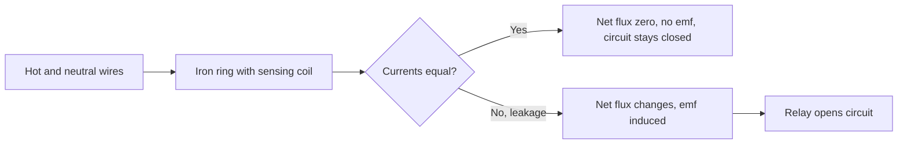

# Concept-Book Run

domain: /home/papagame/projects/digital-duck/cb-college-physics/public/domains/college_physics_ch23/input/graph.yaml
target: electrical_safety_devices
started: 2026-11-23T23:45:03

## Teaching order (7 concepts)

- magnetic_field
- magnetic_flux
- electromagnetic_induction
- electric_current
- faradays_law
- mutual_inductance
- electrical_safety_devices

### magnetic_field (1.5s)

## Magnetic Field

### Definition

A **magnetic field** $\mathbf{B}$ is a vector field: at every point in space it assigns a vector describing the magnetic influence there. We define it operationally through the force on a moving charge. A charge $q$ moving with velocity $\mathbf{v}$ through a field $\mathbf{B}$ experiences

$$\mathbf{F} = q\,\mathbf{v}\times\mathbf{B},$$

with magnitude $F = |q|\,v\,B\sin\theta$, where $\theta$ is the angle between $\mathbf{v}$ and $\mathbf{B}$. The direction follows the right-hand rule (reverse it for negative $q$). The SI unit is the tesla: $1\,\text{T} = 1\,\text{N}/(\text{C}\cdot\text{m/s})$.

Three consequences follow directly from the cross product:

- No force acts on a charge at rest ($v=0$) or one moving parallel to $\mathbf{B}$ ($\theta=0$).
- The force is always perpendicular to $\mathbf{v}$, so $\mathbf{F}\cdot\mathbf{v}=0$. A magnetic force does **no work** and changes a particle's direction, never its speed.
- Magnetic field lines form closed loops. Mathematically, $\nabla\cdot\mathbf{B}=0$, because no isolated magnetic poles have been observed.

### Worked example

A proton ($q=1.60\times10^{-19}$ C, $m=1.67\times10^{-27}$ kg) moves at $v=3.0\times10^{6}$ m/s perpendicular to a uniform field of $B=0.50$ T. Find the force and the path.

**Force:** since $\theta=90^\circ$,

$$F = qvB = (1.60\times10^{-19})(3.0\times10^{6})(0.50)=2.4\times10^{-13}\ \text{N}.$$

**Path:** the force is perpendicular to the velocity and has constant magnitude, so it acts as a centripetal force and the proton moves in a circle. Setting $qvB = mv^2/r$ gives

$$r=\frac{mv}{qB}=\frac{(1.67\times10^{-27})(3.0\times10^{6})}{(1.60\times10^{-19})(0.50)}\approx 6.3\times10^{-2}\ \text{m}.$$

The period $T = 2\pi r/v = 2\pi m/(qB)$ does not depend on speed. This property is the basis of the cyclotron.

### Problem-solving application

**Mass spectrometer.** Ions of charge $q$ are accelerated through a potential difference $V$, so $\tfrac12 mv^2 = qV$. They then enter a field $B$ perpendicular to their motion and curve with radius $r = mv/(qB)$. Eliminating $v$:

$$m=\frac{qB^2r^2}{2V}.$$

Measuring $r$, the distance at which ions strike a detector, therefore determines the mass.

*Practice:* singly charged ions are accelerated through $V=1000$ V and enter $B=0.20$ T. An ion lands with $r=0.102$ m. Then $m = (1.60\times10^{-19})(0.04)(0.0104)/(2000)\approx 3.3\times10^{-26}$ kg, about 20 atomic mass units. This is consistent with neon-20.

**General strategy:**

1. Sketch $\mathbf{v}$ and $\mathbf{B}$, and find the direction of $\mathbf{v}\times\mathbf{B}$. Flip it if $q<0$.
2. Decompose $\mathbf{v}$ into components parallel and perpendicular to $\mathbf{B}$. The perpendicular part drives circular motion and the parallel part is unchanged. If both are present, the path is a helix.
3. Apply $qv_\perp B = mv_\perp^2/r$ and solve for the unknown.

### magnetic_flux (13.7s)

## Magnetic Flux

**Definition.** Magnetic flux measures how much magnetic field passes through a surface. For a flat area $A$ in a uniform field $\vec{B}$, the flux is

$$\Phi = BA\cos\theta,$$

where $\theta$ is the angle between $\vec{B}$ and the **normal** (the perpendicular) to the surface. Equivalently, $\Phi = \vec{B}\cdot\vec{A}$, where $\vec{A}$ has magnitude $A$ and points along the normal. For a non-uniform field or a curved surface, the general definition is

$$\Phi = \int_S \vec{B}\cdot d\vec{A}.$$

The SI unit is the weber: $1\ \text{Wb} = 1\ \text{T·m}^2$.

Think of field lines as rain and the loop as a hoop. The most rain passes through when the hoop faces the rain ($\theta = 0^\circ$, $\Phi = BA$). No rain passes through when the hoop is edge-on ($\theta = 90^\circ$, $\Phi = 0$). Flux is a signed quantity: if the field passes through the loop from the opposite side ($\theta > 90^\circ$), $\Phi$ is negative.

Flux matters because Faraday's law says an induced emf appears whenever flux changes:

$$\mathcal{E} = -N\,\frac{d\Phi}{dt}.$$

Since $\Phi = BA\cos\theta$, there are exactly three ways to change it: change $B$, change $A$, or change $\theta$.

**Worked example.** A circular loop of radius $0.10\ \text{m}$ sits in a uniform $0.50\ \text{T}$ field. The field makes a $60^\circ$ angle with the loop's normal. Find the flux.

$$A = \pi r^2 = \pi(0.10)^2 = 0.0314\ \text{m}^2$$

$$\Phi = (0.50)(0.0314)\cos 60^\circ = 7.85\times10^{-3}\ \text{Wb}$$

A common error is using the angle between $\vec{B}$ and the *plane* of the loop. If you are given that angle, call it $\phi$. Then $\theta = 90^\circ - \phi$, and the flux is $BA\sin\phi$.

**Problem-solving application.** A 200-turn coil of area $0.020\ \text{m}^2$ rotates at a constant angular speed $\omega = 120\pi\ \text{rad/s}$ (60 Hz) in a uniform $0.30\ \text{T}$ field. At $t=0$ the coil's normal is parallel to $\vec{B}$. Find the peak emf.

1. Write the flux through one turn. The angle grows as $\theta=\omega t$, so $\Phi(t)=BA\cos\omega t$.
2. Differentiate. Then $\dfrac{d\Phi}{dt} = -BA\omega\sin\omega t$.
3. Apply Faraday's law for $N$ turns. This gives $\mathcal{E}(t) = NBA\omega\sin\omega t$.
4. The peak occurs when $\sin\omega t = 1$:

$$\mathcal{E}_{\max} = (200)(0.30)(0.020)(120\pi) \approx 452\ \text{V}.$$

Notice that the emf is largest when the flux is *zero*. At that moment the loop is edge-on and $\Phi$ is changing fastest. The emf depends on the *rate of change* of flux, not on the flux itself. This is the principle behind the AC generator.

**Check your understanding.** A loop in a constant field is stretched so that its area doubles, with the orientation held fixed. Does the flux change? Is an emf induced while the area is changing?

### electromagnetic_induction (13.0s)

## Electromagnetic Induction

**Definition.** Electromagnetic induction is the production of an electromotive force (emf) in a conductor or coil whenever the magnetic flux through it changes. The magnetic flux through a surface is

$$\Phi_B = \int \vec{B}\cdot d\vec{A},$$

which for a uniform field and a flat loop becomes $\Phi_B = BA\cos\theta$, where $\theta$ is the angle between $\vec{B}$ and the loop's normal. **Faraday's law** gives the induced emf in a coil of $N$ turns:

$$\varepsilon = -N\,\frac{d\Phi_B}{dt}.$$

The minus sign is **Lenz's law**: the induced current flows in the direction that opposes the change in flux that produced it. This is energy conservation at work. If the induced current reinforced the change, the effect would feed on itself and create energy from nothing.

Flux can change in three ways: the field strength $B$ changes, the loop's area $A$ changes, or the angle $\theta$ changes. Any one of these is enough to induce an emf.

**Worked example.** A circular coil with $N = 200$ turns and radius $r = 5.0\ \text{cm}$ sits with its plane perpendicular to a uniform field. The field rises from $0.20\ \text{T}$ to $0.80\ \text{T}$ in $0.30\ \text{s}$. Find the average emf.

The area is $A = \pi r^2 = \pi(0.050)^2 = 7.85\times10^{-3}\ \text{m}^2$. With $\theta = 0$, the change in flux per turn is

$$\Delta\Phi_B = A\,\Delta B = (7.85\times10^{-3})(0.60) = 4.71\times10^{-3}\ \text{Wb}.$$

Then

$$|\varepsilon| = N\frac{\Delta\Phi_B}{\Delta t} = 200\cdot\frac{4.71\times10^{-3}}{0.30} \approx 3.1\ \text{V}.$$

By Lenz's law, the induced current creates a field opposite to the increasing external field, so its direction is the one that opposes the increase.

**Problem-solving application: the AC generator.** Rotate a coil of area $A$ at angular speed $\omega$ in a uniform field. The angle is $\theta = \omega t$, so

$$\Phi_B = BA\cos\omega t \quad\Longrightarrow\quad \varepsilon = -N\frac{d\Phi_B}{dt} = NBA\omega\sin\omega t.$$

The emf is sinusoidal with peak value $\varepsilon_{\max} = NBA\omega$. This is why power plants produce alternating current.

*Example:* A 100-turn coil of area $0.020\ \text{m}^2$ rotates at $60\ \text{Hz}$ in a $0.50\ \text{T}$ field. Here $\omega = 2\pi(60) = 377\ \text{rad/s}$, so

$$\varepsilon_{\max} = (100)(0.50)(0.020)(377) \approx 3.8\times10^{2}\ \text{V}.$$

**Strategy for any induction problem:**
1. Write $\Phi_B$ as a function of time, or find $\Delta\Phi_B$.
2. Identify which quantity ($B$, $A$, or $\theta$) is changing.
3. Differentiate, or divide by $\Delta t$, and multiply by $N$.
4. Use Lenz's law to find the current direction: it opposes the *change* in flux.

The same law explains transformers, induction cooktops, and eddy-current brakes. In each, a changing flux drives currents that either transfer energy or resist motion.

### electric_current (1.1s)

## Electric Current

**Definition.** Electric current is the rate at which electric charge flows through a cross-sectional area of a conductor. If a net charge $\Delta Q$ passes a given cross section during a time interval $\Delta t$, the average current is

$$I = \frac{\Delta Q}{\Delta t}.$$

When the current varies in time, the instantaneous current is $I = \dfrac{dQ}{dt}$. The SI unit is the **ampere** (A), where $1\ \text{A} = 1\ \text{C/s}$. By convention, the direction of current is the direction positive charge would move. In metal wires the carriers are electrons, so they drift opposite to the conventional current.

**Microscopic view.** Current can also be written in terms of the charge carriers. If a conductor has $n$ carriers per unit volume, each with charge $q$, cross-sectional area $A$, and average drift speed $v_d$, then

$$I = n\,q\,v_d\,A.$$

Within a time $\Delta t$, the carriers in a length $v_d\Delta t$ cross the area. That volume holds $nAv_d\Delta t$ carriers, so $\Delta Q = nqAv_d\,\Delta t$, which gives the formula above.

**Worked example.** A flashlight bulb passes $3.0\ \text{C}$ of charge in $5.0\ \text{s}$. The average current is

$$I = \frac{3.0\ \text{C}}{5.0\ \text{s}} = 0.60\ \text{A}.$$

How many electrons cross a cross section each second? Each electron carries $e = 1.60\times10^{-19}\ \text{C}$, so

$$\frac{N}{\Delta t} = \frac{I}{e} = \frac{0.60}{1.60\times10^{-19}} \approx 3.75\times10^{18}\ \text{electrons/s}.$$

**Problem-solving application.** A copper wire of diameter $2.0\ \text{mm}$ carries $I = 5.0\ \text{A}$. Copper has $n \approx 8.5\times10^{28}\ \text{m}^{-3}$ free electrons. Find the drift speed.

1. The area is $A = \pi r^2 = \pi(1.0\times10^{-3}\ \text{m})^2 = 3.14\times10^{-6}\ \text{m}^2$.
2. Solve $I = nqv_dA$ for $v_d$:

$$v_d = \frac{I}{n\,e\,A} = \frac{5.0}{(8.5\times10^{28})(1.60\times10^{-19})(3.14\times10^{-6})} \approx 1.2\times10^{-4}\ \text{m/s}.$$

The electrons drift at about $0.12\ \text{mm/s}$, which is slower than a crawling snail. A lamp still lights almost instantly because the electric field that drives the electrons propagates through the wire at nearly the speed of light. Every free electron along the wire begins to move at once.

**Key points to remember.**

- Current measures charge per unit time. It is not the amount of charge itself.
- In a series circuit with no branches, the current is the same at every cross section, because charge does not accumulate along the wire. This is a consequence of charge conservation.
- At a junction, the current entering equals the current leaving. This is Kirchhoff's junction rule.

For a time-varying current, the total charge transferred is the area under the $I$–$t$ graph:

$$\Delta Q = \int_{t_1}^{t_2} I\,dt.$$

### faradays_law (12.9s)

## Faradays Law

**Definition.** A changing magnetic flux through a loop of wire induces an electromotive force (emf) in that loop. Magnetic flux through a flat surface of area $A$ in a uniform field $B$ is

$$\Phi = BA\cos\theta,$$

where $\theta$ is the angle between $\vec B$ and the surface normal. Faraday's law states that for a coil of $N$ turns, the induced emf is

$$\mathcal{E} = -N\,\frac{\Delta\Phi}{\Delta t}.$$

Flux is measured in webers ($1\ \text{Wb} = 1\ \text{T·m}^2$), and emf in volts. The minus sign is Lenz's law. The induced emf drives a current whose own magnetic field opposes the *change* in flux that produced it. Because the flux through each turn adds, $N$ turns multiply the emf by $N$. Flux can change in three ways: $B$ changes, $A$ changes, or $\theta$ changes. Any one of these is enough to induce an emf.

**Worked example.** A coil has $N = 200$ turns, each of area $A = 0.010\ \text{m}^2$. It sits with its normal parallel to a field ($\theta = 0$) that drops uniformly from $0.80\ \text{T}$ to $0.20\ \text{T}$ in $0.30\ \text{s}$. Find the induced emf.

1. Initial flux per turn: $\Phi_i = (0.80)(0.010) = 8.0\times10^{-3}\ \text{Wb}$.
2. Final flux per turn: $\Phi_f = (0.20)(0.010) = 2.0\times10^{-3}\ \text{Wb}$.
3. Change: $\Delta\Phi = -6.0\times10^{-3}\ \text{Wb}$.
4. Emf:
$$\mathcal{E} = -200\,\frac{-6.0\times10^{-3}}{0.30} = +4.0\ \text{V}.$$

The positive sign means the induced current produces a field in the *same* direction as the original, opposing the decrease in flux.

**Problem-solving application.** A generator is a coil rotating in a uniform field. Take a coil with $N = 50$ turns, $A = 0.020\ \text{m}^2$, in $B = 0.50\ \text{T}$, turning at $\omega$. Then $\theta = \omega t$, so $\Phi = BA\cos\omega t$. Taking the limit of small $\Delta t$ gives

$$\mathcal{E} = -N\frac{d\Phi}{dt} = NBA\omega\sin\omega t.$$

The peak emf is $\mathcal{E}_{\max} = NBA\omega$. At 60 Hz, $\omega = 2\pi(60) = 377\ \text{rad/s}$, so

$$\mathcal{E}_{\max} = (50)(0.50)(0.020)(377) \approx 189\ \text{V}.$$

The emf is largest when the loop is *parallel* to the field ($\theta = 90^\circ$). At that moment the flux is zero but changing fastest. The emf is zero when the flux is at its maximum, because the flux is momentarily not changing there.

**Strategy for any Faraday problem:**

1. Write $\Phi$ as a function of the quantities that change.
2. Compute $\Delta\Phi$ (or differentiate) per turn.
3. Multiply by $N$ and divide by $\Delta t$.
4. Use the sign and Lenz's law to find the current direction.

Note that the law uses the rate of change, not the flux itself. A large but constant flux induces nothing.

### mutual_inductance (16.5s)

## Mutual Inductance

**Definition.** When two coils are placed near each other, a changing current in coil 1 produces a changing magnetic flux through coil 2. By Faraday's law, this induces an emf in coil 2. The **mutual inductance** $M$ measures how effectively the coils are coupled:

$$\mathcal{E}_2 = -M\,\frac{\Delta I_1}{\Delta t}$$

The unit is the **henry** (H), where $1\ \text{H} = 1\ \text{V·s/A}$. The coupling can also be written in terms of flux. If coil 2 has $N_2$ turns and the flux through each turn is $\Phi_{21}$ (produced by coil 1), then

$$M = \frac{N_2\,\Phi_{21}}{I_1}.$$

$M$ depends only on geometry and materials: the number of turns, the coil shapes, their separation and orientation, and any iron core. It does not depend on the current. It is symmetric: $M_{12} = M_{21} = M$. A current change in coil 2 induces an emf in coil 1 with the same $M$, so you can calculate whichever direction is easier.

The minus sign is Lenz's law. The induced emf opposes the change in flux that causes it.

**Worked example.** Two coils have $M = 25\ \text{mH}$. The current in coil 1 rises uniformly from 0 to 4.0 A in 50 ms. Find the magnitude of the emf induced in coil 2.

$$\left|\mathcal{E}_2\right| = M\,\frac{\Delta I_1}{\Delta t} = (0.025\ \text{H})\,\frac{4.0\ \text{A}}{0.050\ \text{s}} = 2.0\ \text{V}$$

Because the current ramps at a constant rate, the emf is constant at 2.0 V for the whole 50 ms. Its sign is opposite to what the changing flux would "want" to build up. If the current then holds steady at 4.0 A, $\Delta I_1/\Delta t = 0$ and the induced emf drops to zero. Only a *changing* current induces an emf.

**Problem-solving application.** Suppose a wireless charging pad uses a primary coil driven by a sinusoidal current of amplitude $I_0 = 2.0\ \text{A}$ at $f = 100\ \text{kHz}$, and the receiving coil has $M = 4.0\ \mu\text{H}$. Estimate the peak emf in the receiver.

For $I_1 = I_0\sin(2\pi f t)$, the maximum rate of change is $\left|\dfrac{dI_1}{dt}\right|_{\max} = 2\pi f I_0$. Then

$$\mathcal{E}_{2,\max} = M\,(2\pi f I_0) = (4.0\times10^{-6})(2\pi)(1.0\times10^{5})(2.0) \approx 5.0\ \text{V}.$$

This shows the design trade-offs. To raise the received voltage you can increase $f$, increase $I_0$, or increase $M$ by moving the coils closer and aligning them. Misalignment lowers $\Phi_{21}$, so $M$ falls and the emf falls in proportion.

**Strategy for problems.**
1. Identify which coil is the source and which is the receiver.
2. Find $\Delta I/\Delta t$ (or $dI/dt$ for a sinusoid, which has peak $2\pi f I_0$).
3. Multiply by $M$, using the flux definition $M = N_2\Phi_{21}/I_1$ if $M$ is not given.
4. Use Lenz's law for the sign or direction. Check the units: H × A/s = V.

### electrical_safety_devices (16.6s)

## Electrical Safety Devices

**Definition.** An electrical shock occurs when current passes through the body. Current of about 1 mA is perceptible, about 10 mA can prevent a person from letting go of a conductor, and about 100 mA through the chest can cause ventricular fibrillation. Safety devices limit or interrupt such currents. Three common ones are the **three-wire grounding scheme**, the **ground fault interrupter (GFI)**, and the **isolation transformer**.

- **Three-wire grounding.** Besides the hot and neutral wires, a third wire connects the metal case of an appliance to earth. If the hot wire touches the case, current flows through the low-resistance ground wire instead of through a person. The resulting large current trips the breaker or fuse.
- **GFI.** A GFI uses electromagnetic induction. The hot and neutral wires pass through one iron ring, and a sensing coil is wound on the ring. In normal operation the current out equals the current back, $I_{hot} = I_{neutral}$. The two magnetic fluxes cancel, so the net flux is zero and the sensing coil has no induced emf. If current leaks to ground, for example through a person, the currents differ by $I_{leak} = I_{hot} - I_{neutral}$. The net flux $\Phi_B$ changes with the alternating current, and Faraday's law gives an emf in the coil:
$$\mathcal{E} = -N\frac{d\Phi_B}{dt}$$
This emf triggers a relay that opens the circuit within about 25 ms. Household GFIs typically trip at a leakage of about 5 mA.
- **Isolation transformer.** A 1:1 transformer couples the load to the line only through a shared magnetic flux, with no conducting path. The secondary circuit is therefore not referenced to ground. Touching one secondary wire and ground completes no circuit, so no current flows.

**Worked example.** A faulty hair dryer sends current through a person standing on a wet floor. The hot wire carries $I_{hot}=8.000$ A, and $I_{neutral}=7.990$ A returns through the neutral wire. Find the leakage and decide whether a 5 mA GFI trips.

$$I_{leak}=8.000-7.990=0.010\ \text{A}=10\ \text{mA}$$

Since $10\ \text{mA} > 5\ \text{mA}$, the GFI trips. Note that a 15 A breaker would not trip, because the total current is far below 15 A. This is why a GFI protects people while a breaker protects wiring.

**Problem-solving application.** A person has a body resistance of $R = 1500\ \Omega$ (wet skin) and touches a 120 V hot wire while standing on the ground.

1. The current is $I = V/R = 120/1500 = 0.080$ A $= 80$ mA. This is dangerous, but it is far too small to trip a 15 A breaker.
2. The leakage is well above 5 mA, so a GFI opens the circuit in about 25 ms. The charge delivered is roughly $Q \approx It = (0.080)(0.025) = 2\ \text{mC}$, which is brief enough to avoid fibrillation in most cases.
3. With an isolation transformer, the secondary has no path to ground. The body then completes no circuit with the isolated secondary, and ideally $I \approx 0$.

**Choosing a device.** A grounded case handles a case-to-hot fault. A GFI handles any leakage path, including through a person. An isolation transformer prevents a ground path from existing. Real systems often combine them. For example, a bathroom outlet has both a ground pin and a GFI.

*A GFI compares hot and neutral currents through a shared iron ring. Any imbalance induces an emf that trips the relay.*

## Run complete

total: 96.3s
