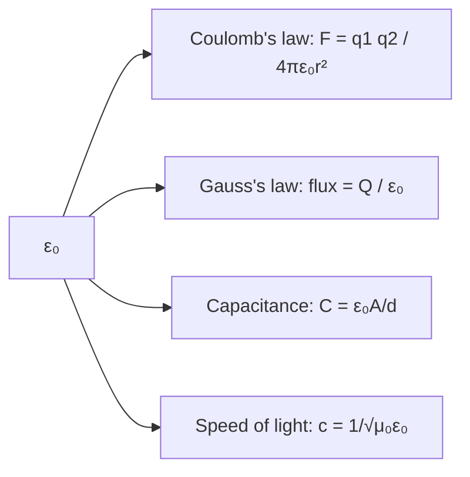
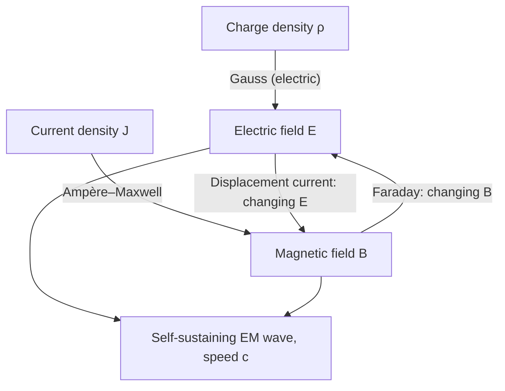

# Concept-Book Run

domain: /home/papagame/projects/digital-duck/cb-college-physics/public/domains/college_physics_ch24/input/graph.yaml
target: microwaves
started: 2026-11-23T23:46:40

## Teaching order (16 concepts)

- amperes_law
- electric_field
- magnetic_field
- permeability_of_free_space
- permittivity_of_free_space
- changing_electric_field_creates_magnetic_field
- faradays_law
- gauss_law_electricity
- gauss_law_magnetism
- speed_of_light
- maxwells_equations
- wave_frequency_wavelength
- electromagnetic_wave
- wave_equation_em
- electromagnetic_spectrum
- microwaves

### amperes_law (23.4s)

## Ampère's Law

**Definition.** Ampère's law relates the magnetic field around a closed loop to the current passing through that loop. For any closed path (an "Amperian loop") in a steady-current situation:

$$\oint \vec{B}\cdot d\vec{l} = \mu_0 I_{\text{enc}}$$

Here $I_{\text{enc}}$ is the net current threading the surface bounded by the loop, with direction set by the right-hand rule (curl your fingers along the loop; your thumb gives the positive current direction). The constant $\mu_0 = 4\pi\times10^{-7}\ \text{T·m/A}$ is the permeability of free space. The law is always true, but it only *solves* for $B$ when symmetry lets you pull $B$ out of the integral.

**Worked example: field of a long straight wire.** A wire carries current $I$. By symmetry, the field lines are circles centered on the wire, and $|\vec{B}|$ is the same everywhere on a circle of radius $r$. Choose that circle as the Amperian loop. Then $\vec{B}$ is parallel to $d\vec{l}$ at every point, so

$$\oint \vec{B}\cdot d\vec{l} = B(2\pi r) = \mu_0 I \quad\Longrightarrow\quad B = \frac{\mu_0 I}{2\pi r}.$$

For $I = 10\ \text{A}$ and $r = 5\ \text{cm}$:

$$B = \frac{(4\pi\times10^{-7})(10)}{2\pi(0.05)} = 4\times10^{-5}\ \text{T},$$

roughly the strength of Earth's magnetic field.

**Problem-solving application: the solenoid.** A long solenoid has $n$ turns per meter and carries current $I$. Find the field inside.

1. *Use symmetry.* Inside a long solenoid, $\vec{B}$ points along the axis, and outside it is negligible.
2. *Choose a loop.* Draw a rectangle of length $L$ with one side inside the solenoid, parallel to the axis, and the opposite side outside.
3. *Evaluate each side.* The inside side gives $BL$. The outside side gives approximately $0$. The two sides perpendicular to the axis give $0$, since $\vec{B}\perp d\vec{l}$ (or $B\approx0$).
4. *Count the enclosed current.* The loop encloses $nL$ turns, so $I_{\text{enc}} = nLI$.

Applying the law, $BL = \mu_0 nLI$, so

$$B = \mu_0 n I.$$

With $n = 2000\ \text{turns/m}$ and $I = 3\ \text{A}$, $B = (4\pi\times10^{-7})(2000)(3)\approx 7.5\times10^{-3}\ \text{T}$. The length $L$ cancels, as it should, because the field is uniform inside.

**Common pitfalls.**
- Only current *passing through* the loop counts. Current outside the loop still contributes to $\vec{B}$ but not to $I_{\text{enc}}$. The integral still holds because $\vec{B}$ is the total field from all sources.
- Without sufficient symmetry (a short wire segment, a finite coil), the law remains true but cannot be solved for $B$ directly. Other methods are needed in those cases.
- The law as written applies to steady currents only. Situations with changing electric fields, such as a charging capacitor, require a correction that is beyond this section.

**Key idea.** Choose a loop that matches the symmetry of the current, so that $B$ is constant and parallel to the path (or zero). Ampère's law then reduces an integral statement to simple algebra.

### electric_field (1.2s)

## Electric Field

### Definition

The **electric field** at a point in space is the electric force that would act on a positive test charge placed there, divided by that test charge:

$$\vec{E} = \frac{\vec{F}}{q}, \qquad [E] = \text{N/C} = \text{V/m}.$$

Dividing by $q$ removes the test charge from the description. What remains depends only on the source charges and on the position of the point. The field is a property of space around the sources, whether or not a test charge is present. $\vec{E}$ is a vector, and it points in the direction a positive charge would be pushed.

For a point source $Q$, Coulomb's law gives the force on a test charge $q$ at distance $r$. Dividing by $q$ gives

$$E = \frac{k|Q|}{r^2}, \qquad k = 8.99\times10^{9}\ \text{N·m}^2/\text{C}^2.$$

The field points away from $Q$ if $Q>0$ and toward $Q$ if $Q<0$. It falls off as $1/r^2$.

**Superposition.** With several sources, the net field is the vector sum of each source's field:

$$\vec{E}_{\text{net}} = \sum_i \vec{E}_i.$$

### Worked example

A point charge $Q = +3.0\ \text{nC}$ sits at the origin. Find the field at $r = 0.30\ \text{m}$ along the $+x$ axis, then find the force on an electron placed there.

$$E = \frac{(8.99\times10^{9})(3.0\times10^{-9})}{(0.30)^2} = 300\ \text{N/C},$$

directed along $+x$, away from the positive charge.

The force on the electron ($q=-1.60\times10^{-19}\ \text{C}$) uses $\vec{F}=q\vec{E}$:

$$\vec{F} = (-1.60\times10^{-19})(300\,\hat{x}) = -4.8\times10^{-17}\,\hat{x}\ \text{N}.$$

The negative sign shows the force points opposite the field, toward the source. A negative charge is pulled against $\vec{E}$.

### Problem-solving application

**Two charges.** Place $+2.0\ \text{nC}$ at $x=0$ and $-2.0\ \text{nC}$ at $x=0.20\ \text{m}$. Find $\vec{E}$ at the midpoint, $x = 0.10\ \text{m}$.

1. Each charge is $0.10\ \text{m}$ from the midpoint, so each field has magnitude
$$E_i = \frac{(8.99\times10^{9})(2.0\times10^{-9})}{(0.10)^2} \approx 1800\ \text{N/C}.$$
2. The positive charge pushes a test charge away from itself, in the $+x$ direction. The negative charge pulls it toward itself, which is also the $+x$ direction.
3. The two fields point the same way, so they add:
$$\vec{E}_{\text{net}} \approx 3600\,\hat{x}\ \text{N/C}.$$

**Strategy for any problem:**
- Sketch the sources and the field point.
- For each source, find the magnitude $k|Q|/r^2$ and the direction (away from $+$, toward $-$).
- Resolve into components, then add the components. Do not add magnitudes unless the vectors are collinear.
- To get a force, compute $\vec{F}=q\vec{E}$. Check that its direction is along $\vec{E}$ for $q>0$ and opposite for $q<0$.

**Check your answer.** Far from a collection of charges with net charge $Q_{\text{net}}$, the field should look like that of a single point charge $Q_{\text{net}}$. At the midpoint above, the field is strong because the two charges are close and their fields reinforce. Far from a net-neutral pair, the fields nearly cancel, and the result falls off faster than $1/r^2$.

### magnetic_field (0.9s)

## Magnetic Field

### Definition

A **magnetic field** $\mathbf{B}$ is a vector field: at every point in space it assigns a vector describing the magnetic influence there. We define it operationally through the force on a moving charge. A charge $q$ moving with velocity $\mathbf{v}$ through a field $\mathbf{B}$ experiences

$$\mathbf{F} = q\,\mathbf{v}\times\mathbf{B},$$

with magnitude $F = |q|\,v\,B\sin\theta$, where $\theta$ is the angle between $\mathbf{v}$ and $\mathbf{B}$. The direction follows the right-hand rule (reverse it for negative $q$). The SI unit is the tesla: $1\,\text{T} = 1\,\text{N}/(\text{C}\cdot\text{m/s})$.

Three consequences follow directly from the cross product:

- No force acts on a charge at rest ($v=0$) or one moving parallel to $\mathbf{B}$ ($\theta=0$).
- The force is always perpendicular to $\mathbf{v}$, so $\mathbf{F}\cdot\mathbf{v}=0$. A magnetic force does **no work** and changes a particle's direction, never its speed.
- Magnetic field lines form closed loops. Mathematically, $\nabla\cdot\mathbf{B}=0$, because no isolated magnetic poles have been observed.

### Worked example

A proton ($q=1.60\times10^{-19}$ C, $m=1.67\times10^{-27}$ kg) moves at $v=3.0\times10^{6}$ m/s perpendicular to a uniform field of $B=0.50$ T. Find the force and the path.

**Force:** since $\theta=90^\circ$,

$$F = qvB = (1.60\times10^{-19})(3.0\times10^{6})(0.50)=2.4\times10^{-13}\ \text{N}.$$

**Path:** the force is perpendicular to the velocity and has constant magnitude, so it acts as a centripetal force and the proton moves in a circle. Setting $qvB = mv^2/r$ gives

$$r=\frac{mv}{qB}=\frac{(1.67\times10^{-27})(3.0\times10^{6})}{(1.60\times10^{-19})(0.50)}\approx 6.3\times10^{-2}\ \text{m}.$$

The period $T = 2\pi r/v = 2\pi m/(qB)$ does not depend on speed. This property is the basis of the cyclotron.

### Problem-solving application

**Mass spectrometer.** Ions of charge $q$ are accelerated through a potential difference $V$, so $\tfrac12 mv^2 = qV$. They then enter a field $B$ perpendicular to their motion and curve with radius $r = mv/(qB)$. Eliminating $v$:

$$m=\frac{qB^2r^2}{2V}.$$

Measuring $r$, the distance at which ions strike a detector, therefore determines the mass.

*Practice:* singly charged ions are accelerated through $V=1000$ V and enter $B=0.20$ T. An ion lands with $r=0.102$ m. Then $m = (1.60\times10^{-19})(0.04)(0.0104)/(2000)\approx 3.3\times10^{-26}$ kg, about 20 atomic mass units. This is consistent with neon-20.

**General strategy:**

1. Sketch $\mathbf{v}$ and $\mathbf{B}$, and find the direction of $\mathbf{v}\times\mathbf{B}$. Flip it if $q<0$.
2. Decompose $\mathbf{v}$ into components parallel and perpendicular to $\mathbf{B}$. The perpendicular part drives circular motion and the parallel part is unchanged. If both are present, the path is a helix.
3. Apply $qv_\perp B = mv_\perp^2/r$ and solve for the unknown.

### permeability_of_free_space (14.1s)

## Permeability Of Free Space

**Definition.** The permeability of free space, $\mu_0$, is the constant that links electric current to the magnetic field it produces in a vacuum. It appears in the Biot–Savart law and Ampère's law, and it sets the scale of every magnetic interaction in free space. Its value is

$$\mu_0 \approx 4\pi \times 10^{-7}\ \text{T·m/A} = 1.2566 \times 10^{-6}\ \text{N/A}^2.$$

Before 2019, $\mu_0$ was defined to be exactly $4\pi\times10^{-7}$ N/A², and this definition fixed the ampere. Since the 2019 SI revision, $\mu_0$ is measured, and it differs from that value by about one part in $10^{10}$. It is also tied to the electric constant $\varepsilon_0$ and the speed of light by

$$c = \frac{1}{\sqrt{\mu_0\,\varepsilon_0}}.$$

**Two key results.** For a long straight wire carrying current $I$, Ampère's law gives the field at distance $r$:

$$B = \frac{\mu_0 I}{2\pi r}.$$

Two parallel wires carrying currents $I_1$ and $I_2$, separated by $d$, exert a force per unit length on each other:

$$\frac{F}{L} = \frac{\mu_0 I_1 I_2}{2\pi d}.$$

The force is attractive when the currents flow in the same direction and repulsive when they flow in opposite directions.

**Worked example.** Find the field 5.0 cm from a wire carrying 20 A.

$$B = \frac{(4\pi\times10^{-7})(20)}{2\pi(0.050)} = \frac{2\times10^{-7}\cdot 20}{0.050} = 8.0\times10^{-5}\ \text{T}.$$

This is about 80 µT, which is comparable to Earth's field of roughly 50 µT. Note that $\mu_0/2\pi = 2\times10^{-7}$ T·m/A, so you can often skip the $\pi$ arithmetic.

**Problem-solving application.** Two parallel conductors 1.0 m apart each carry 1.0 A in the same direction. What is the force on a 1.0 m length of one wire?

$$\frac{F}{L} = \frac{(4\pi\times10^{-7})(1.0)(1.0)}{2\pi(1.0)} = 2\times10^{-7}\ \text{N/m}.$$

This is the force that defined the ampere before 2019. It is tiny, which shows why everyday magnetic effects usually need large currents or ferromagnetic cores. Inside a material, $\mu_0$ is replaced by $\mu = \mu_r\mu_0$. For iron, $\mu_r$ can reach the thousands, and this is why electromagnets and transformers use iron cores.

**Checking your work.**
1. Use units: T·m/A times A divided by m gives tesla.
2. Field strength falls as $1/r$, so doubling the distance halves $B$.
3. Use the right-hand rule for direction. With your thumb along the current, your fingers curl in the direction of $\mathbf{B}$.

**Why it matters.** Because $\mu_0\varepsilon_0 = 1/c^2$, this constant links magnetism, electricity, and light. Maxwell's prediction that electromagnetic waves travel at $c$ follows directly from it.

### permittivity_of_free_space (15.8s)

## Permittivity Of Free Space

### Definition

The **permittivity of free space**, $\varepsilon_0$, is the constant that sets the strength of electric interactions in a vacuum. It appears in Coulomb's law for the force between two point charges $q_1$ and $q_2$ separated by a distance $r$:

$$F = \frac{1}{4\pi\varepsilon_0}\,\frac{|q_1 q_2|}{r^2}$$

Its value is

$$\varepsilon_0 \approx 8.854\times10^{-12}\ \mathrm{C^2\,N^{-1}\,m^{-2}} = 8.854\times10^{-12}\ \mathrm{F/m}.$$

A small $\varepsilon_0$ means the vacuum "permits" little electric field to form per unit charge, so charges interact strongly. The familiar constant $k = \dfrac{1}{4\pi\varepsilon_0} \approx 8.99\times10^{9}\ \mathrm{N\,m^2/C^2}$ is just a repackaging of it.

The same constant appears in Gauss's law, which is where the factor of $4\pi$ comes from. The field of a point charge $Q$ is $E = \dfrac{Q}{4\pi\varepsilon_0 r^2}$. The flux through a closed surface is then

$$\oint \vec{E}\cdot d\vec{A} = \frac{Q_{\text{enc}}}{\varepsilon_0}.$$

Because the sphere's area is $4\pi r^2$, writing Coulomb's law with $4\pi$ in the denominator removes the $4\pi$ from Gauss's law. It also connects $\varepsilon_0$ to light. With the magnetic constant $\mu_0$, Maxwell's equations give

$$c = \frac{1}{\sqrt{\mu_0\varepsilon_0}}.$$

### Worked example

Find the force between a proton and an electron in hydrogen, separated by $r = 5.3\times10^{-11}$ m (the Bohr radius). Each charge has magnitude $e = 1.60\times10^{-19}$ C.

$$F = \frac{(1.60\times10^{-19})^2}{4\pi(8.854\times10^{-12})(5.3\times10^{-11})^2}$$

Numerator: $2.56\times10^{-38}$. Denominator: $4\pi(8.854\times10^{-12}) = 1.113\times10^{-10}$, and $(5.3\times10^{-11})^2 = 2.81\times10^{-21}$, so the denominator is $3.13\times10^{-31}$.

$$F \approx 8.2\times10^{-8}\ \text{N}$$

The force is tiny in everyday terms, but it acts on an electron of mass $9.11\times10^{-31}$ kg. That gives an acceleration of about $9\times10^{22}\ \mathrm{m/s^2}$.

### Problem-solving application

**Problem.** Two small spheres, each carrying $+2.0\ \mu\text{C}$, repel with a force of 0.10 N. How far apart are they?

Solve Coulomb's law for $r$:

$$r = \sqrt{\frac{q^2}{4\pi\varepsilon_0 F}}$$

Substitute $q = 2.0\times10^{-6}$ C, so $q^2 = 4.0\times10^{-12}$ C². The denominator is $1.113\times10^{-10}\times 0.10 = 1.113\times10^{-11}$.

$$r = \sqrt{\frac{4.0\times10^{-12}}{1.113\times10^{-11}}} = \sqrt{0.359} \approx 0.60\ \text{m}$$

**Strategy.** Keep $\varepsilon_0$ in your formulas, because it carries over to other settings:

- **Parallel-plate capacitor.** $C = \varepsilon_0 A/d$.
- **Dielectrics.** In a material, replace $\varepsilon_0$ with $\varepsilon = \kappa\varepsilon_0$. The dielectric constant $\kappa$ is $\approx 80$ for water, so forces between charges in water are about 80 times weaker than in vacuum.
- **Units check.** $\varepsilon_0$ in $\mathrm{F/m}$ gives capacitance directly, and in $\mathrm{C^2\,N^{-1}\,m^{-2}}$ gives force directly. The two forms are identical.

*One constant, $\varepsilon_0$, links electrostatic force, flux, capacitance, and the speed of light.*

### changing_electric_field_creates_magnetic_field (15.9s)

## Changing Electric Field Creates Magnetic Field

### Definition

Ampère's original law states that a magnetic field circulates around any electric current:

$$\oint \vec B\cdot d\vec l = \mu_0 I_{\text{enc}}$$

This law fails when current is not continuous. Consider a capacitor being charged. Current flows in the wires, but no charge crosses the gap between the plates. Choose a surface bounded by a loop around the wire. If the surface is flat, $I_{\text{enc}} = I$. If the surface is bulged out to pass through the gap, $I_{\text{enc}} = 0$. The same loop gives two different answers, which is a contradiction.

Maxwell resolved this by adding a term. A changing electric flux acts like a current, called the **displacement current**:

$$I_d = \varepsilon_0 \frac{d\Phi_E}{dt}$$

The corrected law, the **Ampère–Maxwell law**, is

$$\oint \vec B\cdot d\vec l = \mu_0\left(I_{\text{enc}} + \varepsilon_0 \frac{d\Phi_E}{dt}\right)$$

**A changing electric field creates a magnetic field**, even where no charge moves. This mirrors Faraday's law, in which a changing magnetic field creates an electric field. Together the two laws make the theory symmetric, and they make electromagnetic waves possible.

### Worked Example

A parallel-plate capacitor has circular plates of radius $R = 5.0\ \text{cm}$. It is charged with a current $I = 2.0\ \text{A}$. Find $B$ at $r = 3.0\ \text{cm}$ from the axis, inside the gap.

**Step 1: Electric flux through a circle of radius $r$.** The field between the plates is uniform, with $E = \dfrac{Q}{\varepsilon_0 \pi R^2}$. The flux is

$$\Phi_E = E\,\pi r^2 = \frac{Q\,r^2}{\varepsilon_0 R^2}$$

**Step 2: Rate of change.** Since $dQ/dt = I$,

$$\varepsilon_0\frac{d\Phi_E}{dt} = I\,\frac{r^2}{R^2}$$

**Step 3: Apply the law.** There is no real current in the gap, so symmetry gives $B(2\pi r) = \mu_0 I \dfrac{r^2}{R^2}$. Therefore

$$B = \frac{\mu_0 I r}{2\pi R^2}$$

$$B = \frac{(4\pi\times10^{-7})(2.0)(0.030)}{2\pi(0.050)^2} = 4.8\times10^{-6}\ \text{T}$$

Check consistency: at $r=R$, $B = \mu_0 I/(2\pi R)$. This is exactly the field of the wire just outside the plates, so the field is continuous across the boundary. The contradiction is resolved.

### Problem-Solving Application

**Problem.** An electric field in a region is $E(t) = E_0 \sin(\omega t)$ over a circular area of radius $R$, with $E_0 = 1.0\times10^{3}\ \text{V/m}$ and $\omega = 2\pi\times10^{6}\ \text{s}^{-1}$. Find the peak magnetic field at $r = R = 1.0\ \text{cm}$.

**Strategy.**
1. Identify the loop and surface. Use a circle of radius $r$ with $E$ perpendicular to the surface.
2. Compute $\Phi_E = E\,\pi r^2$ and differentiate. Here $\dfrac{d\Phi_E}{dt} = \pi r^2 E_0\omega\cos\omega t$.
3. Set $I_{\text{enc}} = 0$ and use symmetry: $B(2\pi r) = \mu_0\varepsilon_0 \pi r^2 E_0\omega\cos\omega t$.

**Solution.**

$$B_{\max} = \frac{\mu_0\varepsilon_0\, r\,E_0\,\omega}{2} = \frac{r\,E_0\,\omega}{2c^2}$$

$$B_{\max} = \frac{(0.010)(1.0\times10^{3})(6.28\times10^{6})}{2(9.0\times10^{16})} \approx 3.5\times10^{-13}\ \text{T}$$

The result is tiny because $1/c^2$ is so small. Magnetic fields from changing $\vec E$ are hard to detect in everyday settings. They become important at high frequencies, as in radio waves and light. There the two induction laws feed each other: a changing $\vec E$ creates $\vec B$, and a changing $\vec B$ creates $\vec E$. Together they sustain a wave traveling at $c = 1/\sqrt{\mu_0\varepsilon_0}$.

### faradays_law (2.1s)

## Faradays Law

**Definition.** A changing magnetic flux through a loop of wire induces an electromotive force (emf) in that loop. Magnetic flux through a flat surface of area $A$ in a uniform field $B$ is

$$\Phi = BA\cos\theta,$$

where $\theta$ is the angle between $\vec B$ and the surface normal. Faraday's law states that for a coil of $N$ turns, the induced emf is

$$\mathcal{E} = -N\,\frac{\Delta\Phi}{\Delta t}.$$

Flux is measured in webers ($1\ \text{Wb} = 1\ \text{T·m}^2$), and emf in volts. The minus sign is Lenz's law. The induced emf drives a current whose own magnetic field opposes the *change* in flux that produced it. Because the flux through each turn adds, $N$ turns multiply the emf by $N$. Flux can change in three ways: $B$ changes, $A$ changes, or $\theta$ changes. Any one of these is enough to induce an emf.

**Worked example.** A coil has $N = 200$ turns, each of area $A = 0.010\ \text{m}^2$. It sits with its normal parallel to a field ($\theta = 0$) that drops uniformly from $0.80\ \text{T}$ to $0.20\ \text{T}$ in $0.30\ \text{s}$. Find the induced emf.

1. Initial flux per turn: $\Phi_i = (0.80)(0.010) = 8.0\times10^{-3}\ \text{Wb}$.
2. Final flux per turn: $\Phi_f = (0.20)(0.010) = 2.0\times10^{-3}\ \text{Wb}$.
3. Change: $\Delta\Phi = -6.0\times10^{-3}\ \text{Wb}$.
4. Emf:
$$\mathcal{E} = -200\,\frac{-6.0\times10^{-3}}{0.30} = +4.0\ \text{V}.$$

The positive sign means the induced current produces a field in the *same* direction as the original, opposing the decrease in flux.

**Problem-solving application.** A generator is a coil rotating in a uniform field. Take a coil with $N = 50$ turns, $A = 0.020\ \text{m}^2$, in $B = 0.50\ \text{T}$, turning at $\omega$. Then $\theta = \omega t$, so $\Phi = BA\cos\omega t$. Taking the limit of small $\Delta t$ gives

$$\mathcal{E} = -N\frac{d\Phi}{dt} = NBA\omega\sin\omega t.$$

The peak emf is $\mathcal{E}_{\max} = NBA\omega$. At 60 Hz, $\omega = 2\pi(60) = 377\ \text{rad/s}$, so

$$\mathcal{E}_{\max} = (50)(0.50)(0.020)(377) \approx 189\ \text{V}.$$

The emf is largest when the loop is *parallel* to the field ($\theta = 90^\circ$). At that moment the flux is zero but changing fastest. The emf is zero when the flux is at its maximum, because the flux is momentarily not changing there.

**Strategy for any Faraday problem:**

1. Write $\Phi$ as a function of the quantities that change.
2. Compute $\Delta\Phi$ (or differentiate) per turn.
3. Multiply by $N$ and divide by $\Delta t$.
4. Use the sign and Lenz's law to find the current direction.

Note that the law uses the rate of change, not the flux itself. A large but constant flux induces nothing.

### gauss_law_electricity (25.7s)

## Gauss Law Electricity

### Definition

**Gauss's law** relates the electric field on a closed surface to the charge inside it. For any closed surface $S$:

$$\oint_S \vec{E}\cdot d\vec{A} = \frac{Q_{\text{enc}}}{\varepsilon_0}$$

The left side adds up, over the whole surface, the component of $\vec{E}$ perpendicular to the surface. It counts how many field lines pass outward through $S$. $Q_{\text{enc}}$ is the net charge inside $S$, and $\varepsilon_0 \approx 8.85\times10^{-12}\ \text{C}^2/(\text{N·m}^2)$ is a constant of nature. Charges outside $S$ add nothing, because every line that enters also leaves. For static charges the law is equivalent to Coulomb's law. It is much faster when the charge distribution is symmetric.

### Worked example: point charge

Take a sphere of radius $r$ centered on a charge $q$. By symmetry, $\vec{E}$ is radial and has the same magnitude everywhere on the sphere. It is parallel to $d\vec{A}$, so $E$ comes out of the integral:

$$E\,(4\pi r^2) = \frac{q}{\varepsilon_0}\quad\Longrightarrow\quad E = \frac{1}{4\pi\varepsilon_0}\frac{q}{r^2}.$$

This recovers Coulomb's law, with $k = 1/(4\pi\varepsilon_0)$. The inverse-square dependence comes from geometry: the sphere's area grows as $r^2$, so the same number of field lines is spread more thinly.

### Problem-solving application

**Problem:** An infinite line of charge has linear density $\lambda$ (charge per unit length). Find $E$ at distance $r$ from the line.

**Strategy:** Gauss's law only helps when symmetry lets you pull $E$ out of the integral. Follow these steps:

1. Identify the symmetry. $\vec{E}$ points radially away from the line, and its magnitude depends only on $r$.
2. Choose a closed surface on which $E$ is constant and perpendicular to the surface. Use a coaxial cylinder of radius $r$ and length $L$.
3. Compute the flux. The end caps contribute zero, because $\vec{E}$ is parallel to their surfaces. Only the curved side contributes: $E(2\pi r L)$.
4. Find the enclosed charge: $Q_{\text{enc}} = \lambda L$.
5. Apply the law:

$$E(2\pi r L) = \frac{\lambda L}{\varepsilon_0}\quad\Longrightarrow\quad E = \frac{\lambda}{2\pi\varepsilon_0 r}.$$

The field falls off as $1/r$, not $1/r^2$, because the cylinder's area grows only in proportion to $r$. The length $L$ cancels, as it should for an infinite line.

**Check yourself:** Suppose you doubled $r$. By what factor does $E$ change for a point charge? For the line? (Answers: $1/4$ and $1/2$.)

### Key takeaways

- The net outward flux through a closed surface equals $Q_{\text{enc}}/\varepsilon_0$.
- The law yields $E$ directly only when symmetry makes $E$ constant and perpendicular on the chosen surface.
- The distance dependence follows from how that surface's area grows: $1/r^2$ for a sphere and $1/r$ for a cylinder.

### gauss_law_magnetism (23.3s)

## Gauss's Law for Magnetism

**Definition.** Gauss's law for magnetism states that the net magnetic flux through any closed surface is zero:

$$\oint_S \vec{B}\cdot d\vec{A} = 0 \qquad\Longleftrightarrow\qquad \nabla\cdot\vec{B}=0 .$$

The magnetic flux through a surface is $\Phi_B=\int \vec{B}\cdot d\vec{A}$. For a closed surface, $d\vec{A}$ points outward. Flux leaving the surface counts as positive, and flux entering counts as negative. The law says these always cancel exactly: every field line that enters a closed region must also leave it. Equivalently, magnetic field lines form closed loops or extend to infinity, and they never start or stop. Electric charge produces diverging field lines, so the electric version of Gauss's law gives $Q_{\text{enc}}/\varepsilon_0$. The magnetic version gives zero because no isolated magnetic charge (monopole) has ever been observed. Cutting a bar magnet in half gives two smaller magnets, each with its own north and south pole.

**Worked example.** A uniform field $\vec{B}=B_0\hat{z}$ passes through a cylinder of radius $R$ and length $L$ whose axis lies along $z$. Find the net flux through the closed surface.

- Right end cap, outward normal $+\hat{z}$: $\Phi_1 = B_0\pi R^2$.
- Left end cap, outward normal $-\hat{z}$: $\Phi_2 = -B_0\pi R^2$.
- Curved side: $\vec{B}\perp d\vec{A}$ everywhere, so $\Phi_3=0$.

The total is $\Phi_1+\Phi_2+\Phi_3=0$, as the law requires.

**Problem-solving application.** Suppose a field has the form $\vec{B}=(ax,\,by,\,0)$, where $a$ and $b$ are constants. Can it be a real magnetic field? Apply the law in its differential form, which requires the divergence of $\vec{B}$ (the sum of its partial derivatives) to vanish:

$$\nabla\cdot\vec{B}=\frac{\partial (ax)}{\partial x}+\frac{\partial (by)}{\partial y}=a+b .$$

A physical field requires $a+b=0$, so $b=-a$. The field $\vec{B}=(ax,-ay,0)$ is allowed. Near the origin, field lines move in along one axis and out along the other, which looks like a saddle. The field $(ax, ay, 0)$ with $a\neq 0$ is not allowed. It would radiate outward from a point, which would be a north monopole at the origin.

This divergence test is a quick consistency check on any proposed field. It also describes the field of a magnet: outside a bar magnet, lines run from the north pole to the south pole, and inside, they continue from south back to north, completing the loop.

*Magnetic field lines of a bar magnet form closed loops: outside the magnet they run north to south, and inside they return south to north. They have no starting or ending point.*

**Key takeaway.** Zero divergence means magnetic field lines have no sources or sinks. If a magnetic monopole were discovered, the law would have to be modified, with the zero replaced by a term proportional to the enclosed magnetic charge.

### speed_of_light (14.1s)

## Speed Of Light

**Definition.** The speed of light in vacuum, $c$, is the speed at which electromagnetic waves propagate through empty space. Its value is exactly $c = 299\,792\,458\ \text{m/s} \approx 3\times10^{8}\ \text{m/s}$. Maxwell's equations show that $c$ is not an arbitrary number. It follows from two constants that describe how vacuum responds to electric and magnetic fields: the permittivity $\varepsilon_0$ and the permeability $\mu_0$.

$$c = \frac{1}{\sqrt{\mu_0 \varepsilon_0}}$$

**Where this comes from.** In vacuum, Maxwell's equations combine into a wave equation for the electric field:

$$\nabla^2 \mathbf{E} = \mu_0 \varepsilon_0 \frac{\partial^2 \mathbf{E}}{\partial t^2}.$$

A general wave equation has the form $\nabla^2 \mathbf{E} = \frac{1}{v^2}\frac{\partial^2 \mathbf{E}}{\partial t^2}$, where $v$ is the wave speed. Matching the two forms gives $v^2 = 1/(\mu_0\varepsilon_0)$. Maxwell found that this speed equals the measured speed of light, which led him to conclude that light is an electromagnetic wave.

**Worked example.** Use $\varepsilon_0 = 8.854\times10^{-12}\ \text{C}^2/(\text{N·m}^2)$ and $\mu_0 = 4\pi\times10^{-7}\ \text{N/A}^2 \approx 1.257\times10^{-6}\ \text{N/A}^2$.

$$\mu_0\varepsilon_0 = (1.257\times10^{-6})(8.854\times10^{-12}) = 1.113\times10^{-17}\ \text{s}^2/\text{m}^2$$

$$c = \frac{1}{\sqrt{1.113\times10^{-17}}} = \frac{1}{3.336\times10^{-9}} \approx 3.00\times10^{8}\ \text{m/s}$$

The result matches the measured value. Two constants measured with electric and magnetic apparatus predict the speed of light without any optical measurement.

**Problem-solving application.** *How long does sunlight take to reach Earth, and how long does a radar pulse take to make a round trip to an aircraft 60 km away?*

*Sunlight.* The Earth–Sun distance is $d = 1.496\times10^{11}$ m. Since $t = d/c$,

$$t = \frac{1.496\times10^{11}}{3.00\times10^{8}} \approx 499\ \text{s} \approx 8.3\ \text{min}.$$

*Radar.* Radar pulses are radio waves, so they travel at $c$. The pulse covers the distance twice:

$$t = \frac{2d}{c} = \frac{2(6.0\times10^{4})}{3.00\times10^{8}} = 4.0\times10^{-4}\ \text{s} = 0.40\ \text{ms}.$$

Reversing the calculation, a measured delay $t$ gives the distance $d = ct/2$. Radar ranging, lidar, and GPS timing all use this relation.

**Key points.**

- $c$ is a property of vacuum. In a medium with refractive index $n$, light travels at $v = c/n$, which is slower.
- All electromagnetic waves travel at $c$ in vacuum. This includes radio waves, visible light, and X-rays, and their frequencies and wavelengths are related by $c = f\lambda$.
- Since 1983 the metre has been defined from $c$, which is why $c$ is exact. The second is fixed by atomic clocks, and the metre is the distance light travels in $1/299\,792\,458$ s.
- Special relativity treats $c$ as the same for all inertial observers, and no signal or object can exceed it.

**Check yourself.** Green light has wavelength $550$ nm. Use $f = c/\lambda$ to show that its frequency is about $5.5\times10^{14}$ Hz.

### maxwells_equations (15.3s)

## Maxwells Equations

### Definition

Maxwell's equations are four field equations that describe how electric fields $\mathbf{E}$ and magnetic fields $\mathbf{B}$ are produced by charges, currents, and by each other. In SI units, in differential form:

$$\nabla\cdot\mathbf{E}=\frac{\rho}{\varepsilon_0}\qquad \nabla\cdot\mathbf{B}=0$$

$$\nabla\times\mathbf{E}=-\frac{\partial\mathbf{B}}{\partial t}\qquad \nabla\times\mathbf{B}=\mu_0\mathbf{J}+\mu_0\varepsilon_0\frac{\partial\mathbf{E}}{\partial t}$$

In order, these are:

- **Gauss's law (electric):** charge density $\rho$ is the source of $\mathbf{E}$.
- **Gauss's law (magnetic):** there are no magnetic monopoles, so field lines of $\mathbf{B}$ never begin or end.
- **Faraday's law:** a changing magnetic field induces a circulating electric field.
- **Ampère–Maxwell law:** a current density $\mathbf{J}$ *or* a changing electric field produces a circulating magnetic field.

The integral forms are equivalent. For example, Faraday's law reads $\oint \mathbf{E}\cdot d\boldsymbol{\ell}=-\dfrac{d\Phi_B}{dt}$. Maxwell's key contribution was the term $\mu_0\varepsilon_0\,\partial\mathbf{E}/\partial t$, the displacement current. Without it, the equations contradict charge conservation.

### Worked example: a charging capacitor

A circular parallel-plate capacitor has plate radius $R$ and is charged by a current $I$. Find $B$ between the plates at radius $r<R$.

No charge flows between the plates, so $\mathbf{J}=0$ there. The field is $E=\dfrac{Q}{\varepsilon_0\pi R^2}$, so
$$\frac{\partial E}{\partial t}=\frac{I}{\varepsilon_0\pi R^2}.$$

Apply the integral form of the Ampère–Maxwell law to a circle of radius $r$:
$$\oint\mathbf{B}\cdot d\boldsymbol{\ell}=\mu_0\varepsilon_0\frac{d}{dt}\int\mathbf{E}\cdot d\mathbf{A}$$
$$B(2\pi r)=\mu_0\varepsilon_0\,\pi r^2\,\frac{I}{\varepsilon_0\pi R^2}$$
$$B=\frac{\mu_0 I\,r}{2\pi R^2}.$$

At $r=R$ this equals $\mu_0 I/(2\pi R)$, the field of the wire outside the plates. The field is continuous, as it should be. The changing $\mathbf{E}$ acts as a current.

### Problem-solving application: electromagnetic waves

In empty space, $\rho=0$ and $\mathbf{J}=0$. Take the curl of Faraday's law and use $\nabla\times(\nabla\times\mathbf{E})=\nabla(\nabla\cdot\mathbf{E})-\nabla^2\mathbf{E}=-\nabla^2\mathbf{E}$:
$$-\nabla^2\mathbf{E}=-\frac{\partial}{\partial t}(\nabla\times\mathbf{B})=-\mu_0\varepsilon_0\frac{\partial^2\mathbf{E}}{\partial t^2}$$
$$\nabla^2\mathbf{E}=\mu_0\varepsilon_0\frac{\partial^2\mathbf{E}}{\partial t^2}.$$

This is a wave equation with speed
$$c=\frac{1}{\sqrt{\mu_0\varepsilon_0}}=\frac{1}{\sqrt{(4\pi\times10^{-7})(8.854\times10^{-12})}}\approx3.00\times10^{8}\ \text{m/s}.$$

Light is an electromagnetic wave. **Strategy for problems:**

1. Identify the symmetry (planar, cylindrical, spherical).
2. Choose the equation whose source appears in the problem: charge, current, changing $\mathbf{B}$, or changing $\mathbf{E}$.
3. Pick a surface or loop that exploits the symmetry.
4. Evaluate the integral and solve for the field.

*Changing electric and magnetic fields sustain each other, giving electromagnetic waves.*

### wave_frequency_wavelength (13.1s)

## Wave Frequency Wavelength

**Definition.** A periodic wave repeats its pattern in both time and space. The **frequency** $f$ is the number of complete cycles passing a fixed point each second, measured in hertz (1 Hz = 1 cycle/s). The **period** is $T = 1/f$. The **wavelength** $\lambda$ is the distance between successive identical points, such as crest to crest. In one period the wave advances exactly one wavelength, so the wave speed is

$$v = \frac{\lambda}{T} = f\lambda .$$

At a fixed speed $v$, frequency and wavelength are inversely related:

$$f = \frac{v}{\lambda}, \qquad \lambda = \frac{v}{f}.$$

Doubling $f$ halves $\lambda$. The speed $v$ is set by the medium, not by the source. For example, $v \approx 343\ \text{m/s}$ for sound in air at $20^\circ\text{C}$, and $v = c = 3.00\times10^{8}\ \text{m/s}$ for light in vacuum. The source sets $f$, and the wavelength then follows from $\lambda = v/f$.

**Worked example.** A speaker emits a 440 Hz tone (concert A) in air. Find its wavelength.

$$\lambda = \frac{v}{f} = \frac{343\ \text{m/s}}{440\ \text{Hz}} \approx 0.78\ \text{m}.$$

Check the units: $\text{m/s} \div \text{s}^{-1} = \text{m}$. The answer is reasonable, since audible sound has wavelengths from about 2 cm (20 kHz) to 17 m (20 Hz).

**Problem-solving application.** A wave passes into a new medium, and the problem asks what changes. Consider a 500 Hz sound wave that travels from air ($v_1 = 343\ \text{m/s}$) into water ($v_2 \approx 1480\ \text{m/s}$).

1. *What stays fixed?* The frequency. Each crest arriving at the boundary produces exactly one crest leaving it, so $f = 500\ \text{Hz}$ in both media.
2. *What changes?* The speed and therefore the wavelength.

$$\lambda_1 = \frac{343}{500} = 0.686\ \text{m}, \qquad \lambda_2 = \frac{1480}{500} = 2.96\ \text{m}.$$

The wavelength grows by the same factor as the speed, $\lambda_2/\lambda_1 = v_2/v_1 \approx 4.3$.

A second type of problem asks for the frequency of a signal from its wavelength. An FM radio station broadcasts at $\lambda = 3.00\ \text{m}$. Radio waves are electromagnetic, so

$$f = \frac{c}{\lambda} = \frac{3.00\times10^{8}}{3.00} = 1.00\times10^{8}\ \text{Hz} = 100\ \text{MHz}.$$

This matches the FM band (88–108 MHz).

**Strategy summary.**
- Identify the medium and look up or compute $v$.
- Identify what the source fixes (always $f$) and what the medium fixes (always $v$).
- Solve $v = f\lambda$ for the unknown.
- Check units and compare against a plausible range.

A common error is to say that raising the frequency makes a wave travel faster. In a given medium, $v$ is fixed. Raising $f$ only shortens $\lambda$.

### electromagnetic_wave (14.9s)

## Electromagnetic Wave

### Definition

An **electromagnetic (EM) wave** is a self-sustaining disturbance in which an electric field $\vec{E}$ and a magnetic field $\vec{B}$ oscillate together, each perpendicular to the other and to the direction of propagation. The wave is transverse, and it needs no medium. A changing $\vec{B}$ induces an $\vec{E}$ (Faraday's law), and a changing $\vec{E}$ induces a $\vec{B}$ (Maxwell's addition to Ampère's law). Each field regenerates the other as the wave moves through empty space.

Maxwell's equations in vacuum give a wave equation for each field:

$$\nabla^2 \vec{E} = \mu_0 \varepsilon_0 \,\frac{\partial^2 \vec{E}}{\partial t^2}$$

The wave speed is therefore

$$c = \frac{1}{\sqrt{\mu_0 \varepsilon_0}} \approx 3.00\times 10^8\ \text{m/s}.$$

A plane wave traveling along $+x$ with $\vec{E}$ along $y$ and $\vec{B}$ along $z$ is

$$E_y = E_0 \cos(kx - \omega t), \qquad B_z = B_0 \cos(kx - \omega t),$$

where $k = 2\pi/\lambda$ and $\omega = 2\pi f$. Three relations follow:

- $c = f\lambda$
- $E_0 = c\,B_0$, so the two fields rise and fall in phase
- $\vec{E}\times\vec{B}$ points along the direction of travel

The wave carries energy at an intensity

$$I = \tfrac{1}{2}\,c\,\varepsilon_0 E_0^2 .$$

### Worked example

A radio station broadcasts at $f = 98.0\ \text{MHz}$. Find the wavelength, and find $B_0$ if $E_0 = 0.150\ \text{V/m}$ at your receiver.

**Wavelength:**

$$\lambda = \frac{c}{f} = \frac{3.00\times10^{8}}{98.0\times10^{6}} \approx 3.06\ \text{m}$$

**Magnetic amplitude:**

$$B_0 = \frac{E_0}{c} = \frac{0.150}{3.00\times10^{8}} = 5.00\times10^{-10}\ \text{T}$$

The magnetic field is tiny in SI units. This is normal, because $c$ is so large.

### Problem-solving application

**Problem.** A laser pointer emits 5.00 mW in a beam 2.00 mm in diameter. Find the intensity, $E_0$, and $B_0$.

*Step 1: intensity.* The beam area is $A = \pi r^2 = \pi(1.00\times10^{-3})^2 = 3.14\times10^{-6}\ \text{m}^2$, so

$$I = \frac{P}{A} = \frac{5.00\times10^{-3}}{3.14\times10^{-6}} \approx 1.59\times10^{3}\ \text{W/m}^2 .$$

*Step 2: electric amplitude.* Solve $I = \tfrac12 c\varepsilon_0 E_0^2$ for $E_0$:

$$E_0 = \sqrt{\frac{2I}{c\,\varepsilon_0}} = \sqrt{\frac{2(1.59\times10^{3})}{(3.00\times10^{8})(8.85\times10^{-12})}} \approx 1.09\times10^{3}\ \text{V/m}.$$

*Step 3: magnetic amplitude.*

$$B_0 = \frac{E_0}{c} \approx 3.6\times10^{-6}\ \text{T}.$$

**Check.** The intensity is about that of sunlight, roughly $10^3\ \text{W/m}^2$, but it is squeezed into a pencil-thin beam. The field amplitudes are therefore large. For a given power, a narrower beam gives a larger $E_0$.

**Strategy.** In EM wave problems, first find $\lambda$ or $f$ from $c = f\lambda$. For field strengths, use $E_0 = cB_0$. For power or brightness, use $I = \tfrac12 c\varepsilon_0E_0^2$. Intensity falls as $1/r^2$ from a point source. Doubling the distance cuts $E_0$ by half and $I$ by a factor of four.

*Each changing field induces the other, so the wave keeps propagating through vacuum without a medium.*

### wave_equation_em (13.4s)

## Wave Equation Em

### Definition

An electromagnetic wave is a self-sustaining oscillation of coupled electric and magnetic fields. In vacuum, Maxwell's equations imply that each Cartesian component of $\mathbf{E}$ and $\mathbf{B}$ satisfies the **wave equation**:

$$\frac{\partial^2 E}{\partial x^2} = \frac{1}{c^2}\frac{\partial^2 E}{\partial t^2}, \qquad c = \frac{1}{\sqrt{\mu_0 \varepsilon_0}} \approx 3.00\times10^8\ \text{m/s}.$$

The speed $c$ comes entirely from two measured constants: the vacuum permeability $\mu_0$ and permittivity $\varepsilon_0$. Any function of the form $E(x,t)=f(x-ct)$ solves this equation. The most important case is the sinusoidal traveling wave:

$$E(x,t)=E_0\cos(kx-\omega t),\qquad k=\frac{2\pi}{\lambda},\ \ \omega=2\pi f.$$

Substituting into the wave equation gives $k^2 = \omega^2/c^2$, so $\omega/k = c$. Rewriting this with $f$ and $\lambda$:

$$c = f\lambda.$$

Because $c$ is fixed in vacuum, **higher frequency means shorter wavelength**, and the two are inversely proportional.

### Worked example

An FM radio station broadcasts at $f = 100\ \text{MHz}$. Find its wavelength.

$$\lambda=\frac{c}{f}=\frac{3.00\times10^8}{1.00\times10^8}=3.00\ \text{m}.$$

Now compare green light with $\lambda = 550\ \text{nm}$:

$$f=\frac{c}{\lambda}=\frac{3.00\times10^8}{5.50\times10^{-7}}\approx 5.45\times10^{14}\ \text{Hz}.$$

The light's frequency is about $5\times10^6$ times that of the radio wave, and its wavelength is about $5\times10^6$ times shorter.

### Problem-solving application

**Problem.** A microwave oven operates at $2.45\ \text{GHz}$. (a) Find the wavelength. (b) A standing wave forms between the oven's walls, with nodes at each wall. If the walls are $30.6\ \text{cm}$ apart, how many half-wavelengths fit across?

**Solution.**

(a) $\lambda = \dfrac{3.00\times10^8}{2.45\times10^9}\approx 0.122\ \text{m}=12.2\ \text{cm}$.

(b) Standing waves with nodes at both walls require $L = n\,\dfrac{\lambda}{2}$, so

$$n=\frac{2L}{\lambda}=\frac{2(0.306)}{0.122}\approx 5.$$

Exactly five half-wavelengths fit. Between the nodes lie hot and cold spots spaced $\lambda/2\approx 6.1$ cm apart. This is why ovens use rotating turntables: they move food through the pattern so it heats evenly.

**Strategy to remember.**

1. Convert units first: MHz to $10^6$ Hz, GHz to $10^9$ Hz, nm to $10^{-9}$ m.
2. Use $c=f\lambda$ to move between $f$ and $\lambda$.
3. Check plausibility: radio waves are meters long, visible light is hundreds of nanometers, and X-rays are shorter still.

**Caution.** In a medium such as glass, the speed becomes $v=c/n$, where $n$ is the refractive index. The frequency stays fixed at the boundary, so the wavelength shrinks to $\lambda/n$. Frequency is the invariant property of the wave. Wavelength depends on the medium.

### electromagnetic_spectrum (15.9s)

## Electromagnetic Spectrum

**Definition.** Light is one example of an electromagnetic (EM) wave: an oscillating electric and magnetic field that travels through empty space at the speed of light, $c = 3.00\times10^{8}\ \text{m/s}$. The **electromagnetic spectrum** is the full continuum of these waves, ordered by frequency $f$ or wavelength $\lambda$. All EM waves obey the same relation:

$$c = \lambda f$$

A photon, the quantum of EM radiation, carries energy

$$E = hf = \frac{hc}{\lambda}, \qquad h = 6.63\times10^{-34}\ \text{J·s}.$$

Frequency and energy rise together, while wavelength falls. The categories below are conventional labels for ranges, not sharp physical boundaries.

| Region | Typical wavelength | Typical frequency (Hz) |
|---|---|---|
| Radio | > 1 mm to km | < $3\times10^{11}$ |
| Microwave | 1 mm – 1 m (overlaps radio) | $3\times10^{8}$ – $3\times10^{11}$ |
| Infrared | 700 nm – 1 mm | $3\times10^{11}$ – $4\times10^{14}$ |
| Visible | 400 – 700 nm | $4\times10^{14}$ – $7.5\times10^{14}$ |
| Ultraviolet | 10 – 400 nm | $7.5\times10^{14}$ – $3\times10^{16}$ |
| X-ray | 0.01 – 10 nm | $3\times10^{16}$ – $3\times10^{19}$ |
| Gamma ray | < 0.01 nm | > $3\times10^{19}$ |

The radio and microwave ranges overlap, and so do X-rays and gamma rays. Those bands are defined partly by how the radiation is produced, not only by wavelength.

*Diagram note:* the spectrum is a single axis. Wavelength decreases and frequency and photon energy increase as you move from radio toward gamma rays.

**Worked example.** A Wi-Fi router transmits at $f = 2.4\ \text{GHz}$. Find its wavelength and photon energy.

$$\lambda = \frac{c}{f} = \frac{3.00\times10^{8}}{2.4\times10^{9}} = 0.125\ \text{m}$$

$$E = hf = (6.63\times10^{-34})(2.4\times10^{9}) \approx 1.6\times10^{-24}\ \text{J} \approx 10^{-5}\ \text{eV}$$

The wavelength is about 12 cm, which is why Wi-Fi antennas are only a few centimeters long. The photon energy is far too small to break chemical bonds, which typically need a few eV.

**Problem-solving application.** Why does sunscreen block ultraviolet light but not visible light, and why can UV damage DNA?

Compare photon energies. For green light, $\lambda = 550\ \text{nm}$:

$$E = \frac{hc}{\lambda} = \frac{(6.63\times10^{-34})(3.00\times10^{8})}{5.5\times10^{-7}} \approx 3.6\times10^{-19}\ \text{J} \approx 2.3\ \text{eV}$$

For UV-C at $\lambda = 250\ \text{nm}$, the same calculation gives $E \approx 5.0\ \text{eV}$. Many covalent bonds in biological molecules have energies of roughly 3–5 eV, so a UV photon can break bonds directly, while a visible photon usually cannot. Intensity matters too, but the damage comes from the energy of each individual photon. This is why a dim UV lamp can harm tissue while a bright red lamp does not.

The same reasoning gives a general rule for choosing a region of the spectrum for a task:

- **Penetration and long range** (radio, microwave): low photon energy and long wavelength let the waves pass through walls and diffract around obstacles, as in broadcasting and cell networks.
- **Imaging fine detail** (X-ray, UV): resolution is limited by wavelength, so short wavelengths see small structures. X-rays at $\lambda\sim0.1\ \text{nm}$ are comparable to atomic spacing, which is why they reveal crystal structure.
- **Thermal sensing** (infrared): objects near room temperature emit most strongly around $10\ \mu\text{m}$, so thermal cameras work in the dark.

**Check yourself.** An FM station broadcasts at 100 MHz. Show that $\lambda = 3\ \text{m}$ and that $E\approx 4\times10^{-7}\ \text{eV}$.

### microwaves (13.6s)

## Microwaves

**Definition.** Microwaves are electromagnetic waves with wavelengths from about 1 mm to 1 m, corresponding to frequencies of roughly 0.3 to 300 GHz. They sit between radio waves and infrared light. Like all electromagnetic waves in vacuum, they obey

$$c = f\lambda, \qquad c \approx 3.00\times10^8\ \text{m/s}.$$

Microwaves are produced by macroscopic circuits, such as the magnetron in an oven, the klystron or solid-state oscillators in radar and communication systems, and by thermal agitation of matter. Cosmic background radiation is the best-known thermal example. A photon at frequency $f$ carries energy $E = hf$. At 2.45 GHz this is about $1.6\times10^{-5}$ eV. That is far too small to break chemical bonds, so microwaves are non-ionizing.

**Why they heat food.** Water molecules are polar, so each has an electric dipole moment. An oscillating electric field makes the dipoles rotate back and forth. Collisions with neighboring molecules turn that rotation into thermal energy. Household ovens use 2.45 GHz. At this frequency the waves penetrate a few centimeters into moist food.

**Worked example (wavelength and standing waves).** Find the wavelength of an oven's 2.45 GHz radiation.

$$\lambda = \frac{c}{f} = \frac{3.00\times10^8}{2.45\times10^9} \approx 0.122\ \text{m}.$$

The oven cavity is a resonator, so standing waves form between its metal walls. Adjacent nodes are separated by $\lambda/2 \approx 6.1$ cm. Food sitting at a node is heated poorly, and food at an antinode is heated strongly. This is why ovens have turntables, which move food through the hot and cold spots.

**Problem-solving application (radar ranging).** Radar sends a microwave pulse and times its echo. The pulse travels to the target and back, so the distance is

$$d = \frac{c\,\Delta t}{2}.$$

Suppose an echo returns after $\Delta t = 200\ \mu\text{s}$. Then

$$d = \frac{(3.00\times10^8)(2.00\times10^{-4})}{2} = 3.0\times10^{4}\ \text{m} = 30\ \text{km}.$$

For a moving target, the Doppler shift gives the radial speed. For a reflection from an approaching object with $v \ll c$,

$$\Delta f \approx \frac{2v}{c}\,f_0 .$$

A police radar at $f_0 = 24\ \text{GHz}$ that measures $\Delta f = 3.2$ kHz gives

$$v = \frac{c\,\Delta f}{2 f_0} = \frac{(3.00\times10^8)(3.2\times10^3)}{2(2.4\times10^{10})} = 20\ \text{m/s} \approx 72\ \text{km/h}.$$

**Why microwaves suit communication.** Their short wavelengths allow compact antennas that form narrow beams. A dish of diameter $D$ has a beam width of roughly $\theta \approx \lambda/D$. Higher frequencies also offer more bandwidth for data. Microwaves pass through the atmosphere with little absorption, so they work for satellite links and Wi-Fi (2.4 and 5 GHz). Their weakness is that they travel mostly in straight lines, so line of sight is needed. Heavy rain also absorbs some frequencies.

**Check your understanding.** A 10 GHz radar has $\lambda = 3$ cm. Use $\theta \approx \lambda/D$ to estimate the dish diameter needed for a beam about $2^\circ$ wide ($\approx 0.035$ rad). The answer is $D \approx 0.86$ m.

## Run complete

total: 256.6s
