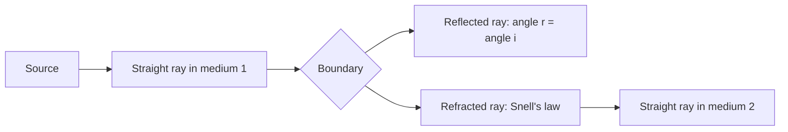
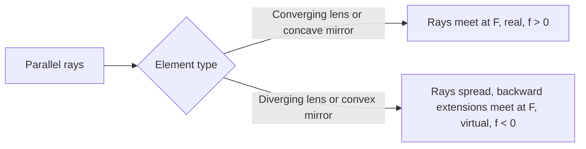
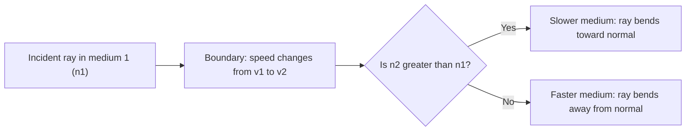
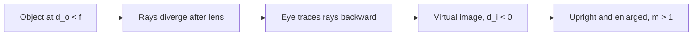

# Concept-Book Run

domain: /home/papagame/projects/digital-duck/cb-college-physics/public/domains/college_physics_ch25/input/graph.yaml
target: magnifying_glass
started: 2026-11-23T23:50:58

## Teaching order (15 concepts)

- light_ray
- geometric_optics
- focal_point
- speed_of_light_vacuum
- focal_length
- image_distance
- index_of_refraction
- object_distance
- magnification
- ray_tracing
- refraction
- converging_lens
- thin_lens_equations
- virtual_image
- magnifying_glass

### light_ray (13.7s)

## Light Ray

### Definition

A **light ray** is an idealized model of light: an infinitely thin line along which light energy travels. In a uniform (homogeneous) medium, a ray is a straight line. Its direction changes only when it meets matter or a boundary between two media. At a boundary it can reflect, refract (bend), be absorbed, or scatter.

The ray model is called **geometric optics**. It works when the objects and openings the light meets are much larger than the wavelength $\lambda$. For visible light, $\lambda \approx 400\text{–}700\ \text{nm}$. When sizes approach $\lambda$, diffraction and interference appear, and the ray model fails.

Two laws govern what happens at a smooth boundary. Angles are measured from the **normal**, the line perpendicular to the surface.

- **Reflection:** $\theta_r = \theta_i$
- **Refraction (Snell's law):** $n_1 \sin\theta_1 = n_2 \sin\theta_2$

Here $n = c/v$ is the refractive index of a medium. It is the ratio of the speed of light in vacuum to the speed in that medium.

### Worked example

A ray in air ($n_1 = 1.00$) strikes the flat surface of water ($n_2 = 1.33$) at $\theta_1 = 40^\circ$ from the normal. Find the refracted angle.

$$\sin\theta_2 = \frac{n_1}{n_2}\sin\theta_1 = \frac{1.00}{1.33}(0.643) = 0.483$$

$$\theta_2 = \sin^{-1}(0.483) \approx 28.9^\circ$$

The ray bends toward the normal because it enters a medium with a higher index. The reflected portion leaves at $40^\circ$ on the air side.

### Problem-solving application

**Apparent depth.** A swimmer's coin lies $2.0$ m below the surface. Viewed from almost directly above, how deep does it appear?

Rays leaving the coin bend away from the normal as they exit into air. The eye extends them backward in straight lines, so it places the coin at a shallower depth. For near-normal viewing, small angles give $\sin\theta \approx \tan\theta$. Then

$$d_{\text{apparent}} = d\,\frac{n_2}{n_1} = 2.0\ \text{m}\times\frac{1.00}{1.33} \approx 1.5\ \text{m}.$$

**Method for any ray problem:**

1. Draw the boundary and the normal.
2. Mark the incident ray and its angle from the normal. A common error is measuring from the surface.
3. Apply reflection or Snell's law at each boundary. Between boundaries, draw straight lines.
4. Check the direction. Entering a higher-$n$ medium bends the ray toward the normal. Entering a lower-$n$ medium bends it away.

**Limiting case.** Going from water to air, $\sin\theta_2 = 1.33\sin\theta_1$ can exceed $1$. Setting $\theta_2 = 90^\circ$ gives the critical angle

$$\theta_c = \sin^{-1}\!\left(\frac{1.00}{1.33}\right) \approx 48.8^\circ.$$

For larger incident angles no refracted ray exists, so all the light reflects. This is total internal reflection, and it is how optical fibers guide light.

*A ray travels straight until it reaches a boundary. There it splits into a reflected ray and a refracted ray, and each continues in a straight line.*

### geometric_optics (12.8s)

## Geometric Optics

**Definition.** Geometric optics (ray optics) models light as straight-line *rays* that change direction only at interfaces. It is valid when the objects and apertures light meets are much larger than the wavelength, $a \gg \lambda$ (visible light has $\lambda \approx 400$–$700$ nm), so diffraction and interference are negligible. Three laws govern everything:

- **Rectilinear propagation:** in a uniform medium, rays are straight.
- **Reflection:** the angle of incidence equals the angle of reflection, $\theta_i = \theta_r$ (both measured from the normal).
- **Refraction (Snell's law):** $n_1 \sin\theta_1 = n_2 \sin\theta_2$, where $n = c/v$ is the refractive index.

For a thin lens or a spherical mirror, rays near the axis (the *paraxial* approximation) obey the imaging equation

$$\frac{1}{s} + \frac{1}{s'} = \frac{1}{f},$$

with object distance $s$, image distance $s'$, and focal length $f$. The magnification is $m = -\dfrac{s'}{s}$. A negative $m$ means the image is inverted. For a spherical mirror, $f = R/2$.

**Worked example.** A converging lens has $f = 10$ cm. An object stands $s = 30$ cm in front of it. Find the image.

$$\frac{1}{s'} = \frac{1}{f} - \frac{1}{s} = \frac{1}{10} - \frac{1}{30} = \frac{2}{30} \;\Rightarrow\; s' = 15\text{ cm}.$$

$$m = -\frac{15}{30} = -0.5.$$

The image is real, inverted, and half the object's height, which is the arrangement a camera uses.

**Problem-solving application.** *A light ray in air hits water ($n = 1.33$) at $40^\circ$ from the normal. Does it bend toward or away from the normal, and what is the critical angle for light going from water to air?*

Refraction angle:

$$\sin\theta_2 = \frac{1.00\,\sin 40^\circ}{1.33} = \frac{0.643}{1.33} = 0.483 \;\Rightarrow\; \theta_2 \approx 28.9^\circ.$$

The ray bends toward the normal because it enters a medium with larger $n$.

Going from water to air, refraction is possible only if $\sin\theta_2 \le 1$. At the limit, $\theta_2 = 90^\circ$, which gives the critical angle:

$$\sin\theta_c = \frac{n_2}{n_1} = \frac{1.00}{1.33} \;\Rightarrow\; \theta_c \approx 48.8^\circ.$$

Beyond $\theta_c$ there is *total internal reflection*, which is how optical fibers trap light.

**Strategy for any problem.**

1. Draw the principal rays: one parallel to the axis that passes through the focus, one through the center of the lens, and one through the focus that emerges parallel.
2. Mark the normal at every interface and measure angles from it, not from the surface.
3. Apply the relevant law, then check the result against the sketch. For example, a real image needs $s' > 0$.

**Limits.** When apertures shrink toward $\lambda$, rays fail and wave optics takes over. Diffraction then sets the resolution limit, roughly $\theta \approx 1.22\,\lambda/D$ for a circular aperture of diameter $D$.

### focal_point (16.3s)

## Focal Point

The **focal point** $F$ of a lens or mirror is the location tied to the optical axis where light parallel to that axis ends up. For a *converging* lens (or concave mirror), parallel rays actually meet at $F$, so it is a **real** focal point. For a *diverging* lens (or convex mirror), the rays spread out after the surface, but their backward extensions meet at $F$, so it is a **virtual** focal point. The distance from the optical center (or mirror vertex) to $F$ is the **focal length** $f$. By convention, $f>0$ for converging elements and $f<0$ for diverging ones.

For a spherical mirror of radius of curvature $R$, paraxial rays (those close to the axis) give

$$f = \frac{R}{2}.$$

For a thin lens, the lensmaker's equation connects $f$ to its shape and material:

$$\frac{1}{f} = (n-1)\left(\frac{1}{R_1} - \frac{1}{R_2}\right),$$

where $n$ is the refractive index of the lens and $R_1, R_2$ are the radii of curvature of its two surfaces.

The focal length also governs image formation through the thin-lens/mirror equation

$$\frac{1}{d_o} + \frac{1}{d_i} = \frac{1}{f},$$

where $d_o$ is the object distance and $d_i$ is the image distance. A positive $d_i$ means a real image. A negative $d_i$ means a virtual image.

### Worked example

A concave mirror has $R = 40\ \text{cm}$. Find the image of an object $60\ \text{cm}$ from the mirror.

1. Focal length: $f = R/2 = 20\ \text{cm}$.
2. Solve for the image distance:
$$\frac{1}{d_i} = \frac{1}{f} - \frac{1}{d_o} = \frac{1}{20} - \frac{1}{60} = \frac{2}{60} \;\Rightarrow\; d_i = 30\ \text{cm}.$$
3. Magnification: $m = -\dfrac{d_i}{d_o} = -\dfrac{30}{60} = -0.5$.

The image is real, inverted, and half the object's size. It forms between $F$ and the center of curvature, as expected for an object beyond $2f$.

### Problem-solving application

**Problem.** A diverging lens has $f = -15\ \text{cm}$. An object sits $30\ \text{cm}$ in front of it. Where is the image, and what is its character?

$$\frac{1}{d_i} = \frac{1}{f} - \frac{1}{d_o} = -\frac{1}{15} - \frac{1}{30} = -\frac{3}{30} \;\Rightarrow\; d_i = -10\ \text{cm}.$$

The negative sign means the image is virtual, $10\ \text{cm}$ on the same side as the object. Then $m = -\dfrac{-10}{30} = +\dfrac{1}{3}$, so the image is upright and one-third the object's size. A diverging lens always produces this kind of image, whatever the object distance.

**Strategy for any problem:**

1. Identify the element type and fix the sign of $f$.
2. Use the equation to find $d_i$, and keep signs throughout.
3. Interpret the signs: $d_i>0$ means real, $d_i<0$ means virtual. $m<0$ means inverted, $m>0$ means upright.
4. Sanity-check with the three principal rays: one parallel to the axis passes through (or appears to come from) $F$, one passes through the center, and one goes through $F$ and exits parallel.

*Parallel rays meet at a real focal point after a converging element. After a diverging element, they appear to come from a virtual focal point.*

### speed_of_light_vacuum (15.4s)

## Speed Of Light Vacuum

**Definition.** The speed of light in vacuum, denoted $c$, is a fundamental constant of nature. Its value is defined exactly as

$$c = 299\,792\,458\ \text{m/s} \approx 3.00\times10^{8}\ \text{m/s}.$$

Since 1983 the metre has been *defined* from this value: one metre is the distance light travels in vacuum in $1/299\,792\,458$ of a second. The constant is not specific to visible light. It is the speed of all electromagnetic waves in vacuum, and it is the speed at which any massless particle travels. Maxwell's equations connect it to two measurable constants of empty space, the permittivity $\varepsilon_0$ and the permeability $\mu_0$:

$$c = \frac{1}{\sqrt{\mu_0\,\varepsilon_0}}.$$

In special relativity, $c$ is also the maximum speed at which energy, matter, or information can travel. In a material such as water or glass, light moves more slowly. The ratio $n = c/v$ is the refractive index. For this reason the definition specifies *vacuum*.

**Worked example.** How long does sunlight take to reach Earth? The mean Earth–Sun distance is $d \approx 1.50\times10^{11}$ m. Using $t = d/c$:

$$t = \frac{1.50\times10^{11}\ \text{m}}{3.00\times10^{8}\ \text{m/s}} = 5.0\times10^{2}\ \text{s} \approx 8.3\ \text{minutes}.$$

The Sun you see is the Sun as it was about eight minutes ago.

**Checking the Maxwell relation.** With $\mu_0 = 4\pi\times10^{-7}\ \text{N/A}^2$ and $\varepsilon_0 = 8.854\times10^{-12}\ \text{F/m}$:

$$\mu_0\varepsilon_0 \approx (1.257\times10^{-6})(8.854\times10^{-12}) = 1.113\times10^{-17},$$

$$c = \frac{1}{\sqrt{1.113\times10^{-17}}} \approx 3.00\times10^{8}\ \text{m/s}.$$

**Problem-solving application.** A radar pulse is sent to a distant object and its echo returns after $\Delta t = 2.40\ \text{ms}$. How far away is the object?

*Step 1.* The pulse travels to the object and back, so the total path is $2d$.

*Step 2.* Apply distance equals speed times time:

$$2d = c\,\Delta t \quad\Rightarrow\quad d = \frac{c\,\Delta t}{2}.$$

*Step 3.* Substitute:

$$d = \frac{(3.00\times10^{8})(2.40\times10^{-3})}{2} = 3.60\times10^{5}\ \text{m} = 360\ \text{km}.$$

The same method gives the distance to the Moon from laser ranging. A round trip of about $2.56$ s gives $d \approx 3.84\times10^{8}$ m.

**Common pitfalls.**

- Forgetting the factor of 2 in round-trip (echo) problems.
- Using $c$ for light in glass or water. There the speed is $v = c/n$. For glass with $n=1.5$, $v = 2.0\times10^{8}$ m/s.
- Treating $c$ as a speed you can add to. Relativity shows that every observer measures the same $c$ in vacuum, regardless of their own motion. This is the postulate that leads to time dilation and length contraction.

**Key takeaway.** $c$ links space and time. It converts a time measurement into a distance, and it sets the speed limit of the universe.

### focal_length (12.8s)

## Focal Length

The **focal length** $f$ of a lens or mirror is the distance from its optical center to its focal point, the point where rays arriving parallel to the optical axis converge (or appear to diverge from). The sign convention is:

- $f > 0$ for **converging** optics (convex lenses, concave mirrors)
- $f < 0$ for **diverging** optics (concave lenses, convex mirrors)

For a thin lens in air, the focal length is tied to its geometry by the lensmaker's equation, with $R_1, R_2$ the radii of curvature of the two surfaces and $n$ the refractive index:

$$\frac{1}{f} = (n-1)\left(\frac{1}{R_1} - \frac{1}{R_2}\right)$$

For a spherical mirror, $f = R/2$. The focal length then connects object distance $d_o$ and image distance $d_i$ through the thin-lens (or mirror) equation:

$$\frac{1}{f} = \frac{1}{d_o} + \frac{1}{d_i}$$

The magnification is $m = -d_i/d_o$. A negative $m$ means the image is inverted. The reciprocal $P = 1/f$ is the **optical power**, measured in diopters (m$^{-1}$) when $f$ is in meters.

### Worked example

A converging lens has $f = +20$ cm. An object sits $d_o = 30$ cm from the lens. Find the image.

$$\frac{1}{d_i} = \frac{1}{f} - \frac{1}{d_o} = \frac{1}{20} - \frac{1}{30} = \frac{3-2}{60} = \frac{1}{60}$$

So $d_i = +60$ cm. The positive sign means a real image on the opposite side of the lens. The magnification is $m = -60/30 = -2$, so the image is inverted and twice the object's size.

Now move the object inside the focal length, at $d_o = 10$ cm:

$$\frac{1}{d_i} = \frac{1}{20} - \frac{1}{10} = -\frac{1}{20} \Rightarrow d_i = -20 \text{ cm}$$

The negative $d_i$ indicates a virtual, upright image on the same side as the object, with $m = -(-20)/10 = +2$. This is how a magnifying glass works.

### Problem-solving application

**Problem.** A diverging lens has $f = -15$ cm. An object is placed 45 cm away. Where is the image, and what are its properties?

**Solution.**

$$\frac{1}{d_i} = \frac{1}{-15} - \frac{1}{45} = \frac{-3-1}{45} = -\frac{4}{45}$$

So $d_i = -11.25$ cm, and $m = -(-11.25)/45 = +0.25$. The image is virtual, upright, and one quarter the object's size, on the same side as the object.

**Strategy for any problem:**

1. Assign the sign of $f$ from the optic type (converging $+$, diverging $-$).
2. Solve $1/d_i = 1/f - 1/d_o$, keeping signs.
3. Interpret $d_i$: positive means real, negative means virtual.
4. Compute $m$: its sign gives orientation (negative means inverted) and its magnitude gives size.
5. Check the result. A diverging optic always gives a virtual, upright, reduced image. A converging optic gives a real, inverted image when $d_o > f$ and a virtual, upright, enlarged image when $d_o < f$.

**Key takeaway:** the sign of $f$ determines which family of images an optic can produce, and a single equation with consistent sign bookkeeping handles every case.

### image_distance (13.8s)

## Image Distance

**Definition.** The image distance $d_i$ is the distance measured along the optical axis from the center of a lens or mirror to the image it forms. Its sign tells you what kind of image you have:

- $d_i > 0$: a **real image**. Light rays actually converge at the image point, so a screen placed there shows the image. For a lens this is on the side opposite the object. For a mirror it is on the same side as the object.
- $d_i < 0$: a **virtual image**. Rays only appear to diverge from the image point, so no screen can capture it. You see it by looking into the lens or mirror.

The image distance is linked to the object distance $d_o$ and focal length $f$ by the thin-lens/mirror equation:

$$\frac{1}{d_o} + \frac{1}{d_i} = \frac{1}{f}$$

Solving for the image distance gives

$$d_i = \frac{f\,d_o}{d_o - f}$$

The magnification is $m = -\dfrac{d_i}{d_o}$. A negative $m$ means the image is inverted, and $|m|$ is the size ratio.

**Sign conventions.** Take $f>0$ for converging elements (convex lenses, concave mirrors) and $f<0$ for diverging ones (concave lenses, convex mirrors). Take $d_o>0$ for a real object.

**Worked example.** A converging lens has $f = 10$ cm. An object sits at $d_o = 30$ cm.

$$d_i = \frac{(10)(30)}{30-10} = \frac{300}{20} = 15 \text{ cm}$$

Because $d_i>0$, the image is real. The magnification is $m = -15/30 = -0.5$. The image is inverted and half the object's size.

Now move the object inside the focal length, to $d_o = 5$ cm:

$$d_i = \frac{(10)(5)}{5-10} = \frac{50}{-5} = -10 \text{ cm}$$

Because $d_i<0$, the image is virtual. The magnification is $m = -(-10)/5 = +2$. The image is upright and twice as large. This is how a magnifying glass works.

**Problem-solving application.** A concave mirror must project a real image onto a wall $d_i = 200$ cm away from an object at $d_o = 25$ cm. What focal length should the mirror have?

Rearrange the equation for $f$:

$$\frac{1}{f} = \frac{1}{25} + \frac{1}{200} = \frac{8}{200} + \frac{1}{200} = \frac{9}{200}$$

So $f = 200/9 \approx 22.2$ cm. The result is positive, which is consistent with a concave (converging) mirror. The magnification is $m = -200/25 = -8$, so the image is inverted and eight times larger.

**Strategy checklist.**

1. Assign signs first: $f$ by element type, and $d_o>0$ for a real object.
2. Solve for $d_i$ with the equation. Do not guess the sign.
3. Read the sign of $d_i$ to classify the image (real or virtual). Use the sign of $m$ to classify its orientation.
4. Check the result. A diverging element ($f<0$) with a real object always gives $d_i<0$, a virtual image. A converging element gives a virtual image only when $d_o<f$.

**Limiting case.** As $d_o \to f^{+}$, the denominator $d_o - f \to 0^{+}$, so $d_i \to +\infty$. The image is pushed infinitely far away. This is the principle behind collimated beams from a source placed at the focal point.

### index_of_refraction (15.5s)

## Index Of Refraction

### Definition

The **index of refraction** of a medium is the ratio of the speed of light in vacuum, $c$, to the speed of light in that medium, $v$:

$$n = \frac{c}{v}, \qquad c \approx 3.00\times10^{8}\ \text{m/s}$$

Because light never travels faster than $c$ in a material, $n \ge 1$, with $n = 1$ for vacuum (air is about $1.0003$). The quantity is dimensionless. Typical values are water $\approx 1.33$, window glass $\approx 1.50$, and diamond $\approx 2.42$.

When light enters a medium, its frequency $f$ stays fixed (set by the source), so the wavelength changes along with the speed:

$$v = f\lambda_n \;\Rightarrow\; \lambda_n = \frac{\lambda_0}{n}$$

where $\lambda_0$ is the vacuum wavelength.

The index also controls bending at an interface. **Snell's law** relates the angles $\theta_1,\theta_2$, measured from the normal, on either side of a boundary:

$$n_1 \sin\theta_1 = n_2 \sin\theta_2$$

Light bends toward the normal when entering a higher-index medium and away from it when entering a lower-index one.

### Worked example

Light of vacuum wavelength $\lambda_0 = 600\ \text{nm}$ travels through glass with $n = 1.50$.

- Speed: $v = c/n = (3.00\times10^{8})/1.50 = 2.00\times10^{8}\ \text{m/s}$
- Wavelength: $\lambda = 600/1.50 = 400\ \text{nm}$
- Frequency: $f = c/\lambda_0 = 5.00\times10^{14}\ \text{Hz}$, unchanged from vacuum.

Now suppose a ray in air ($n_1 = 1.00$) strikes the glass at $\theta_1 = 40.0^\circ$. Then

$$\sin\theta_2 = \frac{1.00\,\sin 40.0^\circ}{1.50} = \frac{0.643}{1.50} = 0.429 \;\Rightarrow\; \theta_2 \approx 25.4^\circ.$$

The ray bends toward the normal, as expected for $n_2 > n_1$.

### Problem-solving application

**Total internal reflection.** Light going from a higher-index to a lower-index medium can bend so far from the normal that it cannot exit. At the **critical angle** $\theta_c$, the refracted ray grazes the surface ($\theta_2 = 90^\circ$):

$$\sin\theta_c = \frac{n_2}{n_1}\quad (n_1 > n_2)$$

For angles of incidence greater than $\theta_c$, all light reflects back into the denser medium. This is how optical fibers work.

*Problem:* A fiber core has $n_1 = 1.48$ and its cladding has $n_2 = 1.46$. What is the minimum angle of incidence at the core–cladding boundary for light to stay trapped?

*Solution:*

$$\theta_c = \sin^{-1}\!\left(\frac{1.46}{1.48}\right) = \sin^{-1}(0.9865) \approx 80.6^\circ.$$

Any ray striking the boundary at more than $80.6^\circ$ from the normal reflects completely, so it travels down the fiber with essentially no loss through the sides.

**Strategy for any refraction problem:**
1. Identify $n_1$ and $n_2$, and check which is larger to predict the bending direction.
2. Measure all angles from the normal, not the surface.
3. Apply $n_1\sin\theta_1 = n_2\sin\theta_2$.
4. If $\sin\theta_2$ would exceed 1, no refracted ray exists, so the light is totally internally reflected.
5. Sanity check: $v = c/n$ should always be less than $c$.

### object_distance (13.1s)

## Object Distance

**Definition.** The object distance $d_o$ is the distance from an object to the center of a lens or to the vertex of a mirror, measured along the principal axis (the line through the optical center, perpendicular to the lens or mirror surface). It is the input to the thin-lens and mirror equation:

$$\frac{1}{d_o} + \frac{1}{d_i} = \frac{1}{f}$$

where $d_i$ is the image distance and $f$ is the focal length.

**Sign convention.** Light is assumed to travel from left to right. For a real object, which is the usual case, the object sits on the side the light comes from, so $d_o > 0$. Distances to the image and focal length use the same convention: $d_i > 0$ for a real image, and $f > 0$ for a converging lens or concave mirror. A negative $d_o$ appears only for a *virtual object*, such as when light is already converging toward a point before it reaches the lens. This is rare in introductory problems.

**Why it matters.** The ratio of $d_o$ to $f$ determines what kind of image forms:

- $d_o > 2f$: a real, inverted, reduced image
- $d_o = 2f$: a real, inverted image, the same size as the object
- $f < d_o < 2f$: a real, inverted, enlarged image
- $d_o = f$: no image forms, because the rays emerge parallel
- $d_o < f$: a virtual, upright, enlarged image (a magnifying glass)

**Worked example.** A converging lens has $f = 10\ \text{cm}$. A candle is placed $d_o = 30\ \text{cm}$ from it. Where is the image, and how large is it?

Rearrange the lens equation:

$$\frac{1}{d_i} = \frac{1}{f} - \frac{1}{d_o} = \frac{1}{10} - \frac{1}{30} = \frac{3-1}{30} = \frac{1}{15}$$

So $d_i = 15\ \text{cm}$. The magnification is

$$m = -\frac{d_i}{d_o} = -\frac{15}{30} = -0.5$$

The image is real, inverted ($m<0$), and half the height of the candle. This agrees with the table, since $d_o = 3f > 2f$.

**Problem-solving application.** Suppose you want a real image on a screen that is *twice* the size of the object, using the same $f = 10\ \text{cm}$ lens. Where must you place the object?

A real, enlarged image needs $|m| = 2$, so $d_i = 2d_o$. Substituting into the lens equation:

$$\frac{1}{d_o} + \frac{1}{2d_o} = \frac{3}{2d_o} = \frac{1}{10} \quad\Rightarrow\quad d_o = 15\ \text{cm}$$

The screen then goes at $d_i = 30\ \text{cm}$. Check: $15\ \text{cm}$ lies between $f = 10\ \text{cm}$ and $2f = 20\ \text{cm}$, as the table requires for an enlarged real image.

**Common pitfalls.**

1. Measure $d_o$ to the lens center or mirror vertex, not to the edge or to a focal point.
2. Always check your result against the table. If you get a real, enlarged image with $d_o > 2f$, you made an error.
3. For a convex mirror or diverging lens, $f<0$. The image is then always virtual and reduced, whatever the value of $d_o$.

**Key idea.** The object distance $d_o$ is the one quantity you control directly. Compare it with $f$ and $2f$ to predict the image before you calculate anything.

### magnification (12.6s)

## Magnification

**Magnification** $m$ measures how an optical system scales an image relative to its object. It is the ratio of image height $h_i$ to object height $h_o$, and for thin lenses and mirrors it equals the negative ratio of image distance $d_i$ to object distance $d_o$:

$$m = \frac{h_i}{h_o} = -\frac{d_i}{d_o}$$

The magnitude $|m|$ gives the size change: $|m| > 1$ means enlarged, $|m| < 1$ means reduced, and $|m| = 1$ means the same size. The sign gives orientation: $m < 0$ means the image is inverted relative to the object, and $m > 0$ means it is upright. (Sign convention: $d_o > 0$ for a real object; $d_i > 0$ for a real image, which forms on the opposite side of a lens from the object, and $d_i < 0$ for a virtual image.)

The relation $m = -d_i/d_o$ follows from similar triangles. A ray through the center of a thin lens passes undeflected, so it forms two similar triangles, one on each side of the lens. Their heights are $h_o$ and $h_i$ (with $h_i$ measured downward as negative), and their bases are $d_o$ and $d_i$.

### Worked example

A converging lens has focal length $f = 10\ \text{cm}$. A candle $h_o = 4.0\ \text{cm}$ tall stands $d_o = 30\ \text{cm}$ from the lens. Find the image position, magnification, and image height.

1. Use the thin-lens equation to find $d_i$:
$$\frac{1}{d_i} = \frac{1}{f} - \frac{1}{d_o} = \frac{1}{10} - \frac{1}{30} = \frac{2}{30} \;\Rightarrow\; d_i = 15\ \text{cm}$$
2. Compute the magnification:
$$m = -\frac{d_i}{d_o} = -\frac{15}{30} = -0.50$$
3. Find the image height:
$$h_i = m\,h_o = (-0.50)(4.0\ \text{cm}) = -2.0\ \text{cm}$$

The image is real, inverted, and half the object's size, located 15 cm from the lens.

### Problem-solving application

Magnification lets you work backward from a desired image size. Suppose a projector must produce an image 40 times as large as a slide, with the screen $d_i = 4.0\ \text{m}$ from the lens. Because a projector image is real and inverted, $m = -40$.

1. Solve for the object distance: $d_o = -d_i/m = 4.0\ \text{m}/40 = 0.10\ \text{m}$.
2. Find the required focal length:
$$\frac{1}{f} = \frac{1}{d_o} + \frac{1}{d_i} = \frac{1}{0.10} + \frac{1}{4.0} = 10.25\ \text{m}^{-1} \;\Rightarrow\; f \approx 0.098\ \text{m}$$

So the slide sits just beyond the focal point, and the lens has $f \approx 9.8\ \text{cm}$.

**Checking your answer.** Two quick tests catch most errors:

- A real image from a single lens or mirror is always inverted ($m < 0$). A virtual image is upright ($m > 0$).
- A magnifying glass has $d_o < f$. In that case $d_i < 0$, so $m = -d_i/d_o > 0$: the image is virtual, upright, and enlarged.

Always keep the sign. Reporting only $|m|$ discards the information about whether the image is inverted.

### ray_tracing (12.9s)

## Ray Tracing

**Definition.** Ray tracing is a graphical method for locating an image and finding its size by following a few special rays from a point on an object through a mirror or lens. Because every ray from an object point that reaches the system passes through the same image point, two rays are enough to fix that point. A third ray serves as a check.

For a thin lens with focal length $f$, the three principal rays are:

1. **Parallel ray:** a ray parallel to the optical axis refracts through the far focal point (converging lens) or appears to come from the near focal point (diverging lens).
2. **Central ray:** a ray through the lens center continues undeviated.
3. **Focal ray:** a ray through the near focal point emerges parallel to the axis.

For a spherical mirror, the parallel ray reflects through the focal point $F$. The focal ray reflects parallel to the axis. A ray aimed at the vertex reflects at an equal angle on the other side of the axis.

The image is **real** if the traced rays actually cross. It is **virtual** if only their backward extensions cross. Each result can be confirmed with the thin-lens equation and the magnification:

$$\frac{1}{d_o}+\frac{1}{d_i}=\frac{1}{f},\qquad m=\frac{h_i}{h_o}=-\frac{d_i}{d_o}$$

**Worked example.** A 2.0 cm tall object sits 30 cm in front of a converging lens with $f = 10$ cm. Draw the axis, the lens, and the points $F$ at $\pm10$ cm. From the top of the object, draw the parallel ray (it bends through the far $F$) and the central ray (it goes straight). They cross about 15 cm beyond the lens, below the axis. The image is real and inverted, and it is smaller than the object.

Check numerically:

$$\frac{1}{d_i}=\frac{1}{10}-\frac{1}{30}=\frac{2}{30}\;\Rightarrow\; d_i=15\text{ cm},\qquad m=-\frac{15}{30}=-0.50$$

So $h_i=-1.0$ cm. The negative sign means the image is inverted, which matches the diagram.

**Problem-solving application.** Suppose the same object is moved to 6 cm, which is inside the focal length. The parallel ray still bends through the far focal point. The central ray still goes straight. Now the two rays diverge after the lens, so they never cross. Extend both backward and they meet on the object's side of the lens. This means the image is virtual and upright, and it is larger than the object. Check this with the equation:

$$\frac{1}{d_i}=\frac{1}{10}-\frac{1}{6}=-\frac{1}{15}\;\Rightarrow\; d_i=-15\text{ cm},\qquad m=+2.5$$

The negative $d_i$ marks a virtual image on the same side as the object. This is how a magnifying glass works.

**Strategy for any problem.**
- Draw to scale, and pick the object's top point as the tracing point.
- Trace at least two principal rays, and extend rays backward with dashed lines when they diverge.
- Read off the image location and size, then classify the image as real or virtual, upright or inverted, and enlarged or reduced.
- Verify with the lens or mirror equation. If the diagram and the algebra disagree, recheck the sign conventions and the scale.

For multi-element systems, treat the image from the first element as the object for the second. This is the basis for analyzing microscopes and telescopes.

### refraction (14.2s)

## Refraction

**Definition.** Refraction is the bending of a light ray as it crosses the boundary between two transparent media. It happens because light travels at different speeds in different media. The speed in a vacuum is $c \approx 3.00\times10^{8}\ \text{m/s}$. In a medium it is $v$, and the medium's **index of refraction** is

$$n = \frac{c}{v} \ge 1.$$

A larger $n$ means slower light. Angles are measured from the **normal**, the line perpendicular to the surface. **Snell's law** relates the angle of incidence $\theta_1$ and the angle of refraction $\theta_2$:

$$n_1 \sin\theta_1 = n_2 \sin\theta_2.$$

Entering a slower medium ($n_2 > n_1$), the ray bends toward the normal. Entering a faster medium, it bends away. A ray along the normal ($\theta_1 = 0$) does not bend. Its speed and wavelength change, but its frequency stays the same.

**Why it bends.** Picture a wavefront hitting the surface at an angle. The part of the front that enters the slow medium first slows down, while the rest is still moving quickly. The front pivots, and the ray, which is perpendicular to the front, changes direction. Snell's law follows from this geometry. It also follows from Fermat's principle, which says light takes the path of least time between two points.

*How the change in speed at a boundary determines the direction of bending.*

**Worked example.** A laser beam in air ($n_1 = 1.00$) strikes water ($n_2 = 1.33$) at $\theta_1 = 40^\circ$. Find $\theta_2$ and the speed of light in water.

$$\sin\theta_2 = \frac{n_1\sin\theta_1}{n_2} = \frac{(1.00)(0.643)}{1.33} = 0.483 \;\Rightarrow\; \theta_2 \approx 28.9^\circ.$$

The ray bends toward the normal, as expected. The speed in water is

$$v = \frac{c}{n} = \frac{3.00\times10^{8}}{1.33} \approx 2.26\times10^{8}\ \text{m/s}.$$

**Problem-solving application: total internal reflection.** Now reverse the direction. Light goes from water ($n_1 = 1.33$) into air ($n_2 = 1.00$). Here the ray bends away from the normal. As $\theta_1$ increases, $\theta_2$ reaches $90^\circ$ at the **critical angle**:

$$\sin\theta_c = \frac{n_2}{n_1} \;\Rightarrow\; \theta_c = \sin^{-1}\!\left(\frac{1.00}{1.33}\right) \approx 48.8^\circ.$$

For $\theta_1 > \theta_c$ there is no refracted ray. All the light reflects back into the water. This is **total internal reflection**, and it requires $n_1 > n_2$. Optical fibers use it. A glass core ($n \approx 1.50$) is surrounded by cladding ($n \approx 1.46$), which gives $\theta_c = \sin^{-1}(1.46/1.50) \approx 77^\circ$. Light striking the wall at a larger angle stays trapped and travels along the fiber.

**Strategy for any refraction problem:**
1. Sketch the boundary and the normal.
2. Identify $n_1$ and $n_2$, and measure angles from the normal, not the surface.
3. Apply Snell's law.
4. Check that the direction of bending matches whether $n_2 > n_1$.
5. If $n_1 > n_2$, test whether $\sin\theta_2$ would exceed 1. If it would, the light is totally reflected.

### converging_lens (12.6s)

## Converging Lens

A **converging lens** (also called a convex lens) is thicker at its center than at its edges. When parallel rays travel along its principal axis, refraction at the two curved surfaces bends them toward the axis so they cross at a single point, the **focal point** $F$, on the opposite side. The distance from the lens to $F$ is the **focal length** $f$. For a converging lens, $f > 0$.

### Governing relations

For a thin lens, the object distance $d_o$, image distance $d_i$, and focal length $f$ obey the **thin-lens equation**:

$$\frac{1}{d_o} + \frac{1}{d_i} = \frac{1}{f}$$

The **magnification** is

$$m = -\frac{d_i}{d_o} = \frac{h_i}{h_o}$$

Sign conventions:
- $d_o > 0$ for a real object on the incoming side.
- $d_i > 0$ for a real image on the far side of the lens.
- $d_i < 0$ for a virtual image on the same side as the object.
- $m < 0$ means the image is inverted.

Three principal rays locate an image:
1. A ray parallel to the axis refracts through $F$.
2. A ray through the lens center continues undeviated.
3. A ray passing through the near-side focal point emerges parallel to the axis.

### Worked example

An object $4.0$ cm tall is placed $30$ cm from a converging lens with $f = 10$ cm. Find the image.

$$\frac{1}{d_i} = \frac{1}{f} - \frac{1}{d_o} = \frac{1}{10} - \frac{1}{30} = \frac{2}{30} \quad\Rightarrow\quad d_i = 15 \text{ cm}$$

$$m = -\frac{15}{30} = -0.50, \qquad h_i = m\,h_o = -2.0 \text{ cm}$$

The image is real, inverted, and reduced, and it forms 15 cm behind the lens.

### Problem-solving application

The object's position relative to $f$ determines the image type:

| Object position | Image |
|---|---|
| $d_o > 2f$ | Real, inverted, smaller (camera) |
| $d_o = 2f$ | Real, inverted, same size |
| $f < d_o < 2f$ | Real, inverted, larger (projector) |
| $d_o = f$ | No image; rays emerge parallel |
| $d_o < f$ | Virtual, upright, larger (magnifier) |

**Problem.** A magnifying glass has $f = 8.0$ cm. A stamp is held $6.0$ cm from it. Where is the image, and how large is it relative to the stamp?

Since $d_o = 6.0 < f$, we expect a virtual image.

$$\frac{1}{d_i} = \frac{1}{8.0} - \frac{1}{6.0} = \frac{3 - 4}{24} = -\frac{1}{24} \quad\Rightarrow\quad d_i = -24 \text{ cm}$$

$$m = -\frac{-24}{6.0} = +4.0$$

The image is virtual, upright, and 4.0 times larger. It appears 24 cm from the lens on the same side as the stamp. The negative $d_i$ is how the equation signals that the rays only appear to diverge from that point, so no screen could capture the image.

**Check your answer.** Confirm that the sign of $d_i$ matches the expected image type. A real object with $d_o > f$ must give $d_i > 0$, and $d_o < f$ must give $d_i < 0$. If the signs disagree with this, recheck the arithmetic.

### thin_lens_equations (14.5s)

## Thin Lens Equations

**Definition.** For a thin lens (or a mirror) with focal length $f$, an object placed a distance $d_o$ from the lens produces an image at distance $d_i$. These quantities are related by the thin lens equation and the magnification equation:

$$\frac{1}{d_o} + \frac{1}{d_i} = \frac{1}{f}, \qquad m = \frac{h_i}{h_o} = -\frac{d_i}{d_o}$$

Here $h_o$ and $h_i$ are the object and image heights, and $m$ is the magnification. The equations rely on a sign convention:

- $f > 0$ for a converging lens (or concave mirror), and $f < 0$ for a diverging lens (or convex mirror).
- $d_o > 0$ for a real object.
- $d_i > 0$ for a real image, on the side where light exits the lens. For a mirror, this is the same side as the object. $d_i < 0$ for a virtual image.
- $m < 0$ means the image is inverted, and $m > 0$ means it is upright. $|m| > 1$ means the image is enlarged.

The equations hold in the paraxial approximation, where rays are close to the axis and the lens is thin compared with the distances involved.

**Worked example.** A converging lens has $f = 10$ cm. An object 4.0 cm tall is placed 30 cm from it. Find the image location, the magnification, and the image height.

Solve for $d_i$:

$$\frac{1}{d_i} = \frac{1}{f} - \frac{1}{d_o} = \frac{1}{10} - \frac{1}{30} = \frac{2}{30}$$

so $d_i = 15$ cm. This is positive, so the image is real. The magnification is

$$m = -\frac{15}{30} = -0.50$$

so the image is inverted and half the object's size, with $h_i = m\,h_o = -2.0$ cm.

**Problem-solving application.** The sign of $d_i$ tells you what kind of image you get. Move the same object inside the focal length, to $d_o = 5.0$ cm:

$$\frac{1}{d_i} = \frac{1}{10} - \frac{1}{5} = -\frac{1}{10} \;\Rightarrow\; d_i = -10 \text{ cm}$$

$$m = -\frac{-10}{5} = +2.0$$

The image is virtual (on the same side as the object), upright, and twice as large. This is how a magnifying glass works.

A general strategy:

1. Sketch the setup and assign signs to $f$ and $d_o$.
2. Solve for $d_i$ using $\frac{1}{d_i} = \frac{1}{f} - \frac{1}{d_o}$, or equivalently $d_i = \frac{f\,d_o}{d_o - f}$.
3. Compute $m$, and from it the image height.
4. Interpret the signs: real or virtual, upright or inverted, larger or smaller.
5. Check the result against the limiting cases. As $d_o \to \infty$, $d_i \to f$, which is why a camera focused on distant scenery places its sensor about one focal length behind the lens. When $d_o = f$, the denominator vanishes and the image forms at infinity, as in a collimated flashlight beam.

For a diverging lens with $f = -15$ cm and $d_o = 30$ cm, the same method gives $d_i = \frac{(-15)(30)}{30 - (-15)} = -10$ cm and $m = +\tfrac{1}{3}$. A diverging lens always produces a virtual, upright, reduced image, whatever the object distance.

### virtual_image (12.9s)

## Virtual Image

A **virtual image** is an image formed where light rays only *appear* to diverge from. The rays never actually pass through the image location. Because no light is concentrated there, a screen placed at that spot stays blank. Your eye can still see the image, because the lens of the eye traces the diverging rays back to an apparent source. A virtual image formed by a single lens or mirror is always upright relative to the object.

**Sign convention.** Use the thin-lens and mirror equation

$$\frac{1}{f} = \frac{1}{d_o} + \frac{1}{d_i}, \qquad m = -\frac{d_i}{d_o}$$

Here $d_o$ is the object distance, $d_i$ is the image distance, and $m$ is the magnification. A negative $d_i$ means the image is virtual. It lies on the same side of the lens or mirror as the object. A positive $m$ means the image is upright.

**Worked example.** A converging lens has $f = +10$ cm. An object sits $d_o = 6$ cm away, which is inside the focal length. Find the image.

$$\frac{1}{d_i} = \frac{1}{f} - \frac{1}{d_o} = \frac{1}{10} - \frac{1}{6} = \frac{3-5}{30} = -\frac{1}{15}$$

So $d_i = -15$ cm. The negative sign says the image is virtual and 15 cm from the lens, on the object's side. The magnification is

$$m = -\frac{-15}{6} = +2.5$$

The image is upright and 2.5 times larger. This is how a magnifying glass works.

**Problem-solving application.** The sign of $d_i$ tells you the image type without any ray diagram. Use these rules:

| Device | Condition | Image |
|---|---|---|
| Converging lens | $d_o < f$ | Virtual, upright, enlarged |
| Diverging lens | any $d_o$ | Virtual, upright, reduced |
| Concave mirror | $d_o < f$ | Virtual, upright, enlarged |
| Convex mirror | any $d_o$ | Virtual, upright, reduced |
| Plane mirror | any $d_o$ | Virtual, upright, same size, $d_i = -d_o$ |

*Check yourself.* A convex mirror has $f = -12$ cm, and an object is placed 24 cm away. Then

$$\frac{1}{d_i} = -\frac{1}{12} - \frac{1}{24} = -\frac{3}{24} = -\frac{1}{8}$$

so $d_i = -8$ cm. The image is virtual, and $m = -\frac{-8}{24} = +\frac{1}{3}$, so it is upright and one-third the object's size. This is why the passenger-side mirror on a car shows a wide view of smaller, more distant-looking objects.

**Constructing it with rays.** Trace the real rays leaving the lens or mirror. Because they diverge, they never meet. Extend them backward with dashed lines, behind the mirror or on the object's side of the lens. The point where the dashed lines intersect is the virtual image. Real rays stop at the optical element, and only the extensions reach the image.

**Key contrast.** A real image has $d_i > 0$, can be projected on a screen, and is inverted for a single lens or mirror. A virtual image has $d_i < 0$, cannot be projected, and is upright. Always check the sign of $d_i$ before interpreting your answer.

### magnifying_glass (13.9s)

## Magnifying Glass

A **magnifying glass** is a converging lens used with the object placed *inside* the focal length, $d_o < f$. Rays from the object leave the lens still diverging, so they never meet on the far side. Your eye traces them backward to a point where they appear to originate. That point is an **upright, enlarged, virtual image** on the same side of the lens as the object.

### Governing equations

Using the thin-lens equation and magnification with the real-is-positive sign convention:

$$\frac{1}{f}=\frac{1}{d_o}+\frac{1}{d_i},\qquad m=-\frac{d_i}{d_o}$$

When $d_o<f$, solving for $d_i$ gives a **negative** value. A negative $d_i$ means the image is virtual. Then $m=-d_i/d_o>0$ means the image is upright, and $|m|>1$ means it is enlarged. Combining the two equations gives

$$m=\frac{f}{f-d_o}$$

As $d_o\to f^-$, $m$ grows without bound. The image also moves farther away, so in practice it becomes hard to view comfortably.

### Worked example

A lens has $f=10.0\ \text{cm}$. A coin is placed $d_o=6.0\ \text{cm}$ from it. Find the image location and the magnification.

$$\frac{1}{d_i}=\frac{1}{f}-\frac{1}{d_o}=\frac{1}{10}-\frac{1}{6}=-\frac{1}{15}\ \Rightarrow\ d_i=-15\ \text{cm}$$

$$m=-\frac{-15}{6}=+2.5$$

The image is virtual, 15 cm from the lens on the same side as the coin, upright, and 2.5 times as large.

### Problem-solving application

**Angular magnification.** For a viewer, what matters is how large the image appears. The unaided eye sees an object best at the near point $N\approx 25\ \text{cm}$. If the lens forms the image at the near point ($d_i=-N$), then

$$M = 1+\frac{N}{f}$$

If the eye relaxes and the image is at infinity ($d_o=f$), then

$$M=\frac{N}{f}$$

*Problem.* A jeweler wants $M=5$ with the image at the near point. What focal length is needed, and where must the gem be placed?

1. $5 = 1+\dfrac{25}{f}\Rightarrow f=\dfrac{25}{4}=6.25\ \text{cm}$.
2. Place the image at $d_i=-25$ cm: $\dfrac{1}{d_o}=\dfrac{1}{6.25}+\dfrac{1}{25}=\dfrac{5}{25}$, so $d_o=5.0\ \text{cm}$.

The gem sits 5.0 cm from the lens, which is inside $f=6.25$ cm as required.

**Checklist for any magnifier problem:**
- Confirm $d_o<f$. If not, the image is real and the lens is not acting as a magnifier.
- Treat $d_i<0$ as a virtual image.
- Check that $m>1$.
- Stronger magnification needs a shorter focal length, which means a more sharply curved lens.

*The chain of reasoning from object placement inside the focal length to an upright, enlarged virtual image.*

## Run complete

total: 236.5s
