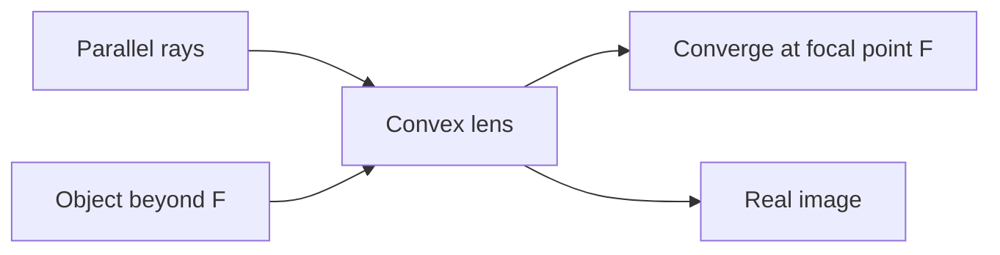
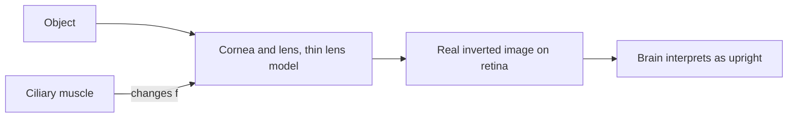

# Concept-Book Run

domain: /home/papagame/projects/digital-duck/cb-college-physics/public/domains/college_physics_ch26/input/graph.yaml
target: laser_vision_correction
started: 2026-11-23T23:54:56

## Teaching order (12 concepts)

- convex_lens
- thin_lens_equation
- eye_as_optical_system
- focal_length
- lens_power
- accommodation
- far_point
- near_point
- astigmatism
- hyperopia
- myopia
- laser_vision_correction

### convex_lens (22.4s)

## Convex Lens

A **convex lens** is a transparent piece of material, usually glass or plastic, that is thicker at its center than at its edges. Light slows down inside the glass, so a ray entering at an angle bends toward the thicker part of the lens. Rays that arrive parallel to the **principal axis** (the line through the lens center, perpendicular to its surface) therefore bend inward and meet at one point, the **focal point** $F$. The distance from the lens center to $F$ is the **focal length** $f$. A convex lens is called a *converging* lens, and $f>0$ by convention.

Three rays locate any image:

1. A ray parallel to the axis refracts through the far focal point.
2. A ray through the lens center continues undeviated (for a thin lens).
3. A ray through the near focal point emerges parallel to the axis.

Where these rays cross is the image point. For a thin lens, the object distance $d_o$ and image distance $d_i$ (positive for a real image on the far side of the lens) are related by the **thin-lens equation**:

$$\frac{1}{f}=\frac{1}{d_o}+\frac{1}{d_i}$$

A negative $d_i$ means the image is virtual and lies on the same side of the lens as the object.

*Parallel rays converge at the focal point; an object placed beyond $F$ produces a real image.*

### Worked example

A convex lens has $f=10\text{ cm}$. A candle stands $30\text{ cm}$ from the lens. Find the image position.

$$\frac{1}{d_i}=\frac{1}{f}-\frac{1}{d_o}=\frac{1}{10}-\frac{1}{30}=\frac{2}{30}\;\Rightarrow\; d_i=15\text{ cm}$$

The image is real, located $15\text{ cm}$ behind the lens. The positive $d_i$ confirms it forms on the far side, where a screen could catch it.

### Problem-solving application

The image type depends on where the object sits:

| Object position | Image |
|---|---|
| $d_o>2f$ | Real, closer to the lens than the object (camera) |
| $f<d_o<2f$ | Real, farther from the lens than the object (projector) |
| $d_o<f$ | Virtual, on the object's side (magnifying glass) |

**Problem.** A magnifying glass has $f=8.0\text{ cm}$. A stamp is held $6.0\text{ cm}$ from it. Where is the image, and what kind is it?

Since $d_o<f$, expect a virtual image.

$$\frac{1}{d_i}=\frac{1}{8}-\frac{1}{6}=\frac{3-4}{24}=-\frac{1}{24}\;\Rightarrow\; d_i=-24\text{ cm}$$

The negative $d_i$ shows the image is virtual, on the same side as the stamp, $24\text{ cm}$ from the lens. It lies farther from the lens than the stamp does, which is why the glass enlarges what you see. This matches the prediction from $d_o<f$.

**Strategy summary:** (1) compare $d_o$ with $f$ to predict the image type, (2) solve the thin-lens equation for $d_i$, (3) check that the sign of $d_i$ matches your prediction.

### thin_lens_equation (20.3s)

## Thin Lens Equation

### Definition

For a thin lens, the object distance $d_o$, the image distance $d_i$, and the focal length $f$ are related by

$$\frac{1}{d_o} + \frac{1}{d_i} = \frac{1}{f}.$$

This holds in the paraxial approximation (rays close to the axis, small angles) and when the lens thickness is negligible compared with $d_o$, $d_i$, and $f$. The sign conventions are:

- $d_o > 0$ for a real object, which is on the side the light comes from.
- $d_i > 0$ for a real image, which is on the opposite side of the lens. $d_i < 0$ for a virtual image, which is on the same side as the object.
- $f > 0$ for a converging (convex) lens. $f < 0$ for a diverging (concave) lens.

### Worked example

A converging lens has $f = 10\ \text{cm}$. An object sits at $d_o = 30\ \text{cm}$. Find the image.

$$\frac{1}{d_i} = \frac{1}{f} - \frac{1}{d_o} = \frac{1}{10} - \frac{1}{30} = \frac{3-1}{30} = \frac{1}{15}$$

So $d_i = 15\ \text{cm}$. This is positive, so the image is real and forms on the opposite side of the lens from the object.

### Problem-solving application

**Case 1: object inside the focal length.** Move the same object to $d_o = 6\ \text{cm}$ with $f = 10\ \text{cm}$:

$$\frac{1}{d_i} = \frac{1}{10} - \frac{1}{6} = \frac{3-5}{30} = -\frac{1}{15} \implies d_i = -15\ \text{cm}.$$

The negative sign means the image is virtual. It lies on the object's side of the lens. This is the situation in a magnifying glass.

**Case 2: diverging lens.** Let $f = -20\ \text{cm}$ and $d_o = 40\ \text{cm}$:

$$\frac{1}{d_i} = -\frac{1}{20} - \frac{1}{40} = -\frac{3}{40} \implies d_i \approx -13.3\ \text{cm}.$$

The image is virtual. A diverging lens always forms a virtual image of a real object.

**Strategy for any problem:**

1. Assign signs to $d_o$ and $f$ before substituting.
2. Solve for $1/d_i$ first, then invert. Do not invert each term separately.
3. Interpret the sign of $d_i$: positive means a real image, negative means a virtual image.
4. Check the limits. As $d_o \to \infty$, $d_i \to f$, so a distant object focuses at the focal point. If $d_o = f$, then $1/d_i = 0$, so the image forms at infinity. This is how a collimated beam is made.

**Quick check.** A converging lens has $f = 12\ \text{cm}$ and a real object sits at $d_o = 8\ \text{cm}$. Is the image real or virtual, and where does it form?

Solution: $\frac{1}{d_i} = \frac{1}{12} - \frac{1}{8} = \frac{2-3}{24} = -\frac{1}{24}$, so $d_i = -24\ \text{cm}$. The image is virtual and lies 24 cm from the lens on the object's side. This agrees with the rule that a converging lens gives a virtual image only when $d_o < f$.

### eye_as_optical_system (16.2s)

## Eye As Optical System

**Definition.** For optics problems, the eye can be modeled as a single thin lens, formed by the cornea and the crystalline lens, that focuses light onto the retina. The retina is a light-sensitive screen at a fixed distance from the lens, about $d_i \approx 2.0\ \text{cm}$. The image on the retina is real and inverted. The brain interprets it as upright. The cornea does most of the bending, about two-thirds of the total power. The crystalline lens does the fine adjustment.

The thin-lens equation applies:

$$\frac{1}{f} = \frac{1}{d_o} + \frac{1}{d_i}, \qquad m = -\frac{d_i}{d_o}, \qquad P = \frac{1}{f}\ \ (\text{in diopters, with } f \text{ in m}).$$

Because $d_i$ is fixed, the eye cannot focus on objects at different distances by moving the lens. Instead, it changes $f$. This is **accommodation**. The ciliary muscles change the curvature of the lens. A relaxed eye focuses distant objects ($d_o \to \infty$) with $f = d_i$. Viewing a nearby object requires a shorter $f$, so the lens becomes more curved and its power increases.

**Worked example.** A normal relaxed eye has $d_i = 2.00$ cm. Find its power, then find the power needed to read at the near point $d_o = 25.0$ cm.

Relaxed (object at infinity): $P = \frac{1}{0.0200\ \text{m}} = 50.0\ \text{D}$.

Reading: $P = \frac{1}{0.250\ \text{m}} + \frac{1}{0.0200\ \text{m}} = 4.00 + 50.0 = 54.0\ \text{D}$.

The eye therefore adds about $4\ \text{D}$ of power through accommodation. The image of a 1.0 cm letter has height $|m|\,h_o = \frac{2.00}{25.0}(1.0\ \text{cm}) = 0.080\ \text{cm}$, and it is inverted.

**Problem-solving application: correcting nearsightedness.** A myopic (nearsighted) eye focuses too strongly or is too long, so distant objects form images in front of the retina. Suppose a person's far point, the farthest object they can see sharply, is $80.0$ cm. A corrective lens must take an object at infinity and form a virtual image at $80.0$ cm, which the eye can then focus. Treat the glasses as lying at the eye, and use $d_o = \infty$ and $d_i = -0.800$ m (virtual, so negative):

$$P = \frac{1}{\infty} + \frac{1}{-0.800\ \text{m}} = -1.25\ \text{D}.$$

The negative sign indicates a diverging lens, which is what nearsightedness requires.

For farsightedness (hyperopia), the near point is too far away. The same method applies. Place the object at $25\ \text{cm}$ and the virtual image at the person's actual near point. The result is a positive, converging lens.

**Strategy.**
1. Identify the fixed quantity, $d_i \approx 2.0$ cm.
2. Decide what the corrective lens must do: map the object to the virtual image at the far point or near point.
3. Use sign conventions carefully: virtual images have $d_i < 0$.
4. Check the sign of $P$. Negative means diverging (myopia). Positive means converging (hyperopia).

*The eye as a thin lens: accommodation changes the focal length so the image always lands on the fixed-distance retina.*

### focal_length (2.5s)

## Focal Length

The **focal length** $f$ of a lens or mirror is the distance from its optical center to its focal point, the point where rays arriving parallel to the optical axis converge (or appear to diverge from). The sign convention is:

- $f > 0$ for **converging** optics (convex lenses, concave mirrors)
- $f < 0$ for **diverging** optics (concave lenses, convex mirrors)

For a thin lens in air, the focal length is tied to its geometry by the lensmaker's equation, with $R_1, R_2$ the radii of curvature of the two surfaces and $n$ the refractive index:

$$\frac{1}{f} = (n-1)\left(\frac{1}{R_1} - \frac{1}{R_2}\right)$$

For a spherical mirror, $f = R/2$. The focal length then connects object distance $d_o$ and image distance $d_i$ through the thin-lens (or mirror) equation:

$$\frac{1}{f} = \frac{1}{d_o} + \frac{1}{d_i}$$

The magnification is $m = -d_i/d_o$. A negative $m$ means the image is inverted. The reciprocal $P = 1/f$ is the **optical power**, measured in diopters (m$^{-1}$) when $f$ is in meters.

### Worked example

A converging lens has $f = +20$ cm. An object sits $d_o = 30$ cm from the lens. Find the image.

$$\frac{1}{d_i} = \frac{1}{f} - \frac{1}{d_o} = \frac{1}{20} - \frac{1}{30} = \frac{3-2}{60} = \frac{1}{60}$$

So $d_i = +60$ cm. The positive sign means a real image on the opposite side of the lens. The magnification is $m = -60/30 = -2$, so the image is inverted and twice the object's size.

Now move the object inside the focal length, at $d_o = 10$ cm:

$$\frac{1}{d_i} = \frac{1}{20} - \frac{1}{10} = -\frac{1}{20} \Rightarrow d_i = -20 \text{ cm}$$

The negative $d_i$ indicates a virtual, upright image on the same side as the object, with $m = -(-20)/10 = +2$. This is how a magnifying glass works.

### Problem-solving application

**Problem.** A diverging lens has $f = -15$ cm. An object is placed 45 cm away. Where is the image, and what are its properties?

**Solution.**

$$\frac{1}{d_i} = \frac{1}{-15} - \frac{1}{45} = \frac{-3-1}{45} = -\frac{4}{45}$$

So $d_i = -11.25$ cm, and $m = -(-11.25)/45 = +0.25$. The image is virtual, upright, and one quarter the object's size, on the same side as the object.

**Strategy for any problem:**

1. Assign the sign of $f$ from the optic type (converging $+$, diverging $-$).
2. Solve $1/d_i = 1/f - 1/d_o$, keeping signs.
3. Interpret $d_i$: positive means real, negative means virtual.
4. Compute $m$: its sign gives orientation (negative means inverted) and its magnitude gives size.
5. Check the result. A diverging optic always gives a virtual, upright, reduced image. A converging optic gives a real, inverted image when $d_o > f$ and a virtual, upright, enlarged image when $d_o < f$.

**Key takeaway:** the sign of $f$ determines which family of images an optic can produce, and a single equation with consistent sign bookkeeping handles every case.

### lens_power (21.4s)

## Lens Power

**Definition.** The *power* of a lens measures how strongly it bends light. It is the reciprocal of the focal length $f$, expressed in meters:

$$P = \frac{1}{f}$$

The unit is the **diopter** (D), where $1\ \text{D} = 1\ \text{m}^{-1}$. A converging (convex) lens has $f > 0$ and therefore $P > 0$. A diverging (concave) lens has $f < 0$ and therefore $P < 0$. A short focal length means a strong lens, so a lens with $f = 0.25$ m bends light four times as strongly as one with $f = 1$ m.

Power is useful because it **adds**. For thin lenses in contact, the combined system has

$$P_{\text{total}} = P_1 + P_2 + \cdots$$

This follows from the thin-lens equation $\frac{1}{d_o} + \frac{1}{d_i} = \frac{1}{f}$. The first lens forms an intermediate image, which acts as the object for the second lens. With the lenses touching, the two image-distance terms cancel, and the reciprocals of the focal lengths sum.

**Worked example.** A converging lens has $f = 20$ cm. Find its power.

1. Convert to meters: $f = 0.20$ m.
2. Compute $P = \dfrac{1}{0.20\ \text{m}} = +5.0\ \text{D}$.

Now place it in contact with a diverging lens of $f = -50$ cm. The second lens has $P_2 = \dfrac{1}{-0.50} = -2.0$ D. The combination has

$$P_{\text{total}} = 5.0 + (-2.0) = +3.0\ \text{D}$$

The system converges light with focal length $f = \dfrac{1}{3.0} \approx 0.33$ m.

A common mistake is to leave $f$ in centimeters. That gives a value off by a factor of 100.

**Problem-solving application.** Eyeglass prescriptions are written in diopters. Suppose a nearsighted person cannot see clearly beyond a **far point** of 80 cm. A corrective lens must take an object at infinity and form a virtual image at 80 cm on the same side as the object. Using the thin-lens equation with $d_o \to \infty$ and $d_i = -0.80$ m (negative, because the image is virtual):

$$P = \frac{1}{f} = \frac{1}{d_o} + \frac{1}{d_i} = 0 + \frac{1}{-0.80} = -1.25\ \text{D}$$

The prescription is a diverging lens of $-1.25$ D, which is what nearsightedness requires. This agrees with the sign rule above.

A farsighted person works the same way in reverse. Suppose their near point is 100 cm and they want to read at 25 cm. Then $d_o = 0.25$ m and $d_i = -1.00$ m, so

$$P = \frac{1}{0.25} + \frac{1}{-1.00} = 4.0 - 1.0 = +3.0\ \text{D}$$

This is a converging lens, as expected.

**Key takeaways.**
- Always convert focal length to meters before taking the reciprocal.
- The sign of $P$ tells you the lens type: positive converges, negative diverges.
- Powers of thin lenses in contact simply add, which is why opticians can combine corrections by arithmetic instead of tracing rays.

### accommodation (16.6s)

## Accommodation

**Accommodation** is the eye's adjustment of its optical power so that objects at different distances form sharp images on the retina. It is performed by the ciliary muscle, which changes the curvature of the crystalline lens.

**Mechanism.** The lens is suspended by zonular fibers attached to the ciliary body.

- *Distant object:* The ciliary muscle relaxes. The zonules are taut and pull the lens into a flatter, thinner shape, which gives it a longer focal length.
- *Near object:* The ciliary muscle contracts. This releases tension on the zonules, and the lens's own elasticity lets it bulge. The surfaces become more curved, the focal length shortens, and the optical power increases.

Because the retina stays at a fixed distance from the lens, the eye must change the lens power to keep the image in focus.

**The optics.** Optical power is $P = 1/f$, measured in diopters (D) when $f$ is in meters. For a relaxed, normal eye focused at infinity, the total power is about $P_0 \approx 60\ \text{D}$. For an object at distance $d_o$, the thin-lens equation gives the power needed:

$$P = \frac{1}{d_o} + \frac{1}{d_i}$$

where $d_i$ is the lens-to-retina distance. For the relaxed eye, $1/d_i = P_0$. The **accommodation required** is therefore

$$A = P - P_0 = \frac{1}{d_o}$$

So the extra power needed is simply the reciprocal of the object distance in meters.

### Worked example

How much accommodation is needed to read a book held 25 cm from the eye?

$$A = \frac{1}{0.25\ \text{m}} = 4.0\ \text{D}$$

The total power is about $60 + 4 = 64$ D. The lens must increase its power by about 7%.

### Problem-solving application

The **near point** is the closest distance at which the eye can still focus. It is set by the maximum accommodation $A_{\max}$:

$$d_{\text{near}} = \frac{1}{A_{\max}}$$

A young adult may have $A_{\max} \approx 10\ \text{D}$, so $d_{\text{near}} = 0.10$ m. By about age 50, the lens has stiffened (*presbyopia*) and $A_{\max}$ may fall to 2.0 D. Then:

$$d_{\text{near}} = \frac{1}{2.0\ \text{D}} = 0.50\ \text{m}$$

Reading at 25 cm needs 4.0 D, but this person can supply only 2.0 D. The shortfall is $4.0 - 2.0 = 2.0$ D, so they need reading glasses with power $+2.0$ D. The glasses supply the missing power, and the eye's remaining accommodation does the rest.

**Check your understanding:** A student can focus on objects no closer than 40 cm. (a) What is $A_{\max}$? (b) What lens power would let them read comfortably at 25 cm if they use all of their accommodation? 

*Answer:* (a) $A_{\max} = 1/0.40 = 2.5$ D. (b) They need $4.0 - 2.5 = +1.5$ D.

### far_point (17.3s)

## Far Point

### Definition

The **far point** of the eye is the greatest distance at which an object can be seen sharply when the eye's focusing muscles are fully relaxed. A normal (emmetropic) eye has its far point at infinity: parallel rays from distant objects converge exactly on the retina with no accommodation. Because accommodation can only *increase* the eye's optical power, the far point marks the eye's lowest-power state.

In optics terms, the far point is the object distance $d_{\text{far}}$ whose image the relaxed eye places on the retina. Using the thin-lens equation for the eye's combined optics,

$$\frac{1}{d_{\text{far}}} + \frac{1}{d_i} = \frac{1}{f_{\text{relaxed}}},$$

where $d_i$ is the lens-to-retina distance (about 2.0 cm in an adult). For a normal eye, $f_{\text{relaxed}} = d_i$, so $1/d_{\text{far}} = 0$ and $d_{\text{far}} = \infty$.

**Myopia** (nearsightedness) occurs when the relaxed eye is too powerful for its length. Rays from infinity focus in front of the retina, and the far point moves to a finite distance.

### Worked example

A myopic person can see clearly only out to $d_{\text{far}} = 80\ \text{cm}$. What power of corrective lens, worn close to the eye, lets them see distant objects clearly?

The lens must take parallel rays (object at infinity) and form a virtual image at the far point, so the eye sees them as coming from 80 cm away. Use $d_o = \infty$ and $d_i = -0.80\ \text{m}$ (negative because the image is virtual, on the object side):

$$\frac{1}{f} = \frac{1}{d_o} + \frac{1}{d_i} = 0 + \frac{1}{-0.80\ \text{m}} = -1.25\ \text{m}^{-1}.$$

The power is $P = 1/f = -1.25\ \text{D}$ (diopters). The negative sign means a diverging lens, which is what nearsightedness requires.

### Problem-solving application

**General rule:** for a distant object, the corrective lens must have focal length $f = -d_{\text{far}}$, so $P = -1/d_{\text{far}}$ (with $d_{\text{far}}$ in meters).

*Problem.* A student's prescription is $-2.50\ \text{D}$. Without the glasses, how far can they see sharply?

*Solution.* Rearrange the rule:

$$d_{\text{far}} = -\frac{1}{P} = \frac{1}{2.50\ \text{D}} = 0.40\ \text{m}.$$

Their uncorrected far point is 40 cm. Anything beyond that is blurred.

**Checking your answer.**
- A myopic far point must be finite and positive. A negative result means a sign error.
- A stronger (more negative) prescription means a *closer* far point.
- If the lens is worn some distance $s$ from the eye (as with glasses, typically about 1.5 to 2 cm), the lens-to-far-point distance is $d_{\text{far}} - s$, so $f = -(d_{\text{far}} - s)$. For weak prescriptions the correction is negligible. For strong ones, such as $-10\ \text{D}$, it changes the required power by roughly 20%. Contact lenses sit on the eye, so $s \approx 0$.

The far point is half of the eye's range of clear vision. The other half is the near point, the closest distance the eye can focus using full accommodation. Together they define the span over which the eye sees sharply.

### near_point (15.3s)

## Near Point

The **near point** is the closest distance at which the eye can form a sharp image on the retina. For a young adult with normal vision it is about $N = 25\ \text{cm}$. Closer than this, the eye's lens cannot increase its optical power enough to keep the image focused.

**Why a limit exists.** The eye focuses by changing the lens's focal length (accommodation). The image distance is fixed by the eye's length, about $d_i \approx 2\ \text{cm}$. As the object distance $d_o$ decreases, the lens must grow stronger to satisfy the thin-lens equation:

$$\frac{1}{f} = \frac{1}{d_o} + \frac{1}{d_i}$$

The ciliary muscles can only squeeze the lens so far. The shortest focal length they can reach sets the near point. The maximum power $P = 1/f$ (in diopters, with $f$ in meters) is therefore the physical limit.

**The far point** is the opposite limit. It is the farthest distance the eye can focus on, and for a normal eye it is effectively infinity.

**Worked example.** Take a normal eye with $d_i = 2.0\ \text{cm}$ and near point $25\ \text{cm}$. Find the lens's power range.

At the far point, $d_o \to \infty$:
$$P_{\min} = \frac{1}{0.020\ \text{m}} = 50\ \text{D}$$

At the near point:
$$P_{\max} = \frac{1}{0.25\ \text{m}} + \frac{1}{0.020\ \text{m}} = 4 + 50 = 54\ \text{D}$$

So accommodation adds only about $4\ \text{D}$. The near point gives a direct measure of the eye's accommodation range, $\Delta P = 1/N$.

**Problem-solving application: correcting a far near point.** With age, the lens stiffens (presbyopia) and the near point recedes. Suppose a person's near point is $N' = 100\ \text{cm}$, but they want to read at $25\ \text{cm}$. A converging lens must form a virtual image at $100\ \text{cm}$ from an object held at $25\ \text{cm}$. Using a negative image distance for a virtual image, with the lens close to the eye:

$$\frac{1}{f} = \frac{1}{0.25} + \frac{1}{-1.00} = 4.0 - 1.0 = 3.0\ \text{D}$$

The prescription is $+3.0\ \text{D}$. The lens takes an object at 25 cm and makes it look as if it sits at 100 cm. The eye can focus on that apparent position.

**General result.** To read at distance $d_o$ with near point $N'$, the needed lens power is

$$P = \frac{1}{d_o} - \frac{1}{N'}$$

**Magnifiers.** The same idea explains why optical instruments are rated relative to $N = 25\ \text{cm}$. A simple magnifier of focal length $f$, with its image at the near point, has angular magnification

$$M = 1 + \frac{N}{f}$$

For $f = 5\ \text{cm}$, $M = 1 + 25/5 = 6$. The object appears six times larger than it would if viewed unaided at the near point.

**Check your understanding.** A person with near point $40\ \text{cm}$ wants to read at $25\ \text{cm}$. Using the general result, $P = 4.0 - 2.5 = +1.5\ \text{D}$.

### astigmatism (18.2s)

## Astigmatism

**Definition.** Astigmatism is a refractive error in which the cornea or lens is not rotationally symmetric. Instead of a uniform curvature like a basketball, the surface is shaped more like a football: steeper along one meridian and flatter along the perpendicular one. Because a steeper surface bends light more strongly, the eye has two different focal lengths. Light in one plane focuses in front of the retina, and light in the perpendicular plane focuses behind it (or at a different distance). The result is a blur that depends on direction, so a point source becomes a smear rather than a point.

The power of a refracting surface is

$$P = \frac{n_2 - n_1}{R},$$

where $R$ is the radius of curvature, and $P$ is in diopters when $R$ is in meters. The cornea supplies most of the eye's focusing power, so a small asymmetry in $R$ has a large effect. Astigmatism is quantified as the **cylinder power**, the difference between the powers of the two principal meridians:

$$C = |P_{\text{steep}} - P_{\text{flat}}|.$$

**Worked example.** A cornea has radius $R_1 = 7.50\ \text{mm}$ along the vertical meridian and $R_2 = 7.80\ \text{mm}$ along the horizontal meridian. Use $n_1 = 1.000$ for air and $n_2 = 1.376$ for the cornea (the standard keratometric index).

$$P_1 = \frac{0.376}{0.00750} \approx 50.1\ \text{D}, \qquad P_2 = \frac{0.376}{0.00780} \approx 48.2\ \text{D}$$

$$C = 50.1 - 48.2 \approx 1.9\ \text{D}.$$

This is moderate astigmatism. The steeper vertical meridian focuses light sooner, so horizontal lines and vertical lines cannot both be sharp at once.

**Problem-solving application.** A prescription gives sphere, cylinder, and axis, for example $-1.00 / -2.00 \times 90^\circ$. A cylindrical lens has power only along the meridian perpendicular to its axis. The axis ($90^\circ$) is the direction along which the lens has no extra power. Here the principal meridians of the lens are:

- Along $90^\circ$ (axis direction): $-1.00\ \text{D}$
- Along $180^\circ$: $-1.00 + (-2.00) = -3.00\ \text{D}$

To correct our corneal example, we need a cylinder that cancels the $1.9\ \text{D}$ difference. The corrective lens must add power along the flatter meridian (or subtract it along the steeper one), equalizing the two focal lengths. Placing a $-1.9\ \text{D}$ cylinder with its axis along the flat (horizontal) meridian reduces the power only in the steep vertical meridian, so both meridians end up with power $\approx 48.2\ \text{D}$.

Between the two focal lines lies the **circle of least confusion**, where the blur is smallest. Its position corresponds to the average power, called the **spherical equivalent**:

$$SE = S + \frac{C}{2}.$$

For $-1.00 / -2.00 \times 90^\circ$, $SE = -1.00 + \frac{-2.00}{2} = -2.00\ \text{D}$. Clinicians use this value when a purely spherical correction (for example, some contact lenses) is the only option, since it places the circle of least confusion on the retina.

**Check your understanding.** If one corneal meridian has $R = 8.00\ \text{mm}$ and the other $R = 7.40\ \text{mm}$, show that the astigmatism is about $3.0\ \text{D}$. Which meridian is steeper, and which way should a correcting cylinder's axis point?

### hyperopia (17.7s)

## Hyperopia

**Hyperopia** (farsightedness) is a refractive error in which the eye's optical power is too weak for its length. Parallel light from distant objects converges to a point *behind* the retina. Light from close objects, which is diverging, is focused even farther back. The cause is usually an eyeball that is too short or a cornea and lens that are too flat. A young person can partly compensate by accommodation, in which the ciliary muscle thickens the lens to add power. Sustained effort causes eye strain and headaches, and accommodation fails with age.

### Thin-lens description

The thin-lens equation relates object distance $d_o$, image distance $d_i$, and focal length $f$:

$$\frac{1}{f} = \frac{1}{d_o} + \frac{1}{d_i}$$

Optical power is $P = 1/f$, measured in diopters (D) when $f$ is in meters. A corrective lens must add the power the eye lacks. A converging (positive) lens does this.

### Worked example

A hyperopic eye has a lens-to-retina distance of $d_i = 2.00\ \text{cm}$. Assume the eye's power is fixed at $P_\text{eye} = 48.0\ \text{D}$, so the eye cannot accommodate. The person tries to read a book at $d_o = 25.0\ \text{cm}$.

The power needed to focus the book on the retina is

$$P_\text{needed} = \frac{1}{0.250\ \text{m}} + \frac{1}{0.0200\ \text{m}} = 4.00 + 50.0 = 54.0\ \text{D}.$$

The eye is short by

$$P_\text{lens} = 54.0 - 48.0 = +6.0\ \text{D}.$$

Without correction, the image forms behind the retina. Solving for the image distance with the eye's own power gives

$$d_i' = \frac{1}{P_\text{eye} - 1/d_o} = \frac{1}{48.0 - 4.00} = 2.27\ \text{cm}.$$

This is $0.27\ \text{cm}$ behind the retina, which is why the image looks blurred.

### Problem-solving application

**Problem.** A person's near point (the closest distance at which they can focus) is $100\ \text{cm}$. What power of glasses lets them read at $25.0\ \text{cm}$?

**Strategy.** The lens must take an object at $d_o = 25.0\ \text{cm}$ and form a *virtual* image at the near point. A virtual image on the same side as the object has a negative image distance, so $d_i = -100\ \text{cm}$.

$$P = \frac{1}{0.250} + \frac{1}{-1.00} = 4.00 - 1.00 = +3.00\ \text{D}$$

The eye then views this virtual image at $100\ \text{cm}$, which it can focus. The positive sign confirms a converging lens, as expected for hyperopia.

**Check.** If the lens were $+3.00\ \text{D}$ and the object sat at $25\ \text{cm}$, the combined image distance satisfies $1/d_i = 3.00 - 4.00 = -1.00\ \text{m}^{-1}$, so $d_i = -1.00\ \text{m}$. This matches the required near point.

*Hyperopia arises when the eye converges light too little. A positive lens adds the missing power and moves the focus onto the retina.*

**Key takeaway:** hyperopia is a power deficit. Find the power the eye needs, subtract the power it has, and the difference is the corrective lens, positive for farsightedness.

### myopia (15.0s)

## Myopia

**Definition.** Myopia (nearsightedness) is a refractive defect in which the eye focuses parallel light rays from distant objects at a point *in front of* the retina. The cause is either an eyeball that is too long (axial myopia) or a cornea and lens whose combined optical power is too strong (refractive myopia). Rays from far objects are overconverged, so they cross and diverge again before reaching the retina, producing a blurred image. Near objects are still seen clearly because their rays diverge more, pushing the focal point back toward the retina.

**Optics.** For a thin lens system, the lens equation is

$$\frac{1}{f}=\frac{1}{d_o}+\frac{1}{d_i}$$

where $f$ is the focal length, $d_o$ is the object distance, and $d_i$ is the image distance. Optical power is $P = 1/f$, measured in diopters (D) when $f$ is in meters. A normal eye has $d_i \approx 2.0$ cm, the lens-to-retina distance. Light from a far object ($d_o\to\infty$) is then focused on the retina. A myopic eye has too much power for its retinal distance, so the image forms at $d_i < $ retina position.

**Far point.** The *far point* is the farthest distance at which the myopic eye can focus an object on its retina. A normal eye's far point is at infinity. A myopic eye's far point is finite, and this is what the corrective lens must fix.

**Worked example.** A person can see clearly only out to $d_{fp}=50$ cm. What lens corrects their vision?

The lens must take an object at infinity and form a virtual image at the far point, on the same side as the object. The image distance is therefore negative: $d_i=-0.50$ m, with $d_o=\infty$.

$$\frac{1}{f}=\frac{1}{\infty}+\frac{1}{-0.50\ \text{m}}=-2.0\ \text{m}^{-1}$$

So $P=-2.0$ D, a diverging (concave) lens with $f=-50$ cm. The lens spreads the incoming rays just enough that the eye's overconverging optics bring them to a focus on the retina.

**Problem-solving application.** Suppose a contact lens sits on the cornea and the person's prescription must be found from their far point. The general rule is

$$P_{\text{correction}}=-\frac{1}{d_{fp}}$$

(with $d_{fp}$ in meters). Use it as follows:

1. Find the far point $d_{fp}$ from the problem statement.
2. Treat the lens as forming a virtual image at $d_{fp}$ of an object at infinity.
3. Compute $P=-1/d_{fp}$. A negative sign always indicates a diverging lens.
4. Check the sign: myopia is always corrected with $P<0$.

*Check:* a far point of 25 cm gives $P=-4.0$ D, which is a stronger prescription than the 50 cm case. This makes sense, because a closer far point means a more severe defect. If the lens is worn 2 cm in front of the eye, as with eyeglasses, use $d_{fp}-0.02$ m in the formula instead.

**Other treatments.** Refractive surgery such as LASIK reshapes the cornea to reduce its power. Orthokeratology lenses do the same temporarily. All of these methods reduce the eye's net optical power so that the focal point moves back onto the retina.

### laser_vision_correction (14.9s)

## Laser Vision Correction

**Definition.** Laser vision correction (LASIK, PRK) uses an excimer laser, which emits ultraviolet light at 193 nm, to reshape the cornea. The cornea supplies about two-thirds of the eye's focusing power, roughly 43 diopters (D), so changing its curvature changes where light focuses on the retina. Each pulse removes about 0.25 µm of tissue by photoablation. This process breaks molecular bonds without significant heat, so nearby tissue is left largely undamaged.

**Optics behind it.** Refractive power $P$ (in diopters) is the reciprocal of focal length $f$ in meters:

$$P = \frac{1}{f}$$

For a single refracting surface with radius of curvature $R$, separating air from a medium of refractive index $n$:

$$P = \frac{n-1}{R}$$

Using the keratometric index $n = 1.3375$, a cornea with $R = 7.8$ mm has $P = 0.3375/0.0078 \approx 43.3$ D.

- **Myopia** (nearsightedness): the eye focuses too strongly, so the laser flattens the central cornea, which increases $R$.
- **Hyperopia** (farsightedness): the eye focuses too weakly, so the laser steepens the cornea by ablating the periphery.
- **Astigmatism**: curvature differs between meridians, so the laser removes tissue unevenly to make the surface spherical.

**Worked example.** A patient has $-4.00$ D of myopia, which means the cornea must lose 4.00 D of power. Starting from $P = 43.3$ D, the target is $39.3$ D. Solve for the new radius:

$$R_{\text{new}} = \frac{0.3375}{39.3} \approx 8.59 \text{ mm}$$

The radius increases from 7.80 mm to 8.59 mm, so the cornea is flatter.

**Problem-solving application: how much tissue?** The Munnerlyn approximation estimates the central ablation depth $t$ for an optical zone of diameter $d$ (in mm) and correction $D$ (in diopters):

$$t \approx \frac{d^{2}\,D}{3}\ \ \mu\text{m}$$

For $d = 6.0$ mm and $D = 4.00$:

$$t \approx \frac{(6.0)^2(4.00)}{3} = 48\ \mu\text{m}$$

At about 0.25 µm per pulse, this takes roughly $48/0.25 \approx 192$ pulses at the center.

The formula shows that depth grows with the **square** of the zone diameter. Widening the zone from 6 mm to 7 mm raises the depth for the same correction to about $65\ \mu\text{m}$ (a factor of $49/36 \approx 1.36$). A larger zone reduces night-vision glare but removes more tissue.

Surgeons use this relationship to check safety. A typical cornea is about 540 µm thick. Practice usually leaves at least 250–300 µm of untouched stromal bed, plus the flap thickness in LASIK, to avoid corneal ectasia, which is progressive bulging. For a patient with a 500 µm cornea, a 100 µm flap, and a 6 mm zone, the maximum allowed ablation is about $500 - 100 - 300 = 100\ \mu\text{m}$. Solving $t = d^2D/3$ for $D$ gives

$$D_{\max} = \frac{3t}{d^2} = \frac{3(100)}{36} \approx 8.3\ \text{D}$$

Corrections near or above this limit call for another option, such as an implantable lens.

**Check your understanding.** For $d = 6.5$ mm and $D = 3.00$ D, estimate $t$ and the pulse count. The answer is $t \approx 42\ \mu\text{m}$, or about 169 pulses.

## Run complete

total: 228.1s
