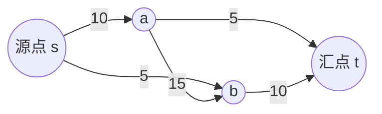
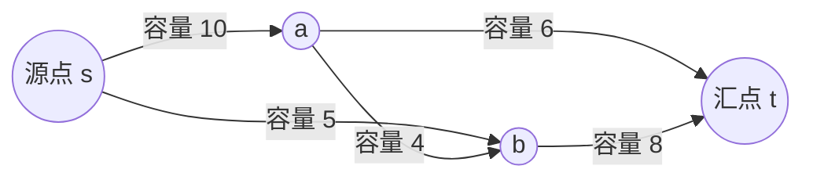

# Concept-Book Run

domain: /home/papagame/projects/digital-duck/cb-algorithms/public/domains/algorithms_ch11/input/graph.yaml
target: minimum_cut_problem
started: 2026-11-23T23:59:32

## Teaching order (5 concepts)

- flow_network
- capacity_function
- cut
- cut_capacity
- minimum_cut_problem

### flow_network (1.0s)

## 流网络

**定义。** 流网络(flow network)是一个有向图 $G=(V,E)$,带有两个特殊顶点:**源点** $s$ 和**汇点** $t$,以及一个非负**容量函数** $c:E\to\mathbb{R}_{\ge 0}$。直观上,边 $(u,v)$ 像一根水管,$c(u,v)$ 是它单位时间内最多能输送的量。若 $(u,v)\notin E$,约定 $c(u,v)=0$。

在网络上,一个**流** $f:E\to\mathbb{R}_{\ge0}$ 必须满足两条规则:

1. **容量限制**:对每条边,$0\le f(u,v)\le c(u,v)$。
2. **流量守恒**:对每个 $v\in V\setminus\{s,t\}$,
$$\sum_{u} f(u,v)=\sum_{w} f(v,w),$$
即流入等于流出,中间顶点不储存也不产生流量。

流的**值**定义为从源点净流出的量:
$$|f|=\sum_{v} f(s,v)-\sum_{v} f(v,s).$$
最大流问题就是在所有合法流中求使 $|f|$ 最大者。

**示例。** 考虑顶点 $s,a,b,t$,容量为 $c(s,a)=10$,$c(s,b)=5$,$c(a,b)=15$,$c(a,t)=5$,$c(b,t)=10$。

*图:示例流网络,边上的数字为容量。*

试取流:$f(s,a)=8$,$f(s,b)=2$,$f(a,t)=5$,$f(a,b)=3$,$f(b,t)=5$。检验:

- 容量限制:每条边的流量都不超过容量,例如 $f(a,b)=3\le15$。
- 守恒:在 $a$ 处流入 $8$,流出 $5+3=8$;在 $b$ 处流入 $2+3=5$,流出 $5$。

流值 $|f|=8+2=10$。它合法,但不一定最大。

**问题求解应用。** 如何判断 $10$ 是否已是最优?考虑**割** $(S,T)$:把顶点分成 $s\in S$、$t\in T$ 两部分,其容量为 $c(S,T)=\sum_{u\in S,\,v\in T}c(u,v)$。取 $S=\{s,a,b\}$,$T=\{t\}$,则只有进入 $t$ 的边穿过割,容量为 $5+10=15$。取 $S=\{s\}$,割容量为 $10+5=15$。取 $S=\{s,a\}$,$T=\{b,t\}$,穿过的边为 $(s,b),(a,b),(a,t)$,容量 $5+15+5=25$。

任何流的值都不超过任何割的容量,因为流必须穿过割。因此 $|f|\le 15$。我们能否达到 $15$?令 $f(s,a)=10$,$f(s,b)=5$,$f(a,t)=5$,$f(a,b)=5$,$f(b,t)=10$:在 $a$ 处 $10=5+5$,在 $b$ 处 $5+5=10$,守恒成立,且 $|f|=15$,等于割 $(\{s,a,b\},\{t\})$ 的容量。

这正是**最大流最小割定理**:最大流的值等于最小割的容量。实际建模时,凡是"在容量约束下从起点向终点输送尽可能多的东西"的问题,如管道输油、网络带宽、二分图匹配、项目选择,都可以先画成流网络,再用 Ford–Fulkerson 或 Edmonds–Karp 等增广路径算法求解,并用最小割证明结果最优。

### capacity_function (2.0s)

## 容量函数

**定义。** 在流网络 $G=(V,E)$ 中，**容量函数**是一个映射
$$c: E \to \mathbb{R}_{\ge 0},$$
它给每条有向边 $(u,v)\in E$ 指定一个非负数 $c(u,v)$，表示这条边最多能承载多少流量。对于不存在的边，约定 $c(u,v)=0$。容量函数是网络的"硬件规格"。它由问题给定，在求解过程中不会改变。要优化的对象是**流** $f$，它必须服从容量函数的约束：

$$0 \le f(u,v) \le c(u,v)\quad \text{对所有 }(u,v)\in E.$$

这条不等式称为**容量约束**。再加上除源点 $s$ 和汇点 $t$ 以外各顶点的**流量守恒**，即 $\sum_{u} f(u,v)=\sum_{w} f(v,w)$，就构成了合法流的完整定义。

**例题。** 考虑网络：$c(s,a)=10$，$c(s,b)=5$，$c(a,b)=4$，$c(a,t)=6$，$c(b,t)=8$。

下面这个流是否合法？$f(s,a)=9$，$f(s,b)=3$，$f(a,b)=4$，$f(a,t)=5$，$f(b,t)=7$。

1. 容量约束：逐条检查，$9\le10$，$3\le5$，$4\le4$，$5\le6$，$7\le8$，全部成立。
2. 在 $a$ 处守恒：流入 $9$，流出 $4+5=9$，成立。
3. 在 $b$ 处守恒：流入 $3+4=7$，流出 $7$，成立。

所以该流合法，流值为 $f(a,t)+f(b,t)=12$。边 $(a,b)$ 已满载，称为**饱和边**。

*图：例题中的流网络，边上标注的是容量函数的取值。*

**问题求解应用。** 容量函数直接给出流值的上界。任取一个把 $s$ 与 $t$ 分开的顶点划分 $(S,T)$，其中 $s\in S$，$t\in T$，则任何合法流的值都不超过**割容量**
$$c(S,T)=\sum_{u\in S,\,v\in T} c(u,v).$$

取 $S=\{s,a,b\}$、$T=\{t\}$，得 $c(S,T)=c(a,t)+c(b,t)=6+8=14$，所以流值最大为 $14$。再取 $S=\{s\}$，得 $c(S,T)=10+5=15$，这个界更松。取 $S=\{s,a\}$，得 $c(s,b)+c(a,b)+c(a,t)=5+4+6=15$，也不如 $14$ 紧。三个割里最小的是 $14$，但它是否真能达到，还要再核对。

我们尝试把例题中的流改进：令 $f(s,a)=10$，$f(s,b)=4$，$f(a,b)=4$，$f(a,t)=6$，$f(b,t)=8$。

- 容量约束：$10\le10$，$4\le5$，$4\le4$，$6\le6$，$8\le8$，成立。
- 在 $a$ 处：流入 $10$，流出 $4+6=10$。
- 在 $b$ 处：流入 $4+4=8$，流出 $8$。

这是合法流，流值为 $14$，与割容量 $14$ 相等。因此 $14$ 就是最大流值。这体现了最大流最小割定理：当流值等于某个割容量时，两者同时达到最优。

**小结。** 容量函数规定每条边的上限。检验一个流是否合法，要逐边比较 $f\le c$，并检查守恒条件。估计最大流时，容量函数通过割容量给出上界。

