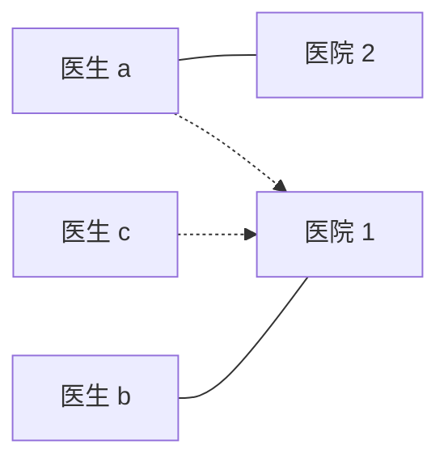

# Concept-Book Run

domain: /home/papagame/projects/digital-duck/cb-algorithms/public/domains/algorithms_ch12/input/graph.yaml
target: minimal_faculty_hiring
started: 2026-11-23T23:59:52

## Teaching order (6 concepts)

- matching
- maximum_flow
- bipartite_matching
- directed_acyclic_graph
- disjoint_path_cover
- minimal_faculty_hiring

### matching (1.0s)

## 匹配(Matching)

**定义。** 设图 $G=(V,E)$。**匹配** $M\subseteq E$ 是一组两两不共享顶点的边,即每个顶点至多与 $M$ 中的一条边相关联。在二部图 $G=(X\cup Y,E)$ 中(例如 $X$ 为医生、$Y$ 为医院),匹配就是把 $X$ 中的元素与 $Y$ 中的元素一对一配对,且每个参与者至多配一个。

几个常用术语:

- 若顶点 $v$ 被 $M$ 中某条边覆盖,称 $v$ 被**饱和**。
- $|M|$ 最大的匹配称为**最大匹配**。
- 若 $X$ 中每个顶点都被饱和,称 $M$ **完美匹配于 $X$**。若 $|X|=|Y|$ 且 $M$ 饱和所有顶点,则称 $M$ 为**完美匹配**。

**例题。** 三名医生 $a,b,c$ 与三家医院 $1,2,3$。可接受的配对为:$a$–1,$a$–2,$b$–1,$c$–1。

取 $M_1=\{a1,\,b1\}$。两条边都含医院 1,违反"至多一个"的要求,所以它不是匹配。

取 $M_2=\{a2,\,b1\}$。这是匹配,$|M_2|=2$。

能否再配上 $c$?$c$ 只能去医院 1,而医院 1 已被 $b$ 占用。设想沿"交错路径"调整:从未饱和的 $c$ 出发,经边 $c1$(不在 $M_2$ 中),再经边 $1b$(在 $M_2$ 中),到达 $b$。此时 $b$ 只能去医院 1,无法继续延伸,所以这条路径不能增广。因此最大匹配大小为 2,而不是 3。

**问题求解:Hall 定理。** 如何不靠试错就判断能否完美匹配于 $X$?对 $S\subseteq X$,记 $N(S)$ 为 $S$ 的所有邻居构成的集合。

> **Hall 定理。** 二部图中存在饱和 $X$ 的匹配,当且仅当对每个 $S\subseteq X$,都有 $|N(S)|\ge |S|$。

必要性显然:$S$ 中的 $|S|$ 个元素要配到互不相同的邻居,邻居数至少为 $|S|$。充分性可对 $|X|$ 用归纳法证明,这里略去。

回到例题。取 $S=\{b,c\}$,则 $N(S)=\{1\}$,$|N(S)|=1<2=|S|$。Hall 条件被破坏,所以不可能饱和全部医生。这与上面的结论一致,并且还指出了瓶颈所在:$b$ 与 $c$ 抢同一家医院。

**求最大匹配的算法。** 若匹配 $M$ 存在一条**增广路径**(起点与终点都未饱和,且路径上的边在 $M$ 外与 $M$ 内交替出现),把路径上的边在 $M$ 内外互换,就得到大小为 $|M|+1$ 的匹配。Berge 定理说明其逆也成立:$M$ 是最大匹配当且仅当不存在增广路径。反复寻找并翻转增广路径,即得到匈牙利算法,其时间复杂度为 $O(|V|\cdot|E|)$。

**小结。** 匹配刻画"一对一配对"。判断存在性用 Hall 条件,构造最优解则靠增广路径。

*图中实线为匹配 $M_2$,虚线为可接受但未选中的配对。医生 $c$ 只能去医院 1,而该医院已被 $b$ 占用,所以 $c$ 无法被饱和。*

