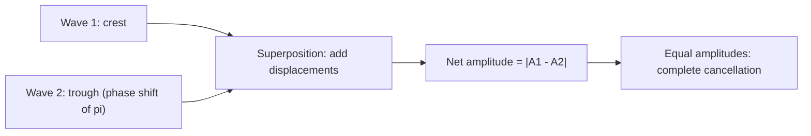

# Concept-Book Run

domain: /home/papagame/projects/digital-duck/cb-college-physics/public/domains/college_physics_ch27/input/graph.yaml
target: spectroscopic_dispersion
started: 2026-11-24T00:02:03

## Teaching order (15 concepts)

- wavelength
- electromagnetic_wave
- interference
- wavefront
- constructive_interference
- destructive_interference
- frequency
- huygens_principle
- path_length_difference
- coherence
- diffraction
- double_slit_interference
- interference_order
- diffraction_grating
- spectroscopic_dispersion

### wavelength (0.7s)

## Wavelength

**Definition.** The wavelength $\lambda$ of a periodic wave is the distance between adjacent identical points on the wave, such as crest to crest, trough to trough, or compression to compression. It is measured parallel to the direction of propagation and is expressed in meters (or nanometers, for light). Wavelength is tied to the wave's frequency $f$ and speed $v$ by

$$v = f\lambda$$

This relation follows from the definition. In one period $T = 1/f$, the wave pattern advances exactly one wavelength, so $v = \lambda/T = \lambda f$.

**What sets $\lambda$.** The source fixes the frequency, and the medium fixes the speed. Wavelength is whatever is left over: $\lambda = v/f$. When a wave enters a new medium, $f$ stays the same because the source is unchanged. The speed $v$ changes, so $\lambda$ changes in proportion.

**Worked example.** A middle-C tuning fork vibrates at $f = 262\ \text{Hz}$. Sound travels at $v = 343\ \text{m/s}$ in air at 20 °C. Find the wavelength in air, then in water, where $v = 1480\ \text{m/s}$.

In air:
$$\lambda_{\text{air}} = \frac{343\ \text{m/s}}{262\ \text{Hz}} \approx 1.31\ \text{m}$$

In water, the frequency is unchanged:
$$\lambda_{\text{water}} = \frac{1480\ \text{m/s}}{262\ \text{Hz}} \approx 5.65\ \text{m}$$

The wavelength is about 4.3 times longer in water, matching the ratio of the speeds ($1480/343 \approx 4.3$).

**Problem-solving application.** Wavelength determines how a wave interacts with its surroundings. Consider an FM radio station broadcasting at $f = 98.1\ \text{MHz}$. Electromagnetic waves in air travel at about $c = 3.00\times10^{8}\ \text{m/s}$, so

$$\lambda = \frac{c}{f} = \frac{3.00\times10^{8}}{98.1\times10^{6}} \approx 3.06\ \text{m}$$

An antenna works well when its length is a simple fraction of the wavelength. A quarter-wave antenna should therefore be about $\lambda/4 \approx 0.76\ \text{m}$ long. That is why car antennas are roughly this size.

A second use is diffraction. A wave bends noticeably around an opening or obstacle only when the size of the obstacle is comparable to or smaller than $\lambda$. The 1.31 m sound wave from the tuning fork spreads easily through a doorway about 1 m wide, so you can hear around corners. Visible light has $\lambda \sim 500\ \text{nm}$, far smaller than a doorway, so you cannot see around corners.

**Strategy for problems.**
1. Identify which quantity the source fixes ($f$) and which the medium fixes ($v$).
2. Apply $\lambda = v/f$, and convert prefixes (MHz $\to 10^6$ Hz, nm $\to 10^{-9}$ m) before computing.
3. When the medium changes, hold $f$ constant and scale $\lambda$ with $v$.
4. Compare $\lambda$ with the size of any opening, obstacle, or antenna to predict its behavior.

**Check your understanding.** A 440 Hz note travels from air into helium, where $v \approx 970\ \text{m/s}$. What is the new wavelength? (Answer: $970/440 \approx 2.20\ \text{m}$, compared with $343/440 \approx 0.78\ \text{m}$ in air.)

### electromagnetic_wave (0.7s)

## Electromagnetic Wave

### Definition

An **electromagnetic (EM) wave** is a self-sustaining disturbance in which an electric field $\vec{E}$ and a magnetic field $\vec{B}$ oscillate together, each perpendicular to the other and to the direction of propagation. The wave is transverse, and it needs no medium. A changing $\vec{B}$ induces an $\vec{E}$ (Faraday's law), and a changing $\vec{E}$ induces a $\vec{B}$ (Maxwell's addition to Ampère's law). Each field regenerates the other as the wave moves through empty space.

Maxwell's equations in vacuum give a wave equation for each field:

$$\nabla^2 \vec{E} = \mu_0 \varepsilon_0 \,\frac{\partial^2 \vec{E}}{\partial t^2}$$

The wave speed is therefore

$$c = \frac{1}{\sqrt{\mu_0 \varepsilon_0}} \approx 3.00\times 10^8\ \text{m/s}.$$

A plane wave traveling along $+x$ with $\vec{E}$ along $y$ and $\vec{B}$ along $z$ is

$$E_y = E_0 \cos(kx - \omega t), \qquad B_z = B_0 \cos(kx - \omega t),$$

where $k = 2\pi/\lambda$ and $\omega = 2\pi f$. Three relations follow:

- $c = f\lambda$
- $E_0 = c\,B_0$, so the two fields rise and fall in phase
- $\vec{E}\times\vec{B}$ points along the direction of travel

The wave carries energy at an intensity

$$I = \tfrac{1}{2}\,c\,\varepsilon_0 E_0^2 .$$

### Worked example

A radio station broadcasts at $f = 98.0\ \text{MHz}$. Find the wavelength, and find $B_0$ if $E_0 = 0.150\ \text{V/m}$ at your receiver.

**Wavelength:**

$$\lambda = \frac{c}{f} = \frac{3.00\times10^{8}}{98.0\times10^{6}} \approx 3.06\ \text{m}$$

**Magnetic amplitude:**

$$B_0 = \frac{E_0}{c} = \frac{0.150}{3.00\times10^{8}} = 5.00\times10^{-10}\ \text{T}$$

The magnetic field is tiny in SI units. This is normal, because $c$ is so large.

### Problem-solving application

**Problem.** A laser pointer emits 5.00 mW in a beam 2.00 mm in diameter. Find the intensity, $E_0$, and $B_0$.

*Step 1: intensity.* The beam area is $A = \pi r^2 = \pi(1.00\times10^{-3})^2 = 3.14\times10^{-6}\ \text{m}^2$, so

$$I = \frac{P}{A} = \frac{5.00\times10^{-3}}{3.14\times10^{-6}} \approx 1.59\times10^{3}\ \text{W/m}^2 .$$

*Step 2: electric amplitude.* Solve $I = \tfrac12 c\varepsilon_0 E_0^2$ for $E_0$:

$$E_0 = \sqrt{\frac{2I}{c\,\varepsilon_0}} = \sqrt{\frac{2(1.59\times10^{3})}{(3.00\times10^{8})(8.85\times10^{-12})}} \approx 1.09\times10^{3}\ \text{V/m}.$$

*Step 3: magnetic amplitude.*

$$B_0 = \frac{E_0}{c} \approx 3.6\times10^{-6}\ \text{T}.$$

**Check.** The intensity is about that of sunlight, roughly $10^3\ \text{W/m}^2$, but it is squeezed into a pencil-thin beam. The field amplitudes are therefore large. For a given power, a narrower beam gives a larger $E_0$.

**Strategy.** In EM wave problems, first find $\lambda$ or $f$ from $c = f\lambda$. For field strengths, use $E_0 = cB_0$. For power or brightness, use $I = \tfrac12 c\varepsilon_0E_0^2$. Intensity falls as $1/r^2$ from a point source. Doubling the distance cuts $E_0$ by half and $I$ by a factor of four.

*Each changing field induces the other, so the wave keeps propagating through vacuum without a medium.*

### interference (0.5s)

## Interference

**Interference** is the combination of two or more waves in the same region of space. By the principle of superposition, the net displacement at any point and time is the sum of the individual displacements:

$$y_{\text{net}}(x,t) = y_1(x,t) + y_2(x,t)$$

Consider two waves of the same frequency $f$ and amplitude $A$, with a phase difference $\phi$:

$$y_1 = A\sin(kx - \omega t), \qquad y_2 = A\sin(kx - \omega t + \phi)$$

Using $\sin a + \sin b = 2\sin\frac{a+b}{2}\cos\frac{a-b}{2}$, the sum is

$$y_{\text{net}} = 2A\cos\!\left(\frac{\phi}{2}\right)\sin\!\left(kx - \omega t + \frac{\phi}{2}\right)$$

The resulting wave has the same frequency, but its amplitude is $2A\left|\cos(\phi/2)\right|$. This gives two limiting cases:

- **Constructive interference:** $\phi = 2\pi n$ gives amplitude $2A$, the maximum.
- **Destructive interference:** $\phi = (2n+1)\pi$ gives amplitude $0$, so the waves cancel.

For two sources, phase difference comes from the path difference $\Delta L = |L_1 - L_2|$:

$$\phi = \frac{2\pi\,\Delta L}{\lambda}$$

So constructive interference occurs when $\Delta L = n\lambda$, and destructive interference occurs when $\Delta L = \left(n+\tfrac{1}{2}\right)\lambda$, for $n = 0, 1, 2, \dots$

| Condition | Path difference | Phase difference | Result |
|---|---|---|---|
| Constructive | $n\lambda$ | $2\pi n$ | Amplitude $2A$ |
| Destructive | $(n+\tfrac12)\lambda$ | $(2n+1)\pi$ | Amplitude $0$ |

### Worked example

Two speakers, driven in phase, emit a 440 Hz tone. Take the speed of sound as $v = 343\ \text{m/s}$. A listener stands 4.00 m from one speaker and 5.75 m from the other. Is the sound loud or quiet?

1. Wavelength: $\lambda = v/f = 343/440 = 0.780\ \text{m}$.
2. Path difference: $\Delta L = 5.75 - 4.00 = 1.75\ \text{m}$.
3. Ratio: $\Delta L/\lambda = 1.75/0.780 \approx 2.24$.

This is neither an integer (constructive) nor a half-integer (destructive). The phase difference is $\phi = 2\pi(2.24) \approx 0.24 \cdot 2\pi \approx 1.5\ \text{rad}$ (mod $2\pi$). The amplitude factor is $|\cos(\phi/2)| = \cos(0.75) \approx 0.73$. The listener hears sound at about 73% of the maximum amplitude. Because intensity scales as amplitude squared, the intensity is about $0.73^2 \approx 53\%$ of the maximum.

### Problem-solving application: timing error in cancellation

Noise-cancelling headphones rely on destructive interference: a speaker emits a copy of the noise shifted by $\phi = \pi$ (an inverted signal). Suppose the noise is a 200 Hz hum and the cancelling signal arrives late by a time $\tau$. The extra phase error is $\delta = 2\pi f\tau$. The inverted copy then differs from perfect cancellation by $\delta$, so the residual amplitude is

$$A_{\text{res}} = 2A\sin\!\left(\frac{\delta}{2}\right)$$

For $\tau = 1$ ms at 200 Hz: $\delta = 2\pi(200)(0.001) \approx 1.26$ rad, so $A_{\text{res}} = 2A\sin(0.63) \approx 1.18A$. This is larger than the original amplitude $A$, so the "cancellation" makes the noise worse.

Now try a smaller error, $\tau = 0.1$ ms: $\delta \approx 0.126$ rad, so $A_{\text{res}} \approx 2A(0.063) \approx 0.13A$. The noise drops by about 87%.

Because $\delta$ grows with $f$ for a fixed delay, these systems cancel best at low frequencies, where a small timing error causes only a small phase error.

### wavefront (0.7s)

## Wavefront

A **wavefront** is a surface connecting all points of a wave that are in the same phase, such as a crest or a trough. Every point on one wavefront is at the same stage of its oscillation. For a wave $\psi(\mathbf{r}, t) = A\cos(\mathbf{k}\cdot\mathbf{r} - \omega t)$, a wavefront is a surface of constant phase:

$$\phi(\mathbf{r}, t) = \mathbf{k}\cdot\mathbf{r} - \omega t = \text{constant}.$$

Wavefronts are perpendicular to the direction of propagation, which is the direction of the **ray**. Their shape depends on the source:

- **Plane wave:** a distant source or a collimated beam gives flat, parallel wavefronts.
- **Spherical wave:** a point source in a uniform medium gives concentric spheres of radius $r$.

Adjacent wavefronts of the same phase (crest to crest) are separated by one wavelength $\lambda = 2\pi/k$. Each wavefront moves outward at the phase speed $v = \omega/k = f\lambda$.

### Worked example

A point source emits sound at $f = 680\ \text{Hz}$ in air, where $v = 340\ \text{m/s}$. Find the wavelength, the spacing between wavefronts, and the radius of a crest after $0.050\ \text{s}$ if it left the source at $t=0$.

1. Wavelength: $\lambda = v/f = 340/680 = 0.50\ \text{m}$. Successive spherical wavefronts are $0.50\ \text{m}$ apart.
2. Radius: $r = vt = (340)(0.050) = 17\ \text{m}$.
3. The wavefront at that moment is a sphere of area $4\pi r^2 \approx 3.6\times10^{3}\ \text{m}^2$. The same wave energy is spread over this larger area as the wavefront expands, so the wave grows weaker with distance.

### Problem-solving application: wavefront geometry and refraction

Wavefronts also explain how a wave bends when its speed changes. Suppose a plane wave moves from air ($v_1$) into water ($v_2 < v_1$) and strikes the boundary at angle of incidence $\theta_1$, measured between the wavefront and the boundary. In time $\Delta t$, one end of the wavefront travels $v_1\Delta t$ in the first medium while the other end travels $v_2\Delta t$ in the second. Both distances are legs of right triangles that share the same hypotenuse $h$ along the boundary, so

$$\sin\theta_1 = \frac{v_1\Delta t}{h}, \qquad \sin\theta_2 = \frac{v_2\Delta t}{h}.$$

Dividing gives Snell's law:

$$\frac{\sin\theta_1}{\sin\theta_2} = \frac{v_1}{v_2} = \frac{n_2}{n_1}.$$

The wavefront bends because the part of it that enters the slower medium first falls behind. For light going from air ($n_1 = 1.00$) into water ($n_2 = 1.33$) with $\theta_1 = 40^\circ$:

$$\sin\theta_2 = \frac{\sin 40^\circ}{1.33} \approx 0.483 \;\Rightarrow\; \theta_2 \approx 28.9^\circ.$$

The wavefront turns toward the normal and its spacing shrinks to $\lambda_2 = \lambda_1/1.33$, while the frequency stays the same.

*From source to refraction: wavefront shape and speed determine how a wave spreads and bends.*

**Key idea:** to analyze a wave problem, draw the wavefronts, draw rays perpendicular to them, and track how the speed changes the spacing and direction.

### constructive_interference (14.1s)

## Constructive Interference

### Definition

**Constructive interference** occurs when two or more waves overlap *in phase*, meaning crest meets crest and trough meets trough. By the principle of superposition, the displacements add:

$$y_{\text{total}}(x,t) = y_1(x,t) + y_2(x,t).$$

For two waves of equal frequency with amplitudes $A_1$ and $A_2$ and phase difference $\varphi$, the resultant amplitude is

$$A = \sqrt{A_1^2 + A_2^2 + 2A_1A_2\cos\varphi}.$$

Constructive interference corresponds to $\cos\varphi = 1$, that is,

$$\varphi = 2\pi m, \quad m = 0, 1, 2, \dots$$

Then $A = A_1 + A_2$, the largest amplitude the pair can produce.

### Path-difference condition

Phase difference usually comes from a difference in path length $\Delta L$ between two sources that emit in phase. Since $\varphi = 2\pi\,\Delta L/\lambda$, the condition becomes

$$\Delta L = m\lambda, \quad m = 0, 1, 2, \dots$$

Constructive interference happens wherever the paths differ by a whole number of wavelengths.

### Worked example

Two speakers, in phase, emit a 686 Hz tone. Take the speed of sound to be 343 m/s. A listener stands 4.00 m from speaker A and 5.50 m from speaker B. Is the sound loud (constructive) or quiet at that point?

1. Wavelength: $\lambda = v/f = 343/686 = 0.500$ m.
2. Path difference: $\Delta L = 5.50 - 4.00 = 1.50$ m.
3. Ratio: $\Delta L/\lambda = 1.50/0.500 = 3$, a whole number.

So $m = 3$ and the waves arrive in phase. If each wave alone has amplitude $A_0$, the combined amplitude is $2A_0$. Intensity scales with amplitude squared, so the intensity is $4I_0$, four times that of one speaker alone. It is not twice. The extra energy comes from regions of destructive interference, where the intensity falls below $2I_0$, so total energy is conserved.

### Problem-solving application

**Problem.** Light of wavelength 600 nm passes through two narrow slits separated by $d = 0.100$ mm. Bright fringes appear on a screen $L = 2.00$ m away. Find the spacing between adjacent bright fringes.

**Solution.** For a far-away screen, the path difference to a point at angle $\theta$ is $\Delta L = d\sin\theta$. Bright fringes satisfy

$$d\sin\theta = m\lambda.$$

For small angles, $\sin\theta \approx \tan\theta = y/L$, so

$$y_m = \frac{m\lambda L}{d}, \qquad \Delta y = \frac{\lambda L}{d}.$$

Substituting:

$$\Delta y = \frac{(600\times10^{-9})(2.00)}{1.00\times10^{-4}} = 1.2\times10^{-2}\ \text{m} = 12\ \text{mm}.$$

**Strategy summary.**
1. Find $\lambda$ from $v/f$.
2. Express the path difference geometrically.
3. Set $\Delta L = m\lambda$ and solve for the unknown.
4. Check the sign and size of the answer. Here, a smaller slit spacing $d$ gives wider fringes, as expected.

Remember that this condition assumes the sources are in phase. If one source has an extra phase shift, such as a $\pi$ shift on reflection, the condition changes to $\Delta L = (m + \tfrac{1}{2})\lambda$, so check the sources' phases before applying the formula.

### destructive_interference (13.4s)

## Destructive Interference

**Definition.** Destructive interference occurs when two or more waves overlap so that their displacements have opposite signs at the same point, reducing the net amplitude. The extreme case is *complete* destructive interference: the waves are exactly out of phase (crest meets trough), and the resultant amplitude is zero (for equal amplitudes).

By the superposition principle, the net displacement is the sum of the individual displacements. For two waves of the same frequency with amplitudes $A_1$ and $A_2$ and phase difference $\Delta\phi$, the resultant amplitude is

$$A = \sqrt{A_1^2 + A_2^2 + 2A_1A_2\cos\Delta\phi}.$$

Destructive interference is the case $\Delta\phi = (2m+1)\pi$ for $m = 0, \pm1, \pm2, \dots$, where $\cos\Delta\phi = -1$ and so $A = |A_1 - A_2|$.

A phase difference often comes from a **path difference** $\Delta L$. Since $\Delta\phi = 2\pi\,\Delta L/\lambda$, the condition becomes

$$\Delta L = \left(m + \tfrac{1}{2}\right)\lambda, \qquad m = 0, 1, 2, \dots$$

**Worked example.** Two identical speakers, driven in phase, emit a 343 Hz tone. The speed of sound is 343 m/s, so $\lambda = v/f = 1.00$ m. A listener stands 4.00 m from speaker A and 5.50 m from speaker B. Is the sound loud or quiet?

1. Path difference: $\Delta L = 5.50 - 4.00 = 1.50$ m.
2. In wavelengths: $\Delta L/\lambda = 1.5 = 1 + \tfrac12$.
3. This matches $(m+\tfrac12)\lambda$ with $m = 1$, so the waves arrive exactly out of phase.

With equal amplitudes, $A = |A_1 - A_2| = 0$. The listener hears (nearly) silence at this spot.

**Problem-solving application: noise-canceling headphones.** A microphone samples ambient noise, and the headphone speaker emits a copy shifted by $\Delta\phi = \pi$, which is the same as multiplying the signal by $-1$. If noise has amplitude $A_n$ and the anti-noise has amplitude $0.9A_n$, the residual amplitude is

$$A = |A_n - 0.9A_n| = 0.1A_n.$$

Since intensity scales as $A^2$, the intensity falls to $(0.1)^2 = 1\%$ of its original value, a reduction of $10\log_{10}(0.01) = -20$ dB.

This also shows why cancellation works best for steady, low-frequency sounds. A fixed time delay $\tau$ gives a phase error $2\pi f\tau$, and this error grows with frequency. At high frequencies the anti-noise drifts out of phase, and the cancellation fails.

**Check your understanding.** Two waves of equal amplitude $A_0$ have a phase difference of $2\pi/3$. Use the amplitude formula to find the resultant amplitude. (Answer: $A = \sqrt{2A_0^2 + 2A_0^2\cos(2\pi/3)} = A_0$. This is partial destructive interference. The amplitude is reduced from the maximum $2A_0$ but not canceled.)

*Two out-of-phase waves add by superposition. Their displacements subtract, and equal amplitudes cancel completely.*

### frequency (0.8s)

## Frequency

The **frequency** of a value in a data set is the number of times that value occurs. If a data set records the number of siblings for 20 students, and the value 2 appears 6 times, then the frequency of "2 siblings" is 6. Frequencies are typically organized into a **frequency table**, which lists each distinct value alongside its count, and often a **relative frequency** — the frequency divided by the total number of observations, expressed as a proportion or percentage.

**Worked example.** Suppose a teacher records the number of pets owned by 15 students:

$$1, 2, 0, 1, 3, 2, 1, 1, 0, 2, 2, 1, 4, 1, 2$$

Tallying each value gives the frequency table:

| Number of pets | Frequency | Relative frequency |
|---|---|---|
| 0 | 2 | $2/15 \approx 0.133$ |
| 1 | 6 | $6/15 = 0.400$ |
| 2 | 5 | $5/15 \approx 0.333$ |
| 3 | 1 | $1/15 \approx 0.067$ |
| 4 | 1 | $1/15 \approx 0.067$ |

The relative frequencies sum to 1 (allowing for rounding), since every observation is accounted for exactly once. This table immediately reveals the shape of the data: owning 1 pet is the most common outcome (the **mode**), while owning 3 or 4 pets is rare.

**Problem-solving application.** Frequency tables are the foundation for nearly every downstream statistical tool: histograms are built by plotting frequency against value, probability estimates from empirical data use relative frequency as a stand-in for probability, and measures like the mode are defined directly in terms of frequency. When solving a problem that asks "how often," "how many," or "what proportion," the first step is almost always to construct or consult a frequency table before computing anything else. For instance, to estimate the probability that a randomly selected student from this class owns at least 2 pets, sum the frequencies for 2, 3, and 4 pets ($5 + 1 + 1 = 7$) and divide by the total ($15$), giving an estimated probability of $7/15 \approx 0.467$. This illustrates the general principle: frequency counts convert raw, unordered data into a structured summary that supports both description (what does the data look like?) and inference (what can we predict from it?).

### huygens_principle (13.3s)

## Huygens Principle

**Definition.** Huygens' principle states that every point on a wavefront acts as a source of secondary spherical wavelets. Each wavelet expands forward at the wave speed $v$. After a time $\Delta t$, the new wavefront is the surface tangent to all of these wavelets (their envelope). Each wavelet has radius

$$r = v\,\Delta t.$$

The principle is a geometric construction. It predicts where a wave goes next, using only the current wavefront and the speed $v$ of the medium.

**Worked example: refraction.** A plane wave in air (speed $v_1$) hits a glass surface (speed $v_2 < v_1$) at incidence angle $\theta_1$, measured from the normal. Take two points on the incoming wavefront, $A$ and $B$. Point $A$ reaches the surface first. By the time $B$ arrives, a time $\Delta t$ later, the wavelet from $A$ has traveled only $v_2\,\Delta t$ in the glass. Meanwhile $B$ has traveled $v_1\,\Delta t$ in air to reach the surface.

Let $d$ be the length of surface between $A$ and $B$'s landing points. Then

$$\sin\theta_1 = \frac{v_1\,\Delta t}{d}, \qquad \sin\theta_2 = \frac{v_2\,\Delta t}{d}.$$

Dividing the two equations gives Snell's law:

$$\frac{\sin\theta_1}{\sin\theta_2} = \frac{v_1}{v_2} = \frac{n_2}{n_1},$$

where $n = c/v$ is the refractive index. The wave bends toward the normal because the wavelets in glass are smaller, which tilts the tangent line.

**Problem-solving application.** Light in air ($n_1 = 1.00$) strikes water ($n_2 = 1.33$) at $\theta_1 = 40^\circ$. Find the refraction angle and the wave speed in water.

1. Speed: $v_2 = c/n_2 = (3.00\times10^8)/1.33 \approx 2.26\times10^8\ \text{m/s}$.
2. Angle: $\sin\theta_2 = \dfrac{n_1}{n_2}\sin\theta_1 = \dfrac{1.00}{1.33}(0.643) = 0.483$, so $\theta_2 \approx 28.9^\circ$.

The same construction handles reflection. The wavelets stay in the original medium, so $v_1 = v_2$ and $\theta_{\text{reflected}} = \theta_{\text{incident}}$.

It also explains diffraction. When a plane wave reaches a slit of width $a$, only the points in the opening emit wavelets. These spread into the shadow region, and the effect is strong when $a$ is comparable to the wavelength $\lambda$. For $a \gg \lambda$ the wave passes nearly straight through.

**Check your understanding.** A sound wave moves from cool air ($v_1 = 330$ m/s) into warm air ($v_2 = 350$ m/s) at $\theta_1 = 20^\circ$. Does it bend toward or away from the normal? Use $\sin\theta_2 = (v_2/v_1)\sin\theta_1$ to find $\theta_2$. The answer is $\theta_2 \approx 21.2^\circ$, which is away from the normal. The wavelets are larger in the faster medium, so the tangent line tilts the other way.

**Limitation.** The basic construction does not explain why waves do not also travel backward. Kirchhoff's later refinement, which adds an obliquity factor to each wavelet, removes this problem.

### path_length_difference (13.0s)

## Path Length Difference

**Definition.** When two coherent waves of the same wavelength $\lambda$ travel from their sources to a common point $P$, the **path length difference** is

$$\Delta L = |r_2 - r_1|,$$

where $r_1$ and $r_2$ are the distances from each source to $P$. It matters because it fixes the **phase difference** of the waves at $P$:

$$\Delta\phi = 2\pi\,\frac{\Delta L}{\lambda}.$$

If the sources vibrate in phase, the interference at $P$ follows from $\Delta L$:

- **Constructive interference** (waves add, maximum amplitude): $\Delta L = m\lambda$, with $m = 0, 1, 2, \dots$
- **Destructive interference** (waves cancel, minimum amplitude): $\Delta L = \left(m + \tfrac{1}{2}\right)\lambda$, with $m = 0, 1, 2, \dots$

The reason is that a shift of one whole wavelength puts a crest back on a crest. A shift of half a wavelength puts a crest on a trough.

**Worked example.** Two speakers, in phase, emit a 343 Hz tone. The speed of sound is 343 m/s, so $\lambda = v/f = 1.00$ m. A listener stands 5.00 m from speaker A and 6.50 m from speaker B.

$$\Delta L = 6.50 - 5.00 = 1.50\ \text{m} = 1.5\lambda.$$

This equals $\left(1 + \tfrac{1}{2}\right)\lambda$, so the listener is at a **destructive** point and hears a quiet spot.

**Problem-solving application: double slit.** Light of wavelength $\lambda$ passes through two slits separated by $d$ and lands on a distant screen at angle $\theta$ from the central axis. Because the screen is far away, the two rays are nearly parallel. The extra distance the lower ray travels is the leg of a right triangle:

$$\Delta L = d\sin\theta.$$

Bright fringes occur when $d\sin\theta = m\lambda$. Dark fringes occur when $d\sin\theta = \left(m+\tfrac12\right)\lambda$.

*Example:* $\lambda = 600$ nm and $d = 0.100$ mm. Find the angle of the first bright fringe beyond the center ($m=1$).

$$\sin\theta = \frac{m\lambda}{d} = \frac{600\times10^{-9}}{1.00\times10^{-4}} = 6.00\times10^{-3}$$

so $\theta \approx 6.00\times10^{-3}$ rad $\approx 0.344^\circ$. On a screen $L = 2.00$ m away, the fringe sits at $y \approx L\tan\theta \approx 12$ mm from the center.

**Strategy for any problem:**

1. Compute $\lambda$ from $v/f$, or use the given wavelength.
2. Find $\Delta L$ geometrically, either from the two distances or from $d\sin\theta$.
3. Divide: $\Delta L/\lambda$. A whole number means constructive interference. A half-integer means destructive. Anything else gives partial interference.
4. Check for extra phase shifts, such as sources that are out of phase or a reflection that inverts the wave. These add to the phase difference and swap the conditions above.

**Common pitfall:** the criterion depends on $\Delta L$ measured in wavelengths, not on the distances themselves. Two paths of 100 m and 101 m can interfere either way, depending on $\lambda$.

### coherence (23.0s)

## Coherence

**Definition.** Two waves are **coherent** if the phase difference between them stays constant (or changes predictably) over time. Waves of the same frequency with a fixed phase relationship produce stable, observable interference. **Incoherent** waves have phase differences that vary randomly, so any interference pattern averages out to nothing.

The key measure is the **coherence length** $L_c$: the distance a wave travels while its phase stays predictable. It depends on how narrow the source's spectrum is. For a source with spectral bandwidth $\Delta\nu$,

$$L_c \approx \frac{c}{\Delta\nu} = \frac{\lambda^2}{\Delta\lambda}.$$

A narrow spectrum means a long coherence length.

**Why it matters for interference.** For two waves with intensities $I_1$ and $I_2$ and phase difference $\phi$, the total intensity is

$$I = I_1 + I_2 + 2\sqrt{I_1 I_2}\,\cos\phi.$$

If the waves are coherent, $\phi$ is fixed, and the cosine term produces bright and dark fringes. If they are incoherent, $\phi$ varies randomly, so the average of $\cos\phi$ is zero and

$$I = I_1 + I_2.$$

The intensities simply add, and no fringes appear.

**Worked example.** A sodium lamp emits light at $\lambda = 589\ \text{nm}$ with a spectral width $\Delta\lambda \approx 0.6\ \text{nm}$. A helium-neon laser emits at $\lambda = 633\ \text{nm}$ with $\Delta\nu \approx 1.5\ \text{GHz}$ (a simple multimode laser). Estimate each coherence length.

*Sodium lamp:*
$$L_c \approx \frac{\lambda^2}{\Delta\lambda} = \frac{(589\times10^{-9})^2}{0.6\times10^{-9}} \approx 5.8\times10^{-4}\ \text{m} \approx 0.6\ \text{mm}.$$

*Laser:*
$$L_c \approx \frac{c}{\Delta\nu} = \frac{3.0\times10^{8}}{1.5\times10^{9}} = 0.20\ \text{m}.$$

The laser's coherence length is about 300 times longer.

**Problem-solving application.** In a Michelson interferometer, a beam is split in two, and the halves travel different paths before they recombine. Fringes are visible only if the path difference $\Delta s$ satisfies $\Delta s \lesssim L_c$.

*Problem:* Using the sodium lamp above, what is the largest mirror displacement $d$ at which you can still see fringes?

*Solution:* Moving one mirror by $d$ changes the path difference by $2d$ (the light goes there and back). Requiring $2d \lesssim L_c$ gives

$$d \lesssim \frac{L_c}{2} \approx 0.3\ \text{mm}.$$

Beyond this, the fringes wash out. With the laser, the same setup works out to about $10\ \text{cm}$.

**Common pitfalls.**

1. Two independent light bulbs never produce stable fringes. Their phases drift on timescales of about $10^{-8}\ \text{s}$ or less, so they are mutually incoherent.
2. Having the same wavelength is not enough. Coherence requires a stable phase relationship as well.
3. The standard way to get coherent beams from an ordinary source is to split one beam into two (a double slit or a beam splitter). Both beams then share the same phase history.

### diffraction (12.7s)

## Diffraction

**Definition.** Diffraction is the spreading of a wave as it passes through an opening or around an obstacle. It happens to all waves (water, sound, light) and is strongest when the opening width $a$ is comparable to or smaller than the wavelength $\lambda$. If $a \gg \lambda$, the wave mostly travels straight and casts a sharp shadow. If $a \lesssim \lambda$, the wave fans out widely.

This follows from Huygens' principle: every point on a wavefront acts as a source of secondary wavelets, and the new wavefront is the superposition of those wavelets. At the edge of an opening, wavelets no longer have neighbors to cancel them sideways, so the wave bends into the "shadow" region.

**Single-slit result.** For a slit of width $a$ illuminated by a plane wave of wavelength $\lambda$, the pattern on a distant screen has a bright central maximum and dark fringes (minima) at angles $\theta$ satisfying

$$a\sin\theta = m\lambda, \qquad m = \pm 1, \pm 2, \dots$$

The reasoning: at the $m=1$ minimum, split the slit into two halves. Each wavelet from the top half has a partner in the bottom half separated by $a/2$. The path difference is $\frac{a}{2}\sin\theta = \frac{\lambda}{2}$, so each pair cancels. Summed over all pairs, the light is zero. Narrowing the slit (smaller $a$) makes $\sin\theta$ larger, so the central peak widens.

**Worked example.** Red laser light ($\lambda = 650\ \text{nm}$) passes through a slit of width $a = 0.10\ \text{mm}$ and lands on a screen $L = 2.0\ \text{m}$ away. Find the width of the central maximum.

First minimum:
$$\sin\theta_1 = \frac{\lambda}{a} = \frac{650\times10^{-9}}{1.0\times10^{-4}} = 6.5\times10^{-3}$$

Since $\theta_1$ is tiny, $\tan\theta_1 \approx \sin\theta_1$, so the distance from the center to the first minimum is
$$y_1 = L\tan\theta_1 \approx (2.0)(6.5\times10^{-3}) = 1.3\ \text{cm}.$$

The central maximum spans from $-y_1$ to $+y_1$, so its width is $2y_1 = 2.6\ \text{cm}$.

**Problem-solving application.** Diffraction limits how well instruments can resolve detail. A circular aperture of diameter $D$ spreads light so that the smallest resolvable angular separation is approximately
$$\theta_{\min} \approx 1.22\,\frac{\lambda}{D}.$$

*Problem:* Can a telescope with a $D = 0.10\ \text{m}$ mirror separate two stars $2.0\times10^{-6}$ rad apart, observing at $\lambda = 550\ \text{nm}$?

$$\theta_{\min} = 1.22\,\frac{550\times10^{-9}}{0.10} \approx 6.7\times10^{-6}\ \text{rad}$$

Because $2.0\times10^{-6} < 6.7\times10^{-6}$, the stars blur together. To resolve them, we need $D \ge 1.22\lambda/\theta = 0.34\ \text{m}$, which is a larger mirror. The same idea explains why you hear someone around a corner (sound wavelengths of about 1 m are comparable to a doorway) but cannot see them (light wavelengths of about $5\times10^{-7}$ m are far smaller).

**Key takeaways:** compare $a$ to $\lambda$ first; use $a\sin\theta = m\lambda$ for single-slit minima; and remember that diffraction sets a fundamental limit on resolution.

### double_slit_interference (13.5s)

## Double Slit Interference

When coherent monochromatic light of wavelength $\lambda$ passes through two narrow slits separated by a distance $d$, the two emerging waves overlap on a distant screen. Each point on the screen receives two waves whose phases depend on how much farther one wave travelled than the other. This **path difference** is

$$\Delta L = d\sin\theta,$$

where $\theta$ is the angle from the central axis to the point on the screen (valid when the screen is far away compared with $d$).

**Constructive interference** (bright fringes) occurs when the waves arrive in phase, so the path difference is a whole number of wavelengths:

$$d\sin\theta = m\lambda, \qquad m = 0, \pm1, \pm2, \dots$$

**Destructive interference** (dark fringes) occurs when the waves arrive exactly out of phase, so the path difference is a half-integer number of wavelengths:

$$d\sin\theta = \left(m+\tfrac12\right)\lambda.$$

The integer $m$ is the **order** of the fringe. The $m=0$ bright fringe is the central maximum at $\theta=0$.

For small angles, $\sin\theta\approx\tan\theta\approx y/L$, where $y$ is the position on a screen a distance $L$ from the slits. The bright fringes are then evenly spaced, with spacing

$$\Delta y = \frac{\lambda L}{d}.$$

### Worked example

Light of wavelength $\lambda = 600\ \text{nm}$ illuminates two slits separated by $d = 0.20\ \text{mm}$. Find the angle of the second-order bright fringe and the fringe spacing on a screen $L = 2.0\ \text{m}$ away.

For $m=2$:

$$\sin\theta = \frac{m\lambda}{d} = \frac{2(600\times10^{-9})}{0.20\times10^{-3}} = 6.0\times10^{-3}.$$

So $\theta \approx 6.0\times10^{-3}$ rad, or about $0.34^\circ$. The small-angle approximation is justified.

The fringe spacing is

$$\Delta y = \frac{(600\times10^{-9})(2.0)}{0.20\times10^{-3}} = 6.0\times10^{-3}\ \text{m} = 6.0\ \text{mm}.$$

### Problem-solving application

**Measuring an unknown wavelength.** Suppose a laser shines through slits with $d = 0.10\ \text{mm}$. On a screen $3.0\ \text{m}$ away, the central maximum and the fourth-order bright fringe are $2.5\ \text{cm}$ apart. What is $\lambda$?

1. Find the fringe spacing: $\Delta y = \dfrac{2.5\ \text{cm}}{4} = 6.25\times10^{-3}\ \text{m}$.
2. Solve $\Delta y = \lambda L/d$ for $\lambda$:

$$\lambda = \frac{d\,\Delta y}{L} = \frac{(1.0\times10^{-4})(6.25\times10^{-3})}{3.0} \approx 2.1\times10^{-7}\ \text{m}.$$

This gives about $208\ \text{nm}$, which is ultraviolet. A check is worthwhile: visible lasers are near 400–700 nm, so the setup values were likely chosen for practice rather than a real laser. The check also shows how the result scales. Larger $d$ squeezes the fringes together, and longer $\lambda$ or larger $L$ spreads them apart.

**Strategy.** Identify whether the question concerns bright ($m\lambda$) or dark ($(m+\tfrac12)\lambda$) fringes. Then choose between the exact angle form and the small-angle spacing form. Finally, check that $\sin\theta\le 1$. This limits the number of visible orders to $m \le d/\lambda$.

### interference_order (14.3s)

## Interference Order

**Definition.** In wave interference, two or more coherent waves combine, and the path difference $\Delta L$ between them determines whether they reinforce or cancel. The **interference order** is the integer $m = 0, \pm 1, \pm 2, \dots$ that counts how many whole wavelengths (or half-wavelengths) fit into that path difference. It labels each maximum or minimum in the pattern in sequence outward from the center.

For a double slit with spacing $d$, observed at angle $\theta$ from the central axis:

- **Bright fringes (constructive):** $d\sin\theta = m\lambda$, with $m = 0, \pm1, \pm2, \dots$
- **Dark fringes (destructive):** $d\sin\theta = \left(m+\tfrac12\right)\lambda$, with $m = 0, \pm1, \pm2, \dots$

The case $m=0$ is the central maximum, where the path difference is zero. The case $m=\pm1$ is the first-order maximum, where one wave travels exactly one wavelength farther than the other, and so on. Always check which convention your source uses. Some texts instead write dark fringes as $d\sin\theta = m'\lambda$ with $m' = \tfrac12, \tfrac32, \dots$, or count dark fringes starting from $m=1$.

**Worked example.** Light of wavelength $\lambda = 600\ \text{nm}$ passes through slits separated by $d = 2.40\ \mu\text{m}$. Find the angle of the second-order bright fringe.

$$\sin\theta_2 = \frac{m\lambda}{d} = \frac{2(600\times10^{-9})}{2.40\times10^{-6}} = 0.500 \quad\Rightarrow\quad \theta_2 = 30.0^\circ$$

On a screen a distance $L$ away, and for small angles, the fringe position is $y_m \approx \dfrac{m\lambda L}{d}$. Adjacent fringes are therefore evenly spaced by $\Delta y = \lambda L/d$.

**Problem-solving application: the highest observable order.** Since $|\sin\theta|\le 1$, the order is bounded:

$$|m| \le \frac{d}{\lambda}$$

For the setup above, $d/\lambda = 2400/600 = 4.0$, so $m$ can be at most 4. At $m=4$, $\sin\theta = 1$, meaning the fringe lies at $90^\circ$ and is not observable on a flat screen. The visible bright fringes are therefore $m = 0, \pm1, \pm2, \pm3$, a total of 7 maxima.

*Strategy for any problem:*

1. Decide whether you need a maximum or a minimum, which determines the equation.
2. Substitute the integer $m$ (or $m+\tfrac12$) to get the path difference.
3. Solve for the unknown ($\theta$, $\lambda$, $d$, or $y$).
4. Check that $|\sin\theta|\le1$. If it is not, that order does not exist.

**Diffraction gratings and wavelength identification.** A grating uses the same equation, $d\sin\theta = m\lambda$, but with very many slits. This makes the maxima sharp and bright. Different wavelengths have different angles at the same $m$, so white light spreads into a spectrum in each order. Higher orders spread more widely. Orders can also overlap. For example, the second-order blue light at $400\ \text{nm}$ appears at the same angle as the first-order light at $800\ \text{nm}$, because both have $m\lambda = 800\ \text{nm}$. When identifying an unknown spectral line, always record the order $m$ along with the angle.

### diffraction_grating (12.5s)

## Diffraction Grating

A **diffraction grating** is an optical element with a very large number $N$ of evenly spaced parallel slits (or grooves), separated by a distance $d$ called the grating spacing. Light passing through each slit spreads out, and the waves from all slits interfere. Bright maxima occur in directions where the waves from *adjacent* slits differ in path length by a whole number of wavelengths:

$$d \sin\theta = m\lambda, \qquad m = 0, \pm 1, \pm 2, \ldots$$

Here $\theta$ is measured from the central axis, $\lambda$ is the wavelength, and $m$ is the **order** of the maximum. The order $m=0$ is the undeviated central beam.

**Why sharper than a double slit?** With two slits, the intensity varies smoothly between maxima. With $N$ slits, the waves cancel almost perfectly at every angle except those that satisfy the condition above. Between adjacent principal maxima there are $N-1$ minima and $N-2$ weak secondary maxima. The principal maxima therefore narrow as $N$ grows: their angular half-width is approximately

$$\Delta\theta \approx \frac{\lambda}{N d \cos\theta}.$$

A grating with thousands of slits gives thin, bright lines that are easy to measure. Because $\theta$ depends on $\lambda$, a grating also separates white light into a spectrum, with each color at a different angle.

### Worked example

A grating has 500 lines per mm, and light of wavelength $\lambda = 600\ \text{nm}$ falls on it at normal incidence. Find the angle of the first-order maximum and the highest observable order.

The spacing is
$$d = \frac{1\ \text{mm}}{500} = 2.00\times10^{-6}\ \text{m}.$$

For $m=1$:
$$\sin\theta_1 = \frac{m\lambda}{d} = \frac{(1)(600\times10^{-9})}{2.00\times10^{-6}} = 0.300 \;\Rightarrow\; \theta_1 \approx 17.5^\circ.$$

The highest order requires $\sin\theta \le 1$, so $m \le d/\lambda = 3.33$. Only $m = 0, \pm1, \pm2, \pm3$ appear, which gives 7 bright spots.

### Problem-solving application: resolving two wavelengths

The sodium doublet has $\lambda_1 = 589.00\ \text{nm}$ and $\lambda_2 = 589.59\ \text{nm}$. How many slits must be illuminated to resolve the two lines in first order?

Two lines are just resolved when the peak of one falls on the first minimum of the other. This gives the **resolving power**:

$$R = \frac{\lambda}{\Delta\lambda} = mN.$$

Using the mean wavelength, $\lambda \approx 589.3\ \text{nm}$ and $\Delta\lambda = 0.59\ \text{nm}$:

$$R = \frac{589.3}{0.59} \approx 1000 \;\Rightarrow\; N = \frac{R}{m} \approx 1000 \text{ slits in first order.}$$

In second order, only about 500 slits are needed. Higher orders give better resolution, but fewer orders fit, since $m \le d/\lambda$.

**Problem-solving strategy:**
1. Compute $d$ from the lines per unit length.
2. Apply $d\sin\theta = m\lambda$ for angles, and check $\sin\theta \le 1$ for the maximum order.
3. For distinguishing close wavelengths, use $R = mN$.

### spectroscopic_dispersion (13.0s)

## Spectroscopic Dispersion

**Definition.** Spectroscopic dispersion is the separation of light into its component wavelengths by an element whose response depends on wavelength. A diffraction grating, a surface ruled with many closely spaced slits, does this through interference. For slit spacing $d$, light of wavelength $\lambda$ makes a bright maximum at angle $\theta_m$ where

$$d\sin\theta_m = m\lambda, \qquad m = 0, \pm1, \pm2, \dots$$

Here $m$ is the diffraction order. Since $\theta_m$ depends on $\lambda$, each wavelength leaves the grating in its own direction. Longer wavelengths are deflected more, which is the opposite of a glass prism, where blue bends more than red.

**Angular dispersion** measures how far the angle changes per unit wavelength. Differentiating the grating equation gives

$$D = \frac{d\theta}{d\lambda} = \frac{m}{d\cos\theta_m}.$$

So dispersion grows with higher order and finer line spacing.

**Resolving power** measures how close two wavelengths can be and still be told apart. For a grating illuminating $N$ lines,

$$R = \frac{\lambda}{\Delta\lambda} = mN.$$

**Worked example.** A grating has 600 lines/mm, so $d = \frac{1}{600}\ \text{mm} = 1.667\ \mu\text{m}$. Find the first-order angle for a hydrogen line at $\lambda = 656.3$ nm.

$$\sin\theta_1 = \frac{\lambda}{d} = \frac{656.3\ \text{nm}}{1667\ \text{nm}} = 0.394 \;\Rightarrow\; \theta_1 \approx 23.2^\circ.$$

For the blue line at 486.1 nm, $\sin\theta_1 = 0.292$, so $\theta_1 \approx 17.0^\circ$. The two lines are separated by about $6.2^\circ$, which is easy to measure.

**Problem-solving application.** The sodium doublet has lines at 589.00 nm and 589.59 nm. Can a grating with 600 lines/mm and a 2.0 cm illuminated width resolve them in first order?

1. The doublet requires $R = \lambda/\Delta\lambda = 589.0/0.59 \approx 1000$.
2. The number of illuminated lines is $N = 600\ \text{mm}^{-1} \times 20\ \text{mm} = 12{,}000$.
3. In first order, $R = mN = 12{,}000 \gg 1000$, so the doublet is resolved with a wide margin.

The same relation works in reverse. To resolve $\Delta\lambda = 0.01$ nm near 600 nm, you need $R = 6\times10^4$. That means $N = 6\times10^4$ lines in first order, or $N = 3\times10^4$ lines in second order.

**Measuring an unknown wavelength.** If $d$ is known and you measure $\theta_m$ for a spectral line, then $\lambda = d\sin\theta_m / m$. This is how spectrometers identify elements. Each element's emission lines occur at fixed wavelengths, so the measured angles act as a fingerprint.

**Check for overlap.** Orders can overlap. The second-order position of 400 nm satisfies $2(400) = 800$ nm $= 1\times(800\ \text{nm})$, so it coincides with the first-order position of 800 nm. Spectrometers therefore use filters to block unwanted orders.

## Run complete

total: 172.9s
