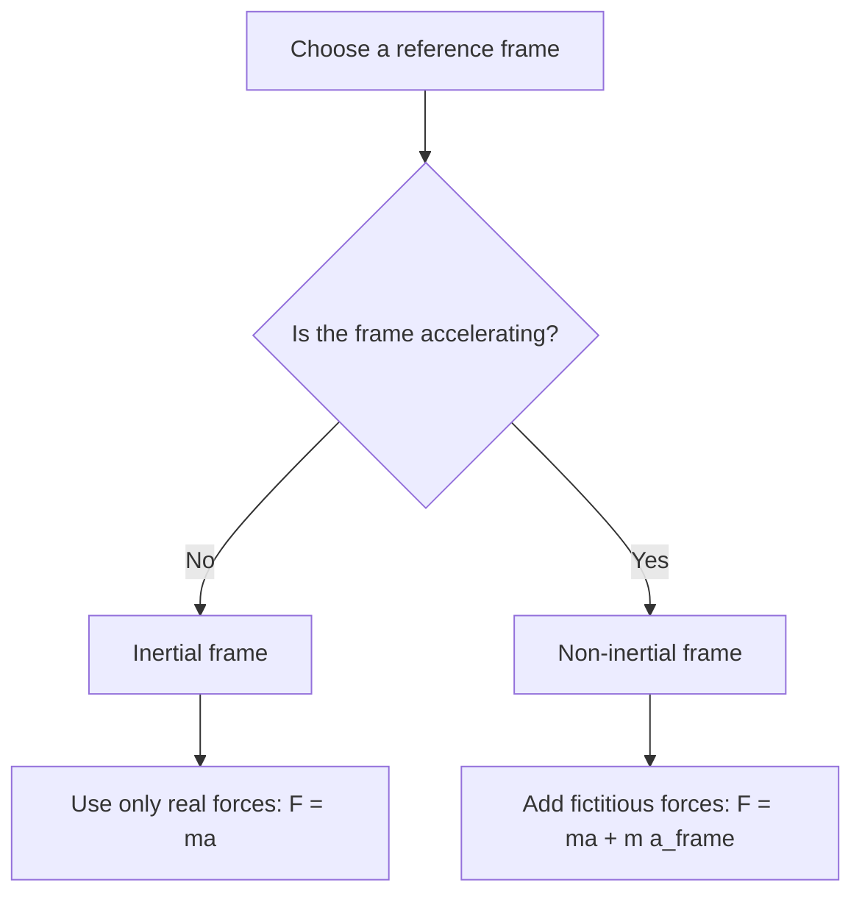
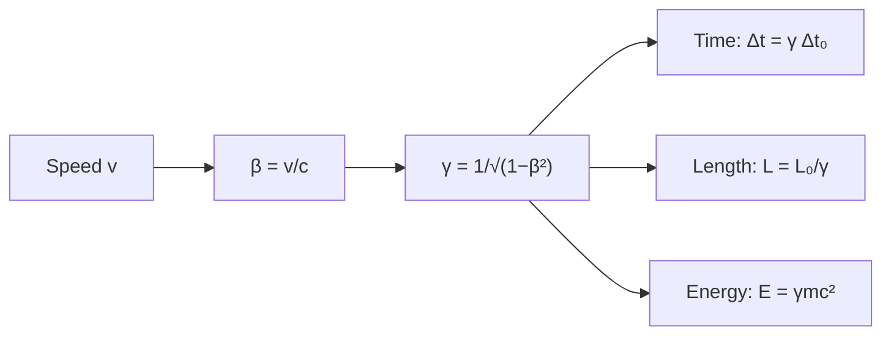

# Concept-Book Run

domain: /home/papagame/projects/digital-duck/cb-college-physics/public/domains/college_physics_ch28/input/graph.yaml
target: twin_paradox
started: 2026-11-24T00:04:57

## Teaching order (7 concepts)

- speed_of_light
- inertial_reference_frame
- second_postulate
- lorentz_factor
- proper_time
- time_dilation
- twin_paradox

### speed_of_light (0.8s)

## Speed Of Light

**Definition.** The speed of light in vacuum, $c$, is the speed at which electromagnetic waves propagate through empty space. Its value is exactly $c = 299\,792\,458\ \text{m/s} \approx 3\times10^{8}\ \text{m/s}$. Maxwell's equations show that $c$ is not an arbitrary number. It follows from two constants that describe how vacuum responds to electric and magnetic fields: the permittivity $\varepsilon_0$ and the permeability $\mu_0$.

$$c = \frac{1}{\sqrt{\mu_0 \varepsilon_0}}$$

**Where this comes from.** In vacuum, Maxwell's equations combine into a wave equation for the electric field:

$$\nabla^2 \mathbf{E} = \mu_0 \varepsilon_0 \frac{\partial^2 \mathbf{E}}{\partial t^2}.$$

A general wave equation has the form $\nabla^2 \mathbf{E} = \frac{1}{v^2}\frac{\partial^2 \mathbf{E}}{\partial t^2}$, where $v$ is the wave speed. Matching the two forms gives $v^2 = 1/(\mu_0\varepsilon_0)$. Maxwell found that this speed equals the measured speed of light, which led him to conclude that light is an electromagnetic wave.

**Worked example.** Use $\varepsilon_0 = 8.854\times10^{-12}\ \text{C}^2/(\text{N·m}^2)$ and $\mu_0 = 4\pi\times10^{-7}\ \text{N/A}^2 \approx 1.257\times10^{-6}\ \text{N/A}^2$.

$$\mu_0\varepsilon_0 = (1.257\times10^{-6})(8.854\times10^{-12}) = 1.113\times10^{-17}\ \text{s}^2/\text{m}^2$$

$$c = \frac{1}{\sqrt{1.113\times10^{-17}}} = \frac{1}{3.336\times10^{-9}} \approx 3.00\times10^{8}\ \text{m/s}$$

The result matches the measured value. Two constants measured with electric and magnetic apparatus predict the speed of light without any optical measurement.

**Problem-solving application.** *How long does sunlight take to reach Earth, and how long does a radar pulse take to make a round trip to an aircraft 60 km away?*

*Sunlight.* The Earth–Sun distance is $d = 1.496\times10^{11}$ m. Since $t = d/c$,

$$t = \frac{1.496\times10^{11}}{3.00\times10^{8}} \approx 499\ \text{s} \approx 8.3\ \text{min}.$$

*Radar.* Radar pulses are radio waves, so they travel at $c$. The pulse covers the distance twice:

$$t = \frac{2d}{c} = \frac{2(6.0\times10^{4})}{3.00\times10^{8}} = 4.0\times10^{-4}\ \text{s} = 0.40\ \text{ms}.$$

Reversing the calculation, a measured delay $t$ gives the distance $d = ct/2$. Radar ranging, lidar, and GPS timing all use this relation.

**Key points.**

- $c$ is a property of vacuum. In a medium with refractive index $n$, light travels at $v = c/n$, which is slower.
- All electromagnetic waves travel at $c$ in vacuum. This includes radio waves, visible light, and X-rays, and their frequencies and wavelengths are related by $c = f\lambda$.
- Since 1983 the metre has been defined from $c$, which is why $c$ is exact. The second is fixed by atomic clocks, and the metre is the distance light travels in $1/299\,792\,458$ s.
- Special relativity treats $c$ as the same for all inertial observers, and no signal or object can exceed it.

**Check yourself.** Green light has wavelength $550$ nm. Use $f = c/\lambda$ to show that its frequency is about $5.5\times10^{14}$ Hz.

### inertial_reference_frame (14.7s)

## Inertial Reference Frame

An **inertial reference frame** is a frame of reference in which Newton's first law holds: a body at rest stays at rest, and a body in motion keeps moving at constant velocity (constant speed along a straight line), unless a net external force acts on it. Equivalently, a frame is inertial if a body with zero net force has zero acceleration:

$$\sum \vec F = 0 \;\Longrightarrow\; \vec a = 0.$$

**Key fact: frames moving at constant velocity relative to an inertial frame are also inertial.** If frame $S'$ moves at constant velocity $\vec v$ relative to inertial frame $S$, positions and velocities transform (Galilean transformation) as

$$\vec r' = \vec r - \vec v\,t, \qquad \vec u' = \vec u - \vec v .$$

Differentiating again, $\vec a' = \vec a$ because $\vec v$ is constant. Since acceleration is the same in both frames, $\sum\vec F = m\vec a$ takes the same form in both. This is why no mechanical experiment can tell you whether you are "at rest" or moving uniformly.

A frame that accelerates relative to an inertial frame is **non-inertial**. In it, free objects appear to accelerate, so one must add fictitious forces (such as the "force" pushing you back in an accelerating car) for Newton's laws to work.

### Worked example

A train moves at $v = 20\ \text{m/s}$ east on straight, level track at constant velocity. A passenger drops a ball. Describe its motion in (a) the train frame and (b) the ground frame.

(a) Train frame (inertial): the ball starts with zero horizontal velocity and only gravity acts, so it falls straight down.

(b) Ground frame (also inertial): the ball starts with horizontal velocity $u = 20\ \text{m/s}$ east. No horizontal force acts, so this stays constant, and the ball follows a parabola. If the fall takes $t = 0.5\ \text{s}$, the ball lands $x = 20(0.5) = 10\ \text{m}$ east of its release point, as measured from the ground. The train has also moved 10 m, so the ball lands directly below the release point *in the train*.

Both observers use the same law, $a_y = -g$, $a_x = 0$. They disagree on the path, not on the physics.

### Problem-solving application

The same train now brakes with $a = -2\ \text{m/s}^2$ (the train frame is non-inertial). A ball rests on a frictionless table in the train. Describe its motion.

*Ground frame (inertial):* no horizontal force acts, so the ball keeps its velocity of 20 m/s east, while the table slows underneath it.

*Train frame (non-inertial):* the ball accelerates forward at $2\ \text{m/s}^2$ with no real force acting. To use $F = ma$ here, we add a fictitious force $F_{\text{fict}} = -m a_{\text{frame}} = +2m$ (forward, in newtons when $m$ is in kg).

**Strategy:** for any problem, first choose a frame. If you can pick an inertial frame (usually the ground), apply Newton's laws directly with only real forces. Use a non-inertial frame only when it simplifies the problem, and then include fictitious forces.

**Practical note:** Earth rotates and orbits the Sun, so it is not exactly inertial. For most lab-scale problems the corrections (about $0.03\ \text{m/s}^2$ at the equator from rotation) are negligible, and Earth's surface is treated as inertial.

*Decision flow for choosing how to apply Newton's second law depending on whether the frame accelerates.*

### second_postulate (12.1s)

## Second Postulate

**Definition.** Einstein's second postulate of special relativity states that light in vacuum travels at the same speed $c = 299\,792\,458\ \text{m/s}$ in every inertial frame, regardless of the motion of the light source or the observer. Unlike a thrown ball, light does not inherit the velocity of whatever emitted it.

Compare this with ordinary (Galilean) velocity addition. If a train moves at $v$ and a passenger throws a ball forward at $u'$ relative to the train, an observer on the ground measures $u = u' + v$. The second postulate says this rule fails for light: if $u' = c$, then $u = c$ as well, not $c + v$.

**Worked example.** A spaceship moves at $v = 0.6c$ relative to Earth and fires a laser pulse forward. What speed does an Earth observer measure?

Galilean prediction: $u = c + 0.6c = 1.6c$. This contradicts the postulate.

The relativistic velocity-addition formula, which follows from the two postulates, gives

$$u = \frac{u' + v}{1 + \dfrac{u'v}{c^2}}.$$

Substituting $u' = c$ and $v = 0.6c$:

$$u = \frac{c + 0.6c}{1 + \dfrac{(c)(0.6c)}{c^2}} = \frac{1.6c}{1.6} = c.$$

The result is $c$ for any $v$, as the postulate requires. In general, with $u' = c$:

$$u = \frac{c + v}{1 + v/c} = \frac{c(c+v)}{c+v} = c.$$

**Problem-solving application.** The postulate has measurable consequences, and it is also the basis for time dilation. Consider a "light clock": a light pulse bounces between two mirrors a distance $L$ apart. In the clock's rest frame, one round trip takes

$$\Delta t_0 = \frac{2L}{c}.$$

Now watch this clock move horizontally at speed $v$. In our frame the pulse travels a diagonal path. Because the speed of light is still $c$ (not $\sqrt{c^2+v^2}$), the pulse covers a longer path in a longer time $\Delta t$. Each one-way leg has vertical extent $L$ and horizontal extent $v\,\Delta t/2$, so

$$\left(\frac{c\,\Delta t}{2}\right)^2 = L^2 + \left(\frac{v\,\Delta t}{2}\right)^2.$$

Solving for $\Delta t$:

$$\Delta t^2\,(c^2 - v^2) = 4L^2 \;\Rightarrow\; \Delta t = \frac{2L/c}{\sqrt{1 - v^2/c^2}} = \gamma\,\Delta t_0, \qquad \gamma = \frac{1}{\sqrt{1 - v^2/c^2}}.$$

For $v = 0.8c$, $\gamma = 1/\sqrt{1 - 0.64} = 1/0.6 \approx 1.67$. A moving clock ticking once per second in its own frame is observed to tick once every $1.67$ s.

**Key takeaway.** Because $c$ cannot change with the observer, something else must give: time intervals and lengths become frame-dependent. The second postulate is why simultaneity, time, and space are relative, while the speed of light is absolute.

### lorentz_factor (14.2s)

## Lorentz Factor

### Definition

The **Lorentz factor** measures how strongly relativistic effects appear at a given speed $v$:

$$\gamma = \frac{1}{\sqrt{1 - \dfrac{v^2}{c^2}}}, \qquad c \approx 3.00\times 10^8\ \text{m/s}.$$

It is defined for $0 \le v < c$. Writing $\beta = v/c$ gives the equivalent form $\gamma = (1-\beta^2)^{-1/2}$. Three properties matter:

- $\gamma \ge 1$, and $\gamma = 1$ only at $v = 0$.
- At everyday speeds, $\gamma \approx 1$. A binomial expansion gives $\gamma \approx 1 + \tfrac{1}{2}\beta^2$ for $\beta \ll 1$.
- As $v \to c$, $\gamma \to \infty$.

The factor appears in the main relativistic effects:

$$\Delta t = \gamma\,\Delta t_0, \qquad L = \frac{L_0}{\gamma}, \qquad E = \gamma m c^2.$$

Here $\Delta t_0$ is the proper time, $L_0$ is the proper length, and $m$ is the rest mass. A moving clock runs slow by $\gamma$. A moving rod contracts by $\gamma$. The total energy grows by $\gamma$.

### Worked example

A muon created in the upper atmosphere travels at $v = 0.995c$. Its proper lifetime is $\Delta t_0 = 2.2\ \mu\text{s}$.

$$\gamma = \frac{1}{\sqrt{1 - 0.995^2}} = \frac{1}{\sqrt{0.009975}} \approx 10.0$$

In Earth's frame, the lifetime is $\Delta t = \gamma\,\Delta t_0 \approx 22\ \mu\text{s}$. The distance traveled is

$$d = v\,\Delta t \approx (0.995)(3.00\times10^8)(22\times10^{-6}) \approx 6.6\ \text{km}.$$

Without time dilation, the muon would travel only about $0.66$ km. That is not enough to reach the ground. Detectors at sea level do register large numbers of muons, which supports the relativistic prediction.

### Problem-solving application

**Problem.** At what speed does $\gamma = 2$?

Solve $\gamma$ for $\beta$ by squaring both sides:

$$\gamma^2 = \frac{1}{1-\beta^2} \;\Rightarrow\; \beta = \sqrt{1 - \frac{1}{\gamma^2}}.$$

With $\gamma = 2$, $\beta = \sqrt{1 - \tfrac14} = \sqrt{0.75} \approx 0.866$. So $v \approx 0.866c$.

**Strategy for any relativity problem:**

1. Compute $\beta = v/c$.
2. Compute $\gamma$. If $\gamma \approx 1.00$, a classical calculation is accurate enough.
3. Apply $\gamma$ to the relevant quantity: time, length, or energy.
4. Check that the result makes sense. Dilated times should be longer, contracted lengths shorter, and no speed should reach $c$.

**Check yourself.** A proton with $\gamma = 7000$ (roughly the Large Hadron Collider's design energy) has

$$\beta = \sqrt{1 - \frac{1}{7000^2}} \approx 1 - \frac{1}{2(7000)^2} \approx 1 - 1.0\times10^{-8}.$$

So it moves only about $3\ \text{m/s}$ slower than light. The speed barely changes while $\gamma$, and with it the energy, grows without bound. That is why accelerators measure particles by energy rather than speed.

*One quantity, γ, controls time dilation, length contraction, and energy.*

### proper_time (12.3s)

## Proper Time

**Definition.** The *proper time* $\Delta t_0$ between two events is the time interval measured by a single observer for whom both events occur at the same location, that is, an observer at rest relative to the events. It is measured with one clock that is present at both events. Observers moving relative to this clock measure a longer interval $\Delta t$, because the two events occur at different places in their frames. The two are related by

$$\Delta t = \gamma\,\Delta t_0, \qquad \gamma = \frac{1}{\sqrt{1 - v^2/c^2}} \ge 1.$$

**Why the relation holds.** Consider a light clock: a pulse bounces between two mirrors separated by distance $L$. In the clock's rest frame, one round trip takes $\Delta t_0 = 2L/c$. An observer who sees the clock move at speed $v$ sees the pulse travel a longer diagonal path. In time $\Delta t$ the light covers $c\,\Delta t$ along a path whose two halves each have vertical leg $L$ and horizontal leg $v\,\Delta t/2$. By the Pythagorean theorem,

$$\left(\tfrac{c\,\Delta t}{2}\right)^2 = L^2 + \left(\tfrac{v\,\Delta t}{2}\right)^2 \;\Rightarrow\; \Delta t = \frac{2L/c}{\sqrt{1-v^2/c^2}} = \gamma\,\Delta t_0.$$

Because light speed is the same in both frames, the moving observer must record more time.

**Worked example.** Muons created in the upper atmosphere have a proper lifetime of $\Delta t_0 = 2.2\ \mu\text{s}$. Suppose a muon moves at $v = 0.995c$. Then

$$\gamma = \frac{1}{\sqrt{1-0.995^2}} \approx 10.0, \qquad \Delta t = \gamma\,\Delta t_0 \approx 22\ \mu\text{s}.$$

Without dilation the muon would travel only about $0.995c \times 2.2\ \mu\text{s} \approx 660$ m. With dilation, the Earth-frame distance is about $6.6$ km, which is why muons reach sea level.

**Problem-solving application.** The key skill is identifying which interval is proper. Use this checklist:

1. Find the two events (for example, "muon created" and "muon decays").
2. Ask which observer sees both events at the *same place*. That observer's clock gives $\Delta t_0$.
3. Every other observer measures $\Delta t = \gamma\,\Delta t_0$.

*Check:* A spaceship passes Earth at $0.80c$, and its crew measures 30 min between two pulses emitted from the ship. Both events occur at the ship's position, so $\Delta t_0 = 30$ min. Here $\gamma = 1/\sqrt{1-0.64} = 5/3$, so Earth measures $\Delta t = 50$ min.

A common error is to plug the Earth-frame time into $\Delta t_0$. Always check where the events happen. The proper time is the *shortest* interval any observer can assign to the pair of events, and all observers agree on its value because it is tied to the one clock present at both events.

### time_dilation (13.8s)

## Time Dilation

**Definition.** Time dilation is the effect, predicted by special relativity, that a clock moving relative to an observer ticks more slowly than a clock at rest in that observer's frame. Let $\Delta t_0$ be the **proper time**: the time between two events measured by a single clock present at both events. An observer for whom that clock moves at speed $v$ measures a longer interval

$$\Delta t = \gamma\,\Delta t_0, \qquad \gamma = \frac{1}{\sqrt{1 - v^2/c^2}} \ge 1,$$

where $c$ is the speed of light.

**Why it happens.** Consider a "light clock": a light pulse bounces between two mirrors a distance $L$ apart, so one tick takes $\Delta t_0 = 2L/c$ in the clock's own frame. An observer who sees the clock move sideways at speed $v$ sees the pulse travel a longer diagonal path. Light's speed is $c$ in every frame, so each tick must take longer. In one tick the pulse covers a path of length $c\,\Delta t$. Its vertical leg is $2L$ and its horizontal leg is $v\,\Delta t$, so the Pythagorean theorem gives

$$\left(\tfrac{c\,\Delta t}{2}\right)^2 = L^2 + \left(\tfrac{v\,\Delta t}{2}\right)^2 \;\Rightarrow\; \Delta t = \frac{2L/c}{\sqrt{1 - v^2/c^2}} = \gamma\,\Delta t_0 .$$

**Worked example.** A muon at rest decays with a mean lifetime $\Delta t_0 = 2.2\ \mu\text{s}$. Cosmic-ray muons are created about 15 km up and travel at $v = 0.995c$.

1. Compute $\gamma = 1/\sqrt{1 - 0.995^2} = 1/\sqrt{0.009975} \approx 10.0$.
2. The lifetime in Earth's frame is $\Delta t = 10.0 \times 2.2\ \mu\text{s} = 22\ \mu\text{s}$.
3. Without dilation, the muon would travel about $0.995c \times 2.2\ \mu\text{s} \approx 0.66$ km before decaying. With dilation, it travels about $0.995c \times 22\ \mu\text{s} \approx 6.6$ km. This is far more of the 15 km path, and many muons do reach the ground. This matches observations.

**Problem-solving application.** A spacecraft travels to a star 8.0 light-years away at $v = 0.80c$. How much time passes for the crew, and how much for Earth?

- *Earth frame:* $\Delta t = d/v = 8.0/0.80 = 10$ years.
- *Crew frame:* The crew's clock is the proper-time clock, since it is present at both departure and arrival. With $\gamma = 1/\sqrt{1-0.64} = 1/0.6 \approx 1.67$,
$$\Delta t_0 = \frac{\Delta t}{\gamma} = \frac{10}{1.67} = 6.0\ \text{years}.$$

**Strategy.** (1) Identify the two events. (2) Decide which observer sees both events happen at the *same place*, because that observer's clock measures $\Delta t_0$. (3) Compute $\gamma$. (4) Apply $\Delta t = \gamma\,\Delta t_0$, and check that the moving-frame time is the larger one.

**Common pitfall.** Do not simply plug numbers into the formula. If you pick the wrong clock as the proper-time clock, you get $\Delta t$ and $\Delta t_0$ reversed, and the answer comes out too small when it should be larger. Also note that $\gamma \approx 1$ at everyday speeds, so the effect is negligible unless $v$ is a sizable fraction of $c$. For example, $\gamma - 1 \approx 10^{-12}$ at jet-airliner speeds, though atomic clocks can still detect it.

### twin_paradox (14.1s)

## Twin Paradox

### Definition

The **twin paradox** is a thought experiment in special relativity. One twin stays on Earth, which we treat as an inertial frame. The other twin travels to a distant star and returns at relativistic speed. When they reunite, the traveler has aged less. This is not a contradiction, and it is not an illusion. It is a measurable consequence of time dilation.

The quantity that matters is **proper time**, which is the time read by a clock along its own path through spacetime. For a clock moving at constant speed $v$, the proper time $\tau$ is related to the Earth-frame time $t$ by

$$\tau = \frac{t}{\gamma}, \qquad \gamma = \frac{1}{\sqrt{1 - v^2/c^2}}.$$

For a trip with changing speed, $\tau = \int \sqrt{1 - v(t)^2/c^2}\,dt$.

### Why it looks paradoxical

From the traveler's frame, Earth moves away and then returns. Each twin seems to see the other's clock run slow, so it appears each should be younger. The symmetry is only apparent. The Earth twin stays in one inertial frame for the whole trip. The traveler must **accelerate** to turn around, so the traveler changes inertial frames. The two situations are not equivalent, and only the Earth twin can use a single frame to compare the clocks.

Acceleration is not what slows the traveler's clock. The turnaround breaks the symmetry. In spacetime, the straight inertial path between two events has the *longest* proper time, and any path with a turnaround has less.

### Worked example

The traveler flies to a star 4 light-years away (in Earth's frame) at $v = 0.8c$ and returns at the same speed. Then $\gamma = 1/\sqrt{1-0.64} = 1/0.6 = 5/3$.

- Earth twin's elapsed time: $t = \dfrac{2(4\ \text{ly})}{0.8c} = 10$ years.
- Traveler's elapsed time: $\tau = \dfrac{t}{\gamma} = 10 \times 0.6 = 6$ years.

The traveler returns 4 years younger than the twin.

### Problem-solving application

**Problem.** A traveler goes out and back at $v = 0.6c$, and the Earth twin ages 20 years. How much does the traveler age?

1. Compute $\gamma$: $\sqrt{1 - 0.36} = 0.8$, so $\gamma = 1.25$.
2. Apply $\tau = t/\gamma = 20/1.25 = 16$ years.

The age gap is 4 years.

**Check from the traveler's view.** The one-way distance is $0.6c \times 10\ \text{yr} = 6$ ly in Earth's frame. Length contraction shortens it to $6 \times 0.8 = 4.8$ ly for the traveler. Then the round trip takes $\dfrac{2(4.8)}{0.6} = 16$ years, which matches the result above. The traveler can explain the answer without any acceleration effects, using only contracted distances.

**Strategy.** To solve any twin-paradox problem:

1. Choose the inertial frame the stay-at-home twin occupies.
2. Compute the coordinate time $t$ for each leg.
3. Convert to proper time with $\tau = t/\gamma$ for each leg, and add the legs.

Never apply time dilation from the traveler's frame across the turnaround. That frame changes at the turnaround, and doing so is the usual source of wrong answers.

## Run complete

total: 102.4s
