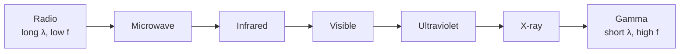
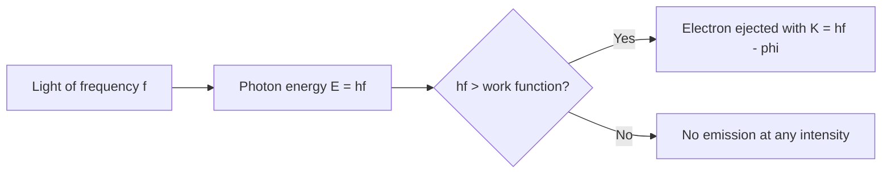
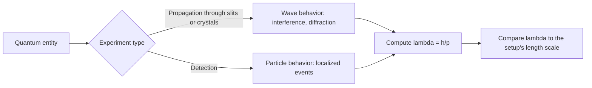

# Concept-Book Run

domain: /home/papagame/projects/digital-duck/cb-college-physics/public/domains/college_physics_ch29/input/graph.yaml
target: electron_microscope
started: 2026-11-24T00:06:41

## Teaching order (12 concepts)

- energy
- frequency
- quantization
- electromagnetic_radiation
- planck_constant
- photon
- momentum
- particle_wave_duality
- wavelength
- de_broglie_wavelength
- electron
- electron_microscope

### energy (1.7s)

## Energy

**Energy** is the capacity of a system to do work. Work is done when a force $F$ moves an object through a displacement $d$ along the force's direction: $W = Fd\cos\theta$. Energy and work share the SI unit, the joule ($1\ \text{J} = 1\ \text{N·m}$).

**Kinetic energy** is energy of motion:
$$K = \tfrac{1}{2}mv^2$$

**Gravitational potential energy** is energy stored by position in a gravitational field (near Earth's surface):
$$U_g = mgh$$

Other forms, such as thermal, chemical, electrical, and nuclear energy, can be understood as microscopic kinetic and potential energy.

### Conservation of energy

Energy is never created or destroyed. It is only transferred or converted. If only conservative forces (such as gravity) act, the total mechanical energy is constant:
$$K_i + U_i = K_f + U_f$$

With non-conservative forces such as friction, the work–energy relation applies:
$$K_i + U_i + W_{\text{nc}} = K_f + U_f$$
Here $W_{\text{nc}}$ is the work done by non-conservative forces. Friction makes it negative, and the "lost" mechanical energy becomes thermal energy.

### Worked example

A 2.0 kg ball is dropped from rest at a height of 20 m. How fast is it moving just before it hits the ground? Ignore air resistance.

Take the ground as $h = 0$. At the start, $K_i = 0$ and $U_i = mgh = (2.0)(9.8)(20) = 392\ \text{J}$. Just before impact, $U_f = 0$, so:
$$392 = \tfrac{1}{2}(2.0)v^2 \Rightarrow v = \sqrt{392} \approx 19.8\ \text{m/s}$$

The mass cancels in general ($v = \sqrt{2gh}$), so any dropped object reaches the same speed.

### Problem-solving application

A 0.50 kg block slides from rest down a frictionless ramp 3.0 m high. At the bottom it crosses a rough horizontal surface and stops after 6.0 m. Find the coefficient of kinetic friction $\mu_k$.

**Strategy:** Treat the whole motion as one system, from the top (at rest) to the final stop (at rest). Then $K_i = K_f = 0$ and $U_f = 0$, so:
$$U_i + W_{\text{nc}} = 0$$

Friction does work $W_{\text{nc}} = -\mu_k mg\,d$ over the distance $d = 6.0$ m. Then:
$$mgh = \mu_k mg\,d \Rightarrow \mu_k = \frac{h}{d} = \frac{3.0}{6.0} = 0.50$$

Check: the mass cancels again, and $\mu_k$ is dimensionless, as it should be.

**General method:**
1. Choose a system and define the initial and final states.
2. Set a reference height where $U = 0$.
3. List the energy terms at each state. Include non-conservative work if friction or drag is present.
4. Apply energy conservation and solve.

Energy methods avoid tracking forces and time. They only need the beginning and end states. This often makes them much simpler than Newton's second law for problems involving curved paths or changing forces.

*Energy is converted from potential to kinetic, then dissipated as thermal energy by friction. The total remains constant.*

### frequency (0.6s)

## Frequency

The **frequency** of a value in a data set is the number of times that value occurs. If a data set records the number of siblings for 20 students, and the value 2 appears 6 times, then the frequency of "2 siblings" is 6. Frequencies are typically organized into a **frequency table**, which lists each distinct value alongside its count, and often a **relative frequency** — the frequency divided by the total number of observations, expressed as a proportion or percentage.

**Worked example.** Suppose a teacher records the number of pets owned by 15 students:

$$1, 2, 0, 1, 3, 2, 1, 1, 0, 2, 2, 1, 4, 1, 2$$

Tallying each value gives the frequency table:

| Number of pets | Frequency | Relative frequency |
|---|---|---|
| 0 | 2 | $2/15 \approx 0.133$ |
| 1 | 6 | $6/15 = 0.400$ |
| 2 | 5 | $5/15 \approx 0.333$ |
| 3 | 1 | $1/15 \approx 0.067$ |
| 4 | 1 | $1/15 \approx 0.067$ |

The relative frequencies sum to 1 (allowing for rounding), since every observation is accounted for exactly once. This table immediately reveals the shape of the data: owning 1 pet is the most common outcome (the **mode**), while owning 3 or 4 pets is rare.

**Problem-solving application.** Frequency tables are the foundation for nearly every downstream statistical tool: histograms are built by plotting frequency against value, probability estimates from empirical data use relative frequency as a stand-in for probability, and measures like the mode are defined directly in terms of frequency. When solving a problem that asks "how often," "how many," or "what proportion," the first step is almost always to construct or consult a frequency table before computing anything else. For instance, to estimate the probability that a randomly selected student from this class owns at least 2 pets, sum the frequencies for 2, 3, and 4 pets ($5 + 1 + 1 = 7$) and divide by the total ($15$), giving an estimated probability of $7/15 \approx 0.467$. This illustrates the general principle: frequency counts convert raw, unordered data into a structured summary that supports both description (what does the data look like?) and inference (what can we predict from it?).

### quantization (29.1s)

## Quantization

**Quantization** is the principle that a confined particle can have only certain discrete energies, not any value in a continuous range. The allowed values are called *levels*. The particle changes its energy only by jumping between levels.

**Definition.** Consider a particle of mass $m$ in a one-dimensional box of length $L$. The particle behaves as a wave, and the wave must fit the box, so only certain wavelengths are allowed. This gives the energy levels

$$E_n = \frac{n^2 h^2}{8 m L^2}, \qquad n = 1, 2, 3, \dots$$

Here $h = 6.626\times10^{-34}\ \text{J·s}$ is Planck's constant. Because $h$ is so small, the gaps between levels are far too fine to notice for everyday objects, which is why a ball's energy seems continuous. For an electron in a nanometer-scale box, the gaps are large. When the particle drops between levels, it emits a photon with $\Delta E = hf = hc/\lambda$.

**Worked example.** An electron ($m = 9.11\times10^{-31}$ kg) is in a box of length $L = 1.0$ nm. Find the ground-state energy and the wavelength emitted in the $n=2\to n=1$ transition.

Ground state:

$$E_1 = \frac{(6.626\times10^{-34})^2}{8(9.11\times10^{-31})(1.0\times10^{-9})^2} \approx 6.0\times10^{-20}\ \text{J} \approx 0.38\ \text{eV}$$

Since $E_n = n^2E_1$, we get $E_2 = 4E_1$. The gap is $\Delta E = 3E_1 \approx 1.8\times10^{-19}$ J. The photon wavelength is

$$\lambda = \frac{hc}{\Delta E} = \frac{(6.626\times10^{-34})(3.00\times10^{8})}{1.8\times10^{-19}} \approx 1.1\times10^{-6}\ \text{m},$$

which is about 1100 nm, in the infrared.

**Problem-solving application.** Suppose we want the same $n=2\to n=1$ transition to emit green light at 550 nm. What box length is needed?

The required gap is $\Delta E = \dfrac{1240\ \text{eV·nm}}{550\ \text{nm}} \approx 2.25$ eV. Since $\Delta E = 3E_1$, we need $E_1 \approx 0.75$ eV. This is about twice the 0.38 eV found for $L = 1.0$ nm. Because $E_1 \propto 1/L^2$, doubling the energy means dividing $L^2$ by 2:

$$L = \frac{1.0\ \text{nm}}{\sqrt{2}} \approx 0.71\ \text{nm}.$$

Shrinking the box raises every level and shifts the emitted light toward shorter wavelengths. This is the principle behind tuning the color of quantum dots by their size.

**Strategy for problems:**
1. Write the level formula for the given box.
2. Compute the energies of the two levels involved.
3. Take the difference, $\Delta E$.
4. Convert with $\lambda = hc/\Delta E$, or use scaling ($E \propto 1/L^2$) to compare boxes.

**Check:** Levels grow as $n^2$, so the spacing widens at higher $n$. A smaller $L$ must always give a larger $\Delta E$ and a shorter $\lambda$. If your answer violates either, recheck the arithmetic.

### electromagnetic_radiation (22.8s)

## Electromagnetic Radiation

**Definition.** Electromagnetic (EM) radiation consists of coupled, oscillating electric and magnetic fields that sustain each other as they travel through space. The two fields are perpendicular to each other and to the direction of travel, so EM waves are *transverse*. Unlike sound or water waves, they need no medium. In vacuum they all travel at the same speed:

$$c = 2.998\times 10^{8}\ \text{m/s}$$

Every EM wave is described by its frequency $f$ (oscillations per second, in Hz) and its wavelength $\lambda$ (distance between successive crests, in m). These are linked by

$$c = \lambda f.$$

Since $c$ is fixed, a higher frequency means a shorter wavelength. In order of increasing frequency, the spectrum runs through radio waves, microwaves, infrared, visible light, ultraviolet, X-rays, and gamma rays. Visible light covers only about 400–700 nm.

**Worked example.** A Wi-Fi router transmits at $f = 2.4\ \text{GHz}$. Find its wavelength.

$$\lambda = \frac{c}{f} = \frac{2.998\times10^{8}}{2.4\times10^{9}} \approx 0.125\ \text{m}$$

The wavelength is about 12.5 cm, which is roughly the size of a hand. Radio and microwave waves have wavelengths from millimeters to kilometers, while visible light is about a million times shorter.

**Problem-solving application.** A radio station broadcasts at 98.1 MHz, and a violet laser has wavelength 405 nm. Which has the higher frequency, and by what factor?

1. Convert the radio frequency to Hz and find its wavelength:
$$f_{\text{radio}} = 98.1\times10^{6}\ \text{Hz},\qquad \lambda_{\text{radio}} = \frac{2.998\times10^{8}}{98.1\times10^{6}} \approx 3.06\ \text{m}$$

2. Convert the laser wavelength to meters and find its frequency:
$$f_{\text{laser}} = \frac{c}{\lambda} = \frac{2.998\times10^{8}}{405\times10^{-9}} \approx 7.40\times10^{14}\ \text{Hz}$$

3. Compare:
$$\frac{f_{\text{laser}}}{f_{\text{radio}}} = \frac{7.40\times10^{14}}{9.81\times10^{7}} \approx 7.5\times10^{6}$$

The violet light has a frequency about 7.5 million times higher. Equivalently, its wavelength is about 7.5 million times shorter ($3.06\ \text{m} \div 405\ \text{nm} \approx 7.5\times10^{6}$), which confirms that $c=\lambda f$ makes frequency and wavelength inversely proportional.

**Strategy.** In any EM problem, first decide which quantity you have ($f$ or $\lambda$). Convert to the other with $c=\lambda f$. Keep units consistent: nm to m, MHz or GHz to Hz. Then check that your answer is reasonable by placing it on the spectrum: a wavelength of meters should be radio, and a wavelength of hundreds of nanometers should be visible.

*The electromagnetic spectrum, ordered by increasing frequency and decreasing wavelength. All of it travels at $c$ in vacuum.*

### planck_constant (27.5s)

## Planck Constant

**Definition.** The Planck constant, $h = 6.626 \times 10^{-34}\ \text{J·s}$, sets the scale of quantum effects. It links a photon's energy to its frequency:

$$E = h f = \frac{hc}{\lambda}$$

Here $f$ is frequency, $\lambda$ is wavelength, and $c = 3.00\times10^{8}\ \text{m/s}$. Light is exchanged in discrete packets, called photons. Each photon carries energy proportional to its frequency. Doubling the frequency doubles the energy per photon.

Because $h$ is so small, a single photon carries a tiny amount of energy. Quantization is invisible in everyday life, because even a dim light delivers enormous numbers of photons.

**Worked example.** Find the energy of one photon of green light with $\lambda = 520\ \text{nm}$.

$$f = \frac{c}{\lambda} = \frac{3.00\times10^{8}}{5.20\times10^{-7}} = 5.77\times10^{14}\ \text{Hz}$$

$$E = hf = (6.626\times10^{-34})(5.77\times10^{14}) = 3.82\times10^{-19}\ \text{J}$$

Check the units: J·s × Hz = J·s × (1/s) = J. The result is about $10^{-19}$ J, far below any energy you could feel, which is why light seems continuous.

**Problem-solving application: counting photons.** Power is energy per unit time. If a source emits power $P$ at a single wavelength, the number of photons per second is

$$N = \frac{P}{E} = \frac{P\lambda}{hc}$$

*Problem.* A green laser pointer ($\lambda = 520\ \text{nm}$) emits $P = 5.0\ \text{mW}$. How many photons leave it each second?

1. Photon energy: $E = 3.82\times10^{-19}\ \text{J}$ (from above).
2. Convert power: $P = 5.0\times10^{-3}\ \text{W} = 5.0\times10^{-3}\ \text{J/s}$.
3. Divide:

$$N = \frac{5.0\times10^{-3}}{3.82\times10^{-19}} \approx 1.3\times10^{16}\ \text{photons/s}$$

Even this faint beam sends about thirteen quadrillion photons every second. The photons are so numerous that their discreteness is hidden. Now compare a red laser of the same power at 650 nm. Each red photon has less energy, since $E \propto 1/\lambda$. So the red laser must emit *more* photons per second to deliver the same power:

$$N_{\text{red}} = N_{\text{green}} \times \frac{650}{520} \approx 1.6\times10^{16}\ \text{photons/s}$$

**Common mistakes.**
- Using wavelength in nanometers without converting to meters.
- Forgetting that $E$ is *per photon*. Total energy is $N$ times $E$.
- Expecting longer wavelengths to carry more energy. The relation is inverse.

**Check your understanding.** Compare a 100 MHz FM radio photon with a 500 nm visible photon ($f \approx 6\times10^{14}$ Hz). Which has more energy, and by what factor? (Answer: the visible photon, by $f_{\text{vis}}/f_{\text{FM}} = 6\times10^{14}/10^{8} = 6\times10^{6}$.)

### photon (22.3s)

## Photon

A **photon** is a quantum of electromagnetic radiation: the smallest indivisible packet of energy a light wave of a given frequency can exchange with matter. It has zero rest mass, travels at $c$ in vacuum, and carries energy

$$E = hf = \frac{hc}{\lambda},$$

where $h = 6.626\times10^{-34}\ \text{J·s}$ is Planck's constant, $f$ is frequency, and $\lambda$ is wavelength. Higher frequency means more energy per photon. Intensity (brightness) changes only the *number* of photons per second, not the energy of each one.

**Why it matters.** Wave theory predicts that a bright enough light of any color should eject electrons from a metal. Experiments show the opposite: below a threshold frequency, no electrons are emitted no matter how intense the light. Einstein explained this by treating light as photons, each absorbed by a single electron in an all-or-nothing event. An electron needs a minimum energy $\phi$ (the metal's *work function*) to escape, so a photon can eject it only if $hf > \phi$.

### Worked example

Green light with $\lambda = 520\ \text{nm}$ strikes a surface. Find the energy per photon and the number of photons per second in a $2.0\ \text{mW}$ beam.

Energy per photon:

$$E = \frac{hc}{\lambda} = \frac{(6.626\times10^{-34})(3.00\times10^{8})}{520\times10^{-9}} \approx 3.82\times10^{-19}\ \text{J} \approx 2.39\ \text{eV}.$$

Photon rate:

$$\frac{P}{E} = \frac{2.0\times10^{-3}\ \text{W}}{3.82\times10^{-19}\ \text{J}} \approx 5.2\times10^{15}\ \text{photons/s}.$$

The number is huge, which is why everyday light looks continuous.

### Problem-solving application

Sodium has $\phi = 2.28\ \text{eV}$. Will the 520 nm light above eject electrons? If so, how much energy can an ejected electron carry?

1. Compare energies: $E = 2.39\ \text{eV} > \phi = 2.28\ \text{eV}$, so emission occurs.
2. Energy left over for the electron (its maximum kinetic energy): $K_{\max} = E - \phi = 2.39 - 2.28 = 0.11\ \text{eV}$.

Now try red light at $700\ \text{nm}$: $E = 1240/700 \approx 1.77\ \text{eV} < 2.28\ \text{eV}$. No electrons are emitted, even at $1000\times$ the intensity, because each photon individually lacks enough energy.

**Useful shortcut:** $E\,[\text{eV}] \approx \dfrac{1240}{\lambda\,[\text{nm}]}$.

**Strategy.** (1) Convert the wavelength to photon energy. (2) Compare it with the work function. (3) If the photon energy is larger, subtract to get the maximum kinetic energy. (4) For power problems, divide power by photon energy to count photons.

*Decision flow for the photoelectric effect: only the photon energy relative to the work function determines whether electrons are emitted.*

### momentum (12.7s)

## Momentum

**Definition.** The momentum of an object is the product of its mass and its velocity:

$$\vec{p} = m\vec{v}$$

Momentum is a vector, so it points in the direction of motion. Its SI unit is $\text{kg·m/s}$. Newton's second law is really a statement about momentum: the net force equals the rate of change of momentum, $\vec{F}_{\text{net}} = \dfrac{d\vec{p}}{dt}$. The law reduces to $\vec{F} = m\vec{a}$ when mass is constant.

**Conservation.** If the net external force on a system is zero, the total momentum of the system stays constant:

$$\sum \vec{p}_{\text{before}} = \sum \vec{p}_{\text{after}}$$

This follows from Newton's third law. During an interaction, the forces two objects exert on each other are equal and opposite and act for the same time. Their momentum changes therefore cancel exactly. The same relation can be written as the impulse–momentum theorem:

$$\vec{J} = \int \vec{F}\,dt = \Delta\vec{p}$$

**Worked example.** A $1500\ \text{kg}$ car moving at $20\ \text{m/s}$ east hits a stationary $1000\ \text{kg}$ car from behind. The two lock together. Find their common velocity.

No net external horizontal force acts during the brief collision, so momentum is conserved:

$$m_1 v_1 + m_2(0) = (m_1+m_2)v_f$$

$$v_f = \frac{(1500)(20)}{2500} = 12\ \text{m/s east}$$

Kinetic energy is not conserved in this collision. Before, $K = \tfrac12(1500)(20)^2 = 300\,000\ \text{J}$. After, $K = \tfrac12(2500)(12)^2 = 180\,000\ \text{J}$. The missing $120\,000\ \text{J}$ went into deformation and heat. Momentum is conserved in every isolated collision, but kinetic energy is conserved only in elastic ones.

**Problem-solving application.** A $0.145\ \text{kg}$ baseball arrives at $40\ \text{m/s}$ and leaves the bat in the opposite direction at $50\ \text{m/s}$. The contact lasts $1.0\ \text{ms}$. Find the average force on the ball.

1. Choose the outgoing direction as positive. Then $v_i = -40\ \text{m/s}$ and $v_f = +50\ \text{m/s}$.
2. Apply the impulse–momentum theorem: $J = m(v_f - v_i) = 0.145(50-(-40)) = 13.05\ \text{kg·m/s}$.
3. Divide by the contact time: $F_{\text{avg}} = \dfrac{J}{\Delta t} = \dfrac{13.05}{0.0010} \approx 1.3\times10^{4}\ \text{N}$.

This shows why stretching out the collision time reduces force. Airbags, padded gloves, and crumple zones all increase $\Delta t$ for the same $\Delta p$. The average force then drops in proportion.

**Strategy for any momentum problem.**
- Define the system.
- Check that external forces are negligible during the interaction.
- Pick a sign convention and apply it to each velocity.
- Equate total momentum before and after, applying it component by component in two dimensions.
- Use energy only if the collision is stated to be elastic.

### particle_wave_duality (26.1s)

## Particle–Wave Duality

**Definition.** Particle–wave duality is the principle that every quantum entity, whether an electron, a photon, or a whole molecule, shows particle-like behavior (localized, countable detections) in some experiments and wave-like behavior (interference, diffraction) in others. The experimental setup decides which face appears. There aren't two different kinds of object. The two faces are linked by the de Broglie relation:

$$\lambda = \frac{h}{p}$$

where $p$ is the momentum (a particle property), $\lambda$ is the wavelength (a wave property), and $h = 6.626\times10^{-34}\ \text{J·s}$ is Planck's constant.

**Evidence for each face.** When electrons are sent one at a time through two narrow slits, each electron lands at a single point on the detector. That is particle behavior. After thousands of arrivals, the dots build up bright and dark interference fringes, the same pattern a wave would make. That is wave behavior. Both appear in one experiment: propagation looks like a wave, and detection looks like a particle.

**Worked example.** What is the de Broglie wavelength of an electron accelerated through $V = 150\ \text{V}$?

The kinetic energy is $K = eV = (1.602\times10^{-19})(150) = 2.40\times10^{-17}\ \text{J}$. Then

$$p = \sqrt{2m_eK} = \sqrt{2(9.11\times10^{-31})(2.40\times10^{-17})} = 6.61\times10^{-24}\ \text{kg·m/s}$$

$$\lambda = \frac{h}{p} = \frac{6.626\times10^{-34}}{6.61\times10^{-24}} \approx 1.0\times10^{-10}\ \text{m} = 0.1\ \text{nm}$$

This is comparable to the spacing between atoms in a crystal, so a crystal can diffract these electrons the way a grating diffracts light.

**Problem-solving application.** Why don't we see a thrown baseball diffract? Take $m = 0.145\ \text{kg}$ and $v = 40\ \text{m/s}$:

$$\lambda = \frac{6.626\times10^{-34}}{(0.145)(40)} \approx 1.1\times10^{-34}\ \text{m}$$

This is far smaller than any slit, obstacle, or atomic nucleus, so no interference can be observed. The rule of thumb is that wave behavior appears when $\lambda$ is comparable to the size of the slit, obstacle, or lattice spacing. Otherwise, particle (classical) behavior dominates.

A second use is choosing a probe. To resolve features about $0.1\ \text{nm}$ across, you need $\lambda \lesssim 0.1\ \text{nm}$. Electrons at 150 V satisfy this. Visible light ($\lambda \sim 500\ \text{nm}$) does not. This is why electron microscopes resolve far finer detail than optical ones.

**Key idea.** The wave determines the *probability* of where a quantum object is detected, and each detection is a discrete, particle-like event. The relation $\lambda = h/p$ tells you which behavior to expect: compare $\lambda$ to the length scale of the setup.

*The experimental setup determines which face of a quantum entity appears; the de Broglie relation tells you when wave behavior is observable.*

### wavelength (0.9s)

## Wavelength

**Definition.** The wavelength $\lambda$ of a periodic wave is the distance between adjacent identical points on the wave, such as crest to crest, trough to trough, or compression to compression. It is measured parallel to the direction of propagation and is expressed in meters (or nanometers, for light). Wavelength is tied to the wave's frequency $f$ and speed $v$ by

$$v = f\lambda$$

This relation follows from the definition. In one period $T = 1/f$, the wave pattern advances exactly one wavelength, so $v = \lambda/T = \lambda f$.

**What sets $\lambda$.** The source fixes the frequency, and the medium fixes the speed. Wavelength is whatever is left over: $\lambda = v/f$. When a wave enters a new medium, $f$ stays the same because the source is unchanged. The speed $v$ changes, so $\lambda$ changes in proportion.

**Worked example.** A middle-C tuning fork vibrates at $f = 262\ \text{Hz}$. Sound travels at $v = 343\ \text{m/s}$ in air at 20 °C. Find the wavelength in air, then in water, where $v = 1480\ \text{m/s}$.

In air:
$$\lambda_{\text{air}} = \frac{343\ \text{m/s}}{262\ \text{Hz}} \approx 1.31\ \text{m}$$

In water, the frequency is unchanged:
$$\lambda_{\text{water}} = \frac{1480\ \text{m/s}}{262\ \text{Hz}} \approx 5.65\ \text{m}$$

The wavelength is about 4.3 times longer in water, matching the ratio of the speeds ($1480/343 \approx 4.3$).

**Problem-solving application.** Wavelength determines how a wave interacts with its surroundings. Consider an FM radio station broadcasting at $f = 98.1\ \text{MHz}$. Electromagnetic waves in air travel at about $c = 3.00\times10^{8}\ \text{m/s}$, so

$$\lambda = \frac{c}{f} = \frac{3.00\times10^{8}}{98.1\times10^{6}} \approx 3.06\ \text{m}$$

An antenna works well when its length is a simple fraction of the wavelength. A quarter-wave antenna should therefore be about $\lambda/4 \approx 0.76\ \text{m}$ long. That is why car antennas are roughly this size.

A second use is diffraction. A wave bends noticeably around an opening or obstacle only when the size of the obstacle is comparable to or smaller than $\lambda$. The 1.31 m sound wave from the tuning fork spreads easily through a doorway about 1 m wide, so you can hear around corners. Visible light has $\lambda \sim 500\ \text{nm}$, far smaller than a doorway, so you cannot see around corners.

**Strategy for problems.**
1. Identify which quantity the source fixes ($f$) and which the medium fixes ($v$).
2. Apply $\lambda = v/f$, and convert prefixes (MHz $\to 10^6$ Hz, nm $\to 10^{-9}$ m) before computing.
3. When the medium changes, hold $f$ constant and scale $\lambda$ with $v$.
4. Compare $\lambda$ with the size of any opening, obstacle, or antenna to predict its behavior.

**Check your understanding.** A 440 Hz note travels from air into helium, where $v \approx 970\ \text{m/s}$. What is the new wavelength? (Answer: $970/440 \approx 2.20\ \text{m}$, compared with $343/440 \approx 0.78\ \text{m}$ in air.)

### de_broglie_wavelength (25.4s)

## De Broglie Wavelength

In 1924, Louis de Broglie proposed that if light, a wave, can behave like a particle with momentum, then particles such as electrons should behave like waves. The **de Broglie wavelength** of any particle with momentum $p$ is

$$\lambda = \frac{h}{p}$$

where $h = 6.626\times10^{-34}\ \text{J·s}$ is Planck's constant. For a particle of mass $m$ moving at speed $v$ much less than the speed of light, $p = mv$, so $\lambda = h/(mv)$. If you know the kinetic energy $K$ instead, use $K = p^2/(2m)$ to get $p = \sqrt{2mK}$, so

$$\lambda = \frac{h}{\sqrt{2mK}}.$$

Every moving object has such a wavelength. Whether the wave nature can be observed depends on how $\lambda$ compares to the size of the objects or gaps the particle encounters.

### Worked example

Find the de Broglie wavelength of an electron ($m = 9.11\times10^{-31}$ kg) accelerated through a potential difference of 100 V.

The kinetic energy is $K = eV = (1.602\times10^{-19})(100) = 1.602\times10^{-17}$ J. Then

$$p = \sqrt{2mK} = \sqrt{2(9.11\times10^{-31})(1.602\times10^{-17})} = 5.40\times10^{-24}\ \text{kg·m/s},$$

$$\lambda = \frac{6.626\times10^{-34}}{5.40\times10^{-24}} = 1.23\times10^{-10}\ \text{m} = 0.123\ \text{nm}.$$

This is comparable to the spacing between atoms in a crystal (about 0.1–0.3 nm).

Now compare a 0.145 kg baseball thrown at 40 m/s:

$$\lambda = \frac{6.626\times10^{-34}}{(0.145)(40)} \approx 1.1\times10^{-34}\ \text{m},$$

roughly $10^{19}$ times smaller than a proton. No experiment could detect it, so everyday objects show no wave behavior.

### Problem-solving application

**Why do electrons diffract from crystals but baseballs do not?** A wave spreads and interferes noticeably only when its wavelength is comparable to the size of the gap or obstacle. The 100 V electron has $\lambda \approx 0.12$ nm, about the spacing of atoms in a crystal, so it can produce a diffraction pattern. The baseball's $\lambda$ is far smaller than any obstacle it meets, so it does not. In 1927, Davisson and Germer saw electrons diffract from a nickel crystal, which confirmed de Broglie's hypothesis.

**Problem.** At what kinetic energy does a neutron ($m = 1.675\times10^{-27}$ kg) have $\lambda = 0.200$ nm, comparable to atomic spacing in a crystal?

Solve $\lambda = h/\sqrt{2mK}$ for $K$:

$$K = \frac{h^2}{2m\lambda^2} = \frac{(6.626\times10^{-34})^2}{2(1.675\times10^{-27})(2.00\times10^{-10})^2} = 3.28\times10^{-21}\ \text{J}\approx 0.0205\ \text{eV}.$$

This is close to the average thermal energy of a particle at room temperature ($\approx 0.025$ eV). A neutron with only ordinary thermal motion therefore has a wavelength suited to probing crystals.

**Strategy summary:**
1. Find $p$ from $mv$ or from $\sqrt{2mK}$.
2. Compute $\lambda = h/p$.
3. Compare $\lambda$ with the relevant length scale.

If $\lambda$ is much smaller than that scale, classical physics works. If the two are comparable, you must include wave effects such as diffraction.

### electron (0.8s)

## Electron

An electron is a subatomic particle carrying a single negative elementary charge ($-1.602 \times 10^{-19}$ C) and a mass of about $9.11 \times 10^{-31}$ kg — roughly 1/1836 the mass of a proton. Electrons occupy the space surrounding the atomic nucleus, at characteristic distances and energies rather than moving on fixed paths. Because they carry charge and mass at once, electrons determine both an atom's chemical behavior (through bonding and reactivity) and its electrical properties (through conduction).

The electron's existence was established experimentally rather than predicted theoretically. In 1897, J. J. Thomson passed a high-voltage current through an evacuated glass tube, producing a glowing beam — a cathode ray. He found that the beam bent toward a positively charged plate and away from a negatively charged one, proving it was made of negatively charged particles rather than light or neutral matter. By measuring how much the beam deflected under known electric and magnetic fields, Thomson calculated the ratio of the particles' charge to their mass and found it was over a thousand times larger than that of the lightest known ion (hydrogen). This meant the particles were either highly charged or extremely light — and since the ratio stayed the same no matter what gas filled the tube or what metal made up the electrodes, Thomson concluded he had found a universal particle, a fundamental constituent of all atoms. This overturned the idea of the atom as an indivisible sphere and led Thomson to propose a model with electrons embedded in a diffuse positive charge.

For problem-solving, electrons matter most in balancing charge. An atom is electrically neutral because its number of electrons equals its number of protons. When an atom loses or gains electrons, that balance is broken, and the resulting charge equals the difference between protons and electrons. For example, a sodium atom (11 protons, 11 electrons) that loses one electron ends up with 11 protons and only 10 electrons, giving it a net charge of $+1$. This single relationship — count the protons, count the electrons, subtract — is the calculation you will use repeatedly whenever a problem asks you to determine the charge of a particle that has gained or lost electrons.

### electron_microscope (22.4s)

## Electron Microscope

### Definition

An **electron microscope** forms images using a beam of accelerated electrons instead of visible light. Its resolving power is limited by diffraction, so it depends on the wavelength of the probe. Electrons have a de Broglie wavelength

$$\lambda = \frac{h}{p}$$

When an electron is accelerated through a potential difference $V$, it gains kinetic energy $eV$. Then $p = \sqrt{2m_e eV}$ and

$$\lambda = \frac{h}{\sqrt{2m_e eV}}$$

Magnetic lenses focus the beam. In a **transmission electron microscope (TEM)**, electrons pass through a very thin sample, and the image is formed from the transmitted beam. (A scanning variant, the SEM, rasters a beam across a surface instead. We focus on the TEM here.)

### Worked example

Compare the wavelength of electrons accelerated through $V = 100\ \text{V}$ with that of green light.

Use $h = 6.63\times10^{-34}\ \text{J·s}$, $m_e = 9.11\times10^{-31}\ \text{kg}$, and $e = 1.60\times10^{-19}\ \text{C}$.

$$\lambda = \frac{6.63\times10^{-34}}{\sqrt{2(9.11\times10^{-31})(1.60\times10^{-19})(100)}} \approx 1.23\times10^{-10}\ \text{m}$$

This is 0.123 nm. Green light has $\lambda \approx 550$ nm, so the electron wavelength is about 4500 times shorter. A convenient shortcut is $\lambda \approx 1.226/\sqrt{V}$ nm, with $V$ in volts.

### Problem-solving application

The diffraction limit gives the smallest resolvable separation for a lens of aperture half-angle $\alpha$:

$$d \approx \frac{0.61\,\lambda}{\alpha}$$

(for small $\alpha$, in vacuum).

**Problem.** A TEM operates at 100 kV. Estimate $\lambda$ and the theoretical resolution if $\alpha = 10$ mrad.

1. The shortcut gives $\lambda \approx 1.226/\sqrt{10^5} \approx 3.88\times10^{-3}$ nm. At 100 kV the electron speed is a substantial fraction of $c$, so this slightly overestimates. The relativistic value is about $3.70\times10^{-3}$ nm, and we use 3.7 pm.
2. With $\alpha = 0.010$,

$$d \approx \frac{0.61(3.7\ \text{pm})}{0.010} \approx 230\ \text{pm} = 0.23\ \text{nm}$$

The result is far better than an optical microscope's roughly 200 nm limit. It is still much larger than $\lambda$ itself. Electron lenses suffer from spherical aberration, which forces the use of tiny apertures. Aberration-corrected instruments allow larger $\alpha$ and reach resolutions below 0.1 nm, enough to image individual atomic columns.

**Practical trade-offs.**
- Raising $V$ shortens $\lambda$, which improves resolution, but it also damages delicate samples.
- Samples must be very thin (tens of nanometers), and the column must be under vacuum so that air does not scatter the beam.

**Key idea:** The wavelength sets the theoretical limit, but lens aberrations and sample damage determine the resolution an instrument actually reaches.

## Run complete

total: 215.7s
