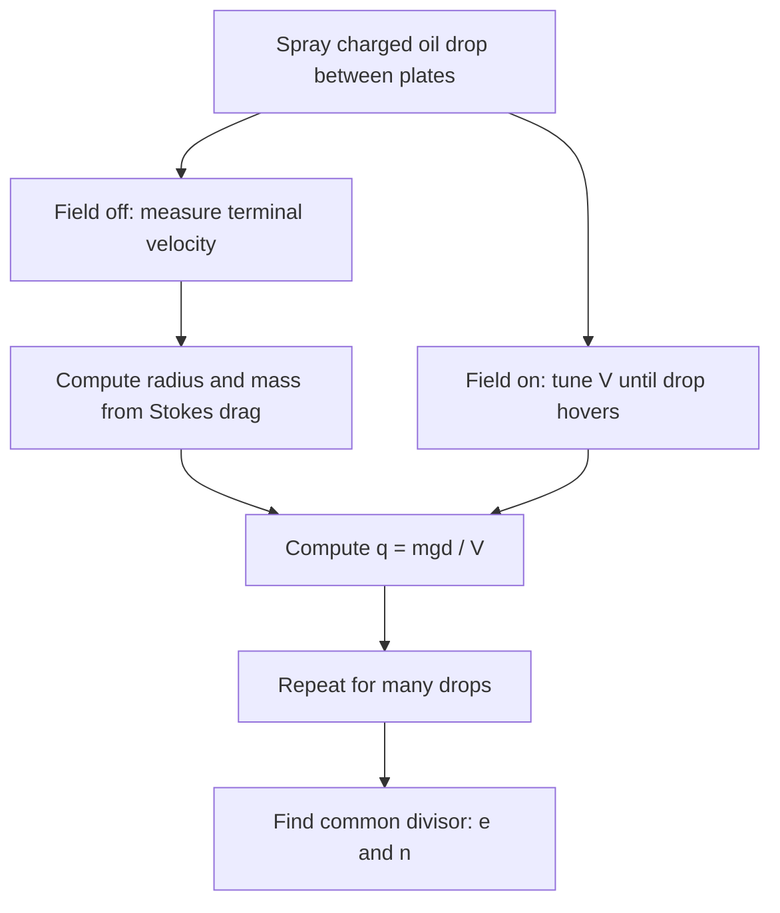

# Concept-Book Run

domain: /home/papagame/projects/digital-duck/cb-college-physics/public/domains/college_physics_ch30/input/graph.yaml
target: millikan_oil_drop_experiment
started: 2026-11-24T00:10:18

## Teaching order (5 concepts)

- atom
- electric_charge
- electron
- electron_charge
- millikan_oil_drop_experiment

### atom (1.0s)

## Atom

An **atom** is the smallest unit of an element that retains the chemical identity of that element and can participate in a chemical reaction. This definition comes from John Dalton's atomic theory (1803), which proposed that all matter is composed of indivisible atoms, that atoms of a given element share the same mass and properties, and that chemical reactions rearrange atoms rather than create or destroy them. Modern physics later showed that atoms are themselves built from smaller pieces — protons and neutrons packed into a dense central nucleus, surrounded by electrons — but the atom is still the smallest particle that behaves as a discrete unit of an element in ordinary chemistry.

What fixes an atom's identity as one element rather than another is its number of protons, called the **atomic number** ($Z$). Every atom with $Z=6$ is carbon; every atom with $Z=11$ is sodium — no matter how many neutrons or electrons it happens to have. Protons and neutrons contribute almost all of an atom's mass, while electrons, far lighter and held around the nucleus by electrostatic attraction, contribute almost none.

**Worked example:** A neutral atom of sodium (Na) has $Z=11$, so it contains 11 protons and, when neutral, 11 electrons to balance that positive charge. Its mass number is 23, so the remaining mass comes from $23 - 11 = 12$ neutrons. Knowing $Z$ alone is enough to identify the element; the neutron count affects mass but not identity.

**Problem-solving application:** Atomic number lets you identify an unknown element from experimental particle counts. Suppose a detector reports that an atom contains 17 protons — you can look up $Z=17$ on the periodic table and identify it as chlorine, regardless of how many neutrons or electrons were also measured. This is the basic logic behind mass spectrometry and nuclear chemistry: proton count is the fingerprint of an element, while neutron and electron counts describe variations (in mass or charge) within that same identity. Later sections build on this atomic structure to explain how electrons determine bonding behavior.

### electric_charge (0.9s)

## Electric Charge

Electric charge is a fundamental property of matter that comes in two types, conventionally labeled positive and negative. Protons carry positive charge, electrons carry negative charge, and neutrons carry none. Charge determines how particles interact electromagnetically: like charges repel, opposite charges attract. Charge is quantized — it exists only in whole-number multiples of the elementary charge, $e = 1.602 \times 10^{-19}$ coulombs — and it is conserved in every physical process, meaning the total charge of an isolated system never changes, even during chemical reactions, nuclear decay, or particle collisions.

An atom is electrically neutral when its number of protons equals its number of electrons. Ions form when atoms gain or lose electrons: a sodium atom (Na) loses one electron to become Na⁺, while a chlorine atom (Cl) gains one electron to become Cl⁻. This transfer of charge is what drives ionic bonding — the attraction between Na⁺ and Cl⁻ is a direct electromagnetic consequence of their opposite charges, and it explains why table salt (NaCl) holds together as a rigid crystal lattice. Because charge is conserved, the electron sodium loses is exactly the electron chlorine gains — nothing is created or destroyed, only transferred from one atom to the other.

To apply this concept in problem-solving: when analyzing a chemical reaction, always check that total charge balances on both sides of the equation, just as mass must balance — the sum of charges among reactants must equal the sum among products. When predicting whether a particular ion will form and remain stable, ask which arrangement of gained or lost electrons gives the atom a full outer electron shell, since that configuration minimizes the system's overall energy; sodium loses exactly one electron (not two) and chlorine gains exactly one electron (not two) because those specific transfers reach a stable, low-energy configuration. Electric charge — and the ions it produces — is the reason atoms bond into compounds, salts dissolve and conduct electricity in solution, and biological membranes maintain the voltage gradients that let neurons fire.

### electron (1.4s)

## Electron

An electron is a subatomic particle carrying a single negative elementary charge ($-1.602 \times 10^{-19}$ C) and a mass of about $9.11 \times 10^{-31}$ kg — roughly 1/1836 the mass of a proton. Electrons occupy the space surrounding the atomic nucleus, at characteristic distances and energies rather than moving on fixed paths. Because they carry charge and mass at once, electrons determine both an atom's chemical behavior (through bonding and reactivity) and its electrical properties (through conduction).

The electron's existence was established experimentally rather than predicted theoretically. In 1897, J. J. Thomson passed a high-voltage current through an evacuated glass tube, producing a glowing beam — a cathode ray. He found that the beam bent toward a positively charged plate and away from a negatively charged one, proving it was made of negatively charged particles rather than light or neutral matter. By measuring how much the beam deflected under known electric and magnetic fields, Thomson calculated the ratio of the particles' charge to their mass and found it was over a thousand times larger than that of the lightest known ion (hydrogen). This meant the particles were either highly charged or extremely light — and since the ratio stayed the same no matter what gas filled the tube or what metal made up the electrodes, Thomson concluded he had found a universal particle, a fundamental constituent of all atoms. This overturned the idea of the atom as an indivisible sphere and led Thomson to propose a model with electrons embedded in a diffuse positive charge.

For problem-solving, electrons matter most in balancing charge. An atom is electrically neutral because its number of electrons equals its number of protons. When an atom loses or gains electrons, that balance is broken, and the resulting charge equals the difference between protons and electrons. For example, a sodium atom (11 protons, 11 electrons) that loses one electron ends up with 11 protons and only 10 electrons, giving it a net charge of $+1$. This single relationship — count the protons, count the electrons, subtract — is the calculation you will use repeatedly whenever a problem asks you to determine the charge of a particle that has gained or lost electrons.

### electron_charge (12.9s)

## Electron Charge

### Definition

The **elementary charge**, $e$, is the smallest unit of free electric charge observed in nature:

$$e = 1.602 \times 10^{-19}\ \text{C}$$

An electron carries charge $-e$ and a proton carries $+e$. Every isolated charge ever measured is an integer multiple of this value, a property called **charge quantization**:

$$q = ne, \qquad n \in \{0, \pm 1, \pm 2, \dots\}$$

Charge is also conserved. In any closed system the net charge does not change, so charge can be moved or exchanged but not created or destroyed on its own.

(Quarks carry $\pm\tfrac13 e$ and $\pm\tfrac23 e$, but they are never found in isolation. Every observable particle still has a charge that is a whole multiple of $e$.)

### Worked example: counting electrons

A plastic rod is rubbed with fur and acquires a charge of $-4.8\times10^{-9}\ \text{C}$. How many excess electrons does it carry?

Since $q = ne$, solve for $n$ by dividing the total charge by the charge of one electron:

$$n = \frac{|q|}{e} = \frac{4.8\times10^{-9}\ \text{C}}{1.602\times10^{-19}\ \text{C}} \approx 3.0\times10^{10}$$

The rod holds about 30 billion extra electrons. The number looks large, but it is a tiny fraction of the roughly $10^{23}$ or more electrons in the rod. This is why everyday charges look continuous even though they are discrete.

### Problem-solving application: Millikan's oil drop

Millikan found $e$ by suspending charged oil droplets between two plates. A droplet hangs motionless when the electric force balances gravity:

$$qE = mg \quad\Rightarrow\quad q = \frac{mg}{E}$$

Suppose measurements on three droplets give the charges below.

| Drop | $q$ (C) |
|------|---------|
| A | $3.2\times10^{-19}$ |
| B | $4.8\times10^{-19}$ |
| C | $8.0\times10^{-19}$ |

**Step 1.** Look for a common factor. The differences are $B-A = 1.6\times10^{-19}$ and $C-B = 3.2\times10^{-19}$, so the spacing is about $1.6\times10^{-19}\ \text{C}$.

**Step 2.** Test whether each charge is a whole multiple of this spacing:

$$\frac{3.2}{1.6}=2,\qquad \frac{4.8}{1.6}=3,\qquad \frac{8.0}{1.6}=5$$

All three are integers. The droplets carry 2, 3, and 5 elementary charges.

**Step 3.** Conclude. Because every measured $q$ fits $ne$ with integer $n$, the data point to a fundamental unit. The best estimate is the greatest common divisor of the measurements, $e \approx 1.6\times10^{-19}\ \text{C}$. If the charge were continuous, the measured values would have no common spacing.

**Check yourself:** A current of $1\ \text{A}$ is $1\ \text{C/s}$. How many elementary charges pass a point each second? Dividing gives $1/(1.602\times10^{-19}) \approx 6.24\times10^{18}$ charges per second.

### millikan_oil_drop_experiment (15.6s)

## Millikan Oil Drop Experiment

### Definition

The Millikan oil drop experiment (Robert Millikan and Harvey Fletcher, 1909–1913) measured the charge of a single electron. Tiny oil droplets are sprayed between two horizontal metal plates. A droplet that has picked up a few extra electrons carries charge $q = ne$, where $n$ is an integer and $e$ is the elementary charge. By adjusting the voltage $V$ across plates separated by distance $d$, the experimenter creates a uniform field $E = V/d$ that pushes the drop upward. When the electric force exactly balances gravity, the drop hangs motionless:

$$qE = mg \quad\Longrightarrow\quad q = \frac{mg}{E} = \frac{mgd}{V}.$$

The remaining difficulty is the mass $m$, since a drop is too small to weigh directly. Millikan found it indirectly. With the field off, the drop falls and quickly reaches terminal velocity $v_t$. There, gravity is balanced by Stokes drag $6\pi\eta r v_t$ (neglecting buoyancy), where $\eta$ is the air's viscosity and $r$ is the drop's radius. Using $m = \tfrac{4}{3}\pi r^3\rho$ for oil density $\rho$:

$$r = \sqrt{\frac{9\eta v_t}{2\rho g}}.$$

### Worked example

Suppose $\rho = 900\ \text{kg/m}^3$, $\eta = 1.8\times10^{-5}\ \text{Pa·s}$, and a drop falls at $v_t = 1.0\times10^{-4}\ \text{m/s}$ with the field off.

1. Radius: $r = \sqrt{\dfrac{9(1.8\times10^{-5})(1.0\times10^{-4})}{2(900)(9.8)}} \approx 9.6\times10^{-7}\ \text{m}$.
2. Mass: $m = \tfrac43\pi r^3\rho \approx 3.3\times10^{-15}\ \text{kg}$.
3. With the field on, the drop hangs still at $V = 500\ \text{V}$ and $d = 1.0\ \text{cm}$, so $E = 5.0\times10^{4}\ \text{V/m}$.
4. Charge: $q = \dfrac{mg}{E} = \dfrac{(3.3\times10^{-15})(9.8)}{5.0\times10^{4}} \approx 6.5\times10^{-19}\ \text{C}$.

### Problem-solving application

One drop gives one value of $q$, which tells you little by itself. The key step is to repeat the measurement on many drops, or on one drop whose charge changes, and look for a pattern. Suppose three measurements give

$$q_1 = 3.2\times10^{-19}\ \text{C},\quad q_2 = 6.4\times10^{-19}\ \text{C},\quad q_3 = 9.6\times10^{-19}\ \text{C}.$$

Every value is a whole-number multiple of the smallest difference, so $e \approx 3.2\times10^{-19}\ \text{C}$ and the drops carry $n = 1, 2, 3$ electrons. Real data contain noise, so the practical method is to find the largest $e$ such that every measured $q$ is within error of an integer multiple of it. This is the same reasoning as finding an approximate greatest common divisor of the data.

Notice that the worked-example drop above has $q \approx 6.5\times10^{-19}$ C, which corresponds to $n = 4$ when $e = 1.602\times10^{-19}$ C, since $4e = 6.41\times10^{-19}$ C.

**Why it matters:** The data show that charge is quantized. It comes in discrete units, never in arbitrary fractions of $e$. Millikan's accepted value is close to the modern one, $e = 1.602\times10^{-19}$ C. Combined with J. J. Thomson's measured ratio $e/m_e$, it yields the electron mass, $m_e \approx 9.11\times10^{-31}$ kg.

*Workflow of the experiment: terminal velocity gives the drop's mass, the balancing voltage gives its charge, and many trials reveal the elementary charge $e$.*

## Run complete

total: 52.5s
