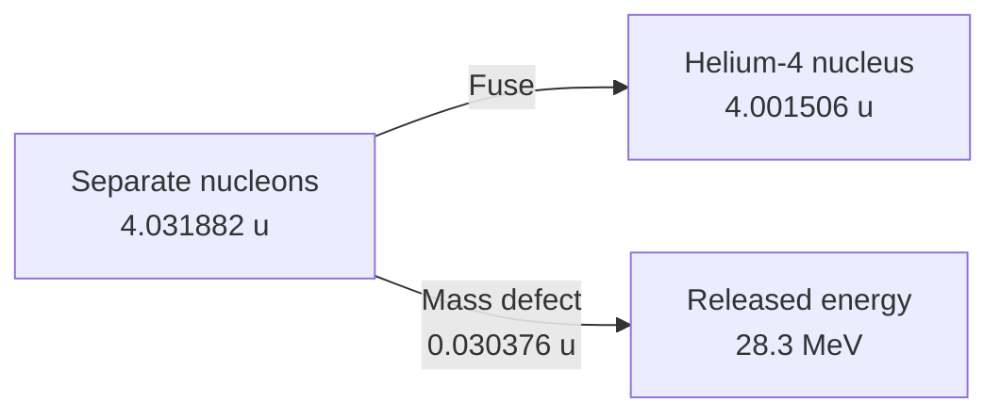

# Concept-Book Run

domain: /home/papagame/projects/digital-duck/cb-college-physics/public/domains/college_physics_ch31/input/graph.yaml
target: scintillator
started: 2026-11-24T00:11:11

## Teaching order (8 concepts)

- mass_energy_equivalence
- nucleus
- radioactivity
- ionization
- nuclear_radiation
- ionizing_radiation
- radiation_detector
- scintillator

### mass_energy_equivalence (21.6s)

## Mass Energy Equivalence

**Definition.** Mass and energy are two measures of the same underlying quantity. A system at rest with mass $m$ has an intrinsic **rest energy**

$$E_0 = mc^2,$$

where $c = 2.998\times10^{8}\ \text{m/s}$ is the speed of light. The factor $c^2$ is a unit-conversion constant. It is enormous, so a tiny amount of mass corresponds to a huge amount of energy.

The practical consequence is that when a system releases energy $\Delta E$ (as heat, light, or kinetic energy of products), its rest mass decreases by

$$\Delta m = \frac{\Delta E}{c^2}.$$

Mass and energy are not separately conserved in reactions. Only the combination is conserved.

**Worked example: the energy in one gram.** Convert $m = 1.00\ \text{g} = 1.00\times10^{-3}\ \text{kg}$ entirely to energy:

$$E = (1.00\times10^{-3})(2.998\times10^{8})^2 \approx 9.0\times10^{13}\ \text{J}.$$

One kilogram of TNT releases about $4.2\times10^{6}$ J, so this is the energy of roughly $2\times10^{7}$ kg of TNT, or 21,000 tons.

**Problem-solving application: nuclear binding energy.** A helium-4 nucleus has mass $4.001506$ u. Its constituents, 2 protons ($1.007276$ u each) and 2 neutrons ($1.008665$ u each), have total mass

$$2(1.007276) + 2(1.008665) = 4.031882\ \text{u}.$$

The mass defect is

$$\Delta m = 4.031882 - 4.001506 = 0.030376\ \text{u}.$$

Using $1\ \text{u}\cdot c^2 = 931.5\ \text{MeV}$,

$$E_B = (0.030376)(931.5) \approx 28.3\ \text{MeV}.$$

This is the energy released when the nucleus forms, or the energy you must supply to split it apart. Per nucleon it is about $7.1$ MeV.

*Strategy for these problems:*
1. Identify the masses before and after the reaction.
2. Compute $\Delta m$ (initial minus final).
3. Convert with $c^2$, using kg and J, or u and MeV via $931.5\ \text{MeV/u}$.
4. Check the sign. If $\Delta m>0$, energy is released.

**Check yourself.** In the Sun, about $4.3\times10^{9}$ kg of mass is converted to energy each second. Then

$$P = \frac{\Delta m\,c^2}{\Delta t} \approx (4.3\times10^{9})(9.0\times10^{16}) \approx 3.9\times10^{26}\ \text{W},$$

which matches the Sun's measured luminosity. The Sun gets its power from this tiny, steady loss of mass.

*Forming helium-4 from its nucleons loses 0.030376 u of mass, which appears as 28.3 MeV of released energy.*

### nucleus (1.1s)

## Nucleus

Every atom has a nucleus: a tiny, dense core made of protons and neutrons, collectively called nucleons. Although the nucleus accounts for less than 1/10,000th of an atom's diameter, it holds more than 99.9% of the atom's mass, because protons and neutrons are roughly 1,800 times heavier than electrons. Protons carry a positive electric charge, neutrons carry none, and the number of protons — the atomic number — defines which element the atom is. The mass number is the total count of protons plus neutrons in a given nucleus. The nucleus's positive charge attracts the negatively charged electrons that occupy the much larger surrounding space, holding the atom together through electrostatic attraction.

**Worked example.** Consider a carbon atom with atomic number 6 and mass number 12. The atomic number tells you the nucleus contains 6 protons — that's what makes it carbon rather than any other element. The mass number, 12, is protons plus neutrons combined, so the neutron count is 12 − 6 = 6. Now consider oxygen, atomic number 8, mass number 16: 8 protons (fixed by the atomic number) and 16 − 8 = 8 neutrons. In both cases, the proton count alone determines elemental identity, while the neutron count is found only by subtracting the atomic number from the mass number.

**Problem-solving application.** This subtraction — neutrons = mass number − atomic number — is the single calculation you'll use repeatedly in chemistry: to check the composition of any nucleus, to balance nuclear equations, and to track how proton and neutron counts change during radioactive decay or fission. It also explains a key organizing principle of chemistry: nuclear charge, not mass, determines chemical identity and behavior. Two atoms of the same element always have the same number of protons (and, in a neutral atom, the same number of electrons), so their chemical reactivity is identical, even if their masses differ. Protons and electrons govern how an atom bonds and reacts; neutrons mainly add mass and influence the nucleus's stability. Keeping proton count and mass number straight — and knowing that subtracting one from the other gives you neutrons — is the foundation you'll build on for every later topic involving nuclear structure, from radioactive decay to nuclear binding energy to the layout of the periodic table itself.

### radioactivity (22.4s)

## Radioactivity

**Radioactivity** is the spontaneous transformation of an unstable nucleus into a more stable one, accompanied by the emission of radiation. In the process, part of the nuclear mass is converted into energy according to $E = \Delta m\,c^2$. The decay of any single nucleus is random, but a large sample follows a precise statistical law.

**Decay types**

- **Alpha ($\alpha$):** emission of a ${}^4_2\mathrm{He}$ nucleus.
- **Beta-minus ($\beta^-$):** a neutron becomes a proton, emitting an electron and an antineutrino.
- **Gamma ($\gamma$):** a nucleus de-excites by emitting a photon.

Charge number $Z$ and mass number $A$ are conserved in every decay.

**The decay law**

Each nucleus has the same probability per unit time $\lambda$ (the decay constant) of decaying. For $N$ nuclei,

$$\frac{dN}{dt} = -\lambda N \quad\Longrightarrow\quad N(t) = N_0 e^{-\lambda t}.$$

The **half-life** is the time for half the sample to decay:

$$t_{1/2} = \frac{\ln 2}{\lambda}.$$

Equivalently, $N(t) = N_0\left(\tfrac12\right)^{t/t_{1/2}}$.

*Each half-life halves the number of undecayed nuclei, giving exponential decay.*

**Worked example**

Write the alpha decay of ${}^{238}_{92}\mathrm{U}$. The alpha particle removes $A=4$, $Z=2$, so the daughter has $A = 234$, $Z = 90$ (thorium):

$${}^{238}_{92}\mathrm{U} \to {}^{234}_{90}\mathrm{Th} + {}^{4}_{2}\mathrm{He}.$$

**Problem-solving application**

Iodine-131 has $t_{1/2} = 8.0$ days. A sample initially contains $N_0 = 4.0\times10^{6}$ nuclei (a small number, chosen for easy arithmetic). How many nuclei remain after 24 days, and when does the count fall to $1.0\times10^{5}$?

*Nuclei after 24 days.* Since $24/8.0 = 3$ half-lives,

$$N = 4.0\times10^{6}\left(\tfrac12\right)^3 = 5.0\times10^{5}.$$

*Time to reach $1.0\times10^{5}$.* Compute $\lambda = \ln 2 / 8.0 = 0.0866\ \text{day}^{-1}$. Then

$$t = \frac{1}{\lambda}\ln\frac{N_0}{N} = \frac{1}{0.0866}\ln 40 = \frac{3.689}{0.0866} \approx 43\ \text{days}.$$

As a check, 43 days is about 5.3 half-lives, and $2^{5.3}\approx 40$, which matches.

**Strategy.** Use the half-life form when the elapsed time is a whole number of half-lives. Otherwise use $N = N_0 e^{-\lambda t}$, and take logarithms to solve for time. The same method underlies radiocarbon dating, medical tracer dosing, and the shielding and storage times for nuclear waste.

### ionization (27.6s)

## Ionization

**Ionization** is the removal of an electron from an atom, which leaves a positively charged ion. For a neutral atom $X$, the first ionization is

$$X + E_i \;\to\; X^{+} + e^{-}$$

where $E_i$ is the **ionization energy**. This is the minimum energy needed to remove the most loosely bound electron from an atom in its ground state. Ionization energies are measured in electron-volts (1 eV $= 1.602\times10^{-19}$ J), and typical values are a few eV to a few tens of eV. Cesium needs about 3.9 eV, hydrogen 13.6 eV, and helium 24.6 eV.

Two facts follow from this definition:

- If the energy supplied is less than $E_i$, the electron stays bound. Extra energy does not "add up" over several weak pushes from a single photon.
- If the energy supplied is greater than $E_i$, the surplus becomes the kinetic energy of the freed electron:

$$K_e = E_{\text{supplied}} - E_i.$$

For a photon, the supplied energy is $E = h\nu = hc/\lambda$, and it is convenient to use $hc = 1240\ \text{eV·nm}$.

### Worked example

What is the longest-wavelength photon that can ionize ground-state hydrogen?

The longest wavelength corresponds to the lowest usable energy, which is exactly $E_i$:

$$\lambda_{\max} = \frac{hc}{E_i} = \frac{1240\ \text{eV·nm}}{13.6\ \text{eV}} \approx 91.2\ \text{nm}.$$

This is ultraviolet. Visible light (400–700 nm, about 1.8–3.1 eV) carries far less than 13.6 eV per photon, so it cannot ionize hydrogen, no matter how intense the beam is.

### Problem-solving application

**Problem.** Ground-state helium ($E_i = 24.6$ eV) is exposed to ultraviolet light. (a) Does a 30 nm photon ionize it? If so, what is the electron's kinetic energy? (b) Does a 100 nm photon?

**Solution.**

(a) The photon energy is

$$E = \frac{1240\ \text{eV·nm}}{30\ \text{nm}} \approx 41.3\ \text{eV}.$$

Since $41.3 > 24.6$, ionization occurs, and

$$K_e = 41.3 - 24.6 \approx 16.7\ \text{eV}.$$

(b) At 100 nm, $E = 12.4$ eV, which is less than 24.6 eV. No ionization occurs.

**Strategy for ionization problems:**

1. Convert the energy source to eV. For a photon, use $E = 1240/\lambda$ with $\lambda$ in nm.
2. Compare $E$ with $E_i$. If $E < E_i$, stop: the atom is not ionized.
3. If $E \ge E_i$, subtract to find the electron's kinetic energy, $K_e = E - E_i$.
4. To find a threshold, set $E = E_i$ and solve for $\lambda$.

**Check your understanding.** What is the longest wavelength of light that can ionize cesium? Is it visible, ultraviolet, or infrared?

### nuclear_radiation (21.8s)

## Nuclear Radiation

**Definition.** Nuclear radiation is the energetic emission from unstable atomic nuclei as they move toward a more stable configuration. Typical energies are on the order of MeV (1 MeV $= 1.602\times10^{-13}$ J), roughly a million times larger than chemical-bond energies. Three types are classical:

| Type | Particle | Change in nucleus | Penetration |
|---|---|---|---|
| $\alpha$ | $^4_2\text{He}$ nucleus | $Z\to Z-2,\ A\to A-4$ | Stopped by paper or skin |
| $\beta^-$ | electron (plus antineutrino) | $Z\to Z+1,\ A$ unchanged | Stopped by a few mm of aluminum |
| $\gamma$ | high-energy photon | none (nucleus de-excites) | Reduced by dense shielding such as lead |

Every decay conserves charge, nucleon number $A$, energy, and momentum. A radioactive sample's decay rate (activity) depends on the number of nuclei $N$ remaining:

$$\frac{dN}{dt} = -\lambda N \quad\Rightarrow\quad N(t)=N_0 e^{-\lambda t},\qquad t_{1/2}=\frac{\ln 2}{\lambda}.$$

This exponential law is a probability result: each nucleus has the same chance per unit time of decaying, regardless of its age.

**Worked example.** Write the alpha decay of $^{238}_{92}\text{U}$.

$$^{238}_{92}\text{U}\;\to\;^{234}_{90}\text{Th}+\,^4_2\text{He}.$$

Check conservation: $A$: $238 = 234+4$; $Z$: $92 = 90+2$. The energy released is the mass defect times $c^2$ (the $Q$-value), here about 4.27 MeV.

Because the products are two bodies, momentum conservation gives nearly all of this energy to the light alpha particle (about 4.2 MeV), so alpha energies from a given decay are sharply defined. Beta decay differs: the energy is shared with an antineutrino, so electron energies form a continuous spectrum.

**Problem-solving application.** A sample of an isotope has $t_{1/2}=8.0$ days and initial activity $A_0 = 4.0\times10^{6}$ Bq. When does the activity fall to a safe level of $2.5\times10^{5}$ Bq?

Activity is proportional to $N$, so $A(t)=A_0e^{-\lambda t}$. Here $A_0/A = 16 = 2^4$, meaning four half-lives:

$$t = 4\,t_{1/2} = 32\ \text{days}.$$

Check with the formula: $\lambda=\ln 2/8 = 0.0866\ \text{day}^{-1}$, and $t=\ln(16)/\lambda = 2.773/0.0866 = 32$ days. ✓

**Key takeaways.** Identify the decay type by tracking $A$ and $Z$; the energy released comes from the mass defect; use the exponential law to find the time for activity to fall. Alpha is the most ionizing but least penetrating, so it is hazardous mainly if ingested. Gamma is the most penetrating.

### ionizing_radiation (29.7s)

## Ionizing Radiation

**Definition.** Ionizing radiation is any radiation whose individual quanta or particles carry enough energy to remove a bound electron from an atom or molecule. The origin does not matter. Alpha, beta, and gamma emissions from nuclei qualify. So do X-rays, cosmic-ray secondaries, and neutrons. Visible light and radio waves do not qualify, however intense the beam, because each photon is too weak.

The key criterion is energy *per event*, not total energy. For a photon, the energy is

$$E = h\nu = \frac{hc}{\lambda}\approx\frac{1240\ \text{eV·nm}}{\lambda}.$$

Removing the electron from a hydrogen atom takes $13.6\ \text{eV}$. Setting $E \ge 13.6\ \text{eV}$ gives $\lambda \lesssim 91\ \text{nm}$, which is in the far ultraviolet. Typical ionization energies for light atoms are about $10$–$25\ \text{eV}$. Bond energies in biological molecules are also near $10\ \text{eV}$. This is why a 1 kW heat lamp is harmless at the molecular level, while a much weaker X-ray beam can break bonds in DNA. The lamp delivers a great deal of energy, but each photon carries only about $1\ \text{eV}$. The X-ray photon carries thousands of times more.

**Worked example.** Can a green photon ($\lambda = 520\ \text{nm}$) ionize hydrogen?

$$E=\frac{1240}{520}\approx 2.4\ \text{eV} < 13.6\ \text{eV}.$$

No. Doubling or tripling the number of photons changes nothing, because each photon acts alone and each one falls short of the threshold.

Now take a diagnostic X-ray photon with $E = 60\ \text{keV}$. Its wavelength is

$$\lambda=\frac{1240}{60{,}000}\approx 0.021\ \text{nm}.$$

Its energy is about $4{,}400$ times the $13.6\ \text{eV}$ threshold. The excess does not vanish. It goes to the freed electron as kinetic energy, and that electron can ionize many more atoms along its path.

**Problem-solving application.** *Problem:* Which of these can ionize hydrogen? (a) a microwave-oven photon, $\lambda = 12\ \text{cm}$; (b) a UV photon, $\lambda = 250\ \text{nm}$; (c) an extreme-UV photon, $\lambda = 40\ \text{nm}$.

First find the threshold wavelength:

$$\lambda_{\max}=\frac{1240\ \text{eV·nm}}{13.6\ \text{eV}}\approx 91\ \text{nm}.$$

A photon ionizes only if $\lambda \le 91\ \text{nm}$.

- (a) $12\ \text{cm} = 1.2\times10^{8}\ \text{nm}$ gives $E\approx 1\times10^{-5}\ \text{eV}$. It does not ionize.
- (b) $E = 1240/250 \approx 5.0\ \text{eV}$. It does not ionize hydrogen.
- (c) $E = 1240/40 = 31\ \text{eV}$. It ionizes hydrogen, with $31 - 13.6 \approx 17\ \text{eV}$ left over as electron kinetic energy.

Note that (b) falls below the hydrogen threshold but still exceeds some bond energies. Chemical damage can begin just below the ionization threshold. The wavelength cutoff is a sharp rule for ionization, not a sharp rule for harm.

**Check yourself.** A laser emits $10^{20}$ photons per second at $\lambda = 600\ \text{nm}$. Does it ionize hydrogen? (Answer: no, since $E\approx 2.1\ \text{eV}$ per photon. The photon count is irrelevant.)

### radiation_detector (23.2s)

## Radiation Detector

### Definition

A **radiation detector** is an instrument that senses ionizing radiation by measuring the ionization it produces in matter. When an alpha particle, beta particle, gamma ray, or neutron passes through a sensitive medium (a gas, a semiconductor, or a scintillating crystal), it transfers energy to atoms and frees charge carriers. The detector collects this charge and converts it into an electrical signal.

The key new quantity is the **W-value**: the average energy needed to create one ion pair (or electron–hole pair). For air, $W \approx 34\ \text{eV}$. For silicon, $W \approx 3.6\ \text{eV}$.

If a particle deposits energy $E$ in the medium, the number of charge carriers is
$$N = \frac{E}{W}$$
and the collected charge is $Q = Ne$, where $e = 1.602\times10^{-19}\ \text{C}$. Because $N$ is proportional to $E$, a detector can measure a particle's energy, not just detect its arrival.

### Worked example

A silicon detector absorbs a 5.48 MeV alpha particle (from $^{241}\text{Am}$) completely. Find the charge collected.

1. Number of pairs:
$$N = \frac{5.48\times10^{6}\ \text{eV}}{3.6\ \text{eV}} \approx 1.52\times10^{6}$$
2. Charge:
$$Q = Ne = (1.52\times10^{6})(1.602\times10^{-19}\ \text{C}) \approx 2.4\times10^{-13}\ \text{C}$$

This is only 0.24 pC, so the signal must be amplified before it can be read out.

### Problem-solving application

**Comparing detector materials.** Suppose the same 5.48 MeV alpha were fully absorbed in air instead of silicon. Then
$$N_{\text{air}} = \frac{5.48\times10^{6}\ \text{eV}}{34\ \text{eV}} \approx 1.61\times10^{5}$$
which is about nine to ten times fewer carriers than in silicon ($1.52\times10^{6}$). More carriers means a larger signal and a smaller relative statistical fluctuation in $N$. This is one reason semiconductor detectors give sharper energy measurements than gas detectors.

**Choosing a detector.** Use the W-value logic to match the tool to the question:

| Goal | Suitable detector |
|---|---|
| Precise alpha energy spectrum | Silicon semiconductor detector |
| Identify isotopes from gamma energies | Scintillator (NaI) or high-purity germanium |
| Quick check for contamination | Gas-filled detector (e.g., Geiger–Müller counter) |

**Practice problem.** A germanium detector has $W \approx 2.9\ \text{eV}$. How many pairs does a 662 keV gamma ray produce if it deposits all its energy?
$$N = \frac{662\times10^{3}\ \text{eV}}{2.9\ \text{eV}} \approx 2.28\times10^{5}$$
The charge is $Q \approx 3.7\times10^{-14}\ \text{C}$, which again requires amplification.

*Signal chain of a radiation detector: radiation creates charge carriers in the medium, which are collected, amplified, and recorded.*

### scintillator (22.1s)

## Scintillator

A **scintillator** is a material that absorbs ionizing radiation (gamma rays, X-rays, charged particles, neutrons) and re-emits part of that energy as a brief flash of visible or near-visible light. A photodetector then turns the light into an electrical pulse that can be counted and measured.

### How it works

1. Radiation deposits energy $E_{dep}$ in the material by exciting and ionizing atoms.
2. The excited states de-excite and emit photons, usually within nanoseconds to microseconds.
3. The number of photons produced is roughly proportional to the deposited energy:

$$N_\gamma = Y \, E_{dep}$$

Here $Y$ is the **light yield**, in photons per MeV. For NaI(Tl), $Y \approx 4\times10^{4}$ photons/MeV. Plastic scintillators give about $10^{4}$ photons/MeV.

Because $N_\gamma \propto E_{dep}$, the total light, and so the pulse height, tells you the energy of the radiation. This is why scintillators work as spectrometers and not only as counters.

### Worked example

A 662 keV gamma ray from $^{137}$Cs is fully absorbed in a NaI(Tl) crystal with $Y = 4.0\times10^{4}$ photons/MeV.

$$N_\gamma = (4.0\times10^{4}\ \text{MeV}^{-1})(0.662\ \text{MeV}) \approx 2.6\times10^{4}\ \text{photons}$$

The crystal therefore emits about 26,000 photons for this single gamma ray. Pulse height is proportional to this number, so a 1.324 MeV gamma ray fully absorbed in the same crystal would produce a pulse twice as tall.

### Problem-solving application: choosing a scintillator

Different jobs call for different materials. Compare these properties:

| Property | Why it matters |
|---|---|
| Light yield $Y$ | Higher yield gives more photons per MeV, so a more precise energy measurement |
| Decay time | Shorter time allows higher count rates and timing precision |
| Density and $Z$ | Higher values stop gamma rays more efficiently |
| Emission wavelength | It must match the photodetector's sensitive range |

**Scenario 1: PET scanner.** It must time two gamma rays precisely and stop 511 keV photons efficiently. That calls for a dense, fast crystal such as LYSO, even though its light yield is lower than that of NaI(Tl).

**Scenario 2: gamma spectroscopy of an unknown source.** Here the goal is to separate nearby energy peaks. A high-yield crystal such as NaI(Tl) is the better choice, because more photons per MeV means a cleaner measurement of each pulse.

**Scenario 3: low-cost survey meter for large areas.** Energy detail matters less than coverage and price. A cheap plastic scintillator, which can be made in large sheets, is the practical choice.

**Check yourself:** A 2.0 MeV gamma ray is fully absorbed in a plastic scintillator with $Y = 1.0\times10^{4}$ photons/MeV. How many photons are produced, and how does that compare with the same gamma ray in NaI(Tl)? (Answer: $2.0\times10^{4}$ photons in plastic versus $8.0\times10^{4}$ in NaI(Tl), a factor of 4 fewer.)

## Run complete

total: 191.7s
