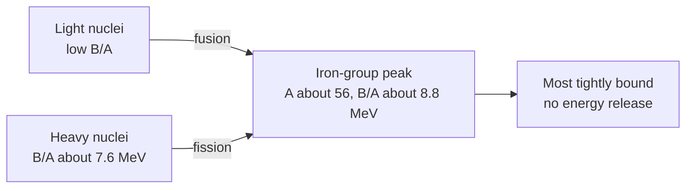
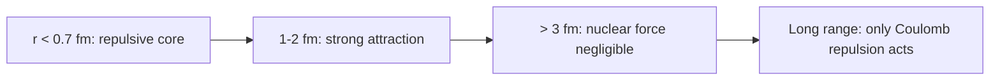
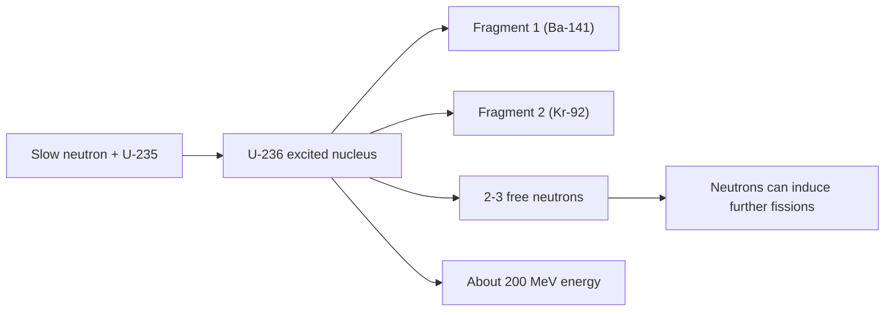
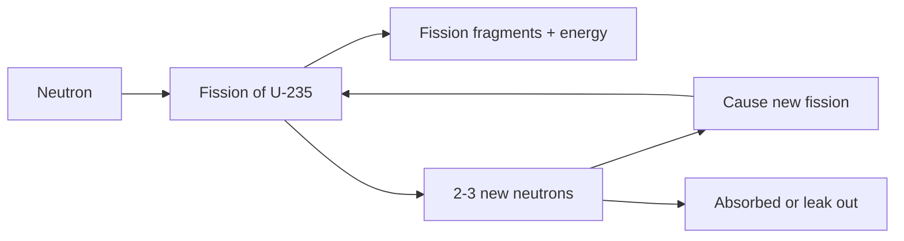
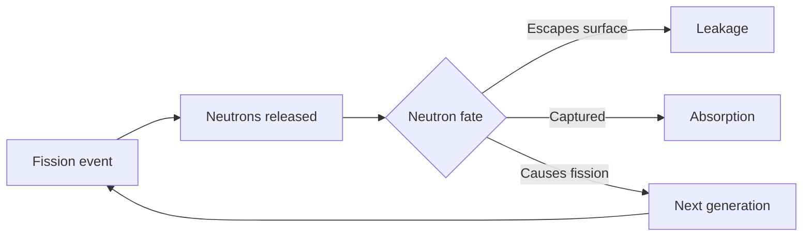
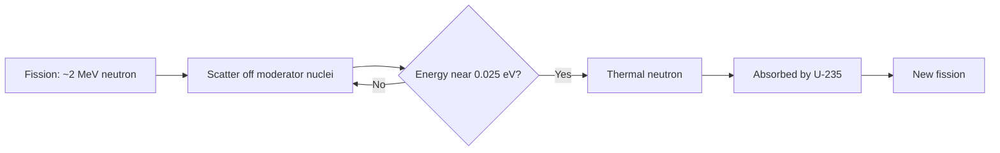

# Concept-Book Run

domain: /home/papagame/projects/digital-duck/cb-college-physics/public/domains/college_physics_ch32/input/graph.yaml
target: nuclear_power_reactor
started: 2026-11-24T00:14:24

## Teaching order (8 concepts)

- binding_energy_per_nucleon
- coulomb_repulsion
- nuclear_force
- nuclear_fission
- chain_reaction
- critical_mass
- neutron_moderation
- nuclear_power_reactor

### binding_energy_per_nucleon (14.1s)

## Binding Energy Per Nucleon

**Definition.** The *binding energy* $B$ of a nucleus is the energy required to separate it completely into free protons and neutrons. It equals the "missing" mass (the mass defect) converted to energy:

$$B = \left[Z\,m_p + N\,m_n - m_{\text{nucleus}}\right]c^2$$

where $Z$ is the number of protons, $N$ the number of neutrons, and $A = Z + N$. The **binding energy per nucleon** is

$$\frac{B}{A},$$

the average energy needed to remove one nucleon. A higher $B/A$ means a more tightly bound, more stable nucleus. Useful conversion: $1\ \text{u} = 931.5\ \text{MeV}/c^2$.

**Worked example: helium-4.** Use masses $m_p = 1.007276$ u, $m_n = 1.008665$ u, and $m_{\text{He-4}} = 4.001506$ u (nuclear mass).

Mass of separated nucleons:
$$2(1.007276) + 2(1.008665) = 4.031882\ \text{u}$$

Mass defect:
$$\Delta m = 4.031882 - 4.001506 = 0.030376\ \text{u}$$

Binding energy:
$$B = 0.030376 \times 931.5 \approx 28.3\ \text{MeV}$$

Per nucleon:
$$\frac{B}{A} = \frac{28.3}{4} \approx 7.07\ \text{MeV/nucleon}$$

**The shape of the curve.** Plotting $B/A$ against $A$ gives a characteristic curve. It rises steeply for light nuclei (deuterium is only about 1.1 MeV/nucleon), reaches a broad maximum near $A \approx 56$ (iron-56 and nickel-62, about 8.8 MeV/nucleon), then declines slowly for heavy nuclei (uranium-238 is about 7.6 MeV/nucleon). The rise comes from the short-range strong force, because each added nucleon gains more neighbors. The decline comes from the growing Coulomb repulsion among protons, which acts over the whole nucleus.

**Problem-solving application: fusion versus fission.** Energy is released when a reaction moves nucleons toward higher $B/A$. The energy released is the *total* binding energy after minus before:

$$Q = B_{\text{products}} - B_{\text{reactants}}$$

*Fission of uranium.* Suppose $^{235}$U ($B/A \approx 7.6$) splits into two fragments near $A \approx 118$ each with $B/A \approx 8.5$. The gain per nucleon is about $0.9$ MeV, so for 235 nucleons:

$$Q \approx 235 \times 0.9 \approx 210\ \text{MeV}$$

This matches the roughly 200 MeV measured per fission event.

*Fusion of hydrogen isotopes.* In D + T $\rightarrow$ He-4 + n, the reactants have $B \approx 2.2 + 8.5 = 10.7$ MeV, and He-4 has $B = 28.3$ MeV (the free neutron has zero). So $Q \approx 28.3 - 10.7 \approx 17.6$ MeV, about 3.5 MeV per nucleon, which is much larger per unit mass than fission.

**Rule of thumb:** Nuclei with $A < 56$ release energy by fusing. Nuclei with $A > 56$ release energy by splitting. Iron-group nuclei sit at the peak, so neither process releases energy from them.

*Both fusion of light nuclei and fission of heavy nuclei move matter toward the iron-group peak in binding energy per nucleon, releasing the difference as energy.*

### coulomb_repulsion (13.7s)

## Coulomb Repulsion

**Definition.** Two point charges $q_1$ and $q_2$ separated by a distance $r$ exert a force on each other along the line joining them. Its magnitude is given by Coulomb's law:

$$F = k\,\frac{|q_1 q_2|}{r^2}, \qquad k = \frac{1}{4\pi\varepsilon_0} \approx 8.99\times10^{9}\ \text{N·m}^2/\text{C}^2 .$$

When $q_1 q_2 > 0$ (like charges), the force is **repulsive**. Each charge is pushed directly away from the other. The corresponding potential energy is

$$U(r) = k\,\frac{q_1 q_2}{r},$$

which is positive for like charges and rises as they are brought closer. This is why it takes work to push like charges together.

In a nucleus, protons each carry $e = 1.602\times10^{-19}$ C, so every pair of protons repels. The $1/r^2$ dependence means the repulsion grows rapidly at short range.

**Worked example.** Two protons sit $r = 1.0\ \text{fm} = 1.0\times10^{-15}$ m apart, which is a typical separation inside a nucleus. Find the repulsive force and the potential energy.

$$F = (8.99\times10^{9})\frac{(1.602\times10^{-19})^2}{(1.0\times10^{-15})^2} \approx 231\ \text{N}$$

$$U = (8.99\times10^{9})\frac{(1.602\times10^{-19})^2}{1.0\times10^{-15}} \approx 2.3\times10^{-13}\ \text{J} \approx 1.44\ \text{MeV}$$

A force of about 231 N acts on a particle with a mass of only $1.67\times10^{-27}$ kg. The resulting acceleration is roughly $10^{29}\ \text{m/s}^2$. Without another interaction to counteract it, the protons would fly apart almost instantly.

**Problem-solving application.** Why do nuclei with many protons exist at all? The answer comes from comparing how two interactions scale.

1. *Coulomb repulsion is long-range.* Each proton repels *every* other proton. For $Z$ protons there are $Z(Z-1)/2$ pairs, so the total repulsive energy grows roughly as $Z^2$.
2. *The strong nuclear force is short-range.* It attracts nucleons only to their near neighbors, so its total contribution grows roughly in proportion to the number of nucleons $A$.

Treat the nucleus as a uniformly charged sphere of radius $R = r_0 A^{1/3}$ with $r_0 \approx 1.2$ fm. Its Coulomb energy is

$$E_C = \frac{3}{5}\,\frac{k Z^2 e^2}{R}.$$

For $^{208}\text{Pb}$ ($Z = 82$, $A = 208$), $R \approx 1.2(208)^{1/3} \approx 7.1$ fm. Then

$$E_C \approx \frac{3}{5}\cdot\frac{(1.44\ \text{MeV·fm})(82)^2}{7.1\ \text{fm}} \approx 818\ \text{MeV}.$$

Here $ke^2 = 1.44$ MeV·fm. This is a large energy, but the strong force supplies a larger attractive binding energy of about 1600 MeV, so the nucleus holds together.

Because $E_C$ grows as $Z^2$ while the strong binding grows only as $A$, heavy nuclei need extra neutrons. Neutrons add attraction without adding repulsion. This explains why stable nuclei move above the $N = Z$ line as $Z$ increases, and why nuclei with very large $Z$ are unstable to fission or alpha decay.

**Check yourself.** If the separation between two protons doubles, by what factor does the force change? The force falls to $1/4$ of its value, and the potential energy falls to $1/2$ of its value.

### nuclear_force (14.0s)

## Nuclear Force

### Definition

The **nuclear force** (strong nuclear force between nucleons) is the attractive interaction between protons and neutrons that holds a nucleus together. It is needed because protons in a nucleus repel one another electrically, and gravity is far too weak to offset that repulsion. Its key properties are:

- **Strongly attractive** at separations of about $1\text{–}2\ \text{fm}$ ($1\ \text{fm}=10^{-15}\ \text{m}$).
- **Short-ranged.** It falls off roughly exponentially and is negligible beyond about $3\ \text{fm}$.
- **Charge-independent.** The $p$–$p$, $n$–$n$ and $p$–$n$ forces are nearly equal once the Coulomb force is removed.
- **Saturating.** Each nucleon interacts mainly with its nearest neighbors, so binding energy grows roughly in proportion to $A$, not $A^2$.
- **Repulsive at very short range** ($\lesssim 0.7\ \text{fm}$), which keeps nuclei from collapsing.

Yukawa modeled the attraction as the exchange of a massive particle (the pion). The resulting potential is

$$V(r) \propto -\frac{e^{-r/R}}{r}, \qquad R=\frac{\hbar}{m_\pi c}\approx 1.4\ \text{fm}.$$

The range $R$ is set by the exchanged particle's mass: a heavier mediator gives a shorter range.

### Worked example

Compare the electric repulsion of two protons with the nuclear attraction between them. At $r = 1.5\ \text{fm}$, the Coulomb potential energy is

$$U_C=\frac{e^2}{4\pi\varepsilon_0 r}=\frac{1.44\ \text{MeV·fm}}{1.5\ \text{fm}}\approx 0.96\ \text{MeV}.$$

The nuclear potential between nucleons at this separation is tens of MeV deep. The attraction therefore beats the repulsion by more than an order of magnitude. At $r=10\ \text{fm}$ the Coulomb energy is still $0.144\ \text{MeV}$, but the nuclear term has dropped to essentially zero. This is why only small separations bind.

### Problem-solving application

**Why do large nuclei need extra neutrons?** Coulomb repulsion is long-ranged. Every proton repels all the others, so the total Coulomb energy grows like $Z^2$. The nuclear force saturates, so each nucleon feels only its neighbors. Past a certain size, the repulsion outgrows the attraction unless neutrons are added. Neutrons supply attraction and no repulsion, and this is why stable heavy nuclei have $N>Z$. For example, $^{208}\text{Pb}$ has $Z=82$ and $N=126$.

**Estimating the range from a mediator mass.** Using $m_\pi c^2\approx 140\ \text{MeV}$ and $\hbar c\approx 197\ \text{MeV·fm}$:

$$R=\frac{\hbar c}{m_\pi c^2}=\frac{197}{140}\approx 1.4\ \text{fm}.$$

This matches the observed range of the force.

**Check yourself:** If the exchanged particle were twice as massive, would the range double or halve? (It would halve, since $R\propto 1/m$.)

### Diagram

*The nuclear force changes with nucleon separation. It is repulsive at very small distances, strongly attractive near 1–2 fm, and negligible beyond a few fm, where only Coulomb repulsion remains.*

### nuclear_fission (15.1s)

## Nuclear Fission

**Definition.** Nuclear fission is a reaction in which a heavy nucleus splits into two (rarely three) lighter nuclei, called fission fragments, usually along with a few free neutrons and gamma rays. It releases energy because the products sit closer to the peak of the binding-energy-per-nucleon curve. Near $A\approx 240$, a nucleus has about $7.6\ \text{MeV}$ per nucleon. Fragments near $A\approx 120$ have about $8.5\ \text{MeV}$ per nucleon. The energy released is the difference in total binding energy:

$$Q = \left(\sum B_{\text{products}}\right) - B_{\text{parent}} = \left(m_{\text{reactants}} - m_{\text{products}}\right)c^2 .$$

A typical induced fission begins when a nucleus such as $^{235}\text{U}$ absorbs a slow neutron. The compound nucleus $^{236}\text{U}^*$ is excited and deforms like a liquid drop. The Coulomb repulsion between its protons then overcomes the surface tension of the nuclear force, and the nucleus splits:

$$^{235}_{92}\text{U} + n \rightarrow {}^{236}_{92}\text{U}^* \rightarrow {}^{141}_{56}\text{Ba} + {}^{92}_{36}\text{Kr} + 3n + \sim 200\ \text{MeV}.$$

Charge ($92 = 56+36$) and nucleon number ($236 = 141+92+3$) are both conserved.

**Worked example.** Estimate the energy released by the reaction above using the binding-energy curve.

- Parent: $236 \times 7.6 \approx 1794\ \text{MeV}$ (the compound nucleus; the incoming neutron is bound inside it).
- Fragments: $(141+92)\times 8.5 \approx 1980\ \text{MeV}$. The 3 free neutrons have no binding energy.
- $Q \approx 1980 - 1794 \approx 186\ \text{MeV}$.

This is close to the accepted value of about $200\ \text{MeV}$ per fission. Most of the energy appears as kinetic energy of the fragments, which are pushed apart by Coulomb repulsion.

**Problem-solving application.** How much fission energy does one kilogram of $^{235}\text{U}$ yield?

1. Number of nuclei: $N = \dfrac{1000\ \text{g}}{235\ \text{g/mol}} \times 6.02\times10^{23} \approx 2.56\times10^{24}$.
2. Energy per fission: $200\ \text{MeV} = 200\times 1.60\times10^{-13}\ \text{J} = 3.2\times10^{-11}\ \text{J}$.
3. Total: $E \approx (2.56\times10^{24})(3.2\times10^{-11}) \approx 8.2\times10^{13}\ \text{J}$.

For comparison, burning 1 kg of coal releases about $3\times10^{7}\ \text{J}$. Fission therefore delivers roughly $3$ million times more energy per kilogram, because nuclear binding energies are millions of times larger than chemical ones.

The released neutrons make a **chain reaction** possible. If the average number of neutrons from one fission that cause another fission is $k$, then:

- $k<1$: the reaction dies out (subcritical).
- $k=1$: the reaction is steady, as in a reactor (critical).
- $k>1$: the reaction grows exponentially (supercritical).

Reactors hold $k=1$ using control rods that absorb neutrons and a moderator that slows them. Slow neutrons are far more likely to be captured by $^{235}\text{U}$.

*Induced fission of U-235: neutron capture, deformation, splitting into fragments, and release of neutrons and energy that can sustain a chain reaction.*

### chain_reaction (15.2s)

## Chain Reaction

A **chain reaction** is a self-sustaining sequence of fission events in which neutrons released by one fission induce further fissions. Whether it grows, holds steady, or dies out depends on one number: the **effective multiplication factor** $k$, the average number of neutrons from one fission generation that go on to cause fission in the next.

$$k = \frac{\text{neutrons causing fission in generation } n+1}{\text{neutrons causing fission in generation } n}$$

Each fission of $^{235}\text{U}$ releases $\nu \approx 2.4$ neutrons on average, but some are absorbed without causing fission and some leak out of the material. So $k$ is lower than $\nu$. The neutron population after $n$ generations, starting from $N_0$ neutrons, is

$$N_n = N_0\,k^{\,n}.$$

This gives three regimes:

- $k<1$ (**subcritical**): the population decays geometrically and the reaction dies out.
- $k=1$ (**critical**): the population is constant. This is a steady chain reaction, as in a reactor running at constant power.
- $k>1$ (**supercritical**): the population grows exponentially.

### Worked example

Suppose $N_0 = 1000$ neutrons and $k = 1.02$. The generation time in a thermal reactor is about $\Lambda \approx 10^{-4}\ \text{s}$.

After $n=100$ generations, which is $10^{-2}$ s:

$$N_{100} = 1000\,(1.02)^{100} \approx 1000 \times 7.24 \approx 7240.$$

The population has grown more than sevenfold in 10 ms. With $k = 1.02$ and no control, it would reach about $10^{9}$ neutrons in roughly $n = \ln(10^6)/\ln(1.02) \approx 700$ generations, or 70 ms. This is why a reactor cannot rely on prompt neutrons alone. About 0.65% of neutrons are *delayed* (emitted seconds after fission by decaying fragments). They stretch the effective generation time to a fraction of a second and make control rods fast enough to hold $k \approx 1$.

### Problem-solving application

**Problem.** A bare sphere of fissile material has $\nu = 2.4$ neutrons per fission. Only a fraction $f = 0.70$ of those neutrons induce another fission, and the rest are absorbed or escape. Is the assembly critical? If the sphere is compressed so that leakage drops and $f$ rises to $0.50\times$... more precisely, to a value that makes $k = 1.1$, what is $f$?

**Solution.** Treat $f$ as the fraction of the $\nu$ emitted neutrons that cause a new fission, so $k = \nu f$.

1. Initially, $k = 2.4 \times 0.70 \approx 1.68$ (supercritical).

   This is greater than 1, so the chain reaction grows.

2. For the required $k=1.1$, $f = k/\nu = 1.1/2.4 \approx 0.46$.

   Note that the criterion for a sustained chain reaction is $k\ge 1$, which means $f \ge 1/\nu \approx 0.42$. Fewer than about 42% of the emitted neutrons can be lost before the reaction fails.

**Key takeaway.** Engineering a chain reaction means managing $k$: use moderators to slow neutrons and raise fission probability, use reflectors and geometry to reduce leakage, and use control rods to absorb neutrons and hold $k$ at 1.

*Each fission releases neutrons. Those that induce further fission continue the chain, while those absorbed or leaked are lost. Whether the chain grows depends on whether $k$ exceeds 1.*

### critical_mass (14.5s)

## Critical Mass

**Definition.** The *critical mass* of a fissionable material is the smallest mass that sustains a self-propagating chain reaction. The key quantity is the **effective multiplication factor**

$$k = \frac{\text{neutrons produced in one generation}}{\text{neutrons lost or absorbed in the previous generation}}.$$

- $k<1$: subcritical, and the reaction dies out.
- $k=1$: critical, and the reaction is steady.
- $k>1$: supercritical, and the reaction grows exponentially.

Each fission releases an average of $\nu$ neutrons (about 2.4 for $^{235}\text{U}$). Whether a neutron causes another fission depends on the fission cross-section $\sigma_f$ compared with the capture and escape probabilities. Writing the number of neutrons after $n$ generations as $N_n = N_0 k^n$ shows why $k=1$ is the threshold.

**Why mass matters.** Neutrons escape through the surface, so leakage scales with surface area ($\propto R^2$). Production scales with volume ($\propto R^3$). A larger piece has proportionally less leakage. Critical mass is the size at which production just balances losses.

For a bare sphere, the neutron balance gives a critical radius $R_c$ and mass

$$M_c = \frac{4}{3}\pi R_c^3\,\rho,$$

where $\rho$ is the density. The number density of nuclei is $n = \rho N_A/A$, where $N_A$ is Avogadro's number and $A$ is the molar mass in g/mol. The macroscopic fission cross-section is $\Sigma_f = n\sigma_f$. Raising $\nu\Sigma_f$ lowers $M_c$.

**Worked example.** For a bare sphere of $^{235}\text{U}$ ($\rho = 18.7\ \text{g/cm}^3$), suppose the critical radius is $R_c \approx 8.4\ \text{cm}$. Then

$$M_c = \frac{4}{3}\pi(8.4)^3(18.7) \approx 4.6\times10^{4}\ \text{g} \approx 46\ \text{kg}.$$

This is close to the accepted bare-sphere value of about 52 kg.

**Problem-solving application.** Suppose the density of a material increases by a factor of 2 (for example, by compression). The number density $n$ doubles, so the mean free path $\lambda = 1/\Sigma_f$ halves. Since $R_c$ scales with $\lambda$, a given mass is now effectively many mean free paths thick, and

$$R_c \propto \frac{1}{\rho}, \qquad M_c \propto \rho R_c^3 \propto \frac{1}{\rho^2}.$$

The critical mass falls to one quarter of its original value. This explains two practical facts:

1. Neutron reflectors (such as beryllium) return escaping neutrons and reduce $M_c$.
2. Different nuclides have very different critical masses. For example, $^{239}\text{Pu}$ has a larger $\nu\sigma_f$ than $^{235}\text{U}$, so its bare critical mass is only about 10 kg.

Reactor designers use the same reasoning in reverse. They add control rods, which absorb neutrons, to hold $k$ at exactly 1.

*Each neutron either leaks, is absorbed, or causes another fission. Critical mass is reached when, on average, exactly one neutron per fission causes a new fission.*

### neutron_moderation (14.7s)

## Neutron Moderation

**Definition.** Neutrons born in fission carry a mean kinetic energy of about 2 MeV, but U-235 fissions most readily when it captures *thermal* neutrons, which have energies near $E_{th} = kT \approx 0.025$ eV at room temperature. The fission cross section differs by a factor of roughly 1000 between these energies. **Neutron moderation** is the process of slowing fast neutrons to thermal energies through repeated elastic scattering in a light material, the *moderator*, such as water, heavy water, or graphite. A good moderator has light nuclei, because a neutron loses the most energy when it collides with a particle of similar mass. It must also scatter often and absorb few neutrons.

**Energy loss per collision.** In an elastic collision with a nucleus of mass number $A$, the neutron's energy after the collision lies between $\alpha E$ and $E$, where

$$\alpha = \left(\frac{A-1}{A+1}\right)^2 .$$

The average logarithmic energy loss per collision, which does not depend on the neutron's energy, is

$$\xi = 1 + \frac{\alpha}{1-\alpha}\ln\alpha .$$

For hydrogen ($A=1$), $\alpha = 0$ and $\xi = 1$. For carbon-12, $\xi \approx 0.158$.

The mean number of collisions needed to slow neutrons from $E_0$ to $E_f$ is

$$N = \frac{1}{\xi}\ln\frac{E_0}{E_f}.$$

**Worked example.** Find the number of collisions needed to moderate a 2 MeV neutron to 0.025 eV in graphite and in hydrogen.

The energy ratio is $E_0/E_f = \dfrac{2\times10^{6}}{0.025} = 8\times10^{7}$, so $\ln(E_0/E_f) \approx 18.2$.

- Graphite: $N = 18.2/0.158 \approx 115$ collisions.
- Hydrogen: $N = 18.2/1 \approx 18$ collisions.

Hydrogen is far more efficient per collision. In practice, thermalization in the hydrogen of water takes about 18–20 collisions. Because $\xi$ is defined as an average over the collisions, these counts are estimates, not exact numbers.

**Problem-solving application.** Collisions alone do not make a good moderator. We must also account for how often scattering happens compared with absorption. The **moderating ratio** is

$$\text{MR} = \frac{\xi\,\Sigma_s}{\Sigma_a},$$

where $\Sigma_s$ and $\Sigma_a$ are the macroscopic scattering and absorption cross sections. Ordinary water has a large $\xi\Sigma_s$ (about 1.35 cm$^{-1}$), but hydrogen absorbs neutrons noticeably, so MR $\approx 70$. Heavy water has a smaller $\xi\Sigma_s$ but very low absorption, giving MR $\approx 5000$. This is why $\text{D}_2\text{O}$ reactors (CANDU) can run on *natural* uranium, while light-water reactors need uranium enriched to 3–5% U-235 to make up for the neutrons water absorbs.

To compare two candidate moderators:
1. Compute $\xi$ from $A$.
2. Compute $N$ for the required energy drop.
3. Check MR against the fuel's enrichment constraints.

Moderation also gives reactors a safety feature. If the water boils or is lost, fewer neutrons are thermalized, the chain reaction weakens, and the power falls.

*A fission neutron loses energy over repeated scattering collisions until it is thermal, then is likely to cause another U-235 fission.*

### nuclear_power_reactor (15.4s)

## Nuclear Power Reactor

### Definition

A **nuclear power reactor** is a device that sustains a *controlled* fission chain reaction and converts the released heat into electricity. Its key components are:

- **Fuel:** uranium enriched to about 3–5% $^{235}\text{U}$ (natural uranium is only 0.72%).
- **Moderator:** water, heavy water, or graphite. It slows fast fission neutrons (about 2 MeV) to thermal energies (about 0.025 eV), where $^{235}\text{U}$ fissions far more readily.
- **Control rods:** neutron absorbers such as boron or cadmium. Inserting or withdrawing them adjusts the reaction rate.
- **Coolant:** carries heat to a steam generator or turbine.

The central quantity is the **effective multiplication factor**

$$k = \frac{\text{neutrons produced in one generation}}{\text{neutrons lost (absorbed or escaped) in the previous generation}}$$

- $k<1$: subcritical, and the reaction dies out.
- $k=1$: **critical**, with a steady power level (normal operation).
- $k>1$: supercritical, and power grows exponentially.

Each fission of $^{235}\text{U}$ releases about 200 MeV and, on average, $\nu \approx 2.4$ neutrons. Only about one of these must go on to cause another fission for the reaction to be steady.

### Worked example

A reactor operates at thermal power $P_{th}=3000\ \text{MW}$. How many fissions occur each second?

$$E = 200\ \text{MeV}\times 1.602\times10^{-13}\ \tfrac{\text{J}}{\text{MeV}} = 3.2\times10^{-11}\ \text{J per fission}$$

$$R = \frac{P_{th}}{E} = \frac{3.0\times10^{9}\ \text{W}}{3.2\times10^{-11}\ \text{J}} \approx 9.4\times10^{19}\ \text{fissions/s}$$

Mass of $^{235}\text{U}$ consumed per day:

$$m = \frac{R\,(86400\ \text{s})}{N_A}\times 235\ \text{g/mol} = \frac{8.1\times10^{24}}{6.02\times10^{23}}\times 235 \approx 3.2\ \text{kg}$$

About 3 kg of fissioned uranium per day gives 3 GW of heat. A coal plant of the same power burns roughly 7000 tonnes of coal per day.

### Problem-solving application

**Problem:** The reactor has $k=1.000$. Control rods are withdrawn slightly so that $k=1.001$. The mean generation time (the average time between one neutron generation and the next) is $\Lambda = 0.1\ \text{ms}$. The delayed-neutron effect is ignored. How fast does power grow?

With $k$ constant, the neutron population after $n$ generations is $N_n = N_0 k^n$. In time $t$ there are $n=t/\Lambda$ generations:

$$N(t)=N_0\,k^{t/\Lambda}=N_0\exp\!\left[\frac{t\ln k}{\Lambda}\right]\approx N_0\exp\!\left[\frac{(k-1)\,t}{\Lambda}\right]$$

Here $(k-1)/\Lambda = 0.001/10^{-4}\ \text{s}=10\ \text{s}^{-1}$. Power therefore grows by a factor of $e^{10}\approx 2\times10^{4}$ in one second. This is far too fast for mechanical rods to catch.

Real reactors are controllable because about 0.65% of fission neutrons are **delayed neutrons**, emitted seconds after fission by decaying fission products. They raise the effective generation time to roughly 0.1 s. The same calculation then gives $(k-1)/\Lambda \approx 0.01\ \text{s}^{-1}$, a time constant of about 100 s, which is slow enough for rods and feedback to manage. Operators and safety systems must therefore keep $k-1$ below the delayed-neutron fraction. Beyond that point the reactor is *prompt critical*, as at Chernobyl.

**Takeaway:** a reactor is a feedback system balancing neutron production against neutron loss. Enrichment and moderation make $k=1$ achievable, control rods hold it there, and delayed neutrons make the control practical.

## Run complete

total: 137.4s
