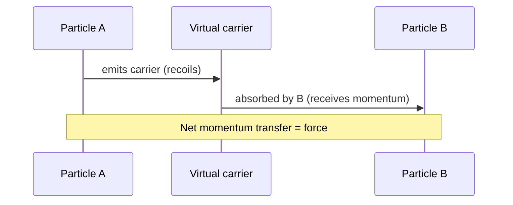
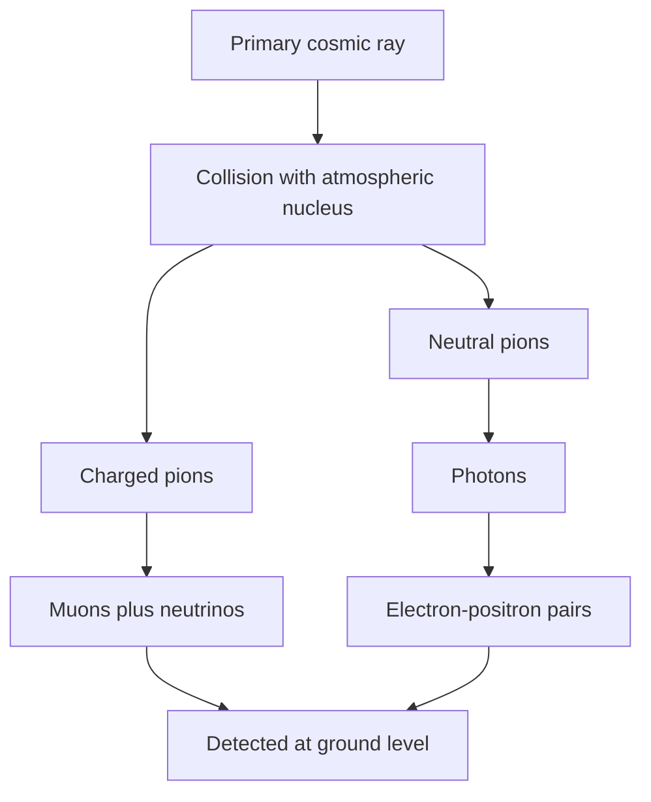

# Concept-Book Run

domain: /home/papagame/projects/digital-duck/cb-college-physics/public/domains/college_physics_ch33/input/graph.yaml
target: cosmic_ray_experiments
started: 2026-11-24T00:16:43

## Teaching order (8 concepts)

- conservation_of_mass_energy
- heisenberg_uncertainty_principle
- carrier_particle
- conservation_of_charge
- virtual_particle
- antimatter
- pion
- cosmic_ray_experiments

### conservation_of_mass_energy (13.1s)

## Conservation Of Mass Energy

**Definition.** In any isolated system, the total mass-energy is constant. Mass and energy are two forms of one conserved quantity, related by Einstein's equation

$$E = mc^2, \qquad c = 3.00\times10^8\ \text{m/s}.$$

In everyday chemistry and mechanics, mass and energy appear to be conserved separately. This is because the energy exchanged is so small that the equivalent mass change is unmeasurable. In nuclear and particle processes, the two must be tracked together:

$$\sum m_{\text{before}}c^2 + \sum K_{\text{before}} = \sum m_{\text{after}}c^2 + \sum K_{\text{after}},$$

where $K$ is kinetic (or other non-rest) energy. The **mass defect** $\Delta m = m_{\text{reactants}} - m_{\text{products}}$ gives the energy released:

$$Q = \Delta m\,c^2.$$

A convenient shortcut: $1\ \text{u} = 931.5\ \text{MeV}/c^2$.

**Worked example.** Deuterium–tritium fusion:
$$^2_1\text{H} + {}^3_1\text{H} \to {}^4_2\text{He} + n$$

Atomic masses: $^2$H = 2.014102 u, $^3$H = 3.016049 u, $^4$He = 4.002603 u, $n$ = 1.008665 u.

- Reactants: $2.014102 + 3.016049 = 5.030151$ u
- Products: $4.002603 + 1.008665 = 5.011268$ u
- $\Delta m = 0.018883$ u
- $Q = 0.018883 \times 931.5 \approx 17.59$ MeV

This energy appears as kinetic energy of the helium nucleus and neutron. Momentum conservation splits it unevenly. The two products have equal and opposite momenta $p$, and since $K = p^2/2m$, the lighter neutron (about 1/4 the mass of He) takes about 4/5 of the energy, roughly 14.1 MeV.

**Problem-solving application.** Electron–positron annihilation: an electron and positron at rest annihilate into two photons. How much energy does each photon carry?

1. Initial energy: $2m_ec^2 = 2(0.511\ \text{MeV}) = 1.022$ MeV.
2. Initial momentum is zero, so the photons must travel in opposite directions with equal energies (a single photon could not conserve momentum).
3. Each photon: $E_\gamma = 0.511$ MeV.

Their wavelength is $\lambda = hc/E = 1240\ \text{eV·nm}/(0.511\times10^6\ \text{eV}) \approx 2.43\times10^{-3}$ nm.

**Strategy for any problem.**
1. Write total rest energy plus kinetic energy before and after.
2. Compute $\Delta m$ from the mass table and convert with $931.5\ \text{MeV/u}$.
3. Apply momentum conservation separately to find how $Q$ is shared.
4. Check the sign. $Q>0$ means the process releases energy. $Q<0$ means the reactants need at least that much kinetic energy to start it.

**Scale check.** One kilogram of matter fully converted gives $E = (1)(3\times10^8)^2 = 9\times10^{16}$ J, about 21 megatons of TNT. Fusion converts only about 0.4% of the reacting mass, so the idea is to find $\Delta m$ and $Q$ by careful bookkeeping, not by assuming complete conversion.

### heisenberg_uncertainty_principle (13.1s)

## Heisenberg Uncertainty Principle

**Definition.** Quantum systems cannot have perfectly sharp values for certain *pairs* of quantities at once. The best-known pair is position and momentum, $\Delta x\,\Delta p \ge h/4\pi$. The pair that matters here is energy and time:

$$\Delta E\,\Delta t \ge \frac{h}{4\pi}$$

Here $\Delta E$ is the uncertainty in a system's energy. $\Delta t$ is the time interval over which that energy is observed, or the lifetime of the state. Planck's constant is $h = 6.626\times10^{-34}\ \text{J·s}$. The product $h/4\pi \approx 5.27\times10^{-35}$ J·s is extremely small. That is why the effects are invisible for everyday objects.

The relation does not describe a flaw in our instruments. It is a property of nature. A state that exists only briefly has no sharply defined energy. Equivalently, over a very short time the energy of a system can fluctuate by an amount $\Delta E$ without violating the physics. The "borrowed" energy must be repaid within roughly $\Delta t \approx h/(4\pi\,\Delta E)$. Averaged over longer times, conservation of energy still holds.

**Worked example.** Estimate how long a virtual electron–positron pair can exist. Creating the pair needs energy equal to the rest mass of two electrons:

$$\Delta E = 2m_ec^2 = 2(8.19\times10^{-14}\ \text{J}) = 1.64\times10^{-13}\ \text{J}$$

Solve for the maximum time:

$$\Delta t \approx \frac{h}{4\pi\,\Delta E} = \frac{5.27\times10^{-35}}{1.64\times10^{-13}} \approx 3.2\times10^{-22}\ \text{s}$$

The pair can exist for only about $10^{-22}$ s. This is far too short to observe directly.

**Problem-solving application.** The principle explains why excited atomic states have a "natural linewidth." A state with lifetime $\Delta t = 1.0\times10^{-8}$ s has an energy spread of at least

$$\Delta E \ge \frac{5.27\times10^{-35}}{1.0\times10^{-8}} = 5.3\times10^{-27}\ \text{J}\approx 3.3\times10^{-8}\ \text{eV}.$$

So the emitted photons do not all have exactly the same energy. The spectral line has a small, unavoidable width. Short-lived states give broad lines, and long-lived states give narrow ones. Particle physicists use the same reasoning in reverse. They measure the width $\Delta E$ of a resonance peak to find the lifetime of an unstable particle that is far too short-lived to track.

A second use is estimating the range of a force. A force carrier of mass $m$ can be "borrowed" for $\Delta t \approx h/(4\pi\,mc^2)$. Even at the speed of light it travels only $r \approx c\,\Delta t$. This is how Yukawa estimated the range of the nuclear force from the pion mass, which gives about $10^{-15}$ m.

**Key points.**
- A short lifetime means a large energy uncertainty, and a long lifetime means a small one.
- Energy "borrowing" is temporary, and the larger the amount, the shorter the loan.
- Use $\Delta E\,\Delta t \approx h/4\pi$ for order-of-magnitude estimates of lifetimes, linewidths, and force ranges.

### carrier_particle (13.8s)

## Carrier Particle

### Definition

A **carrier particle** (or force mediator) is a particle that is exchanged between two other particles to transmit a fundamental force. In this picture, particles do not interact through an instantaneous "action at a distance." Instead, one particle emits a carrier and the other absorbs it, and the momentum transferred in the process is the force.

Hideki Yukawa proposed this idea in 1935 for the nuclear force. The carrier is a **virtual particle**. It exists only briefly and is not directly observed, because it borrows energy $\Delta E$ for a time $\Delta t$ allowed by the uncertainty principle:

$$\Delta E\,\Delta t \gtrsim \frac{\hbar}{2}$$

### Worked example: Yukawa's range estimate

A carrier of mass $m$ costs at least $\Delta E = mc^2$ to create. It can survive for roughly $\Delta t \approx \hbar/(mc^2)$. Even if it travels at nearly the speed of light, it can cover a distance of only about

$$R \approx c\,\Delta t = \frac{\hbar}{mc} = \frac{\hbar c}{mc^2}.$$

The nuclear force has a range of about $R \approx 1.4\ \text{fm}$. Using $\hbar c \approx 197\ \text{MeV·fm}$:

$$mc^2 \approx \frac{197\ \text{MeV·fm}}{1.4\ \text{fm}} \approx 140\ \text{MeV}.$$

Yukawa therefore predicted a particle of roughly 140 MeV/$c^2$, about 270 electron masses. The pion, discovered in 1947, has $m_\pi c^2 \approx 139.6$ MeV. This is a striking agreement.

The same argument gives the force's shape. A massive carrier produces the **Yukawa potential**

$$V(r) = -\frac{g^2}{4\pi}\,\frac{e^{-r/R}}{r},$$

where $g$ is the coupling strength. The exponential factor cuts the force off beyond $R$. A massless carrier ($m=0$) gives $R\to\infty$ and the familiar $1/r$ Coulomb form.

### Problem-solving application

**Problem.** The W boson carries the weak force and has $m_W c^2 \approx 80{,}400$ MeV. Estimate the range of the weak force.

**Solution.**

$$R \approx \frac{\hbar c}{m_W c^2} = \frac{197\ \text{MeV·fm}}{80{,}400\ \text{MeV}} \approx 2.5\times10^{-3}\ \text{fm}.$$

This is about $0.002$ fm, far smaller than a proton (about 1 fm). It explains why the weak force acts only at subnuclear distances. The heavier the carrier, the shorter the range.

### Summary of carriers

| Force | Carrier | Mass | Range |
|---|---|---|---|
| Electromagnetic | photon | 0 | infinite |
| Strong (residual) | pion | 140 MeV/$c^2$ | ~1.4 fm |
| Weak | $W^\pm$, $Z^0$ | ~80–91 GeV/$c^2$ | ~$10^{-3}$ fm |
| Strong (fundamental) | gluon | 0 | confined, ~1 fm |

The pion explains the residual nuclear force between nucleons. Today's Standard Model treats the gluon as the carrier of the fundamental strong force between quarks. Gluons are massless, but they interact with each other, and this confines them to about nuclear scales. The pattern is that range is set by carrier mass, $R \sim \hbar/(mc)$.

*Particle A emits a virtual carrier and particle B absorbs it. The momentum exchanged is the force between them.*

### conservation_of_charge (12.7s)

## Conservation Of Charge

**Definition.** The law of conservation of charge states that the net electric charge of an isolated system never changes. Charge can move from place to place or be redistributed among objects, but it cannot be created or destroyed. For any process,

$$\sum q_{\text{before}} = \sum q_{\text{after}}.$$

Charge is also *quantized*: every observed charge is an integer multiple of the elementary charge $e = 1.602\times10^{-19}\ \text{C}$. Conservation applies at every scale, from rubbing a balloon on hair to particle collisions. In every case, the algebraic sum, counting positive and negative charges with their signs, stays fixed. Locally, the law is expressed by the continuity equation

$$\frac{\partial \rho}{\partial t} + \nabla\cdot\mathbf{J} = 0,$$

which says that charge density $\rho$ at a point can decrease only if current density $\mathbf{J}$ carries charge away from that point.

**Worked example: touching two spheres.** A metal sphere carries $+6.0\ \mu\text{C}$. An identical sphere carries $-2.0\ \mu\text{C}$. They touch and are then separated. What is the final charge on each?

1. Total charge before: $+6.0 + (-2.0) = +4.0\ \mu\text{C}$.
2. The spheres are identical conductors, so charge divides equally.
3. Each sphere ends with $\dfrac{+4.0}{2} = +2.0\ \mu\text{C}$.

Check: $2.0 + 2.0 = 4.0\ \mu\text{C}$, matching the initial total. Electrons moved from the negative sphere to the positive one, but none were lost.

**Problem-solving application: nuclear and particle reactions.** Conservation of charge is a tool for checking whether a reaction is possible and for identifying unknown products. Consider beta-minus decay of a neutron:

$$n \rightarrow p + e^- + \bar{\nu}_e$$

Charges: left side $0$; right side $(+e) + (-e) + 0 = 0$. The reaction passes the charge test.

Now test a proposed decay, $n \rightarrow p + \gamma$. The left side has charge $0$ and the right side has $+e$. Charge is not conserved, so this decay is forbidden.

To find an unknown product, use the same bookkeeping. In $^{14}_{\ 7}\text{N} + {}^4_2\text{He} \rightarrow {}^{17}_{\ 8}\text{O} + X$, the charge (atomic number $Z$) balance is $7 + 2 = 8 + Z_X$, so $Z_X = 1$. The mass-number balance is $14 + 4 = 17 + A_X$, so $A_X = 1$. Product $X$ is therefore a proton, ${}^1_1\text{H}$.

For circuits, the same principle underlies Kirchhoff's current law. Charge does not accumulate at a junction in steady state, so $\sum I_{\text{in}} = \sum I_{\text{out}}$. If $3\ \text{A}$ and $2\ \text{A}$ enter a junction and one wire leaves, that wire carries $5\ \text{A}$.

**Strategy.** (1) Identify the system and confirm it is isolated, or account for charge crossing its boundary. (2) Sum signed charges before. (3) Sum signed charges after. (4) Set them equal and solve for the unknown.

### virtual_particle (13.6s)

## Virtual Particle

A **virtual particle** is a transient excitation of a quantum field that appears in intermediate steps of a quantum process but is never detected as a free particle. It does not satisfy the usual energy–momentum relation $E^2 = p^2c^2 + m^2c^4$. Physicists call it **off-shell**. Its existence is inferred only through measurable effects it produces.

The heuristic link to the uncertainty principle is

$$\Delta E\,\Delta t \gtrsim \frac{\hbar}{2}.$$

A fluctuation that "borrows" energy $\Delta E$ can last roughly $\Delta t \approx \hbar/(2\Delta E)$. The larger the borrowed energy, the shorter the lifetime.

This picture is a useful estimate, not a rigorous derivation. In perturbation theory, virtual particles are internal lines of Feynman diagrams. They are bookkeeping for terms in a calculation, not tiny objects that pop in and out of existence.

### Worked example: range of the nuclear force

Yukawa proposed that the nuclear force between nucleons is carried by a virtual particle of mass $m$. Creating it costs at least $\Delta E = mc^2$. Even if it travels at nearly $c$, it can cover a distance of about

$$R \approx c\,\Delta t \approx \frac{\hbar c}{mc^2}.$$

The nuclear force has a range of about $R \approx 1.4\ \text{fm}$. Solving for the mass gives

$$mc^2 \approx \frac{\hbar c}{R} = \frac{197\ \text{MeV·fm}}{1.4\ \text{fm}} \approx 140\ \text{MeV}.$$

This matches the pion, whose measured mass is about $139\text{–}140\ \text{MeV}/c^2$. The pion was later found experimentally, and this prediction is a classic success of the idea.

### Problem-solving application

**Problem.** Estimate the range of the weak force, mediated by the virtual $W$ boson with $mc^2 \approx 80.4\ \text{GeV}$.

**Solution.** Use $R \approx \hbar c / (mc^2)$ with $\hbar c = 197\ \text{MeV·fm} = 0.197\ \text{GeV·fm}$:

$$R \approx \frac{0.197\ \text{GeV·fm}}{80.4\ \text{GeV}} \approx 2.5\times10^{-3}\ \text{fm}.$$

The weak force is therefore extremely short-ranged, about $1/500$ the size of a proton. This is why it is "weak" at everyday scales.

**Contrast.** The photon is massless, so $R \to \infty$ and electromagnetism has unlimited range. This follows directly from the same formula.

### Observable evidence

Virtual particles show up in measurable effects:

- **Lamb shift:** virtual photons slightly shift hydrogen's energy levels, by about $1058\ \text{MHz}$ between the $2S_{1/2}$ and $2P_{1/2}$ states.
- **Casimir effect:** two neutral conducting plates attract each other. The force per unit area is $F/A = -\dfrac{\pi^2 \hbar c}{240\,d^4}$ for plate separation $d$.
- **Anomalous magnetic moment of the electron:** loop corrections from virtual particles match experiment to about ten significant figures.

### Key takeaways

- Virtual particles are off-shell internal lines in quantum calculations, not directly detectable.
- The range of a force with a massive mediator is $R \approx \hbar c/(mc^2)$.
- Treat the "borrowed energy" picture as an estimate, and trust the full quantum field theory for exact results.

### antimatter (13.1s)

## Antimatter

**Definition.** Every particle has an *antiparticle* with the same mass and spin but opposite charge (and opposite other additive quantum numbers, such as lepton number). The electron $e^-$ has the positron $e^+$; the proton has the antiproton; the neutron has the antineutron. Matter built from antiparticles is *antimatter*. When a particle meets its antiparticle, they can *annihilate*, and their entire rest energy becomes other particles, usually photons. Antimatter's existence follows from combining quantum mechanics with special relativity: Dirac's relativistic equation for the electron, $\left(i\gamma^\mu\partial_\mu - m\right)\psi = 0$, has solutions that describe a particle of the same mass but opposite charge. Anderson observed the positron in cosmic-ray tracks in 1932.

**Worked example: electron–positron annihilation.** An electron and positron at rest annihilate:

$$e^- + e^+ \to \gamma + \gamma$$

The total rest energy is $2m_ec^2$, where $m_e c^2 = 0.511\ \text{MeV}$, so the energy is $1.022\ \text{MeV}$.

Why two photons rather than one? Before the collision, total momentum is zero. A single photon always carries momentum $E/c \neq 0$, so one photon would violate momentum conservation. Two photons must travel in opposite directions, each carrying

$$E_\gamma = m_e c^2 = 0.511\ \text{MeV}.$$

Charge is conserved too: $(-e)+(+e)=0$ before and after.

**Problem-solving application.** Suppose $1.0\ \text{mg}$ of antiprotons annihilates with $1.0\ \text{mg}$ of protons. How much energy is released?

1. Total mass: $m = 2.0\times10^{-6}\ \text{kg}$.
2. All of it converts to energy:
$$E = mc^2 = (2.0\times10^{-6})(3.00\times10^{8})^2 = 1.8\times10^{11}\ \text{J}.$$

For comparison, this is about $43$ tons of TNT (1 ton $\approx 4.184\times10^9\ \text{J}$). Chemical fuel releases roughly $10^{-10}$ of its mass as energy, and fission releases about $10^{-3}$. Annihilation converts 100% of the mass.

Annihilation is not a practical energy source, though. Antimatter does not occur naturally in useful amounts, and making it costs far more energy than it returns. Producing antiprotons takes high-energy collisions, such as $p+p\to p+p+p+\bar p$, which needs a minimum energy threshold. Even then, only a tiny fraction of the input energy ends up as stored antimatter.

**Real applications.** Positron emission tomography (PET) injects a tracer that emits positrons. Each positron annihilates with a nearby electron, producing two back-to-back $0.511\ \text{MeV}$ photons. Detectors record these coincident photons, and the line between them locates the source inside the body.

**Check your understanding.** A proton–antiproton pair annihilates at rest ($m_pc^2 = 938\ \text{MeV}$). What is the total energy released? *(Answer: $1876\ \text{MeV}$, shared among the products, often pions that decay further.)*

An open question remains: the Big Bang should have produced matter and antimatter in equal amounts, yet the observable universe is almost entirely matter. Explaining this asymmetry is one of the major unsolved problems in physics.

### pion (13.5s)

## Pion

The **pion** (or $\pi$ meson) is the lightest meson and the particle that carries the residual strong force between nucleons. It comes in three charge states: $\pi^+$, $\pi^-$ (mass $\approx 139.6\ \text{MeV}/c^2$) and $\pi^0$ (mass $\approx 135.0\ \text{MeV}/c^2$). Each is a quark–antiquark pair of up and down quarks. For example, $\pi^+ = u\bar d$. Pions have spin 0 and are unstable. Charged pions decay in about $2.6\times10^{-8}$ s, and the $\pi^0$ decays in about $8.5\times10^{-17}$ s.

### Why the pion's mass sets the force's range

In 1935 Yukawa proposed that a force carried by a particle of mass $m$ is short-ranged. A virtual exchange particle can "borrow" energy $\Delta E \approx mc^2$ only for a time $\Delta t \lesssim \hbar/\Delta E$ (the energy–time uncertainty relation). Even traveling near the speed of light, it can cover a distance of about

$$R \approx c\,\Delta t = \frac{\hbar c}{mc^2}.$$

The resulting potential has the Yukawa form $V(r)\propto \dfrac{e^{-r/R}}{r}$. It decays much faster than the Coulomb $1/r$ potential.

### Worked example: estimate the range

Use $\hbar c \approx 197.3\ \text{MeV·fm}$ and $m_\pi c^2 \approx 140\ \text{MeV}$:

$$R \approx \frac{197.3\ \text{MeV·fm}}{140\ \text{MeV}} \approx 1.4\ \text{fm}.$$

This matches the observed range of the nuclear force, about 1–2 fm, which is roughly the spacing between nucleons in a nucleus. Yukawa used this argument to predict a particle of mass about 100–200 MeV/$c^2$ years before the pion was found in cosmic rays in 1947.

### Problem-solving application

**Problem.** A $\pi^0$ at rest decays into two photons, $\pi^0\to\gamma\gamma$. Find each photon's energy.

**Solution.** Energy conservation gives $E_{\text{total}} = m_{\pi^0}c^2 = 135.0$ MeV. Momentum conservation, starting from zero total momentum, requires the photons to travel in opposite directions with equal momentum. They therefore share the energy equally:

$$E_\gamma = \frac{m_{\pi^0}c^2}{2} \approx 67.5\ \text{MeV}.$$

Detecting two back-to-back 67.5 MeV photons is the standard experimental signature of a $\pi^0$ at rest.

**Check the range logic in reverse.** If a force had a range of 0.2 fm, the carrier's mass would be

$$mc^2 \approx \frac{197.3}{0.2} \approx 1000\ \text{MeV}.$$

That is about the mass of a heavy meson such as the $\omega$ (about 783 MeV/$c^2$), which helps explain the shorter-range part of the nuclear force.

### Key takeaways

- A heavier exchange particle gives a shorter range, $R=\hbar/(mc)$.
- The pion's mass of about 140 MeV/$c^2$ gives the roughly 1.4 fm range of the nuclear force.
- Pions are quark–antiquark pairs. Strictly, the force between nucleons is a residual effect of the strong interaction between quarks.

### cosmic_ray_experiments (15.4s)

## Cosmic Ray Experiments

**Definition.** Cosmic rays are high-energy particles, mostly protons and atomic nuclei, that arrive from space. When a primary cosmic ray hits an atmospheric nucleus, it starts a *shower* of secondary particles: pions, muons, electrons, photons, and neutrinos. Before accelerators reached high energies, cosmic ray experiments were the main way to study particles above a few GeV. Detectors included cloud chambers, photographic emulsions, and Geiger counter arrays. These were often placed on mountains or carried by balloons.

**Key discoveries.**
- Positron (1932, Anderson): a cloud-chamber track curved the "wrong" way in a magnetic field.
- Muon (1936, Anderson and Neddermeyer): a penetrating particle that was too heavy to be an electron and too penetrating to be a proton.
- Charged pion (1947, Powell, Lattes, and Occhialini): emulsion exposed on mountains showed the decay $\pi \to \mu + \nu$. This was the Yukawa particle, which carries the nuclear force.
- Kaons and hyperons followed in the late 1940s, which led to "strangeness."

**Worked example: why muons reach the ground.** Muons are produced about $h = 15\ \text{km}$ up and have a rest-frame mean lifetime $\tau = 2.2\ \mu\text{s}$. Take a muon with speed $v \approx 0.998c$.

*Without relativity*, the typical decay distance is
$$d = v\tau \approx (3\times10^8\ \text{m/s})(2.2\times10^{-6}\ \text{s}) \approx 660\ \text{m}.$$
The survival fraction over 15 km would then be
$$\frac{N}{N_0} = e^{-h/(v\tau)} = e^{-15000/660} \approx e^{-22.7} \approx 10^{-10}.$$
Almost none would reach sea level. In fact, many do.

*With time dilation*, the Lorentz factor is
$$\gamma = \frac{1}{\sqrt{1-v^2/c^2}} = \frac{1}{\sqrt{1-0.998^2}} \approx 15.8.$$
The lab-frame lifetime is $\gamma\tau \approx 35\ \mu\text{s}$, so the decay length is $\gamma v\tau \approx 10.4\ \text{km}$. Then
$$\frac{N}{N_0} = e^{-15/10.4} \approx e^{-1.44} \approx 0.24.$$
This is about 24% of such muons, which is far closer to what is observed. Muons from cosmic rays are therefore a classic test of special relativity.

**Problem-solving application: identifying a particle.** In a magnetic field $B$, a charged particle of momentum $p$ follows a path of radius
$$r = \frac{p}{qB}.$$
Combine this with a second measurement, such as ionization density or range in emulsion, to get the mass.

*Problem:* A track of a singly charged particle has $r = 0.50\ \text{m}$ in $B = 1.0\ \text{T}$. Find $p$ in MeV/$c$.

*Solution:* Use the practical form $p\ [\text{GeV}/c] = 0.3\,B\,r$, with $B$ in tesla and $r$ in meters. Then $p = 0.3(1.0)(0.50) = 0.15\ \text{GeV}/c = 150\ \text{MeV}/c$. If its range shows $\beta \approx 0.82$, then
$$m = \frac{p}{\gamma\beta c}, \quad \gamma = \frac{1}{\sqrt{1-0.82^2}} \approx 1.75,$$
$$m c^2 \approx \frac{150}{1.75 \times 0.82} \approx 105\ \text{MeV}.$$
This matches the muon mass, 105.7 MeV/$c^2$.

**Takeaway.** Cosmic ray experiments combine curvature (momentum) with a second observable (speed or ionization) to identify particles. They also supply natural tests of relativity.

*A simplified air shower: a primary cosmic ray produces pions, which decay into the muons, photons, and electrons seen at ground level.*

## Run complete

total: 129.8s
