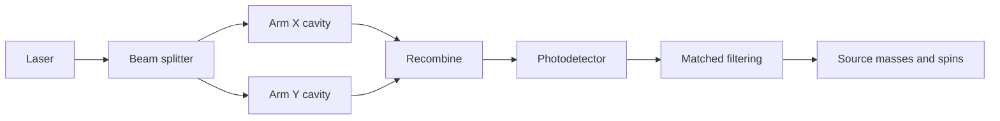

# Concept-Book Run

domain: /home/papagame/projects/digital-duck/cb-college-physics/public/domains/college_physics_ch34/input/graph.yaml
target: gravitational_wave_detection
started: 2026-11-24T00:18:54

## Teaching order (5 concepts)

- special_relativity
- equivalence_principle
- general_relativity
- gravitational_waves
- gravitational_wave_detection

### special_relativity (15.2s)

## Special Relativity

### Definition

Special relativity rests on two postulates:

1. **Relativity principle:** The laws of physics take the same form in every inertial frame, meaning every frame moving at constant velocity.
2. **Invariance of $c$:** The speed of light in vacuum, $c \approx 3.00\times10^8\ \text{m/s}$, is the same for all inertial observers, whatever the motion of the source or observer.

Together these force a revision of how we compare space and time between frames. If frame $S'$ moves at speed $v$ along $x$ relative to $S$, define

$$\gamma = \frac{1}{\sqrt{1-v^2/c^2}} \ge 1.$$

The **Lorentz transformation** is

$$x' = \gamma(x - vt), \qquad t' = \gamma\left(t - \frac{vx}{c^2}\right).$$

Its main consequences are:

- **Time dilation:** A clock moving relative to you ticks slowly. If $\Delta t_0$ is the *proper time* (measured by a clock present at both events), then $\Delta t = \gamma\,\Delta t_0$.
- **Length contraction:** A rod of proper length $L_0$ is measured along its direction of motion as $L = L_0/\gamma$.
- **Relativity of simultaneity:** Events simultaneous in one frame are generally not simultaneous in another.
- **Invariant interval:** $s^2 = c^2\Delta t^2 - \Delta x^2$ has the same value in every inertial frame.
- **Energy and momentum:** $E = \gamma mc^2$, $p=\gamma mv$, and $E^2 = (pc)^2 + (mc^2)^2$.

### Worked example

Muons are created about $15\ \text{km}$ above Earth and travel at $v = 0.995c$. Their proper lifetime is $\Delta t_0 = 2.2\ \mu\text{s}$. Without relativity, the distance they travel is

$$d = v\,\Delta t_0 \approx (0.995)(3.00\times10^8)(2.2\times10^{-6}) \approx 660\ \text{m},$$

so almost none should reach the ground. Now compute $\gamma$:

$$\gamma = \frac{1}{\sqrt{1-0.995^2}} \approx 10.0.$$

In Earth's frame the lifetime is $\Delta t = 10.0 \times 2.2\ \mu\text{s} = 22\ \mu\text{s}$, so the muons travel about $6.6\ \text{km}$. That is still short of $15\ \text{km}$, but the surviving fraction rises from about $e^{-23}$ to $e^{-2.3}\approx 10\%$ (using the $15\ \text{km}$ path and the mean lifetime), which matches observation.

In the muon's frame the explanation is length contraction: the $15\ \text{km}$ atmosphere shrinks to $15/10 = 1.5\ \text{km}$, which the muon crosses in about $5\ \mu\text{s}$. Both frames agree on the outcome.

### Problem-solving application

**Problem:** A spaceship passes Earth at $0.80c$. Its crew measures a trip to a star as taking $9.0\ \text{years}$ on board. How long does the trip take in Earth's frame, and how far away is the star?

**Solution:**

1. Identify the proper time. Both events (departure and arrival) happen at the ship, so $\Delta t_0 = 9.0\ \text{yr}$.
2. Compute $\gamma = 1/\sqrt{1-0.64} = 1/0.60 = 5/3$.
3. Earth-frame time: $\Delta t = \gamma\,\Delta t_0 = 15\ \text{yr}$.
4. Earth-frame distance: $d = v\,\Delta t = 0.80c \times 15\ \text{yr} = 12\ \text{light-years}$.
5. **Check using the invariant interval:** $s^2 = c^2\Delta t^2 - d^2 = (15^2 - 12^2)\ \text{ly}^2 = 81\ \text{ly}^2$, so $s = 9\ \text{ly}$, which equals $c\,\Delta t_0$ in the ship frame. ✓

**Strategy:** Before applying a formula, ask which frame holds the proper time or proper length. Use $\gamma$ only to convert from that frame to another, and confirm with the invariant interval when unsure.

### equivalence_principle (13.6s)

## Equivalence Principle

**Definition.** The (weak) equivalence principle states that inertial mass $m_i$, which resists acceleration in $\vec F = m_i \vec a$, equals gravitational mass $m_g$, which couples an object to a gravitational field in $\vec F_g = m_g \vec g$. Because $m_i = m_g$ (verified to about one part in $10^{13}$), all objects fall with the same acceleration $\vec g$ in a given gravitational field. Einstein's stronger version says that, in a small enough region of space and time, *no local experiment can distinguish a uniform gravitational field $\vec g$ from a frame accelerating at $\vec a = -\vec g$ in free space*. Equivalently, a freely falling frame is locally indistinguishable from an inertial frame with no gravity.

The words "small enough" matter. Real gravitational fields vary from place to place (tidal effects), so the equivalence holds only locally.

**Worked example: the elevator.** A sealed elevator sits at rest on Earth. A ball is released and falls with acceleration $g = 9.8\ \text{m/s}^2$. Now put the same elevator in deep space, far from any mass, and pull it upward with acceleration $a = 9.8\ \text{m/s}^2$. A released ball is no longer pushed by anything. It keeps its velocity while the floor accelerates up to meet it. Relative to the floor, the ball accelerates downward at $9.8\ \text{m/s}^2$. An observer inside sees the same ball behavior, the same scale reading ($N = mg$), and the same pendulum period $T = 2\pi\sqrt{L/g}$ in both cases.

**Problem-solving application: light bends.** An elevator of width $w = 3.0\ \text{m}$ accelerates upward at $a = 9.8\ \text{m/s}^2$. A horizontal light beam enters one wall. How far does it drop relative to the floor by the time it crosses?

1. Crossing time: $t = w/c = \dfrac{3.0}{3.0\times10^{8}} = 1.0\times10^{-8}\ \text{s}$.
2. The elevator rises by $\Delta y = \tfrac12 a t^2 = \tfrac12 (9.8)(10^{-8})^2 \approx 4.9\times10^{-16}\ \text{m}$.
3. So, relative to the elevator, the beam follows a downward-curving parabola, dropping by $\approx 5\times10^{-16}\ \text{m}$.

By the equivalence principle, the same must hold for an elevator at rest in Earth's gravity. Light bends in a gravitational field, a conclusion reached without any new field equations. (The bend is tiny here, but starlight grazing the Sun is deflected measurably, confirmed in the 1919 eclipse expedition. Einstein's full theory predicts twice the simple equivalence-based value.)

The same reasoning predicts gravitational time dilation. A clock at the top of an accelerating rocket receives signals from the bottom with a Doppler shift, so clocks at different heights in a gravitational field must tick at different rates: $\Delta f / f \approx g h / c^2$.

**Key takeaway.** Gravity and acceleration are locally the same phenomenon. This led Einstein to treat gravity not as a force but as the curvature of spacetime, the foundation of general relativity.

### general_relativity (13.2s)

## General Relativity

**Definition.** General relativity (GR) is Einstein's theory of gravity. It extends special relativity to accelerated frames and rests on the **equivalence principle**: locally, the effects of a uniform gravitational field are indistinguishable from those of an accelerating frame. Gravity is therefore not a force in the Newtonian sense. It is the curvature of spacetime, and free-falling objects follow **geodesics**, the straightest possible paths through curved spacetime. The central equation, the Einstein field equations, relates geometry to matter and energy:

$$G_{\mu\nu} + \Lambda g_{\mu\nu} = \frac{8\pi G}{c^4}\,T_{\mu\nu}$$

Here $g_{\mu\nu}$ is the metric (which defines distances and time intervals), $G_{\mu\nu}$ is built from its curvature, and $T_{\mu\nu}$ describes the energy and momentum of matter. Wheeler's summary: matter tells spacetime how to curve, and spacetime tells matter how to move.

**Worked example: gravitational time dilation.** Outside a non-rotating spherical mass $M$, the Schwarzschild metric gives the proper time $d\tau$ of a stationary clock at radius $r$:

$$d\tau = dt\,\sqrt{1-\frac{2GM}{rc^2}}$$

Here $dt$ is the time measured by a distant observer. Compare a clock on Earth's surface ($r = 6.371\times10^6$ m, $M = 5.97\times10^{24}$ kg) with a GPS satellite ($r = 2.656\times10^7$ m).

The factor $2GM/c^2 \approx 8.87\times10^{-3}$ m. At the surface, $2GM/(rc^2) \approx 1.39\times10^{-9}$. At orbit, it is $\approx 3.3\times10^{-10}$. For small $x$, $\sqrt{1-x}\approx 1-x/2$, so the surface clock runs slower than the orbiting one by a fractional amount

$$\frac{1}{2}(1.39-0.33)\times10^{-9}\approx 5.3\times10^{-10}.$$

Over one day ($86{,}400$ s), this is about $46\ \mu\text{s}$.

**Problem-solving application: why GPS needs GR.** The satellite's orbital speed ($\approx 3.9$ km/s) adds a special-relativistic slowdown of about $7\ \mu\text{s}$/day. The net offset is therefore roughly $46 - 7 \approx 39\ \mu\text{s}$/day, with the satellite clock running fast. Positioning error equals $c\,\Delta t$. Uncorrected, the error would grow by

$$(3\times10^{8}\ \text{m/s})(39\times10^{-6}\ \text{s}) \approx 11.7\ \text{km per day}.$$

Engineers offset this by setting the satellite clocks' frequency slightly low before launch. This is a direct, everyday check of GR.

**Other tests.** GR explains Mercury's perihelion advance ($43''$ per century, unexplained by Newtonian gravity). It predicts light bending near the Sun (confirmed in 1919), gravitational waves (detected by LIGO in 2015), and black holes, where $r \le r_s = 2GM/c^2$ marks the event horizon.

**Check your understanding.** Using the formula above, find $r_s$ for the Sun ($M = 1.99\times10^{30}$ kg). Answer: $r_s = 2GM/c^2 \approx 2.95$ km.

### gravitational_waves (16.4s)

## Gravitational Waves

**Definition.** A gravitational wave is a ripple in the geometry of spacetime that travels outward from accelerating masses at the speed of light, $c$. General relativity describes gravity as curvature of spacetime. When massive objects accelerate in a way that is not spherically symmetric, the curvature changes propagate outward as waves. Far from the source, spacetime is nearly flat, and the metric is
$$g_{\mu\nu} = \eta_{\mu\nu} + h_{\mu\nu}, \qquad |h_{\mu\nu}| \ll 1,$$
where $\eta_{\mu\nu}$ is the flat Minkowski metric and $h_{\mu\nu}$ is a small perturbation. In a suitable gauge, each component of $h_{\mu\nu}$ obeys the wave equation
$$\Box\, h_{\mu\nu} = \left(-\frac{1}{c^2}\frac{\partial^2}{\partial t^2} + \nabla^2\right)h_{\mu\nu} = 0,$$
so disturbances travel at speed $c$. The dimensionless **strain** $h = \Delta L / L$ measures the fractional change in the distance between two free test masses. The waves are transverse and have two polarizations, "plus" ($+$) and "cross" ($\times$). A passing wave stretches space along one transverse axis while squeezing it along the perpendicular axis, then reverses.

**Why quadrupoles?** Mass conservation rules out monopole radiation, and momentum conservation rules out dipole radiation. The leading source is therefore the time-varying mass quadrupole moment $Q_{ij}$. The far-field strain is
$$h \sim \frac{2G}{c^4 r}\,\ddot{Q},$$
where $r$ is the distance to the source. The factor $G/c^4 \approx 8\times10^{-45}\ \text{s}^2\,\text{kg}^{-1}\,\text{m}^{-1}$ is tiny, which is why the waves are so hard to detect.

**Worked example.** Estimate the strain from two black holes of mass $M = 30\,M_\odot$ each, orbiting at separation $d = 350$ km, at distance $r = 400$ Mpc. This is roughly the situation of GW150914. Here $\ddot Q \sim M v^2$ with orbital speed $v \approx 0.5c$, so
$$\ddot{Q}\sim Mv^2 \approx (6\times10^{31}\ \text{kg})(1.5\times10^8\ \text{m/s})^2 \approx 1.3\times10^{48}\ \text{J}.$$
With $r = 400\ \text{Mpc} \approx 1.2\times10^{25}$ m,
$$h \sim \frac{2(6.7\times10^{-11})(1.3\times10^{48})}{(3\times10^8)^4(1.2\times10^{25})} \approx 1.8\times10^{-21}.$$
Allowing for the order-of-magnitude approximations, this is consistent with the observed $h \sim 10^{-21}$.

**Problem-solving application.** LIGO's arms are $L = 4$ km long. A strain of $10^{-21}$ changes each arm's length by
$$\Delta L = hL = 10^{-21}(4000\ \text{m}) = 4\times10^{-18}\ \text{m},$$
about $1/200$ of a proton's diameter. A Michelson interferometer detects this by comparing the two arms' lengths using laser interference. A wave stretches one arm while compressing the other, which shifts the interference pattern.

Two further results are used often in problems:

- **Inspiral frequency.** For a circular binary, the gravitational-wave frequency is twice the orbital frequency, $f_{\text{GW}} = 2f_{\text{orb}}$. As the orbit loses energy to radiation, it shrinks and $f_{\text{GW}}$ rises, which produces the characteristic "chirp."
- **Distance.** The chirp's frequency evolution gives the *chirp mass* $\mathcal{M}$, which fixes the intrinsic amplitude. Comparing it to the measured $h$ then gives the distance, so a gravitational-wave event acts as a "standard siren."

**Check yourself.** If the distance to a source doubles and all else is equal, how does $h$ change? From $h\propto 1/r$, it halves. Since $h$ falls off as $1/r$ rather than $1/r^2$, a detector that is twice as sensitive sees $8$ times the volume of space.

### gravitational_wave_detection (15.3s)

## Gravitational Wave Detection

**Definition.** A gravitational wave (GW) is a ripple in spacetime that stretches and squeezes distances as it passes. Its strength is measured by the **strain**

$$h = \frac{\Delta L}{L},$$

the fractional change in the length $L$ of a path. A laser interferometer such as LIGO detects $h$ by comparing the lengths of two perpendicular arms. A wave traveling perpendicular to the arms stretches one arm while it squeezes the other, so the arm-length difference is

$$\Delta L = L_x - L_y = h L.$$

**How the instrument works.** A laser beam is split into two beams, one for each arm. Each beam reflects off a mirror at the end of its arm and returns to the beam splitter. When the arms are equal, the returning beams interfere destructively at the output port, so the photodetector sees almost no light. A passing wave changes $\Delta L$. This shifts the relative phase of the beams by

$$\Delta\phi = \frac{4\pi\,\Delta L}{\lambda} = \frac{4\pi h L}{\lambda},$$

where $\lambda$ is the laser wavelength. The factor of 2 from the round trip is included in the 4π. Light leaks to the detector in proportion to this phase shift.

**Worked example.** The first detected event, GW150914, had a peak strain of about $h \approx 10^{-21}$. LIGO's arms are $L = 4\ \text{km}$. The arm-length change is

$$\Delta L = hL = (10^{-21})(4\times10^{3}\ \text{m}) = 4\times10^{-18}\ \text{m}.$$

A proton's diameter is about $10^{-15}$ m, so this change is roughly $1/250$ of a proton diameter.

**Problem-solving application.** The phase shift from a single pass is far too small to measure directly. For $\lambda = 1064\ \text{nm}$,

$$\Delta\phi = \frac{4\pi(4\times10^{-18})}{1.064\times10^{-6}} \approx 5\times10^{-11}\ \text{rad}.$$

LIGO closes this gap in three ways:

1. **Fabry–Pérot cavities** fold each beam back and forth about 300 times. This multiplies the effective path length, and so $\Delta\phi$, by the same factor.
2. **High laser power**, on the order of 100 kW circulating in the arms, gives more photons. This reduces shot noise, which falls as $1/\sqrt{N}$ for $N$ detected photons.
3. **Coincidence between detectors**. The two sites, in Hanford and Livingston, are 3,000 km apart. A real signal must appear in both within about 10 ms, the light-travel time between them. Local noise, such as a truck or an earthquake, will not.

**Extracting the signal.** The detector output is noise plus a tiny signal, $s(t) = n(t) + h(t)$. Analysts use **matched filtering**. They correlate the data with a bank of predicted waveforms from general relativity. Each template depends on the masses and spins of the merging objects. A template that matches the data produces a peak in the signal-to-noise ratio. For GW150914, matching to a binary black-hole merger gave masses of about $36\,M_\odot$ and $29\,M_\odot$. The energy radiated was about $3\,M_\odot c^2$.

**Check your understanding.** A detector with arms of length $L = 40\ \text{km}$ sees the same strain $h = 10^{-21}$. Its $\Delta L$ is ten times larger, $4\times10^{-17}$ m. This is why proposed next-generation observatories use longer arms.

*Signal path of a laser interferometer: the beam is split, sent down two arms, recombined, detected, and analyzed against waveform templates.*

## Run complete

total: 93.8s
