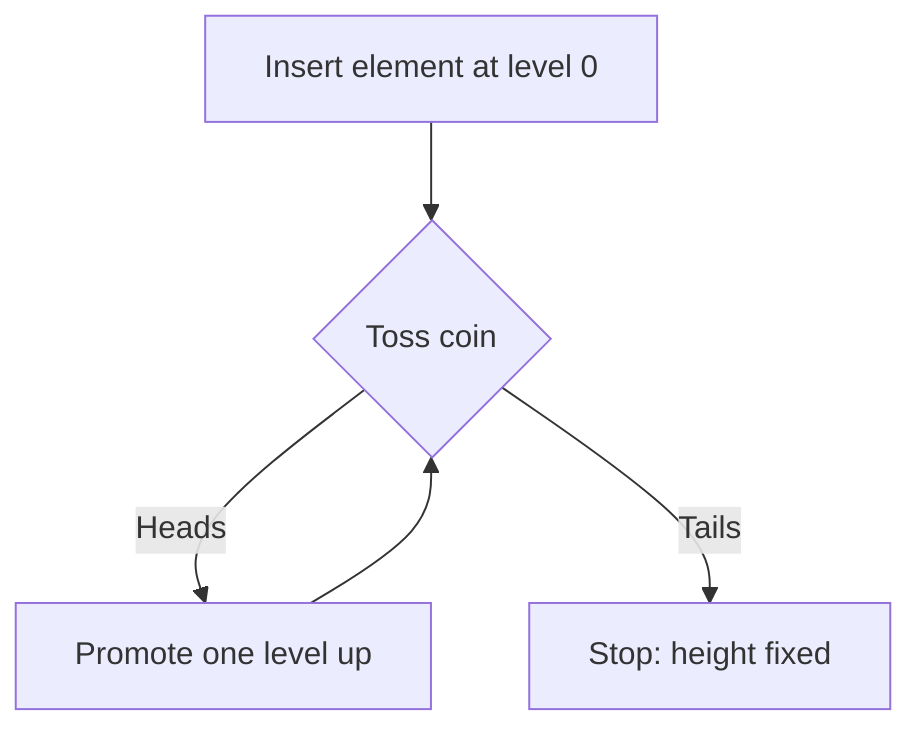
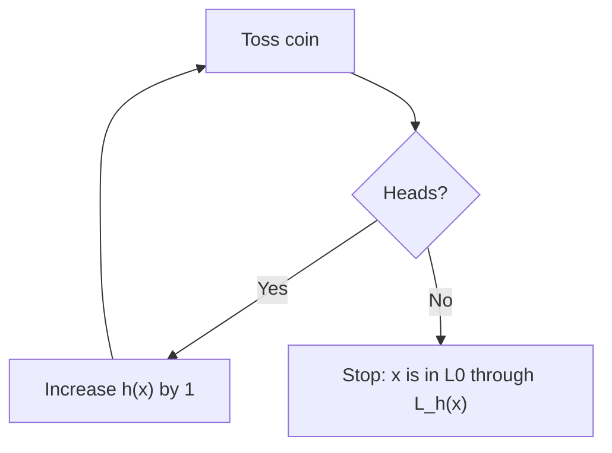
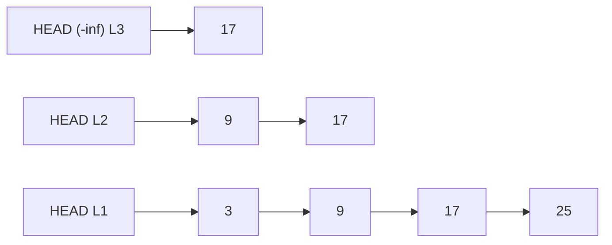
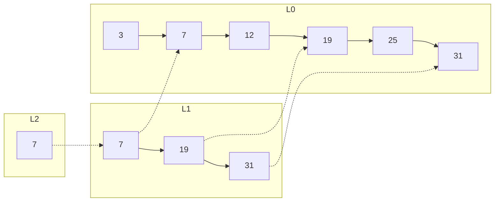

# Concept-Book Run

domain: /home/papagame/projects/digital-duck/cb-data-structure/public/domains/data_structure_ch04/input/graph.yaml
target: skiplist_list
started: 2026-11-24T01:13:39

## Teaching order (10 concepts)

- coin_toss_randomization
- node_height
- sentinel_node
- singly_linked_list_hierarchy
- skiplist
- pseudo_random_generator
- edge_length
- pick_height_procedure
- search_path
- skiplist_list

### coin_toss_randomization (1.0s)

## Coin Toss Randomization

**Definition.** A *coin toss* is a random binary choice: each independent toss yields heads with probability $p$ and tails with probability $1-p$ (usually $p = \tfrac12$). Randomized data structures use these tosses to make structural decisions, such as whether to promote an element to a higher level. The structure's cost is then a random variable, and we analyze its **expected value** $E[X]$ over all possible toss outcomes. No fixed input can reliably force bad behavior, because the randomness comes from the tosses and not from the data.

**Key fact: the geometric distribution.** Suppose we toss a fair coin repeatedly until the first tails, and let $X$ be the number of heads. Then

$$P(X = k) = \left(\tfrac12\right)^{k+1}, \qquad P(X \ge k) = \left(\tfrac12\right)^k.$$

The expected number of heads is $E[X] = \sum_{k\ge1} P(X \ge k) = \sum_{k\ge1} 2^{-k} = 1$.

**Worked example (skip list levels).** In a skip list, each new element starts at level 0. We toss a coin, and each head promotes it one level higher. We stop at the first tail. The element's height $H$ is $1 + X$ levels.

1. Expected height of one element: $E[H] = 1 + E[X] = 2$.
2. Expected total pointers for $n$ elements: $E[\text{pointers}] = \sum_{i=1}^{n} E[H_i] = 2n$, by linearity of expectation. The structure uses only linear space on average.
3. Expected number of elements reaching level $k$: $n \cdot 2^{-k}$. About half the elements sit at level 1, a quarter at level 2, and so on.

**Problem-solving application.** How many levels should we expect with $n = 1024$ elements?

The expected count at level $k$ is $1024 \cdot 2^{-k}$. This falls to about $1$ when $2^k = 1024$, so $k = \log_2 n = 10$. We can make this precise with a union bound. The probability that *any* element reaches level $k$ is at most

$$n \cdot 2^{-k}.$$

Choosing $k = 2\log_2 n$ gives $n \cdot n^{-2} = 1/n$. So with probability at least $1 - 1/n$, the structure has $O(\log n)$ levels.

Searching walks down from the top level. At each level we move right until the next node overshoots, then drop down. Look at the search path *backward*. At each node, a head means "this node was promoted, so we came from below." A tail means "we came from the left." The expected number of tosses needed to climb one level is $2$, so climbing $\log_2 n$ levels costs about $2\log_2 n$ steps. Hence

$$E[\text{search cost}] = O(\log n).$$

**Check yourself.** If the coin is biased with $p = \tfrac14$ for promotion, what is the expected height of an element? Using $E[X] = \frac{p}{1-p} = \tfrac13$, we get $E[H] = \tfrac43$. This gives fewer pointers and less space, but each level skips fewer elements, so searches take more steps. The choice of $p$ trades space against search time, and expectation lets us quantify exactly that trade.

*Each insertion tosses a coin repeatedly. Every head promotes the element one level, and the first tail ends the process, giving a geometric height distribution.*

### node_height (0.9s)

## Node Height

**Definition.** In a skiplist, each element $x$ is stored in the bottom list $L_0$ and may also appear in higher "express" lists $L_1, L_2, \dots$. The **height** of $x$, written $h(x)$, is the largest index $r$ such that $x \in L_r$. Because lists are nested ($L_{r} \subseteq L_{r-1}$), $x$ appears in exactly the lists $L_0, \dots, L_{h(x)}$.

Height is chosen at insertion time by repeated fair coin tosses: toss a coin until the first tails, and let $h(x)$ be the number of heads. Each toss is independent, so

$$\Pr[h(x) \ge r] = \left(\tfrac{1}{2}\right)^r, \qquad \Pr[h(x) = r] = \left(\tfrac{1}{2}\right)^{r+1}.$$

Thus about half of all elements have height $0$, a quarter have height $1$, and so on. Each level thins out the one below by a factor of about $2$, which creates the "express lane" structure.

**Worked example.** Insert a new key and toss: H, H, H, T. Three heads before the first tails gives $h(x) = 3$, so $x$ is linked into $L_0, L_1, L_2, L_3$. The probability of this outcome is $(1/2)^4 = 1/16$.

Now suppose we insert $n = 1024$ elements. The expected number with $h(x) \ge r$ is $n/2^r$. For $r = 10$ this is $1$, so we expect roughly one element at level $10$ and none far above it. This suggests the tallest node has height near $\log_2 n$.

**Problem-solving application.** *How tall is the whole skiplist?* Let $H = \max_x h(x)$ over $n$ elements. By the union bound,

$$\Pr[H \ge r] \le n \cdot 2^{-r}.$$

Choose $r = c\log_2 n$ for a constant $c > 1$:

$$\Pr[H \ge c\log_2 n] \le n \cdot n^{-c} = n^{1-c}.$$

So with $c = 3$, the height exceeds $3\log_2 n$ with probability at most $1/n^2$. The skiplist therefore has $O(\log n)$ height with high probability. Searches start at the top list and descend, so this bound is what makes the expected search time $O(\log n)$.

*Expected height of one node:* $E[h(x)] = \sum_{r \ge 1} \Pr[h(x) \ge r] = \sum_{r\ge1} 2^{-r} = 1$. So each element appears in $E[h(x)] + 1 = 2$ lists on average, and total space is $O(n)$ expected, even though the structure has $\Theta(\log n)$ levels.

*The height-selection procedure: keep tossing, count heads, and stop at the first tails.*

**Practice.** With $n = 2^{20}$ elements, what is the expected number of nodes with $h(x) \ge 15$? Using $n/2^r$, it is $2^{20}/2^{15} = 32$.

### sentinel_node (0.6s)

## Sentinel Node

A **sentinel node** (also called a *header* or *head node*) is a special dummy node placed at the start of every level of a skip list. It stores no real data. Its key is conceptually $-\infty$, so it compares less than every possible search key. Each of its forward pointers, one per level, anchors the start of the search path at that level.

Without a sentinel, an insertion or deletion at the front of a level would need special-case code, because the head pointer itself would have to change. With a sentinel, every real node has a predecessor on every level it occupies. The same pointer-update code then works for every position.

A skip list with maximum height $L$ has a sentinel with $L$ forward pointers. Often a matching tail sentinel with key $+\infty$ ends each level, so the search loop needs no null checks.

*The head sentinel has a forward pointer at every level. Each search starts there and moves right and down.*

### Worked example

Consider a skip list holding keys $3, 9, 17, 25$, where 9 and 17 also appear on level 2, and 17 also appears on level 3. Search for $25$:

1. Start at HEAD on level 3. Its next node is 17, and $17 < 25$, so move to 17.
2. On level 3, 17 has no successor (or the tail $+\infty$). Drop to level 2. The next key is the tail, so drop again.
3. On level 1, 17's next is 25. Since $25 \not< 25$ fails to rule it out, we stop at 25 and check for equality. Found.

Now search for $1$. HEAD's level-3 successor is 17, and $17 \ge 1$, so drop. The same happens on level 2 (next is 9). On level 1 the next is 3, and $3 \ge 1$. The search ends at HEAD with no match. The sentinel gave the search a valid place to stop, even though no real node precedes the key.

### Problem-solving application

**Insert key 2.** We must find the predecessor of 2 on each level. Because the sentinel's key is $-\infty$, the search ends at HEAD on every level. Say the coin flips give node 2 a height of 2. Then:

- Set `new.next[i] = head.next[i]` for $i = 1, 2$.
- Set `head.next[i] = new`.

This is the standard splice. No "empty list" or "insert at front" branch is needed. Without the sentinel, we would write separate code for modifying a head pointer.

**Cost.** The sentinel adds only $O(L)$ extra space, and $L = O(\log n)$ for $n$ keys. It doesn't change the expected search time of $O(\log n)$. It makes the code simpler and less error-prone.

**Check yourself:** In a skip list with $L = 4$, how many forward pointers does the head sentinel hold? (Answer: 4, one per level, whether or not any real node reaches that level.)

### singly_linked_list_hierarchy (0.6s)

## Singly Linked List Hierarchy

**Definition.** A *singly linked list* is a chain of nodes, each storing a key and one pointer to its successor. A skiplist is built from a **hierarchy** of such lists $L_0, L_1, \dots, L_h$ with two properties:

1. $L_0$ contains every key, in sorted order.
2. Each $L_{i+1}$ is a subset of $L_i$, so $L_h \subseteq \cdots \subseteq L_1 \subseteq L_0$.

In the standard randomized skiplist, each key in $L_i$ is promoted to $L_{i+1}$ independently with probability $p$ (usually $p = \tfrac12$). Equivalently, a key's *height* is the number of consecutive coin flips that come up heads, plus one. Each node appears in lists $L_0$ through $L_{\text{height}-1}$, and the copies are linked vertically.

**Worked example.** Take the keys $\{3, 7, 12, 19, 25, 31\}$ with these heights: 3→1, 7→3, 12→1, 19→2, 25→1, 31→2.

- $L_0$: 3 → 7 → 12 → 19 → 25 → 31
- $L_1$: 7 → 19 → 31
- $L_2$: 7

Each list is a sorted singly linked list, and each is a subset of the one below it.

*Three nested singly linked lists. Solid arrows are `next` pointers, and dotted arrows connect copies of the same key between levels.*

**Problem-solving application: searching for 25.** Start at the top list $L_2$ and work down:

1. In $L_2$, the node 7 has no successor, so move down to $L_1$ at 7.
2. In $L_1$, the next key is 19 and $19 \le 25$, so advance. The next key is 31 and $31 > 25$, so drop down to $L_0$ at 19.
3. In $L_0$, advance 19 → 25. Found.

The search took 3 horizontal steps, where a plain list would need 5. The upper lists work as "express lanes" that skip over many nodes at once.

**Why the hierarchy is efficient.** The expected number of keys in $L_i$ is $np^i$, so the expected height is $h = O(\log_{1/p} n)$. Walking a search path backward, each step goes up with probability $p$ and left otherwise. The expected number of left steps per level is therefore $1/p$. The expected search cost is

$$
E[\text{steps}] \approx \frac{1}{p}\log_{1/p} n = O(\log n).
$$

For $p = \tfrac12$ and $n = 1024$, that is about $2 \cdot 10 = 20$ steps, compared with up to 1024 in a single list.

**Key insight.** No single list is balanced or special. The logarithmic performance comes from stacking randomly thinned singly linked lists, each of which is simple to insert into and delete from.

