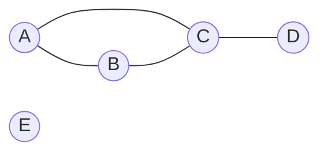

# Concept-Book Run

domain: /home/papagame/projects/digital-duck/cb-data-structure/public/domains/data_structure_ch12/input/graph.yaml
target: shortest_path_via_bfs
started: 2026-11-24T01:17:36

## Teaching order (7 concepts)

- graph
- vertex_degree
- adjacency_list
- graph_traversal
- queue
- breadth_first_search
- shortest_path_via_bfs

### graph (1.5s)

## 图

**定义。** 一个**图**(graph)是一个二元组 $G=(V,E)$,其中 $V$ 是有限的**顶点**集合,$E$ 是由顶点构成的**边**的集合。在无向图中,每条边是一个无序对 $\{u,v\}\subseteq V$;在有向图中,边是有序对 $(u,v)$。顶点 $v$ 的**度** $\deg(v)$ 是与它相连的边的条数。**路径**是顶点序列 $v_0,v_1,\dots,v_k$,其中相邻顶点之间都有边;若任意两个顶点之间都存在路径,则称图是**连通**的。

图的第一个基本结论是**握手引理**:

$$\sum_{v\in V}\deg(v)=2|E|.$$

*证明:* 每条边 $\{u,v\}$ 恰好为 $\deg(u)$ 和 $\deg(v)$ 各贡献 $1$,所以每条边在度数之和中被计算两次。$\blacksquare$

由此可知,度为奇数的顶点个数必为偶数,因为总和 $2|E|$ 是偶数。

**例题。** 设 $V=\{A,B,C,D,E\}$,$E=\{\{A,B\},\{A,C\},\{B,C\},\{C,D\}\}$。

- 各顶点的度:$\deg(A)=2,\ \deg(B)=2,\ \deg(C)=3,\ \deg(D)=1,\ \deg(E)=0$。
- 度数之和为 $2+2+3+1+0=8=2\times 4$,与握手引理一致。
- 从 $A$ 到 $D$ 的一条路径是 $A\to C\to D$,长度为 $2$。
- 顶点 $E$ 是孤立点,没有任何边与它相连,所以 $G$ **不连通**。

*图示:例题中的无向图。顶点 $E$ 孤立,因此整个图不连通。*

**问题求解应用。** 图是把"对象与关系"抽象出来的通用工具。

*问题:* 一个班有 $7$ 名同学,能否让每人恰好与另外 $3$ 名同学互为朋友?

*解答:* 把同学看作顶点,朋友关系看作边。若可行,则每个顶点的度都为 $3$,度数之和为 $7\times 3=21$。但握手引理要求度数之和等于 $2|E|$,必须是偶数,而 $21$ 是奇数,矛盾。因此这种安排**不可能**。

*再看一个应用:* 判断连通性。从某个顶点出发,用广度优先搜索逐层访问相邻顶点。若最后访问到的顶点数等于 $|V|$,则图连通。在例题中,从 $A$ 出发只能访问到 $\{A,B,C,D\}$,共 $4<5$ 个顶点,所以 $G$ 不连通。最短路径、网络可靠性、任务依赖调度等问题,也都是在这一结构上展开的。

**小结。** 图由 $(V,E)$ 完整刻画。握手引理 $\sum\deg(v)=2|E|$ 是判断某种结构是否可能存在的第一道检验。遇到"谁与谁相连"的问题时,先把对象设为顶点、关系设为边,再用度、路径和连通性来分析。

