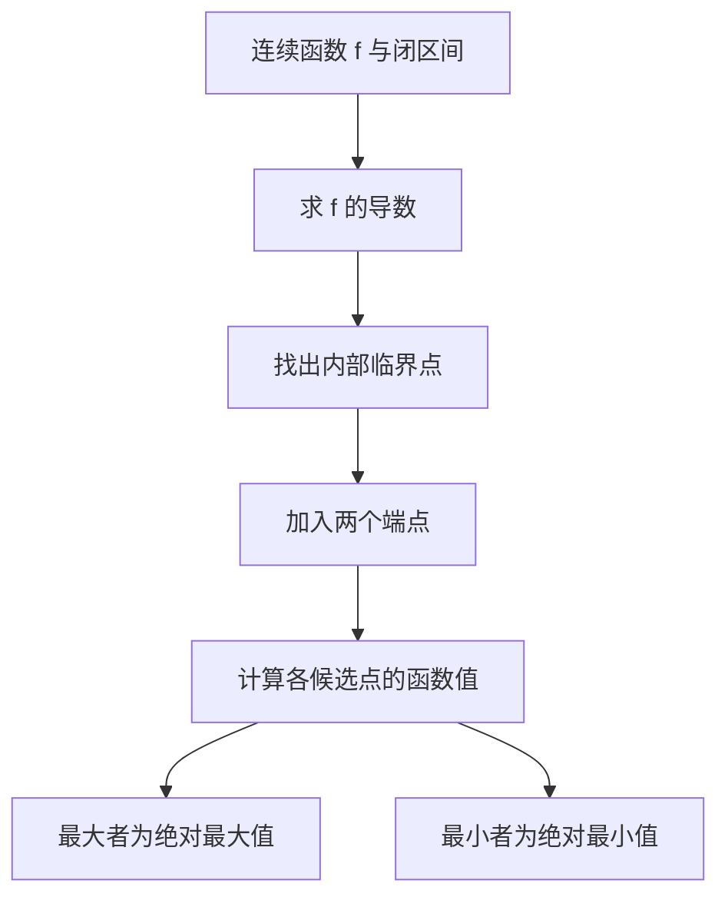
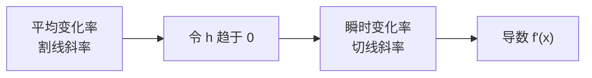
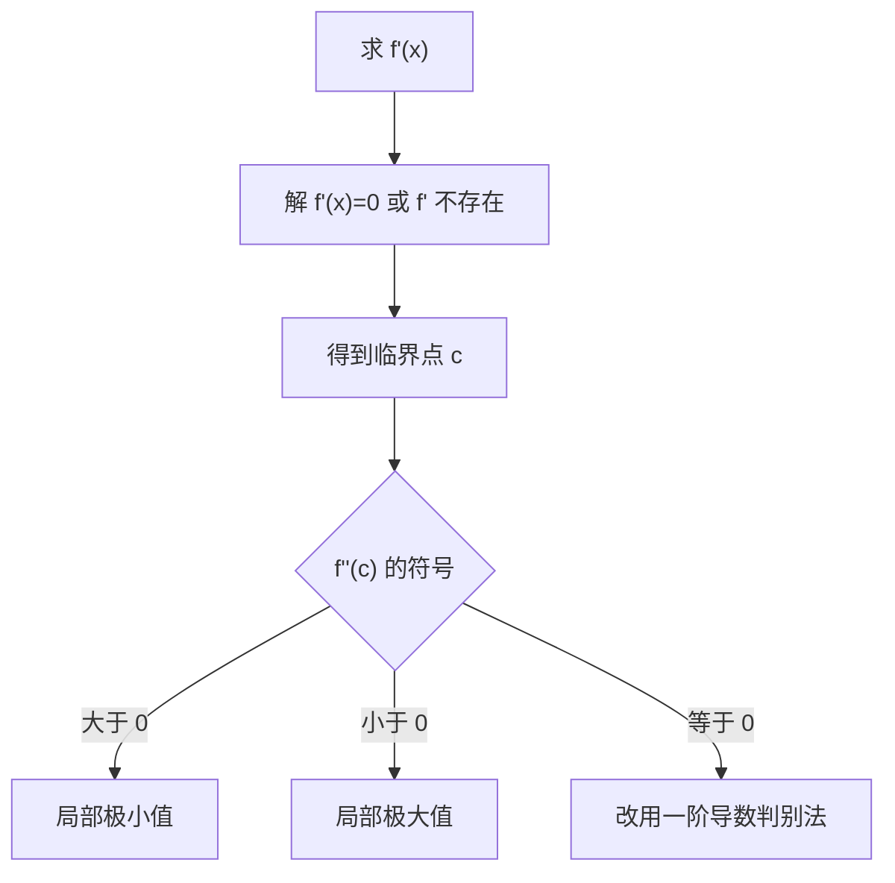
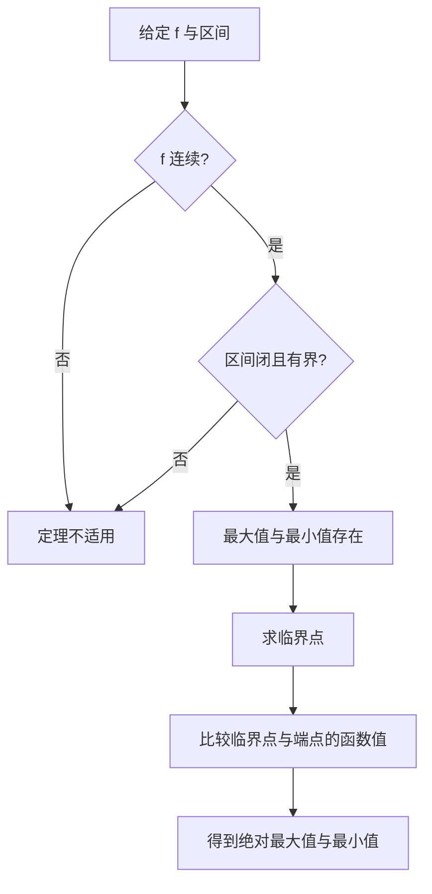
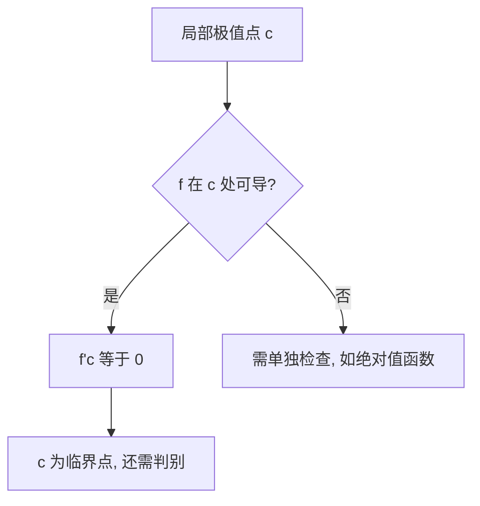

# Concept-Book Run

domain: /home/papagame/projects/digital-duck/cb-calculus/public/domains/calculus_ch04/input/graph.yaml
target: locating_absolute_extrema
started: 2026-11-24T05:59:21

## Teaching order (7 concepts)

- absolute_extrema
- derivative
- critical_point
- local_extrema
- extreme_value_theorem
- fermats_theorem
- locating_absolute_extrema

### absolute_extrema (0.9s)

## 绝对极值

**定义。** 设函数 $f$ 在区间 $I$ 上有定义。若存在 $c\in I$,使得对所有 $x\in I$ 都有 $f(x)\le f(c)$,则称 $f(c)$ 为 $f$ 在 $I$ 上的**绝对最大值**。若对所有 $x\in I$ 都有 $f(x)\ge f(c)$,则称 $f(c)$ 为**绝对最小值**。二者统称绝对极值。它们描述的是整个区间上的"最高点"和"最低点",而不只是某个点附近的局部高低。

**极值定理。** 若 $f$ 在**闭区间** $[a,b]$ 上连续,则 $f$ 在 $[a,b]$ 上一定同时取得绝对最大值和绝对最小值。这一定理保证了极值存在。若区间是开区间,或函数有间断点,极值可能不存在。例如 $f(x)=x$ 在 $(0,1)$ 上既无最大值也无最小值。

**闭区间法。** 对 $[a,b]$ 上的连续函数 $f$:

1. 求出 $(a,b)$ 内所有**临界点**,即 $f'(x)=0$ 或 $f'(x)$ 不存在的点。
2. 计算 $f$ 在这些临界点和两个端点 $a$、$b$ 处的值。
3. 其中最大的是绝对最大值,最小的是绝对最小值。

**例题。** 求 $f(x)=x^3-3x^2+1$ 在 $[-1,3]$ 上的绝对极值。

先求导:$f'(x)=3x^2-6x=3x(x-2)$,令其为零,得临界点 $x=0$ 和 $x=2$,二者都在 $(-1,3)$ 内。

计算候选点处的函数值:

| $x$ | $-1$ | $0$ | $2$ | $3$ |
|---|---|---|---|---|
| $f(x)$ | $-3$ | $1$ | $-3$ | $1$ |

因此绝对最大值为 $1$,在 $x=0$ 与 $x=3$ 处取得。绝对最小值为 $-3$,在 $x=-1$ 与 $x=2$ 处取得。注意,极值可以在多个点取得,而且端点也可能是极值点。

**问题求解应用。** 用一张长 $12$ cm、宽 $12$ cm 的方形纸板,在四角各剪去边长为 $x$ 的小正方形,折成无盖盒子。求体积最大时的 $x$。

体积为 $V(x)=x(12-2x)^2$,定义域为 $[0,6]$,$V$ 在其上连续。展开求导:
$$V'(x)=(12-2x)^2-4x(12-2x)=(12-2x)(12-6x)=12(6-x)(2-x)\cdot 1.$$
令 $V'(x)=0$,得 $x=2$ 或 $x=6$,其中 $x=2$ 在区间内部。比较三个候选值:

$$V(0)=0,\qquad V(2)=2\cdot 8^2=128,\qquad V(6)=0.$$

故当 $x=2$ cm 时,体积最大,为 $128\ \text{cm}^3$。

**要点回顾。** 解题时要先确认区间是否闭合、函数是否连续,再用闭区间法比较候选点。常见错误是漏掉端点,或只求出临界点就停止,而没有比较函数值。

*图:闭区间法求绝对极值的流程。*

### derivative (0.7s)

## 导数

**定义。** 设函数 $f$ 在 $x_0$ 附近有定义。若极限

$$f'(x_0)=\lim_{h\to 0}\frac{f(x_0+h)-f(x_0)}{h}$$

存在,则称 $f$ 在 $x_0$ 处**可导**,该极限值称为 $f$ 在 $x_0$ 处的**导数**。也记作 $\dfrac{df}{dx}\Big|_{x=x_0}$。

几何上,分式 $\dfrac{f(x_0+h)-f(x_0)}{h}$ 是过点 $(x_0,f(x_0))$ 与 $(x_0+h,f(x_0+h))$ 的割线斜率;当 $h\to0$ 时,割线趋于切线,导数就是切线斜率。物理上,若 $s(t)$ 是位置,则 $s'(t)$ 是瞬时速度,即"瞬间的变化率"。

*图示:从平均变化率经极限过程得到瞬时变化率,即导数。*

**例题(按定义求导)。** 求 $f(x)=x^2$ 在任意点 $x$ 处的导数。

$$f'(x)=\lim_{h\to0}\frac{(x+h)^2-x^2}{h}=\lim_{h\to0}\frac{2xh+h^2}{h}=\lim_{h\to0}(2x+h)=2x.$$

因此 $f'(3)=6$:曲线 $y=x^2$ 在 $x=3$ 处的切线斜率为 $6$。

**常用法则。** 由定义可推出:

- 幂函数:$(x^n)'=nx^{n-1}$
- 线性性:$(af+bg)'=af'+bg'$
- 乘积法则:$(fg)'=f'g+fg'$
- 链式法则:$\big(f(g(x))\big)'=f'(g(x))\,g'(x)$

**应用题。** 一个球被竖直上抛,其高度(单位:米)为 $s(t)=20t-5t^2$,$t$ 以秒计。求:(1)$t=1$ 时的速度;(2)球何时到达最高点;(3)最大高度。

*解。* (1)$s'(t)=20-10t$,所以 $s'(1)=10$ m/s,方向向上。

(2)最高点处球瞬间静止,速度为零:$20-10t=0$,得 $t=2$ s。(顶点处切线水平,这是用导数求极值的基本思想。)

(3)$s(2)=20\cdot2-5\cdot4=20$ m。

**注意。** 可导必连续,但连续不一定可导。例如 $f(x)=|x|$ 在 $x=0$ 处连续,但左极限斜率为 $-1$、右极限斜率为 $1$,两者不相等,故该点导数不存在(图像有"尖角")。

**小结。** 导数用极限刻画瞬时变化率,既是切线的斜率,也是速度等物理量的数学表达。掌握定义与求导法则后,就能用它解决最优化、运动分析等问题。

### critical_point (0.8s)

## Critical Point

**定义**

临界点（critical point）是物质相图上气液平衡线的终点，对应一组特定的温度和压强，记为临界温度 $T_c$ 和临界压强 $P_c$。当体系被加热并保持在足够高的压强下，气相和液相的密度会逐渐趋近；到达临界点时，两相密度相等，气液界面消失，物质转变为一种均匀的"超临界流体"（supercritical fluid）。超过临界温度后，无论施加多大压强，都无法通过压缩使气体重新液化——因为已经不存在独立的气相和液相之分。这与普通沸腾不同：沸腾是在固定压强下、温度升到沸点时发生的相变，而临界点是相变现象本身消失的边界。每种纯物质都有其特征性的 $(T_c, P_c)$ 数值，例如水的临界温度约为 $374\,^{\circ}\mathrm{C}$，临界压强约为 $22.1\,\mathrm{MPa}$（约218个大气压）；二氧化碳则低得多，$T_c \approx 31.1\,^{\circ}\mathrm{C}$，$P_c \approx 7.38\,\mathrm{MPa}$。

**实例解析**

以二氧化碳为例说明其应用价值。在常温常压下，$\mathrm{CO_2}$ 是气体；若加压到超过 $7.38\,\mathrm{MPa}$ 且温度维持在 $31.1\,^{\circ}\mathrm{C}$ 以上，它就进入超临界态。超临界 $\mathrm{CO_2}$（scCO₂）兼具气体的低黏度、高扩散性，和液体的高密度、强溶解能力，因此能像液体一样溶解脂类物质，又能像气体一样迅速渗透进固体基质的孔隙中。这正是工业上用它从咖啡豆中脱除咖啡因、从香料中萃取精油的原理：萃取完成后只需降压，$\mathrm{CO_2}$ 便自动变回气体挥发掉，不留化学溶剂残留，产品更纯净、更环保。

**问题解决应用**

判断一个萃取或反应过程是否能利用超临界流体技术，关键是比较操作条件与目标物质的 $(T_c, P_c)$：条件必须同时满足 $T > T_c$ 且 $P > P_c$，二者缺一不可——只升温不加压，物质只是普通气体；只加压不升温，则可能仍处于液相或固相区域。例如设计一套用超临界水氧化法处理有机废水的工艺，工程师必须先查明水的 $T_c = 374\,^{\circ}\mathrm{C}$、$P_c = 22.1\,\mathrm{MPa}$，据此选择耐高温高压的反应釜材料，并核算加热与加压所需的能耗成本，权衡其相对于传统焚烧或生物处理法的经济性。理解临界点，本质上是理解"相变边界为何会消失"，这一原理广泛应用于超临界萃取、增压反应工程以及地质学中解释深部流体（如成矿热液）的行为。

### local_extrema (0.5s)

## 局部极值

**定义。** 设函数 $f$ 在点 $c$ 的某个邻域 $(c-\delta,\,c+\delta)$ 内有定义。

- 若对邻域内所有 $x$ 都有 $f(x)\le f(c)$,则称 $f(c)$ 为**局部极大值**;
- 若对邻域内所有 $x$ 都有 $f(x)\ge f(c)$,则称 $f(c)$ 为**局部极小值**。

两者统称**局部极值**。"局部"意味着只与附近的点比较,不要求在整个定义域上最大或最小。

**费马定理。** 若 $f$ 在 $c$ 处取得局部极值,且 $f'(c)$ 存在,则 $f'(c)=0$。

*理由:* 设 $c$ 处为局部极大值。当 $h>0$ 很小时,$\dfrac{f(c+h)-f(c)}{h}\le 0$,因此右导数 $\le 0$。当 $h<0$ 时,该商 $\ge 0$,因此左导数 $\ge 0$。导数存在时两者相等,只能等于 $0$。

使 $f'(c)=0$ 或 $f'(c)$ 不存在的点称为**临界点**。极值只可能出现在临界点,但临界点不一定是极值。例如 $f(x)=x^3$ 在 $x=0$ 处 $f'(0)=0$,函数却严格递增。

**判别法。**

- *一阶导数判别法:* 经过临界点时,$f'$ 由正变负为极大值,由负变正为极小值,符号不变则不是极值。
- *二阶导数判别法:* 若 $f'(c)=0$,则 $f''(c)>0$ 时为极小值,$f''(c)<0$ 时为极大值,$f''(c)=0$ 时无法判定。

**例题。** 求 $f(x)=x^3-3x^2-9x+5$ 的局部极值。

1. 求导:$f'(x)=3x^2-6x-9=3(x-3)(x+1)$,临界点为 $x=-1$ 和 $x=3$。
2. 二阶导数:$f''(x)=6x-6$。
3. $f''(-1)=-12<0$,所以 $x=-1$ 处为局部极大值,$f(-1)=-1-3+9+5=10$。
4. $f''(3)=12>0$,所以 $x=3$ 处为局部极小值,$f(3)=27-27-27+5=-22$。

**应用。** 用一张 $12\times 12$ 厘米的方形纸板,在四角各剪去边长为 $x$ 的小方块,折成无盖盒子。求容积最大时的 $x$。

容积为 $V(x)=x(12-2x)^2$,定义域为 $0<x<6$。展开得 $V(x)=4x^3-48x^2+144x$,于是

$$V'(x)=12x^2-96x+144=12(x-2)(x-6).$$

在定义域内只有临界点 $x=2$。此时 $V''(x)=24x-96$,$V''(2)=-48<0$,所以这是局部极大值。该点两侧 $V'$ 由正变负,而 $V(0)=V(6)=0$,所以它也是区间上的最大值,$V(2)=2\cdot 8^2=128\ \text{cm}^3$。

**要点。** 求局部极值的步骤是:先求临界点,再用一阶或二阶导数判别法分类。若问题限定在某个闭区间内,还要比较端点处的函数值,才能确定最大值或最小值。

*图:用二阶导数判别法对临界点分类的流程。*

### extreme_value_theorem (0.8s)

## 极值定理

**定义。** 若函数 $f$ 在闭区间 $[a,b]$ 上连续,则存在 $c,d\in[a,b]$,使得对任意 $x\in[a,b]$,都有
$$f(c)\le f(x)\le f(d).$$
即 $f(c)$ 是绝对最小值,$f(d)$ 是绝对最大值。这里的三个条件缺一不可:**连续**、**闭区间**(包含端点)、**有界**(区间长度有限)。

**为什么条件不能省。**
- 去掉闭区间:$f(x)=x$ 在 $(0,1)$ 上连续,但取不到最大值也取不到最小值。
- 去掉有界:$f(x)=x$ 在 $[0,\infty)$ 上没有最大值。
- 去掉连续:$f(x)=\begin{cases}x,&0\le x<1\\0,&x=1\end{cases}$ 在 $[0,1]$ 上取不到最大值,因为上确界 $1$ 从未被取到。

**证明思路。** 连续函数在 $[a,b]$ 上有界。设 $M=\sup f$,则可取点列 $x_n$ 使 $f(x_n)\to M$。由 Bolzano–Weierstrass 定理,它有收敛子列 $x_{n_k}\to d\in[a,b]$(闭区间保证极限仍在区间内)。由连续性,$f(d)=\lim f(x_{n_k})=M$,所以最大值被取到。最小值同理,对 $-f$ 使用同样的论证。

**例题。** 求 $f(x)=x^3-3x+1$ 在 $[-2,3]$ 上的最大值和最小值。

因为 $f$ 连续且区间闭而有界,极值定理保证最大值和最小值存在。极值只可能出现在**临界点**或**端点**。

1. 求导:$f'(x)=3x^2-3=0$,得 $x=\pm1$。
2. 计算候选点的函数值:
   - $f(-2)=-8+6+1=-1$
   - $f(-1)=-1+3+1=3$
   - $f(1)=1-3+1=-1$
   - $f(3)=27-9+1=19$
3. 比较得:最大值为 $f(3)=19$,最小值为 $f(-2)=f(1)=-1$。

**问题求解应用。** 用 $100$ 米栅栏围一块矩形场地,设一边长为 $x$,面积为 $A(x)=x(50-x)$,定义域为 $[0,50]$。$A$ 连续且定义域闭而有界,所以最大面积一定存在。令 $A'(x)=50-2x=0$,得 $x=25$。比较 $A(0)=0$、$A(25)=625$、$A(50)=0$,最大面积为 $625\ \text{m}^2$。

**使用要点。** 极值定理只保证极值**存在**,而**闭区间法**(比较临界点与端点的函数值)告诉我们如何**找到**它。使用前先检验三个条件;若条件不满足,就不能断定极值存在,例如在开区间上必须另行分析。

*图:应用极值定理的判断流程:先检验条件,再用闭区间法求出绝对极值。*

### fermats_theorem (0.6s)

## 费马定理

**定义。** 设函数 $f$ 在点 $c$ 的某个邻域内有定义,若 $f$ 在 $c$ 处取得局部极值(局部极大或局部极小),且 $f$ 在 $c$ 处可导,则
$$f'(c) = 0.$$
也就是说,可导函数的局部极值点处,切线必定是水平的。

**为什么成立。** 设 $c$ 为局部极大点,即对 $c$ 附近的 $x$ 有 $f(x) \le f(c)$。

- 当 $x > c$ 时,$\dfrac{f(x)-f(c)}{x-c} \le 0$,取右极限得 $f'(c) \le 0$;
- 当 $x < c$ 时,$\dfrac{f(x)-f(c)}{x-c} \ge 0$,取左极限得 $f'(c) \ge 0$。

因为 $f'(c)$ 存在,左右极限相等,所以 $f'(c)=0$。局部极小的情形同理(不等号反向)。

**注意:逆命题不成立。** $f'(c)=0$ 只说明 $c$ 是*临界点*,不一定是极值点。例如 $f(x)=x^3$ 在 $x=0$ 处有 $f'(0)=0$,但函数单调递增,没有极值。另外,极值也可能出现在导数不存在的点,如 $f(x)=|x|$ 在 $x=0$ 处取最小值,却不可导。

**例题。** 求 $f(x)=x^3-3x+1$ 的局部极值点。

1. 求导:$f'(x)=3x^2-3=3(x-1)(x+1)$。
2. 由费马定理,极值点只可能在 $f'(x)=0$ 处,即 $x=\pm 1$。
3. 检验:当 $x<-1$ 时 $f'>0$,当 $-1<x<1$ 时 $f'<0$,故 $x=-1$ 是局部极大点,$f(-1)=3$;当 $x>1$ 时 $f'>0$,故 $x=1$ 是局部极小点,$f(1)=-1$。

**问题求解应用。** 用一张 $12\text{ cm}\times 12\text{ cm}$ 的方形纸板,四角各剪去边长为 $x$ 的小正方形后折成无盖盒子,求体积最大时的 $x$。

体积 $V(x)=x(12-2x)^2,\ 0<x<6$。求导:
$$V'(x)=(12-2x)^2-4x(12-2x)=(12-2x)(12-6x).$$
令 $V'(x)=0$,得 $x=2$ 或 $x=6$。$x=6$ 不在开区间内,舍去。由于 $V$ 在端点处趋于 $0$,而 $V(2)=2\cdot 8^2=128>0$,最大值必在内部取得,再由费马定理,该点必为临界点,故 $x=2$ cm 时体积最大,最大体积为 $128\ \text{cm}^3$。

**解题步骤总结。**
1. 确认函数在区间内部可导;
2. 解 $f'(x)=0$,得到候选点;
3. 同时检查不可导点和区间端点;
4. 比较函数值或用导数符号判别,确定极值。

*图:费马定理的使用逻辑。可导的极值点必为临界点,但临界点未必是极值点。*

### locating_absolute_extrema (0.8s)

## 寻找绝对极值

**定义。** 设函数 $f$ 在闭区间 $[a,b]$ 上连续。若对区间内所有 $x$ 都有 $f(c)\ge f(x)$,则称 $f(c)$ 为**绝对最大值**;若都有 $f(c)\le f(x)$,则称 $f(c)$ 为**绝对最小值**。二者统称绝对极值。

其理论依据是**极值定理**:闭区间上的连续函数一定能取到最大值和最小值。绝对极值只可能出现在两类位置:

1. **临界点**:区间内部满足 $f'(c)=0$ 或 $f'(c)$ 不存在的点;
2. **端点**:$x=a$ 与 $x=b$。

原因是,若最值出现在内部某点 $c$,则该点同时是局部极值,由费马定理必为临界点。

**求解步骤(闭区间法)**

1. 确认 $f$ 在 $[a,b]$ 上连续。
2. 求出 $(a,b)$ 内所有临界点。
3. 计算 $f$ 在所有临界点和两个端点处的函数值。
4. 比较这些函数值:最大者为绝对最大值,最小者为绝对最小值。

**例题。** 求 $f(x)=x^3-3x^2+1$ 在 $[-1,4]$ 上的绝对极值。

先求导:$f'(x)=3x^2-6x=3x(x-2)$。令 $f'(x)=0$,得 $x=0$ 或 $x=2$,二者都在 $(-1,4)$ 内。$f'$ 处处存在,所以没有其他临界点。

计算函数值:

| $x$ | $f(x)$ |
|---|---|
| $-1$(端点) | $-1-3+1=-3$ |
| $0$ | $1$ |
| $2$ | $8-12+1=-3$ |
| $4$(端点) | $64-48+1=17$ |

比较得:绝对最大值为 $f(4)=17$,绝对最小值为 $-3$,在 $x=-1$ 和 $x=2$ 两处同时取得。

注意,最值可以在多个点取得,但最值本身只有一个数值。

**应用:问题求解。** 一个物体沿直线运动,位置为 $s(t)=t^3-6t^2+9t$,$0\le t\le 5$(单位:秒)。求它离原点最远的时刻。

$s'(t)=3t^2-12t+9=3(t-1)(t-3)$,临界点为 $t=1,\,3$。计算:

- $s(0)=0$
- $s(1)=1-6+9=4$
- $s(3)=27-54+27=0$
- $s(5)=125-150+45=20$

最大值为 $s(5)=20$,所以物体在 $t=5$ 秒时离原点最远。注意,$t=1$ 处的局部极大值 $4$ 并不是答案。如果只检查临界点而漏掉端点,就会得出错误的结论。

**常见错误**

- 忘记计算端点的函数值。
- 把局部极值直接当作绝对极值。
- 在没有验证连续性的情况下使用此方法。例如 $f(x)=1/x$ 在 $[-1,1]$ 上不连续,极值定理不适用,它没有最大值,也没有最小值。

**小结。** 闭区间上的连续函数,其绝对极值只能出现在临界点或端点,所以只需比较有限个函数值,就能确定答案。

## Run complete

total: 13.0s
