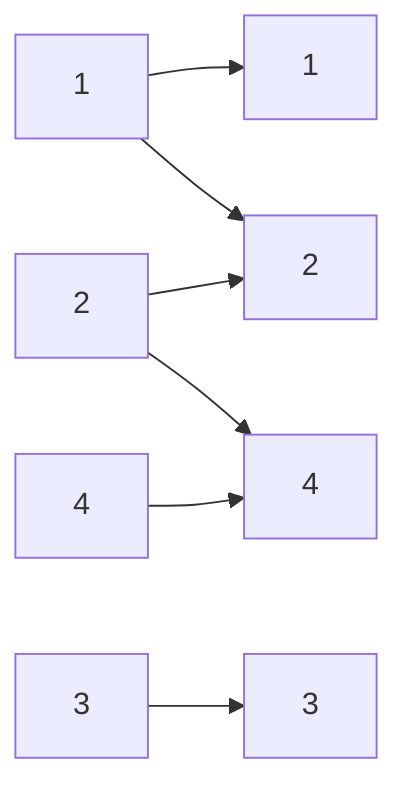

# Concept-Book Run

domain: /home/papagame/projects/digital-duck/cb-calculus/public/domains/calculus_ch01/input/graph.yaml
target: mathematical_model
started: 2026-11-24T06:03:46

## Teaching order (7 concepts)

- relation
- function
- polynomial_function
- slope
- linear_function
- quadratic_function
- mathematical_model

### relation (0.9s)

## 关系

**定义。** 设 $A$、$B$ 是两个集合。从 $A$ 到 $B$ 的**关系** $R$ 是笛卡尔积 $A\times B$ 的任意子集：

$$R\subseteq A\times B=\{(x,y)\mid x\in A,\ y\in B\}.$$

若 $(x,y)\in R$，记作 $xRy$，读作"$x$ 与 $y$ 有关系 $R$"。$A$ 称为**定义域所在集合**，$B$ 称为**陪域**。实际取到的第一分量集合 $\operatorname{dom}R=\{x\mid \exists y,\ (x,y)\in R\}$ 称为**定义域**，实际取到的第二分量集合 $\operatorname{ran}R=\{y\mid \exists x,\ (x,y)\in R\}$ 称为**值域**。若 $A=B$，称 $R$ 为 $A$ 上的关系。

注意：关系对"配对方式"没有任何限制。一个 $x$ 可以对应多个 $y$，也可以不对应任何 $y$。当每个 $x\in A$ 恰好对应一个 $y$ 时，关系才成为**函数**，所以函数是一种特殊的关系。

**例题。** 设 $A=\{1,2,3,4\}$，定义 $A$ 上的关系 $R=\{(x,y)\mid x\text{ 整除 }y\}$。

列出所有满足条件的有序对：

$$R=\{(1,1),(1,2),(1,3),(1,4),(2,2),(2,4),(3,3),(4,4)\}.$$

共 $8$ 个有序对，而 $|A\times A|=16$，所以 $R$ 是 $A\times A$ 的真子集。

读出性质：
- $\operatorname{dom}R=\{1,2,3,4\}$，$\operatorname{ran}R=\{1,2,3,4\}$。
- $1$ 对应 4 个 $y$，所以 $R$ **不是**函数。
- 对每个 $x$ 都有 $(x,x)\in R$（自反性）；$(1,2)\in R$ 但 $(2,1)\notin R$（非对称）。

**问题求解应用。** 

*问题：* 某课程中，$A=\{\text{小明},\text{小红},\text{小刚}\}$ 为学生集合，$B=\{\text{数学},\text{物理},\text{化学}\}$ 为课程集合。已知选课关系为
$$R=\{(\text{小明},\text{数学}),(\text{小明},\text{物理}),(\text{小红},\text{物理}),(\text{小刚},\text{化学})\}.$$
问：(1) 选修物理的学生有哪些？(2) $R$ 是否为从 $A$ 到 $B$ 的函数？(3) 若要使 $R$ 成为函数，最少需要删除几个有序对？

*解：*
1. 找出第二分量为"物理"的有序对：$(\text{小明},\text{物理})$ 与 $(\text{小红},\text{物理})$，所以是小明和小红。
2. 小明出现在两个有序对中，对应两门课，违反"每个 $x$ 恰好一个 $y$"，所以 $R$ 不是函数。
3. 其余学生都只对应一门课，只有小明重复。删除 $(\text{小明},\text{数学})$ 或 $(\text{小明},\text{物理})$ 中的任意一个即可，最少删除 $1$ 个。

**小结。** 判断一个集合是不是关系，只需检查它的元素是否都是 $A\times B$ 中的有序对。要判断它是否为函数，再检查每个 $x$ 是否恰有一个 $y$。把关系写成有序对列表，是后续研究自反、对称、传递等性质的起点。

*图示：集合 $\{1,2,3,4\}$ 上"整除"关系的部分箭头图（左列为 $x$，右列为 $y$），一个 $x$ 可指向多个 $y$。*

### function (0.8s)

## 函数

**定义。** 函数是一种规则:它把输入集合(**定义域**)中的每一个元素,恰好对应到输出集合中的一个元素。若输出集合记为 $Y$,实际取到的所有输出值构成**值域**。记作

$$f: X \to Y,\qquad x \mapsto f(x).$$

关键在于“恰好一个”:同一个输入不能同时得到两个不同的输出,但不同的输入可以得到相同的输出。

**判断是否为函数。** 
- 学号 $\to$ 学生姓名:每个学号对应唯一学生,是函数。 
- 关系 $x = y^2$(把 $x$ 看作输入):当 $x=4$ 时,$y=2$ 或 $y=-2$,输出不唯一,所以不是函数。 
- 竖直线检验:任意竖直线与图像至多相交一点,则该图像表示函数。

**例题。** 设 $f(x)=\dfrac{\sqrt{x-1}}{x-3}$,求定义域,并计算 $f(5)$。

*解:* 根号要求 $x-1\ge 0$,即 $x\ge 1$;分母要求 $x\ne 3$。因此定义域为

$$\{x\in\mathbb{R}\mid x\ge 1,\ x\ne 3\}=[1,3)\cup(3,+\infty).$$

代入 $x=5$:

$$f(5)=\frac{\sqrt{4}}{2}=1.$$

**问题求解应用。** 一家出租车公司起步价 8 元(含 3 公里),超出部分每公里 2 元。设行驶距离为 $d$ 公里,车费为 $C(d)$。

1. 写出规则(分段函数):

$$C(d)=\begin{cases}8, & 0<d\le 3,\\[2pt] 8+2(d-3), & d>3.\end{cases}$$

2. 每个距离 $d$ 只对应一个车费,所以 $C$ 是函数,定义域为 $(0,+\infty)$,值域为 $[8,+\infty)$。
3. 计算 $C(10)=8+2\times 7=22$ 元。
4. 反向提问:车费为 20 元时行驶了多远?解 $8+2(d-3)=20$,得 $d=9$ 公里。因为在 $d>3$ 的部分,不同距离对应不同车费,这样的反问才有唯一答案;但 $C(1)=C(2)=8$,所以“车费 8 元”无法确定具体距离。这说明:**函数保证由输入得到唯一输出,却不保证由输出能唯一还原输入**(后者需要函数是一一对应的,即可逆)。

**解题要点。** 面对一个函数问题,依次问三件事:(1)定义域是什么(分母不为零、偶次根号下非负、对数真数为正);(2)规则是否对每个输入给出唯一输出;(3)值域是什么、能否反推输入。

*图:函数把定义域中的每个输入经过规则 $f$ 变为唯一的输出,所有输出构成值域。*

