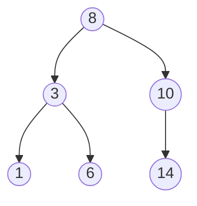

# Concept-Book Run

domain: /home/papagame/projects/digital-duck/cb-data-structure/public/domains/data_structure_ch14/input/graph.yaml
target: b_plus_tree
started: 2026-11-24T06:46:00

## Teaching order (5 concepts)

- binary_search_tree
- block_store
- external_memory_model
- b_tree
- b_plus_tree

### binary_search_tree (0.5s)

## Binary Search Tree

**Definition.** A *binary search tree* (BST) is a binary tree whose nodes store keys from a total order, such that for every node $x$ with key $k(x)$:

$$
\forall\, y \in \text{left}(x):\; k(y) < k(x), \qquad \forall\, z \in \text{right}(x):\; k(z) > k(x).
$$

The property applies to *entire subtrees*, not just immediate children. Assuming distinct keys, an inorder traversal (left, node, right) visits keys in sorted order, which is the structure's central consequence.

**Search and insertion.** To find key $q$, start at the root. If $q$ equals the node's key, stop. If $q$ is smaller, go left. Otherwise go right. Reaching a null link means $q$ is absent. Insertion follows the same path and attaches a new leaf at the null link where the search ended. Each step discards a whole subtree, so the cost is $O(h)$, where $h$ is the tree's height.

**Worked example.** Insert the keys $8, 3, 10, 1, 6, 14$ into an empty BST, in that order.

- $8$ becomes the root.
- $3 < 8$, so it goes left of $8$.
- $10 > 8$, so it goes right of $8$.
- $1 < 8$, then $1 < 3$, so it goes left of $3$.
- $6 < 8$, then $6 > 3$, so it goes right of $3$.
- $14 > 8$, then $14 > 10$, so it goes right of $10$.

*The BST after inserting 8, 3, 10, 1, 6, 14. Every left subtree holds smaller keys and every right subtree holds larger ones.*

Now search for $6$. Compare with $8$ and go left. Compare with $3$ and go right. Compare with $6$, which matches. That took 3 comparisons, not 6.

**Problem-solving application.** The height $h$ decides performance, and it depends on insertion order. Inserting $1, 3, 6, 8, 10, 14$ in sorted order produces a chain of height $n-1 = 5$, so search degrades to $O(n)$. A balanced tree on $n$ keys has height $\lceil \log_2(n+1)\rceil - 1$, giving $O(\log n)$. For random insertion orders, the expected height is $O(\log n)$. To avoid the worst case, self-balancing variants such as AVL and red-black trees restructure the tree during updates.

**Deletion** has three cases for the node $x$ being removed:

1. *Leaf:* remove it.
2. *One child:* replace $x$ with that child.
3. *Two children:* replace $k(x)$ with its inorder successor, which is the minimum of the right subtree. Then delete that successor, which has at most one child.

For example, deleting the root $8$ above replaces it with $10$, the minimum of its right subtree. The old $10$ node has only a right child, $14$, so $14$ takes its place. The result is still a valid BST.

**Check yourself.** If a tree of $n = 1000$ keys is perfectly balanced, search needs at most about $\lceil\log_2 1001\rceil = 10$ comparisons. If the same keys were inserted in sorted order, search could need up to $1000$. This gap is why balance matters in practice.

