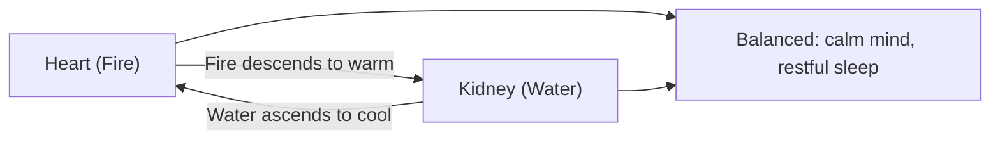
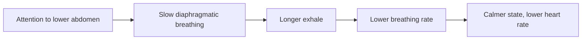
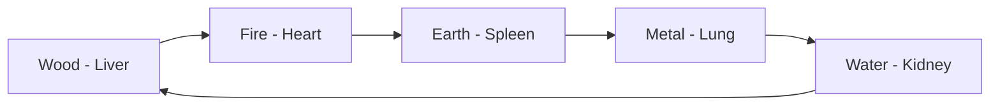
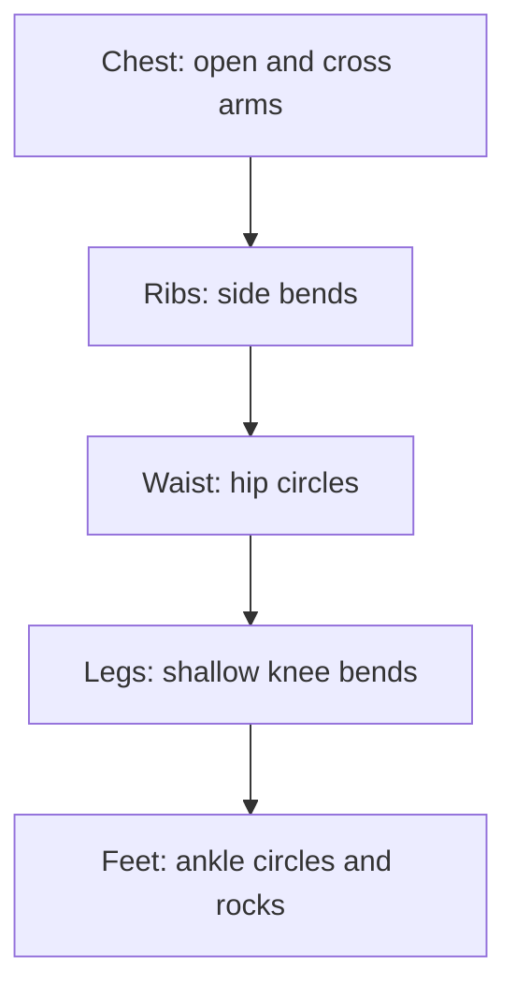

# Concept-Book Run

domain: /home/papagame/projects/digital-duck/cb-meta-health/public/domains/meta_health_ch03/input/graph.yaml
target: five_organ_routine_design
started: 2026-11-24T06:50:08

## Teaching order (24 concepts)

- five_phase_correspondences
- twelve_primary_meridians
- myofascial_lines
- skeletal_muscle_pump
- thoracic_mobility
- yongquan_point
- body_lifting_tishen
- diaphragmatic_breathing
- heart_kidney_interaction
- intra_abdominal_pressure
- squat_mechanics
- chest_expansion_kuoxiong
- deep_squat_shendun
- rib_fanning_shanlei
- torso_twist_niuzhuan
- five_organ_movement_matrix
- dantian
- generating_cycle_xiangsheng
- breath_first_sequence
- generating_cycle_sequence
- safe_practice_and_modification
- sealing_finish
- top_to_bottom_sequence
- five_organ_routine_design

### five_phase_correspondences (0.6s)

## Five-Phase Correspondences

**Definition.** In Traditional Chinese Medicine (TCM), the Five-Phase correspondence table (五行归类) sorts body parts, environmental conditions and mental states into five groups: Wood, Fire, Earth, Metal and Water. Each group collects items that TCM treats as sharing a characteristic pattern. The table is a classification scheme, not a measurement. Its use is to organize observations so a practitioner can reason from one known item to a related one.

| Phase | Organ (yin / yang) | Season | Emotion | Flavor | Tissue |
|---|---|---|---|---|---|
| Wood | Liver / Gallbladder | Spring | Anger | Sour | Sinews (tendons) |
| Fire | Heart / Small Intestine | Summer | Joy | Bitter | Vessels |
| Earth | Spleen / Stomach | Late summer | Pensiveness | Sweet | Muscle |
| Metal | Lung / Large Intestine | Autumn | Grief | Pungent | Skin |
| Water | Kidney / Bladder | Winter | Fear | Salty | Bones |

Read the table in two directions. Reading across a row gives everything TCM associates with one phase. Reading down a column shows how the five phases are ordered within one category, for example the sequence of seasons.

**Worked example.** A patient reports repeated muscle cramps and sore tendons, which worsen every spring, along with frequent irritability.

1. Tissue: tendons fall in the Wood row.
2. Season: spring is also in the Wood row.
3. Emotion: irritability is a form of anger, again Wood.
4. Organ: the row points to the Liver.

Three independent clues land in the same row. In TCM reasoning, that agreement makes the Liver the leading suspect, and a practitioner would examine it first. In modern terms, this works as a **memory and triage aid**: the row organizes a set of observations into one working hypothesis.

**Problem-solving application.** Try a second case. A person has recurring skin dryness and frequent colds, and they feel low each autumn.

- Skin points to Metal.
- Autumn points to Metal.
- Grief or low mood points to Metal.
- The row names the Lung.

Notice what the table does and does not do. It generates a hypothesis quickly, but it does not confirm one. A modern clinician would test the same case with measurable data. Examples are a spirometry reading for lung function, a blood panel, or a skin examination for eczema. Dry skin and frequent colds in autumn have well-understood causes, such as low humidity and seasonal viral circulation, that need no organ correspondence.

**Evidence status.** The correspondences are a traditional classification. Controlled studies have not shown that the associations (for example, sour flavor strengthening the Liver, or grief damaging the Lung) predict disease or treatment outcomes. Treat the table as a cultural and historical framework for understanding TCM texts and practice. Do not use it as a substitute for diagnosis.

**Check yourself.** Using the table, which phase links the Kidney, winter, fear, the salty flavor and bones? (Water.) Then name one measurable test that could check a kidney concern independently of the table. (For example, serum creatinine or estimated glomerular filtration rate.)

### twelve_primary_meridians (1.5s)

## The Twelve Primary Meridians

**Definition.** In Traditional Chinese Medicine (TCM), the twelve primary meridians (十二经脉) are the main channels along which qi is said to circulate through the body. Each meridian is named for three things: the limb it runs along (hand or foot), its yin or yang character, and the organ system it is linked to. Six run along the arms (hand meridians) and six along the legs (foot meridians). Meridians are a traditional framework for locating acupuncture points, and they do not correspond to any anatomical structure that dissection or imaging has identified. Their use as a map is practical, but evidence for the underlying "qi flow" is lacking.

**Organization by pattern.** TCM groups the twelve into six yin–yang pairs. Yin meridians run mainly along the inner (front-medial) surface of the limbs, and yang meridians along the outer (back-lateral) surface.

| Limb | Yin meridians (inner surface) | Yang meridians (outer surface) |
|---|---|---|
| Arm | Lung, Pericardium, Heart | Large Intestine, Triple Burner, Small Intestine |
| Leg | Spleen, Liver, Kidney | Stomach, Gallbladder, Bladder |

In TCM, the meridians are described as connected in a continuous sequence, starting with the Lung meridian and ending with the Liver meridian, which then links back to the Lung. Along the way, the direction of travel follows a pattern. Arm yin meridians run from the chest to the hand. Arm yang meridians run from the hand to the head. Leg yang meridians run from the head to the foot. Leg yin meridians run from the foot to the chest.

**Worked example: tracing the Large Intestine meridian.** Suppose a student wants to understand why the point called LI4 (between the thumb and index finger) is used for headaches and facial complaints.

1. The Large Intestine meridian is an arm yang meridian, so it runs along the outer arm.
2. It begins at the tip of the index finger.
3. It passes through the web between thumb and index finger, which is where LI4 sits.
4. It climbs the outer forearm and upper arm to the shoulder and neck.
5. It ends beside the nose.

The path reaches the face, so TCM predicts that points along it can affect the face. This is a reasoning pattern from the map, not a proven mechanism. Clinical trials of acupuncture for headache show modest benefit that is hard to separate from placebo effects.

**Problem-solving application.** The map becomes useful when you work backward from a symptom to a meridian path. Suppose a patient reports pain running down the outer side of the leg from the hip to the fourth toe. Use these steps:

1. Identify the surface. Outer-lateral means a yang meridian.
2. Identify the limb. Leg means a foot meridian.
3. Choose from the three leg yang options. The Gallbladder runs along the lateral side of the leg and ends at the fourth toe, so it fits.

This approach reproduces the standard TCM reading of such pain. Note that it is a naming exercise. A clinician would also rule out conventional causes, since pain down the outer leg is often explained by nerve compression in the lower back (sciatica), which is a diagnosis with a clear anatomical basis.

**Check yourself.** A pain follows the inner surface of the arm to the little finger. Which meridian does TCM assign to it? (Answer: the Heart meridian, an arm yin meridian.)

### myofascial_lines (0.6s)

## Myofascial Lines

**Definition.** Fascia is the connective tissue that wraps muscles, bones, nerves, and organs. In the myofascial lines model, popularized by Thomas Myers in *Anatomy Trains*, muscles are not treated as isolated units. Instead, they are grouped into continuous chains, called lines, in which muscle and fascia link end to end. Tension or restriction in one part of a line can, in this model, influence movement elsewhere along it. Three lines are common examples:

| Line | Path (approximate) | Main movement role |
|---|---|---|
| Superficial back line | Plantar fascia → calf → hamstrings → sacral fascia → spinal erectors → scalp | Keeps the body upright; extends the trunk and hips |
| Lateral line | Outer ankle → side of the leg → IT band → side of the trunk → neck | Stabilizes the body side to side |
| Spiral line | Skull → opposite shoulder → across the ribs → same-side hip → front of the shin → arch of the foot | Rotates and balances the trunk and hips |

A note on evidence: the lines match real dissection patterns in some places, such as the continuity of the hamstring, sacrotuberous ligament, and erector spinae fascia. Whether they work as force-transmitting "trains" in living people is still being studied, so treat the model as a useful map for finding where to look, not as proven mechanics.

**Worked example.** A runner reports tight hamstrings. She has stretched them for weeks with little change. A line-based screen starts by measuring something simple, the sit-and-reach test, and then adds a second measurement along the same line. She does a standing toe touch and records how far her fingertips are from the floor: 12 cm. Next, she rolls the sole of her foot on a ball for 2 minutes per side and repeats the test. Her reach improves to 7 cm, a gain of $12 - 7 = 5$ cm, without any hamstring stretching.

This result fits the superficial back line idea, because the plantar fascia lies on the same chain as the hamstrings. A single before-and-after test can't separate this from a general warm-up effect, though. A fair check would repeat the test after 2 minutes of easy walking and compare the two gains.

**Problem-solving application.** Use the lines as a hypothesis generator in three steps:

1. **Locate the complaint.** Note where the pain or stiffness is, and which movement provokes it.
2. **Trace the line.** Ask which other regions lie on the same line. Pain along the outer thigh when running, for example, may relate to the lateral line, so the hip abductors, the IT band, and the ankle are all candidates.
3. **Test, don't assume.** Pick one measurable outcome, such as reach distance, single-leg balance time in seconds, or a pain score from 0 to 10. Change one thing at a time and re-measure.

*Practice problem:* A cyclist has right-sided low back tightness and a rotational imbalance, with her torso turning farther to the left than to the right. Which line would you examine first, and what two regions along it, away from the back, would you test? (One reasonable answer: the spiral line, since it crosses the trunk diagonally. Test the opposite-side hip and the front of the shin or foot arch, then compare rotation range in degrees before and after.)

If the measurements don't change, the line hypothesis is not supported for that person, and you should look for other explanations, such as joint mobility, muscle strength, or training load.

### skeletal_muscle_pump (0.6s)

## The Skeletal-Muscle Pump

**Definition.** The skeletal-muscle pump is the mechanism by which contracting leg muscles, especially the calf, squeeze the deep veins and push blood back toward the heart. Veins in the legs carry blood upward against gravity, but they have little muscle of their own and operate at low pressure. Two features make the pump work. First, the deep veins run inside muscle compartments wrapped in tough fascia, so a contracting muscle compresses them. Second, the veins contain one-way valves that let blood move only toward the heart. When the muscle contracts, blood is squeezed upward through the next valve. When it relaxes, the valve below closes, so blood cannot fall back, and the emptied vein refills from the superficial veins and capillaries.

**Why it matters.** Standing still, the column of blood between heart and ankle creates a hydrostatic pressure of roughly 80–100 mmHg in the ankle veins. Walking drops ankle venous pressure to about 20–30 mmHg, because each calf contraction empties the veins. The calf is often called the "peripheral heart" for this reason.

**Worked example.** Suppose each calf contraction ejects about 40 mL of blood from the deep veins of one leg. You walk at a pace of 100 steps per minute, so each leg contracts 50 times per minute.

Volume moved per leg:

$$40\ \text{mL} \times 50\ \text{min}^{-1} = 2000\ \text{mL/min} = 2\ \text{L/min}$$

Both legs together move about 4 L/min. Resting cardiac output is about 5 L/min, so the pumps in the legs can return a large share of the circulating volume during walking. This is an illustration with assumed numbers. Actual ejection volumes vary with the person, the muscle, and the exercise.

**Problem-solving application.** Consider a 45-year-old passenger on a 10-hour flight who sits motionless with knees bent.

1. *Identify the failure.* With no contractions, the pump stops. Blood pools in the leg veins, and ankle pressure stays near the standing value.
2. *Predict the consequences.* Pooling raises capillary pressure, so fluid leaks into the tissue and the ankles swell. Slow flow also raises the risk of deep vein thrombosis (a clot in a deep vein).
3. *Choose an intervention.* Any action that contracts the calf works: ankle pumps (alternating toe-up and toe-down), calf raises while standing in the aisle, or a walk every one to two hours. Compression stockings add external pressure that helps the valves work and limits pooling.

The same reasoning explains why people who stand still for long periods, such as soldiers on parade, sometimes faint. Pooled blood lowers venous return, which lowers cardiac output and blood pressure. Shifting weight or flexing the calves restores return.

**Valve failure.** When the valves are damaged, as in chronic venous insufficiency, blood flows backward on relaxation and the pump loses efficiency. The result is varicose veins, chronic swelling, and sometimes skin ulcers near the ankle. Treatment combines compression, regular walking, and sometimes procedures that close or remove the failing veins.

**Key point.** Muscle contraction supplies the force, and the valves supply the direction. If either is missing, venous return suffers.

### thoracic_mobility (0.6s)

## Thoracic Mobility

**Thoracic mobility** is the ability of the thoracic spine (the 12 vertebrae of the upper and mid back) and the attached rib cage to move through three kinds of motion:

- **Extension:** arching backward, which opens the front of the chest.
- **Rotation:** twisting about the long axis of the spine.
- **Side-bending (lateral flexion):** leaning sideways.

The thoracic spine is built for rotation more than the lumbar spine is. The ribs and sternum add stability, but they also limit motion, so the thoracic region is often stiff in people who sit for long periods. Typical thoracic rotation is roughly 30–40° to each side, and total thoracic extension is small, often only 20–25°.

### Worked example

A student sits at a desk for 6 hours a day and notices that raising their arms overhead makes the lower back arch. They test **seated rotation** by crossing their arms over their chest, keeping the hips facing forward, and turning as far as they can.

- Right: about 20°
- Left: about 35°

The right side is 15° short of the left, and both sides fall below the typical range. The test shows a mobility limit in the thoracic spine. Nothing in it points to a strength problem.

### Problem-solving application

The key skill is **finding where a movement limit actually sits** before choosing an exercise. The thoracic spine, lumbar spine, and shoulder blades share many movements, so a stiff thoracic region often shows up as extra motion somewhere else.

| Observation | Likely compensation | Possible thoracic cause |
|---|---|---|
| Lower back arches during an overhead press | Lumbar extension replaces thoracic extension and shoulder flexion | Limited thoracic extension |
| Golf or tennis swing feels restricted, and the hips over-twist | Hip and lumbar rotation make up the difference | Limited thoracic rotation |
| Neck and shoulders ache after desk work | The neck extends to keep the eyes level | Stiff, flexed upper back |

**Applying it:**

1. **Screen** each direction separately, as in the seated rotation test, and compare the left and right sides.
2. **Isolate** the thoracic spine in the drill. Rotating from a quadruped (hands-and-knees) position with one hand behind the head, or lying over a foam roller to extend the upper back, limits movement at the lumbar spine and hips.
3. **Pair it with breathing.** Because the ribs move with each breath, slow exhalation at the end of a stretch can help the rib cage move further.
4. **Retest** after 2–4 weeks of regular practice. A gain of 5–10° in the limited direction is a reasonable first goal.

Stretching is not always appropriate. Sharp pain, numbness, or pain on deep breathing is a reason to see a clinician. It is not a reason to push harder.

### yongquan_point (0.5s)

## The Yongquan Point (涌泉, KI-1)

**Definition.** Yongquan (涌泉, "bubbling spring"), also called KI-1, is the first point on the Kidney meridian in Traditional Chinese Medicine (TCM). It lies on the sole of the foot, in the depression that forms when the toes curl, roughly at the junction of the front one-third and rear two-thirds of the line from the base of the second toe to the heel. TCM holds that qi rises from this point like water welling up from a spring and travels up the leg. Practices linked to it include rising onto the toes and landing on the heels, massaging the sole, and warm foot soaks. There is no anatomical structure called a "meridian", and the clinical benefits claimed for stimulating the point are not established by good trials. What you can measure is the physical effect of the movement itself.

**Worked example: the heel-drop exercise.**
1. Stand with feet hip-width apart, holding a wall or chair for balance.
2. Rise onto the balls of your feet over about 2 seconds, so the calf muscles (gastrocnemius and soleus) contract.
3. Pause for 1 second.
4. Lower your heels gently to the floor over about 1 second.
5. Repeat 20 times, which takes roughly 80 seconds at 4 seconds per repetition.

The sole is loaded with each landing, and it receives pressure from the floor and from the plantar fascia as the arch flexes. The calf muscle pump also works against gravity. With each contraction, the calf muscles squeeze the deep veins and push blood toward the heart. For comparison, a typical resting heart rate is 60 to 100 beats per minute. Moderate calf exercise like this raises circulation to the lower leg only modestly. It is not a substitute for aerobic exercise.

**Problem-solving application.** Suppose a student sits for about 6 hours a day studying and notices tired, heavy legs in the evening. Decide whether to use the exercise, and how.

*Step 1: Identify the plausible mechanism.* Long sitting reduces calf muscle pump activity, so blood may pool in the lower leg. Calf raises directly counter this.

*Step 2: Plan a dose.* Do 20 repetitions (about 80 seconds) once every hour. Over a 6-hour block, that is 6 sets, or about 8 minutes of total activity.

*Step 3: Add the TCM element if desired.* Press the Yongquan area with a thumb or a smooth ball for 1 to 2 minutes per foot. This is a safe foot massage that many people find relaxing, and relaxation is a real, if modest, benefit.

*Step 4: Check for cautions.* Skip the heel-drop exercise or consult a clinician if you have balance problems, foot or ankle injury, or numbness in the feet, as in diabetic neuropathy. People with diabetes should avoid hard pressure or hot soaks on insensitive skin. Also see a clinician for one-sided leg swelling or pain, which can signal a blood clot rather than ordinary fatigue.

**Takeaway.** The heel-drop exercise is cheap, low-risk, and mechanically useful for the calf pump. Its link to the Yongquan point, and to the Kidney meridian, rests on TCM theory rather than on demonstrated physiology.

### body_lifting_tishen (0.5s)

## Body Lifting (Tishen, 提身)

**Definition.** Body lifting is a standing movement in which you raise both arms overhead while rising onto the balls of the feet, lengthening the whole body upward, then lowering slowly. Physiologically, it combines a calf raise (plantarflexion at the ankle) with an overhead reach that extends the spine and stretches the shoulders and trunk. The muscles involved are the gastrocnemius and soleus in the calves, the spinal extensors, the gluteals and hamstrings (together with the calves, the "posterior chain"), and the shoulder flexors.

In TCM, the movement is associated with the Kidney (肾) system and the Water (水) phase. TCM holds that it stretches the back line of the body, which it describes as running along the Bladder meridian, and that it stimulates Yongquan (KI-1) on the sole, the point at the root of the Kidney meridian. These are traditional frameworks, not measured anatomical findings. The physiological effects described here are what the exercise reliably does.

**The calf pump.** Venous blood in the legs returns to the heart against gravity. When the calf muscles contract, they squeeze the deep veins, and one-way valves push blood upward. Repeated calf raises therefore improve venous return, which is why the soleus is sometimes called the "second heart."

**Worked example.** A 70 kg student does 15 slow body lifts, each raising the heels about 8 cm, with the full body weight on the toes. The work per repetition is the weight lifted through the height. Take $g = 9.8\ \text{m/s}^2$ and treat the whole body as lifted by 0.08 m:

$$W = mgh = 70 \times 9.8 \times 0.08 \approx 55\ \text{J}$$

Over 15 repetitions this is about 820 J, or roughly 0.2 kcal (1 kcal = 4184 J). The energy cost is negligible. The value of the exercise lies in circulation, balance, and mobility, not calorie burning.

**Problem-solving application.** Suppose an office worker sits for six hours and complains of heavy, tired legs and stiff shoulders by late afternoon. Apply body lifting as a break:

1. Stand behind the chair for balance, feet hip-width apart.
2. Inhale, reach both arms overhead, and rise onto the toes over 3 seconds.
3. Hold for 1–2 seconds, keeping the knees soft and the ribs from flaring.
4. Exhale and lower over 3 seconds.
5. Repeat 8–10 times every hour or two.

Each repetition activates the calf pump, and the overhead reach counters the forward-rounded posture of desk work. Reasoning through the mechanics also shows who should adapt the movement. Someone with poor balance should keep a hand on a wall. Someone with an ankle injury should lower the range, and someone with unmanaged hypertension should avoid breath-holding.

**Check your understanding.** Why does a slow lowering phase train the calves more than dropping quickly? (Hint: the muscle lengthens under load, which is an eccentric contraction.) And why does the calf pump matter more during long periods of standing than during walking?

### diaphragmatic_breathing (0.6s)

## Diaphragmatic Breathing

**Definition.** Diaphragmatic breathing (also called belly breathing) is a breathing pattern in which the diaphragm, the dome-shaped muscle beneath the lungs, does most of the work. On inhalation the diaphragm contracts and flattens, moving downward. This enlarges the chest cavity and draws air into the lower lungs. The abdomen rises as the organs beneath are pushed out of the way. On exhalation the diaphragm relaxes and rises. Shallow chest breathing relies more on the rib muscles and upper chest, and it moves less air per breath.

**Why it affects the nervous system.** Slow, deep breathing increases vagal tone. The vagus nerve is the main parasympathetic pathway to the heart. Heart rate speeds up slightly during inhalation and slows during exhalation, a pattern called respiratory sinus arrhythmia. Slow breathing at about 6 breaths per minute makes this swing larger. In practice this tends to lower heart rate and blood pressure a little, and many people report feeling calmer. Controlled studies show modest benefits for stress and anxiety. They do not show that it treats disease.

**Worked example.** Compare two breathing patterns, assuming the same breathing rate and an airway dead space of 150 mL. Alveolar ventilation is

$$\dot V_A = (V_T - V_D)\times f$$

where $V_T$ is tidal volume, $V_D$ is dead space volume, and $f$ is breaths per minute.

- Shallow chest breathing: $V_T = 300$ mL at $f = 15$ breaths per minute gives $\dot V_A = (300-150)\times 15 = 2250$ mL/min.
- Diaphragmatic breathing: $V_T = 500$ mL at $f = 15$ breaths per minute gives $\dot V_A = (500-150)\times 15 = 5250$ mL/min.

Deeper breaths more than double the fresh air reaching the alveoli. The reason is that the fixed dead space is a smaller fraction of each breath.

Now slow the rate to $f = 6$ with $V_T = 750$ mL. Then $\dot V_A = (750-150)\times 6 = 3600$ mL/min. This is still more than shallow breathing delivers, and it uses fewer, slower breaths.

**Problem-solving application.** Suppose a student feels their heart pounding before an exam and wants to settle down. A practical routine:

1. Sit or lie down with one hand on the chest and one on the abdomen.
2. Inhale through the nose for about 4 seconds so that the lower hand rises more than the upper hand.
3. Exhale slowly through pursed lips for about 6 seconds.
4. Repeat for 5 minutes, which is about 30 breaths at 6 breaths per minute.

To check that the method works, measure pulse before and after. If the resting pulse falls from 92 to 84 beats per minute, the change is $92-84 = 8$ beats per minute. Try the routine on several days to see whether the effect is consistent.

The hand placement gives feedback on technique. If the upper hand moves more, the pattern is still chest-dominant. Slow the breath and let the abdomen expand first.

*Caution:* Breathing too fast or too forcefully can cause lightheadedness through excessive carbon dioxide loss. Stop and breathe normally if this happens. People with lung or heart conditions should check with a clinician before using prolonged breath-control exercises.

### heart_kidney_interaction (0.5s)

## Heart–Kidney Interaction (心肾相交)

**Definition.** In Traditional Chinese Medicine (TCM), the Heart is associated with "Fire" (warmth, activity, mental alertness) and the Kidney with "Water" (cooling, storing, resting). TCM holds that a healthy body keeps the two in communication: Heart Fire descends to warm the Kidney, and Kidney Water ascends to cool and nourish the Heart. This two-way exchange is called Heart–Kidney interaction (心肾相交). TCM describes its failure, "Heart and Kidney not interacting" (心肾不交), as a pattern of insomnia, restlessness, palpitations, night sweats, and lower-back soreness. Note that "Heart" and "Kidney" here are functional systems in TCM, not the same as the anatomical organs of physiology. This idea is a traditional framework; it is not an established physiological mechanism, and modern evidence for treatments based on it is limited.

**Worked example.** Consider a 28-year-old graduate student during exam season. They sleep about 4.5 hours a night, drink 4 cups of coffee (roughly 400 mg of caffeine), and describe the following:

| Observation | TCM reading |
|---|---|
| Lies awake with a racing mind | Heart Fire is not descending |
| Wakes at 3 a.m. feeling hot, with night sweats | Kidney Water is too depleted to cool the Heart |
| Dull lower-back ache | Kidney weakness |
| Dry mouth, red tongue tip | Excess heat above |

In TCM, the practitioner would describe this as 心肾不交: the "upper" system runs hot while the "lower" system is depleted, so the two fail to meet.

**Problem-solving application.** Suppose you want to turn this framework into a practical plan. The useful step is to translate each observation into a measurable, testable behavior, as follows.

1. *Identify the modern analogue.* The pattern resembles sleep restriction combined with sympathetic nervous system activation. Caffeine has a half-life of about 5 hours, so 400 mg taken through the day still leaves roughly 100 mg in the body about 10 hours after the last dose.
2. *Choose interventions that address the pattern.* A TCM practitioner might suggest calming practices and herbal formulas aimed at "calming the Heart and nourishing the Kidney." A physiology-based plan would cut caffeine after noon, fix a consistent bedtime, and wind down with slow breathing, which lowers heart rate and sympathetic tone.
3. *Track outcomes.* Record sleep duration, time to fall asleep, and morning resting heart rate for two weeks. If sleep rises from 4.5 to 7 hours and resting heart rate drops by 5 to 8 beats per minute, the plan is working, whichever vocabulary you use to explain it.
4. *Know when to escalate.* Persistent night sweats, palpitations, or back pain can signal thyroid disease, anxiety disorders, diabetes, or kidney disease. These need medical evaluation and should not be attributed to a "pattern" alone.

*In TCM, Heart Fire descends and Kidney Water ascends; when this exchange is intact, sleep and mood are settled.*

**Key takeaway.** Heart–Kidney interaction is a TCM way of describing a cluster of symptoms: an overactive, restless "upper" state alongside a depleted "lower" one. Its practical value is as a prompt to examine sleep, stimulants, and stress, and to rule out medical causes, not as a literal account of organ physiology.

### intra_abdominal_pressure (0.5s)

## Intra-Abdominal Pressure

**Definition.** Intra-abdominal pressure (IAP) is the pressure inside the abdominal cavity, created by the abdominal organs and fluid being enclosed by the diaphragm above, the abdominal wall muscles in front and at the sides, the spine and pelvis behind, and the pelvic floor below. It is measured in millimetres of mercury (mmHg). At rest, a healthy adult lying down has an IAP of roughly 0–5 mmHg, close to atmospheric pressure. The abdomen behaves like a closed, fluid-filled container: squeeze any wall of it and the pressure rises everywhere inside.

**How breathing and trunk movement change it.** Two main mechanisms act on this container.

- **Breathing.** On inhalation the diaphragm contracts and descends, which reduces the cavity's volume and raises IAP slightly. On exhalation the diaphragm relaxes and rises, and IAP falls back.
- **Trunk muscle activity.** The transversus abdominis, obliques, and rectus abdominis squeeze the cavity from the front and sides. The pelvic floor pushes up from below. When these muscles contract together with the diaphragm, IAP rises sharply.

The sharp rise helps the spine. A pressurized abdomen acts like a semi-rigid cylinder that supports the lumbar spine from the front and shares part of the load with the back muscles. This is why lifters brace before a heavy lift.

**Worked example.** Quiet breathing changes IAP by only a few mmHg. Coughing or sneezing can push it above 100 mmHg for a moment, and a maximal Valsalva maneuver (forced exhalation against a closed airway) or a heavy squat can push it higher. Compare three situations:

| Situation | Approximate IAP |
|---|---|
| Lying at rest, quiet breathing | 0–5 mmHg |
| Standing, light walking | 5–20 mmHg |
| Coughing or heavy lifting with bracing | 80–150+ mmHg |

These are typical ranges, not exact values. They vary with body size, posture, and technique.

**Problem-solving application.** Suppose a person lifts a 60 kg box from the floor. Two approaches are possible.

1. *No bracing.* They exhale as they pull, the abdominal wall stays slack, and IAP stays low. The back muscles carry most of the load, and the spine is less supported.
2. *Bracing.* They take a breath, tighten the abdominal wall and pelvic floor together, and keep the trunk firm. IAP rises, and the spine is better supported.

Bracing has costs. High IAP also raises pressure in the chest and veins, so it temporarily raises blood pressure and can strain the pelvic floor. People with hypertension, hernias, or pelvic floor weakness should get individual medical advice before doing heavy straining lifts. Holding the breath through a whole set is not required. Many trainers teach breathing out through the sticking point, with the trunk still braced.

Clinically, abnormally high IAP, sustained at 12 mmHg or more, can reduce blood flow to the abdominal organs and kidneys. Above about 20 mmHg with new organ failure, it is called abdominal compartment syndrome, a medical emergency. This is a pathological state that occurs after trauma, major surgery, or severe illness. It is not the brief, healthy spike that bracing produces.

**Check your understanding.** Why does a cough raise IAP much more than quiet breathing does? (Hint: which muscles are involved, and is the airway open or closed?)

### squat_mechanics (0.6s)

## Squat Mechanics

**Definition.** A squat is a movement in which the hips, knees, and ankles flex together to lower the body, then extend together to raise it, while the trunk stays stable. Each joint contributes: the hip flexes (the thigh moves toward the torso), the knee flexes (the shin and thigh fold), and the ankle dorsiflexes (the shin tilts forward over the foot). The trunk, which includes the spine and core muscles, acts as a rigid link that transfers force between the legs and the load. A good squat depends on the joints moving in coordination. Maximal motion at one joint is not the goal.

**Key mechanical ideas.**

- **Balance over the midfoot.** The combined center of mass, including any barbell, must stay over the middle of the foot. If it drifts toward the toes or heels, the lifter tips or must compensate.
- **Knee tracking.** The knees follow the direction of the toes. Collapsing inward adds stress to the knee ligaments.
- **Neutral spine.** The back keeps its natural curves instead of rounding under load.
- **Moment arms.** Torque at a joint equals force times the perpendicular distance from the joint to the line of the load. Leaning the trunk forward lengthens the distance at the hip. Letting the knees travel forward lengthens it at the knee.

**Worked example.** A lifter holds a 60 kg barbell. The load acts through the midfoot, and the horizontal distance from the hip joint to that line is 0.20 m when the trunk leans forward. The torque the hip extensors must produce to support the bar is

$$\tau = F \cdot d = (60 \times 9.8\ \text{N})(0.20\ \text{m}) \approx 118\ \text{N·m}.$$

If the lifter stays more upright and the distance falls to 0.12 m, the torque becomes

$$\tau = (588\ \text{N})(0.12\ \text{m}) \approx 71\ \text{N·m}.$$

The bar weighs the same in both cases, but the posture changes which muscles carry the demand. A more upright trunk shifts work from the hips toward the knees. A forward lean does the opposite. Neither posture is wrong. Which one is appropriate depends on body proportions and the goal.

**Problem-solving application.** Mechanics can be used to diagnose common faults.

| Observation | Likely cause | Adjustment |
|---|---|---|
| Heels lift off the floor | Limited ankle dorsiflexion | Elevate the heels slightly, or use mobility work |
| Lower back rounds at the bottom ("butt wink") | Hip range of motion reached before the depth target | Reduce depth, or widen the stance |
| Knees cave inward | Weak hip abductors or poor motor control | Cue knees over toes, and use lighter loads |
| Torso collapses forward | Weak trunk or quadriceps relative to the hips | Reduce load, and add trunk and front-loaded squat work |

*Scenario:* A student's heels rise at 90° of knee flexion. Because the ankle cannot dorsiflex further, the shin stops tilting forward. To keep the center of mass over the foot, the student must either fall backward or lean the trunk forward and round the back. The fix targets the limiting joint, which here is the ankle. Lowering the weight would not address it.

**Check yourself.** If a lifter's hip distance doubles under the same load, what happens to the hip torque? (It doubles, since torque scales directly with distance.)

### chest_expansion_kuoxiong (0.5s)

## Chest Expansion (Kuoxiong, 扩胸)

**Definition.** Chest expansion is an exercise in which the arms are opened outward, usually from a position in front of the chest, so that the shoulders move backward and the chest widens. Physiologically, it stretches the pectoralis major and minor and mobilizes the intercostal muscles between the ribs. It also extends the thoracic spine slightly, which allows the rib cage to expand more during inhalation. In TCM, the movement is said to open the Lung meridian across the upper chest and to "draw in clear qi" (中医认为扩胸可以宣通肺经). That is a traditional description, not a measured mechanism. The physiological effects below are the ones you can measure.

**Why posture matters.** Hours of sitting or screen work pull the shoulders forward. This shortens the pectorals and limits how far the ribs can lift. Lung volume is the product of how much the thorax can enlarge, so a stiff chest wall reduces the volume of air you can move without any lung disease being present.

**Worked example.** A student sits at a desk for 6 hours and then does 3 sets of 10 chest expansions, with a 5-second hold at the end of each repetition.

1. Stand with the feet shoulder-width apart. Raise both arms to chest height with the elbows bent and the fists in front of the sternum.
2. Pull the elbows back and open the arms to the sides, keeping the shoulders down.
3. Inhale through the nose during the opening, and hold the stretch for 5 seconds.
4. Exhale slowly as the arms return.

Time per set is $10 \times (2 + 5 + 2)\ \text{s} = 90\ \text{s}$, assuming about 2 seconds each for opening and closing. Three sets take 270 seconds, or 4.5 minutes, which is short enough to repeat every hour of desk work.

**Problem-solving application.** A resting adult breathes with a tidal volume of about 500 mL at 12 breaths per minute. Minute ventilation is the product of the two:

$$\dot{V}_E = V_T \times f = 500\ \text{mL} \times 12\ \text{min}^{-1} = 6000\ \text{mL/min}$$

Suppose a slumped posture limits the chest wall so that deep breaths reach only 2.5 L. Opening the chest might raise that to 3.0 L. This is a plausible illustration, not a measured result. The extra 0.5 L is a 20% gain in available breathing range, which matters most during exercise, when tidal volume rises well above the resting 500 mL.

| Situation | Suggested use |
|---|---|
| Long sitting or studying | 1 set every hour as a break |
| Warm-up before running or swimming | 2 sets of 10 with a short hold |
| Shoulder pain or recent injury | Reduce the range, or ask a clinician first |

**Common mistakes.** Arching the lower back instead of opening the chest, shrugging the shoulders, and holding the breath all reduce the benefit. Keep the ribs stacked over the pelvis and the neck relaxed.

**Check your understanding.** If one repetition takes 8 seconds in total, how many repetitions fit into a 3-minute break? (Answer: $180 \div 8 = 22.5$, so 22 full repetitions.)

### deep_squat_shendun (0.5s)

## Deep Squat (Shendun, 深蹲)

### Definition

A deep squat is a lower-body exercise in which the hips and knees bend until the thighs reach or pass parallel with the floor, then extend to return to standing. It recruits the quadriceps, gluteus maximus, hamstrings, and adductors. These are among the largest muscles in the body, so even bodyweight squats demand substantial blood flow.

In Traditional Chinese Medicine (TCM), the deep squat is also associated with 引火归元 ("leading fire back to its source"). TCM holds that Heart Fire tends to rise, and that lowering the body's center of gravity draws it down to meet Kidney Water. This is a traditional framework, not a measured physiological mechanism. The physiological effects described below are what research actually supports.

### Physiology

Working leg muscles need more oxygen, so the heart pumps more blood per minute. Cardiac output is defined as

$$CO = HR \times SV$$

where $HR$ is heart rate (beats/min) and $SV$ is stroke volume (mL/beat). Contracting leg muscles also squeeze the deep veins, which returns blood to the heart (venous return). This raises stroke volume and helps push blood back up against gravity.

### Worked example

A student has a resting heart rate of 70 beats/min and a stroke volume of 70 mL/beat. Resting cardiac output is

$$CO = 70 \times 70 = 4900 \text{ mL/min} \approx 4.9 \text{ L/min}$$

After 20 continuous bodyweight squats, the student's heart rate is 120 beats/min and stroke volume is 85 mL/beat:

$$CO = 120 \times 85 = 10200 \text{ mL/min} \approx 10.2 \text{ L/min}$$

Cardiac output has roughly doubled (a factor of $10.2 / 4.9 \approx 2.1$). Heart rate rose by about 71%, and stroke volume rose by about 21%.

### Problem-solving application

**Problem.** You want a 3-minute squat session to reach a moderate-intensity heart rate. Estimate maximum heart rate as $HR_{max} \approx 220 - \text{age}$. Moderate intensity is 50–70% of $HR_{max}$. For a 20-year-old, what range should you aim for?

**Solution.** $HR_{max} \approx 220 - 20 = 200$ beats/min. The target range is

$$0.50 \times 200 = 100 \quad \text{to} \quad 0.70 \times 200 = 140 \text{ beats/min}$$

Check your pulse for 15 seconds right after a set and multiply by 4. If you read 30 beats in 15 seconds, that is 120 beats/min, which is inside the range. If you read 20 (80 beats/min), add repetitions or reduce rest.

**Practical notes.**

| Concern | Guidance |
|---|---|
| Form | Keep heels down, knees tracking over the toes, and spine neutral |
| Dizziness on standing | Rise slowly; blood pressure can drop briefly |
| Knee pain or hypertension | Reduce depth or consult a clinician first |

### Summary

The deep squat raises heart rate and venous return because it recruits very large muscles. TCM describes the same posture as leading Heart Fire down to Kidney Water, which is a traditional interpretation. You can track the measurable effects with pulse and cardiac output calculations.

### rib_fanning_shanlei (0.7s)

## Rib Fanning (Shanlei, 扇肋)

**Definition.** Rib fanning is a standing side-bend exercise. You raise one arm overhead, bend the trunk sideways, and let the lower ribs spread apart on the stretched side, like opening a hand fan. Anatomically, it lengthens the lateral line of the torso: the intercostal muscles between the ribs, the external and internal obliques, and the quadratus lumborum. It also expands the rib cage on the stretched side during inhalation. In Traditional Chinese Medicine (TCM), the flank region (the hypochondrium, 胁肋) is the pathway of the Liver meridian. TCM holds that opening this area frees Liver qi that has become stuck, a pattern called Liver qi stagnation (肝气郁结), which is associated with flank tightness, sighing, and irritability. The exercise is linked to the Liver (肝) and to Wood (木), the phase associated with stretching and upward growth. Evidence that it affects the Liver meridian is limited. The mechanical effects on mobility and breathing are well established.

**Worked example.** Stand with feet shoulder-width apart.

1. Inhale and raise the right arm overhead, palm facing the left.
2. Exhale and bend slowly to the left, keeping both hips level and the chest facing forward.
3. At the end of the bend, inhale into the right side of the ribs. You should feel the ribs widen and the skin along the flank draw upward.
4. Hold for 4 breaths, then return to standing on an inhale.
5. Repeat on the other side.

Suppose a slow breath cycle lasts 6 seconds. Four breaths per side is then 24 seconds. Three rounds on both sides is $24 \times 2 \times 3 = 144$ seconds, or about 2.4 minutes. That is short enough to fit into a work break.

**Problem-solving application.** Rib fanning is useful for stiffness that builds up during long sitting. Use the checks below to adjust the movement.

| Problem | Likely cause | Adjustment |
|---|---|---|
| Bending forward instead of sideways | Weak trunk control | Stand with your back and heels against a wall |
| Hips shift out to the side | Compensation for tight obliques | Reduce the range; keep the pelvis level |
| No ribs expansion felt | Shallow breathing | Place the free hand on the lower ribs and breathe into it |
| Pinching at the low back | Over-bending | Stop at mild stretch and lift the arm higher |

*Scenario:* An office worker reports a tight right flank by mid-afternoon and shallow breathing. Seated for 6 hours, they have shortened the lateral trunk muscles on that side. Prescribe 3 rounds of rib fanning, with the stretch directed at the tight side first. Then compare comfort and ease of deep breathing before and after. If the stretch causes sharp pain, numbness, or breathlessness, stop and seek medical advice, because persistent flank pain can have causes unrelated to muscle tension, including kidney, gallbladder, or lung conditions.

### torso_twist_niuzhuan (0.5s)

## Torso Twist (Niuzhuan, 扭转)

**Definition.** A torso twist is a controlled rotation of the thoracic and lumbar spine about the vertical axis, with the hips kept roughly fixed and the shoulders turning to one side and then the other. Each rotation shortens the muscles on one side of the trunk (the obliques, deep spinal rotators, and rectus abdominis) and lengthens those on the other side. It also changes the pressure in the abdominal cavity and stretches the thoracolumbar fascia, the sheet of connective tissue across the lower back. In TCM (Traditional Chinese Medicine), this movement is associated with the Spleen (脾) and the Earth (土) phase. TCM holds that twisting "wrings out" the middle burner (中焦) and supports the Spleen's transformation (运化) of food. Physiologically, the best-supported effects are on spinal mobility and trunk muscle activation. An effect on gut motility is plausible, since the abdomen is alternately compressed and released, but it has been little studied.

**Worked example.** Take a standing torso twist done for one minute at a steady tempo.

- Stand with feet shoulder-width apart and knees slightly soft.
- Let the arms hang loosely and rotate the trunk about 45° to the right, then about 45° to the left.
- Allow the hips to turn slightly, but keep the pelvis mostly facing forward.
- Count one full cycle (right and left) every 3 seconds.

In one minute that gives $\frac{60}{3} = 20$ cycles, or 40 individual rotations. Light twisting like this costs roughly 2–3 METs (metabolic equivalents), similar to a slow walk. For a 70 kg person, energy use is approximately

$$
\text{kcal} \approx \text{MET} \times \text{body mass (kg)} \times \text{time (h)} = 2.5 \times 70 \times \frac{1}{60} \approx 2.9 \text{ kcal}.
$$

The calorie cost is small. The main value of the movement is mobility and gentle abdominal activation.

**Problem-solving application.** Suppose a desk worker has stiff lower-back muscles and feels sluggish after lunch. Work through the options:

1. *Check for contraindications first.* Acute disc herniation, recent abdominal surgery, osteoporosis with vertebral fracture risk, and pregnancy all call for medical advice before twisting.
2. *Choose a safe range.* Rotate from the thoracic spine, which rotates more freely, rather than forcing the lumbar spine, which has limited rotation. Stay within a pain-free range.
3. *Set a dose.* Do 10 to 20 cycles at a slow tempo, 1 to 3 times a day. Starting this on a short walk after a meal is a reasonable choice, since light walking itself is known to help gastric emptying.
4. *Judge results realistically.* Expect improvements in back stiffness and range of motion within a few weeks. Treat any digestive benefit as a possible bonus and track it yourself, for example by noting bloating or regularity in a simple log.

This approach separates what is well established (mobility, muscle activation) from what is only plausible (gut motility). That lets you use the exercise for its dependable benefits without relying on unproven digestive claims.

### five_organ_movement_matrix (0.6s)

## The Five-Organ Movement Matrix

The five-organ movement matrix collects five exercises into one reference table. Each row links a **movement**, its **main physical action**, a **target organ**, a **phase**, and the **proposed mechanism** (a meridian in TCM, or a physiological effect in modern terms). Traditional Chinese Medicine (TCM) pairs each organ with one of the Five Phases. The physiological column is what you can measure or feel, such as breathing depth, spinal mobility, or heart rate.

| Movement | Main physical action | Target organ | Phase (TCM) | Meridian (TCM) / physiological mechanism |
|---|---|---|---|---|
| Overhead arm raise with deep inhale | Chest expansion, shoulder opening | Lung | Metal | Lung meridian runs along the inner arm to the thumb. Physiologically, it increases tidal volume and stretches the intercostal muscles and pectorals. |
| Forward fold with slow exhale | Hip hinge, hamstring and lower-back stretch | Kidney | Water | Kidney meridian runs up the inner leg. Physiologically, it lengthens the posterior chain and promotes parasympathetic relaxation. |
| Torso twist with side bend | Rotation of the trunk | Liver | Wood | Liver meridian runs along the inner thigh and flank. Physiologically, it mobilizes the spine and ribs and stimulates abdominal circulation. |
| Chest-opening backbend | Thoracic extension | Heart | Fire | Heart meridian runs along the inner arm. Physiologically, it improves posture and rib-cage mobility, which helps deep breathing. |
| Seated forward reach or abdominal rotation | Core engagement, gentle abdominal compression | Spleen/stomach | Earth | Spleen meridian runs up the inner leg to the abdomen. Physiologically, it moves the abdominal wall and may aid gut motility. |

In TCM, the meridian and phase columns are a conceptual framework. No anatomical structure corresponding to meridians has been demonstrated. The physiological column is the one that holds up to testing: stretching, breathing, and spinal mobility are real, measurable effects.

### Worked example

Suppose a person reports stiffness in the upper back and shallow breathing after long hours at a desk. To use the matrix:

1. **Identify the physical complaint.** Upper-back stiffness and shallow breathing point to limited thoracic extension and chest expansion.
2. **Match it to rows.** The overhead arm raise with deep inhale (expands the chest) and the chest-opening backbend (extends the thoracic spine) both fit.
3. **Check the physiological mechanism.** Both movements stretch the pectorals and mobilize the rib cage, which directly counters a desk-hunched posture.
4. **Choose a dose.** For example, 8 slow repetitions of each, with each repetition lasting about 6 seconds, takes roughly $2 \times 8 \times 6 = 96$ seconds, or under 2 minutes.

### Problem-solving application

The matrix works as a lookup tool in either direction.

**From symptom to movement.** Lower-back tightness after sitting maps to the forward fold (posterior chain stretch). A stiff, rotation-limited torso maps to the twist and side bend.

**From movement to expected effect.** If a routine includes only the forward fold and the twist, the matrix shows that it addresses posterior chain and trunk rotation but does little for chest expansion. You could add the arm raise to fill that gap.

**Measuring outcomes.** Instead of relying on organ claims, track quantities you can observe. Examples are resting heart rate in beats per minute, how many seconds you can comfortably hold an exhale, or how far your fingertips reach toward the floor in a forward fold, in centimeters. If reach improves from 5 cm above the floor to 2 cm above it over four weeks, that is a measurable gain in hamstring and lower-back flexibility.

**Caution.** Claims that these movements directly treat organ disease are not supported by evidence. Use the matrix for mobility, breathing, and relaxation. People with osteoporosis, disc problems, or cardiovascular conditions should consult a clinician before backbends, deep folds, or twists.

### dantian (0.7s)

## Dantian (丹田)

**Definition.** In Traditional Chinese Medicine (TCM) and qigong, the *dantian* (丹田, literally "elixir field") is a region of the body where practitioners focus attention. The best known is the **lower dantian** (下丹田), located in the lower abdomen about three finger-widths below the navel and roughly one-third of the way into the body. It is not a discrete organ. Anatomists find no structure at this site, so it is better understood as a *focus point* than as a physical object. TCM holds that qi gathers and is stored here, and qigong teaches students to settle breath and attention at this spot. Two other dantian are described, the middle (chest) and upper (between the eyebrows), but the lower one is the starting point for beginners.

**Worked example: finding and using the lower dantian.**

1. Sit or stand with your feet shoulder-width apart and your knees slightly bent.
2. Place one hand flat on your lower abdomen, with your thumb at the navel. The center of your palm now rests near the dantian.
3. Breathe in slowly through the nose for about 4 seconds. Let the abdomen expand under your hand, not the chest. This is diaphragmatic breathing: the diaphragm contracts and moves downward, which pushes the abdominal contents outward.
4. Breathe out for about 6 seconds and let the abdomen soften.
5. Repeat for 10 breaths, keeping your attention on the warmth or movement under your palm.

At this pace you take about 6 breaths per minute ($60 \text{ s} \div 10 \text{ s per breath}$), compared with the typical resting rate of 12–20 breaths per minute.

**Problem-solving application.** Suppose a student is anxious before an exam and notices fast, shallow chest breathing. How could dantian practice help?

*Step 1: Identify the problem.* Chest breathing is shallow and fast, and it often accompanies the stress response.

*Step 2: Apply the technique.* Redirect attention to the lower abdomen and use the 4-second-in, 6-second-out pattern for two minutes. That is 12 breaths.

*Step 3: Check against measurable outcomes.* Count your breaths per minute, or measure your pulse before and after. Slow breathing with a longer exhale is associated with increased vagal activity and a modest drop in heart rate in many people. If your pulse fell from 90 to 80 beats per minute, that is a measurable change you can record.

*Step 4: Interpret carefully.* The physiological effects of slow abdominal breathing are well documented. The claim that qi accumulates in the dantian is a TCM concept that has not been verified by measurement. You can therefore use the practice for its demonstrated calming effect without needing to accept the qi explanation.

**Caution.** Stop and breathe normally if you feel dizzy or lightheaded. Anyone with a respiratory or cardiac condition should check with a clinician before changing their breathing pattern.

*Focusing on the lower dantian guides slow abdominal breathing, which is linked to measurable calming effects.*

### generating_cycle_xiangsheng (0.5s)

## The Generating Cycle (Xiangsheng, 相生)

**Definition.** In Traditional Chinese Medicine (TCM), the generating cycle (相生, *xiangsheng*) describes how each of the Five Phases "gives rise to" or nourishes the next, in a fixed order: Wood → Fire → Earth → Metal → Water, and then Water back to Wood. TCM calls the preceding phase the "mother" and the following phase the "child." Each phase therefore has exactly one mother and one child. The cycle is a classification scheme: it organizes organs, tissues, seasons, and clinical observations into a pattern that practitioners use to reason about how disturbance in one organ system might relate to another. It is not a physical law, and it makes no quantitative predictions.

**Organ correspondences.** TCM pairs each phase with a main organ system:

| Phase | Main organ (TCM sense) | Gives rise to |
|-------|------------------------|---------------|
| Wood | Liver | Fire |
| Fire | Heart | Earth |
| Earth | Spleen | Metal |
| Metal | Lung | Water |
| Water | Kidney | Wood |

These "organs" are functional systems defined by TCM, and they do not map exactly onto the anatomical organs of the same name.

**Worked example.** Suppose a patient reports poor appetite, bloating after meals, and fatigue, which TCM attributes to a weak Spleen (Earth). Using the generating cycle, a practitioner asks two questions:

1. *Who is the mother?* The mother of Earth is Fire (Heart). The "nourish the mother" principle suggests checking whether Heart function is contributing to the problem.
2. *Who is the child?* The child of Earth is Metal (Lung). TCM holds that a weak Earth can fail to support Metal, so the practitioner also asks about recurrent cough or frequent colds.

The cycle thus turns a single complaint into a short list of related questions to ask.

**Problem-solving application.** Apply the same two-step reasoning to a new case. A patient has dry cough, shortness of breath on climbing stairs, and also reports poor digestion. The Lung (Metal) has Earth (Spleen) as its mother. Step one: identify the affected phase (Metal). Step two: look one step back to its mother (Earth). The poor digestion becomes a meaningful clue rather than an unrelated symptom, and a TCM practitioner would treat the Spleen as well as the Lung. Notice the method is the same each time: name the phase, find its mother and its child, and check both.

**Evidence status.** The Five Phases framework is a traditional reasoning model. Clinical trials have not shown that treating a "mother" organ improves outcomes in the child organ, and the cycle does not correspond to established physiology. A cough with poor digestion can have many causes, so persistent symptoms should be evaluated with conventional medical tools such as history, examination, and testing.

*The generating cycle: each phase nourishes the next, and Water closes the loop by nourishing Wood.*

### breath_first_sequence (0.5s)

## The Breath-First Sequence

**Definition.** The breath-first sequence is an ordering of a five-part body-awareness routine that begins with the chest (Lung) and moves on from there. In Traditional Chinese Medicine (TCM), the five organ systems are arranged in a generating cycle, usually listed as Liver, Heart, Spleen, Lung, Kidney. The breath-first order is almost the same, with Lung and Liver swapped, so Lung comes first. Some popular teaching videos use this order. Its rationale is physiological, not traditional: breathing is the one autonomic function you can also control voluntarily, so it is a convenient entry point for calming the body.

**Why breathing works as the entry point.** Heart rate, digestion, and blood pressure run automatically. Breathing runs automatically too, but you can take it over at will. Slow, deliberate breathing increases vagal (parasympathetic) activity. This shows up as respiratory sinus arrhythmia, in which heart rate rises slightly on inhalation and falls on exhalation. Controlled breathing therefore lets you influence a system you cannot command directly. Starting here gives the later steps a calmer baseline.

**Worked example.** Compare two ways to run the routine.

| Step | Generating-cycle order | Breath-first order |
|------|------------------------|--------------------|
| 1 | Liver | Lung |
| 2 | Heart | Heart |
| 3 | Spleen | Spleen |
| 4 | Lung | Liver |
| 5 | Kidney | Kidney |

Only steps 1 and 4 differ. Suppose a student's resting heart rate is 84 beats per minute and they are anxious before an exam. In the breath-first order they begin with six breaths per minute: about 4 seconds in and 6 seconds out, for 10 seconds per breath. Over 2 minutes that is $\frac{120\ \text{s}}{10\ \text{s/breath}} = 12$ breaths. Many people see resting heart rate drop by several beats per minute during this kind of paced breathing, so the student might fall from 84 to roughly 76. The remaining steps then start from that calmer state.

**Problem-solving application.** Use the sequence as a decision rule for designing a routine:

1. Identify what you can control directly. Breathing is the clear choice, and posture and muscle tension are others.
2. Put the controllable step first, then use the change it produces to support the steps that depend on autonomic state.
3. Measure the result with something real, such as pulse over 60 seconds before and after.

*Practice problem:* A person's pulse is 90 beats per minute before the routine and 78 after. What is the percentage decrease? The drop is 12 beats, so $\frac{12}{90} \approx 0.133$, or about 13%. Repeat this on several days. If the number does not move, the breathing step is not doing its job, whatever order you use.

**Evidence note.** The physiological effect of slow breathing on heart rate is well documented. The claim that Lung-first is better than the generating-cycle order has no direct trial support. It is a teaching choice that rests on the breathing rationale above.

### generating_cycle_sequence (0.6s)

## The Generating-Cycle Sequence (相生顺序)

**Definition.** In TCM, the Five Phases (Wood, Fire, Earth, Metal, Water) are described as linked by a *generating cycle* (相生), in which each phase "gives rise to" the next. A generating-cycle sequence applies this ordering to a movement routine: five exercises are arranged so that each one prepares the body for the one that follows. For daily practice, the order is:

1. Rib fanning (Wood)
2. Deep squat (Fire)
3. Torso twist (Earth)
4. Chest expansion (Metal)
5. Body lifting (Water)

TCM associates these movements with particular organ systems. This is a traditional framework, not an established physiological model. The practical case for the sequence rests on the biomechanics below, which you can check against your own body.

**Worked example.** Look at what each transition does physically.

| Step | Movement | Main action | What it sets up |
|---|---|---|---|
| 1 | Rib fanning | Opens the side ribs, lengthens the lateral trunk | Freer breathing and spinal mobility |
| 2 | Deep squat | Flexes hips, knees and ankles under load; raises heart rate | Warm hips and legs, deeper breaths |
| 3 | Torso twist | Rotates the thoracic spine and engages the core | Uses the hip mobility just gained |
| 4 | Chest expansion | Opens the front of the chest, retracts the shoulder blades | Counters the forward rounding of the twist and squat |
| 5 | Body lifting | Extends the whole body upward, with a calf raise and overhead reach | Finishes with an upright, lengthened posture |

Each step plausibly prepares the next. Rib fanning frees the chest wall, so squat breathing is easier. Squatting warms the hips, so the twist can rotate through the spine rather than the lower back. Chest expansion undoes the slouch built up in the middle of the routine. Body lifting then ends the sequence in an upright position.

**Problem-solving application.** Suppose you sit at a desk for eight hours and want a five-minute morning routine. Allow about 60 seconds per movement, with 6 to 8 slow repetitions each.

1. *Check the order against your needs.* If your stiffness is mostly in the upper back, spend extra repetitions on the twist and chest expansion.
2. *Adjust for limits.* If a deep squat hurts your knees, squat only to a comfortable depth or hold a counter edge for support. Keep the position in the sequence, because it is the step that raises your effort level.
3. *Test the ordering yourself.* Run the routine once in the listed order and once reversed, then compare. In the reversed order, a cold twist comes before the hips are warm. Note whether it feels stiffer. This kind of self-test is a reasonable way to judge whether the ordering helps you.

**Key takeaway.** The generating-cycle sequence is a way to order a routine so that each movement leads into the next. Its usefulness comes from warming up, then mobilizing, then opening, then lengthening. That progression holds up whether or not you accept the Five Phases framework behind it.

### safe_practice_and_modification (0.5s)

## Safe Practice and Modifications

**Definition.** Safe practice means adapting a movement so that it trains the body without exceeding what the body can currently tolerate. Five rules cover most situations: stay in a pain-free range, keep the knees aligned over the feet, use support for balance, twist gently when the back is vulnerable, and keep breathing when blood pressure is high. A modification changes the depth, range, speed, or support of an exercise. It does not change the exercise's purpose.

**Why each rule exists.**

- **Pain-free range.** Mild muscle effort or stretch is normal. Sharp, pinching, or joint-line pain signals that tissue is being loaded beyond its current capacity. Stop at the point just before pain begins. That point is your working range, and it usually widens with regular practice.
- **Knee tracking and partial squats.** In a squat the knee should point in the same direction as the toes. If it collapses inward, the joint is twisted under load. A partial squat, with the hips lowered only to a comfortable depth, reduces knee bending and compressive force. Depth can increase as strength and control improve.
- **Chair or wall.** Fingertips on a wall or a hand on a chair back give extra balance. This lets you concentrate on alignment and lowers the risk of a fall, which matters most for older adults and for anyone with poor balance.
- **Gentle twisting for back or disc problems.** Spinal rotation combined with bending puts uneven pressure on the discs. Keep the rotation small, move slowly, and turn from the whole torso instead of forcing the lower back. Avoid bouncing or deep twists.
- **No breath-holding with high blood pressure.** Holding the breath while straining raises blood pressure sharply for a moment. Breathe steadily throughout, and exhale during the effort phase.

**Worked example.** Marcus, 58, has mild knee discomfort and a resting blood pressure of about 145/92 mmHg. He wants to practice a standing sequence that includes a deep squat and a trunk twist.

1. *Squat:* He stands with a chair behind him and one hand on a wall. He lowers his hips only until his knees reach about 45° of bending, which is where discomfort begins to appear. He checks that each knee stays above the second toe.
2. *Twist:* He turns his torso about a quarter turn, with arms relaxed, rather than reaching for maximum rotation.
3. *Breathing:* He inhales as he stands tall and exhales as he lowers and as he turns. He never pauses with his breath held.

**Problem-solving application.** When you adapt any movement, use this sequence of questions:

1. Where does pain begin? Stay short of it.
2. Is a joint out of line, such as a knee falling inward? Reduce depth until alignment holds.
3. Could a loss of balance cause a fall? Add a wall or chair.
4. Does the movement load a vulnerable area, such as a disc? Shrink the range and slow down.
5. Am I straining? If so, lighten the effort until breathing is smooth.

Suppose a pose causes a pinch at the front of the hip at 60° of bending. A sensible modification is to stop at about 45°, support yourself on a chair, and retest next week. Anyone with a diagnosed condition, such as a disc injury or uncontrolled hypertension, should check the plan with a clinician first.

### sealing_finish (0.6s)

## The Sealing Finish (收势)

**Definition.** The sealing finish (收势, *shōushì*) is the closing sequence of a qigong or taijiquan form. The practitioner slowly raises the body, brings the hands to rest over the lower abdomen, and pauses in stillness before walking away. In Traditional Chinese Medicine (TCM) and qigong practice, this point is called the lower dantian, a region a few centimeters below the navel. TCM holds that the pause "settles and stores" qi there instead of leaving it scattered. That idea is a traditional framework, and it has not been established as a measurable physical event. The physiological reasons for finishing gradually, however, are well understood and concrete.

**What the finish looks like.** A typical sealing finish has four parts:

1. Finish the last movement and stand upright with feet shoulder-width apart.
2. Raise the arms slowly, usually to chest height, with the breath rising gently.
3. Lower the hands while exhaling, then place one palm over the other on the lower abdomen.
4. Stay still for about 30 to 60 seconds with slow, quiet breathing, then rub the hands together and let them rest at the sides.

**Worked example.** Suppose a 20-minute session raises a student's heart rate from a resting 68 beats per minute to about 95. The student then compares two endings.

- *Abrupt stop.* The student finishes the last posture and immediately sits down to study. Active muscles stop pumping blood back to the heart, and blood can pool in the legs. This can cause lightheadedness, especially after deep knee bending or long standing.
- *Sealing finish.* The student spends one minute rising, lowering the hands, and holding the pause. Breathing slows and the leg muscles keep a little gentle tension. Heart rate drifts back toward 70 beats per minute with no dizziness.

The cooldown logic is the same as in any exercise: the cardiovascular system needs time to shift from activity to rest. The TCM description and the physiological one both recommend the same behavior, though only the physiological one has a mechanism we can measure.

**Problem-solving application.** Use the finish as a checklist when a session goes wrong.

*Problem:* A beginner feels dizzy or restless right after practice. *Diagnosis:* The ending was probably too fast, or the breathing was held. *Fix:* Extend the pause to a full minute, keep the knees slightly soft, and breathe through the nose at a slow, even pace. If dizziness continues, sit down and stop practicing. Persistent dizziness, chest pain, or palpitations call for medical advice. They are not signs that qi needs settling.

*Problem:* A student has only five minutes. *Fix:* Shorten the movements, not the ending. A 30-second sealing finish costs little and gives the body time to recover.

**Takeaway.** Treat the sealing finish as a deliberate cooldown with a focused, calm ending. The practical benefits, a steadier heart rate, slower breathing, and a mental transition back to daily activity, do not depend on accepting the dantian framework.

### top_to_bottom_sequence (0.5s)

## The Top-to-Bottom Sequence

The top-to-bottom sequence is the order in which a warm-up or movement routine works through the body: chest, then ribs, then waist, then legs, then feet. Each stage prepares the joints and muscles of one region before attention moves to the next one below. In Traditional Chinese Medicine (TCM), the order is also explained as drawing rising yang back down to the root, meaning the lower body.

### Why this order is useful

Two practical reasons support the order, and neither depends on TCM.

1. **Posture control comes first.** The upper trunk sets the position of the head and shoulders. Loosening the chest and ribs first improves breathing depth, so oxygen delivery is better when the larger leg muscles start working.
2. **Load increases gradually.** Chest and rib motions are low-load. Waist rotation adds moderate load. Leg and foot work carries body weight and joint impact. Progressing from light to heavy follows the usual warm-up principle of raising muscle temperature and joint lubrication before loading.

TCM adds its own reading: it holds that yang tends to rise toward the head and chest, and that guiding movement and attention downward settles it. This is a traditional explanation, not a measured mechanism.

### Worked example

A five-stage routine of about 10 minutes, with timings that you can adjust:

| Stage | Region | Movement | Time |
|---|---|---|---|
| 1 | Chest | Open arms wide, then cross them, 10 times | 2 min |
| 2 | Ribs | Slow side bends, 8 per side | 2 min |
| 3 | Waist | Gentle hip circles, 8 each direction | 2 min |
| 4 | Legs | Shallow knee bends, 10 times | 2 min |
| 5 | Feet | Ankle circles and heel-toe rocks | 2 min |

At the start, breathe in time with the arm movements. By stage 4, you are using the largest muscles, and your heart rate should have risen modestly, to roughly a light-effort level. Stage 5 ends with your weight settled through the soles of your feet.

### Problem-solving application

**Problem:** A person with stiff knees and mild lower-back tightness wants to adapt the sequence.

**Reasoning:**
- Keep the order. Loosening the ribs and waist before the legs reduces compensatory strain on the lower back when the knees bend.
- Reduce the load at the point of difficulty. Make the knee bends shallower, or hold a chair for balance, rather than skipping stage 4.
- Extend the time where the stiffness is. Give the waist stage 3 minutes and the legs stage 3 minutes, and shorten the chest stage to 1 minute.
- Stop any movement that causes sharp pain. Mild stretch or warmth is acceptable, but sharp or joint-localized pain is not.

**Check your understanding:** Why would starting with the feet and ending with the chest be a poorer fit for someone with limited balance? (Hint: consider when the body is asked to carry weight, and how well the trunk is prepared at that point.)

*The five stages run from the upper body to the feet, and the load increases at each step.*

### five_organ_routine_design (0.6s)

## Designing Your Five-Organ Routine

**Definition.** A five-organ routine is a short sequence of five movements, one for each of the organ systems that TCM associates with the Five Phases: liver, heart, spleen, lung and kidney. You combine the movements with a breathing pattern and end with a sealing finish. Designing one means making four decisions: the order of the movements, the breath that goes with each, how far each movement goes, and how you close. The target is 5–10 minutes, which is about 1–2 minutes per movement plus a short finish.

**Choosing a sequence.** TCM describes two standard orders. The generating order (liver, heart, spleen, lung, kidney) is the one most people learn first. The order in which you do the movements is a design choice, and the table below gives practical matches between goal and sequence.

| Goal / time of day | Suggested logic | Why it fits |
|---|---|---|
| Morning wake-up | Start with liver (stretching, upward reaching), end with kidney | Opens with large, energizing movements |
| Midday reset | Spleen (centering, gentle twisting) first, then lung | Eases the digestive slump and posture collapse |
| Evening wind-down | Lung, kidney, then slow heart | Moves from expansive to quiet and lowers arousal |

These sequences are conventions. They are not measured physiological effects. What you can check is how you feel and what your pulse does.

**Pairing movement and breath.** A simple rule is to inhale on opening or rising movements and exhale on closing or lowering ones. Take a reach overhead: you inhale as the arms rise (4 seconds) and exhale as they lower (6 seconds). Each repetition then takes 10 seconds, which gives 6 repetitions per minute.

**Sealing finish.** End by standing still with your hands resting over the lower abdomen for 3–5 breaths. This gives your breathing and heart rate time to settle before you go back to normal activity.

**Worked example: a 7-minute morning routine.**
- 5 movements × 1 minute each = 5 minutes
- 5 transitions × 10 seconds = about 1 minute
- Sealing finish: 5 breaths × 6 seconds = 30 seconds
- Total = 6.5 minutes, so you can round up to 7

If you want to reach 10 minutes, extend each movement to 90 seconds. That adds 2.5 minutes, so the total is 9 minutes.

**Problem-solving application: scaling to your body.** Suppose you have stiff shoulders and sometimes feel dizzy when you stand up quickly.
1. For the overhead reach, raise your arms only to shoulder height. Don't go beyond what is comfortable.
2. Do the whole routine seated, or slow the pace so each repetition takes 12 seconds.
3. Skip deep forward bends, since they can worsen dizziness.
4. Check your pulse for 15 seconds before and after, then multiply by 4. A rise of 10–20 beats per minute is normal for light movement. If your resting rate is 72 and you reach 84 afterward, the effort is appropriate. If it is much higher, or you feel faint, reduce the range of motion or slow down.

A good routine is one you can repeat daily without strain. Adjust the order, timing and range of motion until it fits you. If you have a medical condition, check with a clinician before adopting any new exercise routine.

## Run complete

total: 27.5s
