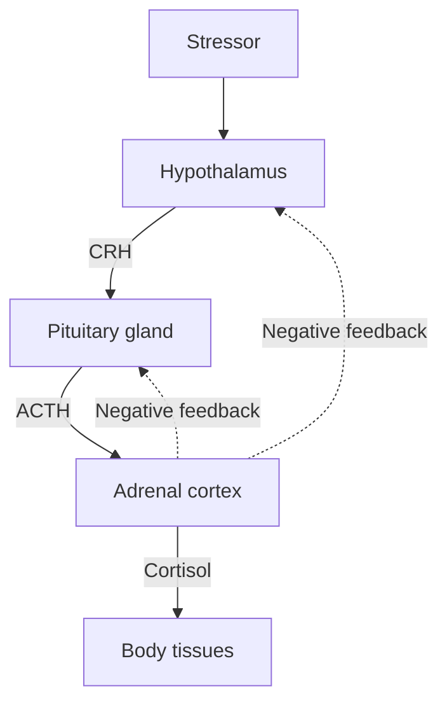

# Concept-Book Run

domain: /home/papagame/projects/digital-duck/cb-meta-health/public/domains/meta_health_ch07/input/graph.yaml
target: stress_resilience_routine
started: 2026-11-24T06:52:01

## Teaching order (24 concepts)

- five_phase_correspondences
- hpa_axis
- sympathetic_parasympathetic_balance
- acute_vs_chronic_stress
- seven_emotions_qiqing
- five_emotions_five_organs
- qi_stagnation_blood_stasis
- vagal_tone_and_hrv
- liver_free_flow_shuxie
- postprandial_hyperemia
- liver_qi_stagnation
- stress_and_digestion
- diaphragmatic_breathing
- liver_spleen_relationship
- allostatic_load
- breath_as_bridge
- gut_brain_axis
- liver_opening_movements
- wood_overacting_on_earth
- emotional_eating
- hrv_self_monitoring
- mind_regulation_tiaoxin
- releasing_liver_qi_through_movement
- stress_resilience_routine

### five_phase_correspondences (0.5s)

## Five-Phase Correspondences

**Definition.** In Traditional Chinese Medicine (TCM), the Five Phases (五行, *wǔ xíng*: Wood, Fire, Earth, Metal, Water) are a classification scheme. TCM groups many things that it considers related under each phase: an organ pair, a season, a climate, a taste, a tissue, a sense organ, and an emotion. These groupings are called *correspondences*. The table works as a lookup chart. It is not a measurement system, so nothing in it is calculated.

| Phase | Yin organ | Season | Climate | Tissue | Sense organ | Emotion |
|---|---|---|---|---|---|---|
| Wood | Liver | Spring | Wind | Sinews | Eyes | Anger |
| Fire | Heart | Summer | Heat | Vessels | Tongue | Joy |
| Earth | Spleen | Late summer | Dampness | Muscle | Mouth | Pensiveness (overthinking) |
| Metal | Lung | Autumn | Dryness | Skin | Nose | Grief |
| Water | Kidney | Winter | Cold | Bones | Ears | Fear |

**Worked example.** A patient reports red, dry, irritated eyes, muscle cramps, and frequent outbursts of anger, with symptoms worse in spring. A practitioner using the table notices that the eyes, sinews, anger, and spring all sit in the Wood row. TCM would therefore treat this as a pattern involving the Liver. Notice what the table did here: it did not diagnose anything by itself. It organized scattered complaints into one hypothesis, which the practitioner then tests with further questions, pulse, and tongue examination.

**Problem-solving application.** Use the table to turn a messy symptom list into a structured clinical question.

*Case:* A student during exam season has trouble with appetite, feels bloated after meals, and "can't stop ruminating."

1. **Sort each symptom by row.** Appetite and bloating point to the Spleen (Earth), and rumination matches pensiveness (Earth).
2. **Note the convergence.** Three complaints fall in one row, so the Earth phase is the working hypothesis.
3. **Check for confounders.** Exam stress, irregular meals, and caffeine intake could each explain the same symptoms without any Five-Phase framework.
4. **Choose a practical response.** Regular meal times, lower caffeine, and a scheduled break from studying are reasonable steps whichever framework you use.

**Evidence status.** The correspondences are traditional conventions, not experimentally established physiology. Emotions such as anger or grief do affect the body, for example through stress hormones and heart rate. However, no research shows that a specific emotion damages one specific organ in the way the table says. Treat the table as a memory aid and a way to organize a TCM case history. It is not a basis for deciding whether to seek or delay medical care. A symptom like persistent bloating or vision change needs conventional evaluation.

**Check your understanding.** A patient has dry skin, a dry cough, frequent sadness, and symptoms that worsen in autumn. Which phase do these point to, and which organ would TCM associate with it? (Answer: Metal, the Lung.)

### hpa_axis (0.6s)

## The HPA Axis

The **hypothalamus–pituitary–adrenal (HPA) axis** is the body's main hormonal stress system. It is a chain of three glands that pass a chemical signal along in sequence, ending with the release of **cortisol** from the adrenal glands. Cortisol raises blood glucose, sharpens the body's energy supply, and temporarily dampens functions that are not urgent, such as digestion and immune activity.

**The chain of command**

1. The **hypothalamus**, a brain region, detects a stressor (a threat, pain, low blood sugar, or an exam) and releases corticotropin-releasing hormone (CRH).
2. CRH travels a short distance to the **pituitary gland**, which releases adrenocorticotropic hormone (ACTH) into the blood.
3. ACTH reaches the **adrenal cortex**, the outer layer of the adrenal glands sitting above the kidneys, which releases cortisol.

Cortisol then acts on tissues throughout the body. It also signals back to the hypothalamus and pituitary to slow CRH and ACTH release. This is **negative feedback**, and it is how the system switches itself off once the stressor passes.

*The HPA axis: each gland triggers the next, and cortisol feeds back to shut the chain down.*

**Daily rhythm.** Cortisol is not constant. Levels peak about 30–45 minutes after waking, a rise called the cortisol awakening response, and fall through the day to their lowest point near midnight. A typical morning blood level is roughly 10–20 µg/dL, and an evening level is often below 5 µg/dL.

**Worked example.** A student has a saliva cortisol test at 8:00 a.m. (just after waking), at 4:00 p.m., and at 11:00 p.m. on a normal day. The results are 15, 6, and 2 nmol/L. This is a healthy pattern: high in the morning and low at night. Now suppose a second student, under weeks of poor sleep and exam pressure, gets 9, 8, and 7 nmol/L. The morning peak is blunted and the evening level stays elevated. The daily rhythm has flattened, which is commonly seen with chronic stress or disrupted sleep.

**Problem-solving application.** Suppose a person reports being "wired but tired" at night, waking at 3 a.m., and relying on caffeine in the morning. You can reason through this in steps:

1. **Identify the system.** Sleep problems and daytime fatigue can involve the HPA rhythm.
2. **Look for the pattern, not one number.** A single cortisol value is hard to interpret. A multi-point daily profile shows whether the rhythm is intact.
3. **Check the inputs.** Irregular sleep, late-night light exposure, overtraining, and under-eating all activate the HPA axis.
4. **Choose changes that reduce the load.** Examples are consistent sleep and wake times, morning daylight, adequate calories, and scheduled recovery days.

Short bursts of cortisol are useful, as in a race or a presentation. Problems arise when activation is prolonged and the feedback loop no longer resets the system. Persistently abnormal cortisol patterns, or symptoms such as rapid weight gain or unexplained weakness, need medical evaluation. Conditions such as Cushing syndrome (too much cortisol) and Addison disease (too little) are diagnosed with clinical testing.

### sympathetic_parasympathetic_balance (0.6s)

## Sympathetic–Parasympathetic Balance

The autonomic nervous system controls involuntary functions such as heart rate, digestion, and pupil size. It has two main branches that often act in opposite directions. The **sympathetic** branch prepares the body for exertion or threat ("fight or flight"): it raises heart rate, widens airways, and redirects blood to skeletal muscle. The **parasympathetic** branch supports rest and recovery ("rest and digest"): it slows the heart, stimulates digestion, and conserves energy. Both branches are active at all times. "Balance" means the net effect of their combined signals at a given moment, not a switch between two modes.

At rest, parasympathetic influence dominates the heart. The sinoatrial node, the heart's natural pacemaker, fires about 100 times per minute on its own. The vagus nerve (the main parasympathetic nerve to the heart) slows it to a typical resting rate of 60–80 beats per minute.

| Organ | Sympathetic effect | Parasympathetic effect |
|---|---|---|
| Heart rate | Increases | Decreases |
| Airways | Dilate | Constrict slightly |
| Digestion | Slows | Stimulates |
| Pupils | Dilate | Constrict |
| Blood flow to muscle | Increases | Little direct effect |

### Worked example

Cardiac output is the volume of blood the heart pumps per minute:

$$CO = HR \times SV$$

where $HR$ is heart rate (beats/min) and $SV$ is stroke volume (mL/beat). Suppose a student at rest has $HR = 65$ and $SV = 75$ mL:

$$CO = 65 \times 75 = 4875 \text{ mL/min} \approx 4.9 \text{ L/min}$$

During a hard sprint, vagal slowing is withdrawn and sympathetic drive rises, so $HR$ reaches 180 and $SV$ rises to 100 mL:

$$CO = 180 \times 100 = 18{,}000 \text{ mL/min} = 18 \text{ L/min}$$

Cardiac output increased almost fourfold. Most of the heart rate change comes from reduced parasympathetic activity at first, with increasing sympathetic activity taking over as intensity climbs.

### Problem-solving application

**Problem:** After exercise, a runner's heart rate falls from 170 to 140 beats/min in the first minute, then to 110 in the second. What does this tell you about autonomic balance?

**Solution:** A fast early drop is largely due to parasympathetic reactivation, as the vagus nerve resumes slowing the heart. Sympathetic activity declines more gradually. The 1-minute drop here is 30 beats/min, and the next minute's drop is also 30. Heart rate recovery, the fall in heart rate after exercise, is used as a simple indicator of autonomic health. A larger early drop generally reflects stronger vagal tone, which is common in trained athletes. A drop smaller than about 12 beats/min in the first minute has been associated with higher cardiovascular risk in clinical studies.

**Practical use:** Resting heart rate and heart rate recovery let you track fitness over time. Chronic stress, poor sleep, and overtraining can shift balance toward sympathetic dominance. This often appears as a rising resting heart rate and slower recovery. These measures are only indicators, since caffeine, illness, dehydration, and medications also affect them.

In TCM, a comparable idea is sometimes described in terms of yin and yang, but those concepts are not measurable physiological quantities. Autonomic balance, by contrast, can be quantified directly using heart rate, heart rate variability, and blood pressure.

### acute_vs_chronic_stress (0.6s)

## Acute vs. Chronic Stress

**Definition.** A stress response is the body's coordinated reaction to a demand. Two systems drive it. The sympathetic nervous system acts within seconds, raising heart rate and blood pressure. The hypothalamic-pituitary-adrenal (HPA) axis acts over minutes, releasing cortisol from the adrenal glands. An **acute** stress response is short and self-limiting. It mobilizes energy, then switches off through negative feedback: cortisol signals the brain to shut down further release. A **chronic** stress response is one that stays switched on. Cortisol and sympathetic tone remain elevated for weeks or months, and the recovery phase never fully arrives.

**Worked example.** Suppose a student is startled by a car horn while crossing the street.

1. Within seconds, sympathetic activation raises heart rate from 70 to about 120 beats per minute.
2. The liver releases glucose, so blood glucose rises a little above its resting range of roughly 70–100 mg/dL.
3. Cortisol peaks about 20–30 minutes later.
4. Once the danger passes, feedback lowers cortisol, and heart rate returns to baseline within minutes.

The energy mobilized was useful, and the system returned to rest.

Compare a student facing a semester of unrelenting pressure. Resting heart rate may stay near 85 rather than 65. Evening cortisol, normally the day's lowest, stays high. Fasting glucose drifts upward, and sleep becomes fragmented. No single day looks dramatic, but the baseline has shifted.

| Feature | Acute | Chronic |
|---|---|---|
| Duration | Minutes to hours | Weeks to years |
| Cortisol pattern | Rises, then falls | Persistently elevated or flattened daily rhythm |
| Energy effect | Mobilizes glucose and fat for use | Mobilizes energy that goes unused |
| Typical outcome | Resolution | Strain on cardiovascular, metabolic, immune, and sleep systems |

**Problem-solving application.** Consider a patient whose blood pressure is 142/92 mmHg and whose fasting glucose is 108 mg/dL, with no diagnosed disease. They report months of work deadlines, poor sleep, and late-night eating. How should you reason about this?

First, separate the signal from the cause. Prolonged sympathetic activation narrows blood vessels and raises cardiac output, which elevates blood pressure. Sustained cortisol raises glucose production and promotes abdominal fat storage. Both findings fit chronic stress, but they also fit diet, genetics, and inactivity, so stress is a hypothesis to test, not a conclusion.

Second, look for the missing recovery. Track resting heart rate each morning and sleep duration for two weeks. A resting rate that stays elevated, or that does not fall on rest days, suggests the system is not recovering.

Third, target the recovery side. Evidence-supported options include regular aerobic exercise, consistent sleep timing, and structured relaxation such as slow breathing. Each shortens or dampens the stress response. If values remain high, clinical evaluation is warranted, since persistent hypertension and elevated glucose need direct treatment regardless of their origin.

The key distinction is not whether stress occurs but whether it resolves. Acute stress is a spike with a return to baseline. Chronic stress is a baseline that has moved.

### seven_emotions_qiqing (0.6s)

## The Seven Emotions (Qiqing, 七情)

**Definition.** In Traditional Chinese Medicine (TCM), the seven emotions are joy (喜), anger (怒), worry (忧), pensiveness (思), grief (悲), fear (恐), and fright (惊). TCM treats them as normal responses to life events, not as diseases. It holds that they become *internal causes of illness* when they are unusually intense, sudden, or prolonged. Classical texts also link each emotion with a particular organ system. For example, anger is linked with the Liver and fear with the Kidney. These links are traditional, and modern physiology has not confirmed them as organ-specific effects.

| Emotion | TCM-associated organ | Pattern TCM describes |
|---|---|---|
| Joy | Heart | Scattered attention, restlessness |
| Anger | Liver | Rising tension, headache, flushed face |
| Worry | Lung | Tight chest, shallow breathing |
| Pensiveness | Spleen | Poor appetite, bloating |
| Grief | Lung | Fatigue, weak voice |
| Fear | Kidney | Sinking feeling, loss of bladder control |
| Fright | Heart/Kidney | Palpitations, disorientation |

**Worked example.** Consider a student during a three-week exam period. She sleeps five hours a night and re-reads notes late into the evening. She reports poor appetite, a bloated stomach after meals, and difficulty concentrating.

A TCM practitioner would label this as prolonged pensiveness, meaning excessive rumination. The pattern is a Spleen disorder, with digestion affected. The treatment would be to reduce the cause by setting study limits and regular meals, and to add calming activity such as walking.

A modern clinician would see the same facts differently: sustained stress, sleep loss, and irregular eating. These raise cortisol and alter gut motility. The gut-brain connection is real, and chronic psychological stress is a recognized contributor to functional digestive symptoms. The TCM explanation, however, is not a proven mechanism.

**Problem-solving application.** Use a three-step approach when you meet a case that involves emotions and symptoms.

1. **Separate the timeline.** Did the symptoms begin after a specific emotional event or period? Record when they began, how long they lasted, and how intense they were. A timeline is the main evidence that TCM uses to call an emotion causal.
2. **Rule out physical causes.** Poor appetite, palpitations, and fatigue can come from anemia, thyroid disease, infection, or heart rhythm disorders. Palpitations with chest pain need medical evaluation, not an emotional label.
3. **Choose measurable interventions.** Sleep, exercise, social support, and counseling or psychotherapy all have good evidence for stress and anxiety. Track the symptoms for two to four weeks to see whether they improve.

Try it: a man has a racing heart and a sense of dread for two days after a car accident. Which of the seven emotions would TCM name (fright), and what physical and psychological conditions should a clinician consider first? (Cardiac arrhythmia, hyperthyroidism, and acute stress reaction are all possibilities.)

The key point is that the seven emotions give a useful vocabulary for asking how emotional load relates to health. Treat their organ assignments as traditional descriptions, not as established physiology.

### five_emotions_five_organs (0.7s)

## The Five Emotions and the Five Organs

**Definition.** Traditional Chinese Medicine (TCM) pairs each of five emotions with one of five organ systems. It holds that sustained or extreme emotion injures its paired organ system: anger harms the Liver (怒伤肝), excess joy the Heart (喜伤心), overthinking the Spleen (思伤脾), grief the Lung (悲伤肺), and fear the Kidney (恐伤肾). In TCM, the capitalized "Liver," "Heart," and so on name functional systems, not just anatomical organs. The key word is *excess*: a brief or proportionate emotion is considered a normal response. TCM treats prolonged, intense, or inappropriate emotion as a cause of illness.

| Emotion | Organ system | Pattern TCM describes |
|---|---|---|
| Anger | Liver | Rising tension, headache, red face, irritability |
| Excess joy | Heart | Scattered attention, palpitations, insomnia |
| Overthinking | Spleen | Poor appetite, bloating, fatigue |
| Grief | Lung | Shortness of breath, weak voice, tiredness |
| Fear | Kidney | Weak knees, urinary urgency, a sense of "sinking" |

**Worked example.** A graduate student spends three weeks before a thesis defense ruminating over every possible question. She sleeps poorly, loses her appetite, feels bloated after meals, and is tired by mid-afternoon. A TCM practitioner would call this "overthinking harms the Spleen" (思伤脾). The Spleen is the system TCM links to digestion and energy.

Now look at the same case in modern terms. Chronic worry activates the stress response. Stress hormones such as cortisol change gut motility and appetite. Poor sleep adds fatigue. The two accounts describe the same observed pattern, but only the physiological one is supported by measurement. The TCM organ-emotion pairing is a traditional framework. It has not been validated as a mechanism, although the general link between stress and digestive symptoms is well documented.

**Problem-solving application.** Suppose a patient reports frequent irritability, tension headaches, and a flushed face during a stressful work period. Work through it in steps:

1. **Identify the dominant emotion.** Anger and frustration are the main complaints.
2. **Apply the TCM pairing.** TCM would associate this pattern with the Liver and suggest the emotion is both a symptom and a contributor.
3. **Translate to testable factors.** Check blood pressure, which can rise under chronic anger. Ask about sleep, caffeine, and alcohol. Measure resting heart rate, for example 85 beats per minute compared with a typical 60 to 80.
4. **Choose a practical response.** Regular exercise, a consistent sleep schedule, and stress-management skills such as paced breathing target the shared physiological pathways. If symptoms persist or blood pressure is elevated, seek medical evaluation.

Note what the framework offers and what it does not. It is a useful prompt to ask about emotional state alongside physical symptoms. It should not replace measurement or diagnosis. Persistent low mood, panic, or grief that disrupts daily life calls for professional mental health care, not an organ-based explanation alone.

