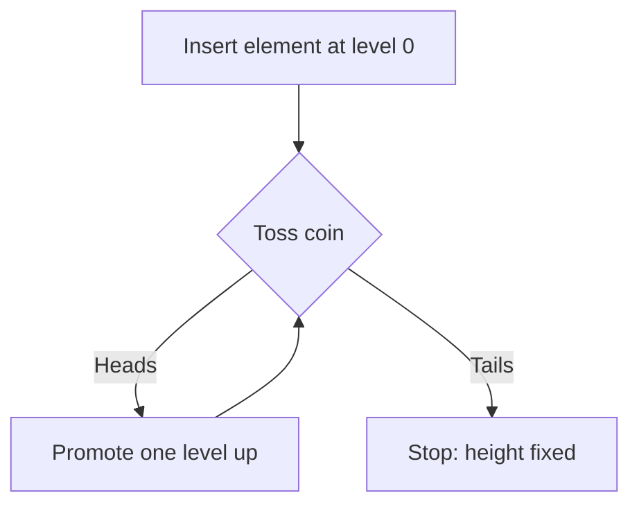
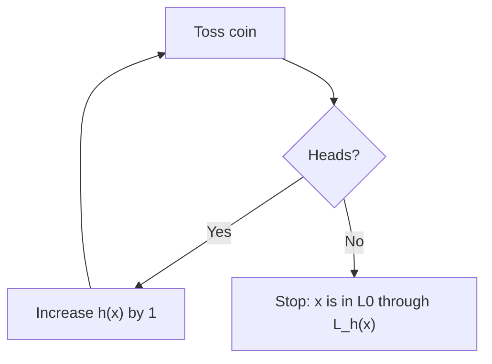
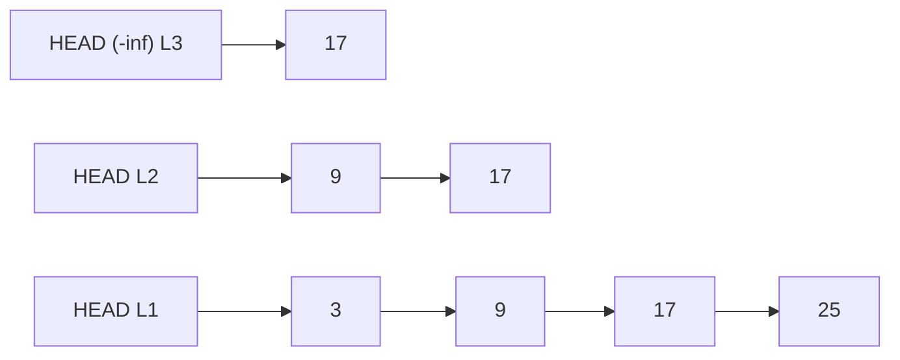
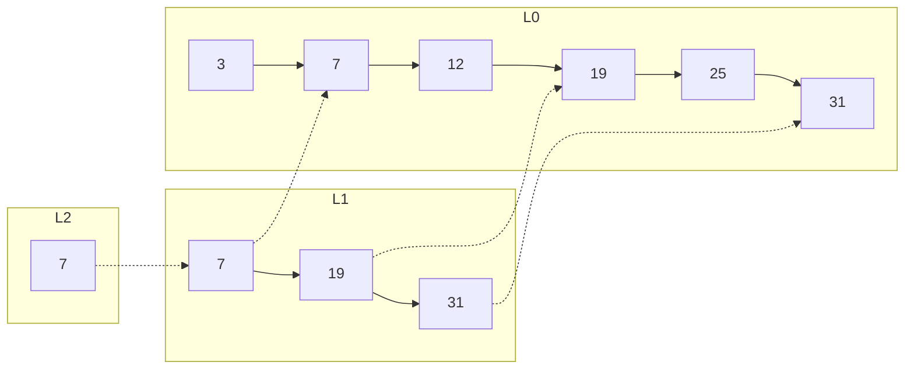
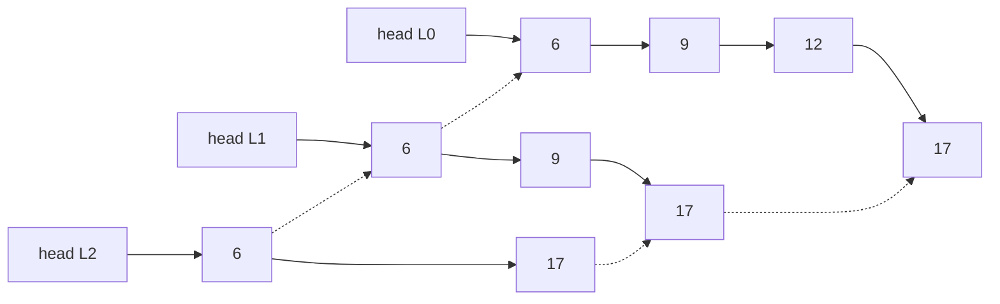
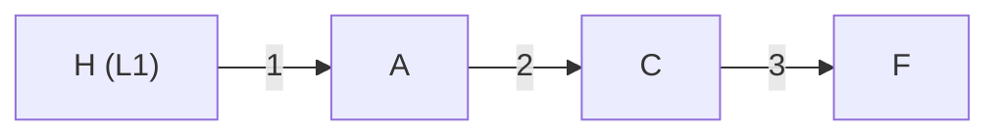
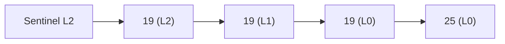

# Concept-Book Run

domain: /home/papagame/projects/digital-duck/cb-data-structure/public/domains/data_structure_ch04/input/graph.yaml
target: skiplist_list
started: 2026-11-24T06:58:24

## Teaching order (10 concepts)

- coin_toss_randomization
- node_height
- sentinel_node
- singly_linked_list_hierarchy
- skiplist
- pseudo_random_generator
- edge_length
- pick_height_procedure
- search_path
- skiplist_list

### coin_toss_randomization (0.9s)

## Coin Toss Randomization

**Definition.** A *coin toss* is a random binary choice: each independent toss yields heads with probability $p$ and tails with probability $1-p$ (usually $p = \tfrac12$). Randomized data structures use these tosses to make structural decisions, such as whether to promote an element to a higher level. The structure's cost is then a random variable, and we analyze its **expected value** $E[X]$ over all possible toss outcomes. No fixed input can reliably force bad behavior, because the randomness comes from the tosses and not from the data.

**Key fact: the geometric distribution.** Suppose we toss a fair coin repeatedly until the first tails, and let $X$ be the number of heads. Then

$$P(X = k) = \left(\tfrac12\right)^{k+1}, \qquad P(X \ge k) = \left(\tfrac12\right)^k.$$

The expected number of heads is $E[X] = \sum_{k\ge1} P(X \ge k) = \sum_{k\ge1} 2^{-k} = 1$.

**Worked example (skip list levels).** In a skip list, each new element starts at level 0. We toss a coin, and each head promotes it one level higher. We stop at the first tail. The element's height $H$ is $1 + X$ levels.

1. Expected height of one element: $E[H] = 1 + E[X] = 2$.
2. Expected total pointers for $n$ elements: $E[\text{pointers}] = \sum_{i=1}^{n} E[H_i] = 2n$, by linearity of expectation. The structure uses only linear space on average.
3. Expected number of elements reaching level $k$: $n \cdot 2^{-k}$. About half the elements sit at level 1, a quarter at level 2, and so on.

**Problem-solving application.** How many levels should we expect with $n = 1024$ elements?

The expected count at level $k$ is $1024 \cdot 2^{-k}$. This falls to about $1$ when $2^k = 1024$, so $k = \log_2 n = 10$. We can make this precise with a union bound. The probability that *any* element reaches level $k$ is at most

$$n \cdot 2^{-k}.$$

Choosing $k = 2\log_2 n$ gives $n \cdot n^{-2} = 1/n$. So with probability at least $1 - 1/n$, the structure has $O(\log n)$ levels.

Searching walks down from the top level. At each level we move right until the next node overshoots, then drop down. Look at the search path *backward*. At each node, a head means "this node was promoted, so we came from below." A tail means "we came from the left." The expected number of tosses needed to climb one level is $2$, so climbing $\log_2 n$ levels costs about $2\log_2 n$ steps. Hence

$$E[\text{search cost}] = O(\log n).$$

**Check yourself.** If the coin is biased with $p = \tfrac14$ for promotion, what is the expected height of an element? Using $E[X] = \frac{p}{1-p} = \tfrac13$, we get $E[H] = \tfrac43$. This gives fewer pointers and less space, but each level skips fewer elements, so searches take more steps. The choice of $p$ trades space against search time, and expectation lets us quantify exactly that trade.


*Each insertion tosses a coin repeatedly. Every head promotes the element one level, and the first tail ends the process, giving a geometric height distribution.*

### node_height (0.6s)

## Node Height

**Definition.** In a skiplist, each element $x$ is stored in the bottom list $L_0$ and may also appear in higher "express" lists $L_1, L_2, \dots$. The **height** of $x$, written $h(x)$, is the largest index $r$ such that $x \in L_r$. Because lists are nested ($L_{r} \subseteq L_{r-1}$), $x$ appears in exactly the lists $L_0, \dots, L_{h(x)}$.

Height is chosen at insertion time by repeated fair coin tosses: toss a coin until the first tails, and let $h(x)$ be the number of heads. Each toss is independent, so

$$\Pr[h(x) \ge r] = \left(\tfrac{1}{2}\right)^r, \qquad \Pr[h(x) = r] = \left(\tfrac{1}{2}\right)^{r+1}.$$

Thus about half of all elements have height $0$, a quarter have height $1$, and so on. Each level thins out the one below by a factor of about $2$, which creates the "express lane" structure.

**Worked example.** Insert a new key and toss: H, H, H, T. Three heads before the first tails gives $h(x) = 3$, so $x$ is linked into $L_0, L_1, L_2, L_3$. The probability of this outcome is $(1/2)^4 = 1/16$.

Now suppose we insert $n = 1024$ elements. The expected number with $h(x) \ge r$ is $n/2^r$. For $r = 10$ this is $1$, so we expect roughly one element at level $10$ and none far above it. This suggests the tallest node has height near $\log_2 n$.

**Problem-solving application.** *How tall is the whole skiplist?* Let $H = \max_x h(x)$ over $n$ elements. By the union bound,

$$\Pr[H \ge r] \le n \cdot 2^{-r}.$$

Choose $r = c\log_2 n$ for a constant $c > 1$:

$$\Pr[H \ge c\log_2 n] \le n \cdot n^{-c} = n^{1-c}.$$

So with $c = 3$, the height exceeds $3\log_2 n$ with probability at most $1/n^2$. The skiplist therefore has $O(\log n)$ height with high probability. Searches start at the top list and descend, so this bound is what makes the expected search time $O(\log n)$.

*Expected height of one node:* $E[h(x)] = \sum_{r \ge 1} \Pr[h(x) \ge r] = \sum_{r\ge1} 2^{-r} = 1$. So each element appears in $E[h(x)] + 1 = 2$ lists on average, and total space is $O(n)$ expected, even though the structure has $\Theta(\log n)$ levels.


*The height-selection procedure: keep tossing, count heads, and stop at the first tails.*

**Practice.** With $n = 2^{20}$ elements, what is the expected number of nodes with $h(x) \ge 15$? Using $n/2^r$, it is $2^{20}/2^{15} = 32$.

### sentinel_node (0.6s)

## Sentinel Node

A **sentinel node** (also called a *header* or *head node*) is a special dummy node placed at the start of every level of a skip list. It stores no real data. Its key is conceptually $-\infty$, so it compares less than every possible search key. Each of its forward pointers, one per level, anchors the start of the search path at that level.

Without a sentinel, an insertion or deletion at the front of a level would need special-case code, because the head pointer itself would have to change. With a sentinel, every real node has a predecessor on every level it occupies. The same pointer-update code then works for every position.

A skip list with maximum height $L$ has a sentinel with $L$ forward pointers. Often a matching tail sentinel with key $+\infty$ ends each level, so the search loop needs no null checks.


*The head sentinel has a forward pointer at every level. Each search starts there and moves right and down.*

### Worked example

Consider a skip list holding keys $3, 9, 17, 25$, where 9 and 17 also appear on level 2, and 17 also appears on level 3. Search for $25$:

1. Start at HEAD on level 3. Its next node is 17, and $17 < 25$, so move to 17.
2. On level 3, 17 has no successor (or the tail $+\infty$). Drop to level 2. The next key is the tail, so drop again.
3. On level 1, 17's next is 25. Since $25 \not< 25$ fails to rule it out, we stop at 25 and check for equality. Found.

Now search for $1$. HEAD's level-3 successor is 17, and $17 \ge 1$, so drop. The same happens on level 2 (next is 9). On level 1 the next is 3, and $3 \ge 1$. The search ends at HEAD with no match. The sentinel gave the search a valid place to stop, even though no real node precedes the key.

### Problem-solving application

**Insert key 2.** We must find the predecessor of 2 on each level. Because the sentinel's key is $-\infty$, the search ends at HEAD on every level. Say the coin flips give node 2 a height of 2. Then:

- Set `new.next[i] = head.next[i]` for $i = 1, 2$.
- Set `head.next[i] = new`.

This is the standard splice. No "empty list" or "insert at front" branch is needed. Without the sentinel, we would write separate code for modifying a head pointer.

**Cost.** The sentinel adds only $O(L)$ extra space, and $L = O(\log n)$ for $n$ keys. It doesn't change the expected search time of $O(\log n)$. It makes the code simpler and less error-prone.

**Check yourself:** In a skip list with $L = 4$, how many forward pointers does the head sentinel hold? (Answer: 4, one per level, whether or not any real node reaches that level.)

### singly_linked_list_hierarchy (0.8s)

## Singly Linked List Hierarchy

**Definition.** A *singly linked list* is a chain of nodes, each storing a key and one pointer to its successor. A skiplist is built from a **hierarchy** of such lists $L_0, L_1, \dots, L_h$ with two properties:

1. $L_0$ contains every key, in sorted order.
2. Each $L_{i+1}$ is a subset of $L_i$, so $L_h \subseteq \cdots \subseteq L_1 \subseteq L_0$.

In the standard randomized skiplist, each key in $L_i$ is promoted to $L_{i+1}$ independently with probability $p$ (usually $p = \tfrac12$). Equivalently, a key's *height* is the number of consecutive coin flips that come up heads, plus one. Each node appears in lists $L_0$ through $L_{\text{height}-1}$, and the copies are linked vertically.

**Worked example.** Take the keys $\{3, 7, 12, 19, 25, 31\}$ with these heights: 3→1, 7→3, 12→1, 19→2, 25→1, 31→2.

- $L_0$: 3 → 7 → 12 → 19 → 25 → 31
- $L_1$: 7 → 19 → 31
- $L_2$: 7

Each list is a sorted singly linked list, and each is a subset of the one below it.


*Three nested singly linked lists. Solid arrows are `next` pointers, and dotted arrows connect copies of the same key between levels.*

**Problem-solving application: searching for 25.** Start at the top list $L_2$ and work down:

1. In $L_2$, the node 7 has no successor, so move down to $L_1$ at 7.
2. In $L_1$, the next key is 19 and $19 \le 25$, so advance. The next key is 31 and $31 > 25$, so drop down to $L_0$ at 19.
3. In $L_0$, advance 19 → 25. Found.

The search took 3 horizontal steps, where a plain list would need 5. The upper lists work as "express lanes" that skip over many nodes at once.

**Why the hierarchy is efficient.** The expected number of keys in $L_i$ is $np^i$, so the expected height is $h = O(\log_{1/p} n)$. Walking a search path backward, each step goes up with probability $p$ and left otherwise. The expected number of left steps per level is therefore $1/p$. The expected search cost is

$$
E[\text{steps}] \approx \frac{1}{p}\log_{1/p} n = O(\log n).
$$

For $p = \tfrac12$ and $n = 1024$, that is about $2 \cdot 10 = 20$ steps, compared with up to 1024 in a single list.

**Key insight.** No single list is balanced or special. The logarithmic performance comes from stacking randomly thinned singly linked lists, each of which is simple to insert into and delete from.

### skiplist (2.2s)

## Skiplist

A **skiplist** is a randomized, sorted linked-list structure that gives $O(\log n)$ expected search, insertion, and deletion without the rebalancing rules of a balanced tree. It stores every key in a bottom list (level 0) and promotes each key to the next level up with probability $p$ (typically $p=\tfrac12$), independently of all other keys. Level $i$ is therefore a sparse "express lane" over level $i-1$.

**Search.** Start at the top-left sentinel. At each level, move right while the next key is less than the target. When the next key is too large (or absent), drop down one level. At level 0, the next node is either the target or proof that it is absent.

### Worked example

Keys $3, 6, 7, 9, 12, 17, 19$ are stored as follows:

- Level 2: $6 \to 17$
- Level 1: $3 \to 6 \to 9 \to 17 \to 19$
- Level 0: $3 \to 6 \to 7 \to 9 \to 12 \to 17 \to 19$

Search for $12$:

1. Level 2: from the head, $6<12$, so move to $6$. Next is $17>12$, so drop.
2. Level 1: from $6$, next is $9<12$, so move to $9$. Next is $17>12$, so drop.
3. Level 0: from $9$, next is $12$. Found.

This took 3 moves right and 2 drops. A plain list would need 5 steps.


*A portion of the skiplist: solid arrows are forward pointers within a level, and dotted arrows connect the same key across levels. Searches move right, then drop.*

### Why it is fast

A key reaches level $\ge i$ with probability $p^i$, so the expected number of nodes at level $i$ is $np^i$. The top useful level is about $L=\log_{1/p} n$, since there $np^L\approx 1$.

To analyze a search, trace it **backward** from the target at level 0. At each step, the reversed path either climbs (the node was promoted, probability $p$) or moves left (probability $1-p$). The path ends once it reaches level $L$, so the expected number of climbs is $L$. The expected number of left moves per climb is $\frac{1-p}{p}$. The expected path length is therefore

$$\frac{L}{p}+O(1)=\frac{\log_{1/p} n}{p}+O(1)=O(\log n).$$

For $p=\tfrac12$, this is about $2\log_2 n$ steps. The expected space is $\sum_i np^i=\frac{n}{1-p}=2n$ pointers.

### Problem-solving application

**Problem.** For $n=1{,}000{,}000$ and $p=\tfrac12$, estimate the number of levels and the expected search cost.

**Solution.** $L=\log_2 10^6\approx 20$ levels. The expected path length is $\approx 2L=40$ steps, compared with an average of $500{,}000$ for a linked list.

**Insertion** searches for the key while recording the last node visited at each level (the "update" array). It then flips coins to pick the new node's height $h$: keep promoting while a coin shows heads. Finally, it splices the node into the lists at levels $0,\dots,h-1$. **Deletion** uses the same search, then unlinks the node at every level where it appears. Both cost $O(\log n)$ expected, since they add only $O(1)$ expected pointer updates per level.

The bound holds for *every* input order, because it depends only on the random coin flips and not on the data. That is the main advantage over an unbalanced binary search tree, which degrades to $O(n)$ on sorted input.

### pseudo_random_generator (0.7s)

## Pseudo Random Generator

A **pseudo-random number generator (PRNG)** is a deterministic algorithm that produces a sequence of numbers that *behaves* like random data. It keeps an internal **state** $s_t$ and updates it with a fixed rule, $s_{t+1} = f(s_t)$, then outputs a value derived from that state. The same starting state, called the **seed**, always yields the same sequence. Python's `random` module uses the Mersenne Twister, whose period is $2^{19937}-1$. That is far longer than any program will use up.

A good PRNG passes statistical tests: bits look uniform, and successive bits look independent. This is what lets a program use it to simulate a fair coin. (PRNGs are not cryptographically secure. Use `secrets` for that.)

### Worked example: coin tosses for node heights

In a skip list, each new node's height is set by tossing a fair coin until it lands tails. Height $h$ occurs with probability

$$P(H = h) = \left(\tfrac12\right)^{h}, \qquad h = 1, 2, 3, \dots$$

The expected height is $E[H] = \sum_{h\ge1} h\,2^{-h} = 2$.

`random.getrandbits(1)` returns 0 or 1 with equal probability, so it works as one toss:

```python
import random

def random_height(max_level=16):
    h = 1
    while h < max_level and random.getrandbits(1):  # 1 = heads
        h += 1
    return h

random.seed(42)          # reproducible
print([random_height() for _ in range(10)])
```

Because the seed is fixed, this prints the same list on every run. That makes bugs reproducible and tests deterministic.

### Problem-solving application

**Problem.** A skip list holds $n = 1024$ nodes, with heights drawn as above. About how many nodes reach level 4 or higher, and what level should we cap at?

**Solution.** A node reaches height $\ge k$ only if its first $k-1$ tosses are all heads, so

$$P(H \ge k) = 2^{-(k-1)}.$$

For $k=4$ this is $1/8$. The expected count is $1024/8 = 128$ nodes.

For the cap, we want the expected number of nodes above level $L$ to be about 1. That means $n \cdot 2^{-L} \approx 1$, so $L \approx \log_2 n = 10$. Many implementations use a cap of 16 or 32 for safety.

**Why the PRNG quality matters.** The $O(\log n)$ expected search time depends on heights being independent and geometrically distributed. A poor generator could correlate neighbouring heights and cluster tall nodes. Searches would then degrade toward $O(n)$. A fixed seed gives repeatable heights, but it also makes the structure predictable. If an adversary knows the seed, they could craft inserts that produce a bad shape. In production, seed from system entropy. In tests, seed with a constant.

**Check yourself.** Run `random_height()` 100,000 times. About half the results should be 1, a quarter should be 2, and the mean should be near 2. A large deviation points to a bug in the loop, not in the generator.

### edge_length (1.0s)

## Edge Length

### Definition

An indexable skiplist is built from layers of linked lists $L_0, L_1, \dots, L_r$. The bottom list $L_0$ contains every element, and each higher list contains a subset of the one below it. To search by *position* (for example, "give me the 7th element") instead of by value, each edge stores an extra number.

The **edge length** of an edge $e$ in list $L_r$, written $\text{len}(e)$, is the number of edges in $L_0$ that lie below it, that is, the number of bottom-level steps the edge jumps over. Every edge in $L_0$ has length $1$. A higher edge's length is the sum of the lengths of the edges it skips:

$$\text{len}(e) = \sum_{e' \in L_{r-1}\text{ under } e} \text{len}(e')$$

### Worked example

Suppose $L_0$ holds the keys $A,B,C,D,E,F$, and $L_1$ holds only $A, C, F$ (plus a head node $H$ before $A$).

- In $L_0$, every edge has length 1.
- In $L_1$: $H\to A$ spans one $L_0$ edge, so length $1$. $A\to C$ spans $A\to B\to C$, so length $2$. $C\to F$ spans $C\to D\to E\to F$, so length $3$.


*Edges in $L_1$ labeled with their lengths; each equals the number of $L_0$ steps it skips.*

### Problem-solving application: find the element at index $k$

Keep a running total $pos$, the position of the current node, starting at $0$ at the head. Starting at the top layer, follow an edge $e$ only if $pos + \text{len}(e) \le k$. Otherwise drop one layer. When $pos = k$, you have arrived.

Find index $4$ (counting $A$ as index 1) in the example:

1. At $H$ in $L_1$: $pos=0$. Edge to $A$ has length 1, and $0+1\le 4$, so move. $pos=1$.
2. Edge $A\to C$: $1+2=3\le 4$, so move. $pos=3$.
3. Edge $C\to F$: $3+3=6>4$, so drop to $L_0$.
4. In $L_0$, edge $C\to D$: $3+1=4\le 4$, so move. $pos=4$. Done, and the answer is $D$.

Because the edge lengths let us skip whole stretches without counting them, the expected cost is $O(\log n)$, the same as searching by key. A plain linked list would need $O(n)$ steps.

### Maintaining lengths

When inserting a new node, every edge that *spans* the insertion point at a higher layer must have its length increased by $1$. For the layers where the new node appears, the spanning edge is split into two, and their lengths must add up to the old length plus one. If you track the $pos$ values at each layer during the search, you can compute the split without extra traversal. Deletion reverses this: merge the two edges around the removed node and subtract one.

**Check yourself:** in the example, if $G$ is inserted between $F$ and the end of $L_0$ and also promoted to $L_1$, what is the length of the new edge $F\to G$ in $L_1$? (Answer: $1$.)

### pick_height_procedure (0.8s)

## Pick Height Procedure

### Definition

In a skip list, each inserted key is stored on level 0 and promoted to higher levels at random. The **pick height procedure** chooses the node's height $h$ by simulating repeated fair coin tosses: keep tossing until the first "tails," and let $h$ be one more than the number of heads. With a random integer, "heads" is a 1-bit. So the procedure counts the **trailing 1-bits** of a random integer $r$, up to a maximum height $H_{\max}$.

$$h = \min\bigl(1 + \text{trailing\_ones}(r),\; H_{\max}\bigr)$$

Because each bit of a uniformly random integer is an independent fair coin, the heights follow a geometric distribution:

$$P(h = k) = \left(\tfrac12\right)^k \quad (k < H_{\max})$$

### Worked example

```python
import random

def pick_height(max_height=16):
    r = random.getrandbits(max_height)
    h = 1
    while (r & 1) and h < max_height:
        h += 1
        r >>= 1
    return h
```

Suppose $r = 10110111_2$. Reading from the least significant bit: 1, 1, 1, then 0. That is three trailing 1-bits, so $h = 1 + 3 = 4$.

Check a few other values:

| $r$ (binary) | trailing 1-bits | height $h$ |
|---|---|---|
| `...0` | 0 | 1 |
| `...01` | 1 | 2 |
| `...011` | 2 | 3 |

Half of all nodes get height 1, a quarter get height 2, an eighth get height 3, and so on.

### Problem-solving application

**Problem.** A skip list holds $n = 1024$ keys. About how many nodes reach level $k$ or higher, and what height $H_{\max}$ should you choose?

**Solution.** A node reaches height at least $k$ when its first $k-1$ tosses are heads. That has probability $2^{-(k-1)}$. The expected number of nodes with height $\ge k$ is therefore

$$E[N_k] = n \cdot 2^{-(k-1)}.$$

For $n = 1024 = 2^{10}$:

- $k = 1$: 1024 nodes (every node)
- $k = 5$: $1024/16 = 64$ nodes
- $k = 11$: $1024/1024 = 1$ node

The expected number of nodes on level $k$ falls to about 1 near $k \approx \log_2 n + 1$. Levels beyond that are almost always empty. So a cap of $H_{\max} \approx \log_2 n$ to $2\log_2 n$ is enough. For $n = 1024$, a cap of 16 is safe, and the cutoff changes the distribution only negligibly.

**Why this matters.** Each level is about half as dense as the one below. A search can skip across roughly half the remaining nodes per level, which gives expected $O(\log n)$ search, insert, and delete. The pick height procedure supplies the randomness that makes this balance work. It does so without the rotations or rebalancing that a balanced tree needs.

**Implementation note.** Counting trailing ones with bit operations needs one random draw per node, instead of one draw per coin toss. This is much cheaper. A single call such as `random.getrandbits(32)` supports heights up to 32.

### search_path (0.8s)

## Search Path

In a skip list, the **search path** for a target key $x$ is the sequence of nodes visited when searching from the sentinel (header) node in the topmost list $L_h$ down to the target's position in the bottom list $L_0$. The rule at each node is simple:

1. **Move right** while the next key on the current level is $\le x$ (not overshooting).
2. When the next key would **overshoot** $x$ (is greater than $x$, or is the end of the list), **step down** one level.
3. Stop when you reach $x$ at level $0$ (or confirm that it is absent).

Because each higher list skips over many nodes in the lists below, the path takes long strides early and short strides late, like zooming a map from country to street level.

### Worked example

Let $L_0 = \{3, 7, 12, 19, 25, 31, 40\}$, $L_1 = \{7, 19, 31\}$, $L_2 = \{19\}$, and search for $x = 25$. Start at the sentinel on $L_2$.

| Step | Level | Current | Next | Action |
|---|---|---|---|---|
| 1 | $L_2$ | sentinel | 19 | $19 \le 25$, move right |
| 2 | $L_2$ | 19 | end | overshoot, step down |
| 3 | $L_1$ | 19 | 31 | $31 > 25$, step down |
| 4 | $L_0$ | 19 | 25 | $25 \le 25$, move right |
| 5 | $L_0$ | 25 | | found |

The path touched only 3 distinct keys (19, 25, plus the sentinel), whereas a linear scan of $L_0$ would examine 5.


*The search path for 25: right along $L_2$, down twice at node 19, then right once on $L_0$.*

### Problem-solving application: expected length

Suppose each node is promoted to the next level with probability $p = \tfrac12$. Analyze the path **backwards**, from the target in $L_0$ up to the sentinel at $L_h$. At each node on the reversed path, one of two things happens:

- the node was promoted (probability $p$), so we go **up**, or
- it was not promoted (probability $1-p$), so we go **left**.

Each up-move corresponds to one level climbed, and the path must climb $h$ levels. The expected number of moves to climb one level is the expected number of trials until the first "promoted" outcome, which is $1/p$ (geometric distribution). So the expected number of steps to climb $h$ levels is

$$
\mathbb{E}[\text{path length}] \approx \frac{h}{p}.
$$

For $n$ keys, the expected height is $h \approx \log_{1/p} n$, so for $p=\tfrac12$:

$$
\mathbb{E}[\text{path length}] = O(\log n).
$$

**Check:** with $n = 1024$ and $p = \tfrac12$, $h \approx 10$, giving about $10/0.5 = 20$ steps, versus up to $1024$ for a linked list.

**Why this matters:** the search path is the unit of cost for *every* skip-list operation. Insertion and deletion first trace a search path, then modify the pointers of the nodes where the path stepped down. Bounding the path's length therefore bounds all three operations at expected $O(\log n)$.

### skiplist_list (0.6s)

## Skiplist List

### Definition

A **skiplist list** implements the List interface (`get(i)`, `set(i,x)`, `add(i,x)`, `remove(i)`) using a skiplist whose links carry **lengths**. Nodes are stored in list order, not sorted by key. Each node $u$ has a *height* $h(u)$, the number of levels it participates in. At each level $r$, node $u$ has a pointer `next[r]` and an integer `length[r]`, the number of bottom-level steps that pointer jumps over. A bottom-level edge has length 1.

Heights are random: a node's height is $k$ with probability $2^{-k}$, from repeated coin flips. A list of $n$ elements has expected height $O(\log n)$, and the expected search path has length $O(\log n)$.

### Worked example

To find index $i$, start at the sentinel (position $-1$) at the top level $r$. Keep $j$, the position of the current node $u$:

1. While $r \ge 0$: if `u.next[r]` exists and $j + \text{length}[r] \le i$, move right: $j \leftarrow j + \text{length}[r]$ and $u \leftarrow \text{next}[r]$.
2. Otherwise drop down: $r \leftarrow r-1$.

Suppose the bottom list is $a,b,c,d,e,f$ (indices 0–5), and only $c$ and $e$ are tall. At level 1 the sentinel jumps to $c$ with length 3 (from position $-1$ to $2$), and $c$ jumps to $e$ with length 2. To find index 4: at level 1, $-1+3=2 \le 4$, so move to $c$. Then $2+2=4\le 4$, so move to $e$, and we have $j=4$. Only two moves are needed instead of five.

For `add(i,x)`, run the same search but record, at each level $r$, the last node $w_r$ visited before overshooting. Give the new node a random height $k$. At each level $r \le k$, splice it in after $w_r$ and split the length. If $w_r$ is at position $p_r$ and its old length was $\ell$, the new node sits at position $i$. So $w_r$'s length becomes $i - p_r$ and the new node's length becomes $\ell + 1 - (i - p_r)$. At levels above $k$, the pointer still skips over the new node, so just add 1 to $w_r$'s length. `remove(i)` reverses this: at levels where the node appears, merge lengths by $\ell_{w} + \ell_{u} - 1$, and subtract 1 at higher levels.

### Problem-solving application

**Why $O(\log n)$?** Read the search path backward from the target. At each step, with probability $1/2$ you came from a node taller than the current level (you moved up), and otherwise you came from the left (you moved left). Each level costs a geometric number of steps with expected value 2. The height is $O(\log n)$, so the expected path length is at most about $2\log_2 n + O(1)$. Because `add` and `remove` perform one search plus work proportional to the node's height (expected 2 levels), all four operations run in $O(\log n)$ expected time.

**Practice.** After inserting 100 elements, estimate the expected number of levels. Level $r$ holds about $100/2^r$ nodes, which falls below 1 near $r = \log_2 100 \approx 6.6$, so expect about 7 levels. Expected search cost is then about $2 \times 7 = 14$ steps, compared with up to 100 for a linked list.

**Key invariant:** after any `add` or `remove`, the lengths at each level must sum to the list size plus one (counting the sentinel). Checking this is a good unit test for your implementation.

## Run complete

total: 17.3s
