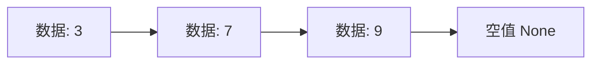
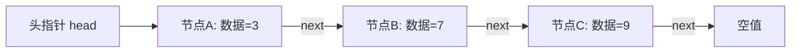

# Concept-Book Run

domain: /home/papagame/projects/digital-duck/cb-data-structure/public/domains/data_structure_ch03/input/graph.yaml
target: stack_operations_sllist
started: 2026-11-24T07:05:10

## Teaching order (4 concepts)

- node
- pointer_reference
- sllist
- stack_operations_sllist

### node (11.8s)

## 节点

**定义。** 节点(node)是链式数据结构中最基本的存储单元。每个节点包含两部分:

1. **数据域**:存放一个数据值;
2. **引用域**(指针):存放指向其他节点的一个或多个引用。

链表中的节点只有一个"后继"引用 $\text{next}$;二叉树中的节点有 $\text{left}$ 和 $\text{right}$ 两个引用;图中的节点则可以有任意多个。没有后继的引用记为空值(`None`)。与数组不同,节点在内存中不必连续存放,它们靠引用彼此"串"起来。

**例题。** 用 Python 构建链表 $3 \to 7 \to 9$:

```python
class Node:
    def __init__(self, value, next=None):
        self.value = value   # 数据域
        self.next = next     # 引用域

c = Node(9)          # 尾节点,next 为 None
b = Node(7, c)
a = Node(3, b)       # a 是头节点
```

遍历时从头节点出发,沿 `next` 逐个访问,直到遇到 `None`:

```python
cur = a
while cur is not None:
    print(cur.value)
    cur = cur.next    # 输出 3, 7, 9
```

访问第 $k$ 个元素必须从头走 $k-1$ 步,所以时间复杂度为 $O(k)$,而数组的下标访问是 $O(1)$。


*图:三个节点通过 next 引用连成的单向链表,最后一个节点指向空值。*

**问题求解应用。** 在节点 `a` 与 `b` 之间插入值为 5 的新节点:

```python
new = Node(5, a.next)   # 先让新节点指向 b
a.next = new            # 再让 a 指向新节点
```

顺序很关键:若先执行 `a.next = new`,指向 $b$ 的引用就丢失了,后面的节点 $7, 9$ 将无法再被访问。已知前驱节点时,插入只改动常数个引用,时间为 $O(1)$;而数组在中间插入需要移动 $O(n)$ 个元素。

**练习。** (1) 写出删除 `a` 之后那个节点的两行代码。(2) 为什么在单向链表中删除某节点,通常需要先找到它的前驱?

**小结。** 节点 = 数据 + 引用。链表、树、图等结构都由节点通过引用组合而成。对节点引用的操作顺序和边界情况(如 `None`)正是这类问题的关键。

### pointer_reference (13.9s)

## 指针引用

**定义。** 指针引用(pointer reference)是存放在某个节点中的一个值,它指向另一个节点(通常保存的是该节点的内存地址或索引),从而把彼此独立的节点串成一个序列。一个单向链表节点包含两部分:

- `data`:该节点存储的数据;
- `next`:指针引用,指向下一个节点;最后一个节点的 `next` 为空值(`None` 或 `NULL`),表示序列结束。

与数组不同,链表节点在内存中不必连续排列,"顺序"完全由指针引用所编码。


*图:三个节点通过 next 指针引用串成单向链表,最后一个节点指向空值。*

**例题。** 用 Python 构造链表 $3 \to 7 \to 9$ 并遍历:

```python
class Node:
    def __init__(self, data):
        self.data = data
        self.next = None   # 指针引用,初始为空

a, b, c = Node(3), Node(7), Node(9)
a.next = b
b.next = c

p = a                      # 从头节点出发
while p is not None:
    print(p.data)
    p = p.next             # 沿指针引用前进一步
```

输出 `3 7 9`。关键在于 `p = p.next`:每执行一次,`p` 就从当前节点"跳"到它所指向的节点。遍历 $n$ 个节点需要 $n$ 步,时间复杂度为 $O(n)$。

**问题求解应用。** *在节点 B 之后插入值为 8 的新节点。*

```python
new = Node(8)
new.next = b.next   # ① 新节点先接住后继 C
b.next = new        # ② 再让 B 指向新节点
```

结果为 $3 \to 7 \to 8 \to 9$。**顺序不能颠倒**:若先执行 `b.next = new`,指向 C 的唯一引用就丢失了,节点 C 及其后面的所有节点将无法访问。已知前驱节点时,插入只需修改两个指针,时间为 $O(1)$,不必像数组那样移动 $O(n)$ 个元素;但要找到"节点 B"本身,仍需 $O(n)$ 的遍历。

**常见错误与检查。**

1. **空指针解引用**:对 `None` 访问 `.next` 会报错,遍历时必须先判断 `p is not None`。
2. **断链**:修改指针前,先确认原有引用已被另一个变量或指针保存。
3. **环**:若某节点的 `next` 指回前面的节点,遍历将永不终止。

**小结。** 指针引用把"下一个是谁"这一信息存进节点自身,使序列可以动态增长和重组。掌握它,就为理解链表、树、图等所有链式数据结构打下基础。

### sllist (13.9s)

## 单向链表(Sllist)

**定义。** 单向链表(singly linked list,简称 sllist)是一种线性数据结构:序列中的每个**节点**保存两部分内容——一个数据值 `data` 和一个指向下一个节点的引用 `next`。链表另外维护两个引用:`head` 指向第一个节点,`tail` 指向最后一个节点。最后一个节点的 `next` 为 `null`,表示序列结束。与数组不同,链表的节点在内存中不必连续,元素之间靠引用串联。

```mermaid
graph TD
    H[头指针 head] --> N1[节点1: 数据 | next]
    N1 --> N2[节点2: 数据 | next]
    N2 --> N3[节点3: 数据 | next]
    N3 --> NULL[空 null]
    NEW[新节点: 数据 | next] -.->|新节点的 next 指向原头节点| N1
    H2[第二步: head 更新为新节点] -.-> NEW
```
*图示:在表头插入新节点的两个步骤——先让新节点的 next 指向当前头节点,再把 head 指针改为指向新节点。*

**复杂度分析。** 设链表有 $n$ 个节点。

- 表头插入:只改两个引用,时间 $O(1)$。
- 借助 `tail` 在表尾插入:同样 $O(1)$。
- 删除表头:$O(1)$。
- 删除表尾:必须从 `head` 出发找到倒数第二个节点,时间 $O(n)$,因为单向链表无法"倒退"。
- 按位置 $k$ 访问:需要沿 `next` 走 $k$ 步,时间 $O(k)$,最坏 $O(n)$;数组则是 $O(1)$。

**例题。** 空链表上依次执行 `add(3)`、`add(7)`、`add(5)`(每次都在表头插入),求最终链表。

1. `add(3)`:链表为空,新节点既是头也是尾。此时 $head = tail = [3]$。
2. `add(7)`:新节点 $[7]$ 的 `next` 指向 $[3]$,然后 `head` 指向 $[7]$。链表:$7 \to 3$。
3. `add(5)`:同理得到 $5 \to 7 \to 3 \to \text{null}$,`head` 为 $[5]$,`tail` 仍为 $[3]$。

**注意顺序。** 若先执行 `head = new_node`,再设置 `new_node.next = head`,则 `new_node.next` 指向它自己,原链表随之丢失。正确顺序必须是先连接、后移动头指针。

**问题求解应用:反转链表。** 要把 $5 \to 7 \to 3$ 反转为 $3 \to 7 \to 5$,用三个指针 `prev`、`cur`、`nxt` 遍历:

```python
def reverse(head):
    prev, cur = None, head
    while cur:
        nxt = cur.next    # 先保存后继
        cur.next = prev   # 反转当前引用
        prev = cur        # 前进
        cur = nxt
    return prev           # 新的头节点
```

每个节点只被访问一次,时间为 $O(n)$,只用了常数个额外变量,空间为 $O(1)$。

**如何选择。** 若程序需要频繁在两端插入、删除表头(如栈、队列),单向链表很合适;若需要大量随机访问或"按下标取值",则应选用数组。

### stack_operations_sllist (13.7s)

## 栈操作与单链表（SLList）

**栈**是一种"后进先出"（LIFO）的数据结构：最后压入的元素最先被弹出。单链表（SLList）只保存头指针 `head`，每个结点包含 `value` 与 `next`。若把**表头**当作栈顶，则两种操作都只需改动常数个指针：

- `push(x)`：创建新结点，令其 `next` 指向原头结点，再把 `head` 指向新结点。
- `pop()`：若表为空则报错；否则取出 `head.value`，再令 `head = head.next`。

二者都不需要遍历链表，所以与元素个数 $n$ 无关，时间均为 $O(1)$。

### 例题：逐步追踪

从空栈开始，依次执行 `push(3)`、`push(7)`、`push(5)`、`pop()`。

1. `push(3)`：$\text{head}\to[3]\to\varnothing$
2. `push(7)`：$\text{head}\to[7]\to[3]\to\varnothing$
3. `push(5)`：$\text{head}\to[5]\to[7]\to[3]\to\varnothing$
4. `pop()`：返回 $5$，$\text{head}\to[7]\to[3]\to\varnothing$

```python
class Node:
    def __init__(self, value, next=None):
        self.value, self.next = value, next

class SLStack:
    def __init__(self):
        self.head = None
        self.n = 0

    def push(self, x):
        self.head = Node(x, self.head)   # 新结点指向旧头
        self.n += 1

    def pop(self):
        if self.head is None:
            raise IndexError("pop from empty stack")
        x = self.head.value
        self.head = self.head.next       # 头指针后移
        self.n -= 1
        return x
```

每个方法只含固定数量的赋值与比较，因此最坏情况下也是 $T(n)=c=O(1)$。

### 为什么选择表头而不是表尾？

若把表尾当作栈顶，`push` 还可以借助尾指针做到 $O(1)$，但 `pop` 必须找到**倒数第二个**结点，而单链表没有反向指针，只能从头遍历，代价为 $\Theta(n)$。所以单链表的栈必须放在**表头**。

### 问题求解应用：括号匹配

判断字符串 `"{[()]}"` 是否括号匹配：遇到左括号就 `push`；遇到右括号就 `pop`，并检查弹出的括号是否与之配对；扫描结束时栈必须为空。

```python
def balanced(s):
    pair = {')': '(', ']': '[', '}': '{'}
    st = SLStack()
    for ch in s:
        if ch in '([{':
            st.push(ch)
        elif ch in pair:
            if st.n == 0 or st.pop() != pair[ch]:
                return False
    return st.n == 0
```

对长度为 $m$ 的字符串，每个字符至多触发一次 $O(1)$ 的栈操作，总时间为 $O(m)$。对 `"([)]"`，读到 `)` 时弹出的是 `[`，与 `(` 不配对，返回 `False`。

### 小结

| 操作 | 修改位置 | 时间 |
|---|---|---|
| `push(x)` | 表头插入 | $O(1)$ |
| `pop()` | 表头删除 | $O(1)$ |

要点：把栈顶对应到单链表**能在常数时间内访问和修改**的一端，也就是表头，这样两种操作的代价都与 $n$ 无关。

## Run complete

total: 74.3s
