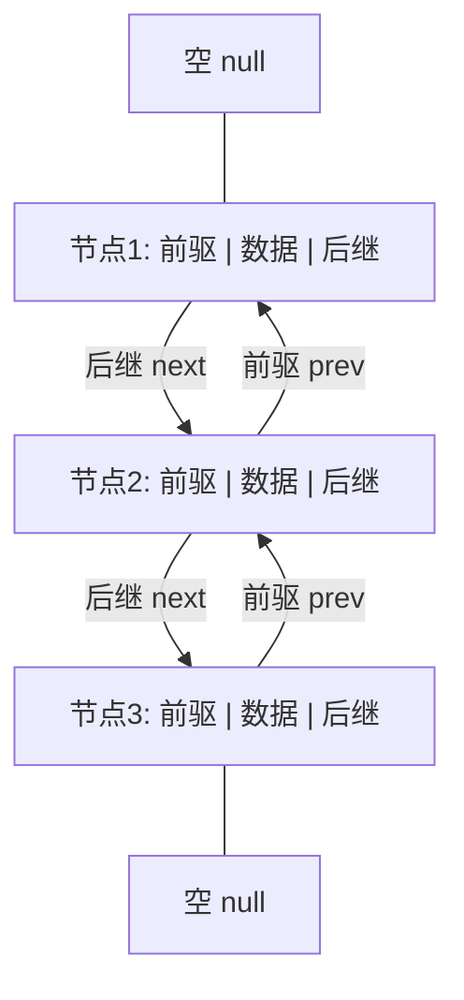
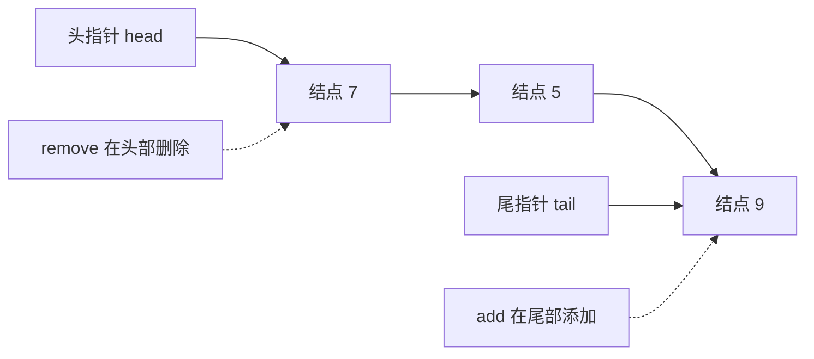

# Concept-Book Run

domain: /home/papagame/projects/digital-duck/cb-data-structure/public/domains/data_structure_ch03/input/graph.yaml
target: queue_operations_sllist
started: 2026-11-24T07:06:25

## Teaching order (5 concepts)

- node
- pointer_reference
- dllist
- sllist
- queue_operations_sllist

### node (0.9s)

## 节点

**定义。** 节点(node)是链式数据结构中最基本的存储单元。每个节点包含两部分:

1. **数据域**:存放一个数据值;
2. **引用域**(指针):存放指向其他节点的一个或多个引用。

链表中的节点只有一个"后继"引用 $\text{next}$;二叉树中的节点有 $\text{left}$ 和 $\text{right}$ 两个引用;图中的节点则可以有任意多个。没有后继的引用记为空值(`None`)。与数组不同,节点在内存中不必连续存放,它们靠引用彼此"串"起来。

**例题。** 用 Python 构建链表 $3 \to 7 \to 9$:

```python
class Node:
    def __init__(self, value, next=None):
        self.value = value   # 数据域
        self.next = next     # 引用域

c = Node(9)          # 尾节点,next 为 None
b = Node(7, c)
a = Node(3, b)       # a 是头节点
```

遍历时从头节点出发,沿 `next` 逐个访问,直到遇到 `None`:

```python
cur = a
while cur is not None:
    print(cur.value)
    cur = cur.next    # 输出 3, 7, 9
```

访问第 $k$ 个元素必须从头走 $k-1$ 步,所以时间复杂度为 $O(k)$,而数组的下标访问是 $O(1)$。


*图:三个节点通过 next 引用连成的单向链表,最后一个节点指向空值。*

**问题求解应用。** 在节点 `a` 与 `b` 之间插入值为 5 的新节点:

```python
new = Node(5, a.next)   # 先让新节点指向 b
a.next = new            # 再让 a 指向新节点
```

顺序很关键:若先执行 `a.next = new`,指向 $b$ 的引用就丢失了,后面的节点 $7, 9$ 将无法再被访问。已知前驱节点时,插入只改动常数个引用,时间为 $O(1)$;而数组在中间插入需要移动 $O(n)$ 个元素。

**练习。** (1) 写出删除 `a` 之后那个节点的两行代码。(2) 为什么在单向链表中删除某节点,通常需要先找到它的前驱?

**小结。** 节点 = 数据 + 引用。链表、树、图等结构都由节点通过引用组合而成。对节点引用的操作顺序和边界情况(如 `None`)正是这类问题的关键。

### pointer_reference (0.7s)

## 指针引用

**定义。** 指针引用(pointer reference)是存放在某个节点中的一个值,它指向另一个节点(通常保存的是该节点的内存地址或索引),从而把彼此独立的节点串成一个序列。一个单向链表节点包含两部分:

- `data`:该节点存储的数据;
- `next`:指针引用,指向下一个节点;最后一个节点的 `next` 为空值(`None` 或 `NULL`),表示序列结束。

与数组不同,链表节点在内存中不必连续排列,"顺序"完全由指针引用所编码。


*图:三个节点通过 next 指针引用串成单向链表,最后一个节点指向空值。*

**例题。** 用 Python 构造链表 $3 \to 7 \to 9$ 并遍历:

```python
class Node:
    def __init__(self, data):
        self.data = data
        self.next = None   # 指针引用,初始为空

a, b, c = Node(3), Node(7), Node(9)
a.next = b
b.next = c

p = a                      # 从头节点出发
while p is not None:
    print(p.data)
    p = p.next             # 沿指针引用前进一步
```

输出 `3 7 9`。关键在于 `p = p.next`:每执行一次,`p` 就从当前节点"跳"到它所指向的节点。遍历 $n$ 个节点需要 $n$ 步,时间复杂度为 $O(n)$。

**问题求解应用。** *在节点 B 之后插入值为 8 的新节点。*

```python
new = Node(8)
new.next = b.next   # ① 新节点先接住后继 C
b.next = new        # ② 再让 B 指向新节点
```

结果为 $3 \to 7 \to 8 \to 9$。**顺序不能颠倒**:若先执行 `b.next = new`,指向 C 的唯一引用就丢失了,节点 C 及其后面的所有节点将无法访问。已知前驱节点时,插入只需修改两个指针,时间为 $O(1)$,不必像数组那样移动 $O(n)$ 个元素;但要找到"节点 B"本身,仍需 $O(n)$ 的遍历。

**常见错误与检查。**

1. **空指针解引用**:对 `None` 访问 `.next` 会报错,遍历时必须先判断 `p is not None`。
2. **断链**:修改指针前,先确认原有引用已被另一个变量或指针保存。
3. **环**:若某节点的 `next` 指回前面的节点,遍历将永不终止。

**小结。** 指针引用把"下一个是谁"这一信息存进节点自身,使序列可以动态增长和重组。掌握它,就为理解链表、树、图等所有链式数据结构打下基础。

### dllist (14.8s)

## 双向链表(Dllist)

**定义。** 双向链表(doubly linked list)是一种线性数据结构:每个节点保存三个字段——`prev`(指向前驱节点的引用)、`data`(数据)和 `next`(指向后继节点的引用)。头节点的 `prev` 与尾节点的 `next` 均为 `null`。与单向链表相比,它多付出一个引用的空间,换来**双向遍历**的能力,并使"已知某节点就能在 $O(1)$ 时间内删除它"成为可能。


*图:双向链表中每个节点同时保存 prev 与 next 引用,相邻节点互相指向;单向链表则只有向右的 next 箭头。*

**节点定义与删除示例。**

```python
class Node:
    def __init__(self, data):
        self.data = data
        self.prev = None
        self.next = None

def remove(node):
    # 先把前后邻居彼此连接,再处理边界
    if node.prev: node.prev.next = node.next
    if node.next: node.next.prev = node.prev
```

设链表为 $A \leftrightarrow B \leftrightarrow C$,要删除 $B$。执行 `remove(B)` 后:$A.\text{next}=C$,$C.\text{prev}=A$,即 $A \leftrightarrow C$。整个过程只改动两个引用,无需从头查找 $B$ 的前驱,时间为 $O(1)$。在单向链表中,同样的操作必须先从头遍历找到 $B$ 的前驱,代价为 $O(n)$。

**问题求解应用。** 在节点 $p$ 之后插入新节点 $q$,需要按正确顺序更新四个引用:

1. `q.prev = p`
2. `q.next = p.next`
3. 若 `p.next` 不为空,则 `p.next.prev = q`
4. `p.next = q`

顺序很关键:若先执行第 4 步,`p.next` 的原值就丢失了,后继节点将无法接回。这类"断链"错误是双向链表最常见的 bug。

**复杂度比较。** 设链表长度为 $n$:

| 操作 | 单向链表 | 双向链表 |
|---|---|---|
| 已知节点,删除该节点 | $O(n)$ | $O(1)$ |
| 在已知节点后插入 | $O(1)$ | $O(1)$ |
| 从尾部向前遍历 | 不能直接做到 | $O(n)$ |
| 按下标访问第 $k$ 个 | $O(k)$ | $O(\min(k,\,n-k))$ |

最后一行说明:若同时保存头、尾指针,可从离目标更近的一端出发,最坏只需走 $n/2$ 步。

**应用场景。** 浏览器的前进/后退历史、文本编辑器的撤销/重做栈,以及 LRU 缓存(哈希表配合双向链表,在 $O(1)$ 时间内把节点移到表头并淘汰表尾)都依赖这一结构。代价是每个节点多占一个指针的空间,且每次修改都要维护两个方向的一致性。

**练习。** 写出在节点 $p$ **之前**插入节点 $q$ 的四步操作,并说明当 $p$ 是头节点时需要额外更新什么。(提示:需要更新链表的 `head` 引用。)

### sllist (0.7s)

## 单向链表(Sllist)

**定义。** 单向链表(singly linked list,简称 sllist)是一种线性数据结构:序列中的每个**节点**保存两部分内容——一个数据值 `data` 和一个指向下一个节点的引用 `next`。链表另外维护两个引用:`head` 指向第一个节点,`tail` 指向最后一个节点。最后一个节点的 `next` 为 `null`,表示序列结束。与数组不同,链表的节点在内存中不必连续,元素之间靠引用串联。

```mermaid
graph TD
    H[头指针 head] --> N1[节点1: 数据 | next]
    N1 --> N2[节点2: 数据 | next]
    N2 --> N3[节点3: 数据 | next]
    N3 --> NULL[空 null]
    NEW[新节点: 数据 | next] -.->|新节点的 next 指向原头节点| N1
    H2[第二步: head 更新为新节点] -.-> NEW
```
*图示:在表头插入新节点的两个步骤——先让新节点的 next 指向当前头节点,再把 head 指针改为指向新节点。*

**复杂度分析。** 设链表有 $n$ 个节点。

- 表头插入:只改两个引用,时间 $O(1)$。
- 借助 `tail` 在表尾插入:同样 $O(1)$。
- 删除表头:$O(1)$。
- 删除表尾:必须从 `head` 出发找到倒数第二个节点,时间 $O(n)$,因为单向链表无法"倒退"。
- 按位置 $k$ 访问:需要沿 `next` 走 $k$ 步,时间 $O(k)$,最坏 $O(n)$;数组则是 $O(1)$。

**例题。** 空链表上依次执行 `add(3)`、`add(7)`、`add(5)`(每次都在表头插入),求最终链表。

1. `add(3)`:链表为空,新节点既是头也是尾。此时 $head = tail = [3]$。
2. `add(7)`:新节点 $[7]$ 的 `next` 指向 $[3]$,然后 `head` 指向 $[7]$。链表:$7 \to 3$。
3. `add(5)`:同理得到 $5 \to 7 \to 3 \to \text{null}$,`head` 为 $[5]$,`tail` 仍为 $[3]$。

**注意顺序。** 若先执行 `head = new_node`,再设置 `new_node.next = head`,则 `new_node.next` 指向它自己,原链表随之丢失。正确顺序必须是先连接、后移动头指针。

**问题求解应用:反转链表。** 要把 $5 \to 7 \to 3$ 反转为 $3 \to 7 \to 5$,用三个指针 `prev`、`cur`、`nxt` 遍历:

```python
def reverse(head):
    prev, cur = None, head
    while cur:
        nxt = cur.next    # 先保存后继
        cur.next = prev   # 反转当前引用
        prev = cur        # 前进
        cur = nxt
    return prev           # 新的头节点
```

每个节点只被访问一次,时间为 $O(n)$,只用了常数个额外变量,空间为 $O(1)$。

**如何选择。** 若程序需要频繁在两端插入、删除表头(如栈、队列),单向链表很合适;若需要大量随机访问或"按下标取值",则应选用数组。

### queue_operations_sllist (15.1s)

## 队列操作(单链表实现)

**定义。** 队列(queue)遵循先进先出(FIFO)原则:`add(x)` 把元素加入队尾,`remove()` 取出并返回队首元素。用单链表 `SLList` 实现时,维护两个指针:`head` 指向第一个结点,`tail` 指向最后一个结点,另有计数器 $n$。

关键设计:**在尾部添加,在头部删除**。原因在于单链表每个结点只有 `next` 指针,没有 `prev`:

- 在头部删除只需改 `head`,不依赖前驱;
- 在尾部添加借助 `tail` 直接链接;
- 若反过来在尾部删除,则必须从 `head` 遍历到倒数第二个结点才能更新指针,耗时 $O(n)$。

```python
class Node:
    def __init__(self, x):
        self.x, self.next = x, None

class SLListQueue:
    def __init__(self):
        self.head = self.tail = None
        self.n = 0

    def add(self, x):
        u = Node(x)
        if self.n == 0:
            self.head = u          # 空队列:新结点既是头也是尾
        else:
            self.tail.next = u     # 链到旧尾结点之后
        self.tail = u
        self.n += 1

    def remove(self):
        if self.n == 0:
            raise IndexError("队列为空")
        x = self.head.x
        self.head = self.head.next
        self.n -= 1
        if self.n == 0:
            self.tail = None       # 队列变空,清除悬空的 tail
        return x
```

**例题。** 依次执行 `add(3)`、`add(7)`、`add(5)`、`remove()`、`add(9)`。

1. 三次 `add` 后:`head → 3 → 7 → 5 ← tail`,$n=3$。
2. `remove()` 返回 $3$(最先进入),`head` 前移,链表为 $7 → 5$,$n=2$。
3. `add(9)`:`tail.next` 指向新结点,链表为 $7 → 5 → 9$,$n=3$。

出队顺序 $3, 7, 5, 9,\dots$ 与入队顺序一致,符合 FIFO。

**复杂度分析。** 两个操作都只做固定数量的指针赋值与一次计数更新,没有循环或遍历,与 $n$ 无关:

$$T_{\text{add}}(n)=O(1),\qquad T_{\text{remove}}(n)=O(1).$$

**问题求解应用。** 在"打印任务调度"中,有 $m$ 个任务依次到达并按顺序处理。每个任务入队、出队各一次,总代价为 $m\cdot O(1)+m\cdot O(1)=O(m)$。若误用"尾部删除",每次出队需 $O(n)$,总代价可达 $O(m^2)$。

**易错点(边界情况)。**
- 空队列时 `add`:必须同时设置 `head` 和 `tail`,否则 `head` 仍为 `None`。
- 删除最后一个元素时:必须把 `tail` 置为 `None`,否则 `tail` 指向已被移除的结点,下一次 `add` 会把新结点链到"幽灵"结点上,元素丢失。


*图:单链表队列。`remove()` 作用于头部,`add(x)` 作用于尾部,二者均为 $O(1)$。*

**小结。** 将队首放在链表头、队尾放在链表尾,并同时维护 `head` 与 `tail`,即可使 FIFO 队列的两个核心操作都在常数时间内完成。

## Run complete

total: 51.4s
