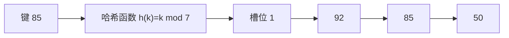
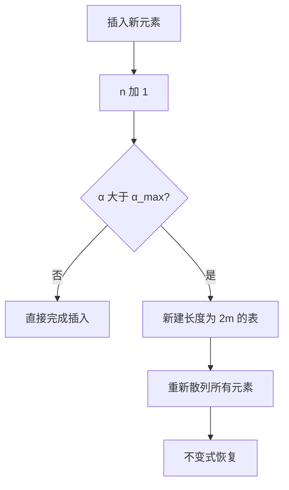
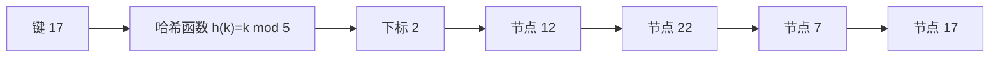
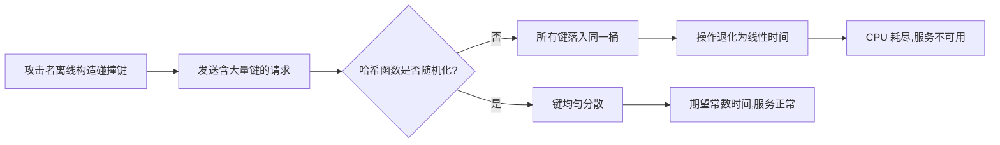

# Concept-Book Run

domain: /home/papagame/projects/digital-duck/cb-data-structure/public/domains/data_structure_ch05/input/graph.yaml
target: hash_collision_dos
started: 2026-11-24T07:10:50

## Teaching order (5 concepts)

- hash_table
- hash_function
- load_factor_invariant
- chained_hash_table
- hash_collision_dos

### hash_table (14.5s)

## 哈希表

**定义。** 当我们只需要存储全域 $U$ 中的少量键（$n \ll |U|$）时，为每个可能的键都分配一个位置既浪费又不现实。*哈希表*（hash table）使用一个长度为 $m$ 的数组 $T[0..m-1]$，并通过**哈希函数** $h: U \to \{0,1,\dots,m-1\}$ 把键 $k$ 映射到槽位 $h(k)$。因为 $|U| > m$，不同的键可能映射到同一个槽位，这称为**冲突**（collision）。

最常用的冲突处理方法是**链地址法**：每个槽位保存一个链表，所有哈希值相同的键都放入同一条链中。

定义**装载因子** $\alpha = n/m$。在"简单均匀哈希"假设下（每个键等可能地落入任一槽位，且相互独立），一条链的期望长度就是 $\alpha$。因此：

- 不成功查找的期望时间为 $\Theta(1+\alpha)$；
- 成功查找的期望时间同样为 $\Theta(1+\alpha)$。

若保持 $m = \Theta(n)$，则 $\alpha = O(1)$，查找、插入、删除的期望时间均为 $O(1)$。

**例题。** 取 $m=7$，$h(k) = k \bmod 7$，依次插入键 $50, 700, 76, 85, 92, 73$：

| 键 | $k \bmod 7$ | 槽位 |
|---|---|---|
| 50 | 1 | 1 |
| 700 | 0 | 0 |
| 76 | 6 | 6 |
| 85 | 1 | 1（与 50 冲突） |
| 92 | 1 | 1（再次冲突） |
| 73 | 3 | 3 |

最终槽位 1 的链为 $92 \to 85 \to 50$（新元素插在链头），其余槽位各有 0 或 1 个元素。此时 $n=6,\ m=7$，$\alpha \approx 0.86$。查找 85 时，先计算 $h(85)=1$，再沿链比较，只需 2 次比较。


*图：键 85 经哈希函数定位到槽位 1，再沿链表查找。*

**问题求解应用。** 

*问题：* 给定整数数组 $a$ 和目标值 $t$，判断是否存在两个元素之和等于 $t$。

*思路：* 暴力枚举需要 $O(n^2)$。改用哈希表：遍历每个 $x$，先查询 $t-x$ 是否已在表中；若在，则找到答案；否则把 $x$ 插入表中。

```python
def two_sum(a, t):
    seen = set()          # 基于哈希表实现
    for x in a:
        if t - x in seen:
            return True
        seen.add(x)
    return False
```

每个元素只做一次期望 $O(1)$ 的查询和一次插入，总期望时间为 $O(n)$，空间为 $O(n)$。这正是用空间换时间的典型例子。

**注意事项。** 当 $\alpha$ 过大时，链会变长，性能退化，最坏情况下所有键落入同一槽位，操作退化为 $O(n)$。实际实现会在 $\alpha$ 超过阈值（如 $0.75$）时将 $m$ 加倍并重新哈希所有键，使均摊代价仍为 $O(1)$。此外，好的哈希函数应使键尽量均匀分布；例如取模时，$m$ 宜选为远离 2 的幂的素数。

### hash_function (14.7s)

## 哈希函数

**定义。** 哈希表是一个长度为 $m$(即 $\text{length}(t)=m$)的数组 $t$。**哈希函数**是一个映射
$$h: U \to \{0,1,\dots,m-1\},$$
它把键 $x\in U$(键的全集)变成数组下标,表示 $x$ 应存放在 $t[h(x)]$。好的哈希函数应满足三条要求:

1. **确定性**:同一个键每次得到相同的下标。
2. **高效**:计算时间为 $O(1)$(对定长键)。
3. **均匀性**:各个下标被选中的概率大致相等,以减少冲突。

由于 $|U|\gg m$,由**鸽巢原理**可知,必有不同的键映射到同一下标,这称为**冲突**。哈希函数的目标不是消除冲突,而是让冲突尽量少。

**常用构造:除法哈希。** 若键是非负整数 $k$,取
$$h(k)=k \bmod m.$$
$m$ 最好选素数,并避开接近 $2^p$ 的值。若 $m=2^p$,则 $h(k)$ 只取决于 $k$ 的低 $p$ 位,高位信息被浪费。

**例题。** 设 $m=7$,依次插入键 $50,\ 700,\ 76,\ 85,\ 92$。

| 键 $k$ | 计算 | $h(k)$ |
|---|---|---|
| 50 | $50 = 7\cdot7+1$ | 1 |
| 700 | $700=7\cdot100+0$ | 0 |
| 76 | $76=7\cdot10+6$ | 6 |
| 85 | $85=7\cdot12+1$ | 1 |
| 92 | $92=7\cdot13+1$ | 1 |

键 $50, 85, 92$ 都落在下标 1,发生冲突,需要用链地址法或开放寻址法处理。

**字符串键。** 先把字符串转成整数,再取模。常用多项式哈希:
$$h(s)=\Big(\sum_{i=0}^{n-1} s_i\, b^{\,n-1-i}\Big)\bmod m,$$
其中 $s_i$ 是第 $i$ 个字符的编码,$b$ 是基数(如 31)。用 Horner 法则可在 $O(n)$ 时间内算出:

```python
def hash_str(s, m, b=31):
    h = 0
    for ch in s:
        h = (h * b + ord(ch)) % m
    return h

print(hash_str("cat", 101))  # 99*961+97*31+116 = 98,... mod 101
```

**问题求解应用。** 假设哈希函数满足**简单均匀哈希假设**:每个键等概率落入 $m$ 个位置中的任意一个,且彼此独立。那么向表中插入 $n$ 个键后,定义**装载因子** $\alpha=n/m$。用链地址法时,每条链的期望长度为 $\alpha$,所以一次查找的期望代价是
$$\Theta(1+\alpha).$$
若 $n=O(m)$,则查找、插入、删除的平均时间都是 $O(1)$。

*练习:* 一张表有 $m=1000$ 个槽位,要存 $n=5000$ 个键。此时 $\alpha=5$,平均每次查找约需比较 $1+\alpha=6$ 次。若要把 $\alpha$ 降到 $0.5$ 以下,表至少要扩容到 $m>10000$。这正是动态哈希表在 $\alpha$ 过大时**重新哈希(rehash)**的原因。

**小结。** 哈希函数把任意键压缩成有限范围内的下标。它的质量决定冲突的多少,进而决定哈希表能否达到平均 $O(1)$ 的性能。

### load_factor_invariant (14.3s)

## 负载因子不变式

**定义。** 设哈希表长度为 $m$(桶的个数),当前存储的元素个数为 $n$,则**负载因子**为

$$\alpha = \frac{n}{m}.$$

**负载因子不变式**是哈希表在每次插入、删除之后都要维持的约束:

$$\alpha \le \alpha_{\max}$$

其中 $\alpha_{\max}$ 是预先选定的常数(链地址法常取 $1$,开放寻址法常取 $0.5\sim0.75$)。一旦某次插入使 $\alpha>\alpha_{\max}$,就必须**扩容**:新建长度为 $2m$ 的表,并把所有元素重新散列进去,使不变式重新成立。

**为什么需要它。** 在简单均匀散列假设下:

- 链地址法:不成功查找的期望链长为 $\alpha$,期望代价为 $\Theta(1+\alpha)$。
- 开放寻址法:不成功查找的期望探查次数至多为 $\dfrac{1}{1-\alpha}$($\alpha<1$)。

只要 $\alpha\le\alpha_{\max}$ 且 $\alpha_{\max}$ 为常数,这些期望代价就是 $O(1)$。如果不维持不变式,$n$ 增大而 $m$ 固定,$\alpha$ 会线性增长,查找退化为 $\Theta(n)$。

**例题。** 开放寻址哈希表初始 $m=8$,规定 $\alpha_{\max}=0.75$。依次插入元素:

- 插入第 6 个元素后 $\alpha=6/8=0.75$,仍满足不变式。
- 插入第 7 个元素后 $\alpha=7/8=0.875>0.75$,触发扩容:$m\leftarrow16$,重新散列 7 个元素,此时 $\alpha=7/16\approx0.44$。

扩容前,不成功查找的期望探查次数约为 $\frac{1}{1-0.875}=8$;扩容后降为 $\frac{1}{1-0.44}\approx1.8$。

**问题求解:扩容的摊还代价。** 扩容一次需要 $\Theta(n)$ 的时间,会不会让插入变慢?考虑从空表出发连续插入 $N$ 个元素,表长每次翻倍,扩容发生在元素个数约为 $1,2,4,\dots,2^k$ 时($2^k\le N$)。总的重新散列代价为

$$\sum_{i=0}^{k}2^i=2^{k+1}-1<2N.$$

再加上 $N$ 次普通插入,总代价小于 $3N$,故每次插入的**摊还代价**为 $O(1)$。若改为每次只增长固定长度 $c$,则扩容次数约为 $N/c$,总代价为 $\Theta(N^2/c)$,摊还代价退化为 $\Theta(N)$。所以扩容必须按**固定比例**(如翻倍)增长,而不是按固定增量增长。

**练习。** 链地址哈希表 $m=100$,$\alpha_{\max}=1$。当 $n=100$ 时再插入一个元素,会发生什么?新的 $\alpha$ 是多少?

*解答:* $\alpha=101/100>1$,触发扩容,$m\leftarrow200$,重新散列全部 101 个元素,$\alpha=101/200=0.505$。

**要点。** 负载因子不变式把"表长随元素数增长"这一维护动作,转化为对期望查找代价的常数上界;翻倍扩容则保证维护本身的摊还代价也是常数。


*图:插入操作中负载因子的检查与扩容流程。*

### chained_hash_table (14.8s)

## 链式哈希表

### 定义

**链式哈希表**(chained hash table,也称"拉链法")由一个长度为 $m$ 的数组构成,数组的每个位置称为一个**桶**(bucket),每个桶存放一个链表。哈希函数 $h(k)$ 把键 $k$ 映射到下标 $0,1,\dots,m-1$。若多个键得到相同的下标(即发生**冲突**),它们就被依次追加到该下标对应的链表中。

三种基本操作如下:

- **插入**:计算 $h(k)$,把 $(k,v)$ 追加到 `table[h(k)]`。
- **查找**:计算 $h(k)$,只在 `table[h(k)]` 这一条链表中顺序比较。
- **删除**:先查找,再从链表中摘除该节点。

衡量表的拥挤程度用**装载因子** $\alpha = n/m$,其中 $n$ 是已存元素个数。

### 例题

取 $m=5$,$h(k)=k \bmod 5$,依次插入键 $12,\,22,\,7,\,15,\,17$。

| 下标 | 链表 |
|---|---|
| 0 | 15 |
| 1 | (空) |
| 2 | 12 → 22 → 7 → 17 |
| 3 | (空) |
| 4 | (空) |

因为 $12,22,7,17$ 除以 5 的余数都是 2,它们全部落入下标 2 的链表。查找 $17$ 时,先算出 $h(17)=2$,再沿链表比较 4 个节点。此时 $\alpha = 5/5 = 1$。

```python
class ChainedHashTable:
    def __init__(self, m=5):
        self.m = m
        self.table = [[] for _ in range(m)]

    def put(self, k, v):
        bucket = self.table[hash(k) % self.m]
        for i, (key, _) in enumerate(bucket):
            if key == k:              # 键已存在则更新
                bucket[i] = (k, v)
                return
        bucket.append((k, v))

    def get(self, k):
        for key, v in self.table[hash(k) % self.m]:
            if key == k:
                return v
        raise KeyError(k)
```

### 问题求解:复杂度分析

**简单均匀哈希假设**:每个键等可能地落入 $m$ 个桶中,且彼此独立。在此假设下,任一链表的期望长度恰为 $\alpha = n/m$。

- **不成功查找**(键不在表中):需要遍历整条链表,期望比较次数为 $\alpha$,加上计算哈希的 $O(1)$,总期望代价为 $\Theta(1+\alpha)$。
- **成功查找**:平均需检查的节点数约为 $1+\dfrac{\alpha}{2}-\dfrac{\alpha}{2n}$,同样是 $\Theta(1+\alpha)$。

**应用**:若要存储 $n=10^6$ 个键,并希望平均每次查找比较不超过 2 个节点,则需 $\alpha \le 1$,所以取 $m \ge 10^6$。实际中常在 $\alpha$ 超过某个阈值(如 $0.75$ 到 $1$)时**扩容**:把 $m$ 加倍并重新哈希所有元素。单次扩容代价为 $O(n)$,但按摊还分析,每次插入的平均代价仍是 $O(1)$。

**最坏情况**:若所有键都冲突到同一个桶,查找退化为 $\Theta(n)$。这说明哈希函数的质量至关重要。若把每条链表换成平衡二叉搜索树,最坏情况可降为 $O(\log n)$。


*图:键 17 经哈希函数定位到下标 2,再沿该桶的链表顺序查找,最终在第 4 个节点处命中。*

### hash_collision_dos (16.2s)

## 哈希碰撞拒绝服务攻击

### 定义

**哈希碰撞拒绝服务攻击**(hash collision DoS)是一种算法复杂度攻击:攻击者精心构造大量不同的键,使它们经哈希函数映射后落入同一个桶,从而把哈希表的操作从期望的常数时间退化为线性时间,耗尽服务器的 CPU 资源。

在正常情况下,设哈希表有 $m$ 个桶,存有 $n$ 个键,装载因子 $\alpha = n/m$。若哈希函数把键均匀分散,链地址法下一次查找的期望代价为

$$E[T] = \Theta(1+\alpha).$$

但若所有 $n$ 个键都落入同一个桶,该桶的链表长度为 $n$,一次查找就是 $\Theta(n)$。

### 例题

向空表依次插入 $n$ 个键,每次插入前需先检查键是否已存在(扫描所在链表)。

- **均匀情形**:第 $i$ 次插入扫描的链表平均长度约为 $i/m$,总代价为
$$\sum_{i=1}^{n}\Theta\!\left(1+\tfrac{i}{m}\right)=\Theta(n)\quad(m=\Theta(n)).$$
- **全碰撞情形**:第 $i$ 次插入需扫描长度为 $i-1$ 的链表,总代价为
$$\sum_{i=1}^{n}(i-1)=\frac{n(n-1)}{2}=\Theta(n^2).$$

取 $n=10^5$:前者约 $10^5$ 次基本操作,后者约 $5\times10^9$ 次,相差约 $5\times10^4$ 倍。一个只需几毫秒的请求,会变成数十秒的 CPU 占用。

### 问题求解应用

**攻击如何成立。** 设服务器用已知的确定性哈希(如 $h(s)=\left(\sum s_i\cdot 31^{\,k-i}\right) \bmod m$)解析 HTTP 参数。由于该函数结构简单,攻击者可以离线构造碰撞。例如 Java 中 `"Aa"` 与 `"BB"` 的哈希值相同(因为 $65\cdot31+97=66\cdot31+66$)。把它们任意拼接,$k$ 段就得到 $2^k$ 个长度为 $2k$ 的不同字符串,且哈希值全部相同。攻击者只需发送一个包含几万个这样参数名的 POST 请求,就能使服务器的 CPU 在 $\Theta(n^2)$ 时间内被占满。

**防御思路。**

1. **随机化哈希**:每个进程启动时随机选取密钥 $k$,使用带密钥的哈希 $h_k(x)$(如 SipHash)。攻击者不知道 $k$,就无法预先构造碰撞。通用哈希族保证对任意不同的 $x\neq y$,
$$\Pr_{h}[\,h(x)=h(y)\,]\le \frac{1}{m},$$
于是即使输入由对手选择,期望代价仍为 $\Theta(1+\alpha)$。
2. **限制输入规模**:限制单个请求的参数个数与体积。
3. **改进数据结构**:当桶内链表过长时转为平衡树,将最坏情况由 $\Theta(n)$ 降至 $\Theta(\log n)$,总代价降为 $O(n\log n)$。

**练习。** 某服务器对 $5\times10^4$ 个全碰撞参数做上述插入,每次比较耗时 $1\,\text{ns}$。估算总耗时。(答案:$\frac{n^2}{2}\approx1.25\times10^9$ 次比较,约 $1.25$ 秒;若改用平衡树,约 $n\log_2 n\approx8\times10^5$ 次比较,不足 $1$ 毫秒。)


*图:有无随机化哈希时,同一攻击请求的两种结局。*

## Run complete

total: 93.6s
