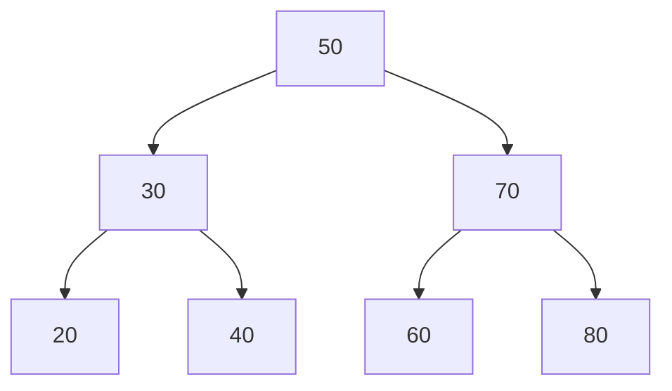
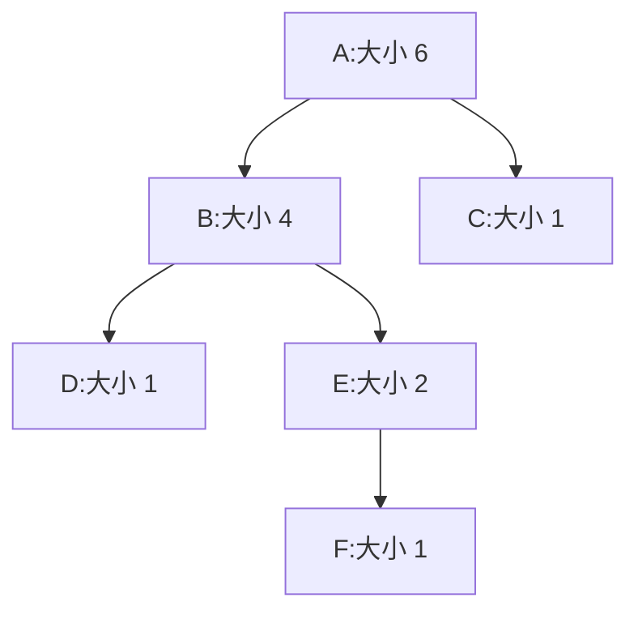
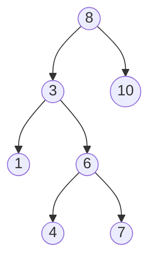
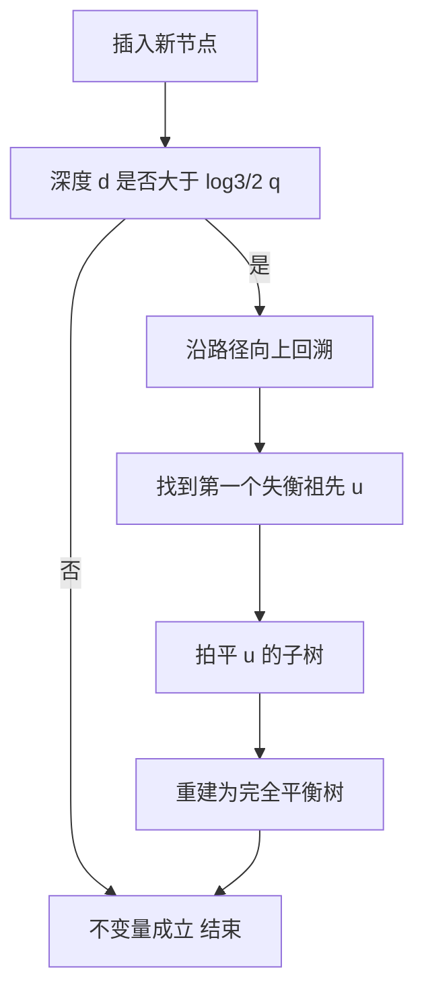
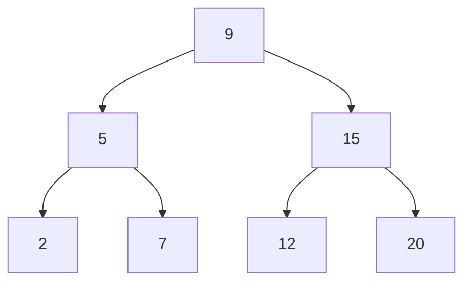
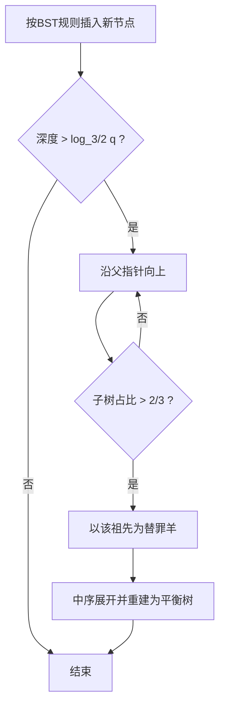
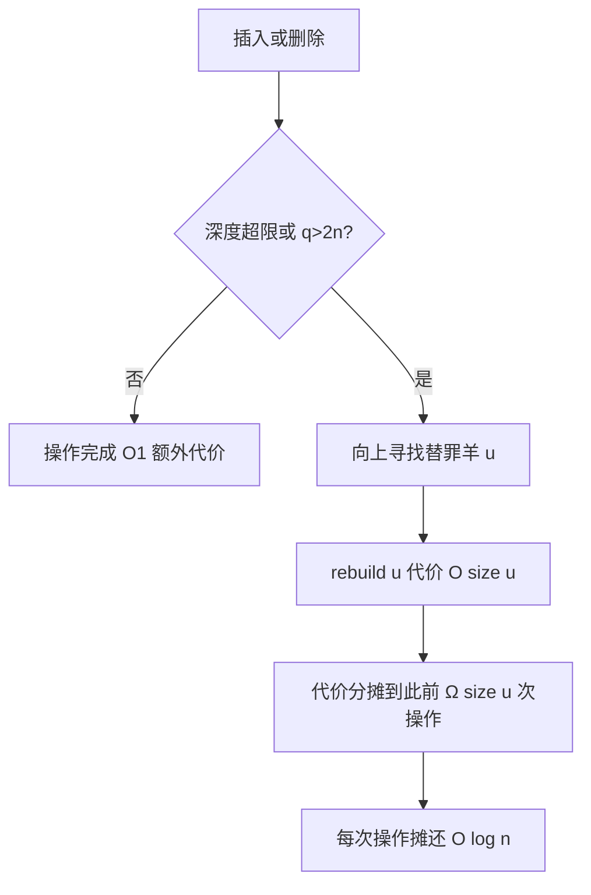

# Concept-Book Run

domain: /home/papagame/projects/digital-duck/cb-data-structure/public/domains/data_structure_ch08/input/graph.yaml
target: scapegoat_tree_performance
started: 2026-11-24T07:18:23

## Teaching order (13 concepts)

- binary_search_tree
- scapegoat_tree
- subtree_size
- tree_height
- height_bound_invariant
- rebuild_operation
- scapegoat_node
- amortized_analysis
- scapegoat_existence_lemma
- credit_scheme
- scapegoat_add
- scapegoat_remove
- scapegoat_tree_performance

### binary_search_tree (0.8s)

## 二叉搜索树

**定义。** 二叉搜索树(Binary Search Tree,BST)是一棵二叉树,其每个结点存储一个来自全序集的键值,并满足**搜索性质**:对任意结点 $x$,

$$
\forall\, y \in \text{left}(x):\ \text{key}(y) < \text{key}(x), \qquad \forall\, z \in \text{right}(x):\ \text{key}(z) > \text{key}(x).
$$

该性质对每个结点都成立,而不只是对根结点成立。由此可得:对 BST 做**中序遍历**(左 → 根 → 右),输出的键值严格递增。

**查找、插入与删除。** 查找键 $k$ 时,从根出发:若 $k$ 等于当前键则找到;若 $k$ 更小则进入左子树;否则进入右子树。每比较一次,就排除一整棵子树。

```python
def search(node, k):
    while node and node.key != k:
        node = node.left if k < node.key else node.right
    return node
```

插入沿用同样的路径,在遇到空位处挂上新结点。删除分三种情形:被删结点是叶子(直接移除);只有一个孩子(用孩子顶替);有两个孩子(用右子树中的最小结点,即中序后继,替换其键值,再删除该后继)。

**例题。** 依次插入 $50, 30, 70, 20, 40, 60, 80$,得到一棵完全平衡的树。查找 $60$:

1. $60 > 50$,走右子树;
2. $60 < 70$,走左子树;
3. $60 = 60$,找到,共比较 3 次。

七个结点只需最多 3 次比较。


*上例构成的二叉搜索树:每个结点左边的值更小,右边的值更大。*

**复杂度分析。** 查找、插入、删除的代价都与树高 $h$ 成正比,即 $O(h)$。树高取决于插入顺序:

- 平衡情形:$n$ 个结点的树高为 $h = \lfloor \log_2 n \rfloor$,操作为 $O(\log n)$。
- 退化情形:若按 $1,2,3,\dots,n$ 的升序插入,树退化为一条链,$h = n-1$,操作退化为 $O(n)$。
- 随机插入顺序下,期望树高为 $O(\log n)$。

**问题求解应用。**

*问题 1:验证 BST。* 一棵树是否是合法的 BST?只比较结点与其直接孩子是**不够的**。例如根为 $10$、右孩子为 $15$、而 $15$ 的左孩子为 $6$,每个局部看都合理,但 $6 < 10$ 却位于根的右子树中。正确做法是递归时携带取值区间 $(lo, hi)$,或检查中序遍历是否严格递增。

*问题 2:第 $k$ 小的元素。* 做中序遍历并计数,计到第 $k$ 个结点即停止,时间为 $O(h + k)$。

*问题 3:选择数据结构。* 需要频繁插入并保持有序,又要支持范围查询时,BST 比排序数组(插入需 $O(n)$ 移动)更合适;但若输入可能已有序,应使用 AVL 树或红黑树等自平衡变体,以保证 $h = O(\log n)$。

**小结。** BST 的核心是"每个结点把键空间一分为二",效率则完全取决于树的高度。

### scapegoat_tree (14.6s)

## 替罪羊树

**定义。** 替罪羊树(scapegoat tree)是一种自平衡二叉搜索树,它不使用旋转,也不在节点中存储平衡因子或颜色,只额外维护两个计数器:$n$ 为当前节点数,$q$ 为自上次整体重建以来的"上界"计数(插入时增加,删除时 $n$ 减少,而 $q$ 保持不变,仅当 $n<\alpha q$ 时重建整棵树并令 $q=n$)。设平衡参数 $\alpha\in(\tfrac12,1)$。树被称为 **$\alpha$-高度平衡**,当且仅当其高度满足
$$h\le \lfloor\log_{1/\alpha} q\rfloor .$$
若插入后某节点深度超过 $\log_{1/\alpha} q$,就沿插入路径向上寻找一个"替罪羊":满足
$$\frac{\text{size}(\text{子节点})}{\text{size}(\text{该节点})}>\alpha$$
的最近祖先。随后将以替罪羊为根的子树拍平成有序序列,再重建为完全平衡的子树。这就是**部分重建**。

**例题。** 取 $\alpha=\tfrac23$,依次插入 $1,2,3,4$ 得到一条链:$1\to2\to3\to4$,此时 $n=q=4$。允许的最大深度为 $\lfloor\log_{3/2}4\rfloor=\lfloor 3.42\rfloor=3$。插入 $4$ 的深度恰为 $3$,未超限。再插入 $5$,此时 $n=q=5$,深度为 $4$,而 $\lfloor\log_{3/2}5\rfloor=\lfloor3.97\rfloor=3$,违反条件。从新节点 $5$ 向上检查:

- 节点 $4$:$\text{size}(5)/\text{size}(4)=1/2\le\tfrac23$,不是替罪羊;
- 节点 $3$:$2/3\le\tfrac23$,不是;
- 节点 $2$:$3/4>\tfrac23$,是替罪羊。

将以 $2$ 为根的子树 $\{2,3,4,5\}$ 中序拍平,取中位数重建,得到根为 $3$(或 $4$)的平衡子树。整棵树高度降为 $3$,条件恢复。

**问题求解应用。** 为什么重建代价是可接受的?关键是摊还分析:

1. **查找** 始终是 $O(\log n)$,因为高度 $\le\log_{1/\alpha}q$,且 $q\le n/\alpha$,故 $h=O(\log n)$。
2. **重建** 一棵含 $s$ 个节点的子树需要 $\Theta(s)$ 时间。替罪羊子树在重建后是完全平衡的,要再次变得失衡(某子节点占比超过 $\alpha$),必须在其中再做 $\Omega(s)$ 次插入或删除。因此重建代价可分摊到这些操作上,每次操作摊还 $O(\log n)$。
3. **删除** 只做普通 BST 删除,并令 $n$ 减 1;当 $n<\alpha q$ 时重建整棵树,代价 $\Theta(n)$ 可由此前至少 $(1-\alpha)q$ 次删除分摊。

**小结。** 替罪羊树用"偶尔大扫除"取代"每次小调整":查找最坏 $O(\log n)$,插入与删除摊还 $O(\log n)$,实现简单、节点无额外字段,代价是个别操作可能耗时 $O(n)$。$\alpha$ 越接近 $\tfrac12$,树越矮但重建越频繁;越接近 $1$,则相反。

### subtree_size (13.8s)

## 子树大小

### 定义

在一棵二叉树中,以节点 $v$ 为根的**子树大小**(subtree size)指这棵子树所包含的节点总数,包括 $v$ 本身,记作 $\operatorname{size}(v)$。它满足递推关系:

$$
\operatorname{size}(v)=
\begin{cases}
0, & v=\text{空},\\[4pt]
1+\operatorname{size}(v.\text{left})+\operatorname{size}(v.\text{right}), & \text{否则}.
\end{cases}
$$

叶节点的子树大小为 $1$,整棵树的大小就是根节点的子树大小。子树大小常用来衡量**平衡性**:若每个节点的左右子树大小相差不大,树的高度就接近 $\log_2 n$,查找、插入等操作的代价也就接近 $O(\log n)$。

### 例题

考虑如下二叉树:根节点 $A$ 的左孩子为 $B$,右孩子为 $C$;$B$ 的左孩子为 $D$,右孩子为 $E$;$E$ 的左孩子为 $F$。

自底向上计算:

- $\operatorname{size}(D)=\operatorname{size}(C)=\operatorname{size}(F)=1$;
- $\operatorname{size}(E)=1+\operatorname{size}(F)+0=2$;
- $\operatorname{size}(B)=1+\operatorname{size}(D)+\operatorname{size}(E)=1+1+2=4$;
- $\operatorname{size}(A)=1+\operatorname{size}(B)+\operatorname{size}(C)=1+4+1=6$。


*图中每个节点标注了以它为根的子树大小,数值由叶向根逐层累加得到。*

### 问题求解应用:判断平衡条件

**权重平衡**(weight-balanced)树要求:对每个节点 $v$,较大的一侧子树大小不超过整棵子树的某个比例,例如

$$
\max\big(\operatorname{size}(v.\text{left}),\ \operatorname{size}(v.\text{right})\big)\le \alpha\cdot \operatorname{size}(v),\quad \tfrac12<\alpha<1 .
$$

取 $\alpha=\tfrac23$ 检查上例的根 $A$:较大一侧为 $\operatorname{size}(B)=4$,而 $\alpha\cdot 6=4$,$4\le 4$,条件成立。再检查 $B$:$\max(1,2)=2$,$\alpha\cdot 4\approx 2.67$,成立。检查 $E$:较大一侧为 $1$,$\alpha\cdot 2\approx1.33$,成立。所以这棵树满足 $\alpha=\tfrac23$ 的权重平衡。

**为什么这能保证高度?** 每向下走一步,子树大小至多变为原来的 $\alpha$ 倍,所以走 $h$ 步后大小至多为 $n\alpha^h$。大小至少为 $1$,故 $n\alpha^h\ge 1$,即

$$
h\le \frac{\log n}{\log(1/\alpha)}=O(\log n).
$$

**实现要点:**在节点中缓存 $\operatorname{size}$ 字段,每次插入或删除后沿路径回溯更新:$v.\text{size}\leftarrow 1+\operatorname{size}(v.\text{left})+\operatorname{size}(v.\text{right})$。这样每次平衡检查只需 $O(1)$ 时间,而不必重新遍历整棵子树($O(n)$)。同一字段还能支持**顺序统计**:要找第 $k$ 小的元素,比较 $k$ 与 $\operatorname{size}(v.\text{left})+1$,即可决定向左、向右或就是当前节点,耗时 $O(h)$。

### tree_height (13.6s)

## 树的高度

### 定义

在一棵树中,**高度**(height)是从根节点到任意叶节点的最长路径所包含的**边数**。记树 $T$ 的高度为 $h(T)$,则可递归定义为:

$$
h(T)=\begin{cases}
-1 & T \text{ 为空树},\\
0 & T \text{ 只有一个节点},\\
1+\max\limits_{c\,\in\,\text{根的子树}} h(c) & \text{其他情况}.
\end{cases}
$$

(有些教材按节点数计算,此时所有结果加 1;使用时务必先确认约定。本节统一按边数计算。)

高度之所以重要,是因为查找、插入、删除等操作都是沿着一条从根出发的路径向下走,**最坏情况的代价正比于 $h$**。

### 例题

对下面的二叉树计算高度:



*根节点 8 的最长路径是 8→3→6→4(或 8→3→6→7),共 3 条边。*

按递归定义自底向上计算:

- 叶节点 1、4、7、10:$h=0$。
- 节点 6:$h = 1+\max(0,0)=1$。
- 节点 3:$h = 1+\max(h(1),h(6)) = 1+\max(0,1)=2$。
- 节点 10:$h=0$。
- 根节点 8:$h = 1+\max(2,0)=3$。

所以 $h(T)=3$。注意左右子树的高度不同,取的是**较大者**。

### 问题求解:高度如何决定查找代价

**问题**:一棵含 $n=1023$ 个节点的二叉搜索树,最坏情况下需要比较多少次?

**分析**:查找每下降一层最多比较一次,因此最坏比较次数为 $h+1$。关键在于 $h$ 的范围。

1. **最好情形(完全平衡)**:高度为 $h$ 的二叉树最多有 $2^{h+1}-1$ 个节点。令 $2^{h+1}-1\ge n$,得
$$
h \ge \lceil \log_2(n+1)\rceil - 1 .
$$
当 $n=1023$ 时,$h_{\min}=\log_2 1024-1=9$,最坏只需 10 次比较。

2. **最坏情形(退化为链)**:若按递增顺序依次插入 $1,2,\dots,n$,每个节点只有右孩子,则 $h=n-1=1022$,查找退化成线性扫描,需 1023 次比较。

因此对于 $n$ 个节点的二叉树,
$$
\lceil \log_2(n+1)\rceil-1 \;\le\; h \;\le\; n-1,
$$
即查找的最坏代价可以从 $O(\log n)$ 一直变化到 $O(n)$。

**结论**:树的高度,而不是节点总数,才是衡量查找效率的真正指标。这正是 AVL 树、红黑树等**自平衡树**存在的原因:它们在每次插入或删除后通过旋转把高度维持在 $O(\log n)$,从而保证最坏情况下的对数级查找。

**练习**:对一棵有 $n=100$ 个节点的二叉树,求高度的最小可能值与最大可能值。(答案:$\lceil\log_2 101\rceil-1=6$;$99$。)

### height_bound_invariant (15.4s)

## 高度界不变量

**定义。** 设 $n$ 为 ScapegoatTree 当前的节点数,$q$ 为"上界计数器",它记录自上次整体重建以来树可能达到的最大规模。每次插入使 $n$ 与 $q$ 同时加 1;删除只让 $n$ 减 1,而 $q$ 保持不变;当 $q>2n$ 时,整棵树被重建,并令 $q=n$。**高度界不变量**要求树的高度 $h$ 始终满足

$$h \le \log_{3/2} q = \frac{\ln q}{\ln(3/2)}.$$

因为 $q$ 至多是 $n$ 的常数倍(重建规则保证 $n\le q\le 2n$),所以 $h=O(\log n)$,搜索时间也是 $O(\log n)$。

**为什么底数是 $3/2$?** ScapegoatTree 使用 $\alpha=2/3$ 的权重平衡:若节点 $u$ 的某个子树大小超过 $\tfrac23\,\text{size}(u)$,则 $u$ 失衡。一个深度为 $d$ 的节点,其所在每一层的子树大小至多是上一层的 $2/3$,因此若所有祖先都平衡,则

$$1 \le n\left(\tfrac23\right)^{d}\ \Longrightarrow\ d\le\log_{3/2} n\le \log_{3/2} q.$$

**例题。** 设 $q=100$,计算允许的最大高度:

$$\log_{3/2}100=\frac{\ln 100}{\ln 1.5}=\frac{4.605}{0.405}\approx 11.36,$$

所以高度不得超过 $11$。现在插入一个新节点,它落在深度 $12$ 处。此时 $n$ 与 $q$ 均加 1(变为 $101$),但 $\log_{3/2}101\approx 11.38$,深度 $12>11.38$,**不变量被破坏**。

**应用:寻找替罪羊。** 一旦插入后检测到 $d>\log_{3/2} q$,就沿插入路径向上回溯,寻找第一个失衡的祖先 $u$,即满足

$$\text{size}(\text{子节点})>\tfrac23\,\text{size}(u)$$

的节点,它就是"替罪羊"。理由是:若路径上所有祖先都平衡,由上面的推导就有 $d\le\log_{3/2}n\le\log_{3/2}q$,与 $d>\log_{3/2}q$ 矛盾;所以替罪羊必然存在。把以 $u$ 为根的子树拍平成有序数组,再递归地以中位数为根重建为完全平衡的树,不变量即可恢复。

**摊还分析要点。** 重建代价为 $O(\text{size}(u))$,但只有在大量更新使子树严重失衡之后才会发生,把代价摊到这些更新上,每次插入或删除的摊还代价为 $O(\log n)$。


*图:插入后检查高度界不变量,若被破坏则定位替罪羊并重建子树。*

**小结。** 高度界不变量用一个简单的数值阈值 $\log_{3/2}q$ 取代了每次操作都维护严格平衡的开销:平时几乎不做额外工作,只在阈值被突破时才局部重建,从而同时保证了 $O(\log n)$ 的搜索时间与 $O(\log n)$ 的摊还更新代价。

### rebuild_operation (14.7s)

## 重建操作(Rebuild Operation)

**定义。** 在平衡二叉搜索树(如替罪羊树)中,当以结点 $u$ 为根的子树失衡时,**重建操作**会销毁该子树,并用同样的 $\text{size}(u)$ 个键重新构造一棵**完美平衡**的二叉搜索树。整个过程耗时 $O(\text{size}(u))$,由辅助过程 `build_balanced` 完成。

重建分两步:

1. **压平(flatten)**:对 $u$ 的子树做中序遍历,按升序把所有键收集到数组 $A[0..m-1]$,其中 $m=\text{size}(u)$。
2. **建树(build_balanced)**:递归地取中点作根,左半段建左子树,右半段建右子树。

```python
def build_balanced(A, lo, hi):      # 区间 [lo, hi)
    if lo >= hi: return None
    mid = (lo + hi) // 2
    node = Node(A[mid])
    node.left  = build_balanced(A, lo, mid)
    node.right = build_balanced(A, mid + 1, hi)
    return node
```

**为什么是 $O(m)$?** 中序遍历访问每个结点一次,耗时 $O(m)$;`build_balanced` 为每个键恰好创建一个结点,其递归式为
$$T(m)=2T(m/2)+O(1),$$
由主定理(或直接计数:共 $m$ 个结点,每个 $O(1)$)得 $T(m)=O(m)$。因每次取中点,左右子树大小至多相差 1,故树高为 $\lceil \log_2(m+1)\rceil$。

**例题。** 设某子树中序遍历得 $A=[2,5,7,9,12,15,20]$($m=7$)。

- 区间 $[0,7)$:$\text{mid}=3$,根为 $9$。
- 左段 $[2,5,7]$:根 $5$,孩子 $2$、$7$。
- 右段 $[12,15,20]$:根 $15$,孩子 $12$、$20$。

结果是高度为 $2$ 的满二叉树,其中 $\lceil\log_2 8\rceil=3$ 层。原先若是一条退化的链(高度 $6$),重建后查询代价从 $O(m)$ 降到 $O(\log m)$。


*图:对有序数组 [2,5,7,9,12,15,20] 调用 build_balanced 得到的完美平衡树。*

**问题求解应用。** 替罪羊树规定:若某结点 $v$ 满足 $\text{size}(v.\text{child}) > \alpha\cdot \text{size}(v)$($\tfrac12<\alpha<1$),则称其失衡。插入后沿路径向上找到**最高**的失衡祖先 $u$,对其执行重建。

*摊还分析思路*:重建后 $u$ 的两棵子树大小几乎相等,要再次使 $u$ 失衡,至少需要 $\Omega\big((2\alpha-1)\,\text{size}(u)\big)$ 次插入。把重建的 $O(\text{size}(u))$ 代价均摊给这些插入,每次插入摊到 $O(1)$ 的重建费用;每个键又至多被其 $O(\log n)$ 个祖先"付费",故插入的摊还代价为 $O(\log n)$。

**练习。** 对 $A=[1,\dots,10]$ 调用 `build_balanced`(区间 $[0,10)$),写出根结点以及左、右子树的大小,并验证树高为 $\lceil\log_2 11\rceil=4$。(提示:$\text{mid}=5$,根为 $A[5]=6$,左子树 5 个键,右子树 4 个键。)

### scapegoat_node (15.0s)

## 替罪羊节点

**定义。** 替罪羊树(scapegoat tree)是一种不存储平衡标记的自平衡二叉搜索树。它只维护一个参数 $\alpha\in(1/2,1)$,取 $\alpha=2/3$ 时,要求树高满足
$$h\le \log_{3/2} n .$$
插入新节点 $u$ 后,如果 $u$ 的深度超过这一上界,就沿 $u$ 向根的路径向上找第一个**失衡祖先** $w$,满足
$$\frac{\operatorname{size}(w.\text{child})}{\operatorname{size}(w)}>\frac{2}{3}.$$
这个 $w$ 就是**替罪羊节点**。它的某个孩子子树占比过大,所以要为这次过深的插入"负责"。处理办法是把以 $w$ 为根的整棵子树重建为完全平衡的树。

**为什么一定存在。** 用反证法。设路径上每个祖先都满足 $\operatorname{size}(\text{child})\le\frac23\operatorname{size}(\text{parent})$,那么深度为 $d$ 的节点 $u$ 满足
$$1\le \operatorname{size}(u)\le \left(\tfrac23\right)^{d} n ,$$
即 $d\le\log_{3/2}n$,这与"$u$ 过深"矛盾。所以路径上至少有一个祖先违反该比例,替罪羊节点必然存在。

**工作示例。** 设 $n=10$,高度上界为 $\lfloor\log_{3/2}10\rfloor=5$。某次插入使 $u$ 落在深度 6。从 $u$ 向上逐层计算子树大小:

| 节点 | 子树大小 | 其在父节点中的占比 |
|---|---|---|
| $u$ | 1 | — |
| $p_1$ | 2 | — |
| $p_2$ | 3 | — |
| $p_3$ | 5 | $3/5=0.6\le 2/3$ |
| $p_4$ | 8 | $5/8=0.625\le 2/3$ |
| $p_5$ | 10 | $8/10=0.8>2/3$ |

第一个违反条件的是 $p_5$,所以 $w=p_5$。把它的 10 个节点按中序展开成有序数组,再取中点递归建树,新高度为 $\lceil\log_2 11\rceil-1=3$,深度 6 的违规随之消除。

**问题求解应用:代价分析。** 重建 $w$ 需要 $O(\operatorname{size}(w))$ 时间,看起来很贵。但 $w$ 的孩子占比超过 $2/3$,说明那一侧积累了大量未被平衡的插入。重建后,$w$ 两侧大小相差至多 1。要再次让某一侧占比超过 $2/3$,至少还需要 $\Omega(\operatorname{size}(w))$ 次插入。把重建费用均摊到这些插入上,每次插入的均摊代价为 $O(\log n)$。因此插入的均摊时间是 $O(\log n)$,查找的最坏时间也是 $O(\log n)$。

**练习。** 某节点 $w$ 的 $\operatorname{size}=30$,左子树大小 21,右子树大小 8。判断 $w$ 是否为替罪羊节点。
解:$21/30=0.7>2/3$,满足条件。若 $w$ 是路径上自下而上的第一个这样的节点,它就是替罪羊节点,需要重建这 30 个节点。

**要点。** 替罪羊节点由比例判据确定,不需要额外的平衡标记。局部重建加上均摊分析,使整棵树的高度始终保持在 $O(\log n)$。

### amortized_analysis (13.5s)

## 摊还分析

**定义。** 摊还分析(amortized analysis)用来计算一个操作序列中**每次操作的平均代价**,并且这个平均是对最坏情况序列取的,与概率无关。有些操作偶尔很贵(例如重建数据结构),但如果昂贵操作之前必然有许多便宜操作,总代价仍然很小。

设 $n$ 个操作的实际代价为 $c_1,\dots,c_n$,则摊还代价的上界为
$$
\hat{c}=\frac{1}{n}\sum_{i=1}^{n}c_i .
$$
本节使用**记账法(credit scheme)**:给每个操作规定一个摊还代价 $\hat{c}_i$,多收的部分作为"积分"存起来,供以后昂贵操作支付。只要积分余额始终 $\ge 0$,就有
$$
\sum_{i=1}^{n} c_i \;\le\; \sum_{i=1}^{n}\hat{c}_i .
$$

**示例:动态数组的扩容。** 数组容量为 $m$ 且已满时,再插入一个元素需要新开容量 $2m$ 的数组并复制 $m$ 个元素(重建),代价为 $m+1$。普通插入代价为 $1$。

规定每次插入的摊还代价为 $\hat{c}=3$:
- $1$ 个单位用于插入本身;
- $2$ 个单位作为积分存放在新元素上。

当容量从 $m/2$ 扩到 $m$ 后,后面的 $m/2$ 次插入共攒下 $2\cdot\frac{m}{2}=m$ 个积分,正好支付下一次重建复制 $m$ 个元素的开销。所以积分永远不会为负,即使最坏的那次插入代价为 $\Theta(m)$,每次插入的摊还代价仍是 $O(1)$。

**问题求解应用。** 连续插入 $n=16$ 个元素,初始容量为 $1$。重建发生在插入第 $2,3,5,9$ 个元素时,复制的元素数分别为 $1,2,4,8$,总复制量为 $15$。

总实际代价为
$$
\sum c_i = 16 + (1+2+4+8) = 31 \;\le\; 3\times 16 = 48 .
$$
推广到一般的 $n$:复制总量为
$$
\sum_{k=0}^{\lfloor\log_2 n\rfloor} 2^k < 2n,
$$
所以总代价小于 $n+2n=3n$,与记账法的结论一致。

**解题步骤:**
1. 找出昂贵操作及其触发条件(此处是"数组已满");
2. 估计昂贵操作之前至少有多少次便宜操作;
3. 设定摊还代价,使多收的积分刚好覆盖昂贵操作;
4. 验证积分余额始终非负。

**注意。** 摊还界是对整个操作序列的**最坏情况保证**,不是平均情况的概率估计。它只限制总代价,不限制某一次操作的延迟:单次重建仍然很慢。如果系统对单次响应时间有严格要求,就需要另外的技术,例如增量式重建。

### scapegoat_existence_lemma (13.3s)

## 替罪羊存在性引理

**背景。** 替罪羊树(scapegoat tree)是一种不存储平衡信息的二叉搜索树。设当前树中有 $q$ 个节点,平衡参数取 $\alpha = 2/3$。若插入后新节点的深度超过 $\log_{3/2} q$,就必须找出一个"替罪羊"并重建其子树。本节证明:这样的节点一定存在。

**定义。** 记 $\mathrm{size}(v)$ 为以 $v$ 为根的子树的节点数。若节点 $v$ 的某个孩子 $c$ 满足
$$\mathrm{size}(c) > \tfrac{2}{3}\,\mathrm{size}(v),$$
则称 $v$ 是**不平衡**节点,也就是替罪羊的候选。

**引理 8.1。** 若节点 $u$ 的深度 $d(u) > \log_{3/2} q$,则从 $u$ 到根的路径上至少有一个不平衡节点。

**证明(反证法)。** 设路径为 $u = v_d, v_{d-1}, \dots, v_0 = \text{根}$,并假设路径上每个节点都平衡。于是对每个 $i$,
$$\mathrm{size}(v_{i+1}) \le \tfrac{2}{3}\,\mathrm{size}(v_i).$$
从根出发逐层应用,得到
$$\mathrm{size}(v_d) \le \left(\tfrac{2}{3}\right)^{d} \mathrm{size}(v_0) \le \left(\tfrac{2}{3}\right)^{d} q.$$
又因为 $\mathrm{size}(v_d) \ge 1$,所以
$$1 \le \left(\tfrac{2}{3}\right)^{d} q \;\Longrightarrow\; \left(\tfrac{3}{2}\right)^{d} \le q \;\Longrightarrow\; d \le \log_{3/2} q.$$
这与 $d > \log_{3/2} q$ 矛盾。因此路径上必有不平衡节点。$\blacksquare$

**例题。** 设 $q = 100$,则 $\log_{3/2} 100 = \dfrac{\ln 100}{\ln 1.5} \approx \dfrac{4.605}{0.405} \approx 11.36$。若新插入节点深度为 $12$,引理保证路径上存在不平衡节点。检验:若 12 层全部平衡,叶子所在子树大小至多 $100\cdot(2/3)^{12} \approx 100 \times 0.0077 = 0.77 < 1$,不可能,因为子树至少含 1 个节点。

**应用:如何找到替罪羊。** 引理只保证存在,算法则要实际找出它。做法是从新节点向根回溯,沿途计算每个祖先的子树大小,遇到第一个满足 $\mathrm{size}(c) > \tfrac{2}{3}\,\mathrm{size}(v)$ 的 $v$ 就停止,并重建以 $v$ 为根的子树。回溯最多走 $O(\log q)$ 层,但需要逐层求子树大小,所以单次查找的代价与被重建子树的规模同阶。这就是替罪羊树的均摊分析要处理的内容。

**要点。**
- 深度超限是"存在不平衡祖先"的充分条件。
- 证明的核心是:每一层平衡会让子树大小至少缩小为原来的 $2/3$,而子树大小不能小于 $1$。
- 引理保证重建操作总能执行,树高因而维持在 $O(\log q)$。

### credit_scheme (14.4s)

## 信用方案(Credit Scheme)

### 定义

在重建式平衡树(如替罪羊树、或带有 $\text{rebuild}(u)$ 操作的结构)中,当子树 $u$ 失衡时,我们将整棵子树重建为完全平衡的树,代价为 $\Theta(s(u))$,其中 $s(u)$ 是该子树的节点数。单次重建可能很昂贵,所以需要**摊还分析**。

**信用方案**的思想是:每次插入或删除时,给路径上的每个节点预先"存入"一定的信用(credit);当之后某次 $\text{rebuild}(u)$ 发生时,用这些已存入的信用支付重建费用。这样,重建的真实代价被"提前分摊"到之前的更新操作上。

### 例题

**关键事实**:若子树 $u$ 在上一次重建后恰好完全平衡,则触发下一次重建之前,必须有至少 $c\cdot s(u)$ 次(其中 $c>0$ 为常数,取决于失衡阈值 $\alpha$)经过 $u$ 的更新操作。原因:要让某个孩子的规模超过 $\alpha\, s(u)$,而重建后孩子规模约为 $s(u)/2$,二者之差是 $\Theta(s(u))$。

**分配规则**:每次更新(插入或删除)沿根到叶的路径,给路径上每个节点 $v$ 存入 $\dfrac{K}{c}$ 个信用($K$ 为重建单位代价常数)。

**验证**:当 $\text{rebuild}(u)$ 触发时,$u$ 已累计收到至少
$$
c\, s(u)\cdot \frac{K}{c} = K\, s(u)
$$
个信用,恰好覆盖真实代价 $K\, s(u)$。因此重建"免费",信用随后清零。

### 问题求解应用

**问题**:对 $m$ 次操作,求总重建代价上界。

**解**:树的高度为 $O(\log m)$(平衡性保证,节点数至多 $m$)。每次操作经过 $O(\log m)$ 个节点,每个节点存入 $O(1)$ 个信用(常数 $K/c$),所以每次操作新增信用总量为
$$
O(\log m)\cdot \frac{K}{c} = O(\log m).
$$
所有重建的总代价不超过所存入的信用总量(信用不会透支,因为每次重建前信用已足够):
$$
\sum_{\text{rebuild}} K\, s(u)\;\le\; m\cdot O(\log m)=O(m\log m).
$$

再加上搜索与更新本身每次 $O(\log m)$ 的代价,总代价仍为 $O(m\log m)$,即**摊还**每次操作 $O(\log m)$。

**检验要点**(解题时务必检查):
1. **信用不透支**:证明重建触发时 $u$ 的信用余额 $\ge$ 重建代价;
2. **不重复计费**:重建后子树内所有节点信用清零,避免同一信用被使用两次;
3. **路径长度有界**:依赖树高 $O(\log m)$,这是最终得到 $\log m$ 因子的来源。

### 小结

信用方案把"稀少但昂贵"的重建分摊到"频繁但廉价"的更新上:每次更新沿路径付出 $O(\log m)$ 的信用,换来总重建代价 $O(m\log m)$ 的保证。

### scapegoat_add (16.7s)

## 替罪羊树的插入操作(Scapegoat Add)

### 定义

**替罪羊树**(scapegoat tree)是一种自平衡二叉搜索树,它不在节点中存储颜色或高度等平衡信息,而是靠"偶尔整体重建一棵子树"来维持平衡。设 $n$ 为当前节点数,$q$ 为"上界计数器"(自上次整体重建以来,$q \ge n$,删除不会使 $q$ 减小)。参数 $\alpha = 2/3$ 对应深度界:

$$
d_{\max}(q) = \lfloor \log_{3/2} q \rfloor .
$$

**插入操作** `scapegoat_add(x)` 分三步:

1. 按普通二叉搜索树规则插入 $x$,并令 $n \leftarrow n+1,\ q \leftarrow q+1$;
2. 记录新节点的深度 $d$。若 $d \le \log_{3/2} q$,结束;
3. 若 $d > \log_{3/2} q$,则从新节点沿父指针向上走,找到第一个满足
$$
\frac{\text{size}(\text{child})}{\text{size}(\text{node})} > \frac{2}{3}
$$
的祖先 $s$(即**替罪羊**),把以 $s$ 为根的子树**重建**为完全平衡的树。

可以证明这样的祖先一定存在:若路径上所有节点都满足 $\text{size(child)} \le \tfrac23\,\text{size(parent)}$,则新节点深度不会超过 $\log_{3/2} n \le \log_{3/2} q$,与"过深"矛盾。

### 例题

向一棵空树依次插入 $1,2,3,4$(升序,最坏情形)。

- 插入 1、2、3 后树是一条链,$q=3$,$\log_{3/2}3 \approx 2.71$,节点 3 的深度为 2,不超界。
- 插入 4:$q=4$,$\log_{3/2}4 \approx 3.42$,节点 4 深度为 3,仍然 $3 \le 3.42$,不触发。
- 再插入 5:$q=5$,$\log_{3/2}5 \approx 3.97$,而深度为 4 $>3.97$,触发重建。

向上寻找替罪羊:节点 5 的父节点 4,$\text{size}(5)/\text{size}(4)=1/2$,不满足;节点 4 的父节点 3,$\text{size}(4)/\text{size}(3)=2/3$,不严格大于 $2/3$;节点 3 的父节点 2:$\text{size}(3)/\text{size}(2)=3/4>2/3$,于是 2 是替罪羊。把以 2 为根的子树 $\{2,3,4,5\}$ 中序展开为有序数组,取中点递归建树,得到高度 $2$ 的平衡子树。整棵树的深度降到 $3$ 以内。

### 问题求解应用

**重建代价**:重建大小为 $m$ 的子树需 $O(m)$ 时间(中序展开 + 递归建树)。单次插入可能很贵,但代价可摊还:一次重建之前,替罪羊子树必然已积累了 $\Omega(m)$ 次不平衡的插入。因此:

$$
\text{插入的摊还代价为 } O(\log n),\qquad \text{查找最坏代价为 } O(\log n).
$$

**练习**:

1. 当 $q=100$ 时,允许的最大深度是多少?(提示:$\log_{3/2}100 = \ln 100/\ln 1.5 \approx 11.4$,所以深度 $\ge 12$ 才触发。)
2. 为什么用 $q$ 而不是 $n$ 做判断?(思考:删除只减小 $n$,若用 $n$ 判断,会引起什么后果?)

**要点**:`scapegoat_add` = BST 插入 + 深度检测 + 向上找替罪羊 + 局部重建。它以极小的额外空间,换取了对数级的摊还性能。


*图:替罪羊树插入流程——深度超界时向上寻找替罪羊并局部重建。*

### scapegoat_remove (13.7s)

## 替罪羊树的删除操作

**定义。** 替罪羊树(scapegoat tree)是一种自平衡二叉搜索树,它不在每个节点上存储平衡信息,而是维护两个全局计数器:$n$ 表示当前树中的节点数,$q$ 表示"上界计数器"(自上次整树重建以来,插入操作使 $n$ 可能达到的最大值)。参数 $\alpha\in(1/2,1)$ 控制平衡程度。**删除操作**(`remove`)的规则是:

1. 按照标准二叉搜索树(BST)删除算法移除目标节点;
2. 令 $n \leftarrow n-1$;
3. 若 $q > 2n$,则重建整棵树为完全平衡的树,并令 $q \leftarrow n$。

注意:删除时**不会**减小 $q$,除非触发全局重建。这一点是理解其摊还性质的关键。

**为什么是 $2n$?** 插入时的深度检查保证树高 $h \le \log_{1/\alpha} q$。删除会让 $n$ 变小而 $q$ 不变,这个界就会变得宽松。当 $q>2n$ 时,$\log_{1/\alpha} q \le \log_{1/\alpha} n + \log_{1/\alpha}2$,因此重建条件保证了高度始终为 $O(\log n)$。

**例题。** 设 $\alpha=0.7$,先插入 $20$ 个键(重建后 $n=q=20$)。依次删除 $10$ 个键。

- 前 $9$ 次删除:$n$ 从 $20$ 降到 $11$,$q=20$。检查 $q>2n$:$20>22$?否。不重建。
- 第 $10$ 次删除:$n=10$,$q=20$。$20>20$?否。仍不重建。
- 第 $11$ 次删除:$n=9$,$q=20>18$,**触发重建**。重建后 $q=n=9$。

**问题求解:摊还代价分析。** 重建一次花费 $O(n)$。问:为什么删除的摊还代价仍为 $O(\log n)$?

设某次重建后 $q=n_0$。要再次触发重建,需要 $q>2n$,即 $n<n_0/2$,所以至少经历了 $n_0 - n_0/2 = n_0/2$ 次删除(若期间有插入,$q$ 与 $n$ 同步增加,只会让所需删除数更多)。把这次 $O(n_0)$ 的重建代价平摊到至少 $n_0/2$ 次删除上,每次分摊
$$\frac{O(n_0)}{n_0/2}=O(1).$$
再加上每次删除本身的 BST 删除代价 $O(h)=O(\log n)$,总摊还代价为 $O(\log n)$。

**小结。** 删除操作的核心设计是"懒惰":平时只做普通 BST 删除,仅当 $q>2n$ 时才一次性重建。这既保持了树高 $O(\log n)$ 的不变量,又把昂贵的重建代价均摊到大量廉价的删除上。

### scapegoat_tree_performance (15.2s)

## 替罪羊树的性能

**定义。** 替罪羊树(ScapegoatTree)是一种基于"懒惰重建"的二叉搜索树。它不存储平衡信息,只维护节点数 $n$ 和上界 $q\ge n$。设平衡参数 $\alpha\in(1/2,1)$,则树始终满足:

$$h(T)\le \log_{1/\alpha} q + 1 .$$

插入后若新节点深度超过 $\log_{1/\alpha} q$,就沿路径向上找到第一个满足 $\text{size}(\text{child}) > \alpha\cdot \text{size}(u)$ 的节点 $u$(即"替罪羊"),并调用 $\text{rebuild}(u)$,把以 $u$ 为根的子树重建为完全平衡的树,代价为 $O(\text{size}(u))$。删除时,若 $q > 2n$,则重建整棵树。

**性能结论。**

1. $\text{find}(x)$:树高为 $O(\log n)$,所以最坏情况 $O(\log n)$。
2. $\text{add}(x)$ 与 $\text{remove}(x)$:**摊还** $O(\log n)$。
3. 在从空树开始的 $m$ 次操作中,所有 $\text{rebuild}(u)$ 的总代价为 $O(m\log m)$。

**论证思路(势能法)。** 重建前,$u$ 的某个孩子 $v$ 满足 $\text{size}(v)>\alpha\,\text{size}(u)$,所以另一个孩子的大小小于 $(1-\alpha)\,\text{size}(u)$。两者的差距至少为 $(2\alpha-1)\,\text{size}(u)$。这意味着自上次 $u$ 被重建(那时两边几乎相等)以来,至少发生了 $\Omega(\text{size}(u))$ 次插入或删除作用于 $u$ 的子树。于是重建代价 $O(\text{size}(u))$ 可以分摊到这些操作上。每次操作只影响其路径上 $O(\log n)$ 个祖先,每个祖先承担 $O(1)$ 的摊还费用,因此每次操作总共多付 $O(\log n)$。

**例题。** 取 $\alpha=2/3$,某子树 $u$ 有 $\text{size}(u)=30$,刚重建时左右各 $14$ 个。之后连续向左侧插入,直到左孩子大小超过 $\alpha\cdot\text{size}(u)$。
- 当 $\text{size}(u)=31+k$ 时,左孩子大小为 $14+k+1$。解 $15+k>\tfrac23(31+k)$,得 $k>17$,即至少 $18$ 次插入。
- 此时重建代价约为 $\text{size}(u)\approx 49$,平均每次插入分摊 $49/18\approx 2.7=O(1)$。

**应用。** 设你要连续执行 $m=10^6$ 次操作。
- 单次 $\text{find}$ 最多比较约 $\log_{3/2} 10^6\approx 34$ 次。
- 重建总代价为 $O(m\log m)\approx 10^6\times 20$ 量级,即平均每次操作仅多付约 $\log m$ 的常数倍。

因此,若应用允许个别操作偶尔较慢(如一次 $O(n)$ 的重建),而更看重平均速度和实现简单,替罪羊树是很好的选择。若要求每次操作都有最坏情况保证,则应选择红黑树等结构。


*图:一次操作何时触发重建,以及重建代价如何被分摊到先前的操作上。*

## Run complete

total: 202.8s
