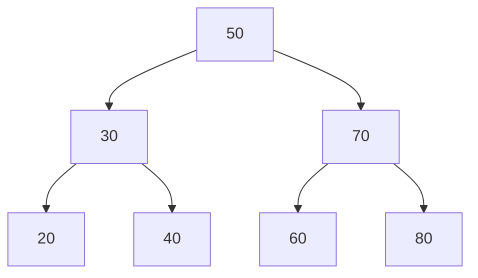
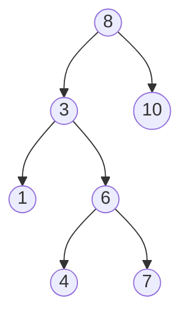
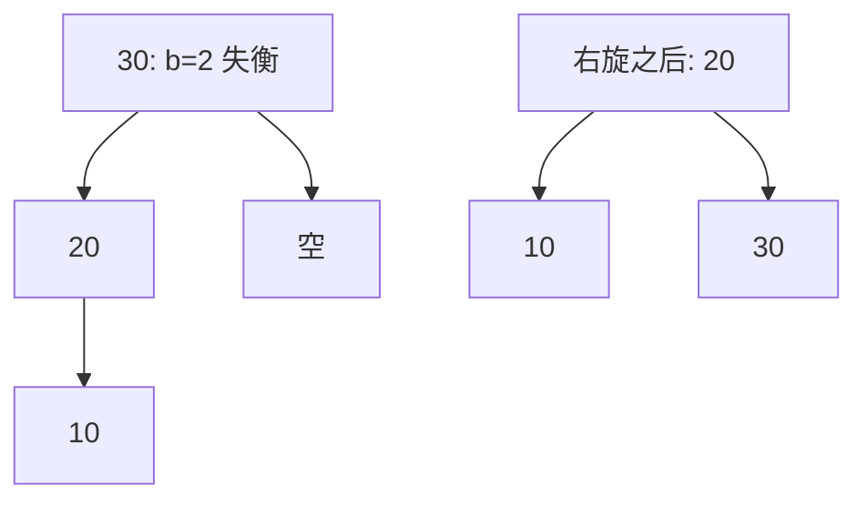

# Concept-Book Run

domain: /home/papagame/projects/digital-duck/cb-data-structure/public/domains/data_structure_ch09/input/graph.yaml
target: avl_tree
started: 2026-11-24T07:26:43

## Teaching order (3 concepts)

- binary_search_tree
- tree_height
- avl_tree

### binary_search_tree (0.6s)

## 二叉搜索树

**定义。** 二叉搜索树(Binary Search Tree,BST)是一棵二叉树,其每个结点存储一个来自全序集的键值,并满足**搜索性质**:对任意结点 $x$,

$$
\forall\, y \in \text{left}(x):\ \text{key}(y) < \text{key}(x), \qquad \forall\, z \in \text{right}(x):\ \text{key}(z) > \text{key}(x).
$$

该性质对每个结点都成立,而不只是对根结点成立。由此可得:对 BST 做**中序遍历**(左 → 根 → 右),输出的键值严格递增。

**查找、插入与删除。** 查找键 $k$ 时,从根出发:若 $k$ 等于当前键则找到;若 $k$ 更小则进入左子树;否则进入右子树。每比较一次,就排除一整棵子树。

```python
def search(node, k):
    while node and node.key != k:
        node = node.left if k < node.key else node.right
    return node
```

插入沿用同样的路径,在遇到空位处挂上新结点。删除分三种情形:被删结点是叶子(直接移除);只有一个孩子(用孩子顶替);有两个孩子(用右子树中的最小结点,即中序后继,替换其键值,再删除该后继)。

**例题。** 依次插入 $50, 30, 70, 20, 40, 60, 80$,得到一棵完全平衡的树。查找 $60$:

1. $60 > 50$,走右子树;
2. $60 < 70$,走左子树;
3. $60 = 60$,找到,共比较 3 次。

七个结点只需最多 3 次比较。


*上例构成的二叉搜索树:每个结点左边的值更小,右边的值更大。*

**复杂度分析。** 查找、插入、删除的代价都与树高 $h$ 成正比,即 $O(h)$。树高取决于插入顺序:

- 平衡情形:$n$ 个结点的树高为 $h = \lfloor \log_2 n \rfloor$,操作为 $O(\log n)$。
- 退化情形:若按 $1,2,3,\dots,n$ 的升序插入,树退化为一条链,$h = n-1$,操作退化为 $O(n)$。
- 随机插入顺序下,期望树高为 $O(\log n)$。

**问题求解应用。**

*问题 1:验证 BST。* 一棵树是否是合法的 BST?只比较结点与其直接孩子是**不够的**。例如根为 $10$、右孩子为 $15$、而 $15$ 的左孩子为 $6$,每个局部看都合理,但 $6 < 10$ 却位于根的右子树中。正确做法是递归时携带取值区间 $(lo, hi)$,或检查中序遍历是否严格递增。

*问题 2:第 $k$ 小的元素。* 做中序遍历并计数,计到第 $k$ 个结点即停止,时间为 $O(h + k)$。

*问题 3:选择数据结构。* 需要频繁插入并保持有序,又要支持范围查询时,BST 比排序数组(插入需 $O(n)$ 移动)更合适;但若输入可能已有序,应使用 AVL 树或红黑树等自平衡变体,以保证 $h = O(\log n)$。

**小结。** BST 的核心是"每个结点把键空间一分为二",效率则完全取决于树的高度。

### tree_height (0.8s)

## 树的高度

### 定义

在一棵树中,**高度**(height)是从根节点到任意叶节点的最长路径所包含的**边数**。记树 $T$ 的高度为 $h(T)$,则可递归定义为:

$$
h(T)=\begin{cases}
-1 & T \text{ 为空树},\\
0 & T \text{ 只有一个节点},\\
1+\max\limits_{c\,\in\,\text{根的子树}} h(c) & \text{其他情况}.
\end{cases}
$$

(有些教材按节点数计算,此时所有结果加 1;使用时务必先确认约定。本节统一按边数计算。)

高度之所以重要,是因为查找、插入、删除等操作都是沿着一条从根出发的路径向下走,**最坏情况的代价正比于 $h$**。

### 例题

对下面的二叉树计算高度:



*根节点 8 的最长路径是 8→3→6→4(或 8→3→6→7),共 3 条边。*

按递归定义自底向上计算:

- 叶节点 1、4、7、10:$h=0$。
- 节点 6:$h = 1+\max(0,0)=1$。
- 节点 3:$h = 1+\max(h(1),h(6)) = 1+\max(0,1)=2$。
- 节点 10:$h=0$。
- 根节点 8:$h = 1+\max(2,0)=3$。

所以 $h(T)=3$。注意左右子树的高度不同,取的是**较大者**。

### 问题求解:高度如何决定查找代价

**问题**:一棵含 $n=1023$ 个节点的二叉搜索树,最坏情况下需要比较多少次?

**分析**:查找每下降一层最多比较一次,因此最坏比较次数为 $h+1$。关键在于 $h$ 的范围。

1. **最好情形(完全平衡)**:高度为 $h$ 的二叉树最多有 $2^{h+1}-1$ 个节点。令 $2^{h+1}-1\ge n$,得
$$
h \ge \lceil \log_2(n+1)\rceil - 1 .
$$
当 $n=1023$ 时,$h_{\min}=\log_2 1024-1=9$,最坏只需 10 次比较。

2. **最坏情形(退化为链)**:若按递增顺序依次插入 $1,2,\dots,n$,每个节点只有右孩子,则 $h=n-1=1022$,查找退化成线性扫描,需 1023 次比较。

因此对于 $n$ 个节点的二叉树,
$$
\lceil \log_2(n+1)\rceil-1 \;\le\; h \;\le\; n-1,
$$
即查找的最坏代价可以从 $O(\log n)$ 一直变化到 $O(n)$。

**结论**:树的高度,而不是节点总数,才是衡量查找效率的真正指标。这正是 AVL 树、红黑树等**自平衡树**存在的原因:它们在每次插入或删除后通过旋转把高度维持在 $O(\log n)$,从而保证最坏情况下的对数级查找。

**练习**:对一棵有 $n=100$ 个节点的二叉树,求高度的最小可能值与最大可能值。(答案:$\lceil\log_2 101\rceil-1=6$;$99$。)

### avl_tree (15.0s)

## AVL 树

**定义。** AVL 树是一种高度平衡的二叉搜索树:对每个结点 $v$,定义平衡因子
$$b(v)=h(v.\text{left})-h(v.\text{right}),$$
其中空树的高度记为 $-1$。AVL 树要求对所有结点都有 $b(v)\in\{-1,0,1\}$。它首先是二叉搜索树(左子树键值小于结点,右子树键值大于结点),其次才满足上述平衡条件。普通二叉搜索树在按顺序插入时会退化成链表,查找代价为 $O(n)$。AVL 树通过平衡条件保证高度为 $O(\log n)$。

**为什么高度至多约 $1.44\log_2 n$。** 设 $N(h)$ 为高度为 $h$ 的 AVL 树所含的最少结点数。最稀疏的树,其根的一棵子树高度为 $h-1$,另一棵为 $h-2$,所以
$$N(h)=N(h-1)+N(h-2)+1,\quad N(0)=1,\ N(1)=2.$$
令 $F(h)=N(h)+1$,则 $F(h)=F(h-1)+F(h-2)$,这正是斐波那契递推,于是 $N(h)=\Theta(\varphi^{h})$,其中 $\varphi=\tfrac{1+\sqrt5}{2}$。因此 $n\ge N(h)$ 给出
$$h<\frac{1}{\log_2\varphi}\log_2 n\approx 1.44\log_2 n.$$

**旋转:恢复平衡。** 插入或删除可能使某结点的 $|b|=2$,这时用旋转修复,每次旋转只需 $O(1)$ 时间,并保持二叉搜索树的顺序。共有四种情形:
- **LL**(左子树的左侧过高):对该结点做一次右旋。
- **RR**(右子树的右侧过高):做一次左旋。
- **LR**:先对左孩子左旋,再对该结点右旋。
- **RL**:先对右孩子右旋,再对该结点左旋。


*左图为插入 10 后,结点 30 的 LL 失衡;右图为一次右旋后,以 20 为根的平衡树。*

**例题。** 依次插入 $10,20,30,40,50,25$。
1. 插入 10、20 后无问题。插入 30 后,10 处出现 RR 失衡($b=-2$),左旋后根为 20,子结点为 10 和 30。
2. 插入 40,无失衡。插入 50 后,30 失衡($b=-2$,RR),左旋后子树以 40 为根,子结点为 30 和 50。
3. 此时 20 的右子树高度为 1,左子树高度为 0,$b=-1$,仍然平衡。
4. 插入 25:它位于 30 的左侧,30 的 $b=1$。20 的左子树高度为 0,右子树高度为 2,$b=-2$,且 20 的右孩子 40 满足 $b(40)=+1$(左重),属 RL 情形。先对 40 右旋,再对 20 左旋,最终得到平衡树,根为 30。

**应用与分析。** 查找、插入、删除的最坏时间都是 $O(h)=O(\log n)$。插入至多需要一次(单或双)旋转,删除则可能沿路径向上需要 $O(\log n)$ 次旋转。当系统需要严格的最坏情况保证,而且读操作远多于写操作时(例如数据库内存索引、实时调度),AVL 树比红黑树更合适。AVL 树的高度上界更紧,查找更快;红黑树的旋转更少,更新更便宜。

**练习。** 求高度为 4 的 AVL 树的最少结点数 $N(4)$。由递推,$N(2)=4$,$N(3)=7$,$N(4)=12$。

## Run complete

total: 33.2s
