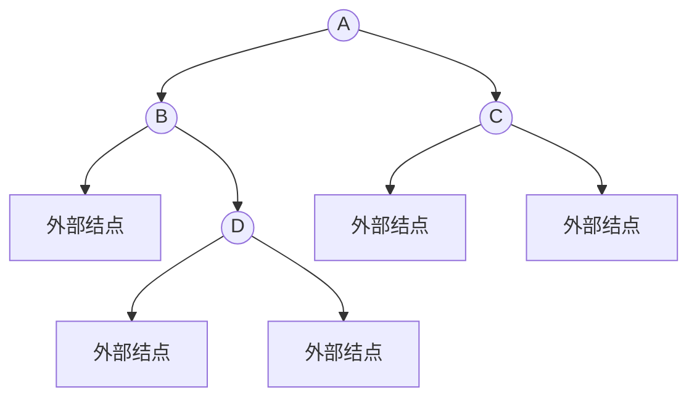
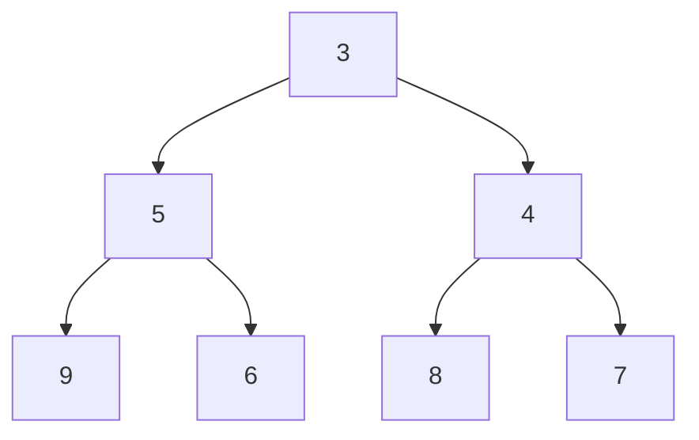
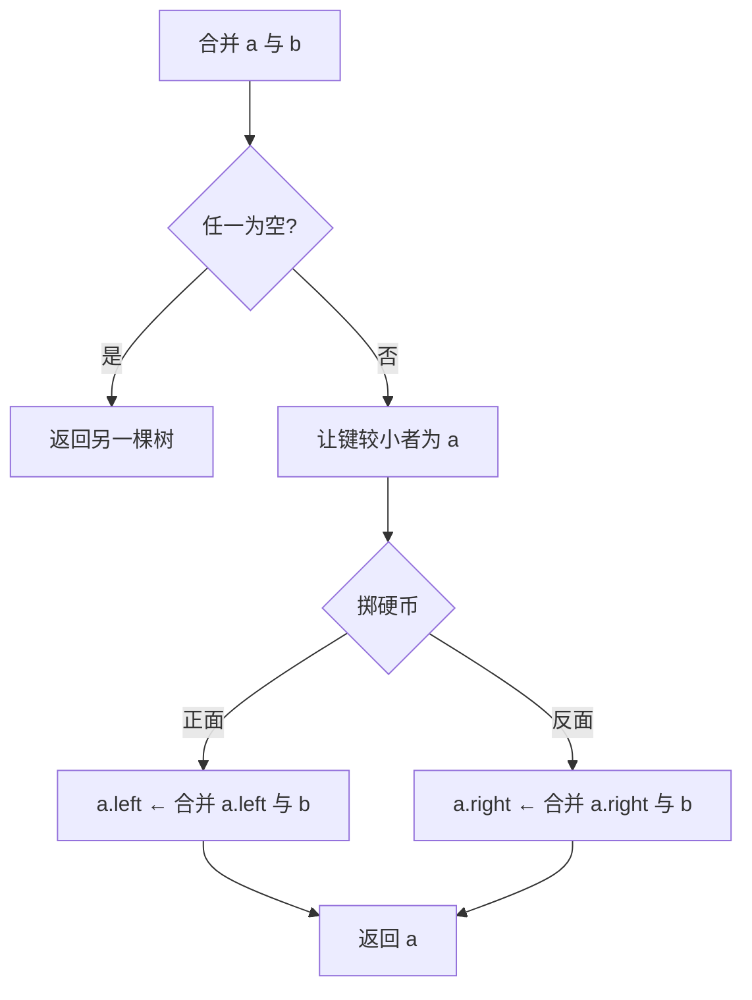
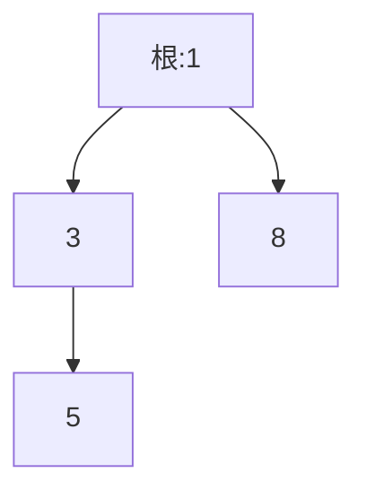
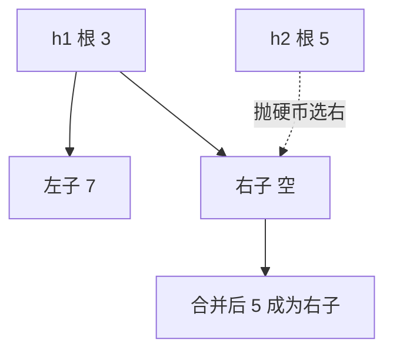
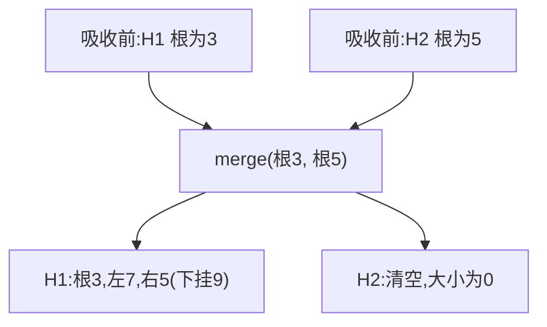

# Concept-Book Run

domain: /home/papagame/projects/digital-duck/cb-data-structure/public/domains/data_structure_ch10/input/graph.yaml
target: absorb_operation
started: 2026-11-24T07:29:26

## Teaching order (7 concepts)

- binary_tree
- heap_order_property
- randomization_coin_toss
- merge_operation
- priority_queue
- meldable_heap
- absorb_operation

### binary_tree (0.6s)

## 二叉树

**定义。** 二叉树(binary tree)是一种有根树,其中每个结点至多有两个孩子,分别称为**左孩子**和**右孩子**。左、右位置是区分的:只有左孩子的结点与只有右孩子的结点是不同的树。若把每个缺失的孩子位置用**外部结点**(空位)补齐,则每个原有的**内部结点**恰好有两个孩子。

这带来一个重要的计数关系:设二叉树有 $n$ 个内部结点,则外部结点数为
$$
e = n + 1 .
$$
**证明(归纳法)。** $n=0$ 时只有一个外部结点,$e=1$。设结论对少于 $n$ 个内部结点的树成立。取根,左子树有 $a$ 个内部结点,右子树有 $b$ 个,且 $a+b=n-1$。由归纳假设,外部结点数为 $(a+1)+(b+1)=n+1$。$\blacksquare$

**常用术语。** 结点的**深度**是它到根的边数;树的**高度** $h$ 是最大深度。高度为 $h$ 的二叉树,第 $d$ 层至多有 $2^d$ 个结点,因此
$$
n \le 2^{h+1}-1,\qquad h \ge \lceil \log_2(n+1) \rceil - 1 .
$$

**例题。** 一棵二叉树的根为 $A$,$A$ 的左孩子为 $B$、右孩子为 $C$,$B$ 只有右孩子 $D$,其余结点均无孩子。求内部结点数、外部结点数和高度。

- 有孩子的结点为 $A, B$,另 $C, D$ 是叶子。若把叶子也算作内部结点(它们各有两个外部孩子),则 $n=4$,于是 $e=5$。
- 验证:$C$ 有 2 个外部孩子,$D$ 有 2 个,$B$ 的左位置有 1 个,共 $2+2+1=5$。✓
- 高度:$A\to B\to D$,所以 $h=2$。

**中序遍历。** 遍历顺序为"左子树、根、右子树"。上例得到 $B, D, A, C$ 吗?注意 $B$ 无左孩子,先访问 $B$,再访问其右子树 $D$,然后是 $A$,最后是 $C$。结果:$B, D, A, C$。

**问题求解应用。** 许多递归算法直接沿树的结构展开。例如计算高度:

```python
def height(node):
    if node is None:          # 外部结点
        return -1
    return 1 + max(height(node.left), height(node.right))
```

每个结点恰好被访问一次,外部结点被访问 $n+1$ 次,所以总时间为 $\Theta(n)$。递归深度等于树高 $h$:平衡时 $h=\Theta(\log n)$,最坏情形(所有结点排成一条链)$h=n-1$。这正是平衡二叉搜索树要保证 $h=O(\log n)$ 的原因:查找、插入的代价都与 $h$ 成正比。


*例题中的二叉树:圆形为内部结点,方形为补齐缺失孩子位置的外部结点,共 5 个,符合 $e=n+1$。*

### heap_order_property (0.8s)

## 堆序性质(Heap Order Property)

### 定义

**堆序性质**是二叉树上的一种局部约束:除根结点外,每个结点存储的值都**不小于**其父结点的值。设 $A[i]$ 表示结点 $i$ 的值,$\text{parent}(i)$ 表示其父结点,则

$$
A[\text{parent}(i)] \le A[i], \quad \text{对所有非根结点 } i .
$$

满足该性质的树称为**最小堆**(min-heap)。由于约束沿每条"根到叶"的路径连续传递,可推出:**根结点存储整棵树的最小值**。

> 证明:任取结点 $v$,设根到 $v$ 的路径为 $r=v_0, v_1,\dots,v_k=v$。由堆序性质,$A[v_0]\le A[v_1]\le\cdots\le A[v_k]$,故 $A[r]\le A[v]$。$\blacksquare$

注意:堆序性质只比较**父子**关系,**不**要求左右兄弟之间有大小顺序,这与二叉搜索树不同。

### 例题:判断是否满足堆序

下面这棵树是否满足堆序性质?



*一棵满足堆序性质的二叉树:每个结点的值都不小于其父结点的值。*

逐条检查父子关系:$3\le5$,$3\le4$,$5\le9$,$5\le6$,$4\le8$,$4\le7$。全部成立,所以满足堆序性质。注意左子树的结点 $6$ 小于右子树的结点 $7$ 与 $8$ 无关紧要,而 $5>4$ 这对兄弟的"逆序"同样允许。

若把结点 $9$ 改成 $2$,则 $5\le 2$ 不成立,堆序被破坏。

### 问题求解应用:插入后修复堆序

向上面的堆中插入值 $1$。步骤如下:

1. 把 $1$ 放在最后一层最左的空位,即结点 $8$ 的位置之后(作为 $4$ 的左孩子之下需先补满;此处作为 $7$ 的右侧空位,即 $4$ 的子树之外的下一空位——$6$ 的右侧也已满,故放在 $9$ 的左孩子位置)。
2. 此时 $1<$ 其父结点 $9$,违反堆序,交换。
3. 继续与父结点 $5$ 比较,$1<5$,交换。
4. 再与根 $3$ 比较,$1<3$,交换,$1$ 成为新根。

每次交换只修复一处局部违规,最多沿树高上行一次,因此修复代价为 $O(\log n)$,其中 $n$ 为结点数(完全二叉树高度为 $\lfloor\log_2 n\rfloor$)。

**要点**:

- 堆序是**局部**条件,却推出**全局**结论(根是最小值),因此可以 $O(1)$ 取得最小元。
- 插入和删除最小元都通过"交换到合适位置"恢复堆序,代价 $O(\log n)$。
- 若把不等号反向($A[\text{parent}(i)]\ge A[i]$),得到**最大堆**,根为最大值。

**练习**:序列 $[2,7,4,10,8,5]$ 按层序存放为完全二叉树(下标从 1 开始,$\text{parent}(i)=\lfloor i/2\rfloor$),它是否满足堆序性质?请逐对验证。

### randomization_coin_toss (14.5s)

## 随机化抛硬币

### 定义

在随机化二叉搜索树(如 treap 或随机化的 merge/split 结构)中,**随机化抛硬币**是指:在 `merge` 的每一步,用一个随机比特来决定下降到左子树还是右子树,而不是依据存储的平衡信息(高度、大小或颜色)。

设要合并的两棵树为 $L$ 和 $R$,且 $L$ 中所有键都小于 $R$ 中所有键。令 $|L|=m$,$|R|=n$。则 `merge(L, R)` 以概率

$$
p=\frac{m}{m+n}
$$

选择 $L$ 的根作为新根(然后递归合并 $L$ 的右子树与 $R$);以概率 $1-p$ 选择 $R$ 的根作为新根(然后递归合并 $L$ 与 $R$ 的左子树)。当只用"公平硬币"($p=\tfrac12$)时,也可以得到期望对数深度的变体,但按子树大小加权的版本能精确保持均匀随机的树形分布。

### 例题

合并 $L$(根 $a$,$m=3$)与 $R$(根 $b$,$n=1$)。

1. 以概率 $p=\tfrac{3}{4}$ 选 $a$ 为根:新树的根为 $a$,其右子树变为 $\text{merge}(a.\text{right},\,R)$。
2. 以概率 $\tfrac14$ 选 $b$ 为根:新树的根为 $b$,其左子树变为 $\text{merge}(L,\,b.\text{left})$。

每一层只需**一个随机比特(或一次随机数比较)**,无需读取、维护任何平衡因子。

```python
import random

def merge(L, R):
    if not L: return R
    if not R: return L
    if random.random() < L.size / (L.size + R.size):
        L.right = merge(L.right, R)
        L.update()
        return L
    else:
        R.left = merge(L, R.left)
        R.update()
        return R
```

### 问题求解应用

**问题:** 说明为什么这种做法使 `merge` 的期望时间为 $O(\log n)$。

**分析:** 每次递归都沿着 $L$ 的最右链或 $R$ 的最左链向下走一步。由于根的选择概率与子树大小成正比,每个节点成为合并后树根的概率,与它在"所有节点随机排列"模型中成为根的概率相同。因此合并结果的分布与"把全部键依次随机插入"得到的随机二叉搜索树一致。

随机二叉搜索树中,节点 $x$ 的期望深度为

$$
\mathbb{E}[\text{depth}(x)] = H_k + H_{N-k+1} - 2 = O(\log N),
$$

其中 $H_k=\sum_{i=1}^{k}\frac1i$ 是调和数,$k$ 为 $x$ 的秩,$N$ 为节点总数。`merge` 的路径长度不超过两条链长度之和,故期望步数为 $O(\log m+\log n)$。

**要点:**

- 平衡来自**概率**,而非**记录**:没有旋转,没有平衡标记。
- 最坏情况仍可能很深,但概率随深度指数级下降,即以高概率为 $O(\log N)$。
- 代价是依赖随机源的质量;若随机比特可被对手预测,结构的保证就会失效。

*练习:* 若 $m=n=1$,`merge` 的两种结果各以什么概率出现?它们分别对应怎样的树形?

### merge_operation (17.9s)

## 合并操作

**定义。** 本节讨论的是倾斜堆(skew heap)的"随机化"变体,即 **随机化堆(randomized meldable heap)** 中的合并操作。给定两棵满足堆序的二叉树,其根分别为 $a$ 与 $b$,合并操作 $\text{merge}(a,b)$ 返回一棵包含两者全部元素、且仍满足堆序的二叉树。递归规则如下(小根堆):

1. 若 $a$ 为空,返回 $b$;若 $b$ 为空,返回 $a$。
2. 若 $a.\text{key} > b.\text{key}$,交换 $a,b$,使 $a$ 的键更小(它必须成为新根)。
3. 掷一枚公平硬币:正面则 $a.\text{left} \leftarrow \text{merge}(a.\text{left}, b)$,反面则 $a.\text{right} \leftarrow \text{merge}(a.\text{right}, b)$。
4. 返回 $a$。

堆序得以保持,是因为新根始终是两个根中较小者,而被递归合并的子树中所有键都不小于它。

**例题。** 设堆 $A$:根 3,左孩子 7,右孩子为空;堆 $B$:根 5,无孩子。

- $\text{merge}(A,B)$:$3<5$,根为 3。假设硬币为正面,则递归 $\text{merge}(7,5)$。
- $\text{merge}(7,5)$:$7>5$,交换,5 成为根。假设硬币为反面,则 $5.\text{right}\leftarrow\text{merge}(\varnothing,7)=7$。
- 结果:3 的左子树是以 5 为根、右孩子为 7 的树,3 的右子树为空。堆序成立($3<5<7$)。

若第一次硬币为反面,则 $3.\text{right}\leftarrow\text{merge}(\varnothing,5)=5$,结果是另一棵同样合法的堆。可见同样的输入可产生不同的树形,但元素集合与堆序不变。

**问题求解:期望时间。** 设两棵树的节点数分别为 $n_1,n_2$,$n=n_1+n_2$。每一步递归都沿着 $a$ 或 $b$ 的某条随机路径向下走一层。**引理:** 在含 $m$ 个节点的二叉树中,从根出发每步等概率选左右的随机游走,其长度的期望至多为 $\log_2(m+1)$。

*证明思路:* 对于深度为 $d$ 的节点,随机游走恰好到达它的概率为 $2^{-d}$。若游走长度 $\ge k$,则必须到达深度 $k$ 的某个位置,而深度 $\le k$ 的完整位置至多有 $2^k$ 个;当 $k>\log_2(m+1)$ 时,到达概率总和以几何速率衰减,因此期望长度为 $O(\log m)$。

合并过程中,两棵树各自的随机路径总长度之和受上述引理控制,故

$$
E[\text{merge 的步数}] \le \log_2(n_1+1)+\log_2(n_2+1)=O(\log n).
$$

**应用。** 随机化堆将 `insert`(把单节点堆合并进来)与 `delete_min`(合并根的两棵子树)都归约为一次 $\text{merge}$,因此三种操作的期望时间均为 $O(\log n)$,而代码只需约十行,无需维护平衡信息。

**练习。** 若把硬币换成总是选左子树,最坏情形会退化成什么?(提示:考虑反复插入递增序列时的左链。)


*图:随机化合并的递归流程,硬币决定下降到哪一侧子树。*

### priority_queue (1.2s)

## 优先队列

**定义。** 优先队列(priority queue)是一种抽象数据类型,支持两种基本操作:

- $\text{add}(x)$:将元素 $x$ 加入队列;
- $\text{remove}()$:删除并返回当前存储的**最小值**。

它与普通队列的区别在于:取出元素的顺序不取决于插入的先后,而取决于元素的大小(优先级)。"抽象数据类型"意味着我们只规定行为,不规定实现方式。

**常见实现:二叉堆。** 最小堆是一棵完全二叉树,满足:每个节点的值不大于其子节点的值。若用数组存储(下标从 1 开始),节点 $i$ 的父节点为 $\lfloor i/2 \rfloor$,子节点为 $2i$ 和 $2i+1$。

- `add`:把新元素放在数组末尾,再不断与父节点比较并上移("上浮");
- `remove`:取出根节点(最小值),把末尾元素移到根,再不断与较小的子节点交换("下沉")。

由于完全二叉树的高度为 $\lfloor \log_2 n \rfloor$,两种操作的时间复杂度均为 $O(\log n)$,而查看最小值只需 $O(1)$。

**worked example。** 依次执行 add(5)、add(3)、add(8)、add(1),再执行两次 remove()。

1. add(5):堆为 $[5]$。
2. add(3):放在末尾得 $[5,3]$,3 小于父节点 5,上浮,得 $[3,5]$。
3. add(8):得 $[3,5,8]$,无需调整。
4. add(1):得 $[3,5,8,1]$,1 的父节点是下标 2 的 5,交换得 $[3,1,8,5]$;再与根 3 比较,交换得 $[1,3,8,5]$。
5. remove():返回 1。把末尾的 5 移到根:$[5,3,8]$,与较小子节点 3 交换,得 $[3,5,8]$。
6. remove():返回 3。

两次返回值依次为 1、3,即始终是当前最小值。

**问题求解应用:合并 $k$ 个有序列表。** 设有 $k$ 个各自已排好序的列表,总共 $n$ 个元素,要合并成一个有序列表。

思路:先把每个列表的首元素加入优先队列。每次 remove() 得到当前全局最小值并输出,再把该元素所在列表的下一个元素 add 进去。

```python
import heapq

def merge(lists):
    heap = [(l[0], i, 0) for i, l in enumerate(lists) if l]
    heapq.heapify(heap)
    out = []
    while heap:
        v, i, j = heapq.heappop(heap)      # remove()
        out.append(v)
        if j + 1 < len(lists[i]):
            heapq.heappush(heap, (lists[i][j+1], i, j+1))  # add()
    return out
```

队列中始终最多只有 $k$ 个元素,每个元素各经历一次 add 和一次 remove,所以总时间为 $O(n \log k)$。相比之下,把所有元素拼起来再排序需要 $O(n \log n)$;当 $k \ll n$ 时,优先队列方法明显更快。

同样的模式也出现在 Dijkstra 最短路径算法、事件调度、Huffman 编码以及"求前 $K$ 大元素"等问题中:只要需要反复取出"当前最小(或最优)者",就应想到优先队列。


*图:执行 add(5)、add(3)、add(8)、add(1) 后得到的最小堆,每个父节点都不大于其子节点。*

### meldable_heap (15.4s)

## 可合并堆(Meldable Heap)

**定义。** 可合并堆是一种基于**堆序二叉树**的优先队列,其树形不受限制:只要求每个节点的值不大于其子节点的值(最小堆),不要求完全或平衡。它的核心是一个操作 $\text{merge}(h_1,h_2)$,把两个堆合并为一个堆。其余操作都归约为合并:

- $\text{add}(x)$:把 $x$ 看作单节点堆,与原堆合并;
- $\text{remove}()$:取出根节点,再合并其左、右子树。

因此只需把 $\text{merge}$ 做对、做快。

**随机合并算法。** 设 $h_1$ 的根不大于 $h_2$ 的根(否则交换)。将 $h_2$ 与 $h_1$ 的左子树或右子树合并,**用抛硬币决定**走哪一边:

```python
import random

def merge(h1, h2):
    if h1 is None: return h2
    if h2 is None: return h1
    if h2.x < h1.x:
        h1, h2 = h2, h1          # 保证 h1 根更小
    if random.random() < 0.5:
        h1.left = merge(h1.left, h2)
    else:
        h1.right = merge(h1.right, h2)
    return h1
```

**例题。** 合并 $h_1$(根 3,左子 7,右子为空)与 $h_2$(单节点 5)。

1. $3<5$,$h_1$ 的根保留。
2. 若硬币选“右”:$\text{merge}(\text{None},5)$ 返回节点 5,于是 5 成为 3 的右子。
3. 若选“左”:比较 7 与 5,5 更小,5 成为新子树根,7 挂到 5 的随机一侧。

两种结果都满足堆序,只是形状不同,这正是“树形不受限制”的含义。

**性能分析。** 合并沿一条随机路径下降。设 $n=|h_1|+|h_2|$。每一步向左或向右的概率各为 $1/2$,一条随机路径的期望长度满足

$$
E[\text{长度}] \le \log_2 n + O(1)
$$

(可以这样理解:一条长度为 $k$ 的特定路径出现的概率是 $2^{-k}$,而深度超过 $2\log_2 n$ 的节点极少。)因此 $\text{merge}$、$\text{add}$、$\text{remove}$ 的**期望**时间都是 $O(\log n)$。要注意这是期望界,而非最坏情况界:最坏情况下树可能退化为一条链。

**问题应用。** 要合并 $m$ 个各有 $n/m$ 个元素的有序任务队列,可逐个调用 $\text{merge}$,总期望时间为 $O(m\log n)$。相比之下,把所有元素逐个插入新堆需要 $O(n\log n)$。当 $m\ll n$ 时,可合并堆的优势明显。二叉堆(数组实现)合并需重建,代价为 $O(n)$,所以在需要频繁合并队列的场景(如分布式任务调度)中,可合并堆更合适。


*图示:合并时,较大根所在的堆沿随机方向并入较小根堆的子树。*

**小结。** 可合并堆用一个随机化的 $\text{merge}$ 统一实现了插入与删除,期望代价为 $O(\log n)$,代码简洁,适合需要快速合并优先队列的场景。

### absorb_operation (16.1s)

## 吸收操作(Absorb Operation)

**定义。** 设 $H_1$、$H_2$ 是两个可合并堆(MeldableHeap)。**吸收操作** $H_1.\text{absorb}(H_2)$ 把 $H_2$ 中的全部元素加入 $H_1$,并使 $H_2$ 变为空堆。它不逐个搬运元素,而是直接调用 `merge`,把两棵堆的根合并成一棵新树:

```python
def absorb(self, other):
    self.root = merge(self.root, other.root)
    self.n += other.n
    other.root = None
    other.n = 0
```

关键点有三个:(1)元素总数相加;(2)源堆被清空,避免同一节点被两个堆共享;(3)总代价等于一次 `merge` 的代价。

**回顾 merge。** 对最小堆,若 $a$ 的键不大于 $b$ 的键,则 $a$ 保持为根,随机选取其左或右子树,与 $b$ 递归合并;否则交换 $a,b$ 的角色。在随机化可合并堆中,合并两棵大小为 $n_1$、$n_2$ 的堆,期望时间为

$$O(\log n_1 + \log n_2) = O(\log n),\quad n = n_1+n_2 .$$

**例题。** 设 $H_1$ 的根为 3(右子树为空,左子树含 7),$H_2$ 的根为 5(含子节点 9)。执行 $H_1.\text{absorb}(H_2)$:

1. 比较根:$3 < 5$,故 3 仍为新根。
2. 随机选择右子树(空),则 `merge(空, 5)` 直接返回以 5 为根的整棵树。
3. 结果:根 3,左子树为 7,右子树为 5(其下挂 9)。
4. 令 $H_2$ 的根为空、大小为 0;$H_1$ 的大小为 $2+2=4$。

堆序性质仍然成立:每个节点不大于其子节点。


*吸收操作调用 merge:H1 得到全部元素,H2 被清空。*

**问题应用。** 有 $k$ 个已排序的日志流,每个流用一个堆存放待处理事件,要求把它们汇总成一个堆。做法:令 $H=H_1$,依次执行 $H.\text{absorb}(H_i)$,$i=2,\dots,k$。若总元素数为 $N$,每次吸收的期望代价为 $O(\log N)$,总代价为 $O(k\log N)$,远低于把 $N$ 个元素逐个插入的 $O(N\log N)$(当 $k\ll N$ 时)。

**常见错误。** 吸收后继续使用 $H_2$ 并认为其内容不变是错误的:其节点已并入 $H_1$。若需保留 $H_2$,应先复制。另外,别忘记同步更新元素计数,否则 `size()` 会返回错误结果。

**小结。** 吸收操作 = 一次 `merge` + 计数相加 + 清空源堆,期望时间 $O(\log n)$。

## Run complete

total: 91.4s
