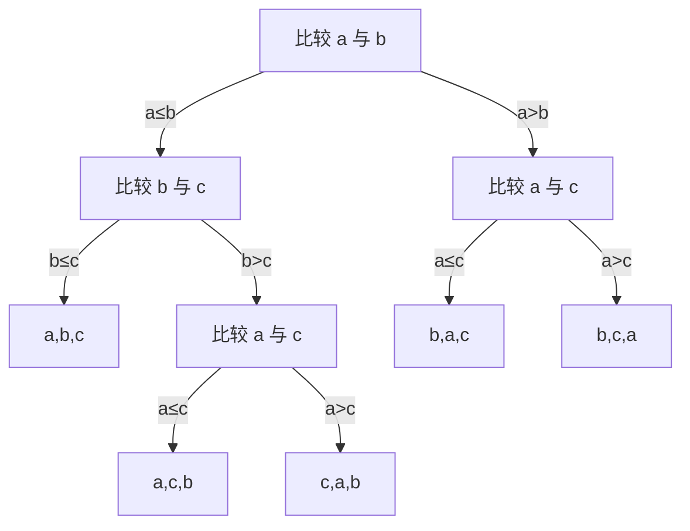
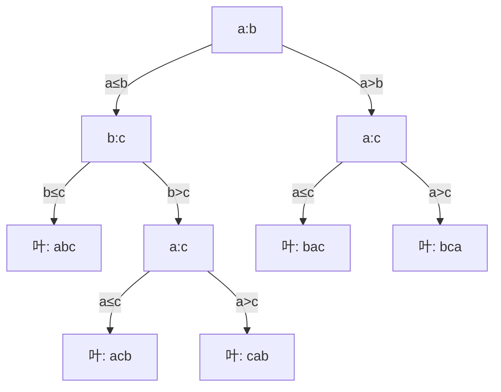
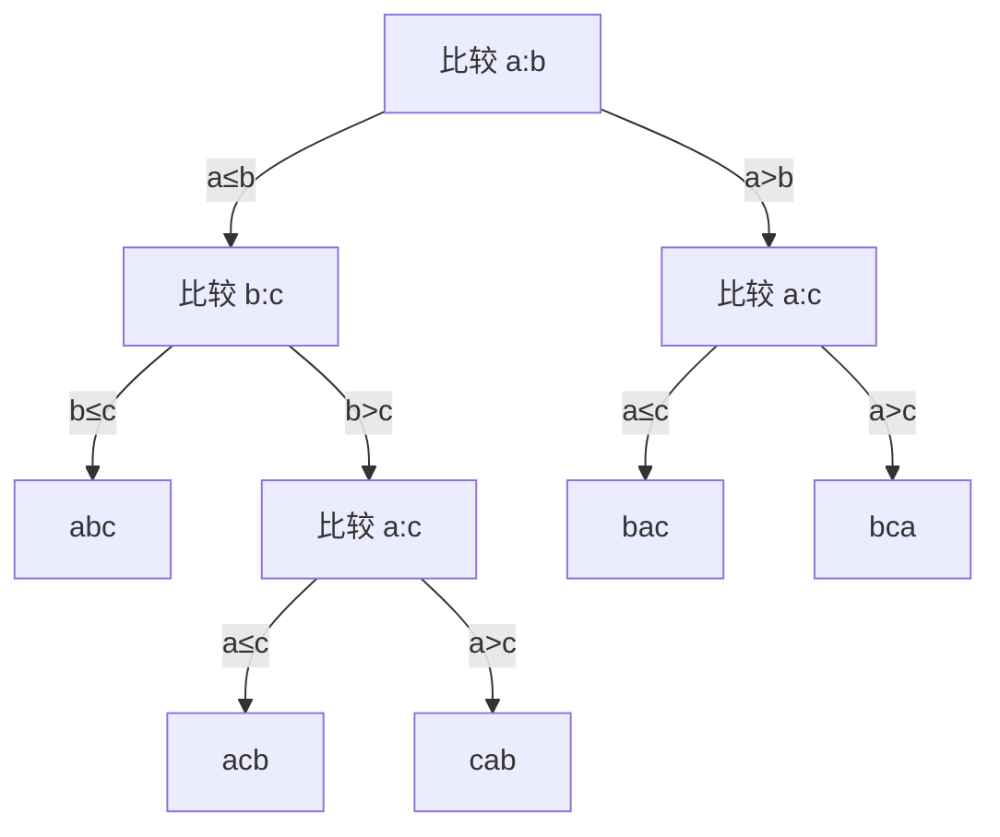
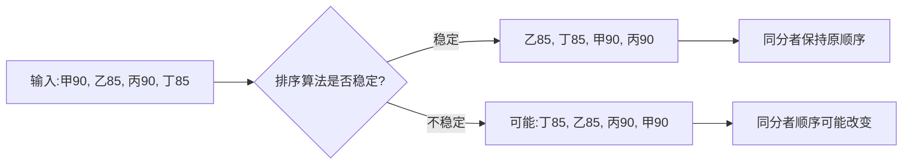

# Concept-Book Run

domain: /home/papagame/projects/digital-duck/cb-data-structure/public/domains/data_structure_ch11/input/graph.yaml
target: integer_sorting_via_indexing
started: 2026-11-24T07:30:58

## Teaching order (9 concepts)

- compare_operation
- comparison_based_sorting
- comparison_tree
- comparison_sorting_lower_bound
- non_comparison_sorting
- stable_sorting
- counting_sort
- radix_sort
- integer_sorting_via_indexing

### compare_operation (14.0s)

## 比较运算(Compare Operation)

### 定义

**比较运算**是一个基本操作 $\text{compare}(a, b)$,它接收两个可比较的对象,返回一个整数,用符号表示二者的顺序关系:

$$
\text{compare}(a,b)=
\begin{cases}
<0, & a<b\\
0, & a=b\\
>0, & a>b
\end{cases}
$$

关键在于:调用者只关心返回值的**符号**,不应依赖具体数值(例如 $-1$ 与 $-37$ 含义相同)。几乎所有排序、查找与优先队列算法,都只通过这一原语来获知元素之间的顺序。

要使 compare 行为正确,它必须定义一个**全序**,即满足:

1. **反对称性**:$\text{compare}(a,b)$ 与 $\text{compare}(b,a)$ 符号相反;
2. **传递性**:若 $a\le b$ 且 $b\le c$,则 $a\le c$;
3. **完全性**:任意两个元素都可以比较。

### 例题

用 Python 为"先按年级、再按姓名"比较学生:

```python
def compare(a, b):
    if a.grade != b.grade:
        return a.grade - b.grade      # 年级低者在前
    if a.name < b.name:
        return -1
    if a.name > b.name:
        return 1
    return 0
```

设 $a=(\text{高一},\text{李})$,$b=(\text{高二},\text{王})$。年级不同,返回 $\text{高一}-\text{高二}<0$,因此 $a<b$。若两人同为高二,则退化为姓名的字典序比较。这种"逐级比较、第一个不相等的字段决定结果"的方式称为**字典序比较**。

### 问题求解应用

**问题 1:二分查找。** 在有序数组中查找目标 $t$,每一步计算 $c=\text{compare}(t,\,A[m])$:

- $c=0$:找到;
- $c<0$:在左半部分继续;
- $c>0$:在右半部分继续。

每次比较使搜索范围减半,递推式为 $T(n)=T(n/2)+O(1)$,故 $T(n)=O(\log n)$。

**问题 2:下界。** 仅依靠 compare 的排序算法,其决策树至少需要 $n!$ 个叶子,高度 $h$ 满足 $2^h\ge n!$,所以

$$
h\ge \log_2(n!)=\Theta(n\log n).
$$

因此基于比较的排序不可能优于 $O(n\log n)$。

**问题 3:常见陷阱。** 用减法实现 compare 可能整数溢出:例如在 32 位整数中,$a=2^{30}\cdot 2$ 与 $b=-1$ 相减会得到错误符号。更稳妥的写法是:

```python
return (a > b) - (a < b)   # 只返回 -1, 0, 1
```

另外,浮点数中的 NaN 与任何数比较都不成立,破坏了完全性,排序前需要先行处理。

**小结:** compare 只需返回符号,但它必须满足全序的三条性质;一旦违反,排序与查找的正确性都将失去保证。

### comparison_based_sorting (14.7s)

## 基于比较的排序

**定义。** 基于比较的排序是一类排序算法,它们获取元素顺序信息的*唯一*途径,是调用比较操作 $\text{compare}(a,b)$,判断 $a \le b$ 是否成立。算法不查看元素的内部表示(如数字的位数、字符串的字符),因此只要元素之间定义了全序关系,同一算法就能排序整数、字符串或自定义对象。归并排序、快速排序、堆排序、插入排序都属于这一类;计数排序、基数排序则不是,因为它们要读取键的内部结构。

**工作示例。** 以三个互异元素 $a,b,c$ 为例。先比较 $a$ 与 $b$,再比较较大者与 $c$,最多需要 3 次比较才能确定顺序。我们可以把整个过程画成**决策树**:每个内部节点是一次比较,每条边是比较结果(是/否),每个叶子是一种可能的排列。

3 个元素共有 $3! = 6$ 种排列,所以决策树至少有 6 个叶子。深度为 $h$ 的二叉树至多有 $2^h$ 个叶子,故 $2^h \ge 6$,即 $h \ge 3$。因此 3 次比较是最坏情况下的最优值。


*三个元素排序的决策树(部分叶子对应的排列已列出,每个叶子是一种可能的输出顺序)。*

**定理(比较排序的下界)。** 任何基于比较的排序算法,在最坏情况下至少需要 $\Omega(n\log n)$ 次比较。

*证明。* 对 $n$ 个互异元素,算法必须区分 $n!$ 种输入排列,所以决策树至少有 $n!$ 个叶子。设树高为 $h$,则 $2^h \ge n!$,因此
$$h \ge \log_2 (n!).$$
由于 $n! \ge (n/2)^{n/2}$,可得
$$\log_2(n!) \ge \frac{n}{2}\log_2\frac{n}{2} = \Omega(n\log n). \qquad \blacksquare$$

**问题求解应用。** 假设要为 $n = 10^6$ 条记录排序,你能否设计出只用约 $10^7$ 次比较的比较排序算法?

计算下界:$\log_2(10^6!) \approx n\log_2 n - 1.44\,n \approx 10^6 \times 19.93 - 1.44\times 10^6 \approx 1.85\times 10^7$。所以 $10^7$ 次比较**不可能**做到,不论算法多么巧妙。归并排序约用 $n\log_2 n \approx 2\times10^7$ 次,已非常接近下界,说明它在渐近意义上是最优的。

实际选择时可以这样判断:

- 若只能使用 $\text{compare}(a,b)$(例如按用户自定义规则排序对象),则 $\Omega(n\log n)$ 是无法突破的底线。
- 若键是范围有限的整数,可以放弃"只比较"的限制,使用计数排序或基数排序,在 $O(n)$ 时间内完成,因为它们利用了键的内部结构,不受上述定理约束。

**小结。** 比较排序以通用性换取了 $\Omega(n\log n)$ 的下界;理解决策树论证,就能判断一个排序目标是否可能达到,以及何时应该跳出"只比较"的框架。

### comparison_tree (15.3s)

## 比较树

**定义。** 对 $n$ 个互异元素做基于比较的排序时，算法的每一次执行都可以用一棵**有根二叉树**来刻画，称为**比较树**（comparison tree，亦称决策树）：

- **内部节点**：一次比较 $a_i : a_j$。左子树对应"$a_i \le a_j$"，右子树对应"$a_i > a_j$"；
- **叶节点**：算法最终输出的一个排列；
- **根到叶的路径**：输入数据在该次执行中经历的全部比较，路径长度就是这次执行所做的比较次数。

最坏情况比较次数等于树的**高度** $h$。由于算法只能通过比较获得信息，所以树的形状完全决定了算法的行为。

**图示。**


*对三个元素 $a,b,c$ 排序的部分比较树（省略了其余分支）。每个内部节点是一次比较，每个叶节点是一种输出顺序。*

**例题。** 对 $n=3$ 的元素排序。输入共有 $3!=6$ 种可能的顺序，要想对每种输入都输出正确结果，树中必须**至少有 6 个叶节点**（每种排列至少一个）。高度为 $h$ 的二叉树最多有 $2^h$ 个叶节点，因此
$$2^h \ge 6 \;\Rightarrow\; h \ge \lceil \log_2 6 \rceil = 3.$$
所以任何基于比较的算法对 3 个元素排序，最坏情况下至少需要 3 次比较，而插入排序恰好能做到。

**问题求解：下界定理。** 对一般的 $n$，叶节点数 $\ell \ge n!$，而 $\ell \le 2^h$，于是
$$h \ge \log_2 (n!).$$
利用 $n! \ge \left(\tfrac{n}{2}\right)^{n/2}$（后一半的 $n/2$ 个因子都不小于 $n/2$），得
$$h \ge \frac{n}{2}\log_2\frac{n}{2} = \Omega(n\log n).$$

**结论：** 任何基于比较的排序算法，最坏情况下都需要 $\Omega(n\log n)$ 次比较。因此归并排序和堆排序的 $O(n\log n)$ 已经是渐近最优的。

**练习。** (1) 用该方法证明：对 $n=5$，最坏情况至少需要 $\lceil\log_2 120\rceil=7$ 次比较。(2) 判断题：若某算法的比较树有 $n!-1$ 个叶节点，它还能正确排序吗？（提示：必有某个排列无法输出。）

### comparison_sorting_lower_bound (15.5s)

## 比较排序的下界

**定义。** 比较排序算法只通过询问"$a_i \le a_j$ 吗?"这类比较来获取输入顺序的信息。任何这样的算法在固定的输入规模 $n$ 下,都可以画成一棵**决策树**:内部节点表示一次比较,左右分支对应两种结果,叶子节点表示算法最终输出的排列。

**定理。** 任何正确的比较排序算法,在最坏情况下至少需要
$$\lceil \log_2(n!) \rceil = n\log_2 n - O(n)$$
次比较。

**证明。** 设输入是 $n$ 个互不相同的元素。它们有 $n!$ 种可能的相对顺序,每种顺序需要不同的输出排列。若两种不同顺序到达同一叶子,算法就会对其中一种输出错误结果。因此决策树至少有 $n!$ 个叶子。

高度为 $h$ 的二叉树至多有 $2^h$ 个叶子,所以
$$2^h \ge n! \quad\Longrightarrow\quad h \ge \log_2(n!).$$
而树的高度 $h$ 正是最坏情况下的比较次数。

再估计 $\log_2(n!)$。一方面,
$$\log_2(n!) = \sum_{k=1}^{n}\log_2 k \le n\log_2 n.$$
另一方面,只取后半部分的项:
$$\log_2(n!) \ge \sum_{k=\lceil n/2\rceil}^{n}\log_2 k \ge \frac{n}{2}\log_2\frac{n}{2} = \Omega(n\log n).$$
由斯特林公式可得更精确的结果:$\log_2(n!) = n\log_2 n - n\log_2 e + O(\log n)$。

**例题。** 对 $n=3$,有 $3! = 6$ 个叶子,故 $h \ge \lceil\log_2 6\rceil = 3$。三个元素排序最坏需要 3 次比较,而且确实可以做到:先比较 $a,b$,再把 $c$ 与较大(或较小)者比较,必要时再做一次比较,即可确定全部顺序。再看 $n=5$:$5!=120$,$\lceil\log_2 120\rceil = 7$,所以任何比较排序最坏都至少需要 7 次比较。

**问题求解应用。**

1. *判断算法是否最优。* 归并排序的最坏比较次数为 $O(n\log n)$,与下界吻合,所以在比较模型下它渐近最优。若有人声称设计出 $O(n)$ 的通用比较排序,则可直接断定其不成立。

2. *平均情况。* 每个叶子的深度之和不小于 $n!\log_2 n!$(平衡树时最小),因此平均比较次数也至少为 $\log_2(n!)$。同样的论证可推广到随机化算法:随机化算法是确定性决策树的概率分布,期望比较次数仍为 $\Omega(n\log n)$。

3. *突破下界。* 计数排序、基数排序能达到 $O(n+k)$ 或 $O(d(n+k))$,是因为它们利用了键值的整数结构,不再是纯粹的比较模型,所以不受此定理约束。


*三个元素排序的决策树(为简洁起见只展开部分分支):每个叶子对应一种排列,6 种排列要求树高至少为 3。*

### non_comparison_sorting (14.4s)

## 非比较排序

### 定义

任何基于两两比较的排序算法,其决策树至少有 $n!$ 个叶子,因此最坏情况下需要 $\Omega(n\log n)$ 次比较。**非比较排序**绕开了这一下界:它不问"$a$ 是否小于 $b$",而是直接把元素的**值**当作数组下标来使用。前提是元素为范围有限的整数,例如取值于 $\{0,1,\dots,k-1\}$。

最典型的是**计数排序**(counting sort):

1. 开一个长度为 $k$ 的计数数组 $C$,统计每个值出现的次数;
2. 对 $C$ 做前缀和,使 $C[v]$ 表示"小于等于 $v$ 的元素个数",即值 $v$ 的最后一个输出位置;
3. 从右向左扫描输入,把每个元素放到 $C[v]-1$ 处并将 $C[v]$ 减 1。

从右向左扫描保证了**稳定性**(相等元素保持原有相对顺序),这是下一个算法的关键。总时间为 $\Theta(n+k)$。

**基数排序**(radix sort)则逐位处理:从最低位到最高位,每一位用稳定的计数排序。若数字有 $d$ 位、每位取值范围为 $b$(进制),总时间为 $\Theta(d(n+b))$。

### 例题

对 $A=[4,1,3,4,3]$($k=5$)做计数排序。

- 计数:$C=[0,1,0,2,2]$(值 0 到 4 的出现次数)。
- 前缀和:$C=[0,1,1,3,5]$。
- 从右向左扫描:
  - 读到 $3$:$C[3]-1=2$,放入位置 2,$C[3]=2$;
  - 读到 $4$:放入位置 4,$C[4]=4$;
  - 读到 $3$:放入位置 1,$C[3]=1$;
  - 读到 $1$:放入位置 0,$C[1]=0$;
  - 读到 $4$:放入位置 3,$C[4]=3$。

输出为 $[1,3,3,4,4]$,两个 $4$ 的相对顺序与输入一致,所以排序是稳定的。

### 问题求解应用

**问题**:对 $n=10^6$ 个取值于 $[0,10^9)$ 的整数排序,应选哪种算法?

- 直接计数排序:$k=10^9$,时间与空间为 $\Theta(n+k)\approx10^9$,远不可取。
- 基数排序:取 $b=1000$,则 $d=3$,总代价 $\Theta(3\,(10^6+10^3))\approx3\times10^6$ 次基本操作。
- 比较排序:$n\log_2 n\approx2\times10^7$ 次比较。

因此基数排序在此场景下更快。

一般地,若数值范围为 $n^{c}$($c$ 为常数),取 $b=n$,则 $d=c$,基数排序的时间为 $\Theta(cn)=\Theta(n)$,即线性时间。

**这是否推翻了 $\Omega(n\log n)$ 下界?** 没有。该下界只针对"仅通过比较获取信息"的模型。非比较排序额外利用了"元素是有界整数"这一结构信息,代价是:

- 适用范围受限(需要整数或可映射为整数的键);
- 需要 $\Theta(k)$ 或 $\Theta(b)$ 的额外空间;
- 当 $k\gg n$ 时,优势消失。

**选择准则**:当 $k=O(n)$ 或键的位数 $d$ 很小时,优先考虑非比较排序;当键是任意可比较对象(如字符串的自定义顺序、浮点数的复杂规则)时,回到比较排序。

### stable_sorting (16.0s)

## 稳定排序

**定义。** 设待排序序列为记录 $a_1, a_2, \dots, a_n$,每条记录带有一个排序键 $k(a_i)$。若一个排序算法满足:对任意 $i<j$,只要 $k(a_i)=k(a_j)$,则在输出序列中 $a_i$ 仍排在 $a_j$ 之前,就称该算法是**稳定的**(stable)。换言之,键相同的元素保持输入时的相对顺序。键不同的元素按键值排序,这一点所有排序算法都一样,稳定性只约束"相等"的情形。

**示例。** 对下列(姓名, 成绩)记录按成绩升序排序:

$$(\text{甲},90),\ (\text{乙},85),\ (\text{丙},90),\ (\text{丁},85)$$

- 稳定排序的结果:$(\text{乙},85),(\text{丁},85),(\text{甲},90),(\text{丙},90)$。乙仍在丁前,甲仍在丙前。
- 不稳定排序可能给出:$(\text{丁},85),(\text{乙},85),(\text{丙},90),(\text{甲},90)$。成绩的顺序正确,但同分者的原有次序被打乱。

**哪些算法是稳定的?** 归并排序、插入排序、冒泡排序、计数排序是稳定的(归并时遇到相等元素,先取左半部分的元素即可)。选择排序、堆排序、朴素的快速排序通常不稳定。以选择排序为例,对 $[3_a,\,3_b,\,1]$ 排序:第一轮把最小值 $1$ 与首位交换,得到 $[1,\,3_b,\,3_a]$,两个 $3$ 的顺序被颠倒了。

**问题求解应用:多关键字排序。** 假设要先按班级、再按成绩排序,同班内成绩相同者仍按原学号顺序排列。利用稳定性,可以**从次要关键字到主要关键字**依次排序:

1. 先按成绩稳定排序;
2. 再按班级稳定排序。

第二步中,班级相同的记录保持第一步得到的成绩顺序,因此最终结果同时满足两级要求。若第二步使用不稳定算法,班级内的成绩顺序就可能被破坏。基数排序正是依赖这一原理,对每一位依次做稳定的计数排序,才得以正确工作。

在 Python 中,内置的 `sorted` 和 `list.sort` 使用 Timsort,它是稳定的:

```python
students = [("甲", 2, 90), ("乙", 1, 85), ("丙", 2, 85), ("丁", 1, 90)]
students.sort(key=lambda s: s[2])   # 次要关键字:成绩
students.sort(key=lambda s: s[1])   # 主要关键字:班级
```

**复杂度提示。** 稳定性通常需要付出代价:归并排序稳定,但需要 $O(n)$ 额外空间;原地的堆排序只需 $O(1)$ 额外空间,却不稳定。此外,任何排序算法都可以通过把原始下标作为第二关键字,即比较 $(k(a_i),\,i)$,变成稳定的,代价是额外的 $O(n)$ 存储。


*图:稳定与不稳定排序对相同键值元素的处理对比。*

### counting_sort (15.9s)

## 计数排序

**定义。** 计数排序(counting sort)是一种**非比较**的稳定排序算法,适用于 $n$ 个取值在 $\{0,1,\dots,k-1\}$ 内的整数。它不比较元素大小,而是统计每个值出现的次数,再用累计和(前缀和)直接算出每个元素在输出数组中的位置。时间复杂度为 $O(n+k)$,额外空间为 $O(n+k)$。

算法分三步,设输入数组为 $A[0..n-1]$:

1. **计数**:$C[v]$ 记录值 $v$ 出现的次数。
2. **累计**:令 $C[v] \leftarrow C[v]+C[v-1]$。此后 $C[v]$ 等于"小于等于 $v$ 的元素个数",即值 $v$ 的最后一个元素在输出中的下一个位置。
3. **放置**:从右向左扫描 $A$,对每个元素 $A[i]$,先令 $C[A[i]] \leftarrow C[A[i]]-1$,再令 $B[C[A[i]]] \leftarrow A[i]$。

从右向左扫描是保证**稳定性**(相等元素保持原有相对顺序)的关键。

**例题。** 对 $A=[2,5,3,0,2,3,0,3]$ 排序,$k=6$。

- 计数:$C=[2,0,2,3,0,1]$。
- 累计:$C=[2,2,4,7,7,8]$。
- 放置(从右向左):
  - $A[7]=3$:$C[3]=7\to 6$,$B[6]=3$。
  - $A[6]=0$:$C[0]=2\to 1$,$B[1]=0$。
  - $A[5]=3$:$C[3]=6\to 5$,$B[5]=3$。
  - $A[4]=2$:$C[2]=4\to 3$,$B[3]=2$。
  - 依此类推,最终 $B=[0,0,2,2,3,3,3,5]$。

两个 $3$ 与第三个 $3$ 在输出中的先后顺序,与它们在输入中的先后顺序一致。

**复杂度分析。** 计数循环耗时 $\Theta(n)$,累计循环耗时 $\Theta(k)$,放置循环耗时 $\Theta(n)$,总计
$$T(n,k)=\Theta(n+k).$$
当 $k=O(n)$ 时,这是线性时间,突破了基于比较的排序的下界 $\Omega(n\log n)$。这并不矛盾:该下界只对"仅通过比较获取信息"的算法成立,而计数排序把键值直接当作数组下标使用。

**问题求解应用。** 

*问题:* 有 $10^6$ 名学生的百分制成绩(整数 $0$–$100$),要求按成绩排序,且同分学生保持原有的录入顺序。

*分析:* 此处 $k=101\ll n=10^6$,所以计数排序约需 $10^6+101$ 次基本操作,而比较排序约需 $n\log_2 n\approx 2\times10^7$ 次比较。同时题目要求稳定性,而计数排序天然满足。

*何时不适用:* 若键值范围 $k$ 远大于 $n$(例如对 $100$ 个 $32$ 位整数排序,$k=2^{32}$),$O(k)$ 的时间和空间代价会使其不划算。此时可把计数排序作为子程序,用于**基数排序**(radix sort),逐位处理,每一轮的 $k$ 很小,并依靠稳定性保证多轮排序的正确性。

**小结。** 计数排序用"以值为下标"的方法换取线性时间;累计和给出每个值的输出区间,反向扫描保证稳定,适用条件是 $k=O(n)$。

### radix_sort (13.7s)

## 基数排序

**定义。** 基数排序(radix sort)是一种非比较排序算法,用于排序 $w$ 位整数。它把每个整数切成若干组、每组 $d$ 位的"数字",共 $\lceil w/d \rceil$ 组,然后**从最低位组到最高位组**依次对每一组做一次稳定的计数排序。每个数字取值范围为 $\{0,1,\dots,2^d-1\}$,即基数 $b=2^d$。

**为什么正确?** 关键在于计数排序的**稳定性**。设第 $i$ 轮处理第 $i$ 组数字。归纳假设:第 $i-1$ 轮之后,序列已按低 $i-1$ 组数字有序。第 $i$ 轮按第 $i$ 组排序时,若两数该组数字不同,则大小由该组决定;若相同,稳定性保证它们保持原有相对顺序,而原有顺序正是按低位组排好的。因此第 $i$ 轮后序列按低 $i$ 组数字有序,最后一轮后整体有序。

**时间复杂度。** 每轮计数排序耗时 $O(n+2^d)$,共 $w/d$ 轮,所以
$$T(n)=O\!\left(\frac{w}{d}\,(n+2^d)\right).$$

**例题。** 取 $d=1$ 位十进制(基数 10)的类比,排序 $[170, 45, 75, 90, 802, 24, 2, 66]$:

- 按个位:$[170, 90, 802, 2, 24, 45, 75, 66]$
- 按十位:$[802, 2, 24, 45, 66, 170, 75, 90]$
- 按百位:$[2, 24, 45, 66, 75, 90, 170, 802]$

注意第二步中 $802$ 与 $2$ 的十位都是 $0$,它们保持了上一步的先后次序($802$ 在前),这正是稳定性的作用。

**问题求解:如何选择 $d$?** 设需排序 $n=10^6$ 个 32 位整数($w=32$)。

- $d=1$:32 轮,每轮约 $n+2$,总计约 $3.2\times10^7$ 次操作。
- $d=8$:4 轮,每轮约 $n+256$,总计约 $4\times10^6$。
- $d=16$:2 轮,每轮约 $n+65536$,总计约 $2.1\times10^6$,但计数数组需 $65536$ 项,可能超出缓存。
- $d=32$:1 轮,计数数组 $2^{32}$ 项,不可行。

一般地,当 $2^d$ 与 $n$ 同阶时最合适,取 $d\approx\log_2 n$,得
$$T(n)=O\!\left(\frac{w\,n}{\log n}\right).$$
若 $w=O(\log n)$(例如键值在 $0$ 到 $n^c$ 之间,$w=c\log_2 n$),则总时间为 $O(cn)=O(n)$,**线性时间**,突破了比较排序 $\Omega(n\log n)$ 的下界。这并不矛盾:该下界只针对只能比较两元素的算法,而基数排序利用了键的内部结构。

**代价与注意。** 基数排序需要 $O(n+2^d)$ 的额外空间;当键很长($w\gg\log n$)或数据不是整数时,其优势会消失。负数需先做偏移或单独处理符号位。

**练习。** 对 $n=2^{20}$ 个 64 位整数,取 $d=16$ 与 $d=8$,分别估算总操作次数,并说明哪个更合适。

### integer_sorting_via_indexing (14.7s)

## 通过下标索引进行整数排序

**定义。** 基于比较的排序在最坏情况下需要 $\Omega(n\log n)$ 次比较。但若键是整数,我们可以直接把键值当作数组下标,绕开比较。设 $n$ 个整数取值于 $\{0,1,\dots,k-1\}$:

- **计数排序(counting sort)**:统计每个值出现的次数,对计数数组做前缀和,得到每个值在输出中的末位置,再从后向前扫描输入,把元素放入对应位置。时间 $O(n+k)$,且是**稳定**的。
- **基数排序(radix sort)**:取基数 $b$,把每个整数写成 $d$ 位 $b$ 进制数,从最低位到最高位,依次对每一位做一次稳定的计数排序。时间 $O\big(d\,(n+b)\big)$。

**为什么必须稳定。** 处理第 $i$ 位时,稳定性保证第 $i$ 位相同的元素保持此前由低位 $0,\dots,i-1$ 所决定的相对顺序。由归纳法,$d$ 轮之后序列按完整数值有序。

**核心结论。** 若键取值于 $\{0,\dots,n^c-1\}$($c$ 为常数),取基数 $b=n$,则每个数恰有 $d=\lceil\log_n n^c\rceil=c$ 位,总时间为
$$
O\big(c\,(n+n)\big)=O(cn)=O(n).
$$

**例题。** 取 $n=5$,$c=2$,键值范围 $\{0,\dots,24\}$,基数 $b=5$。输入:$[17,\,3,\,24,\,8,\,13]$。每个数写成两位五进制数 $(\text{高位},\text{低位})$:$17=(3,2)$,$3=(0,3)$,$24=(4,4)$,$8=(1,3)$,$13=(2,3)$。

- 第 1 轮(按低位稳定排序):低位为 2 的是 17;低位为 3 的依次是 3、8、13;低位为 4 的是 24。得 $[17,\,3,\,8,\,13,\,24]$。
- 第 2 轮(按高位稳定排序):高位 0:3;高位 1:8;高位 2:13;高位 3:17;高位 4:24。得 $[3,\,8,\,13,\,17,\,24]$。

两轮即完成,每轮只做 $O(n+b)=O(n)$ 次数组操作,没有任何一次元素间的比较。

**问题求解应用。** 问:要对 $10^6$ 个取值于 $\{0,\dots,10^{12}-1\}$ 的整数排序,应如何选取基数?

此时 $n=10^6$,$10^{12}=n^2$,故 $c=2$。取 $b=n=10^6$,只需 2 轮,总代价约 $2\times(10^6+10^6)=4\times10^6$ 次基本操作。比较排序约需 $n\log_2 n\approx 2\times10^7$ 次比较。

**选基数的权衡。** 总代价 $d(n+b)$ 中,$b$ 太小会使位数 $d=\log_b U$ 变大($U$ 为值域上界),$b$ 太大则每轮的 $O(b)$ 开销占主导。取 $b\approx n$ 使两者平衡。若值域是 $n^{c}$ 且 $c$ 不是常数(例如 $c=\log n$),则 $O(cn)$ 不再线性,这时基数排序就不再比 $O(n\log n)$ 有优势。

**要点。** 整数排序的速度来自"键值即地址":用数组下标代替比较。这不违反比较排序下界,因为该下界只适用于仅靠比较获取信息的算法。

## Run complete

total: 155.5s
