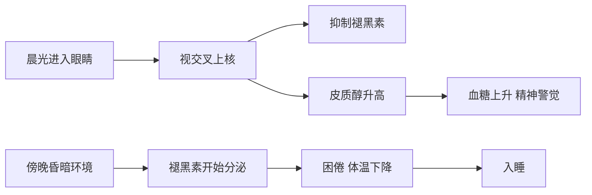
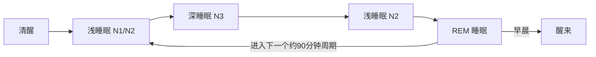

# Concept-Book Run

domain: /home/papagame/projects/digital-duck/cb-meta-health/public/domains/meta_health_ch08/input/graph.yaml
target: personal_daily_rhythm_schedule
started: 2026-11-24T07:34:46

## Teaching order (18 concepts)

- circadian_clock
- yin_yang
- day_night_yin_yang
- cortisol_melatonin_rhythm
- sleep_architecture
- five_phase_correspondences
- sleep_and_metabolic_repair
- twelve_primary_meridians
- chrononutrition
- four_seasons_regimen
- light_entrainment
- organ_clock_ziwu_liuzhu
- exercise_timing
- seasonal_organ_care
- breakfast_in_chenshi
- seasonal_food_and_movement
- sleep_before_zishi
- personal_daily_rhythm_schedule

### circadian_clock (26.6s)

## 生物钟

**定义。** 生物钟(昼夜节律系统)是人体内约 24 小时运转一圈的内部计时机制。它的"总指挥"是下丘脑的**视交叉上核**(SCN),约由两万个神经元组成,位于视交叉上方,直接接收来自视网膜的光信号。除此之外,肝、肾、心脏、脂肪、骨骼肌等几乎所有组织的细胞中也有各自的**外周时钟**。外周时钟靠细胞内的基因反馈环路自行振荡,而视交叉上核通过神经信号、体温和激素(如褪黑素、皮质醇)把它们协调成同一节拍。

在人体中,内源性周期平均约为 24.2 小时,略长于一天。因此,每天清晨的光照会把时钟"拨回"与外界同步。能校准时钟的外部信号称为授时因子,其中光最强,进餐时间、运动和社交活动也有作用。

**例题。** 小林的内源周期为 24.2 小时。如果他长期待在没有任何时间线索的环境中,每天会比外界"晚"多少?30 天后累计偏移多少?

每天偏移:

$$24.2\ \text{h} - 24\ \text{h} = 0.2\ \text{h} = 12\ \text{min}$$

30 天累计:

$$30 \times 12\ \text{min} = 360\ \text{min} = 6\ \text{h}$$

也就是说,没有光照校准时,他的睡眠时段会逐渐后移,一个月后大约晚 6 小时。这解释了为什么盲人有时会出现"非24小时睡眠觉醒障碍":他们的时钟得不到光的校准。

**问题解决应用。** 小王从上海飞往纽约,时差 $-12$ 小时(向西飞)。他的时钟需要"向后拨"。研究显示,向西飞时,体内时钟每天大约能后移 1.5 小时,向东飞则每天只能前移约 1 小时。估算他完全适应所需天数:

$$\frac{12\ \text{h}}{1.5\ \text{h/天}} = 8\ \text{天}$$

若他从纽约飞回上海,同样 12 小时的差距,按每天前移 1 小时估算,则需约 12 天。这与"向东飞比向西飞更难倒时差"的经验一致。(这里的数字是粗略平均值,个体差异较大。)

可操作的策略包括:

| 目的 | 做法 |
|---|---|
| 时钟需要前移(向东飞) | 到达后上午尽早接触明亮的自然光,傍晚避免强光 |
| 时钟需要后移(向西飞) | 傍晚多接触光,早晨可适当避光 |
| 日常维持稳定 | 起床和用餐时间尽量固定,睡前一小时减少手机、电脑等蓝光屏幕 |

**小结。** 视交叉上核负责与外界光照同步,外周时钟负责各器官的节律。两者失调,例如倒班、长期熬夜或跨时区旅行,会带来睡眠紊乱、代谢和情绪方面的问题。调整作息时抓住"光照时机"这一关键,就能更快让整个系统重新同步。

### yin_yang (16.4s)

## 阴阳

**定义。** 阴阳是中医(Traditional Chinese Medicine,TCM)用来描述事物相对性质及其相互关系的一对概念。中医认为,人体和自然界的现象都可以按相对的性质分为两类:阴偏向寒凉、安静、向内、向下、物质性;阳偏向温热、活跃、向外、向上、功能性。要注意,阴阳不是固定的标签,而是相对的:同一事物与不同对象比较,归属可以改变。例如,白天属阳、夜晚属阴;而在白天之中,上午又相对属阳、下午相对属阴。

中医还提出阴阳之间有几种关系:对立制约(如热与寒互相抑制)、互根互用(阴为阳提供物质基础,阳推动阴的化生)、消长变化(此长彼消)、相互转化(极端状态下可向对立面转变)。这些是定性的描述,不能用数值或公式计算,也没有可直接测量的"阴量"或"阳量"。从现代科学角度看,阴阳是一种思维框架和分类语言,而不是已被证实的生理机制;它与体温、心率、激素水平等可测量指标之间并没有经检验的对应关系。

**示例:用阴阳描述一次发热。** 设想一位患者,体温 $39\,^\circ\text{C}$,面红口渴,喜冷饮,脉快,尿黄。中医会这样分析:

| 观察 | 倾向 |
|---|---|
| 发热、面红 | 热,属阳 |
| 口渴喜冷饮 | 热伤津液,津液属阴 |
| 脉快 | 动,属阳 |
| 尿黄、量少 | 阴液不足 |

中医据此判断为"阳盛"(热过盛),治疗原则是清热。若另一位患者怕冷、四肢冰凉、精神萎靡、脉弱、喜热饮,则被归为"阳虚"(温煦不足),治疗原则是温补。两者的区别在于:前者是热的一方过多,后者是热的一方不足。

**问题应用。** 下面三道题练习用阴阳的相对性做分类。

1. *某人白天精神好、夜间畏寒,怎样描述?* 白天属阳,精神好是阳的功能活跃,属正常;夜间畏寒,说明夜间"阳"不足以温煦身体。这是中医的描述方式,并不等于诊断出某种疾病。
2. *在"心"与"肾"中,谁相对属阳?* 在中医的五脏理论中,心位于上,属阳;肾位于下,属阴。这是与对方比较得出的相对结论。
3. *出汗过多后口渴、乏力,如何理解?* 汗是津液,属阴;大量出汗是阴液耗损。

**需要提醒的是**:现代医学对发热、脱水等情况有明确的测量方法和处理规范。体温持续升高、严重脱水或意识改变时,应以体温、血压、化验结果为依据及时就医,而不应只靠阴阳分类来判断病情。学习阴阳的价值,在于读懂中医的语言和推理方式,而不是替代客观检查。

### day_night_yin_yang (21.7s)

## 昼夜阴阳消长

### 定义

中医认为,一天之中人体的阴阳也随昼夜起伏:从子夜到正午,阳气逐渐生长,阴气逐渐减退;从正午到子夜,阴气逐渐生长,阳气逐渐减退。这就是"昼夜阴阳消长"。按这一说法,白天属阳,适合活动、工作和消耗;夜晚属阴,适合安静、睡眠和储存。这是一种用来安排作息的传统框架,不是可以用数字计算的量。

与之相对应的,是现代生理学中真实可测的昼夜节律(生物钟),大约以24小时为周期。例如:

| 指标 | 大致规律 |
|---|---|
| 核心体温 | 清晨最低,傍晚最高,相差约 $0.5\,^\circ\mathrm{C}$ 至 $1\,^\circ\mathrm{C}$ |
| 皮质醇 | 醒后不久达到高峰,夜间降到低谷 |
| 褪黑素 | 天黑后升高,夜间达到高峰 |
| 心率与血压 | 白天较高,睡眠中下降 |

这两套说法的时段划分大体相近,但中医的"阳气""阴气"是传统概念,并不等同于上述任何一项指标。

### 示例

小林是一名学生,作息如下:

- 23:30 入睡,7:00 起床,早餐后上课;
- 12:00 午饭后短暂休息;
- 晚上 20:00 之后做轻松的复习,22:30 关闭屏幕。

按中医的说法,7:00 至 12:00 属阳气渐盛之时,适合安排最费脑力的课程;午后至傍晚阳气渐退,安排练习与运动;入夜后阴气渐盛,应减少兴奋性活动,准备入睡。

用现代生理学解释,这样安排也有道理:早晨皮质醇高、体温上升,警觉性较好;夜间强光会抑制褪黑素分泌,推迟入睡。睡眠时长也可以直接计算:

$$
\text{睡眠时长} = 7{:}00 - 23{:}30 = 7.5\ \text{小时}
$$

处在成年人常被推荐的 7 至 9 小时范围内。

### 问题应用

小王是夜班护士,22:00 上班,6:00 下班,回家后想马上睡觉,但总在中午前后醒来。请分析并提出建议。

**第一步:找出冲突。**中医认为,他在阴气渐盛的夜晚工作,又在阳气渐生的白天睡觉,与昼夜阴阳消长的节奏相反。现代的说法是:白天光照和体温上升会让睡眠变浅、变短,这是昼夜节律与作息错位的表现。

**第二步:提出可操作的措施。**

1. 下班回家路上戴深色墨镜,减少晨光照射;
2. 卧室使用遮光窗帘,保持安静和凉爽;
3. 睡眠分为主睡眠(如 7:30–13:00)和上班前的 20–30 分钟小睡;
4. 上班前半段在明亮环境中工作,临近下班时调暗光线,咖啡因最迟在上班后约 6 小时停用;
5. 休息日也尽量保持相近的睡眠时间,避免节律反复被打乱。

**第三步:评估边界。**长期倒班会增加疲劳和睡眠障碍的风险,这是有研究支持的结论。而"子时必须入睡,否则伤阴"这类具体说法,缺乏可靠的证据。若失眠持续超过数周,或白天严重嗜睡,应就医评估。

**小结:**昼夜阴阳消长提醒人们让作息顺应昼夜的节律。真正用来解决问题的,是对光照、睡眠时长和时间安排的具体调整。

### cortisol_melatonin_rhythm (22.5s)

## 皮质醇与褪黑素节律

**定义。** 人体的昼夜节律由下丘脑视交叉上核这一“主时钟”协调,并受光照校准。其中两种激素的变化最具代表性:**皮质醇**由肾上腺皮质分泌,在醒后约 30–45 分钟达到峰值(称为“皮质醇觉醒反应”),作用是动员能量,包括促进肝脏糖异生、升高血糖、提升警觉性;此后全天逐渐下降,午夜前后降至最低。**褪黑素**由松果体分泌,在黑暗中开始上升(昏暗光线下褪黑素开始分泌的时间,约在入睡前 2 小时),夜间 2–4 点达到高峰,随晨光出现而被抑制。两者大致呈相反的走向:皮质醇白天高、夜间低,褪黑素夜间高、白天几乎检测不到。

| 激素 | 峰值时间 | 谷值时间 | 主要作用 |
|---|---|---|---|
| 皮质醇 | 醒后约 30–45 分钟 | 午夜前后 | 动员能量、维持警觉 |
| 褪黑素 | 凌晨 2–4 点 | 白天 | 向身体传递“夜晚”信号、促进入睡 |

*图:光照信号经视交叉上核调控两种激素的昼夜走向。*

**例题。** 小李平时 7:00 起床、23:00 入睡。(1)他的皮质醇峰值大约出现在何时?(2)褪黑素开始分泌大约在何时?

解:(1)峰值在醒后 30–45 分钟,即约 7:30–7:45。(2)褪黑素开始分泌约在入睡前 2 小时,即约 21:00。

**问题解决应用。** 小李最近晚上 21:00 后仍在明亮灯光下刷手机,常到凌晨 1:00 才睡,早晨又难以清醒。请分析原因并提出调整方案。

分析:明亮光线,尤其是富含蓝光的屏幕光,会抑制并推迟褪黑素的分泌,使“夜晚信号”延后,入睡时间随之后移。睡眠不足时,早晨的皮质醇觉醒反应往往不能顺利衔接,表现为晨起迟钝。

调整方案:
1. **固定起床时间**:每天在同一时间起床,是校准节律最有效的锚点。
2. **晨间光照**:起床后 1 小时内到户外接受自然光,可强化皮质醇的晨间上升,并为约 14–16 小时后的褪黑素分泌“定时”。
3. **傍晚减光**:21:00 后调暗室内灯光,减少屏幕使用,或开启夜间模式并降低亮度。
4. **晚间避免刺激**:睡前不做剧烈运动、不摄入咖啡因,以免推高皮质醇和警觉度。

在上述方案中,最关键的是光照时间的管理,而非额外补充激素。褪黑素补充剂主要用于倒时差等特定情形,长期使用应咨询医生。

**小结。** 皮质醇在晨起后达到高峰以供能,褪黑素在夜间黑暗中升高以促眠,二者由光照和作息共同校准。规律的起床时间、白天的充足光照和夜间的昏暗环境,是维持这一节律的基本做法。

### sleep_architecture (16.5s)

## 睡眠结构

**定义。** 睡眠结构（sleep architecture）指一整夜睡眠中各个睡眠阶段的类型、时长和排列方式。根据脑电图，睡眠分为非快速眼动睡眠（NREM）和快速眼动睡眠（REM）。NREM 又分为：

- **浅睡眠**（N1、N2期）：肌肉放松，体温和心率下降，容易被唤醒。N2期占整夜睡眠的约 45%–55%，是占比最大的阶段。
- **深睡眠**（N3期，又称慢波睡眠）：脑电出现高振幅、低频的慢波，很难被唤醒，与身体修复和记忆巩固有关。
- **REM 睡眠**：脑电活动接近清醒，眼球快速转动，多数梦境发生在此阶段，与情绪处理和记忆整合有关。

这些阶段并非各出现一次，而是按 NREM 到 REM 的顺序循环，每个周期约 90 分钟（个体差异约 70–110 分钟）。一夜通常经历 4–6 个周期。

**关键规律：** 深睡眠集中在前半夜，随周期推进逐渐减少；REM 睡眠则在后半夜逐渐变长。第一个周期的 REM 可能只有约 5–10 分钟，而最后一个周期的 REM 可达 30–60 分钟。

*一个睡眠周期的典型顺序：浅睡眠、深睡眠、再回到浅睡眠，最后进入 REM，然后进入下一周期。*

**例题。** 小李 23:00 入睡，设定 07:00 起床。假设每个周期 90 分钟，他能完成几个周期？

总睡眠时间为 8 小时，即 480 分钟。周期数为：

$$\frac{480\ \text{分钟}}{90\ \text{分钟/周期}} \approx 5.3$$

也就是约 5 个完整周期，加上一个未完成的周期。5 个周期共 450 分钟，结束于 06:30。

**问题解决应用。** 小李平时睡 6 小时（360 分钟），只有 4 个周期。因为深睡眠集中在前半夜，这样缩短后深睡眠损失不大；但 REM 集中在后半夜，所以 REM 损失最明显。他可能觉得情绪调节变差，注意力和记忆下降。

再看闹钟设置。如果小李想在周期结束时醒来，可把起床时间设在入睡后 $n\times 90$ 分钟附近，再加上约 15 分钟的入睡时间。要睡 5 个周期，应在约 23:00 上床后的 $450+15=465$ 分钟，即 06:45 左右起床。在深睡眠中被叫醒，往往会出现睡眠惯性（头昏、迟钝），而在周期末的浅睡眠中醒来则轻松得多。

**注意事项。** 90 分钟只是平均值，各周期长度会变化。酒精会抑制 REM，使睡眠结构被打乱；年龄增长会使深睡眠占比明显下降。因此，不能只看总时长，还要看睡眠是否连续、周期是否完整。

### five_phase_correspondences (15.2s)

## 五行归类

**定义。** 五行归类,是中医(Traditional Chinese Medicine,TCM)用木、火、土、金、水五个类别,把自然现象和人体功能按特征相近的原则分组的方法。中医认为,凡具有生发、舒展特点的事物归"木",具有温热、向上特点的归"火",具有承载、化生特点的归"土",具有清肃、收敛特点的归"金",具有寒凉、闭藏特点的归"水"。这里的"五行"是分类标签,不是数量,更不是公式;归类的依据是功能特征的类比。

**五行对应表。**

| 五行 | 季节 | 方位 | 气候 | 五脏 | 六腑 | 五官 | 情志 | 五味 |
|---|---|---|---|---|---|---|---|---|
| 木 | 春 | 东 | 风 | 肝 | 胆 | 目 | 怒 | 酸 |
| 火 | 夏 | 南 | 暑 | 心 | 小肠 | 舌 | 喜 | 苦 |
| 土 | 长夏 | 中 | 湿 | 脾 | 胃 | 口 | 思 | 甘 |
| 金 | 秋 | 西 | 燥 | 肺 | 大肠 | 鼻 | 悲 | 辛 |
| 水 | 冬 | 北 | 寒 | 肾 | 膀胱 | 耳 | 恐 | 咸 |

需要注意的是"五季":中医把一年分为春、夏、长夏、秋、冬。长夏通常指夏末秋初、湿气最重的时段(大致相当于农历六月),对应"土"。这样一年的季节恰好与五行一一配齐。

**例题。** 一位患者每到梅雨季就觉得身体困重、食欲差、大便偏稀,舌苔厚腻。请用对应表归类。

*步骤:* ①梅雨季湿气重,对应"湿",在表中属"土"(长夏);②"土"对应脾与胃,而食欲差、便稀属消化功能表现;③中医据此认为,这是"湿困脾土"一类的表现,调理思路是祛湿、健脾。

**练习应用。** 另一位患者在秋季反复出现干咳、鼻咽干燥、皮肤干。请自行推理:

1. 秋季气候特点为"燥",归"金";
2. "金"对应肺、大肠、鼻,症状涉及呼吸道和鼻,与肺相符;
3. 中医据此提出"燥邪伤肺"的解释,调理以润燥为主。

注意区分:归类给出的是思路的起点,不能代替诊断。同样是干咳,可能由过敏、哮喘、感染或胃食管反流引起,持续不缓解时应就医检查。

**证据状态与使用提醒。** 五行归类是一套古代的类比分类框架,表中的对应关系(例如"怒"属肝、"恐"属肾)并不是经现代生理学验证的解剖或生理事实。把它当作理解中医术语和辨证思路的"语言",是合理的;但不应据此推断某种食物或情绪必然导致某个器官疾病。

**小结。** 记住表的横向读法:同一行的各项在中医里被视为"同类"。解题时,先找到题目中的已知线索(季节、症状、器官、情绪或味道),定位到所在行,再读出同行的其他项,即可完成归类推理。

