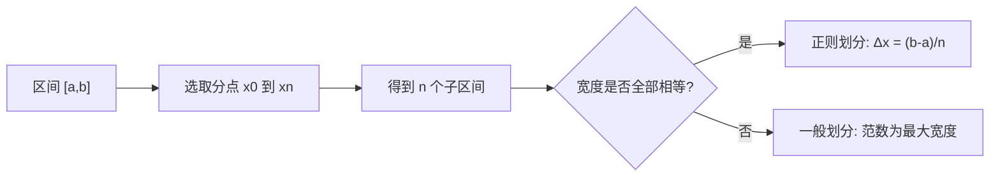

# Concept-Book Run

domain: /home/papagame/projects/digital-duck/cb-calculus/public/domains/calculus_ch05/input/graph.yaml
target: price_demand_application
started: 2026-11-24T11:50:38

## Teaching order (12 concepts)

- partition
- sigma_notation
- antiderivative
- riemann_sum
- area_under_curve_limit
- definite_integral
- fundamental_theorem_calculus_part1
- fundamental_theorem_calculus_part2
- integration_by_substitution
- integrals_exponential_functions
- net_change_theorem
- price_demand_application

### partition (0.7s)

## 划分(Partition)

**定义。** 闭区间 $[a,b]$ 的一个**划分**是一组有限的点
$$P=\{x_0,x_1,\dots,x_n\},\qquad a=x_0<x_1<\cdots<x_n=b,$$
它把 $[a,b]$ 分成 $n$ 个子区间 $[x_{i-1},x_i]$($i=1,\dots,n$)。第 $i$ 个子区间的宽度为 $\Delta x_i=x_i-x_{i-1}$,各宽度之和恒为 $b-a$。划分的**范数**(最大子区间宽度)记作
$$\|P\|=\max_{1\le i\le n}\Delta x_i.$$

若所有子区间等宽,则称 $P$ 为**正则划分**(等分划分)。此时
$$\Delta x=\frac{b-a}{n},\qquad x_i=a+i\,\Delta x,\quad i=0,1,\dots,n,$$
并且 $\|P\|=\Delta x$。

**例题。** 设 $[a,b]=[0,3]$。

1. 取 $P_1=\{0,\,1,\,2,\,3\}$:$n=3$,$\Delta x=\frac{3-0}{3}=1$,这是正则划分,$\|P_1\|=1$。
2. 取 $P_2=\{0,\,0.5,\,2,\,3\}$:宽度依次为 $0.5,\ 1.5,\ 1$,三者不相等,所以不是正则划分,且 $\|P_2\|=1.5$。

可见,点数相同的划分未必是正则的;范数衡量的是"最粗"的那一块。

**问题求解应用。** 划分是黎曼和的基础。对 $f(x)=x^2$ 在 $[0,2]$ 上取 $n=4$ 的正则划分,用右端点求近似面积:

- $\Delta x=\frac{2-0}{4}=0.5$,分点为 $0,\,0.5,\,1,\,1.5,\,2$。
- 右端点黎曼和为
$$R_4=\sum_{i=1}^{4}f(x_i)\,\Delta x=0.5\,(0.25+1+2.25+4)=3.75.$$

精确值为 $\int_0^2x^2\,dx=\frac{8}{3}\approx2.667$,右端点和偏大,因为 $f$ 在该区间上递增。

对一般的 $n$,取正则划分 $x_i=\frac{2i}{n}$,则
$$R_n=\sum_{i=1}^{n}\left(\frac{2i}{n}\right)^2\frac{2}{n}=\frac{8}{n^3}\cdot\frac{n(n+1)(2n+1)}{6}.$$
当 $n\to\infty$ 时,$\|P\|=\frac{2}{n}\to0$,于是 $R_n\to\frac{8}{6}\cdot2=\frac{8}{3}$,与精确值一致。

**要点。**
- 划分由满足 $a=x_0<\cdots<x_n=b$ 的分点唯一确定,子区间宽度之和为 $b-a$。
- 正则划分只需知道 $a$、$b$ 和 $n$,计算最方便。
- 积分的定义要求 $\|P\|\to0$,而不仅仅是 $n\to\infty$;对非正则划分,只增加点数并不能保证每个子区间都变窄。

*图:从区间 $[a,b]$ 出发构造划分,并按子区间宽度是否相等区分正则划分与一般划分。*

### sigma_notation (0.6s)

## 求和符号(Sigma 记号)

**定义。** 希腊字母 $\Sigma$(西格玛)用来简洁地表示一列数的和。表达式

$$\sum_{i=m}^{n} a_i = a_m + a_{m+1} + \cdots + a_n$$

中,$i$ 称为**求和指标**(哑变量),$m$ 是**下限**,$n$ 是**上限**,$a_i$ 是**通项**。指标 $i$ 只在求和式内部有意义,换成 $j$ 或 $k$ 结果不变:$\sum_{i=1}^{n} a_i=\sum_{k=1}^{n} a_k$。项数为 $n-m+1$。

**基本性质(线性)。** 对常数 $c$:

$$\sum_{i=m}^{n} (c\,a_i + b_i) = c\sum_{i=m}^{n} a_i + \sum_{i=m}^{n} b_i$$

**常用公式。**

$$\sum_{i=1}^{n} 1 = n,\qquad \sum_{i=1}^{n} i = \frac{n(n+1)}{2},\qquad \sum_{i=1}^{n} i^2 = \frac{n(n+1)(2n+1)}{6}$$

**例题 1(展开与计算)。** 计算 $\sum_{k=2}^{5} (2k-1)$。

逐项展开:$k=2,3,4,5$ 分别给出 $3,5,7,9$,所以和为 $3+5+7+9=24$。

也可用线性性质:项数为 $4$,
$$\sum_{k=2}^{5}(2k-1)=2\sum_{k=2}^{5}k-4=2\cdot 14-4=24.$$

**例题 2(把和式写成 $\Sigma$)。** 把 $2+4+8+16+32$ 写成求和式。观察到第 $i$ 项是 $2^i$,从 $i=1$ 到 $5$:
$$\sum_{i=1}^{5} 2^i.$$
同一个和也可以写成 $\sum_{j=0}^{4} 2^{j+1}$,这叫做**指标平移**,需要同时改变上下限和通项。

**问题求解应用。** 求 $\sum_{i=1}^{n}(3i^2 - 2i + 1)$ 的闭式。

先拆分,再套用公式:

$$3\cdot\frac{n(n+1)(2n+1)}{6} - 2\cdot\frac{n(n+1)}{2} + n = \frac{n(n+1)(2n+1)}{2} - n(n+1) + n.$$

通分化简得 $\dfrac{n(n+1)(2n-1)}{2}+n=\dfrac{2n^3+n^2-n+2n}{2}=\dfrac{2n^3+n^2+n}{2}$。

用 $n=2$ 检验:直接计算为 $(3-2+1)+(12-4+1)=2+9=11$;公式给出 $\dfrac{16+4+2}{2}=11$。✓

**常见错误。**

1. 不能把常数项当成只出现一次:$\sum_{i=1}^{n}1=n$,而不是 $1$。
2. $\sum a_ib_i \neq \left(\sum a_i\right)\left(\sum b_i\right)$,乘积的和不等于和的乘积。
3. 平移指标时忘记同步调整上下限。

**编程对照。** 求和符号与循环等价:`sum(2*k - 1 for k in range(2, 6))` 返回 `24`。理解这一点,能帮助你将数学公式转化为程序,也能用闭式公式把 $O(n)$ 的循环优化成 $O(1)$ 的计算。

### antiderivative (0.9s)

## 原函数(不定积分的基础)

**定义。** 若在区间 $I$ 上对每个 $x$ 都有
$$F'(x)=f(x),$$
则称 $F(x)$ 是 $f(x)$ 在 $I$ 上的一个**原函数**(antiderivative)。原函数不唯一:若 $F$ 是原函数,则对任意常数 $C$,$F(x)+C$ 也是,因为常数的导数为 $0$。反过来,若 $F$ 与 $G$ 都是 $f$ 的原函数,则 $(F-G)'=0$,由均值定理知 $F-G$ 在区间上为常数。因此 $f$ 的全部原函数可写成
$$\int f(x)\,dx = F(x)+C.$$

**常用公式。**

| $f(x)$ | 一个原函数 $F(x)$ |
|---|---|
| $x^n\ (n\neq -1)$ | $\dfrac{x^{n+1}}{n+1}$ |
| $\dfrac1x\ (x\neq0)$ | $\ln|x|$ |
| $e^x$ | $e^x$ |
| $\cos x$ | $\sin x$ |
| $\sin x$ | $-\cos x$ |

**例题 1。** 求 $f(x)=3x^2-4\cos x+e^x$ 的所有原函数。

逐项用公式(原函数对加法与常数倍是线性的):
$$F(x)=3\cdot\frac{x^3}{3}-4\sin x+e^x+C=x^3-4\sin x+e^x+C.$$
**检验:** $F'(x)=3x^2-4\cos x+e^x=f(x)$。求原函数后一定要求导验证,这是最可靠的检查方法。

**例题 2(初值问题)。** 一质点的速度为 $v(t)=6t+2$(单位:m/s),且 $t=0$ 时位置为 $s(0)=5$ m,求 $s(t)$。

位置是速度的原函数:
$$s(t)=3t^2+2t+C.$$
代入 $s(0)=5$,得 $C=5$,所以
$$s(t)=3t^2+2t+5.$$
常数 $C$ 由初始条件唯一确定,这正是原函数在物理问题中的作用。

**应用:与定积分的联系。** 微积分基本定理(牛顿–莱布尼茨公式)指出:若 $F$ 是连续函数 $f$ 在 $[a,b]$ 上的一个原函数,则
$$\int_a^b f(x)\,dx = F(b)-F(a).$$
例如计算 $\displaystyle\int_1^3 (2x+1)\,dx$:取 $F(x)=x^2+x$,则
$$F(3)-F(1)=(9+3)-(1+1)=10.$$
这里任取哪个 $C$ 都不影响结果,因为 $(F(b)+C)-(F(a)+C)=F(b)-F(a)$,常数相互抵消。于是,求曲线下面积这类"无限求和"的问题,被转化为"逆向求导"的问题。

**常见错误。**
- 忘记写 $+C$(不定积分中必须保留)。
- 把 $\int \frac1x\,dx$ 套用幂函数公式,得到分母为零的错误结果;正确答案是 $\ln|x|+C$。
- 对复合函数(如 $\cos 2x$)直接套用公式:$\int\cos 2x\,dx=\tfrac12\sin 2x+C$,须通过求导验证系数。

**小结。** 原函数是求导的逆运算,它们构成一族只差常数的函数;掌握基本公式、线性性质和求导检验,就能解决初值问题,并借助 $F(b)-F(a)$ 高效计算定积分。

### riemann_sum (0.8s)

## 黎曼和

**定义。** 设函数 $f$ 在闭区间 $[a,b]$ 上有定义。把区间划分为 $n$ 个小区间：
$$a=x_0<x_1<\cdots<x_n=b,\qquad \Delta x_i=x_i-x_{i-1}.$$
在每个小区间 $[x_{i-1},x_i]$ 中任取一点 $x_i^*$（左端点、右端点、中点或任意点均可），则

$$S_n=\sum_{i=1}^{n} f(x_i^*)\,\Delta x_i$$

称为 $f$ 的**黎曼和**。当 $f\ge 0$ 时，每一项 $f(x_i^*)\Delta x_i$ 是一个以 $\Delta x_i$ 为宽、$f(x_i^*)$ 为高的矩形面积，所以 $S_n$ 是这些矩形面积之和，用来近似曲线下的面积。若采用等分划分，则 $\Delta x=\dfrac{b-a}{n}$，$x_i=a+i\Delta x$。

**取点方式的影响。** 取 $x_i^*=x_{i-1}$ 得到左黎曼和 $L_n$，取 $x_i^*=x_i$ 得到右黎曼和 $R_n$，取中点得到中点和 $M_n$。对递增函数，$L_n$ 偏小，$R_n$ 偏大。

**例题。** 用 $n=4$ 的左、右黎曼和估计 $\displaystyle\int_0^2 x^2\,dx$。

此时 $\Delta x=\dfrac{2-0}{4}=0.5$，分点为 $0,\,0.5,\,1,\,1.5,\,2$。

- 左黎曼和：
$$L_4=0.5\,[f(0)+f(0.5)+f(1)+f(1.5)]=0.5\,(0+0.25+1+2.25)=1.75.$$
- 右黎曼和：
$$R_4=0.5\,[f(0.5)+f(1)+f(1.5)+f(2)]=0.5\,(0.25+1+2.25+4)=3.75.$$

由于 $f(x)=x^2$ 在 $[0,2]$ 上递增，真实面积夹在两者之间：$1.75<A<3.75$。精确值为 $\dfrac{8}{3}\approx 2.667$。取两者平均 $\dfrac{L_4+R_4}{2}=2.75$，误差已明显缩小。

**问题求解应用。** 一辆车在 $t=0,2,4,6$ 秒时的速度分别为 $0,\,3,\,5,\,6$ m/s（速度递增）。估计前 6 秒的位移。

位移等于速度曲线下的面积。取 $\Delta t=2$：

- 左和：$2\,(0+3+5)=16$ m（低估）；
- 右和：$2\,(3+5+6)=28$ m（高估）。

所以位移在 $16$ 到 $28$ m 之间，取平均得估计值 $22$ m。要缩小这个范围，就需要更密的测量数据，也就是增大 $n$。

**与定积分的联系。** 若 $f$ 在 $[a,b]$ 上连续，令最大小区间宽度 $\|P\|=\max_i\Delta x_i\to 0$（等分时即 $n\to\infty$），则无论 $x_i^*$ 如何选取，黎曼和都收敛到同一个极限：
$$\int_a^b f(x)\,dx=\lim_{\|P\|\to 0}\sum_{i=1}^{n} f(x_i^*)\,\Delta x_i.$$
这正是定积分的定义。因此，黎曼和既是数值估算面积的实用工具，也是积分理论的出发点。

*图：从划分区间到定积分的黎曼和构造流程。*

### area_under_curve_limit (0.5s)

## 曲线下面积的极限

**定义。** 设 $f$ 在 $[a,b]$ 上连续且非负。把区间等分为 $n$ 个子区间，每个宽度 $\Delta x=\dfrac{b-a}{n}$，取分点 $x_i=a+i\,\Delta x$。黎曼和为

$$
S_n=\sum_{i=1}^{n} f(x_i)\,\Delta x ,
$$

它用 $n$ 个矩形近似曲线下的面积。**曲线下的精确面积**定义为 $n\to\infty$ 时黎曼和的极限：

$$
A=\lim_{n\to\infty}\sum_{i=1}^{n} f(x_i)\,\Delta x=\int_a^b f(x)\,dx .
$$

直观上，$n$ 越大，矩形越窄，矩形顶部与曲线之间的误差越小，最终趋于零。

**例题。** 求 $f(x)=x^2$ 在 $[0,1]$ 上的曲线下面积。

此时 $\Delta x=\dfrac1n$，$x_i=\dfrac in$，所以

$$
S_n=\sum_{i=1}^{n}\left(\frac in\right)^2\frac1n=\frac{1}{n^3}\sum_{i=1}^{n} i^2 .
$$

利用公式 $\sum_{i=1}^{n} i^2=\dfrac{n(n+1)(2n+1)}{6}$，得

$$
S_n=\frac{n(n+1)(2n+1)}{6n^3}=\frac{1}{6}\left(1+\frac1n\right)\left(2+\frac1n\right).
$$

令 $n\to\infty$，$\dfrac1n\to0$，因此

$$
A=\lim_{n\to\infty}S_n=\frac16\cdot1\cdot2=\frac13 .
$$

数值检验：$n=10$ 时 $S_{10}=0.385$，$n=100$ 时 $S_{100}\approx0.33835$，逐步逼近 $\dfrac13$。

**问题求解应用。** 求 $f(x)=2x+1$ 在 $[0,3]$ 上的面积。

1. 确定 $\Delta x=\dfrac3n$，$x_i=\dfrac{3i}{n}$。
2. 写出黎曼和：
$$
S_n=\sum_{i=1}^{n}\left(\frac{6i}{n}+1\right)\frac3n=\frac{18}{n^2}\sum_{i=1}^{n}i+\frac{3}{n}\cdot n .
$$
3. 代入 $\sum_{i=1}^{n} i=\dfrac{n(n+1)}{2}$：
$$
S_n=\frac{18}{n^2}\cdot\frac{n(n+1)}{2}+3=9\left(1+\frac1n\right)+3 .
$$
4. 取极限：$A=9+3=12$。

检验：该图形是梯形，上下底为 $1$ 和 $7$，高为 $3$，面积 $\dfrac{(1+7)\cdot3}{2}=12$，结果一致。

**解题步骤总结：** ① 写出 $\Delta x$ 与 $x_i$；② 列出黎曼和；③ 用求和公式化为 $n$ 的显式表达式；④ 令 $n\to\infty$ 求极限。要点在于：必须先把和化简成关于 $n$ 的闭式，才能计算极限。

*图示：从区间划分到取极限，得到曲线下精确面积的流程。*

### definite_integral (0.8s)

## 定积分

**定义。** 设函数 $f$ 在区间 $[a,b]$ 上有定义。把 $[a,b]$ 等分为 $n$ 个小区间，每段宽度 $\Delta x=\dfrac{b-a}{n}$，在每个小区间内任取一点 $x_i^*$，作黎曼和
$$S_n=\sum_{i=1}^{n} f(x_i^*)\,\Delta x .$$
当 $n\to\infty$ 时，若 $S_n$ 的极限存在，且与取点方式无关，则称该极限为 $f$ 在 $[a,b]$ 上的**定积分**：
$$\int_a^b f(x)\,dx=\lim_{n\to\infty}\sum_{i=1}^{n} f(x_i^*)\,\Delta x .$$

它推广了"曲线下的面积"：当 $f(x)<0$ 时，对应的小矩形"高度"为负，贡献负值。因此定积分计算的是**带符号面积**，即 $x$ 轴上方的面积减去 $x$ 轴下方的面积。若 $f$ 在 $[a,b]$ 上连续，或只有有限个跳跃间断点且有界，则定积分一定存在。

**例题。** 用定义计算 $\displaystyle\int_0^2 x^2\,dx$。

取右端点 $x_i^*=\dfrac{2i}{n}$，$\Delta x=\dfrac{2}{n}$，则
$$S_n=\sum_{i=1}^{n}\left(\frac{2i}{n}\right)^2\frac{2}{n}=\frac{8}{n^3}\sum_{i=1}^{n} i^2=\frac{8}{n^3}\cdot\frac{n(n+1)(2n+1)}{6}.$$
化简得 $S_n=\dfrac{4}{3}\cdot\dfrac{(n+1)(2n+1)}{n^2}$。令 $n\to\infty$，$\dfrac{(n+1)(2n+1)}{n^2}\to 2$，所以
$$\int_0^2 x^2\,dx=\frac{8}{3}.$$

**问题求解应用。** 利用带符号面积和几何意义，可以不经过计算极限而直接求值。

*问题：* 求 $\displaystyle\int_{-1}^{3} (x-1)\,dx$。

图像是一条过点 $(1,0)$ 的直线。在 $[-1,1]$ 上，函数值为负，形成底为 $2$、高为 $2$ 的三角形，带符号面积为 $-\tfrac12\cdot2\cdot2=-2$。在 $[1,3]$ 上，函数值为正，形成底为 $2$、高为 $2$ 的三角形，面积为 $+2$。因此
$$\int_{-1}^{3}(x-1)\,dx=-2+2=0.$$

结果为 $0$ 说明正负两部分恰好抵消。这提醒我们：定积分为 $0$ 不代表函数处处为 $0$，也不代表"面积"为 $0$。若要求总面积，需改算 $\displaystyle\int_{-1}^{3}|x-1|\,dx=4$。

**常用性质。**
- 线性性：$\displaystyle\int_a^b [\alpha f+\beta g]\,dx=\alpha\int_a^b f\,dx+\beta\int_a^b g\,dx$。
- 区间可加性：$\displaystyle\int_a^b f\,dx=\int_a^c f\,dx+\int_c^b f\,dx$。
- 反向积分：$\displaystyle\int_b^a f\,dx=-\int_a^b f\,dx$。

这些性质让我们可以把分段函数或复杂函数拆开，逐段处理，这是后续学习微积分基本定理的基础。

### fundamental_theorem_calculus_part1 (0.6s)

## 微积分基本定理（第一部分）

### 定义

设 $f$ 在闭区间 $[a,b]$ 上连续。定义**累积函数**

$$F(x)=\int_a^x f(t)\,dt,\qquad x\in[a,b].$$

**微积分基本定理第一部分**指出：$F$ 在 $(a,b)$ 内可导，且

$$F'(x)=f(x).$$

也就是说，$F$ 是 $f$ 的一个原函数。直观上，$F(x)$ 表示曲线 $y=f(t)$ 下从 $a$ 到 $x$ 的面积。当 $x$ 增加一小段 $h$ 时，面积增加量约等于一个高为 $f(x)$、宽为 $h$ 的细长矩形，所以面积的变化率恰好是 $f(x)$。

### 为什么成立（证明思路）

由积分的可加性，

$$F(x+h)-F(x)=\int_x^{x+h} f(t)\,dt.$$

$f$ 连续，由积分中值定理，存在 $c_h$ 介于 $x$ 与 $x+h$ 之间，使

$$\int_x^{x+h} f(t)\,dt=f(c_h)\,h.$$

于是

$$\frac{F(x+h)-F(x)}{h}=f(c_h).$$

当 $h\to0$ 时，$c_h\to x$，由 $f$ 的连续性得 $f(c_h)\to f(x)$，所以 $F'(x)=f(x)$。

### 例题

**例 1** 求 $F(x)=\int_1^x t^2\,dt$ 的导数。

直接套用定理：$F'(x)=x^2$。验证：$F(x)=\dfrac{x^3-1}{3}$，求导得 $x^2$。✓

**例 2（链式法则）** 求 $G(x)=\displaystyle\int_0^{x^2}\sin t\,dt$ 的导数。

令 $u=x^2$，则 $G(x)=F(u)$，其中 $F(u)=\int_0^u \sin t\,dt$。由链式法则，

$$G'(x)=F'(u)\cdot u'=\sin(x^2)\cdot 2x=2x\sin(x^2).$$

注意：这个积分的原函数无需求出，也能得到导数。

### 问题求解应用

**问题** 设 $\displaystyle H(x)=\int_x^{3} \sqrt{1+t^4}\,dt$，求 $H'(x)$。

**解** 变量在下限，先交换上下限并变号：

$$H(x)=-\int_3^{x}\sqrt{1+t^4}\,dt,$$

所以

$$H'(x)=-\sqrt{1+x^4}.$$

**解题要点**

1. 先确认被积函数连续，且变量只出现在积分限中，不出现在被积函数里。
2. 变量在下限时，先交换上下限并添加负号。
3. 上限是 $g(x)$ 时，结果再乘以 $g'(x)$。一般形式为

$$\frac{d}{dx}\int_a^{g(x)} f(t)\,dt=f\big(g(x)\big)\,g'(x).$$

该定理说明，积分与求导是互逆的运算。它保证了每个连续函数都有原函数，这也是第二部分用原函数计算定积分的基础。

*图示：先对连续函数做积分，再求导，结果还原为原函数 $f$，体现积分与求导互为逆运算。*

### fundamental_theorem_calculus_part2 (0.7s)

## 微积分基本定理（第二部分）

### 定义

**微积分基本定理第二部分**（也称牛顿–莱布尼茨公式）：设 $f$ 在 $[a,b]$ 上连续，$F$ 是 $f$ 在 $[a,b]$ 上的任意一个原函数，即 $F'(x)=f(x)$，则

$$
\int_a^b f(x)\,dx = F(b)-F(a).
$$

右端常记作 $F(x)\Big|_a^b$。它把"无限多个小矩形求和"的极限，转化为"两个端点函数值之差"。

**为什么原函数可以任选？** 若 $F$ 与 $G$ 都是 $f$ 的原函数，则 $(F-G)'=0$，所以 $F-G=C$（常数）。于是
$$
G(b)-G(a)=\big(F(b)+C\big)-\big(F(a)+C\big)=F(b)-F(a),
$$
常数 $C$ 相互抵消，结果与选择无关。

### 例题

计算 $\displaystyle\int_1^3 (2x+1)\,dx$。

1. 求原函数：$F(x)=x^2+x$，因为 $F'(x)=2x+1$。
2. 代入端点：$F(3)=9+3=12$，$F(1)=1+1=2$。
3. 相减：$\displaystyle\int_1^3 (2x+1)\,dx = 12-2 = 10$。

**检验：** 该图形是梯形，上下底分别为 $f(1)=3$ 与 $f(3)=7$，高为 $2$，面积 $=\frac{(3+7)\cdot 2}{2}=10$，与结果一致。

### 问题求解应用

**问题：** 一质点的速度为 $v(t)=3t^2-6t$（单位：m/s），求 $t=0$ 到 $t=3$ 秒内的**位移**与**总路程**。

**位移：** 位移等于速度的定积分，取原函数 $s(t)=t^3-3t^2$：
$$
\int_0^3 (3t^2-6t)\,dt = s(3)-s(0)=(27-27)-0=0.
$$
质点最终回到出发点。

**总路程：** 路程是 $|v(t)|$ 的积分。令 $v(t)=3t(t-2)=0$，得 $t=0,\,2$。当 $0<t<2$ 时 $v<0$（反向运动），当 $2<t<3$ 时 $v>0$。故需分段计算：

- $[0,2]$：$s(2)-s(0)=(8-12)-0=-4$，路程为 $4$ m；
- $[2,3]$：$s(3)-s(2)=0-(-4)=4$，路程为 $4$ m。

总路程 $=4+4=8$ m。

**常见错误提醒：**

- 若函数在区间内变号，要求"面积"或"路程"，必须在零点处分段，否则正负部分会相互抵消。
- 定理要求 $f$ 在 $[a,b]$ 上**连续**。例如 $\int_{-1}^{1}\frac{1}{x^2}\,dx$ 被积函数在 $x=0$ 处无界，若直接用 $F(x)=-\frac1x$ 得到 $-2$，结果显然错误（被积函数恒为正）。

**小结：** 计算定积分的步骤是：①确认连续；②求任一原函数 $F$；③计算 $F(b)-F(a)$；④必要时在变号点分段。

### integration_by_substitution (0.5s)

## 换元积分法

**定义。** 换元积分法(也称 $u$-代换)是求不定积分的一种技术,它把链式法则"倒着用"。若 $F'(x)=f(x)$,则由链式法则
$$\frac{d}{dx}F\big(g(x)\big)=f\big(g(x)\big)\,g'(x).$$
反过来就得到换元公式:
$$\int f\big(g(x)\big)\,g'(x)\,dx=\int f(u)\,du\Big|_{u=g(x)}=F\big(g(x)\big)+C.$$
关键在于:令 $u=g(x)$,则 $du=g'(x)\,dx$,被积表达式中的"内函数及其导数"就被整体换成了一个更简单的变量 $u$。

**操作步骤。**
1. 在被积函数中找出"内层表达式" $u=g(x)$,且其导数(至多相差常数倍)也出现在被积函数中;
2. 计算 $du=g'(x)\,dx$,把 $x$ 全部换成 $u$;
3. 对 $u$ 积分;
4. 把 $u=g(x)$ 代回,得到关于 $x$ 的答案。

**例题 1。** 求 $\displaystyle\int 2x\cos(x^2)\,dx$。

令 $u=x^2$,则 $du=2x\,dx$。于是
$$\int \cos u\,du=\sin u+C=\sin(x^2)+C.$$
验证:$\dfrac{d}{dx}\sin(x^2)=\cos(x^2)\cdot 2x$,与被积函数一致。

**例题 2(需要补常数)。** 求 $\displaystyle\int x\sqrt{1+3x^2}\,dx$。

令 $u=1+3x^2$,则 $du=6x\,dx$,即 $x\,dx=\tfrac16\,du$。于是
$$\int \sqrt{u}\cdot\frac16\,du=\frac16\cdot\frac{2}{3}u^{3/2}+C=\frac19\,(1+3x^2)^{3/2}+C.$$

**定积分的换元。** 计算定积分时,可以同时变换积分限,这样就不必代回 $x$:若 $u=g(x)$,则
$$\int_a^b f\big(g(x)\big)g'(x)\,dx=\int_{g(a)}^{g(b)} f(u)\,du.$$

**例题 3。** 求 $\displaystyle\int_0^{2}\frac{x}{x^2+1}\,dx$。

令 $u=x^2+1$,$du=2x\,dx$;当 $x=0$ 时 $u=1$,当 $x=2$ 时 $u=5$。所以
$$\int_1^{5}\frac{1}{2u}\,du=\frac12\ln|u|\Big|_1^5=\frac12\ln 5.$$

**解题应用与常见错误。**
- **选择 $u$ 的经验:** 优先选括号内的部分、根号下的部分、分母、指数,并检查剩下的因子是否恰好是 $du$ 的常数倍。
- **必须消去所有 $x$:** 若换元后仍残留 $x$,说明 $u$ 选得不合适(或需要用 $u$ 表示 $x$,例如 $u=x+1\Rightarrow x=u-1$)。
- **定积分不要混用变量:** 换了积分限就用 $u$ 的值求结果;若保留原限 $a,b$,则必须先代回 $x$。
- **自检:** 对结果求导,应当还原被积函数。

**练习。** 求 $\displaystyle\int \frac{e^{x}}{1+e^{x}}\,dx$。提示:令 $u=1+e^{x}$,则 $du=e^{x}dx$,结果为 $\ln(1+e^{x})+C$。

### integrals_exponential_functions (0.5s)

## 指数函数的积分

### 定义

指数函数的积分公式由求导公式反推而来。因为 $\dfrac{d}{dx}e^x=e^x$,以及 $\dfrac{d}{dx}a^x=a^x\ln a$,所以对 $a>0,\ a\neq 1$:

$$\int e^x\,dx=e^x+C,\qquad \int a^x\,dx=\frac{a^x}{\ln a}+C.$$

当指数是线性函数时,用换元法 $u=kx+b$,则 $du=k\,dx$:

$$\int e^{kx+b}\,dx=\frac{1}{k}e^{kx+b}+C\quad(k\neq 0).$$

一般形式为:若 $u=g(x)$,则

$$\int e^{g(x)}g'(x)\,dx=\int e^u\,du=e^{g(x)}+C.$$

关键是在被积函数中识别出"指数部分的导数"。

### 例题

**例 1** 求 $\displaystyle\int 3^{2x}\,dx$。

令 $u=2x$,则 $dx=\tfrac12du$:

$$\int 3^{u}\cdot\frac12\,du=\frac{1}{2}\cdot\frac{3^{u}}{\ln 3}+C=\frac{3^{2x}}{2\ln 3}+C.$$

**例 2** 求 $\displaystyle\int x\,e^{x^2}\,dx$。

指数部分为 $x^2$,其导数 $2x$ 与被积函数中的 $x$ 只差常数倍。令 $u=x^2$,则 $x\,dx=\tfrac12du$:

$$\int e^{u}\cdot\frac12\,du=\frac12e^{x^2}+C.$$

检验:$\dfrac{d}{dx}\left(\tfrac12e^{x^2}\right)=\tfrac12e^{x^2}\cdot2x=xe^{x^2}$ ✓。

### 问题求解应用

**应用:连续衰减的累积量。** 某放射性样品的衰变速率为 $r(t)=500e^{-0.2t}$(单位:原子/小时)。求前 $5$ 小时内共衰变的原子数。

累积量等于速率的定积分:

$$N=\int_0^5 500e^{-0.2t}\,dt.$$

令 $u=-0.2t$,则 $dt=-5\,du$,即 $k=-0.2$,于是

$$N=500\cdot\frac{1}{-0.2}\Big[e^{-0.2t}\Big]_0^5=-2500\left(e^{-1}-1\right)=2500\left(1-e^{-1}\right)\approx 1580.$$

所以前 $5$ 小时约衰变 $1580$ 个原子。

**常见错误提醒:**

1. 忘记除以内层函数的导数系数:$\int e^{5x}dx\neq e^{5x}+C$,正确结果是 $\tfrac15e^{5x}+C$。
2. 把底数 $a$ 的公式与 $e$ 混淆:$\int 2^x dx\neq 2^x+C$,必须除以 $\ln 2$。
3. 被积函数中的 $x$ 因子与指数的导数不成常数倍时(如 $\int e^{x^2}dx$),换元法失效;此函数没有初等原函数。

**解题步骤:** (1)找出指数部分 $g(x)$;(2)检查被积函数中是否含有 $g'(x)$(允许差一个常数倍);(3)令 $u=g(x)$ 换元并积分;(4)回代,求导检验。

### net_change_theorem (0.5s)

## 净变化定理

### 定义

**净变化定理**(Net Change Theorem)指出:一个量的新值等于它的初始值加上其变化率在该区间上的积分。设 $F(t)$ 是某个量,其变化率 $F'(t)$ 在 $[a,b]$ 上连续,则

$$
F(b) = F(a) + \int_a^b F'(t)\,dt,
\qquad\text{即}\qquad
\int_a^b F'(t)\,dt = F(b)-F(a).
$$

右边的 $F(b)-F(a)$ 称为**净变化量**。这正是微积分基本定理(第二部分)的"应用语言"版本:把对变化率的无穷多个微小贡献 $F'(t)\,dt$ 累加起来,就得到总的变化。

注意区分两个概念:积分得到的是**净**变化(增加与减少相互抵消),而不是总的累计变化量。若要求总量(如总路程),需对 $|F'(t)|$ 积分。

### 例题

一辆小车沿直线运动,速度为 $v(t)=t^2-4t+3$(单位:m/s),$0\le t\le 4$。求:(a)位移;(b)总路程。

**(a)位移**即位置的净变化:

$$
\Delta s=\int_0^4 (t^2-4t+3)\,dt=\left[\frac{t^3}{3}-2t^2+3t\right]_0^4
=\frac{64}{3}-32+12=\frac{4}{3}\ \text{m}.
$$

**(b)总路程**:先找速度变号点。$v(t)=(t-1)(t-3)$,所以在 $[1,3]$ 上 $v\le 0$(小车倒退),其余时间前进。于是

$$
\text{路程}=\int_0^1 v\,dt-\int_1^3 v\,dt+\int_3^4 v\,dt.
$$

由原函数 $G(t)=\frac{t^3}{3}-2t^2+3t$ 得 $G(0)=0$,$G(1)=\frac43$,$G(3)=0$,$G(4)=\frac43$。因此

$$
\text{路程}=\frac43-\left(0-\frac43\right)+\left(\frac43-0\right)=4\ \text{m}.
$$

位移 $\frac43$ m 与路程 $4$ m 不同,原因正是中间一段的倒退。

### 问题求解应用

**水箱问题**:水箱中初始有 $200$ L 水,注入速率为 $r(t)=30-4t$ (L/min),$0\le t\le 5$。求 $t=5$ 时的水量。

直接套用定理:

$$
V(5)=V(0)+\int_0^5 (30-4t)\,dt=200+\left[30t-2t^2\right]_0^5=200+(150-50)=300\ \text{L}.
$$

**解题要点**:

1. 明确所求量是什么,以及题目给出的是"该量"还是"该量的变化率"。
2. 若给的是变化率,用"新值 = 初值 + 积分"。
3. 问"位移/净增量"时直接积分;问"总路程/总消耗量"时,先找变号点,分段对绝对值积分。
4. 检查单位:变化率的单位乘以时间单位,应得到该量的单位(如 L/min × min = L)。

该定理适用于任何可表示为"变化率"的情形:人口增长率、电流与电荷($Q=\int I\,dt$)、边际成本与总成本变化等。

### price_demand_application (0.6s)

## 价格需求应用

**定义。** 边际需求(或边际收益)函数描述价格随销量变化的瞬时变化率。设价格–需求函数为 $p(x)$,其中 $x$ 为需求量,$p'(x)$ 是已知的边际函数。由微积分基本定理,

$$p(x)=\int p'(x)\,dx = F(x)+C.$$

积分常数 $C$ 不能由导数本身确定,必须借助一个**初始条件**(例如“当需求量为 $x_0$ 时价格为 $p_0$”)来求出。这样得到的 $p(x)$ 才是唯一的价格–需求函数。

同样的思路适用于所有“已知变化率、求总量”的问题:若种群数量 $P(t)$ 的增长率为 $P'(t)$,则

$$P(t)=P(0)+\int_0^t P'(s)\,ds.$$

**例题 1(价格–需求)。** 某商品的边际价格函数为 $p'(x)=-\dfrac{900}{(3x+1)^2}$,且当 $x=3$ 时价格为 $p=40$ 元。求 $p(x)$,并求需求量为 $x=11$ 时的价格。

*第一步:积分。* 令 $u=3x+1$,则 $du=3\,dx$:
$$p(x)=\int -900(3x+1)^{-2}\,dx=-300\int u^{-2}\,du=\frac{300}{3x+1}+C.$$

*第二步:用初始条件求 $C$。* 由 $p(3)=40$:
$$\frac{300}{10}+C=40\ \Rightarrow\ C=10.$$

所以 $p(x)=\dfrac{300}{3x+1}+10$。

*第三步:代入。* $p(11)=\dfrac{300}{34}+10\approx 18.82$ 元。价格随需求量增加而下降,符合需求定律($p'<0$)。

**例题 2(细菌增长)。** 某培养皿中细菌的增长率为 $\dfrac{dN}{dt}=200e^{0.5t}$(个/小时),初始数量 $N(0)=500$。求 $t=4$ 小时时的数量。

$$N(t)=500+\int_0^t 200e^{0.5s}\,ds=500+400\left(e^{0.5t}-1\right).$$

因此 $N(4)=500+400(e^{2}-1)\approx 500+400(6.389)\approx 3056$ 个。

**问题求解步骤。** 
1. 辨认题目给出的是**变化率**(导数),所求的是**总量**(原函数)。
2. 求不定积分,保留常数 $C$;
3. 用初始条件(“当 $x=x_0$ 时 $p=p_0$”或 $N(0)=N_0$)解出 $C$;
4. 代入目标值,并检查结果的合理性(单位、符号、单调性)。

**常见错误。** 忘记使用初始条件、换元后漏掉因子 $\tfrac13$,或把“增长率”误当成“数量”直接代入。

**练习。** 已知边际价格 $p'(x)=-0.04x$,且 $p(0)=20$,求 $p(x)$,并求当价格降为 $p=4$ 时的需求量。(答案:$p(x)=20-0.02x^2$,$x\approx 28.3$。)

*图示:由变化率恢复总量函数的求解流程。*

## Run complete

total: 16.8s
