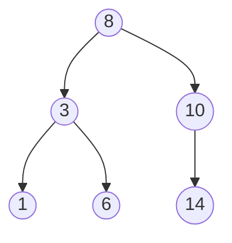
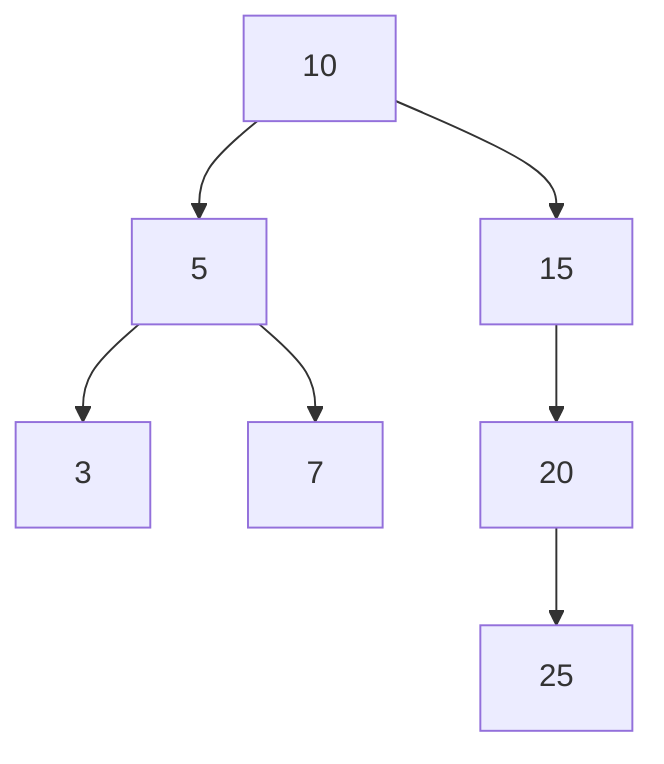

# Concept-Book Run

domain: /home/papagame/projects/digital-duck/cb-data-structure/public/domains/data_structure_ch08/input/graph.yaml
target: scapegoat_tree_performance
started: 2026-11-24T11:52:56

## Teaching order (13 concepts)

- binary_search_tree
- scapegoat_tree
- subtree_size
- tree_height
- height_bound_invariant
- rebuild_operation
- scapegoat_node
- amortized_analysis
- scapegoat_existence_lemma
- credit_scheme
- scapegoat_add
- scapegoat_remove
- scapegoat_tree_performance

### binary_search_tree (0.7s)

## Binary Search Tree

**Definition.** A *binary search tree* (BST) is a binary tree whose nodes store keys from a total order, such that for every node $x$ with key $k(x)$:

$$
\forall\, y \in \text{left}(x):\; k(y) < k(x), \qquad \forall\, z \in \text{right}(x):\; k(z) > k(x).
$$

The property applies to *entire subtrees*, not just immediate children. Assuming distinct keys, an inorder traversal (left, node, right) visits keys in sorted order, which is the structure's central consequence.

**Search and insertion.** To find key $q$, start at the root. If $q$ equals the node's key, stop. If $q$ is smaller, go left. Otherwise go right. Reaching a null link means $q$ is absent. Insertion follows the same path and attaches a new leaf at the null link where the search ended. Each step discards a whole subtree, so the cost is $O(h)$, where $h$ is the tree's height.

**Worked example.** Insert the keys $8, 3, 10, 1, 6, 14$ into an empty BST, in that order.

- $8$ becomes the root.
- $3 < 8$, so it goes left of $8$.
- $10 > 8$, so it goes right of $8$.
- $1 < 8$, then $1 < 3$, so it goes left of $3$.
- $6 < 8$, then $6 > 3$, so it goes right of $3$.
- $14 > 8$, then $14 > 10$, so it goes right of $10$.


*The BST after inserting 8, 3, 10, 1, 6, 14. Every left subtree holds smaller keys and every right subtree holds larger ones.*

Now search for $6$. Compare with $8$ and go left. Compare with $3$ and go right. Compare with $6$, which matches. That took 3 comparisons, not 6.

**Problem-solving application.** The height $h$ decides performance, and it depends on insertion order. Inserting $1, 3, 6, 8, 10, 14$ in sorted order produces a chain of height $n-1 = 5$, so search degrades to $O(n)$. A balanced tree on $n$ keys has height $\lceil \log_2(n+1)\rceil - 1$, giving $O(\log n)$. For random insertion orders, the expected height is $O(\log n)$. To avoid the worst case, self-balancing variants such as AVL and red-black trees restructure the tree during updates.

**Deletion** has three cases for the node $x$ being removed:

1. *Leaf:* remove it.
2. *One child:* replace $x$ with that child.
3. *Two children:* replace $k(x)$ with its inorder successor, which is the minimum of the right subtree. Then delete that successor, which has at most one child.

For example, deleting the root $8$ above replaces it with $10$, the minimum of its right subtree. The old $10$ node has only a right child, $14$, so $14$ takes its place. The result is still a valid BST.

**Check yourself.** If a tree of $n = 1000$ keys is perfectly balanced, search needs at most about $\lceil\log_2 1001\rceil = 10$ comparisons. If the same keys were inserted in sorted order, search could need up to $1000$. This gap is why balance matters in practice.

### scapegoat_tree (0.5s)

## Scapegoat Tree

### Definition

A **scapegoat tree** is a binary search tree that keeps its height logarithmic without storing balance data in each node and without rotations. It stores only two counters:

- $n$: the current number of nodes.
- $q$: an upper bound on $n$. Insertions increment both $n$ and $q$. Deletions decrement only $n$.

The tree maintains two invariants, where $\alpha \in (\tfrac12, 1)$ is a fixed constant:

1. $q/2 \le n \le q$.
2. Every node $u$ has depth at most $\lceil \log_{1/\alpha} q \rceil$.

If an insertion creates a node deeper than $\lceil \log_{1/\alpha} q \rceil$, the tree walks up from the new node to find a **scapegoat**. This is the nearest ancestor $w$ with $\text{size}(\text{child}) > \alpha \cdot \text{size}(w)$ for the child on the search path. The subtree rooted at $w$ is then **rebuilt**: it is flattened into sorted order and reassembled as a perfectly balanced tree. For deletion, the node is removed as in an ordinary BST. If $n < \alpha q$ afterward, the whole tree is rebuilt and $q$ is set to $n$.

A scapegoat always exists. If every node on the path were $\alpha$-balanced, the new node's depth would be at most $\log_{1/\alpha} n \le \log_{1/\alpha} q$, which contradicts the depth violation.

### Worked example

Let $\alpha = 2/3$ and insert $1,2,3,4$ in increasing order. After the fourth insertion, $n = q = 4$ and the allowed depth is
$$\lceil \log_{3/2} 4 \rceil = \lceil 3.42 \rceil = 4.$$
Node 4 sits at depth 3, so no rebuild occurs. Insert 5: now $q = 5$, the limit is $\lceil \log_{3/2} 5 \rceil = 4$, and node 5 is at depth 4, so there is still no violation. Insert 6: the limit is $\lceil \log_{3/2} 6\rceil = 5$ and the depth is 5, so again no violation. Insert 7 at depth 6 with limit $\lceil \log_{3/2} 7 \rceil = 5$. This is a violation. Walking up from 7, the sizes are $1, 2, 3, \dots$. At node 6, the child 7 has size 1 and node 6 has size 2, giving ratio $1/2 \le 2/3$. At node 5, the child 6 has size 2 and node 5 has size 3, giving ratio $2/3$, which is still acceptable. At node 4, the child 5 has size 3 and node 4 has size 4, giving ratio $3/4 > 2/3$. So node 4 is the scapegoat, and its subtree $\{4,5,6,7\}$ is rebuilt with root 5 or 6, which brings the depth of every node in it down to at most 2 below node 4.

### Problem-solving application

**Cost.** Rebuilding a subtree of size $s$ costs $O(s)$. Search is $O(\log n)$ worst case. Insert and delete are $O(\log n)$ **amortized**. Between two rebuilds of a scapegoat $w$, the subtree must receive $\Omega(\text{size}(w))$ updates, because a perfectly balanced subtree is far from the $\alpha$ threshold. Charging the $O(\text{size}(w))$ rebuild cost to those updates adds only $O(\log n)$ per update, since each update affects at most $O(\log n)$ ancestors.

**Problem.** With $\alpha = 3/4$, a tree has $q = 100$. What is the maximum allowed depth, and how many deletions are needed to force a full rebuild?

*Solution.* The depth limit is $\lceil \log_{4/3} 100 \rceil = \lceil 16.01 \rceil = 17$. Since $\log_{4/3}100 = \ln 100/\ln(4/3) \approx 4.605/0.2877 \approx 16.008$, the ceiling is 17. Starting with $n = 100$, a full rebuild is triggered when $n < \alpha q = 75$, which first happens at $n = 74$. That takes 26 deletions. The rebuild then sets $q = 74$.

### subtree_size (0.7s)

## Subtree Size

### Definition

In a rooted tree, the **subtree size** of a node $v$, written $\operatorname{size}(v)$, is the number of nodes in the subtree rooted at $v$. That count includes $v$ itself and all of its descendants. For a binary tree it satisfies a simple recurrence:

$$
\operatorname{size}(v) =
\begin{cases}
0 & \text{if } v = \text{null},\\[2pt]
1 + \operatorname{size}(v.\text{left}) + \operatorname{size}(v.\text{right}) & \text{otherwise.}
\end{cases}
$$

A leaf has size $1$. The root's size equals the total number of nodes $n$.

### Worked Example

Consider this tree, with the root $A$ on top:

- $A$ has children $B$ and $C$.
- $B$ has children $D$ and $E$.
- $C$ has no children.
- $D$ and $E$ are leaves.

Working from the bottom up:

- $\operatorname{size}(D) = \operatorname{size}(E) = \operatorname{size}(C) = 1$.
- $\operatorname{size}(B) = 1 + 1 + 1 = 3$.
- $\operatorname{size}(A) = 1 + 3 + 1 = 5$.

The root's size is $5$, which matches the number of nodes.

```python
def size(v):
    if v is None:
        return 0
    return 1 + size(v.left) + size(v.right)
```

This computes the size of every node in $O(n)$ time if each node is visited once. Calling it separately at every node of a degenerate (list-like) tree costs $O(n^2)$. To avoid that, each node can store a `size` field. After every insertion or deletion, the field is updated along the affected path as `v.size = 1 + size(v.left) + size(v.right)`, which takes $O(1)$ per node touched. In the code below, `size(v)` reads the stored field and returns $0$ for `None`.

### Problem-Solving Application

**Problem.** Using stored sizes, find the $k$th smallest key ($1$-indexed) in a binary search tree.

**Solution.** Let $s = \operatorname{size}(v.\text{left})$. All keys in the left subtree are smaller than $v$'s key, so $v$'s key has rank $s + 1$ within $v$'s subtree.

- If $k = s + 1$, return $v$.
- If $k \le s$, recurse left with the same $k$.
- If $k > s + 1$, recurse right with $k - s - 1$. This skips the $s$ keys on the left and $v$ itself.

```python
def select(v, k):
    s = size(v.left)
    if k == s + 1: return v
    if k <= s:     return select(v.left, k)
    return select(v.right, k - s - 1)
```

In the example tree, suppose an in-order traversal gives $D, B, E, A, C$.

- For $k = 4$, at $A$ we have $s = \operatorname{size}(B) = 3$, so $k = s + 1$ and we return $A$.
- For $k = 2$, at $A$ we have $k \le 3$, so the search goes left to $B$. There $s = \operatorname{size}(D) = 1$, so $k = s + 1$ and it returns $B$.
- For $k = 5$, at $A$ we have $k > 4$, so the search goes right to $C$ with $k = 5 - 3 - 1 = 1$. There $s = 0$, so it returns $C$.

**Cost.** The search follows one root-to-leaf path and does $O(1)$ work per node. It therefore takes $O(h)$ time, where $h$ is the tree height. Without stored sizes, computing $s$ at each step would cost $O(n)$ and the search would be much slower. The stored field is what makes selection cheap.

### tree_height (0.7s)

## Tree Height

### Definition

The **height** of a tree is the number of edges on the longest path from the root down to a leaf. A tree with only a root has height $0$, and by convention an empty tree has height $-1$. This gives a clean recursive definition:

$$h(T) = \begin{cases} -1 & T = \varnothing \\ 1 + \max\big(h(T_L),\, h(T_R)\big) & \text{otherwise} \end{cases}$$

where $T_L$ and $T_R$ are the left and right subtrees. (Some texts count nodes instead of edges, which adds $1$. Always check which convention is in use.)

Height matters because searching, inserting, and deleting in a binary search tree (BST) each follow a single root-to-leaf path. The worst-case cost is therefore $O(h)$.

### Worked example

Insert the keys $10, 5, 15, 3, 7, 20, 25$ into an empty BST in that order. The resulting structure is:


*A BST built from the keys 10, 5, 15, 3, 7, 20, 25. The longest path is 10 → 15 → 20 → 25.*

Apply the recursion bottom-up:

- Leaves $3$, $7$, $25$: $h = 0$.
- Node $20$: $1 + \max(-1, 0) = 1$.
- Node $5$: $1 + \max(0, 0) = 1$.
- Node $15$: $1 + \max(-1, 1) = 2$.
- Root $10$: $1 + \max(1, 2) = 3$.

So $h = 3$. Searching for $25$ takes $3$ edge-steps, which is the worst case for this tree.

### Problem-solving application

**Bounds on height.** A binary tree with $n$ nodes satisfies

$$\lfloor \log_2 n \rfloor \le h \le n - 1.$$

The lower bound occurs when the tree is as full as possible. A tree of height $h$ holds at most $2^{h+1}-1$ nodes, so $n \le 2^{h+1}-1$, which gives $h \ge \log_2(n+1) - 1$. The upper bound occurs when each node has one child, making the tree a linked list.

**Problem.** A BST receives $1023$ keys. What are the best-case and worst-case search costs?

*Best case:* a perfectly balanced tree has $n = 2^{h+1}-1$, so $1023 = 2^{10}-1$ gives $h = 9$. A search needs at most $9$ edge-steps.

*Worst case:* inserting the keys in sorted order produces a chain, so $h = 1022$. A search may need $1022$ steps.

The same data can therefore cost $O(\log n)$ or $O(n)$ per search, depending only on insertion order. Self-balancing trees such as AVL and red-black trees address this by keeping $h = O(\log n)$ after every update, which guarantees logarithmic worst-case search.

**Implementation:**

```python
def height(node):
    if node is None:
        return -1
    return 1 + max(height(node.left), height(node.right))
```

This visits each node once, so it runs in $O(n)$ time. It uses $O(h)$ stack space for the recursion.

### height_bound_invariant (1.0s)

## Height Bound Invariant

### Definition

A **ScapegoatTree** is a binary search tree that stores two counters: $n$, the number of nodes currently in the tree, and $q$, an upper estimate of $n$ that satisfies $n \le q \le 2n$. The **height bound invariant** states that the height $h$ of the tree (the number of edges on its longest root-to-leaf path) always obeys

$$h \le \log_{3/2} q.$$

Because $q \le 2n$, this gives $h \le \log_{3/2} (2n) = O(\log n)$. Every search, which follows a single root-to-leaf path, therefore takes $O(\log n)$ time in the worst case. Unlike AVL or red-black trees, a ScapegoatTree stores no balance information in each node. It enforces the invariant globally, and it repairs the tree only when an insertion breaks it.

### Worked example

Suppose a tree has $n = 10$ nodes and $q = 10$. The largest permitted height is

$$\log_{3/2} 10 = \frac{\ln 10}{\ln 1.5} \approx \frac{2.303}{0.405} \approx 5.68,$$

so the height must be at most $5$, because heights are integers. Now insert an 11th key. The new node lands at depth $6$. Then $n = 11$ and $q = 11$, so the bound is $\log_{3/2} 11 \approx 5.91$. Depth $6 > 5.91$, and the invariant is violated.

The tree responds by walking up from the new node to find a **scapegoat**. This is an ancestor $u$ that is *weight-unbalanced*, meaning that one child's subtree holds more than $\tfrac{2}{3}$ of the nodes in $u$'s subtree. The algorithm rebuilds the subtree rooted at $u$ into a perfectly balanced tree. Rebuilding takes time proportional to the size of that subtree. After the rebuild, the depth of the new node drops, and the invariant holds again.

### Problem-solving application

**Problem.** A ScapegoatTree has $q = 100$. What is the maximum height it may have, and what is the smallest $q$ that allows a height of $10$?

**Part 1.** Compute

$$\log_{3/2} 100 = \frac{\ln 100}{\ln 1.5} \approx \frac{4.605}{0.405} \approx 11.36,$$

so the maximum height is $11$.

**Part 2.** The invariant requires $10 \le \log_{3/2} q$. Solving for $q$ gives

$$q \ge (3/2)^{10} \approx 57.7,$$

so $q \ge 58$. Since $n \ge q/2$, the tree must hold at least $29$ nodes.

**Why the invariant is enough.** Suppose an insertion creates a node at depth $d > \log_{3/2} q$. Walking up from that node, there must be an ancestor whose child subtree is more than $\tfrac{2}{3}$ of its own size. If no such ancestor existed, each step down the path would shrink the subtree size by at least a factor of $\tfrac{2}{3}$. The subtree sizes along the path would then be at most $q\,(2/3)^i$ at depth $i$. A node at depth $d$ would need size at least $1$, so $q(2/3)^d \ge 1$, which gives $d \le \log_{3/2} q$. This contradicts the choice of $d$. Hence a scapegoat always exists, and rebuilding it restores the invariant. The rebuild cost is amortized over the insertions that unbalanced the subtree. This gives $O(\log n)$ amortized insertion and $O(\log n)$ worst-case search.

**Check your understanding.** If $q = 200$ and a node is inserted at depth $14$, is the invariant violated? Since $\log_{3/2} 200 \approx 13.07$, depth $14$ exceeds the bound, so a scapegoat must be found and rebuilt.

### rebuild_operation (0.7s)

## Rebuild Operation

**Definition.** In a scapegoat-style binary search tree, a *rebuild* of node $u$ destroys the subtree rooted at $u$ and replaces it with a perfectly balanced BST holding exactly the same keys. "Perfectly balanced" means that for every node, the two child subtrees differ in size by at most 1. A tree of $n$ nodes then has height $\lfloor \log_2 n \rfloor$. The rebuild takes $O(\text{size}(u))$ time. It has two phases:

1. **Flatten.** An in-order traversal of the subtree writes its nodes into an array $A[0..n-1]$ in sorted order. This costs $O(n)$.
2. **build_balanced.** Choose the middle element $A[\lfloor n/2 \rfloor]$ as the root. Recursively build the left subtree from the elements before it and the right subtree from the elements after it.

```python
def pack(u, A):                 # in-order flatten
    if u is None: return
    pack(u.left, A); A.append(u); pack(u.right, A)

def build_balanced(A, lo, hi):  # builds from A[lo:hi]
    if lo >= hi: return None
    m = (lo + hi) // 2
    node = A[m]
    node.left  = build_balanced(A, lo, m)
    node.right = build_balanced(A, m + 1, hi)
    return node

def rebuild(u):
    A = []; pack(u, A)
    return build_balanced(A, 0, len(A))   # parent re-links to this root
```

**Why it is linear.** Each call to `build_balanced` does constant work besides its two recursive calls. Each node is placed exactly once, and each empty range returns immediately. So the running time satisfies
$$T(n) = T(\lfloor n/2 \rfloor) + T(n - \lfloor n/2 \rfloor - 1) + O(1) = O(n).$$
Adding the $O(n)$ flatten step, the total is $O(\text{size}(u))$. The array reuses the existing nodes, so no new nodes are allocated. Only the $O(n)$ temporary array is needed.

**Worked example.** Suppose $u$ is the root of a degenerate chain holding the keys $1,2,\dots,7$, so its height is 6. Flattening gives $A=[1,2,3,4,5,6,7]$.

- `build_balanced(0,7)`: $m=3$, so the root is 4.
- Left, `(0,3)`: $m=1$, so the node is 2, with children 1 and 3.
- Right, `(4,7)`: $m=5$, so the node is 6, with children 5 and 7.

The result is a complete tree of height $2 = \lfloor\log_2 7\rfloor$. Its cost was about $7$ node visits to flatten and $7$ node placements to build.

**Problem-solving application.** Rebuilding is expensive for one operation, but it is cheap when its cost is spread over many operations. Suppose a scapegoat tree rebuilds a subtree of size $n$ only after at least about $n/2$ insertions have gone into it since it was last perfectly balanced. Then the $O(n)$ rebuild cost can be charged to those insertions. Each insertion is charged $O(1)$ per ancestor that is later rebuilt. Since the tree has height $O(\log n)$, the amortized cost per insertion is $O(\log n)$.

*Check yourself:* If you rebuild a subtree of size 1023, what is the resulting height? Because $\lfloor\log_2 1023\rfloor = 9$, the height is 9. The tree is complete, with 10 full levels.

### scapegoat_node (0.7s)

## Scapegoat Node

### Definition

A **scapegoat tree** is a binary search tree that stores no balance information (no colors, no ranks) and instead enforces the height bound

$$h \le \log_{3/2} n + 1$$

by occasionally rebuilding an entire subtree. Fix a balance parameter $\alpha = 2/3$. A node $x$ is **$\alpha$-weight-balanced** if each child's subtree has size at most $\alpha \cdot \text{size}(x)$.

When an insertion lands at a depth $d > \log_{3/2} n$, some ancestor on the search path must violate this condition. A **scapegoat node** is such an ancestor $w$: a node with a child $c$ on the path to the new node $u$ satisfying

$$\frac{\text{size}(c)}{\text{size}(w)} > \frac{2}{3}.$$

The tree rebuilds the subtree rooted at $w$ into a perfectly balanced tree in $O(\text{size}(w))$ time. Such a $w$ always exists. If every ancestor were balanced, then $\text{size}(\text{node at depth } i) \le (2/3)^i\, n$. At depth $d$ this gives $1 \le (2/3)^d n$, so $d \le \log_{3/2} n$, a contradiction.

### Worked example

Suppose $u$ is inserted at depth 5 in a tree of $n = 8$ nodes, and $\log_{3/2} 8 \approx 5.13$. Take the inequality as the trigger, with $n$ counting $u$. Assume a path to $u$ with ancestors $a_0$ (the root), $a_1, \dots, a_4$ and subtree sizes (including $u$):

| Node | $a_0$ | $a_1$ | $a_2$ | $a_3$ | $a_4$ | $u$ |
|---|---|---|---|---|---|---|
| size | 8 | 6 | 5 | 3 | 2 | 1 |

The search for a scapegoat goes **upward** from $u$, testing each parent–child pair:

- $a_4$: $\text{size}(u)/\text{size}(a_4) = 1/2$, which is not above $2/3$.
- $a_3$: $2/3$, which is not strictly above $2/3$.
- $a_2$: $3/5 = 0.6$, so it is balanced.
- $a_1$: $5/6 \approx 0.83 > 2/3$.

The scapegoat is $a_1$. Rebuilding its 6 nodes as a perfectly balanced tree cuts the depth of $u$ from 5 to at most $\lceil\log_2 7\rceil = 3$ below $a_1$'s level.

### Problem-solving application

**Finding the scapegoat efficiently.** Walk up from $u$ while maintaining $\text{size}(c)$ for the child just visited. Compute the sibling's size by a traversal, using $\text{size}(w) = 1 + \text{size}(c) + \text{size}(\text{sibling})$. The total cost is $O(\text{size}(w))$, which is no more than the rebuild itself.

```python
def find_scapegoat(path):           # path = [root, ..., u]
    child_size = 1                  # size(u)
    for i in range(len(path) - 2, -1, -1):
        w = path[i]
        sibling = other_child(w, path[i + 1])
        total = 1 + child_size + size(sibling)
        if child_size > (2/3) * total:
            return w                # the scapegoat
        child_size = total
```

**Why the cost is acceptable.** After rebuilding, $w$'s subtree is perfectly balanced, so $\Theta(\text{size}(w))$ further insertions or deletions beneath $w$ are needed before it becomes unbalanced again. Charging the $O(\text{size}(w))$ rebuild to those operations gives $O(\log n)$ **amortized** cost per insertion. Search remains $O(\log n)$ worst case.

**Checking your work.** To test whether a candidate $w$ is a scapegoat, compute $\text{size}(c)/\text{size}(w)$ with exact arithmetic. Compare $3\,\text{size}(c) > 2\,\text{size}(w)$ to avoid floating-point error at the boundary $2/3$.

### amortized_analysis (0.6s)

## Amortized Analysis

**Definition.** Amortized analysis bounds the *average cost per operation* over a worst-case sequence of operations. It differs from average-case analysis because it uses no probability. The guarantee holds for every sequence. A single operation may be expensive, but if it can only happen after many cheap operations have "paid" for it, the cost per operation stays small.

In the **credit (accounting) method**, we assign each operation type an *amortized cost* $\hat{c}_i$. It may be more or less than the actual cost $c_i$. When $\hat{c}_i > c_i$, the surplus is stored as credit on specific data items. When $\hat{c}_i < c_i$, we spend stored credit. The scheme is valid if credit never goes negative. In that case, for any sequence of $n$ operations,

$$\sum_{i=1}^{n} c_i \;\le\; \sum_{i=1}^{n} \hat{c}_i .$$

The total amortized cost therefore upper-bounds the total actual cost.

**Worked example: a doubling array.** Appending to a dynamic array costs $1$ if there is space. If the array is full with $k$ elements, we allocate an array of size $2k$ and copy all $k$ elements. That append costs $k+1$. A naive bound of $O(n)$ per append gives $O(n^2)$ for $n$ appends, which is too pessimistic.

Charge $\hat{c}=3$ per append:
- $1$ pays for the actual write.
- $1$ is stored on the new element, to pay for copying that element at the next rebuild.
- $1$ is stored on an older element that has no credit left, to pay for copying it.

Suppose a rebuild happens at size $k$, and the previous rebuild left $k/2$ elements. Each of the $k/2$ elements added since then holds $2$ credits. That gives $k$ credits in total, which pays for copying all $k$ elements. Credit is never negative, so $\sum c_i \le 3n$. The cost is $O(1)$ amortized per append.

**Problem-solving application: bounding rebuilds.** Suppose a hash table rebuilds, at cost proportional to its size $m$, whenever the load factor reaches $1$. After a rebuild it holds $m$ items in $2m$ slots. Find the amortized cost of an insertion.

1. *Find when rebuilding happens.* The next rebuild occurs after $m$ more insertions.
2. *Set the charge.* Charge each insertion $\hat{c}=3$. One unit pays for the insertion itself, and two units are stored as credit.
3. *Check the credit.* Over $m$ insertions, we save $2m$ credits. The rebuild at size $2m$ costs about $2m$, which is exactly covered.
4. *Conclude.* Every insertion is $O(1)$ amortized, so $n$ insertions cost $O(n)$ in total, even though one insertion may cost $\Theta(n)$.

**Common pitfall.** Rebuilding after a *fixed number* of insertions, such as growing by $+10$ slots, fails this analysis. With $n$ insertions you get about $n/10$ rebuilds of average size $\Theta(n)$. That is $\Theta(n^2)$ in total, or $\Theta(n)$ per insertion. The credit scheme only works when the growth is *geometric*, because then the work between rebuilds grows in proportion to the rebuild cost.

**Key takeaway.** To do an amortized analysis, define the credit invariant, show it is never negative, and compare the total amortized cost with the total actual cost.

### scapegoat_existence_lemma (0.7s)

## Scapegoat Existence Lemma

**Setting.** A scapegoat tree maintains a binary search tree with $n$ nodes and a counter $q$ (an upper bound on $n$, with $q/2 \le n \le q$ maintained by rebuilds). A node $x$ is **$\alpha$-weight-balanced** with $\alpha = 2/3$ if
$$\text{size}(\text{child}) \le \tfrac{2}{3}\,\text{size}(x)$$
for each child of $x$. After an insertion, a newly placed node $u$ is "too deep" if $\text{depth}(u) > \log_{3/2} q$. A **scapegoat** is an ancestor $w$ of $u$ (possibly $u$'s parent chain up to the root) that is *not* $\tfrac23$-weight-balanced, meaning some child $c$ on the path has $\text{size}(c) > \tfrac23\,\text{size}(w)$.

**Lemma 8.1.** If $\text{depth}(u) > \log_{3/2} q$, then some ancestor of $u$ is a scapegoat.

**Proof (by contradiction).** Let the path from the root be $r = v_0, v_1, \dots, v_d = u$, where $d = \text{depth}(u)$. Suppose no node on the path is a scapegoat. Then for every $i$,
$$\text{size}(v_{i+1}) \le \tfrac23\,\text{size}(v_i).$$
Applying this $d$ times,
$$\text{size}(u) \le \left(\tfrac23\right)^d \text{size}(r) = \left(\tfrac23\right)^d n.$$
Since $\text{size}(u) \ge 1$ and $n \le q$,
$$1 \le \left(\tfrac23\right)^d q \quad\Longrightarrow\quad \left(\tfrac32\right)^d \le q \quad\Longrightarrow\quad d \le \log_{3/2} q.$$
This contradicts $d > \log_{3/2} q$. Hence some ancestor violates the balance condition. $\blacksquare$

**Worked example.** Let $q = 100$. Then $\log_{3/2} 100 = \dfrac{\ln 100}{\ln 1.5} \approx \dfrac{4.605}{0.405} \approx 11.36$. Suppose an insertion lands at depth $d = 12$. If every step shrank subtree size by a factor of at most $2/3$, the leaf would have size at most $100\cdot(2/3)^{12} \approx 0.77 < 1$, which is impossible because a node's subtree contains at least itself. So the path must contain a step where $\text{size}(v_{i+1}) > \tfrac23\,\text{size}(v_i)$.

**Problem-solving application.** The lemma justifies the insertion algorithm: after inserting $u$ at too great a depth, walk upward from $u$, computing $\text{size}$ at each ancestor, and stop at the first ancestor $w$ with a child whose size exceeds $\tfrac23\,\text{size}(w)$. The lemma guarantees this walk succeeds before reaching past the root. Rebuilding the subtree at $w$ into a perfectly balanced tree restores balance.

*Try it:* With $q = 50$, what is the smallest depth that forces a scapegoat to exist?
Here $\log_{3/2} 50 = \ln 50 / \ln 1.5 \approx 3.912/0.405 \approx 9.65$, so any depth $d \ge 10$ guarantees one. Check the contrapositive: a path with no scapegoat of length 10 would require $\text{size}(u) \le 50\,(2/3)^{10} \approx 0.87 < 1$, again impossible.

**Key takeaway.** The lemma converts a *global* property (excess depth) into a *local* one (a single unbalanced ancestor), which lets the algorithm find where to repair the tree using only subtree sizes along one root-to-leaf path.

### credit_scheme (0.5s)

## Credit Scheme

**Definition.** A *credit scheme* is an amortized-analysis technique in which each update (insertion or deletion) deposits a small number of *credits* on nodes of a data structure. Those credits later pay for expensive restructuring. Here the restructuring is a call to $\text{rebuild}(u)$, which tears down the subtree rooted at $u$ and rebuilds it as a perfectly balanced tree. Rebuilding $u$ costs $\Theta(\operatorname{size}(u))$. The claim is that credits deposited earlier cover this cost, so $m$ operations cost $O(m\log m)$ in total.

**The invariant.** Rebuilding is triggered when a node $u$ becomes unbalanced. For example, a child's subtree may hold more than a fraction $\alpha$ of $\operatorname{size}(u)$, with $\tfrac12<\alpha<1$. The scheme maintains this invariant:

> Every node $u$ holds credit proportional to how far it has drifted from balance since it was last rebuilt.

Right after $\text{rebuild}(u)$, the subtree is perfectly balanced, so every node in it has zero credit and a drift of zero.

**Worked example.** Suppose $\text{rebuild}(u)$ has just run, with $\operatorname{size}(u)=s$. Both children have size about $s/2$. For $u$ to become unbalanced, one child must exceed $\alpha s$. Since $\alpha>\tfrac12$, that child must gain at least $(\alpha-\tfrac12)s=\Omega(s)$ net nodes. Each of those updates passes through $u$.

Charge each update $c$ credits at *every* node on its root-to-leaf path. Then $u$ accumulates at least
$$c\,(\alpha-\tfrac12)\,s=\Omega(s)$$
credits before it can trigger another rebuild. Choosing $c$ large enough, the credits at $u$ pay for the $\Theta(s)$ rebuild cost.

**Problem-solving application: bounding the total.** Each update touches a path of length $O(\log m)$. This holds because rebuilding keeps the tree height logarithmic. Each node on the path receives $c=O(1)$ credits, so one update deposits
$$c\cdot O(\log m)=O(\log m)$$
credits in total.

After $m$ operations, the credits deposited total $O(m\log m)$. Every rebuild is paid from credits that were deposited since that node's previous rebuild. Credits spent at $u$ were never counted for any other rebuild. Therefore

$$\sum_{\text{rebuilds}} \Theta(\operatorname{size}(u)) \;\le\; \text{total credits deposited} \;=\; O(m\log m).$$

The amortized cost per operation is then $O(\log m)$. This covers both the search path and the rebuilding.

**Checking your work.** To apply this scheme to a new problem, follow three steps.

1. State the imbalance condition that triggers a rebuild.
2. Show that after a rebuild, at least $\Omega(\operatorname{size}(u))$ updates must pass through $u$ before it triggers again.
3. Multiply the per-node charge by the path length to get the per-update charge.

A common mistake is to charge only the node that triggers the rebuild. That node has not necessarily received enough updates. The charge must go to every ancestor along the path, and the $O(\log m)$ path length is what produces the extra logarithmic factor in the bound.

### scapegoat_add (0.8s)

## Scapegoat Add

**Definition.** A *scapegoat tree* is a binary search tree that stores no balance field in its nodes. It tracks only two counters: $n$, the number of nodes, and $q$, an upper bound on $n$ (the largest $n$ since the last full rebuild). For a fixed $\alpha = 3/2$ (so $\log_{3/2}$ is used), the tree maintains the invariant

$$h(T) \le \log_{3/2} q.$$

The **add** operation does the following:

1. Insert the key as a leaf using ordinary BST insertion. Record the depth $d$ of the new node.
2. Increment $n$ and $q$.
3. If $d > \log_{3/2} q$, the invariant is broken. Walk up from the new node to find a *scapegoat*: the lowest ancestor $u$ that is too unbalanced, meaning $\text{size}(\text{child on the path}) > \tfrac{2}{3}\,\text{size}(u)$.
4. Rebuild the subtree rooted at $u$ as a perfectly balanced tree. Flatten it to a sorted list in $O(\text{size}(u))$ time, then rebuild it recursively by choosing the median as the root.

A scapegoat is guaranteed to exist. If every ancestor had the path child holding at most $2/3$ of its size, the new node's depth would be at most $\log_{3/2} n \le \log_{3/2} q$, which contradicts the depth violation.

**Worked example.** Suppose the tree has $q = 5$, so the allowed depth is $\lfloor \log_{3/2} 5 \rfloor = \lfloor 3.97 \rfloor = 3$. Insert keys $10, 20, 30, 40, 50$, which form a right-leaning chain. Adding $50$ gives $q=5$, and its depth is $4 > 3$, so a rebuild is triggered.

Walk up from $50$, computing sizes:
- Node $40$: size $2$, child $50$ has size $1$. Ratio $1/2 \le 2/3$, so it is not the scapegoat.
- Node $30$: size $3$, child $40$ has size $2$. Ratio $2/3$, which is not strictly greater than $2/3$, so it is not the scapegoat.
- Node $20$: size $4$, child $30$ has size $3$. Ratio $3/4 > 2/3$, so it is the scapegoat.

Rebuild the subtree at $20$ from the sorted list $[20,30,40,50]$. The median choice gives root $30$ with children $20$ and $40$, and $50$ below $40$. The overall height drops from $4$ to $3$, which satisfies the invariant.

**Problem-solving application.** Rebuilding costs $O(\text{size}(u))$, which looks expensive. The analysis shows it is not. A subtree that is $\tfrac{2}{3}$-unbalanced at $u$ needs at least $\Omega(\text{size}(u))$ insertions into it since its last rebuild, so each rebuild can be charged to those insertions. The result:

- **Search** costs $O(\log n)$ worst case, since $h \le \log_{3/2} q$ and $q \le 2n$ between full rebuilds.
- **Add** costs $O(\log n)$ *amortized*. A single add may cost $O(n)$, but any $m$ adds cost $O(m\log n)$ in total.

To solve a problem such as "which add triggers a rebuild?", compute $\lfloor\log_{3/2} q\rfloor$ after incrementing $q$, then compare it with the new node's depth. Rebuild only when the depth is strictly larger. If it isn't, the add finishes with no rebuild and no extra cost beyond the normal BST insertion.

### scapegoat_remove (0.6s)

## Scapegoat Remove

### Definition

A **scapegoat tree** is a binary search tree (BST) that stays balanced without storing balance information in each node. It keeps two counters:

- $n$, the number of nodes currently in the tree
- $q$, an upper-bound counter. It equals $n$ plus the number of deletions since the last full rebuild.

A tree is **$\alpha$-weight-balanced** (for $\tfrac12 < \alpha < 1$) when every node's subtree sizes satisfy $\text{size}(\text{child}) \le \alpha \cdot \text{size}(\text{node})$. This guarantees height at most $\log_{1/\alpha} q$.

**`remove(x)`** works in three steps:

1. Delete $x$ with standard BST deletion. If $x$ has two children, replace it with its in-order successor.
2. Decrement $n$. Leave $q$ unchanged.
3. If $q > 2n$, rebuild the *entire* tree into a perfectly balanced tree and set $q \leftarrow n$.

```text
remove(x):
    if BST-delete(x) succeeded:
        n ← n − 1
        if q > 2n:
            rebuild(root)
            q ← n
```

The rebuild flattens the tree into a sorted list by in-order traversal. It then reconstructs the tree by recursively choosing the median as the root. This takes $O(n)$ time.

### Worked Example

Start with $n = q = 8$. Remove keys one at a time.

| Removal | $n$ | $q$ | $2n$ | $q > 2n$? |
|---|---|---|---|---|
| 1st | 7 | 8 | 14 | No |
| 2nd | 6 | 8 | 12 | No |
| 3rd | 5 | 8 | 10 | No |
| 4th | 4 | 8 | 8 | No (equal) |
| 5th | 3 | 8 | 6 | **Yes** |

On the 5th removal, the whole 3-node tree is rebuilt as a balanced tree, and $q \leftarrow 3$. Deletions alone never trigger local scapegoat searches. Only the global rebuild restores the height bound.

### Problem-Solving Application

**Why rebuild at $q > 2n$?** Insertions maintain the invariant $h \le \log_{1/\alpha} q$ using $q$, not $n$. Deletions shrink $n$ but not $q$, so the bound is stale. Without rebuilding, the tree could be tall relative to its current size. The rule $q > 2n$ guarantees

$$\log_{1/\alpha} q \le \log_{1/\alpha} 2n = \log_{1/\alpha} n + O(1),$$

so the height remains $O(\log n)$.

**Amortized cost.** A rebuild at $q > 2n$ occurs only after $q$ was last set to some value $q_0 = n_0$. Reaching $q > 2n$ then requires $n$ to fall below $q/2$. Since $q$ is at least $n_0$ (insertions only raise it), at least $n_0 - q/2 \ge n_0/2$ deletions must have occurred since the last rebuild, if no insertions happened. Each rebuild costs $O(n) \le O(n_0)$. Charging this to the $\Omega(n_0)$ deletions gives $O(1)$ amortized extra cost per deletion. Adding the $O(\log n)$ search and deletion gives:

$$\text{amortized cost of remove} = O(\log n).$$

**Practice problem.** A tree has $n = 100$, $q = 130$. How many removals, with no insertions, trigger a rebuild?

*Solution.* After $k$ removals, $n = 100 - k$ and $q = 130$. We need $130 > 2(100 - k)$, so $k > 35$. The 36th removal triggers the rebuild, at which point $n = 64$ and $q$ resets to $64$.

### scapegoat_tree_performance (0.8s)

## Scapegoat Tree Performance

**Definition.** A scapegoat tree is a binary search tree that stores $n$ keys and maintains the invariant $h(T) \le \lfloor \log_{3/2} q \rfloor$, where $q \ge n$ is an upper-bound counter (it equals $n$ except after removals). When an insertion creates a node deeper than $\log_{3/2} q$, the structure finds a *scapegoat*, which is an ancestor $w$ with $\text{size}(\text{child}) > \tfrac{2}{3}\,\text{size}(w)$. It then calls $\text{rebuild}(w)$. This call flattens the subtree into a sorted array and rebuilds it as a perfectly balanced tree in $O(\text{size}(w))$ time. Removals simply delete the node. When $q > 2n$, the whole tree is rebuilt.

**Summary result.** For a scapegoat tree with $n$ nodes:

- $\text{find}(x)$ runs in $O(\log n)$ worst-case time.
- $\text{add}(x)$ and $\text{remove}(x)$ run in $O(\log n)$ *amortized* time.
- Over $m$ operations, the total cost of all $\text{rebuild}(u)$ calls is $O(m \log m)$.

**Why find is cheap.** The height never exceeds $\log_{3/2} q$. Since $q \le 2n$, we get $h \le \log_{3/2} 2n = O(\log n)$, so every search takes at most $O(\log n)$ steps.

**Worked example (rebuild accounting).** Suppose $\text{rebuild}(u)$ is called on a subtree of size $s = \text{size}(u)$. Immediately afterward the subtree is perfectly balanced, so $\text{size}(u.\text{left})$ and $\text{size}(u.\text{right})$ differ by at most 1. For the subtree to need rebuilding again, one child must grow to exceed $\tfrac{2}{3}$ of the subtree. From a near-even split of $\tfrac{s}{2}$ per side, the heavy side must gain at least

$$\tfrac{2}{3}s - \tfrac{1}{2}s = \tfrac{1}{6}s$$

more nodes than it started with. (The exact bound is slightly larger, because the total grows too.) So at least $\Omega(s)$ updates must touch $u$'s subtree before the next rebuild there. Charge the $O(s)$ rebuild cost to those $\Omega(s)$ updates, which is $O(1)$ per update per affected ancestor.

**Problem-solving application.** An insertion or deletion affects at most $O(\log q)$ ancestors, since the tree has height $O(\log q)$. Each ancestor receives an $O(1)$ charge. Hence the amortized rebuild cost per operation is $O(\log q)$. Over $m$ operations the tree never has more than $m$ nodes, so $q \le m$ and

$$\sum \text{(rebuild costs)} = O(m \log m).$$

Adding the $O(\log n)$ search cost per operation gives $O(\log n)$ amortized time for $\text{add}$ and $\text{remove}$.

For the full-tree rebuild triggered when $q > 2n$, at least $q - n > n$ removals have occurred since the counters were last reset. These removals pay for an $O(n)$ rebuild, which adds $O(1)$ amortized cost per operation.

**Check yourself.** Suppose $m = 1024$ operations are performed. The rebuild total is bounded by $c \cdot 1024 \cdot \log_2 1024 = 10{,}240\,c$ steps for some constant $c$. This averages about $10c$ steps per operation, which is logarithmic and not linear.

**Takeaway.** A scapegoat tree needs no per-node balance data, such as colors or heights. It still guarantees $O(\log n)$ search in the worst case and $O(\log n)$ amortized updates, because rare, expensive rebuilds are paid for by many cheap operations.

## Run complete

total: 17.7s
