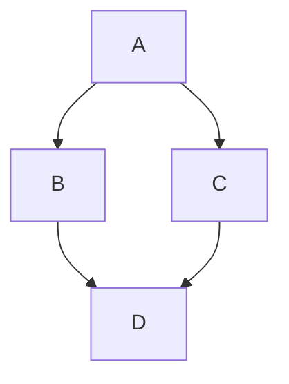

# Concept-Book Run

domain: /home/papagame/projects/digital-duck/cb-data-structure/public/domains/data_structure_ch12/input/graph.yaml
target: shortest_path_via_bfs
started: 2026-11-24T11:54:31

## Teaching order (7 concepts)

- graph
- vertex_degree
- adjacency_list
- graph_traversal
- queue
- breadth_first_search
- shortest_path_via_bfs

### graph (0.5s)

## Graph

A **directed graph** is a pair $G = (V, E)$, where $V$ is a finite set of **vertices** (nodes) and $E \subseteq V \times V$ is a set of **directed edges**. An edge $(u, v) \in E$ points from $u$ to $v$. We say $v$ is an *out-neighbor* of $u$ and $u$ is an *in-neighbor* of $v$. The **out-degree** $\deg^+(v)$ counts edges leaving $v$, and the **in-degree** $\deg^-(v)$ counts edges entering it.

Two facts are used constantly:

$$\sum_{v \in V} \deg^+(v) = \sum_{v \in V} \deg^-(v) = |E|, \qquad |E| \le |V|^2.$$

The first holds because every edge has exactly one tail and one head. The second holds because $E$ is a subset of $V \times V$.

A **path** is a sequence of vertices $v_0, v_1, \dots, v_k$ with $(v_{i-1}, v_i) \in E$ for each $i$. A **cycle** is a path of length $k \ge 1$ with $v_0 = v_k$. A graph with no cycles is a **directed acyclic graph** (DAG).

### Worked example

Let $V = \{A, B, C, D\}$ and $E = \{(A,B), (A,C), (B,D), (C,D)\}$.

- $\deg^+(A) = 2$, $\deg^-(A) = 0$.
- $\deg^+(D) = 0$, $\deg^-(D) = 2$.
- Both degree sums equal $4 = |E|$.
- $A, B, D$ is a path of length 2.
- No path returns to its starting vertex, so $G$ is a DAG.


*A four-vertex DAG. Every edge points downward, so no cycle can form.*

### Problem-solving application

**Problem.** Course prerequisites form a graph: an edge $(u, v)$ means "take $u$ before $v$." Can a student finish all courses, and in what order?

**Method.** A valid ordering exists exactly when the graph is a DAG. The ordering is a **topological sort**. Repeat these steps:

1. Pick a vertex with in-degree $0$. Such a vertex has no unmet prerequisites.
2. Output it and delete it with its outgoing edges.
3. If no vertex has in-degree $0$ while vertices remain, every remaining vertex has an in-neighbor. Following in-neighbors backward must eventually repeat a vertex, which gives a cycle. The prerequisites are then impossible to satisfy.

**Apply to the example.**

- $A$ is the only vertex with in-degree $0$. Output $A$ and remove it.
- $B$ and $C$ now have in-degree $0$. Output $B$ and remove it.
- $C$ still has in-degree $0$. Output $C$ and remove it.
- $D$ now has in-degree $0$. Output $D$.

The result is $A, B, C, D$. The order $A, C, B, D$ also works, so valid orderings need not be unique.

**Cost.** If you store each vertex's out-neighbors in an adjacency list and keep in-degree counts, each edge is removed once and each vertex is output once. The running time is $O(|V| + |E|)$.

**Test your understanding.** Add the edge $(D, A)$ to $E$. Is there now a valid ordering? No. $A \to B \to D \to A$ is a cycle, and every vertex then has in-degree at least $1$, so step 3 applies immediately.

### vertex_degree (0.5s)

## Vertex Degree

### Definition

In a directed graph $G = (V, E)$, the **degree** of a vertex $i \in V$, written $\deg(i)$, is the number of edges in $E$ that have $i$ as their source:

$$\deg(i) = \bigl|\{(u,v) \in E : u = i\}\bigr|.$$

In directed-graph terminology this is the *out-degree*. Edges that merely arrive at $i$ do not count. In an undirected graph, each edge is stored as two directed edges, so $\deg(i)$ is the number of neighbors of $i$.

Degree connects to a fundamental counting identity. Every edge has exactly one source, so summing degrees over all vertices counts every edge exactly once:

$$\sum_{i \in V} \deg(i) = |E|.$$

(For an undirected graph stored as pairs of directed edges, this sum equals $2|E_{\text{undirected}}|$, which is the handshake lemma.)

### Worked Example

Let $V = \{1,2,3,4\}$ and

$$E = \{(1,2),\ (1,3),\ (2,3),\ (3,1),\ (3,4)\}.$$

Count the edges whose first coordinate is each vertex:

- $\deg(1) = 2$, from $(1,2)$ and $(1,3)$
- $\deg(2) = 1$, from $(2,3)$
- $\deg(3) = 2$, from $(3,1)$ and $(3,4)$
- $\deg(4) = 0$, because no edge starts at 4

Check: $2+1+2+0 = 5 = |E|$. ✓

Notice that vertex 3 has *three* incident edges, namely $(1,3)$, $(2,3)$ and its two outgoing ones, but $\deg(3)=2$, since only edges leaving 3 count.

### Problem-Solving Application

**Problem.** A graph is stored as an adjacency list. How long does it take to run a loop that visits every edge, and how does degree enter the analysis?

**Solution.** Processing vertex $i$ means scanning its list, which has length $\deg(i)$. That costs $\Theta(1 + \deg(i))$, where the $1$ covers the work of looking up the vertex itself even if its list is empty. Summing over all vertices:

$$\sum_{i\in V}\bigl(1 + \deg(i)\bigr) = |V| + \sum_{i \in V}\deg(i) = |V| + |E|.$$

The total is $\Theta(|V|+|E|)$. This is why breadth-first and depth-first search run in linear time. The identity $\sum \deg(i) = |E|$ does the work, and no assumption about how the degrees are distributed is needed.

**A second use: bounding.** Since each vertex has at most $|V|$ possible targets (allowing self-loops), $\deg(i) \le |V|$. This gives $|E| \le |V|^2$, so a dense graph has $|E| = \Theta(|V|^2)$. Comparing the actual degrees to this bound tells you whether to choose an adjacency matrix (dense) or an adjacency list (sparse).

**Quick check.** For $E=\{(a,b),(a,c),(b,c)\}$ on $V=\{a,b,c\}$, find $\deg$ of each vertex and verify the sum. You should get $2, 1, 0$, which sums to $3=|E|$.

### adjacency_list (0.6s)

## Adjacency List

An **adjacency list** represents a graph with $n$ vertices and $m$ edges as an array `adj` of $n$ lists. The list `adj[i]` holds every vertex $j$ for which $(i,j)$ is an edge. The representation is vertex-centric, because each vertex stores its own neighbors. For an undirected graph, each edge $\{i,j\}$ appears twice, once in `adj[i]` and once in `adj[j]`. For a directed graph, it appears once, in the list of its tail.

**Costs.** Let $\deg(i)$ be the length of `adj[i]`.

| Operation | Cost |
|---|---|
| `add_edge(i, j)` | $O(1)$ (append to `adj[i]`) |
| `has_edge(i, j)` | $O(\deg(i))$ (scan `adj[i]`) |
| `remove_edge(i, j)` | $O(\deg(i))$ (find, then delete) |
| Space | $O(n+m)$ |

The space bound holds because there are $n$ list headers and the lists hold $\sum_i \deg(i)$ entries in total. That sum is $m$ for a directed graph and $2m$ for an undirected one. An adjacency matrix needs $\Theta(n^2)$ space, so the list wins on sparse graphs, where $m \ll n^2$.

**Worked example.** Take the undirected graph on vertices $0,\dots,3$ with edges $\{0,1\},\{0,2\},\{1,2\},\{2,3\}$.

```python
n = 4
adj = [[] for _ in range(n)]

def add_edge(i, j):          # undirected
    adj[i].append(j)
    adj[j].append(i)

for u, v in [(0,1), (0,2), (1,2), (2,3)]:
    add_edge(u, v)

# adj == [[1, 2], [0, 2], [0, 1, 3], [2]]
```

The list lengths are $2, 2, 3, 1$, and they sum to $8 = 2m$. Checking `has_edge(2, 3)` scans `adj[2]`, which takes at most 3 comparisons.

**Problem-solving application.** Suppose you must compute the degree of every vertex, or visit every neighbor of every vertex, as breadth-first search does. Loop over each list:

```python
for i in range(n):
    for j in adj[i]:
        visit(i, j)
```

The outer loop runs $n$ times. The inner loops run $\sum_i \deg(i) = 2m$ times in total. The cost is therefore $O(n+m)$. An adjacency matrix would need $\Theta(n^2)$ for the same traversal, because it must examine every cell, including the empty ones.

Now consider a graph with $n = 10^5$ vertices and $m = 3\times10^5$ edges, such as a road network.

- **Matrix:** it needs $10^{10}$ cells, which is impractical.
- **List:** it stores about $6\times10^5$ entries, which is trivial.

**Trade-off.** Edge lookup is the weak point. In a star graph, the center has $\deg = n-1$, so `has_edge(center, x)` costs $\Theta(n)$. If your algorithm performs many membership queries on dense graphs, there are two fixes. You can store each `adj[i]` as a hash set, which gives expected $O(1)$ lookup. Or you can use a matrix.

**Check your understanding.** For a directed graph with $n=5$ and $m=7$, how many list entries are stored in total? The answer is $7$, one entry per directed edge. For the undirected version, it is $14$.

### graph_traversal (0.8s)

## Graph Traversal

**Definition.** Let $G=(V,E)$ be a graph with $n=|V|$ vertices and $m=|E|$ edges, stored as adjacency lists. Each vertex has a list of its neighbors. *Graph traversal* starts at a vertex $i$ and visits every vertex reachable from $i$, meaning every $v$ for which a path $i \to \dots \to v$ exists. Each vertex is visited exactly once, and none is skipped.

The method we use is *breadth-first search* (BFS). It marks vertices as it discovers them and keeps a queue of vertices that are discovered but not yet explored. Mark $i$ and enqueue it. Then repeat the following until the queue is empty:

1. Remove the front vertex $u$.
2. For each neighbor $w$ of $u$, if $w$ is unmarked, mark it and enqueue it.

**Worked example.** Let $V=\{0,1,2,3,4,5\}$ with adjacency lists

- $0:[1,2]$
- $1:[0,3]$
- $2:[0,3]$
- $3:[1,2]$
- $4:[5]$
- $5:[4]$

Run BFS from $i=0$. Mark 0 and set the queue to $[0]$.

1. Remove 0. Mark and enqueue 1 and 2. The queue is $[1,2]$.
2. Remove 1. Vertex 0 is already marked, so mark and enqueue 3. The queue is $[2,3]$.
3. Remove 2. Both of its neighbors are marked.
4. Remove 3. Both of its neighbors are marked. The queue is empty.

The visit order is $0,1,2,3$. Vertices 4 and 5 are never reached because no path leads to them from 0.

```python
def bfs(adj, i):
    visited = {i}
    queue = [i]
    for u in queue:          # list grows as we append
        for w in adj[u]:
            if w not in visited:
                visited.add(w)
                queue.append(w)
    return queue
```

**Cost analysis.** A vertex is marked before it is enqueued, so each reachable vertex is enqueued at most once. Each enqueued vertex's list is scanned once. The list lengths sum to $\sum_u \deg(u) = 2m$ for an undirected graph, or $m$ for a directed one. The total running time is therefore
$$T(n,m)=O(n+m),$$
which is linear in the size of the input.

**Problem-solving application.** *Problem:* A network is given as adjacency lists. A message starts at computer $s$ and is forwarded along links. Which computers receive it, and does computer $t$ receive it?

Run `bfs(adj, s)`. The returned list is exactly the set of computers that receive the message, so $t$ receives it if and only if $t$ appears in the list. The marks make this reliable even when the network contains cycles. Without them, the message would loop forever between 0, 1, 3, and 2 in the example above.

Check the method on the example. From $s=0$ the list is $[0,1,2,3]$, so computer 3 receives the message and computer 4 does not. The number of computers reached is `len(bfs(adj, s))`, which is 4 here. The whole computation costs $O(n+m)$, so it stays fast even for very large networks.

### queue (0.7s)

## Queue

A **queue** is a collection that follows the **first-in, first-out (FIFO)** rule: the element that has waited longest is the next one removed. It supports two core operations:

- **enqueue(x)**: add $x$ at the back.
- **dequeue()**: remove and return the element at the front.

With a linked list or a circular array, both operations take $O(1)$ time. Peeking at the front and testing for emptiness are also $O(1)$.

In graph traversal, the queue holds vertices that have been discovered but not yet processed. Because vertices leave in the order they entered, the traversal finishes every vertex at distance $d$ from the start before it touches any vertex at distance $d+1$. This is **breadth-first search (BFS)**.

### Worked example

Consider the undirected graph with edges $A\!-\!B$, $A\!-\!C$, $B\!-\!D$, $C\!-\!D$, $D\!-\!E$. Run BFS from $A$. Mark a vertex as visited when you enqueue it.

| Step | Dequeue | Enqueue (new neighbors) | Queue after step (front → back) |
|---|---|---|---|
| 0 | — | $A$ | $[A]$ |
| 1 | $A$ | $B, C$ | $[B, C]$ |
| 2 | $B$ | $D$ | $[C, D]$ |
| 3 | $C$ | none ($D$ already marked) | $[D]$ |
| 4 | $D$ | $E$ | $[E]$ |
| 5 | $E$ | none | $[\,]$ |

The visit order is $A, B, C, D, E$. Marking at enqueue time is what stops $D$ from being added twice at step 3.

```python
from collections import deque

def bfs(adj, start):
    seen = {start}
    q = deque([start])
    order = []
    while q:
        v = q.popleft()          # dequeue
        order.append(v)
        for w in adj[v]:
            if w not in seen:
                seen.add(w)      # mark when enqueued
                q.append(w)      # enqueue
    return order
```

Use `deque`, not a list. `list.pop(0)` shifts every remaining element, so it costs $O(n)$ per call.

### Problem-solving application: shortest path in an unweighted graph

Suppose you need the fewest edges from $A$ to $E$ in the graph above. BFS already gives the answer if you record a distance when you enqueue each vertex: $\text{dist}(w) = \text{dist}(v) + 1$. This reuses the `bfs` code with one extra dictionary and introduces no new data structure.

- $\text{dist}(A)=0$.
- $B$ and $C$ are discovered from $A$, so each gets distance 1.
- $D$ is discovered from $B$, so $\text{dist}(D)=2$.
- $E$ is discovered from $D$, so $\text{dist}(E)=3$.

The shortest path therefore has 3 edges, for example $A\to B\to D\to E$.

This works because the queue releases vertices in nondecreasing order of distance. A vertex is first discovered by a vertex at the smallest possible distance, so its first recorded distance is its true shortest distance. A stack would break this property. It would follow one branch deep and could record a longer route first.

**Cost.** Each vertex is enqueued and dequeued at most once, and each adjacency entry is examined once. BFS therefore runs in $O(V+E)$ time and uses $O(V)$ space for the queue and the visited set.

**Common pitfalls.**
1. Marking at dequeue time instead of enqueue time. This allows duplicates in the queue.
2. Forgetting to handle disconnected graphs. Restart BFS from each unvisited vertex.
3. Using BFS distances on weighted graphs. Edge weights require a different method.

### breadth_first_search (0.8s)

## Breadth First Search

**Definition.** Breadth-first search (BFS) is a graph traversal that starts at a vertex $s$ and visits vertices in order of increasing distance (number of edges) from $s$: first $s$, then its neighbours, then their unvisited neighbours, and so on. It uses a **queue** (first in, first out) to hold vertices that have been discovered but not yet processed, and a **seen** array to ensure no vertex is enqueued twice.

For a graph with $n$ vertices and $m$ edges stored as adjacency lists:

```python
from collections import deque

def bfs(adj, s):
    n = len(adj)
    seen = [False] * n
    order = []
    seen[s] = True
    q = deque([s])
    while q:
        u = q.popleft()
        order.append(u)
        for v in adj[u]:
            if not seen[v]:
                seen[v] = True   # mark when enqueued, not when dequeued
                q.append(v)
    return order
```

Marking a vertex when it is *enqueued* is essential: it guarantees each vertex enters the queue at most once.

**Worked example.** Let $n=6$ with adjacency lists
$0:[1,2]$, $1:[0,3]$, $2:[0,3,4]$, $3:[1,2,5]$, $4:[2]$, $5:[3]$. Run BFS from $s=0$.

| Step | Dequeue | Newly enqueued | Queue after |
|---|---|---|---|
| 1 | 0 | 1, 2 | [1, 2] |
| 2 | 1 | 3 | [2, 3] |
| 3 | 2 | 4 | [3, 4] |
| 4 | 3 | 5 | [4, 5] |
| 5 | 4 | none | [5] |
| 6 | 5 | none | [] |

Visit order: $0,1,2,3,4,5$. Vertices 1 and 2 are at distance 1, vertices 3 and 4 at distance 2, and vertex 5 at distance 3.

**Running time.** Each vertex is enqueued and dequeued at most once, costing $O(n)$ in total. Each vertex's adjacency list is scanned exactly once, when it is dequeued. The list lengths sum to $2m$ for an undirected graph (or $m$ for a directed one). The total work is therefore
$$O(n) + O\!\left(\sum_{u} \deg(u)\right) = O(n+m).$$
An adjacency matrix would instead force $\Theta(n)$ work per vertex, giving $\Theta(n^2)$. This is why adjacency lists are the natural representation for BFS.

**Problem-solving application: shortest paths.** Because the queue is FIFO, vertices are dequeued in nondecreasing order of distance from $s$. This makes BFS correct for shortest paths in *unweighted* graphs. To exploit this, record a distance and a parent for each vertex:

```python
def bfs_dist(adj, s):
    dist = [-1] * len(adj)
    parent = [None] * len(adj)
    dist[s] = 0
    q = deque([s])
    while q:
        u = q.popleft()
        for v in adj[u]:
            if dist[v] == -1:
                dist[v] = dist[u] + 1
                parent[v] = u
                q.append(v)
    return dist, parent
```

Here `dist[v] == -1` plays the role of the seen array. In the example, `dist[5] = 3`. Following parents from 5 gives $5 \to 3 \to 1 \to 0$, a shortest path of length 3. (Vertex 3 was first discovered from 1, so that is its parent.)

Other standard uses follow from the same idea:

- **Connectivity:** any vertex with `dist == -1` after the search is unreachable from $s$. Repeating BFS from each unseen vertex counts connected components in $O(n+m)$ total.
- **Bipartite testing:** colour vertices by the parity of `dist`. The graph is bipartite exactly when no edge joins two vertices of the same parity.
- **Grid mazes:** treat each open cell as a vertex and each adjacent open cell as a neighbour. BFS gives the fewest-move route.

**Caution:** with weighted edges, BFS no longer yields shortest paths, because fewer edges does not mean smaller total weight. Use Dijkstra's algorithm in that case.

### shortest_path_via_bfs (0.9s)

## Shortest Path Via Bfs

### Definition

Let $G=(V,E)$ be an unweighted graph and let $r \in V$ be a root (source). The **distance** $d(r,j)$ is the minimum number of edges on any path from $r$ to $j$. Breadth-first search (BFS) explores vertices in non-decreasing order of distance from $r$: first $r$, then all vertices at distance 1, then distance 2, and so on.

To recover actual paths, not just distances, BFS records a **predecessor array** $p$. When vertex $u$ is dequeued and an unvisited neighbor $v$ is discovered, we set $p[v] = u$ and $d[v] = d[u]+1$. We set $p[r]=\text{nil}$. Because each vertex is discovered exactly once, $p$ defines a tree rooted at $r$, the *BFS tree*.

```
BFS(G, r):
    for each v: d[v] = ∞, p[v] = nil
    d[r] = 0;  Q = [r]
    while Q not empty:
        u = dequeue(Q)
        for each neighbor v of u:
            if d[v] == ∞:
                d[v] = d[u] + 1;  p[v] = u;  enqueue(Q, v)
```

**Reconstruction.** To get the path to a reachable $j$, follow $p$ backward: $j, p[j], p[p[j]], \dots, r$, then reverse. If $d[j]=\infty$, no path exists.

### Worked Example

Take $V=\{1,\dots,6\}$ with edges $1\!-\!2,\ 1\!-\!3,\ 2\!-\!4,\ 3\!-\!4,\ 4\!-\!5$, and $r=1$. (Vertex 6 is isolated.)

| Dequeued | Discovered | Queue after |
|---|---|---|
| 1 | 2, 3 (p=1, d=1) | 2, 3 |
| 2 | 4 (p=2, d=2) | 3, 4 |
| 3 | none (4 already seen) | 4 |
| 4 | 5 (p=4, d=3) | 5 |
| 5 | none | empty |

Final: $p[2]=1,\ p[3]=1,\ p[4]=2,\ p[5]=4$. For $j=5$: $5 \to 4 \to 2 \to 1$, reversed gives $1,2,4,5$, a path of $d[5]=3$ edges. Vertex 6 keeps $d=\infty$, so it is unreachable.

Note the path through 3 (also length 3) is equally short; $p[4]=2$ only reflects which vertex was dequeued first. Shortest paths need not be unique, but every path produced is shortest.

### Why It Is Correct

**Claim:** $d[j]=d(r,j)$ for every reachable $j$, and the path from $p$ has exactly $d(r,j)$ edges.

*Sketch.* The queue holds vertices in non-decreasing $d$ order, and it never contains values differing by more than 1. By induction on distance $k$: if all vertices at distance $<k$ have correct $d$, then a vertex $v$ with $d(r,v)=k$ has a neighbor $u$ at distance $k-1$. That $u$ is dequeued before any vertex at distance $\ge k$, so $v$ is discovered with $d[v]=k$. Each $p$-step reduces $d$ by exactly 1, so following $p$ from $j$ takes $d[j]$ steps to reach $r$.

Running time is $O(|V|+|E|)$ with adjacency lists, and reconstruction costs $O(d[j])$.

### Problem-Solving Application

*A maze is a grid; each open cell is a vertex adjacent to its open up/down/left/right neighbors. Find the fewest moves from $S$ to $T$ and list them.*

1. Run BFS from $S$, storing $p$ for each cell.
2. If $d[T]=\infty$, report "no route."
3. Otherwise, walk from $T$ through $p$ to $S$, reverse the list, and read off each move.

The same recipe solves word-ladder puzzles (words as vertices, one-letter changes as edges) and "degrees of separation" queries in social networks. **Caution:** BFS gives shortest paths only when every edge costs the same. With weighted edges, use Dijkstra's algorithm instead.

## Run complete

total: 11.1s
