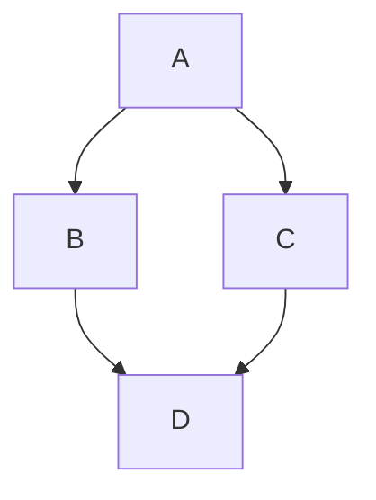
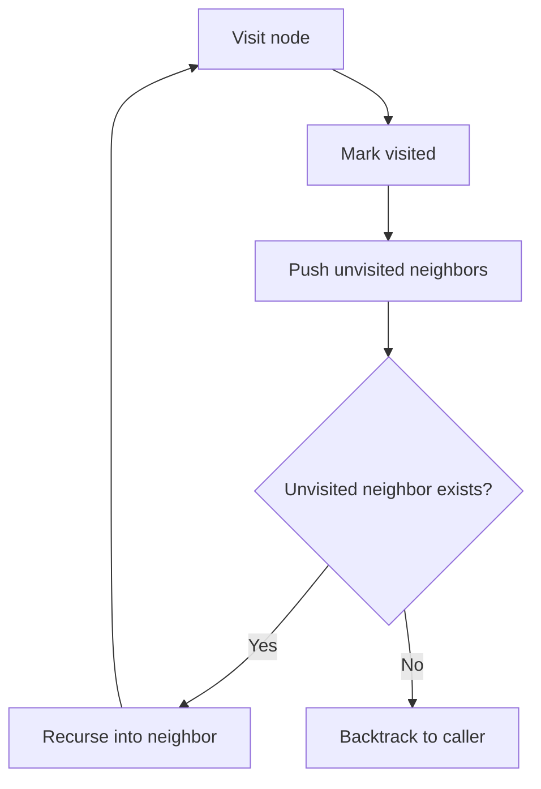

# Concept-Book Run

domain: /home/papagame/projects/digital-duck/cb-data-structure/public/domains/data_structure_ch12/input/graph.yaml
target: cycle_detection_via_dfs
started: 2026-11-24T11:54:43

## Teaching order (7 concepts)

- graph
- vertex_degree
- adjacency_list
- graph_traversal
- stack
- depth_first_search
- cycle_detection_via_dfs

### graph (0.7s)

## Graph

A **directed graph** is a pair $G = (V, E)$, where $V$ is a finite set of **vertices** (nodes) and $E \subseteq V \times V$ is a set of **directed edges**. An edge $(u, v) \in E$ points from $u$ to $v$. We say $v$ is an *out-neighbor* of $u$ and $u$ is an *in-neighbor* of $v$. The **out-degree** $\deg^+(v)$ counts edges leaving $v$, and the **in-degree** $\deg^-(v)$ counts edges entering it.

Two facts are used constantly:

$$\sum_{v \in V} \deg^+(v) = \sum_{v \in V} \deg^-(v) = |E|, \qquad |E| \le |V|^2.$$

The first holds because every edge has exactly one tail and one head. The second holds because $E$ is a subset of $V \times V$.

A **path** is a sequence of vertices $v_0, v_1, \dots, v_k$ with $(v_{i-1}, v_i) \in E$ for each $i$. A **cycle** is a path of length $k \ge 1$ with $v_0 = v_k$. A graph with no cycles is a **directed acyclic graph** (DAG).

### Worked example

Let $V = \{A, B, C, D\}$ and $E = \{(A,B), (A,C), (B,D), (C,D)\}$.

- $\deg^+(A) = 2$, $\deg^-(A) = 0$.
- $\deg^+(D) = 0$, $\deg^-(D) = 2$.
- Both degree sums equal $4 = |E|$.
- $A, B, D$ is a path of length 2.
- No path returns to its starting vertex, so $G$ is a DAG.


*A four-vertex DAG. Every edge points downward, so no cycle can form.*

### Problem-solving application

**Problem.** Course prerequisites form a graph: an edge $(u, v)$ means "take $u$ before $v$." Can a student finish all courses, and in what order?

**Method.** A valid ordering exists exactly when the graph is a DAG. The ordering is a **topological sort**. Repeat these steps:

1. Pick a vertex with in-degree $0$. Such a vertex has no unmet prerequisites.
2. Output it and delete it with its outgoing edges.
3. If no vertex has in-degree $0$ while vertices remain, every remaining vertex has an in-neighbor. Following in-neighbors backward must eventually repeat a vertex, which gives a cycle. The prerequisites are then impossible to satisfy.

**Apply to the example.**

- $A$ is the only vertex with in-degree $0$. Output $A$ and remove it.
- $B$ and $C$ now have in-degree $0$. Output $B$ and remove it.
- $C$ still has in-degree $0$. Output $C$ and remove it.
- $D$ now has in-degree $0$. Output $D$.

The result is $A, B, C, D$. The order $A, C, B, D$ also works, so valid orderings need not be unique.

**Cost.** If you store each vertex's out-neighbors in an adjacency list and keep in-degree counts, each edge is removed once and each vertex is output once. The running time is $O(|V| + |E|)$.

**Test your understanding.** Add the edge $(D, A)$ to $E$. Is there now a valid ordering? No. $A \to B \to D \to A$ is a cycle, and every vertex then has in-degree at least $1$, so step 3 applies immediately.

### vertex_degree (0.6s)

## Vertex Degree

### Definition

In a directed graph $G = (V, E)$, the **degree** of a vertex $i \in V$, written $\deg(i)$, is the number of edges in $E$ that have $i$ as their source:

$$\deg(i) = \bigl|\{(u,v) \in E : u = i\}\bigr|.$$

In directed-graph terminology this is the *out-degree*. Edges that merely arrive at $i$ do not count. In an undirected graph, each edge is stored as two directed edges, so $\deg(i)$ is the number of neighbors of $i$.

Degree connects to a fundamental counting identity. Every edge has exactly one source, so summing degrees over all vertices counts every edge exactly once:

$$\sum_{i \in V} \deg(i) = |E|.$$

(For an undirected graph stored as pairs of directed edges, this sum equals $2|E_{\text{undirected}}|$, which is the handshake lemma.)

### Worked Example

Let $V = \{1,2,3,4\}$ and

$$E = \{(1,2),\ (1,3),\ (2,3),\ (3,1),\ (3,4)\}.$$

Count the edges whose first coordinate is each vertex:

- $\deg(1) = 2$, from $(1,2)$ and $(1,3)$
- $\deg(2) = 1$, from $(2,3)$
- $\deg(3) = 2$, from $(3,1)$ and $(3,4)$
- $\deg(4) = 0$, because no edge starts at 4

Check: $2+1+2+0 = 5 = |E|$. ✓

Notice that vertex 3 has *three* incident edges, namely $(1,3)$, $(2,3)$ and its two outgoing ones, but $\deg(3)=2$, since only edges leaving 3 count.

### Problem-Solving Application

**Problem.** A graph is stored as an adjacency list. How long does it take to run a loop that visits every edge, and how does degree enter the analysis?

**Solution.** Processing vertex $i$ means scanning its list, which has length $\deg(i)$. That costs $\Theta(1 + \deg(i))$, where the $1$ covers the work of looking up the vertex itself even if its list is empty. Summing over all vertices:

$$\sum_{i\in V}\bigl(1 + \deg(i)\bigr) = |V| + \sum_{i \in V}\deg(i) = |V| + |E|.$$

The total is $\Theta(|V|+|E|)$. This is why breadth-first and depth-first search run in linear time. The identity $\sum \deg(i) = |E|$ does the work, and no assumption about how the degrees are distributed is needed.

**A second use: bounding.** Since each vertex has at most $|V|$ possible targets (allowing self-loops), $\deg(i) \le |V|$. This gives $|E| \le |V|^2$, so a dense graph has $|E| = \Theta(|V|^2)$. Comparing the actual degrees to this bound tells you whether to choose an adjacency matrix (dense) or an adjacency list (sparse).

**Quick check.** For $E=\{(a,b),(a,c),(b,c)\}$ on $V=\{a,b,c\}$, find $\deg$ of each vertex and verify the sum. You should get $2, 1, 0$, which sums to $3=|E|$.

### adjacency_list (0.8s)

## Adjacency List

An **adjacency list** represents a graph with $n$ vertices and $m$ edges as an array `adj` of $n$ lists. The list `adj[i]` holds every vertex $j$ for which $(i,j)$ is an edge. The representation is vertex-centric, because each vertex stores its own neighbors. For an undirected graph, each edge $\{i,j\}$ appears twice, once in `adj[i]` and once in `adj[j]`. For a directed graph, it appears once, in the list of its tail.

**Costs.** Let $\deg(i)$ be the length of `adj[i]`.

| Operation | Cost |
|---|---|
| `add_edge(i, j)` | $O(1)$ (append to `adj[i]`) |
| `has_edge(i, j)` | $O(\deg(i))$ (scan `adj[i]`) |
| `remove_edge(i, j)` | $O(\deg(i))$ (find, then delete) |
| Space | $O(n+m)$ |

The space bound holds because there are $n$ list headers and the lists hold $\sum_i \deg(i)$ entries in total. That sum is $m$ for a directed graph and $2m$ for an undirected one. An adjacency matrix needs $\Theta(n^2)$ space, so the list wins on sparse graphs, where $m \ll n^2$.

**Worked example.** Take the undirected graph on vertices $0,\dots,3$ with edges $\{0,1\},\{0,2\},\{1,2\},\{2,3\}$.

```python
n = 4
adj = [[] for _ in range(n)]

def add_edge(i, j):          # undirected
    adj[i].append(j)
    adj[j].append(i)

for u, v in [(0,1), (0,2), (1,2), (2,3)]:
    add_edge(u, v)

# adj == [[1, 2], [0, 2], [0, 1, 3], [2]]
```

The list lengths are $2, 2, 3, 1$, and they sum to $8 = 2m$. Checking `has_edge(2, 3)` scans `adj[2]`, which takes at most 3 comparisons.

**Problem-solving application.** Suppose you must compute the degree of every vertex, or visit every neighbor of every vertex, as breadth-first search does. Loop over each list:

```python
for i in range(n):
    for j in adj[i]:
        visit(i, j)
```

The outer loop runs $n$ times. The inner loops run $\sum_i \deg(i) = 2m$ times in total. The cost is therefore $O(n+m)$. An adjacency matrix would need $\Theta(n^2)$ for the same traversal, because it must examine every cell, including the empty ones.

Now consider a graph with $n = 10^5$ vertices and $m = 3\times10^5$ edges, such as a road network.

- **Matrix:** it needs $10^{10}$ cells, which is impractical.
- **List:** it stores about $6\times10^5$ entries, which is trivial.

**Trade-off.** Edge lookup is the weak point. In a star graph, the center has $\deg = n-1$, so `has_edge(center, x)` costs $\Theta(n)$. If your algorithm performs many membership queries on dense graphs, there are two fixes. You can store each `adj[i]` as a hash set, which gives expected $O(1)$ lookup. Or you can use a matrix.

**Check your understanding.** For a directed graph with $n=5$ and $m=7$, how many list entries are stored in total? The answer is $7$, one entry per directed edge. For the undirected version, it is $14$.

### graph_traversal (0.8s)

## Graph Traversal

**Definition.** Let $G=(V,E)$ be a graph with $n=|V|$ vertices and $m=|E|$ edges, stored as adjacency lists. Each vertex has a list of its neighbors. *Graph traversal* starts at a vertex $i$ and visits every vertex reachable from $i$, meaning every $v$ for which a path $i \to \dots \to v$ exists. Each vertex is visited exactly once, and none is skipped.

The method we use is *breadth-first search* (BFS). It marks vertices as it discovers them and keeps a queue of vertices that are discovered but not yet explored. Mark $i$ and enqueue it. Then repeat the following until the queue is empty:

1. Remove the front vertex $u$.
2. For each neighbor $w$ of $u$, if $w$ is unmarked, mark it and enqueue it.

**Worked example.** Let $V=\{0,1,2,3,4,5\}$ with adjacency lists

- $0:[1,2]$
- $1:[0,3]$
- $2:[0,3]$
- $3:[1,2]$
- $4:[5]$
- $5:[4]$

Run BFS from $i=0$. Mark 0 and set the queue to $[0]$.

1. Remove 0. Mark and enqueue 1 and 2. The queue is $[1,2]$.
2. Remove 1. Vertex 0 is already marked, so mark and enqueue 3. The queue is $[2,3]$.
3. Remove 2. Both of its neighbors are marked.
4. Remove 3. Both of its neighbors are marked. The queue is empty.

The visit order is $0,1,2,3$. Vertices 4 and 5 are never reached because no path leads to them from 0.

```python
def bfs(adj, i):
    visited = {i}
    queue = [i]
    for u in queue:          # list grows as we append
        for w in adj[u]:
            if w not in visited:
                visited.add(w)
                queue.append(w)
    return queue
```

**Cost analysis.** A vertex is marked before it is enqueued, so each reachable vertex is enqueued at most once. Each enqueued vertex's list is scanned once. The list lengths sum to $\sum_u \deg(u) = 2m$ for an undirected graph, or $m$ for a directed one. The total running time is therefore
$$T(n,m)=O(n+m),$$
which is linear in the size of the input.

**Problem-solving application.** *Problem:* A network is given as adjacency lists. A message starts at computer $s$ and is forwarded along links. Which computers receive it, and does computer $t$ receive it?

Run `bfs(adj, s)`. The returned list is exactly the set of computers that receive the message, so $t$ receives it if and only if $t$ appears in the list. The marks make this reliable even when the network contains cycles. Without them, the message would loop forever between 0, 1, 3, and 2 in the example above.

Check the method on the example. From $s=0$ the list is $[0,1,2,3]$, so computer 3 receives the message and computer 4 does not. The number of computers reached is `len(bfs(adj, s))`, which is 4 here. The whole computation costs $O(n+m)$, so it stays fast even for very large networks.

### stack (0.5s)

## Stack

A **stack** is a collection that allows insertion and removal at only one end, called the *top*. It follows **last-in, first-out (LIFO)** order: the most recently added item is the first one removed. Its core operations are:

- `push(x)`: place $x$ on top.
- `pop()`: remove and return the top item.
- `peek()`: read the top item without removing it.
- `isEmpty()`: report whether the stack has no items.

Each operation runs in $O(1)$ time. Stacks matter in traversal because recursion already uses one: each recursive call is pushed onto the *call stack*, and each return pops it. An explicit stack lets you reproduce that behavior yourself. This avoids stack-overflow errors on deep inputs, and it gives you direct control over visit order.

### Worked example

Run a depth-first traversal of this graph, given as adjacency lists, starting at $A$:

$A: [B, C]$, $B: [D]$, $C: [D]$, $D: []$

```python
def dfs(graph, start):
    visited, order = set(), []
    stack = [start]
    while stack:
        node = stack.pop()
        if node in visited:
            continue
        visited.add(node)
        order.append(node)
        for nbr in reversed(graph[node]):
            stack.append(nbr)
    return order
```

Trace of the stack (top at right):

| Step | Pop | Stack after pushes | Order |
|---|---|---|---|
| 1 | $A$ | $[C, B]$ | $A$ |
| 2 | $B$ | $[C, D]$ | $A, B$ |
| 3 | $D$ | $[C]$ | $A, B, D$ |
| 4 | $C$ | $[D]$ | $A, B, D, C$ |
| 5 | $D$ | $[\,]$ (already visited, skipped) | $A, B, D, C$ |

We push neighbors in reverse so that $B$, the first neighbor, ends up on top and is explored first. This matches what the recursive version would do.

### Problem-solving application

**Problem:** Decide whether the bracket string `{[()]}` is balanced.

**Strategy:** Scan left to right. Push each opening bracket. When you see a closing bracket, the matching opener must be on top, because the most recent unmatched opener must close first. That is exactly the LIFO property.

```python
def balanced(s):
    pairs = {')': '(', ']': '[', '}': '{'}
    stack = []
    for ch in s:
        if ch in '([{':
            stack.append(ch)
        elif ch in pairs:
            if not stack or stack.pop() != pairs[ch]:
                return False
    return not stack
```

Tracing `{[()]}`: the stack grows to `{`, `[`, `(`. Then `)` pops `(`, `]` pops `[`, and `}` pops `{`. The stack is empty at the end, so the string is balanced. For `{[(])}`, the `]` finds `(` on top, which is a mismatch, so the function returns `False`.

**Complexity:** Each character is pushed and popped at most once, so the running time is $O(n)$ and the extra space is $O(n)$ in the worst case.

**General recipe:** Whenever a recursive solution works by "do this, then come back and finish that," put the pending work on a stack. Push work in the reverse of the order you want to do it, since the last item pushed is the first one handled.

### depth_first_search (0.8s)

## Depth First Search

Depth-first search (DFS) is a graph traversal algorithm that explores as deeply as possible along one branch before backtracking to try another. Starting from a source vertex $v$, DFS visits an unvisited neighbor, marks it, and recursively repeats the process from that neighbor. When a vertex has no unvisited neighbors left, the algorithm backtracks to the most recent vertex with unexplored options — a pattern naturally implemented with a stack (explicit or via recursion's call stack).

Formally, for a graph $G = (V, E)$, DFS maintains a set $\text{visited} \subseteq V$ and a recursive procedure:

$$
\text{DFS}(v):\quad \text{visited} \leftarrow \text{visited} \cup \{v\}; \quad \text{for each } u \in \text{adj}(v): \text{ if } u \notin \text{visited}, \text{ call DFS}(u)
$$

Each vertex is visited exactly once and each edge examined at most twice (once from each endpoint in an undirected graph), giving a time complexity of $O(|V| + |E|)$ — linear in the size of the graph. This efficiency, combined with the order in which vertices are discovered and finished, makes DFS a building block for many other algorithms: detecting cycles, finding connected components, computing topological orderings of directed acyclic graphs, and identifying strongly connected components (Tarjan's and Kosaraju's algorithms).

**Worked example.** Consider a graph with edges $A\!-\!B$, $A\!-\!C$, $B\!-\!D$, $C\!-\!D$. Starting DFS at $A$: visit $A$, mark it, move to neighbor $B$; visit $B$, mark it, move to neighbor $D$; visit $D$, mark it, move to neighbor $C$; visit $C$, mark it — no unvisited neighbors remain, so backtrack all the way to $A$, which also has no unvisited neighbors left. The visitation order is $A, B, D, C$, and the recursive call stack at the deepest point holds $A \to B \to D \to C$, four nested frames.

**Problem-solving application.** DFS answers reachability and structural questions efficiently: "Is there a path from $A$ to $C$?" reduces to checking whether $C$ becomes marked. To detect a cycle in an undirected graph, track each vertex's parent in the recursion; if DFS reaches an already-visited vertex that is not the current parent, a cycle exists. For maze-solving or puzzle search spaces, DFS is preferred over breadth-first search when memory is constrained, since it only needs to store the current path, not every frontier vertex.


*The DFS control flow: each recursive call corresponds to a nested frame on the call stack, unwound only once a vertex's neighbors are exhausted.*

### cycle_detection_via_dfs (0.7s)

## Cycle Detection Via Dfs

### Definition

Depth-first search (DFS) colours each vertex of a directed graph $G=(V,E)$ with one of three states:

- **White**: not yet discovered.
- **Grey**: discovered, but some descendants are still being explored. These vertices are on the current recursion stack.
- **Black**: finished, meaning all of its out-neighbours have been fully processed.

An edge $(u,v)$ is classified by the colour of $v$ at the moment DFS examines it from $u$. If $v$ is white, it is a tree edge. If $v$ is black, it is a forward or cross edge. If $v$ is **grey**, it is a **back edge**, which points to an ancestor still on the stack.

**Cycle criterion.** A directed graph contains a cycle if and only if a DFS of it produces a back edge, that is, an edge to a grey vertex.

**Proof.** ($\Rightarrow$) Suppose edge $(u,v)$ reaches grey $v$. Then $v$ is an ancestor of $u$ in the DFS forest, so a tree path $v \leadsto u$ exists. Adding $(u,v)$ closes a cycle.

($\Leftarrow$) Suppose a cycle exists, and let $v$ be the first of its vertices to be discovered. By the white-path theorem, every other cycle vertex is white when $v$ is discovered and is reachable from $v$ along white vertices. So all of them become descendants of $v$. Let $u$ be the cycle vertex that precedes $v$. When DFS examines $(u,v)$, $v$ is still grey because $u$ is a descendant of $v$ and is still being processed. So $(u,v)$ is a back edge. $\blacksquare$

The algorithm runs in $O(|V|+|E|)$ time.

### Worked example

Take the edges $A\to B,\ B\to C,\ C\to D,\ B\to D,\ D\to B$.

Start at $A$ and write the colours as the search proceeds:

1. Visit $A$ (grey), then $B$ (grey), then $C$ (grey), then $D$ (grey).
2. From $D$, examine $D\to B$. $B$ is **grey**, so a back edge is found. The cycle is $B\to C\to D\to B$, and we can recover it by following the parent pointers from $D$ back to $B$.

Now change the graph: remove $D\to B$ and add $A\to D$. DFS finishes $D$ (black) through $B$ and $C$. When $A$ later examines $A\to D$, $D$ is black, so it is a forward edge. There is no cycle, because the graph is a DAG.

### Problem-solving application

```python
def has_cycle(graph):
    color = {v: 0 for v in graph}   # 0 white, 1 grey, 2 black
    def dfs(u):
        color[u] = 1
        for v in graph[u]:
            if color[v] == 1:
                return True
            if color[v] == 0 and dfs(v):
                return True
        color[u] = 2
        return False
    return any(color[v] == 0 and dfs(v) for v in graph)
```

**Problem.** Courses have prerequisites $a \to b$ (take $a$ before $b$). Can a student finish them all?

The schedule is feasible if and only if the prerequisite graph is acyclic, so `has_cycle` answers the question. If it returns `False`, then ordering vertices by decreasing finish time gives a valid topological order.

**Common pitfall.** Using only a "visited" flag fails. In the graph $A\to B,\ A\to C,\ B\to C$, vertex $C$ is reached twice, but there is no cycle. The grey/black distinction separates "on the current path" (a cycle) from "already finished" (harmless).

For *undirected* graphs the rule changes. The edge back to the DFS parent is trivial, so a cycle exists only if DFS meets a visited vertex that is not the parent.

## Run complete

total: 10.7s
