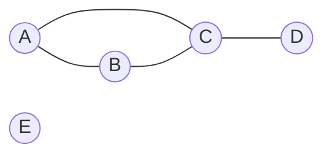
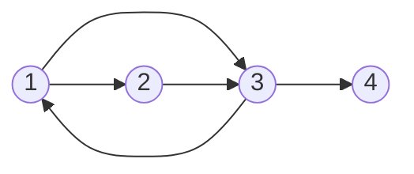
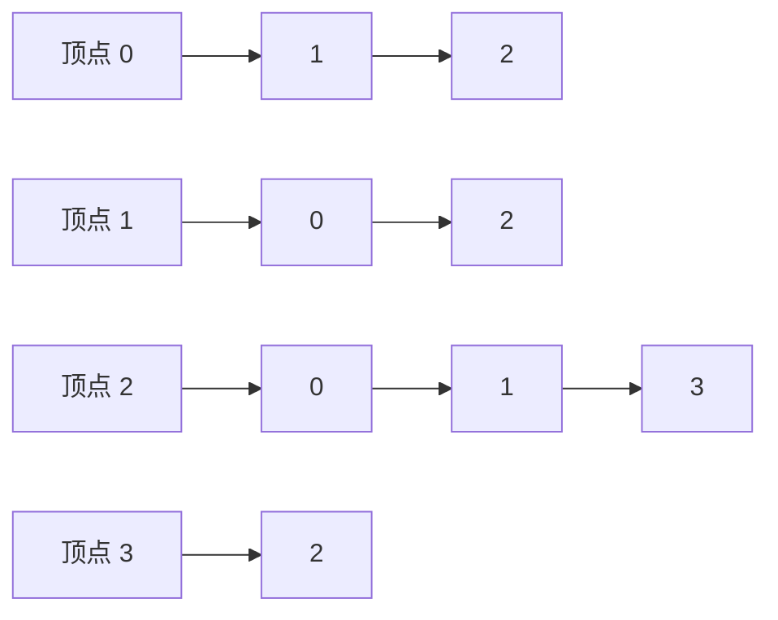
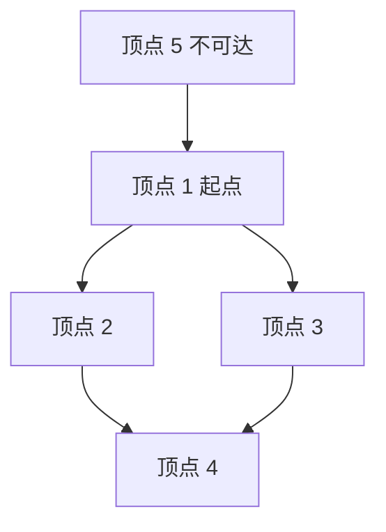
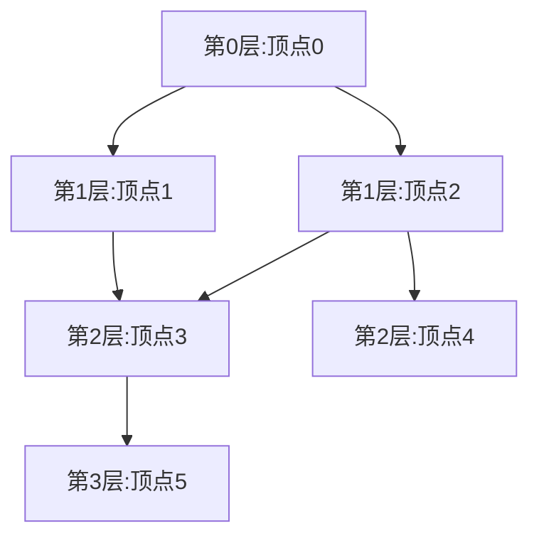
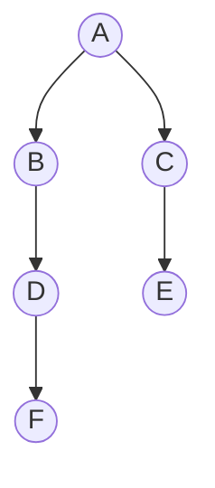

# Concept-Book Run

domain: /home/papagame/projects/digital-duck/cb-data-structure/public/domains/data_structure_ch12/input/graph.yaml
target: shortest_path_via_bfs
started: 2026-11-24T11:55:48

## Teaching order (7 concepts)

- graph
- vertex_degree
- adjacency_list
- graph_traversal
- queue
- breadth_first_search
- shortest_path_via_bfs

### graph (0.7s)

## 图

**定义。** 一个**图**(graph)是一个二元组 $G=(V,E)$,其中 $V$ 是有限的**顶点**集合,$E$ 是由顶点构成的**边**的集合。在无向图中,每条边是一个无序对 $\{u,v\}\subseteq V$;在有向图中,边是有序对 $(u,v)$。顶点 $v$ 的**度** $\deg(v)$ 是与它相连的边的条数。**路径**是顶点序列 $v_0,v_1,\dots,v_k$,其中相邻顶点之间都有边;若任意两个顶点之间都存在路径,则称图是**连通**的。

图的第一个基本结论是**握手引理**:

$$\sum_{v\in V}\deg(v)=2|E|.$$

*证明:* 每条边 $\{u,v\}$ 恰好为 $\deg(u)$ 和 $\deg(v)$ 各贡献 $1$,所以每条边在度数之和中被计算两次。$\blacksquare$

由此可知,度为奇数的顶点个数必为偶数,因为总和 $2|E|$ 是偶数。

**例题。** 设 $V=\{A,B,C,D,E\}$,$E=\{\{A,B\},\{A,C\},\{B,C\},\{C,D\}\}$。

- 各顶点的度:$\deg(A)=2,\ \deg(B)=2,\ \deg(C)=3,\ \deg(D)=1,\ \deg(E)=0$。
- 度数之和为 $2+2+3+1+0=8=2\times 4$,与握手引理一致。
- 从 $A$ 到 $D$ 的一条路径是 $A\to C\to D$,长度为 $2$。
- 顶点 $E$ 是孤立点,没有任何边与它相连,所以 $G$ **不连通**。


*图示:例题中的无向图。顶点 $E$ 孤立,因此整个图不连通。*

**问题求解应用。** 图是把"对象与关系"抽象出来的通用工具。

*问题:* 一个班有 $7$ 名同学,能否让每人恰好与另外 $3$ 名同学互为朋友?

*解答:* 把同学看作顶点,朋友关系看作边。若可行,则每个顶点的度都为 $3$,度数之和为 $7\times 3=21$。但握手引理要求度数之和等于 $2|E|$,必须是偶数,而 $21$ 是奇数,矛盾。因此这种安排**不可能**。

*再看一个应用:* 判断连通性。从某个顶点出发,用广度优先搜索逐层访问相邻顶点。若最后访问到的顶点数等于 $|V|$,则图连通。在例题中,从 $A$ 出发只能访问到 $\{A,B,C,D\}$,共 $4<5$ 个顶点,所以 $G$ 不连通。最短路径、网络可靠性、任务依赖调度等问题,也都是在这一结构上展开的。

**小结。** 图由 $(V,E)$ 完整刻画。握手引理 $\sum\deg(v)=2|E|$ 是判断某种结构是否可能存在的第一道检验。遇到"谁与谁相连"的问题时,先把对象设为顶点、关系设为边,再用度、路径和连通性来分析。

### vertex_degree (0.8s)

## 顶点的度(Vertex Degree)

### 定义

设有向图 $G=(V,E)$,对顶点 $i\in V$,以 $i$ 为**起点**的边的条数称为 $i$ 的**(出)度**,记作

$$
\deg(i)=\bigl|\{(u,v)\in E : u=i\}\bigr|.
$$

直观地说,$\deg(i)$ 就是"从 $i$ 出发有几条路可走"。若图用邻接矩阵 $A$ 表示($A_{ij}=1$ 表示存在边 $i\to j$),则 $\deg(i)$ 等于第 $i$ 行的元素之和:

$$
\deg(i)=\sum_{j} A_{ij}.
$$

对所有顶点求和,每条边恰好被计入一次(只在它的起点处),因此

$$
\sum_{i\in V}\deg(i)=|E|.
$$

这是一个简单但很有用的"计数恒等式":它可以用来检验你数出的度是否正确。

### 例题

设 $V=\{1,2,3,4\}$,$E=\{(1,2),(1,3),(2,3),(3,4),(3,1)\}$。

按起点分组计数:

- $\deg(1)=2$(边 $(1,2),(1,3)$)
- $\deg(2)=1$(边 $(2,3)$)
- $\deg(3)=2$(边 $(3,4),(3,1)$)
- $\deg(4)=0$(没有以 4 为起点的边)

检验:$2+1+2+0=5=|E|$ ✓。


*示例有向图:顶点 1 与 3 的出度为 2,顶点 2 的出度为 1,顶点 4 的出度为 0。*

### 问题求解应用

**问题 1(平均度与边数)。** 一个有 $n=100$ 个顶点的网络,平均出度为 $6$,问共有多少条边?

由恒等式 $\sum_i \deg(i)=|E|$,得 $|E|=100\times 6=600$。

**问题 2(存储与时间估算)。** 用邻接表存储图时,顶点 $i$ 的邻居列表长度恰为 $\deg(i)$。因此遍历所有顶点的所有出边,总代价为

$$
\sum_{i}\deg(i)=|E|,
$$

加上访问各顶点本身的开销,广度优先搜索的总时间为 $O(|V|+|E|)$。若改用邻接矩阵,仅"找出 $i$ 的所有邻居"就需扫描整行,代价 $O(|V|)$,与 $\deg(i)$ 大小无关——当图稀疏($\deg(i)\ll |V|$)时,邻接表明显更省。

**问题 3(识别特殊顶点)。** $\deg(i)=0$ 的顶点称为**汇点(sink)**,例如上例的顶点 4。在随机游走(如网页排名)中,走到汇点就无路可走,所以算法必须专门处理这类顶点,比如以一定概率"随机跳转"到别处。

**小结:** 求度的步骤是"按起点分组、逐组计数、用 $\sum\deg(i)=|E|$ 验算"。度既是图的局部性质,也决定了算法的存储与运行代价。

### adjacency_list (0.7s)

## 邻接表

**定义。** 邻接表(adjacency list)是图的一种以顶点为中心的存储方式:用一个长度为 $n$ 的数组 $\text{adj}$,其中 $\text{adj}[i]$ 是一个链表(或动态数组),保存所有满足 $(i,j)\in E$ 的顶点 $j$。对无向图,每条边 $\{i,j\}$ 会在 $\text{adj}[i]$ 与 $\text{adj}[j]$ 中各出现一次;对有向图,边 $(i,j)$ 只出现在 $\text{adj}[i]$ 中。

**复杂度。** 设图有 $n$ 个顶点、$m$ 条边:

- 空间:数组占 $O(n)$,所有列表的总长度为 $m$(有向)或 $2m$(无向),故总空间为 $O(n+m)$。
- `add_edge(i, j)`:把 $j$ 追加到 $\text{adj}[i]$ 的末尾(或链表头部),为 $O(1)$。
- `has_edge(i, j)` 与 `remove_edge(i, j)`:需要扫描 $\text{adj}[i]$,最坏为 $O(\deg(i))$。
- 遍历 $i$ 的所有邻居:$O(\deg(i))$,这正是 BFS、DFS 所需要的操作。

**例题。** 考虑无向图,顶点为 $0,1,2,3$,边为 $\{0,1\},\{0,2\},\{1,2\},\{2,3\}$。其邻接表为:

$$
\text{adj}[0]=[1,2],\quad \text{adj}[1]=[0,2],\quad \text{adj}[2]=[0,1,3],\quad \text{adj}[3]=[2].
$$

各列表长度之和为 $2+2+3+1=8=2m$,这正是握手引理 $\sum_i \deg(i)=2m$ 的体现。

```python
class Graph:
    def __init__(self, n):
        self.adj = [[] for _ in range(n)]

    def add_edge(self, i, j):          # O(1)
        self.adj[i].append(j)
        self.adj[j].append(i)          # 有向图则省略此行

    def has_edge(self, i, j):          # O(deg(i))
        return j in self.adj[i]
```


*图:例题中各顶点对应的邻接列表,每一行表示一个顶点及其邻居序列。*

**问题求解应用。** 问:某社交网络有 $n=10^6$ 个用户、$m=5\times10^6$ 条好友关系(无向),平均每人约 10 个好友。应选邻接矩阵还是邻接表?

- 邻接矩阵需要 $n^2=10^{12}$ 个单元,即使每格 1 位也约 125 GB,不可行。
- 邻接表需要约 $n+2m=1.1\times10^7$ 个条目,只有几十 MB。
- 若要对所有用户执行一次 BFS,邻接表的总代价是 $O(n+m)$;邻接矩阵则要对每个顶点扫描一整行,代价为 $O(n^2)$。

结论:对**稀疏图**($m\ll n^2$),邻接表在空间与遍历上都占优。其代价是 `has_edge` 不再是 $O(1)$;若需频繁判断边是否存在,可将每个 $\text{adj}[i]$ 改用哈希集合,期望时间降为 $O(1)$,空间仍为 $O(n+m)$。

### graph_traversal (0.9s)

## 图遍历

### 定义

给定图 $G=(V,E)$ 和起点 $i\in V$,**图遍历**(graph traversal)是系统地访问从 $i$ 出发所有**可达**顶点的过程。若存在一条从 $i$ 到 $v$ 的路径,则称 $v$ 可达。遍历的核心是避免重复访问,因此需要一个"已访问"标记 $\text{visited}[v]$。

遍历的效率取决于图的存储方式。**邻接表**为每个顶点 $u$ 保存其邻居列表 $\text{Adj}[u]$,于是枚举 $u$ 的所有邻居只需 $O(\deg(u))$ 时间。若用邻接矩阵,枚举邻居需要 $O(|V|)$,整体会退化为 $O(|V|^2)$。

两种基本策略:

- **深度优先搜索(DFS)**:沿一条路径尽量深入,无路可走再回溯(用递归或栈)。
- **广度优先搜索(BFS)**:按与起点的距离逐层扩展(用队列)。

```python
from collections import deque

def bfs(adj, i):
    visited = {i}
    order = []
    q = deque([i])
    while q:
        u = q.popleft()
        order.append(u)
        for v in adj[u]:
            if v not in visited:
                visited.add(v)      # 入队时标记,防止重复入队
                q.append(v)
    return order
```

### 例题

设有向图的邻接表为:

$$\text{Adj}[1]=\{2,3\},\ \text{Adj}[2]=\{4\},\ \text{Adj}[3]=\{4\},\ \text{Adj}[4]=\{\},\ \text{Adj}[5]=\{1\}.$$

从 $i=1$ 出发做 BFS:

1. 队列 $[1]$,取出 1,将 2、3 入队。
2. 取出 2,邻居 4 未访问,入队;队列 $[3,4]$。
3. 取出 3,邻居 4 已访问,跳过。
4. 取出 4,无邻居。

访问顺序为 $1,2,3,4$。顶点 5 虽在图中,但没有从 1 到 5 的路径,故**不可达**。DFS 的顺序则为 $1,2,4,3$。

### 问题求解应用

**复杂度分析。** 每个顶点至多入队(或入栈)一次,出队时扫描其邻接表一次,因此总工作量为

$$\sum_{u\in V_{\text{reach}}}\bigl(1+\deg(u)\bigr)\le O(|V|+|E|).$$

这是线性时间,也是邻接表的优势所在。

**正确性要点。** 若 $v$ 可达,设最短路径为 $i=u_0,u_1,\dots,u_k=v$。对 $k$ 归纳:$u_0$ 被访问;若 $u_{j}$ 被访问,则扫描其邻接表时必会发现 $u_{j+1}$,要么将其标记,要么它此前已被标记。故 $v$ 最终被访问。

**典型应用:**

- **连通性判断**:从 $i$ 遍历后检查目标是否在 visited 中。
- **最短路径(无权图)**:BFS 中记录 $\text{dist}[v]=\text{dist}[u]+1$,首次发现 $v$ 时的距离即为最短跳数。
- **连通分量计数**:对每个未访问的顶点启动一次遍历,启动次数即为分量个数。
- **环检测与拓扑排序**:基于 DFS 的访问状态(未访问/进行中/已完成)。

**练习:** 在上面的图中,若添加边 $4\to5$,从 1 出发的可达集合如何变化?此时图中是否存在环?(答案:可达集合变为 $\{1,2,3,4,5\}$;存在环 $1\to2\to4\to5\to1$。)


*示例图:从顶点 1 出发可到达 2、3、4;顶点 5 只有指向 1 的边,因此不可达。*

### queue (0.7s)

## 队列

**定义。** 队列(queue)是一种遵循**先进先出**(FIFO, First-In-First-Out)原则的线性集合:元素只能从**队尾**加入(入队, enqueue),只能从**队首**移除(出队, dequeue)。最早进入的元素最先被处理,就像排队买票。典型操作如下:

| 操作 | 作用 | 时间复杂度 |
|---|---|---|
| `enqueue(x)` | 将 $x$ 加到队尾 | $O(1)$ |
| `dequeue()` | 移除并返回队首元素 | $O(1)$ |
| `front()` | 查看队首元素 | $O(1)$ |
| `is_empty()` | 判断队列是否为空 | $O(1)$ |

在 Python 中应使用 `collections.deque` 实现队列;若用 `list.pop(0)`,每次出队需移动全部元素,代价为 $O(n)$。

**在图遍历中的角色。** 广度优先搜索(BFS)用队列来安排"待访问顶点"的顺序:先发现的顶点先被展开,因此搜索会一层一层地向外扩展。

**例题。** 无向图的邻接表为:
$A:\{B,C\}$,$B:\{A,D\}$,$C:\{A,D\}$,$D:\{B,C,E\}$,$E:\{D\}$。从 $A$ 出发做 BFS,写出访问顺序。

```python
from collections import deque

def bfs(graph, start):
    visited = {start}
    queue = deque([start])
    order = []
    while queue:
        v = queue.popleft()          # 出队
        order.append(v)
        for w in graph[v]:
            if w not in visited:
                visited.add(w)       # 入队时即标记,避免重复入队
                queue.append(w)
    return order
```

队列的变化过程(队首在左):

| 步骤 | 出队 | 入队 | 队列 |
|---|---|---|---|
| 初始 | — | $A$ | $[A]$ |
| 1 | $A$ | $B,C$ | $[B,C]$ |
| 2 | $B$ | $D$ | $[C,D]$ |
| 3 | $C$ | (D 已标记) | $[D]$ |
| 4 | $D$ | $E$ | $[E]$ |
| 5 | $E$ | — | $[\,]$ |

访问顺序为 $A,B,C,D,E$。

**问题求解应用:最短路径(边数)。** 在无权图中,求从起点 $s$ 到各顶点的最少边数。只需在入队时记录距离:若 $w$ 由 $v$ 发现,则 $d(w)=d(v)+1$。

因为队列是先进先出的,所有距离为 $k$ 的顶点一定在所有距离为 $k+1$ 的顶点之前出队。因此每个顶点**第一次**被发现时所得的距离就是最短距离。上例中 $d(A)=0$,$d(B)=d(C)=1$,$d(D)=2$,$d(E)=3$。

若把队列换成栈(后进先出),遍历就变成深度优先搜索,上述"按层扩展"的性质随之消失,距离也就不再保证最短。

**复杂度。** 每个顶点至多入队、出队一次,每条边至多被检查常数次,所以 BFS 的总时间为 $O(|V|+|E|)$,队列所需额外空间为 $O(|V|)$。


*图:队列在 BFS 中的循环:顶点从队尾进入,从队首取出并展开,同时把新发现的邻居放回队尾。*

### breadth_first_search (0.7s)

## 广度优先搜索

### 定义

**广度优先搜索**(Breadth-First Search,BFS)是一种图遍历算法。从起点 $s$ 出发,它先访问 $s$ 的所有邻居,再访问邻居的邻居,依此类推,即按与 $s$ 的**边数距离**由近到远逐层访问。

算法用到两个数据结构:

- **队列**(先进先出):存放"已发现但尚未处理"的顶点;
- **seen 数组**:`seen[v]` 记录顶点 $v$ 是否已被发现,防止重复入队。

图用**邻接表**(AdjacencyLists)存储:`adj[u]` 是 $u$ 的邻居列表。

```python
from collections import deque

def bfs(adj, s):
    n = len(adj)
    seen = [False] * n
    dist = [-1] * n          # 到 s 的最短边数
    seen[s], dist[s] = True, 0
    q = deque([s])
    order = []
    while q:
        u = q.popleft()
        order.append(u)
        for v in adj[u]:
            if not seen[v]:
                seen[v] = True
                dist[v] = dist[u] + 1
                q.append(v)
    return order, dist
```

### 例题

设无向图有 6 个顶点,邻接表为:

$0:[1,2]$, $1:[0,3]$, $2:[0,3,4]$, $3:[1,2,5]$, $4:[2]$, $5:[3]$。

从 $s=0$ 开始:

| 步骤 | 取出 | 新入队 | 队列 |
|---|---|---|---|
| 1 | 0 | 1, 2 | [1, 2] |
| 2 | 1 | 3 | [2, 3] |
| 3 | 2 | 4 | [3, 4] |
| 4 | 3 | 5 | [4, 5] |
| 5 | 4 | — | [5] |
| 6 | 5 | — | [] |

访问顺序为 $0,1,2,3,4,5$,距离为 $\text{dist}=[0,1,1,2,2,3]$。注意顶点 3 被 1 发现后,再被 2 看到时 `seen[3]` 已为真,所以不会重复入队。

### 复杂度分析

每个顶点至多入队、出队一次,共 $O(n)$ 次操作。每个顶点出队时扫描其邻接表,所有邻接表长度之和为 $2m$(无向图)或 $m$(有向图),故扫描总代价为 $O(m)$。因此总时间为

$$T(n,m)=O(n+m).$$

这正是选用邻接表的原因:若用邻接矩阵,每个顶点需扫描整行,时间升为 $O(n^2)$。

### 正确性要点

**定理**:BFS 计算出的 $\text{dist}[v]$ 等于 $s$ 到 $v$ 的最短路径边数(不可达则为 $-1$)。

*证明思路*:对距离 $d$ 归纳。距离为 $0$ 的只有 $s$。假设所有距离 $\le d$ 的顶点都已正确标记且按距离非递减顺序入队。距离为 $d+1$ 的顶点 $v$ 必有一个距离为 $d$ 的邻居 $u$;队列的先进先出性质保证 $u$ 先于任何距离更大的顶点出队,故 $v$ 最早由 $u$(或另一个距离为 $d$ 的顶点)发现,得到 $\text{dist}[v]=d+1$。$\square$

### 问题求解应用

**迷宫最短步数**:把每个格子看作顶点,相邻的可走格子之间连边(无权图)。从起点做 BFS,`dist[终点]` 就是最少步数;若为 $-1$,则无通路。

**连通分量计数**:依次对每个 `seen` 为假的顶点启动一次 BFS,启动次数即连通分量数,总时间仍为 $O(n+m)$。

**二分图判定**:BFS 时给顶点按 `dist` 的奇偶染色;若存在边连接同色顶点,则图含奇环,不是二分图。


*图:例题中从顶点 0 出发的 BFS 分层结构。同一层的顶点与起点的边数距离相同。*

**练习**:修改上面的代码,使其额外记录 `parent[v]`,并据此还原 $s$ 到任意顶点的一条最短路径。(提示:发现 $v$ 时令 `parent[v] = u`,再从目标沿 `parent` 回溯。)

### shortest_path_via_bfs (0.7s)

## 通过广度优先搜索求最短路径

### 定义

设无权图 $G=(V,E)$,$r\in V$ 为源点。从 $r$ 到顶点 $j$ 的**最短路径**是边数最少的路径,其长度记为 $d(j)$。

广度优先搜索(BFS)按"层"扩展:先访问距 $r$ 为 $0$ 的点,再访问距离为 $1$ 的点,依此类推。因此每个顶点**首次被发现**时,所用的边数恰为它到 $r$ 的最短距离。

为了还原路径,我们为每个顶点记录**前驱数组** $p$:当顶点 $v$ 的邻居 $w$ 第一次被发现时,令
$$p[w]=v,\qquad d(w)=d(v)+1.$$
源点满足 $p[r]=\text{None}$。

```python
from collections import deque

def bfs(adj, r):
    p = {r: None}
    d = {r: 0}
    q = deque([r])
    while q:
        v = q.popleft()
        for w in adj[v]:
            if w not in p:        # 首次发现
                p[w] = v
                d[w] = d[v] + 1
                q.append(w)
    return p, d

def path(p, j):
    if j not in p:
        return None               # 不可达
    res = []
    while j is not None:
        res.append(j)
        j = p[j]
    return res[::-1]
```

BFS 的时间复杂度为 $O(|V|+|E|)$,每个顶点至多入队一次,每条边至多被检查常数次。

### worked example

图的邻接表为:$A:\{B,C\}$,$B:\{A,D\}$,$C:\{A,D,E\}$,$D:\{B,C,F\}$,$E:\{C,F\}$,$F:\{D,E\}$。取 $r=A$。

| 出队顶点 | 新发现的顶点 | 记录 |
|---|---|---|
| $A$ | $B,C$ | $p[B]=p[C]=A$ |
| $B$ | $D$ | $p[D]=B$ |
| $C$ | $E$ | $p[E]=C$($D$ 已被发现) |
| $D$ | $F$ | $p[F]=D$ |

还原 $A$ 到 $F$ 的路径:$F\to p[F]=D\to p[D]=B\to p[B]=A$,反转得 $A,B,D,F$,长度 $d(F)=3$。注意 $E$ 也能到达 $F$,但 $D$ 先出队,所以 $p[F]$ 不会被覆盖;这条路径同样长度为 3,最短路径不一定唯一。


*BFS 树:每条边由 $p$ 数组确定,从任意顶点沿箭头反向走到 $A$ 即得最短路径。*

### 问题求解应用

**问题**:迷宫是 $n\times n$ 的网格,求从起点到出口的最少步数及一条具体路线。

**解法**:把每个空格看作顶点,相邻空格之间连边,这就化为无权图上的最短路径问题。

1. 从起点运行 BFS,记录 $p$ 和 $d$。
2. 若出口不在 $p$ 中,则无解。
3. 否则 $d(\text{出口})$ 即最少步数,用 `path(p, 出口)` 还原路线。

**正确性要点**:BFS 队列中顶点的距离单调不减,所以首次发现某点时的距离就是最小距离(对 $d$ 归纳可证)。此结论依赖边权相同;若边带有不同权重,需改用 Dijkstra 算法。

**复杂度**:网格有 $n^2$ 个顶点、至多 $2n(n-1)$ 条边,总时间为 $O(n^2)$,路径还原再花 $O(d(j))$。

**常见错误**:在顶点出队时才标记"已访问"会让同一顶点重复入队,既浪费时间,也可能覆盖 $p$。应在**发现时**就标记,如上面 `if w not in p` 所做的那样。

## Run complete

total: 27.8s
