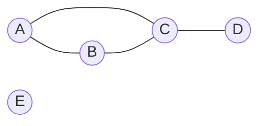
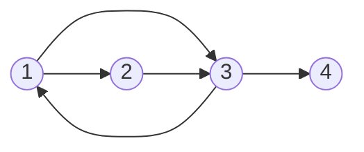
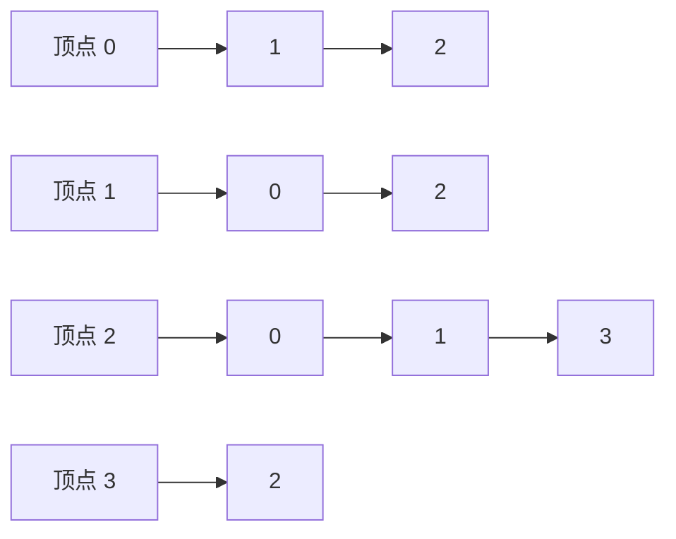
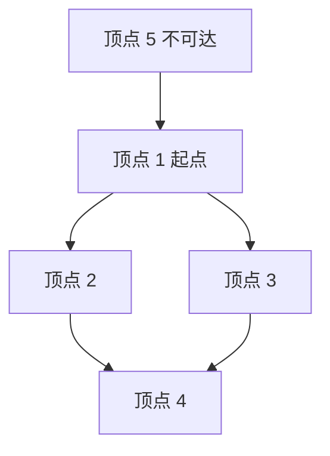
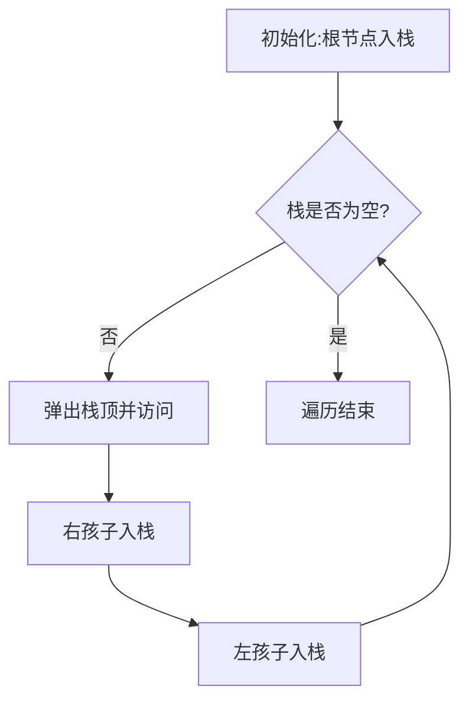
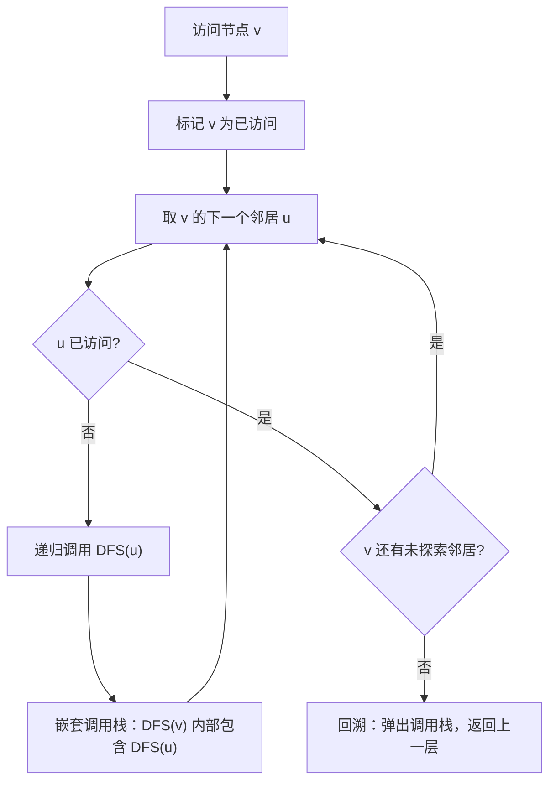
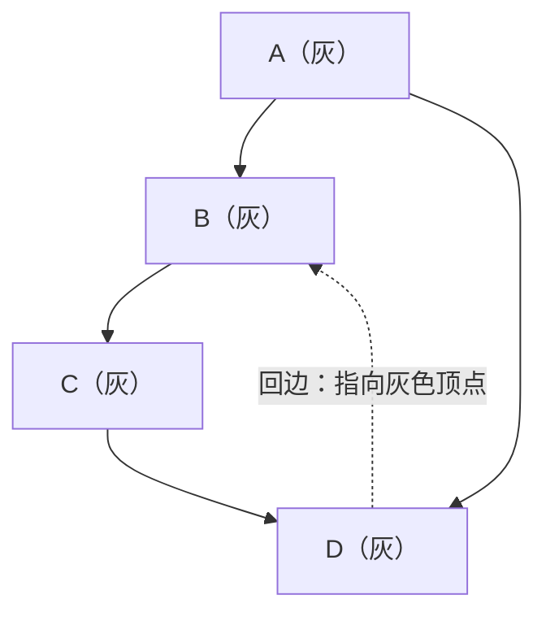

# Concept-Book Run

domain: /home/papagame/projects/digital-duck/cb-data-structure/public/domains/data_structure_ch12/input/graph.yaml
target: cycle_detection_via_dfs
started: 2026-11-24T11:56:17

## Teaching order (7 concepts)

- graph
- vertex_degree
- adjacency_list
- graph_traversal
- stack
- depth_first_search
- cycle_detection_via_dfs

### graph (0.6s)

## 图

**定义。** 一个**图**(graph)是一个二元组 $G=(V,E)$,其中 $V$ 是有限的**顶点**集合,$E$ 是由顶点构成的**边**的集合。在无向图中,每条边是一个无序对 $\{u,v\}\subseteq V$;在有向图中,边是有序对 $(u,v)$。顶点 $v$ 的**度** $\deg(v)$ 是与它相连的边的条数。**路径**是顶点序列 $v_0,v_1,\dots,v_k$,其中相邻顶点之间都有边;若任意两个顶点之间都存在路径,则称图是**连通**的。

图的第一个基本结论是**握手引理**:

$$\sum_{v\in V}\deg(v)=2|E|.$$

*证明:* 每条边 $\{u,v\}$ 恰好为 $\deg(u)$ 和 $\deg(v)$ 各贡献 $1$,所以每条边在度数之和中被计算两次。$\blacksquare$

由此可知,度为奇数的顶点个数必为偶数,因为总和 $2|E|$ 是偶数。

**例题。** 设 $V=\{A,B,C,D,E\}$,$E=\{\{A,B\},\{A,C\},\{B,C\},\{C,D\}\}$。

- 各顶点的度:$\deg(A)=2,\ \deg(B)=2,\ \deg(C)=3,\ \deg(D)=1,\ \deg(E)=0$。
- 度数之和为 $2+2+3+1+0=8=2\times 4$,与握手引理一致。
- 从 $A$ 到 $D$ 的一条路径是 $A\to C\to D$,长度为 $2$。
- 顶点 $E$ 是孤立点,没有任何边与它相连,所以 $G$ **不连通**。


*图示:例题中的无向图。顶点 $E$ 孤立,因此整个图不连通。*

**问题求解应用。** 图是把"对象与关系"抽象出来的通用工具。

*问题:* 一个班有 $7$ 名同学,能否让每人恰好与另外 $3$ 名同学互为朋友?

*解答:* 把同学看作顶点,朋友关系看作边。若可行,则每个顶点的度都为 $3$,度数之和为 $7\times 3=21$。但握手引理要求度数之和等于 $2|E|$,必须是偶数,而 $21$ 是奇数,矛盾。因此这种安排**不可能**。

*再看一个应用:* 判断连通性。从某个顶点出发,用广度优先搜索逐层访问相邻顶点。若最后访问到的顶点数等于 $|V|$,则图连通。在例题中,从 $A$ 出发只能访问到 $\{A,B,C,D\}$,共 $4<5$ 个顶点,所以 $G$ 不连通。最短路径、网络可靠性、任务依赖调度等问题,也都是在这一结构上展开的。

**小结。** 图由 $(V,E)$ 完整刻画。握手引理 $\sum\deg(v)=2|E|$ 是判断某种结构是否可能存在的第一道检验。遇到"谁与谁相连"的问题时,先把对象设为顶点、关系设为边,再用度、路径和连通性来分析。

### vertex_degree (1.3s)

## 顶点的度(Vertex Degree)

### 定义

设有向图 $G=(V,E)$,对顶点 $i\in V$,以 $i$ 为**起点**的边的条数称为 $i$ 的**(出)度**,记作

$$
\deg(i)=\bigl|\{(u,v)\in E : u=i\}\bigr|.
$$

直观地说,$\deg(i)$ 就是"从 $i$ 出发有几条路可走"。若图用邻接矩阵 $A$ 表示($A_{ij}=1$ 表示存在边 $i\to j$),则 $\deg(i)$ 等于第 $i$ 行的元素之和:

$$
\deg(i)=\sum_{j} A_{ij}.
$$

对所有顶点求和,每条边恰好被计入一次(只在它的起点处),因此

$$
\sum_{i\in V}\deg(i)=|E|.
$$

这是一个简单但很有用的"计数恒等式":它可以用来检验你数出的度是否正确。

### 例题

设 $V=\{1,2,3,4\}$,$E=\{(1,2),(1,3),(2,3),(3,4),(3,1)\}$。

按起点分组计数:

- $\deg(1)=2$(边 $(1,2),(1,3)$)
- $\deg(2)=1$(边 $(2,3)$)
- $\deg(3)=2$(边 $(3,4),(3,1)$)
- $\deg(4)=0$(没有以 4 为起点的边)

检验:$2+1+2+0=5=|E|$ ✓。


*示例有向图:顶点 1 与 3 的出度为 2,顶点 2 的出度为 1,顶点 4 的出度为 0。*

### 问题求解应用

**问题 1(平均度与边数)。** 一个有 $n=100$ 个顶点的网络,平均出度为 $6$,问共有多少条边?

由恒等式 $\sum_i \deg(i)=|E|$,得 $|E|=100\times 6=600$。

**问题 2(存储与时间估算)。** 用邻接表存储图时,顶点 $i$ 的邻居列表长度恰为 $\deg(i)$。因此遍历所有顶点的所有出边,总代价为

$$
\sum_{i}\deg(i)=|E|,
$$

加上访问各顶点本身的开销,广度优先搜索的总时间为 $O(|V|+|E|)$。若改用邻接矩阵,仅"找出 $i$ 的所有邻居"就需扫描整行,代价 $O(|V|)$,与 $\deg(i)$ 大小无关——当图稀疏($\deg(i)\ll |V|$)时,邻接表明显更省。

**问题 3(识别特殊顶点)。** $\deg(i)=0$ 的顶点称为**汇点(sink)**,例如上例的顶点 4。在随机游走(如网页排名)中,走到汇点就无路可走,所以算法必须专门处理这类顶点,比如以一定概率"随机跳转"到别处。

**小结:** 求度的步骤是"按起点分组、逐组计数、用 $\sum\deg(i)=|E|$ 验算"。度既是图的局部性质,也决定了算法的存储与运行代价。

### adjacency_list (0.7s)

## 邻接表

**定义。** 邻接表(adjacency list)是图的一种以顶点为中心的存储方式:用一个长度为 $n$ 的数组 $\text{adj}$,其中 $\text{adj}[i]$ 是一个链表(或动态数组),保存所有满足 $(i,j)\in E$ 的顶点 $j$。对无向图,每条边 $\{i,j\}$ 会在 $\text{adj}[i]$ 与 $\text{adj}[j]$ 中各出现一次;对有向图,边 $(i,j)$ 只出现在 $\text{adj}[i]$ 中。

**复杂度。** 设图有 $n$ 个顶点、$m$ 条边:

- 空间:数组占 $O(n)$,所有列表的总长度为 $m$(有向)或 $2m$(无向),故总空间为 $O(n+m)$。
- `add_edge(i, j)`:把 $j$ 追加到 $\text{adj}[i]$ 的末尾(或链表头部),为 $O(1)$。
- `has_edge(i, j)` 与 `remove_edge(i, j)`:需要扫描 $\text{adj}[i]$,最坏为 $O(\deg(i))$。
- 遍历 $i$ 的所有邻居:$O(\deg(i))$,这正是 BFS、DFS 所需要的操作。

**例题。** 考虑无向图,顶点为 $0,1,2,3$,边为 $\{0,1\},\{0,2\},\{1,2\},\{2,3\}$。其邻接表为:

$$
\text{adj}[0]=[1,2],\quad \text{adj}[1]=[0,2],\quad \text{adj}[2]=[0,1,3],\quad \text{adj}[3]=[2].
$$

各列表长度之和为 $2+2+3+1=8=2m$,这正是握手引理 $\sum_i \deg(i)=2m$ 的体现。

```python
class Graph:
    def __init__(self, n):
        self.adj = [[] for _ in range(n)]

    def add_edge(self, i, j):          # O(1)
        self.adj[i].append(j)
        self.adj[j].append(i)          # 有向图则省略此行

    def has_edge(self, i, j):          # O(deg(i))
        return j in self.adj[i]
```


*图:例题中各顶点对应的邻接列表,每一行表示一个顶点及其邻居序列。*

**问题求解应用。** 问:某社交网络有 $n=10^6$ 个用户、$m=5\times10^6$ 条好友关系(无向),平均每人约 10 个好友。应选邻接矩阵还是邻接表?

- 邻接矩阵需要 $n^2=10^{12}$ 个单元,即使每格 1 位也约 125 GB,不可行。
- 邻接表需要约 $n+2m=1.1\times10^7$ 个条目,只有几十 MB。
- 若要对所有用户执行一次 BFS,邻接表的总代价是 $O(n+m)$;邻接矩阵则要对每个顶点扫描一整行,代价为 $O(n^2)$。

结论:对**稀疏图**($m\ll n^2$),邻接表在空间与遍历上都占优。其代价是 `has_edge` 不再是 $O(1)$;若需频繁判断边是否存在,可将每个 $\text{adj}[i]$ 改用哈希集合,期望时间降为 $O(1)$,空间仍为 $O(n+m)$。

### graph_traversal (0.6s)

## 图遍历

### 定义

给定图 $G=(V,E)$ 和起点 $i\in V$,**图遍历**(graph traversal)是系统地访问从 $i$ 出发所有**可达**顶点的过程。若存在一条从 $i$ 到 $v$ 的路径,则称 $v$ 可达。遍历的核心是避免重复访问,因此需要一个"已访问"标记 $\text{visited}[v]$。

遍历的效率取决于图的存储方式。**邻接表**为每个顶点 $u$ 保存其邻居列表 $\text{Adj}[u]$,于是枚举 $u$ 的所有邻居只需 $O(\deg(u))$ 时间。若用邻接矩阵,枚举邻居需要 $O(|V|)$,整体会退化为 $O(|V|^2)$。

两种基本策略:

- **深度优先搜索(DFS)**:沿一条路径尽量深入,无路可走再回溯(用递归或栈)。
- **广度优先搜索(BFS)**:按与起点的距离逐层扩展(用队列)。

```python
from collections import deque

def bfs(adj, i):
    visited = {i}
    order = []
    q = deque([i])
    while q:
        u = q.popleft()
        order.append(u)
        for v in adj[u]:
            if v not in visited:
                visited.add(v)      # 入队时标记,防止重复入队
                q.append(v)
    return order
```

### 例题

设有向图的邻接表为:

$$\text{Adj}[1]=\{2,3\},\ \text{Adj}[2]=\{4\},\ \text{Adj}[3]=\{4\},\ \text{Adj}[4]=\{\},\ \text{Adj}[5]=\{1\}.$$

从 $i=1$ 出发做 BFS:

1. 队列 $[1]$,取出 1,将 2、3 入队。
2. 取出 2,邻居 4 未访问,入队;队列 $[3,4]$。
3. 取出 3,邻居 4 已访问,跳过。
4. 取出 4,无邻居。

访问顺序为 $1,2,3,4$。顶点 5 虽在图中,但没有从 1 到 5 的路径,故**不可达**。DFS 的顺序则为 $1,2,4,3$。

### 问题求解应用

**复杂度分析。** 每个顶点至多入队(或入栈)一次,出队时扫描其邻接表一次,因此总工作量为

$$\sum_{u\in V_{\text{reach}}}\bigl(1+\deg(u)\bigr)\le O(|V|+|E|).$$

这是线性时间,也是邻接表的优势所在。

**正确性要点。** 若 $v$ 可达,设最短路径为 $i=u_0,u_1,\dots,u_k=v$。对 $k$ 归纳:$u_0$ 被访问;若 $u_{j}$ 被访问,则扫描其邻接表时必会发现 $u_{j+1}$,要么将其标记,要么它此前已被标记。故 $v$ 最终被访问。

**典型应用:**

- **连通性判断**:从 $i$ 遍历后检查目标是否在 visited 中。
- **最短路径(无权图)**:BFS 中记录 $\text{dist}[v]=\text{dist}[u]+1$,首次发现 $v$ 时的距离即为最短跳数。
- **连通分量计数**:对每个未访问的顶点启动一次遍历,启动次数即为分量个数。
- **环检测与拓扑排序**:基于 DFS 的访问状态(未访问/进行中/已完成)。

**练习:** 在上面的图中,若添加边 $4\to5$,从 1 出发的可达集合如何变化?此时图中是否存在环?(答案:可达集合变为 $\{1,2,3,4,5\}$;存在环 $1\to2\to4\to5\to1$。)


*示例图:从顶点 1 出发可到达 2、3、4;顶点 5 只有指向 1 的边,因此不可达。*

### stack (13.9s)

## 栈

**定义。** 栈(stack)是一种**后进先出**(LIFO, Last-In-First-Out)的线性集合。它只允许在同一端(栈顶)操作,核心操作有三个:

- `push(x)`:把元素 $x$ 压入栈顶;
- `pop()`:弹出并返回栈顶元素;
- `peek()`:查看栈顶元素但不删除。

在合适的实现(如数组末尾或链表头)下,三个操作的时间复杂度均为 $O(1)$。递归之所以能工作,正是因为系统维护了一个"调用栈";而显式使用栈,就是把这个隐含的结构交到自己手中,从而**自主控制遍历顺序**,并避免递归过深导致的栈溢出。

**例题:用栈做二叉树的前序遍历。** 考虑二叉树:根为 $A$,左孩子为 $B$,右孩子为 $C$;$B$ 的左孩子为 $D$,右孩子为 $E$。

算法:先把根压栈;每次弹出一个节点并访问,然后**先压右孩子,再压左孩子**(这样左孩子后进先出,会先被处理)。

| 步骤 | 弹出并访问 | 压入后的栈(右端为栈顶) |
|---|---|---|
| 初始 | — | $[A]$ |
| 1 | $A$ | $[C, B]$ |
| 2 | $B$ | $[C, E, D]$ |
| 3 | $D$ | $[C, E]$ |
| 4 | $E$ | $[C]$ |
| 5 | $C$ | $[\ ]$ |

访问顺序为 $A, B, D, E, C$,正是前序遍历。

```python
def preorder(root):
    result, stack = [], [root]
    while stack:
        node = stack.pop()
        if node is None:
            continue
        result.append(node.val)
        stack.append(node.right)   # 先压右
        stack.append(node.left)    # 后压左,先被弹出
    return result
```

**问题求解应用。** 栈不仅能改写递归,还能改变遍历的性质:

1. **深度优先搜索(DFS)**:在图上把"前序遍历"中的左右孩子换成所有未访问的邻居即可。若把栈换成先进先出的队列,同一段代码就变成广度优先搜索(BFS)——**仅靠更换容器就能切换遍历顺序**。
2. **括号匹配**:遇到左括号压栈,遇到右括号则弹出并检查是否配对。对 `{[()]}` 逐字符处理,栈在末尾为空则合法;若中途弹空或结尾非空,则不合法。
3. **深度限制**:Python 默认递归深度约 1000 层;对一条含 $10^5$ 个节点的链状树,递归会崩溃,而显式栈只受内存限制。

**复杂度分析。** 每个节点恰好入栈、出栈各一次,总时间为 $O(n)$;额外空间最坏为 $O(n)$(链状树),平衡树时仅为 $O(h)$,其中 $h$ 为树高。


*用显式栈实现前序遍历的流程:循环"弹出、访问、先压右后压左",直到栈空。*

### depth_first_search (0.5s)

## Depth First Search

深度优先搜索（Depth First Search，DFS）是一种图遍历算法：从起始节点出发，沿着某一条分支尽可能深入地探索，直到无法继续前进（所有邻居都已访问）为止，再回溯到上一个节点，尝试其他未探索的分支。这种"先深入、后回溯"的策略天然地用递归实现——每次递归调用对应向前探索一步，递归返回则对应回溯一步。算法维护一个 `visited` 集合以避免重复访问同一节点（否则在有环图中会陷入无限递归）。

伪代码如下：

$$
\text{DFS}(v):\quad \text{mark } v \text{ as visited}; \quad \text{for each neighbor } u \text{ of } v: \quad \text{if } u \text{ not visited, call DFS}(u)
$$

**递归调用栈的本质**：DFS 并不显式维护一个栈数据结构（除非用迭代版本实现），而是借助程序运行时自身的调用栈——每次递归调用会把当前节点的"未探索邻居列表"压入调用栈，直到某一层的邻居全部访问完毕，该层才从栈中弹出，控制权交还给上一层调用者。这正是"递归 = 隐式栈"这一编程范式的典型体现。

**复杂度分析**：设图有 $V$ 个顶点、$E$ 条边。每个顶点恰好被访问一次（标记为 visited），每条边最多被检查两次（有向图为一次）。因此时间复杂度为 $O(V + E)$，空间复杂度（递归调用栈深度）在最坏情况下为 $O(V)$（例如一条链状图）。

**问题求解应用**：假设要判断一个无向图是否连通，可以从任意一个顶点开始执行 DFS，遍历结束后检查 `visited` 集合是否覆盖了所有顶点——若是，则图连通。DFS 还是拓扑排序、检测环、寻找连通分量、求解迷宫路径等问题的核心工具：例如在迷宫求解中，节点是格子，边是相邻可通行的格子，DFS 沿一条路径深入，撞墙则回溯，直到找到出口或穷尽所有路径。



*该流程图展示了 DFS 的访问-标记-递归-回溯循环，以及递归调用如何形成嵌套的调用栈结构。*

### cycle_detection_via_dfs (15.6s)

## 基于深度优先搜索的环检测

### 定义

在有向图 $G=(V,E)$ 上运行深度优先搜索（DFS）时，给每个顶点涂上三种颜色之一：

- **白色**：尚未被发现；
- **灰色**：已被发现，但其所有出边尚未处理完（即仍在当前递归栈中）；
- **黑色**：已处理完毕，其所有后代都已访问。

**环检测定理：** 有向图 $G$ 含有环，当且仅当 DFS 过程中出现一条**回边**，即从当前顶点 $u$ 指向一个**灰色**顶点 $v$ 的边 $(u,v)$。

**证明思路：**

- ($\Rightarrow$) 设 $G$ 有环 $C$，令 $v$ 为 $C$ 中最先被发现的顶点。此刻 $C$ 上其余顶点均为白色。由白色路径定理，它们都会成为 $v$ 的后代。设 $u$ 是环上指向 $v$ 的前驱，则 $u$ 是 $v$ 的后代。处理 $u$ 的边 $(u,v)$ 时，$v$ 尚未结束，仍为灰色，因此这是一条回边。
- ($\Leftarrow$) 若存在边 $(u,v)$ 且 $v$ 为灰色，则 $v$ 在递归栈上，是 $u$ 的祖先。于是存在树路径 $v \leadsto u$，再加上边 $(u,v)$，就构成一个环。

指向黑色顶点的边是前向边或横叉边，不会产生环。算法的时间复杂度为 $O(|V|+|E|)$。

### worked example（工作示例）

考虑有向图，边集为 $A\to B,\ B\to C,\ C\to D,\ D\to B,\ A\to D$。

从 $A$ 出发：

1. 访问 $A$（灰），沿 $A\to B$ 访问 $B$（灰）。
2. 访问 $C$（灰），再访问 $D$（灰）。
3. 检查 $D\to B$：$B$ 是**灰色**，发现回边，报告环 $B\to C\to D\to B$。

若把 $D\to B$ 改为 $D\to A$，同样会得到灰色目标。而若图中只有 $A\to B,\ A\to C,\ B\to D,\ C\to D$（菱形），则处理 $C\to D$ 时 $D$ 已是**黑色**，不构成环，正确地判定为无环。


*图示：从 D 指向仍在栈上的灰色顶点 B 的回边（虚线），说明存在环 B→C→D→B。*

### 问题求解应用

**课程先修关系检查：** 把每门课程看作顶点，"先修 $X$ 才能修 $Y$"看作边 $X\to Y$。如果先修关系中存在环，就没有合法的修课顺序（拓扑排序不存在）。

```python
def has_cycle(graph):
    WHITE, GRAY, BLACK = 0, 1, 2
    color = {v: WHITE for v in graph}

    def dfs(u):
        color[u] = GRAY
        for v in graph[u]:
            if color[v] == GRAY:      # 回边 → 有环
                return True
            if color[v] == WHITE and dfs(v):
                return True
        color[u] = BLACK
        return False

    return any(color[v] == WHITE and dfs(v) for v in graph)
```

**注意事项：**

- 只用"是否访问过"的二值标记会把菱形误判为有环，必须区分灰与黑。
- **无向图**中情形不同：每条边 $(u,v)$ 都会被反向看到一次，需要忽略指向父节点的那条边，其余指向已访问顶点的边才表示环。
- 若要输出环本身，可记录每个顶点的父指针，发现回边 $(u,v)$ 时沿父指针从 $u$ 回溯到 $v$ 即可。

**练习：** 对边集 $1\to2,\ 2\to3,\ 3\to4,\ 2\to4,\ 4\to2$ 手动运行算法，并指出哪条边是回边。（答案：$4\to2$。）

## Run complete

total: 53.2s
