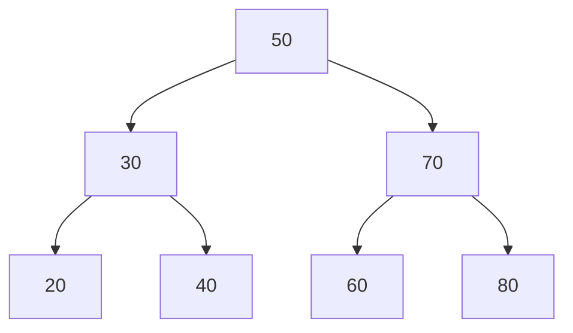
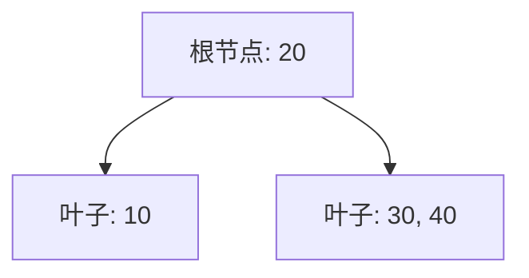
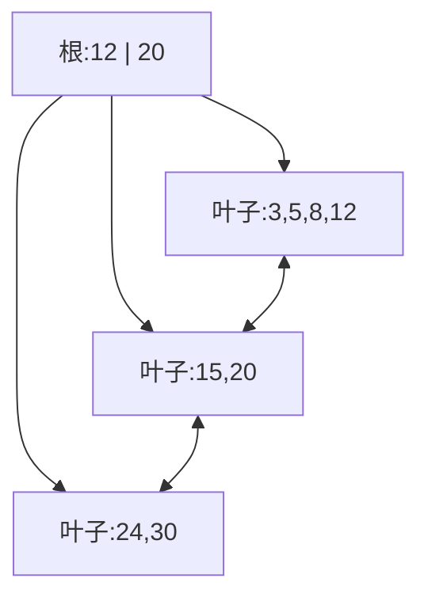

# Concept-Book Run

domain: /home/papagame/projects/digital-duck/cb-data-structure/public/domains/data_structure_ch14/input/graph.yaml
target: btree_filesystems_databases
started: 2026-11-24T12:02:04

## Teaching order (6 concepts)

- binary_search_tree
- block_store
- external_memory_model
- b_tree
- b_plus_tree
- btree_filesystems_databases

### binary_search_tree (0.8s)

## 二叉搜索树

**定义。** 二叉搜索树(Binary Search Tree,BST)是一棵二叉树,其每个结点存储一个来自全序集的键值,并满足**搜索性质**:对任意结点 $x$,

$$
\forall\, y \in \text{left}(x):\ \text{key}(y) < \text{key}(x), \qquad \forall\, z \in \text{right}(x):\ \text{key}(z) > \text{key}(x).
$$

该性质对每个结点都成立,而不只是对根结点成立。由此可得:对 BST 做**中序遍历**(左 → 根 → 右),输出的键值严格递增。

**查找、插入与删除。** 查找键 $k$ 时,从根出发:若 $k$ 等于当前键则找到;若 $k$ 更小则进入左子树;否则进入右子树。每比较一次,就排除一整棵子树。

```python
def search(node, k):
    while node and node.key != k:
        node = node.left if k < node.key else node.right
    return node
```

插入沿用同样的路径,在遇到空位处挂上新结点。删除分三种情形:被删结点是叶子(直接移除);只有一个孩子(用孩子顶替);有两个孩子(用右子树中的最小结点,即中序后继,替换其键值,再删除该后继)。

**例题。** 依次插入 $50, 30, 70, 20, 40, 60, 80$,得到一棵完全平衡的树。查找 $60$:

1. $60 > 50$,走右子树;
2. $60 < 70$,走左子树;
3. $60 = 60$,找到,共比较 3 次。

七个结点只需最多 3 次比较。


*上例构成的二叉搜索树:每个结点左边的值更小,右边的值更大。*

**复杂度分析。** 查找、插入、删除的代价都与树高 $h$ 成正比,即 $O(h)$。树高取决于插入顺序:

- 平衡情形:$n$ 个结点的树高为 $h = \lfloor \log_2 n \rfloor$,操作为 $O(\log n)$。
- 退化情形:若按 $1,2,3,\dots,n$ 的升序插入,树退化为一条链,$h = n-1$,操作退化为 $O(n)$。
- 随机插入顺序下,期望树高为 $O(\log n)$。

**问题求解应用。**

*问题 1:验证 BST。* 一棵树是否是合法的 BST?只比较结点与其直接孩子是**不够的**。例如根为 $10$、右孩子为 $15$、而 $15$ 的左孩子为 $6$,每个局部看都合理,但 $6 < 10$ 却位于根的右子树中。正确做法是递归时携带取值区间 $(lo, hi)$,或检查中序遍历是否严格递增。

*问题 2:第 $k$ 小的元素。* 做中序遍历并计数,计到第 $k$ 个结点即停止,时间为 $O(h + k)$。

*问题 3:选择数据结构。* 需要频繁插入并保持有序,又要支持范围查询时,BST 比排序数组(插入需 $O(n)$ 移动)更合适;但若输入可能已有序,应使用 AVL 树或红黑树等自平衡变体,以保证 $h = O(\log n)$。

**小结。** BST 的核心是"每个结点把键空间一分为二",效率则完全取决于树的高度。

### block_store (0.7s)

## 块存储(Block Store)

**定义。** 块存储是对外部存储设备(如磁盘、SSD)的一种抽象:设备被划分为若干大小固定、均为 $B$ 字节的**块**,每个块由一个整数索引 $i \in \{0,1,\dots,N-1\}$ 标识。数据的传输总是以整块为单位,而不是按单个字节。它支持四种操作:

- `read_block(i)`:把第 $i$ 块的 $B$ 字节读入内存;
- `write_block(i, data)`:用 $B$ 字节数据覆盖第 $i$ 块;
- `place_block(data)`:找到一个空闲块,写入数据,并返回其索引;
- `free_block(i)`:把第 $i$ 块标记为空闲,以供回收。

在外存模型(I/O 模型)中,代价以**块传输次数**(I/O 次数)衡量,而不是 CPU 指令数。每调用一次 `read_block` 或 `write_block`,代价为 $1$ 次 I/O。

**例题。** 设 $B = 4096$ 字节,一个整数占 $8$ 字节。(1)每块能存放多少个整数?(2)顺序扫描 $n = 10^6$ 个整数需要多少次 I/O?

解:(1)每块容纳 $\lfloor 4096/8 \rfloor = 512$ 个整数。
(2)这些整数连续存放,共需
$$\left\lceil \frac{n}{512} \right\rceil = \left\lceil \frac{10^6}{512} \right\rceil = 1954$$
块,因此顺序扫描需要 $1954$ 次 I/O。若每个整数各自存放在不同的块中,则需要 $10^6$ 次 I/O,相差近 $512$ 倍。一般地,顺序扫描 $n$ 个元素的代价为 $\lceil n/b \rceil$,其中 $b = B/(\text{元素大小})$ 是每块容纳的元素个数。

**问题求解应用。** 设计一个简单的链表,并保存在块存储上,每个结点占一整块,其中包含数据和下一结点的索引。

```python
def insert_front(store, head, value):
    node = (value, head)            # 新结点指向旧表头
    return store.place_block(node)  # 返回新表头的索引

def delete_front(store, head):
    value, nxt = store.read_block(head)  # 1 次 I/O
    store.free_block(head)               # 释放该块以便复用
    return value, nxt
```

分析代价:`insert_front` 只用 $1$ 次 I/O(一次放置);`delete_front` 用 $1$ 次读取,`free_block` 仅修改空闲记录。但遍历长度为 $n$ 的链表需要 $n$ 次 I/O,因为每个结点占一块;若改为每块存放 $b$ 个结点,则遍历仅需 $\lceil n/b \rceil$ 次 I/O,这正是 B 树等外存数据结构以"每结点一块"为设计原则的原因。

**小结。** 块存储的关键在于:传输以块为单位,索引是块的"地址",`place_block` 与 `free_block` 负责空间的分配与回收。设计外存算法时,应尽量让每次读入的 $B$ 字节都被充分利用。

### external_memory_model (0.6s)

## 外部存储模型

**定义。** 当数据量远超内存时,真正的瓶颈是磁盘或 SSD 的访问,而不是 CPU 运算。**外部存储模型**(External Memory Model,又称 I/O 模型)正是为此而设:它只统计在内存与外部存储之间传输的**块**的次数,内存内部的指令开销一律忽略。

模型有三个参数:

- $N$:问题规模(数据项总数);
- $M$:内存容量(可容纳的数据项数);
- $B$:块大小(一次 I/O 传输的数据项数),满足 $B \le M/2$。

一次 I/O 读取或写入一个包含 $B$ 个连续数据项的块,代价为 $1$。算法的复杂度即 I/O 次数。

**基本界限。** 顺序扫描 $N$ 个元素需要
$$\operatorname{scan}(N)=\Theta\!\left(\frac{N}{B}\right)$$
次 I/O。外部排序的最优界限为
$$\operatorname{sort}(N)=\Theta\!\left(\frac{N}{B}\log_{M/B}\frac{N}{B}\right).$$
其中 $\log$ 的底数是 $M/B$,即内存最多能同时容纳的块数。

**例题。** 设 $N=2^{30}$,$M=2^{20}$,$B=2^{10}$。比较顺序扫描与逐个随机访问的 I/O 代价。

- 顺序扫描:$N/B = 2^{20}\approx 10^6$ 次 I/O。
- 每个元素随机访问一次,且各自落在不同的块中:$N=2^{30}\approx 10^9$ 次 I/O。

两者相差 $B=1024$ 倍。可见,算法的**局部性**(一次读入的块要被充分利用)直接决定性能。

**应用:外部归并排序。** 问题:在上述参数下,估算对 $N$ 个元素排序所需的 I/O 次数。

1. 把数据分成大小为 $M$ 的段,每段读入内存排序后写回,得到 $N/M=2^{10}$ 个有序段。这一步读写各一遍,共 $2N/B$ 次 I/O。
2. 内存可容纳 $M/B=2^{10}$ 个块,因此可以同时做 $k=M/B-1\approx 2^{10}$ 路归并。一趟归并就能把 $2^{10}$ 个段合并成一个。
3. 归并趟数为 $\lceil\log_{k}(N/M)\rceil=1$,代价为 $2N/B$ 次 I/O。

总计约 $4N/B = 2^{22}\approx 4\times10^6$ 次 I/O。若用二路归并,则需要约 $\log_2 2^{10}=10$ 趟,代价是它的数倍。这说明利用大扇出 $M/B$ 正是外部算法设计的核心。


*外部存储模型示意图:只有内存与外部存储之间的块传输被计入代价,内存内部的计算免费。*

**小结。** 在外部存储模型下设计算法,要抓住两点:一是尽量顺序访问,使每次 I/O 都用满 $B$ 个数据项;二是尽量利用内存的 $M/B$ 个块缓冲,提高归并或分治的扇出,以减少遍历数据的趟数。

### b_tree (0.8s)

## B 树

**定义。** B 树是一种所有叶子深度相同的平衡多路搜索树。设最小度数为 $B\ge 2$,则:

- 每个非根内部节点有 $B$ 到 $2B$ 个孩子;根节点至少有 2 个孩子(若根不是叶子);
- 一个有 $k$ 个孩子的内部节点,在有序数组中存放 $k-1$ 个键 $K_1<K_2<\dots<K_{k-1}$,并规定第 $i$ 个子树中的所有键落在 $(K_{i-1},K_i)$ 之间;
- 所有叶子位于同一深度。

这样的设计针对磁盘等外存:一次读取一整个节点(一个"页"),在节点内用二分查找定位,从而用很少的磁盘访问完成查找。

**高度分析。** 设树含 $n$ 个键,高度为 $h$(根为第 0 层)。根至少有 2 个孩子,其余内部节点至少有 $B$ 个孩子,所以第 $h$ 层至少有 $2B^{h-1}$ 个节点。每个节点至少含 $B-1$ 个键(根除外),因此

$$n \ge 1 + 2(B-1)\sum_{i=0}^{h-1}B^{i}=2B^{h}-1,$$

即

$$h \le \log_B\frac{n+1}{2}=O(\log_B n).$$

查找只需读取 $O(h)$ 个节点,而当 $B$ 很大时 $h$ 很小。

**例题。** 取 $B=2$(即 2–3–4 树,每个节点最多 3 个键),依次插入 $10,20,30,40$。

1. 插入 $10,20,30$:根节点为 $[10,20,30]$,已满。
2. 插入 $40$:根已满,先**分裂**。中间键 $20$ 上升成为新根,左右分别为 $[10]$ 和 $[30]$,再把 $40$ 放入右侧,得到 $[30,40]$。

结果:根 $[20]$,孩子 $[10]$ 与 $[30,40]$。分裂只在根被分裂时才使树增高一层,因此所有叶子始终保持等深。

**问题求解应用。** 某数据库索引有 $n=10^9$ 条记录,每个磁盘页可容纳约 $2B-1=255$ 个键,所以 $B=128$。问最坏情况下一次查找需读多少个页?

由高度上界,
$$h\le\log_{128}\frac{10^9+1}{2}\approx\frac{\ln(5\times10^{8})}{\ln 128}\approx\frac{20.03}{4.85}\approx 4.13,$$
所以 $h\le 4$,最多读取 $h+1=5$ 个页。相比之下,平衡二叉搜索树需约 $\log_2 10^9\approx 30$ 次访问。若根常驻内存,实际磁盘读取还更少。

**要点。**

- 查找:在节点内二分,再沿对应孩子下降,代价 $O(\log_B n)$ 次页访问。
- 插入:找到叶子;若节点已有 $2B-1$ 个键,则沿路径将满节点按中位键分裂。
- 删除:若节点键数低于 $B-1$,则向兄弟借键或与兄弟合并。
- 三种操作都保持 $O(\log_B n)$ 的页访问代价,这正是 B 树成为数据库和文件系统索引标准结构的原因。


*插入 10、20、30、40 后($B=2$)的 B 树:根分裂后,两个叶子处于同一深度。*

### b_plus_tree (0.7s)

## B+ 树

**定义。** B+ 树是 B 树的一种变体,专为磁盘与数据库索引设计。它有三条核心性质:

1. 所有键(及其对应记录)只存放在**叶子结点**中;
2. 叶子结点按键的大小顺序用**双向链表**相连;
3. 内部结点只保存"路标"(如每个叶子的最大键),用来引导查找,构成覆盖在叶子层之上的索引树。

设阶数为 $m$,则每个结点至多有 $m$ 个孩子,除根外至少有 $\lceil m/2\rceil$ 个孩子。所有叶子位于同一深度,因此树始终保持平衡。若共有 $N$ 个键,树高为 $h$,则

$$h = O(\log_{\lceil m/2\rceil} N).$$

磁盘中一个结点通常对应一页,$m$ 可达数百,所以即使 $N=10^9$,高度也只有 3 到 4 层,即一次查找只需几次磁盘读取。

**与 B 树的区别。** B 树的内部结点也存储数据,而 B+ 树的内部结点只存索引。于是同样大小的一页能容纳更多路标,$m$ 更大,树更矮;并且任何查找都要走到叶子,耗时稳定。

**例题。** 设 $m=4$,叶子依次为 $[3,5]\to[8,12]\to[15,20]\to[24,30]$,上层索引存各叶子的最大值 $5,12,20,30$。

*点查询* 查找 $15$:根据路标,$12<15\le 20$,进入第三个叶子,在其中找到 $15$。

*范围查询* 查找 $[10,25]$:

1. 在索引中定位 $10$:$5<10\le12$,到达第二个叶子 $[8,12]$;
2. 在叶内取出 $12$;
3. 沿链表依次读取 $[15,20]$,取出 $15,20$;
4. 到达 $[24,30]$,取出 $24$;下一个键 $30>25$,停止。

结果为 $\{12,15,20,24\}$。整个过程只做了**一次**自顶向下查找,之后全靠叶子链表顺序扫描。

**问题求解应用。** 分析范围查询的代价:设结果含 $k$ 个键,每个叶子至少装 $\lceil m/2\rceil-1$ 个键(此处取近似 $m/2$),则需访问的叶子数约为 $\lceil 2k/m\rceil$,总代价为

$$O\!\left(\log_{m/2} N + \frac{k}{m}\right)\ \text{次页读取}.$$

若改用普通 B 树,范围查询需要反复中序遍历、在层间来回回溯,代价约为 $O(k\log N)$ 次结点访问;而 B+ 树把"定位"与"扫描"分离,后者是顺序读取,对磁盘尤为友好。

**插入时的分裂。** 向已满的叶子插入键时,把它分成两半,并把左半的最大键作为新路标上推到父结点。例如向 $[24,30]$ 所在的满叶(设容量为 2)插入 $27$,得到 $[24,27]$ 与 $[30]$,父结点新增路标 $27$;若父结点也溢出,则继续向上分裂,最坏情况下树高加 1。


*上层为索引结点,下层叶子通过双向链表相连,范围查询只需定位起点后沿链表扫描。*

**小结。** B+ 树用"索引与数据分离 + 叶子链表"的设计,同时获得了 $O(\log N)$ 的点查询和高效的范围扫描,这正是数据库索引普遍采用它的原因。

### btree_filesystems_databases (16.8s)

## B 树在文件系统与数据库中的应用

### 定义

**B 树**是一种自平衡的多路搜索树。阶为 $m$ 的 B 树满足:

- 每个结点最多有 $m$ 个孩子、最多存 $m-1$ 个键;
- 除根外,每个内部结点至少有 $\lceil m/2\rceil$ 个孩子;
- 所有叶子位于同一深度。

设有 $n$ 个键,则树高满足

$$h \le \log_{\lceil m/2\rceil}\frac{n+1}{2}+1 .$$

**为什么工业界偏爱它?** 磁盘或 SSD 以"页"(通常 4 KB 到 16 KB)为单位读写,一次 I/O 的代价远高于内存中的比较。B 树把结点大小设计成恰好一页,于是一次查找的 I/O 次数就是树高 $O(\log_m n)$,而不是二叉树的 $O(\log_2 n)$。

实际系统大多使用 **B+ 树**:数据只存放在叶子,内部结点只存路标键,因此扇出更大;叶子之间用链表相连,范围查询只需顺着链表扫描。

### 典型应用

| 系统 | B 树的用途 |
|---|---|
| NTFS | 目录索引与主文件表(MFT)的 B+ 树索引 |
| HFS+ / APFS | 目录树与扩展区溢出文件(catalog、extents)的 B 树 |
| Ext4 | 大目录的 HTree(哈希加持的 B 树变体)、extent 树 |
| MySQL InnoDB、PostgreSQL | 聚簇索引与二级索引 |
| 云端键值存储 | 部分系统(如 LMDB、BoltDB、部分元数据服务)直接采用 B 树;LSM 树是另一条路线 |

### 例题:估算树高

设一页为 $16\,\text{KB}$,索引键加指针共 $16\,\text{B}$,则扇出约

$$m \approx \frac{16384}{16} = 1024 .$$

问:一张含 $n = 10^9$ 行的表,索引需要几层?

**解:** 取最坏情况下每个结点至少有 $m/2 = 512$ 个孩子,则

$$h \le \log_{512}\frac{10^9+1}{2}+1 \approx \frac{\ln(5\times10^{8})}{\ln 512}+1 \approx \frac{20.03}{6.24}+1 \approx 4.2 .$$

所以树高至多约 4 到 5 层。再考虑到根和第二层通常常驻内存缓存,一次点查询往往只需 **2 到 3 次磁盘 I/O**。

### 问题求解应用

**问题:** 某查询 `SELECT * FROM orders WHERE id BETWEEN 1000 AND 1999`,在 $10^9$ 行的表上,应该如何用 B+ 树回答?为什么比全表扫描快?

**分析:**

1. 自根向下定位到包含键 $1000$ 的叶子:约 $h \approx 4$ 次页读取。
2. 沿叶子链表顺序读取,直到键超过 $1999$。若每个叶子存 $200$ 行,则约需 $\lceil 1000/200\rceil = 5$ 页。
3. 总计约 $4+5 = 9$ 次页读取。

全表扫描需读取 $10^9/200 = 5\times10^6$ 页。二者相差约 $5\times 10^5$ 倍。

**插入时的维护:** 若叶子已满,将其一分为二,并把中间键上推到父结点;分裂可向上传播,至多到根。根分裂时树高才增加 1。因此所有叶子始终等深,最坏查询代价被严格控制在 $O(\log_m n)$。

**设计取舍:** 随机插入导致的页分裂会使空间利用率降到约 $70\%$;而写密集的负载(如云端日志型存储)常改用 LSM 树,用顺序写换取更高的写吞吐,但读代价略高。理解"页大小决定扇出,扇出决定树高"这一链条,是调优索引与选择存储引擎的基础。

## Run complete

total: 40.4s
