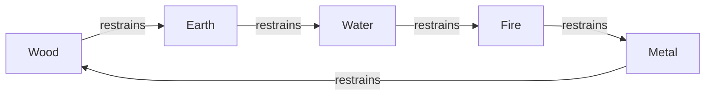
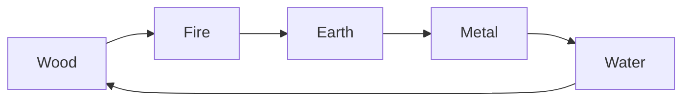
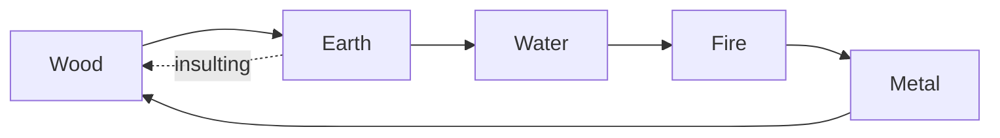
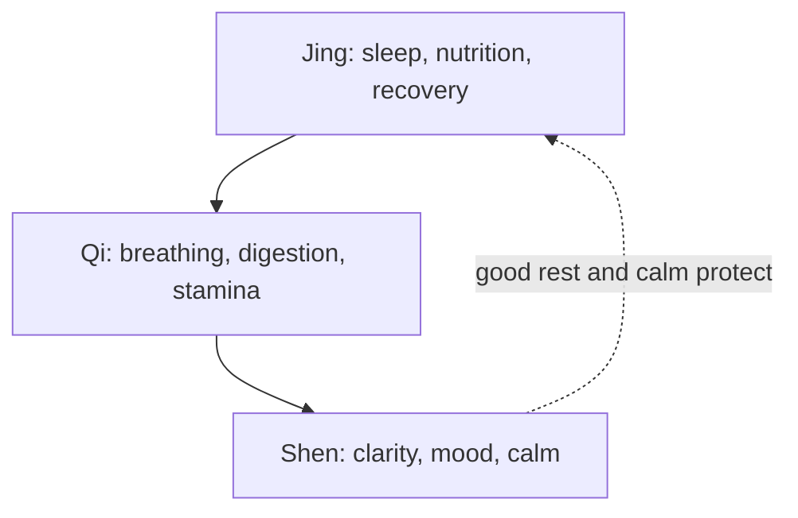
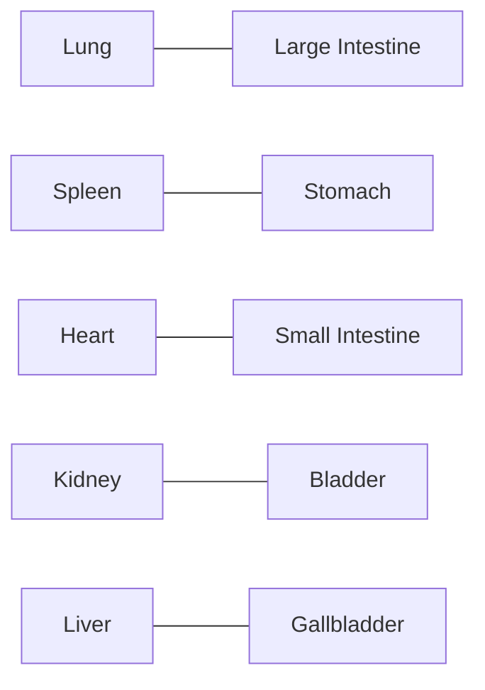
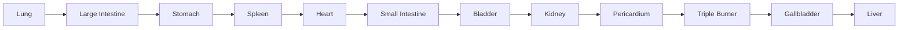
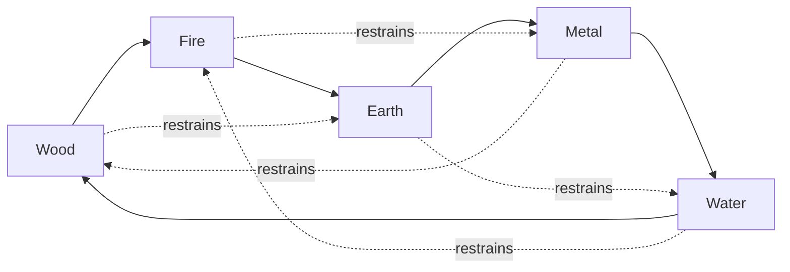

# Concept-Book Run

domain: /home/papagame/projects/digital-duck/cb-meta-health/public/domains/meta_health_ch01/input/graph.yaml
target: five_phase_body_map
started: 2026-11-24T12:28:38

## Teaching order (26 concepts)

- qi
- five_phases_wuxing
- blood_xue
- essence_jing
- five_zang_organs
- body_fluids_jinye
- controlling_cycle_xiangke
- six_fu_organs
- generating_cycle_xiangsheng
- meridian_jingluo
- qi_blood_relationship
- spirit_shen
- yin_yang
- overacting_and_insulting
- qi_stagnation_blood_stasis
- three_treasures_jing_qi_shen
- zang_fu_pairing
- dantian
- five_phase_correspondences
- harmony_as_health
- heart_kidney_interaction
- liver_spleen_relationship
- prenatal_postnatal_qi
- triple_burner_sanjiao
- twelve_primary_meridians
- five_phase_body_map

### qi (0.7s)

## Qi (气)

**Definition.** In Traditional Chinese Medicine (TCM), *qi* (气) is the body's vital activity: the moving, warming, protecting, and transforming functions that keep a living person working. A useful modern reading is "physiological function in motion." Qi is not a substance you can measure with an instrument, and it has no unit. TCM groups its roles into five functions:

| Function | What TCM means | Closest physiological parallel |
|---|---|---|
| Promoting | Drives growth, movement, and organ activity | Metabolism, hormonal and neural drive |
| Warming | Keeps the body at a steady temperature | Heat from metabolism, regulated near 37 °C |
| Defending | Protects against illness | Skin barrier, immune response |
| Containing | Holds fluids and organs in place | Vascular integrity, urinary and sweat control |
| Transforming | Turns food and drink into usable material | Digestion, absorption, cellular metabolism |

**Worked example.** Take a student who says, "I feel tired, cold, and catch every cold going around." TCM would call this *qi deficiency* (气虚). Each complaint maps onto one function:

- Tiredness: weak promoting (low drive and energy).
- Feeling cold: weak warming.
- Frequent colds: weak defending.

The physiological parallels give measurable quantities to check. Resting energy expenditure can be estimated with the Mifflin–St Jeor equation. For a 20-year-old woman, 60 kg and 165 cm:

$$\text{REE} = 10(60) + 6.25(165) - 5(20) - 161 = 1370 \text{ kcal/day}$$

If she has been eating about 1200 kcal/day while training, she is in an energy deficit. That deficit can plausibly explain the fatigue and feeling cold. Low iron, thyroid problems, and poor sleep are other common causes.

**Problem-solving application.** Use qi as a *vocabulary for organizing symptoms*, then check the pattern against measurable causes.

1. List the symptoms and sort them by function (promoting, warming, defending, and so on).
2. Look for a shared cause. Here, tiredness, cold, and frequent infections all fit undereating and poor sleep.
3. Test it. Compare actual intake with estimated needs, and ask a clinician about blood tests such as hemoglobin, ferritin, and thyroid-stimulating hormone.
4. Act on what you find. Raise intake toward 1400–1500 kcal/day, add iron-rich foods, and keep a regular sleep schedule. Then reassess in a few weeks.

**Evidence note.** Qi is a conceptual framework, not an anatomical or biochemical entity. No study has identified a physical "qi" in the body. Its value in this section is as a map of functions. Any claim that qi is a measurable energy, or that a symptom *must* be qi deficiency, goes beyond the evidence. Persistent fatigue, repeated infections, or unexplained weight change should be evaluated medically and not attributed to qi alone.

**Check your understanding.** A runner reports shortness of breath on stairs, spontaneous sweating, and a weak voice. Which qi functions would TCM say are involved? What measurable conditions, such as anemia or asthma, would you rule out first?

### five_phases_wuxing (0.6s)

## The Five Phases (Wuxing, 五行)

**Definition.** In Traditional Chinese Medicine (TCM), the Five Phases (五行, *wuxing*) are five categories of process: Wood 木, Fire 火, Earth 土, Metal 金, and Water 水. They are sometimes called the "Five Elements," but "phases" is closer to the meaning, because each name labels a *kind of change* (growth, peak activity, transformation, contraction, storage) rather than a fixed substance. TCM uses the categories to sort body parts, seasons, tastes, and emotions, and to describe how groups influence one another. Two relationships link them:

- **Generating (生):** each phase supports the next. Wood feeds Fire, Fire produces Earth (ash), Earth bears Metal, Metal collects Water (condensation), and Water nourishes Wood.
- **Restraining (克):** each phase checks another. Wood restrains Earth, Earth restrains Water, Water restrains Fire, Fire restrains Metal, and Metal restrains Wood.

Together the two cycles are meant to describe self-regulation: support from one side and checking from the other.

| Phase | Season | Organ pair (zang-fu) | Taste | Emotion |
|---|---|---|---|---|
| Wood 木 | Spring | Liver / Gallbladder | Sour | Anger |
| Fire 火 | Summer | Heart / Small Intestine | Bitter | Joy |
| Earth 土 | Late summer | Spleen / Stomach | Sweet | Worry |
| Metal 金 | Autumn | Lung / Large Intestine | Pungent | Grief |
| Water 水 | Winter | Kidney / Bladder | Salty | Fear |

*Note that "Liver," "Lung," and the like name TCM functional systems, which do not map one-to-one onto the anatomical organs of physiology.*

**Worked example.** A TCM practitioner sees a patient with a persistent dry cough in autumn. Autumn is linked to Metal, and Metal to the Lung. The practitioner therefore treats the Lung as the system of interest. The generating cycle suggests checking the "mother" of Metal, which is Earth (Spleen and Stomach), so the practitioner asks about appetite and digestion. The restraining cycle suggests checking Wood (Liver), which restrains Metal, so the practitioner asks about stress and irritability. Each of these is a prompt for questions and a hypothesis. None is a measurement.

**Problem-solving application.** Suppose a patient reports poor digestion, anxious rumination, and fatigue. The table puts worry and digestion together under Earth, so the framework points to the Spleen/Stomach system. Wood is the phase that restrains Earth, so the practitioner also asks whether stress (Wood) is disrupting digestion. Pick one hypothesis, choose an intervention such as regular meals or stress reduction, then reassess after two weeks.

Check the reasoning from a modern perspective. Stress does affect digestion, so the Wood-restrains-Earth prompt happens to point at a real physiological link, the gut-brain axis. But the framework itself is a classification scheme, not a tested causal model. Controlled studies have not shown that Five Phases reasoning predicts disease or improves treatment outcomes beyond the individual interventions it suggests. Use it to organize questions, and rely on conventional diagnosis (blood tests, imaging, clinical examination) to rule out conditions such as anemia, thyroid disease, or infection that would explain the same symptoms.

**Practice.** A patient has recurrent winter lower-back pain and frequent urination. Which phase and organ system does TCM associate with this pattern, and which other phase would a practitioner consult through the generating cycle? (Answer: Water, Kidney/Bladder; the generating cycle points to Metal, the Lung/Large Intestine system, which "generates" Water.)

### blood_xue (0.6s)

## Blood (Xue, 血)

**Definition.** In Traditional Chinese Medicine (TCM), *xue* (血) is the red, nourishing, moistening substance that circulates in the vessels. It overlaps with anatomical blood, since both are red, fluid, and move through vessels. But TCM's concept is broader, because it also describes functions that biomedicine assigns to other systems. TCM holds that xue nourishes the tissues, moistens the skin, muscles, and sinews, and anchors the mind (*shen*) so that sleep and thinking are steady. It is said to be produced from food essence processed by the Spleen and Stomach, and to be moved by the Heart and stored by the Liver. Xue is treated as a companion of *qi* (气): qi moves xue, and xue carries and nourishes qi. These are relationships described in words, not quantities, and they have no equations.

**Comparison with anatomical blood.**

| Feature | Biomedical blood | TCM xue |
|---|---|---|
| Defined by | Cells, plasma, measurable chemistry | Function and observed signs |
| Measured with | Hemoglobin, hematocrit, glucose, etc. | Pulse, tongue, complexion, history |
| Mental role | Delivers oxygen and glucose to the brain | Houses and anchors the mind |

**Worked example.** A 24-year-old student reports dizziness on standing, pale lips, dry skin, brittle nails, light menstrual flow, poor sleep with vivid dreams, and fatigue. TCM would call this "xue deficiency" (血虚), a pattern diagnosis based on this cluster of signs, not on one number.

A biomedical workup tests the overlapping part. Suppose hemoglobin is 10.5 g/dL, below the typical adult female lower limit of about 12 g/dL, and ferritin is low. That points to iron-deficiency anemia, which explains the pallor, fatigue, and dizziness through reduced oxygen-carrying capacity. Oxygen delivery depends on hemoglobin concentration, oxygen saturation, and cardiac output, so a low hemoglobin directly lowers delivery:

$$\text{O}_2\text{ content} \approx 1.34 \times \text{Hb} \times S_{\text{O}_2}$$

Here Hb is in g/dL and $S_{\text{O}_2}$ is the fraction of hemoglobin saturated, giving mL of O$_2$ per dL of blood. With Hb = 10.5 and $S_{\text{O}_2}=0.98$, content is about $1.34 \times 10.5 \times 0.98 \approx 13.8$ mL/dL. At Hb = 13.5 it would be about 17.7 mL/dL, roughly 22% more.

**Problem-solving application.** Suppose you must decide how to handle this student's case.

1. **Separate the claims.** The pallor, fatigue, and low hemoglobin map onto measurable anatomical blood. Treat them with established care: confirm the cause (diet, menstrual loss, absorption), then use iron, dietary changes, and follow-up labs.
2. **Treat the broader claims separately.** Whether TCM treatments such as herbal formulas or dietary advice improve sleep or dryness beyond iron repletion is a different question. Evidence for these is limited and mixed, so it should not replace testing.
3. **Check for danger signs.** Heavy bleeding, chest pain, fainting, or very low hemoglobin require urgent biomedical care. Xue-based reasoning must never delay it.
4. **Re-measure.** Hemoglobin should rise over weeks of treatment. If it does not, look for another cause.

**Takeaway.** Xue is best read as a functional concept that partly overlaps with blood. Where it overlaps, use laboratory values and established treatment. Where it goes beyond, treat it as a traditional framework, not as a measured quantity.

### essence_jing (0.6s)

## Essence (Jing, 精)

**Definition.** In Traditional Chinese Medicine (TCM), essence (精, *jing*) is the stored, constitutional substance that underlies growth, development, reproduction, and aging. TCM divides it into two sources. *Prenatal essence* is inherited from the parents at conception and is treated as a fixed starting endowment. *Postnatal essence* is produced from food and drink after birth and is used to top up the inherited reserve. TCM locates storage in the Kidney system, and holds that essence is consumed gradually over a lifetime. Essence is a traditional explanatory concept, not a measured substance. No assay, tissue, or molecule corresponds to it, so it cannot be tested directly. The biological phenomena it is used to organize, such as puberty, fertility, and aging, are real and well studied.

**Worked example: the life-stage account.** The *Huangdi Neijing* describes female development in cycles of seven years and male development in cycles of eight. The table gives the TCM account alongside the modern biological observation.

| Stage | TCM description | Modern observation |
|---|---|---|
| About 14 (female) / 16 (male) | Essence becomes abundant; reproductive capacity matures | Puberty, with rising sex hormones |
| Around 28 (female) / 32 (male) | Essence and Qi at their peak | Peak muscle mass and bone density |
| About 49 (female) / 56 (male) | Essence declines; fertility ends | Menopause in women; gradual testosterone decline in men |

The ages roughly match the timing of real physiological milestones. That is why the framework is a useful teaching map. Matching a description to timing does not show that a stored substance exists, because the same timeline can be written purely in terms of hormones.

**Problem-solving application.** Suppose a 45-year-old reports fatigue, poor sleep, and low back soreness, and asks whether "depleted essence" is the cause.

1. *Translate the claim.* In TCM, these symptoms are read as signs of essence depletion, often attributed to overwork, chronic poor sleep, or inadequate nutrition.
2. *Separate the real from the interpretive.* Fatigue, poor sleep, and back pain have many measurable causes: anemia, thyroid disease, sleep apnea, depression, and musculoskeletal strain. A TCM reading does not rule these out.
3. *Act on the practical overlap.* The TCM advice to protect essence, which means regular sleep, adequate food, and avoiding chronic overwork, matches ordinary health guidance and is low-risk.
4. *Flag the limits.* Persistent symptoms call for a medical evaluation. Costly tonics or supplements sold to "replenish essence" have no established benefit, and some herbal products carry real risks, including contamination and drug interactions.

**Takeaway.** Essence is a framework for describing a person's finite constitutional reserve and how lifestyle draws it down. Use it to understand TCM's account of aging, and use measurable physiology to decide on diagnosis and treatment.

### five_zang_organs (0.6s)

## The Five Zang Organs (五脏)

**Definition.** In Traditional Chinese Medicine (TCM), the five zang organs (五脏) are the Liver 肝, Heart 心, Spleen 脾, Lung 肺, and Kidney 肾. TCM treats each as a *functional system* rather than a piece of anatomy. Each system is said to store and regulate qi (vital activity), blood, and essence (the substance underlying growth, reproduction, and aging). Each is also linked to one of the Five Phases. The names match anatomical organs, but the concepts are not identical. The TCM "Spleen," for example, is described mainly as a digestive and nutrient-transforming function, not as the immune and blood-filtering organ in the upper left abdomen.

**The traditional functional roles.**

| Zang organ | Phase | Main functions in TCM | Closest modern topic |
|---|---|---|---|
| Liver 肝 | Wood | Keeps qi flowing smoothly; stores blood | Metabolism, stress response |
| Heart 心 | Fire | Governs blood circulation; houses the "shen" (mind, consciousness) | Circulation, cognition |
| Spleen 脾 | Earth | Transforms food into usable nutrients; holds blood in the vessels | Digestion, absorption |
| Lung 肺 | Metal | Governs breathing and the spread of qi and fluids | Respiration, fluid balance |
| Kidney 肾 | Water | Stores essence; governs water metabolism, growth, and reproduction | Renal, endocrine, and developmental function |

The last column is only a rough guide to the area of physiology each system touches. It is not an equivalence.

**Worked example.** A student reports poor appetite, loose stools, fatigue after meals, and a pale complexion. A TCM practitioner would group these signs as "Spleen qi deficiency," because the Spleen system is said to transform food into qi and blood. Notice the method:

1. Collect the signs and symptoms.
2. Find the functional system that the pattern fits.
3. Choose a treatment aimed at that system, such as dietary changes, acupuncture, or herbs.

A modern clinician would use the same symptoms differently. They would consider iron-deficiency anemia, celiac disease, thyroid disease, and infection, and then order a hemoglobin test, a celiac antibody panel, or a thyroid panel to separate them. The two frameworks start from the same observations but sort them into different categories.

**Problem-solving application.** Suppose a person has a persistent dry cough, dry skin, and frequent colds. TCM would group these under the Lung system, since the Lung is said to govern breathing and the skin surface. Your task is to turn this pattern into a question that can be tested:

- Which measurable explanations fit these symptoms? Examples are asthma, allergy, low indoor humidity, and recurrent viral infection.
- Which measurements would separate them? Examples are peak expiratory flow, spirometry, and a symptom diary tied to season or environment.
- If a TCM treatment is used, what outcome would count as improvement? For instance, you could log the number of coughing days per week for eight weeks.

**Evidence note.** The zang organ framework is a traditional model of how the body is organized. Its main value is as a language for describing patterns of symptoms. It has not been validated as an anatomical or physiological account, and symptoms that suggest serious illness should always be evaluated with standard medical testing.

**Key takeaway.** The zang organs are *functional categories*, not anatomical organs. Reading them correctly means treating a TCM term like "Spleen deficiency" as a label for a symptom pattern, and then asking what can be measured to check it.

### body_fluids_jinye (0.7s)

## Body Fluids (Jinye, 津液)

**Definition.** In Traditional Chinese Medicine (TCM), *jinye* (津液) is the collective name for all normal fluids of the body. TCM divides them into two types:

- **Jin (津, thin fluids):** light, watery fluids that moisten the skin, muscles, and surface tissues. Sweat and the fluid in the skin are typical examples.
- **Ye (液, thick fluids):** heavier, more viscous fluids that lubricate and nourish deeper structures such as joints, the brain and spinal cord, internal organs, and the sensory orifices.

TCM holds that these fluids come from food and drink, are processed mainly by the Spleen and Stomach, are distributed by the Lung, and are controlled by the Kidney. The result is a continuous cycle of intake, distribution, and excretion as sweat, urine, and breath. These organ names refer to TCM functional systems. They are not the same as the anatomical organs of biomedicine.

| Feature | Jin (thin) | Ye (thick) |
|---|---|---|
| Consistency | Watery, light | Viscous, dense |
| Main role | Moistening skin and muscle | Lubricating joints, nourishing brain and organs |
| Biomedical analogue | Interstitial fluid, sweat | Synovial fluid, cerebrospinal fluid |
| Lost easily through | Sweating, fever | Prolonged illness, chronic depletion |

The biomedical analogues are loose comparisons, not exact equivalents. Because fluids are a physical quantity, they can be tracked with real numbers.

**Worked example: a fluid balance.** A 70 kg adult with a normal daily intake and output might have:

| Intake | mL | Output | mL |
|---|---|---|---|
| Drinks | 1500 | Urine | 1500 |
| Food moisture | 700 | Skin and breath | 900 |
| Metabolic water | 300 | Stool | 100 |
| **Total** | **2500** | **Total** | **2500** |

Intake equals output, so total body water stays stable. Now suppose a person has a fever and sweats an extra 1000 mL while drinking only 500 mL more. The net deficit is 500 mL for the day. Biomedicine would call this early dehydration. TCM would describe it as *jin* being consumed, with signs such as dry mouth, thirst, dark scanty urine, and dry skin.

**Problem-solving application.** Consider a runner who loses 1.8 kg during a 90-minute run and drank 0.6 L of water during it.

1. Body mass lost is roughly equal to net fluid lost, since 1 L of water has a mass of about 1 kg. So net loss is 1.8 kg ≈ 1.8 L.
2. Total sweat loss is the net loss plus the amount drunk: $1.8 + 0.6 = 2.4$ L.
3. The sweat rate is $\frac{2.4\ \text{L}}{1.5\ \text{h}} = 1.6$ L/h.
4. To replace the deficit, a common sports-nutrition guideline is to drink about 1.25–1.5 times the mass lost, which here is about 2.3–2.7 L over the next several hours. The extra amount covers ongoing urine losses.

In TCM terms, this runner has consumed *jin*. Biomedicine reaches the same practical conclusion by measuring mass and sweat rate. The measurement method comes from physiology, not from TCM. The TCM concept of *jin* and *ye* gives a descriptive vocabulary for fluid-related signs, but the quantitative guidance on how much to drink comes from measured physiology.

**Check your understanding.** A patient reports stiff, creaky joints after a long illness, while another reports dry skin after a week of heavy sweating. Which would TCM link to *ye* and which to *jin*? (Answer: the joints to *ye*, the skin to *jin*.)

### controlling_cycle_xiangke (0.6s)

## The Controlling Cycle (Xiangke, 相克)

**Definition.** In Traditional Chinese Medicine (TCM), the Five Phases (Wood, Fire, Earth, Metal, Water) are linked by two relationships. The generating cycle describes how each phase nourishes the next. The *controlling cycle*, called xiangke (相克), describes how each phase restrains another. TCM holds that this restraint keeps any one phase, and the organ system associated with it, from growing unchecked. The order is Wood → Earth → Water → Fire → Metal → Wood. Read each arrow as "restrains."

| Controller | Controlled | Traditional image |
|---|---|---|
| Wood | Earth | Roots hold soil in place |
| Earth | Water | Banks channel a river |
| Water | Fire | Water douses flame |
| Fire | Metal | Heat melts metal |
| Metal | Wood | An axe cuts timber |

These are images used to help remember the pairings. They are not measurements, and nothing in the cycle can be calculated.

*The controlling cycle forms a closed loop. Each phase restrains one phase and is restrained by another.*

**Worked example.** TCM associates Wood with the liver and Earth with the spleen and stomach, which handle digestion. In TCM, stress and frustration can make the liver "overact" on the spleen. Imagine a student during exams who skips regular meals, feels tense, and then has bloating, poor appetite, and loose stools. A TCM practitioner would describe this as Wood overcontrolling Earth. The suggested response would be to calm the stress and support digestion with regular meals, rather than treating the stomach symptoms alone.

A related idea is "counter-restraint." When a phase becomes too weak, the phase that normally controls it is said to overcontrol it. Wood is the controller of Earth, so a weak Earth is the case where Wood overcontrols it.

**Problem-solving application.** The cycle gives practitioners a way to reason about which organ systems to examine together. Suppose a patient has recurring anxiety and irritability along with poor digestion. The reasoning goes in steps:

1. Identify the main symptom group. Here it is digestive, which belongs to Earth.
2. Find what controls it. Wood restrains Earth, so check Wood-related patterns such as stress, tension, and irritability.
3. Find what it controls. Earth restrains Water, so a long-weakened Earth could also be linked to fluid-related complaints such as swelling.
4. Choose an approach. Address the likely source of imbalance and its effects, not just the one complaint.

**Evidence and limits.** The Five Phases framework is a traditional model and does not come from controlled experiments. Its predictions about which organs affect one another have not been established as reliable by clinical research. The link between stress and digestive symptoms does have support in modern physiology, since the gut and nervous system interact closely. That support is for the stress–digestion connection itself, not for the cycle as an explanation. Treat xiangke as a way to organize traditional reasoning, and do not use it in place of medical diagnosis. Seek medical evaluation for persistent or severe digestive symptoms.

### six_fu_organs (0.5s)

## The Six Fu Organs (六腑)

In Traditional Chinese Medicine (TCM), the **six fu organs** (六腑, *liù fǔ*) are the hollow, tube-like organs that receive food and fluids, transform them, and pass the remainder along. They are the gallbladder, small intestine, stomach, large intestine, bladder, and triple burner (三焦, *sānjiāo*). TCM contrasts them with the solid *zang* organs, which store and regulate substances. Its guiding idea is that the fu organs work in sequence and must keep moving. Their job is to transport, not to hold.

Five of the six match structures anatomists recognize. The triple burner has no single anatomical counterpart. TCM treats it as a functional division of the torso into upper, middle, and lower zones that governs how fluids move through the body. Its usefulness as a physiological concept is not established by modern research.

| Fu organ | TCM role (summary) | Modern counterpart |
|---|---|---|
| Stomach | Receives and "ripens" food | Mixes food with acid and enzymes |
| Small intestine | Separates useful from waste | Digests and absorbs nutrients |
| Large intestine | Receives waste, reabsorbs fluid | Absorbs water, forms stool |
| Gallbladder | Stores and releases bile | Concentrates and releases bile |
| Bladder | Stores and expels urine | Stores urine |
| Triple burner | Channel for fluids | No single structure |

### Worked example: following a meal

Suppose you eat a 600 kcal lunch of rice, chicken, and vegetables. TCM describes a handoff along the fu organs:

1. The **stomach** receives the meal. Physiology agrees that it churns the food with acid and enzymes for roughly 2–4 hours into a semi-liquid mixture.
2. The **gallbladder** releases bile into the small intestine to help digest fat. In TCM it is also counted among the fu organs.
3. The **small intestine** does the main work of separating usable material from waste. Physiology confirms that most nutrient absorption happens here, including most of the meal's 600 kcal.
4. The **large intestine** receives what remains and reclaims water, forming stool.
5. Fluid that was absorbed and not needed is filtered by the kidneys, and the **bladder** stores it as urine.

### Problem-solving application

TCM holds that a fu organ "fails" when its flow stalls. Use this to analyze a scenario.

**Scenario:** A person reports bloating, no appetite, and constipation after several days of low fluid intake and little movement.

*Step 1: Locate the stall.* Bloating and poor appetite point to the stomach and small intestine. Constipation points to the large intestine.

*Step 2: Identify the shared cause.* TCM would describe blocked downward movement. Physiology offers a testable explanation. Low fluid intake makes stool harder and slows transit, and inactivity reduces gut motility.

*Step 3: Choose an action you can check.* Raise fluid intake, add dietary fiber (about 25–30 g per day is a common adult target), and walk after meals. These steps are supported by evidence for constipation, whatever the TCM framing.

*Step 4: Know when the framework stops.* Persistent bloating with weight loss, blood in stool, or severe pain is not a "stalled flow" to be managed at home. These are warning signs that need medical evaluation.

**Takeaway:** The fu organs are best read as a sequence of handoffs. Asking "where did the flow stop?" gives a useful way to organize symptoms. The physiological explanation and the medical red flags should guide what you actually do.

### generating_cycle_xiangsheng (0.8s)

## The Generating Cycle (Xiangsheng, 相生)

**Definition.** In Traditional Chinese Medicine (TCM), the generating cycle (相生, *xiangsheng*) describes how each of the Five Phases promotes the next in a fixed loop: Wood → Fire → Earth → Metal → Water → Wood. TCM calls the preceding phase the "mother" and the following phase the "child." Each phase therefore has one mother that nourishes it and one child that it nourishes. The cycle is a classification scheme: TCM uses it to organize observations about the body and the seasons, and to reason about which organ system may be involved in a problem. Because it is a qualitative framework, it is explained here in words and tables, not equations. Some of its claims are testable physiology. Others are metaphor, and the two should be kept apart.

**The pairings.** TCM links each phase to an organ system (the TCM organ names refer to functional systems, not exactly to anatomical organs):

| Phase | Organ system (yin) | Mother (nourishes it) | Child (it nourishes) |
|---|---|---|---|
| Wood | Liver | Water (Kidney) | Fire (Heart) |
| Fire | Heart | Wood (Liver) | Earth (Spleen) |
| Earth | Spleen | Fire (Heart) | Metal (Lung) |
| Metal | Lung | Earth (Spleen) | Water (Kidney) |
| Water | Kidney | Metal (Lung) | Wood (Liver) |

*The generating cycle: each phase feeds the next, and Water closes the loop back to Wood.*

**Worked example.** Consider the pairing Earth → Metal, Spleen → Lung. In TCM, the Spleen governs digestion and transforms food into the raw material for energy (qi). The Lung takes in air and distributes qi. TCM therefore says a weak Spleen can leave the Lung undersupplied, "Earth failing to feed Metal." Compare this with modern physiology, where the link is real in part. Poor nutrition does weaken respiratory muscles and immune defenses, and a person who is underfed and loses weight can have a lower exercise capacity. But the TCM mechanism (qi transfer between organ systems) is not a measured physiological pathway.

**Problem-solving application.** Suppose a patient has a long-standing dry cough, fatigue, and poor appetite with loose stools. A TCM practitioner using the cycle would reason as follows:

1. The cough points to Metal (Lung).
2. Metal's mother is Earth (Spleen), and the appetite and stool symptoms point to Earth.
3. The cycle suggests the Lung problem may stem from a weak mother, so treatment would aim to strengthen the Spleen, for example by improving diet, instead of treating only the cough.

This is called "tonifying the mother" (补其母). A modern clinician would handle the same case differently: take a history, check for infection, reflux, asthma, or medication side effects (such as ACE inhibitors, a common cause of dry cough), and order tests where indicated. The cycle can serve as a way to organize questions, but it is not a diagnostic test. Evidence that treatments chosen by this reasoning outperform standard care is limited, and persistent cough or unexplained weight loss needs a medical evaluation.

**Check your understanding.** Using the table, name the mother and child of Water. (Mother: Metal. Child: Wood.) If a TCM practitioner explains a Kidney weakness by a problem in its mother, which organ system would they examine first? (The Lung.)

### meridian_jingluo (0.7s)

## Meridians (Jingluo, 经络)

**Definition.** In Traditional Chinese Medicine (TCM), meridians (经络, *jingluo*) are a network of channels through which qi and blood are said to flow. TCM holds that this network links the internal organs with the skin, muscles, and limbs. It has two main parts:

- **Main channels (经脉):** twelve regular channels, each tied to one organ system and running along an arm or a leg, plus eight "extraordinary" channels.
- **Network vessels (络脉):** smaller branches that connect the main channels to one another and to the body surface.

Along these channels lie acupuncture points (穴位, *xuewei*), the sites used in acupuncture, acupressure, and moxibustion. Meridians are a conceptual map. Dissection, imaging, and histology have not found a distinct anatomical structure that matches them. The best-supported explanations for acupuncture's effects involve nerves, connective tissue, and the brain's response to stimulation.

**Worked example: reading a channel map.** Take the Large Intestine channel (手阳明大肠经). In TCM it begins at the tip of the index finger, runs up the outer edge of the arm, crosses the shoulder and neck, and ends beside the nose. One point on it is LI4 (合谷, *hegu*), in the web between thumb and index finger. TCM texts associate LI4 with problems of the head and face, such as headache or toothache. They also associate it with the organ the channel is named for. The channel is therefore a traditional rule for connecting distant parts of the body. It links a point on the hand to the face and to the large intestine.

| Channel | Path (outline) | Example point | Traditional use |
|---|---|---|---|
| Large Intestine | Index finger → arm → face | LI4 | Head and face complaints |
| Stomach | Face → chest → abdomen → leg → foot | ST36 | Digestive complaints |
| Lung | Chest → inner arm → thumb | LU7 | Cough, neck stiffness |

**Problem-solving application.** Suppose a patient reports tension headaches and a stiff neck. A practitioner using meridian theory would ask four questions:

1. Which channels pass through the painful area? The Large Intestine channel crosses the neck and shoulder.
2. Which points lie along those channels, including points far from the pain, such as LI4 on the hand?
3. Do the symptoms suggest an organ system, such as digestion, that the same channel is linked to?
4. Which technique fits (needling, pressure, or heat), and what safety rules apply?

The last question is a practical one. Needles must be sterile and single-use. Practitioners should avoid certain points during pregnancy, and LI4 is a standard example. Anyone with severe or sudden headaches should see a clinician, because those can signal conditions that need conventional diagnosis.

Evaluating the claims takes two steps. First, ask whether a treatment works. Trials of acupuncture show modest benefit for some chronic pain, though results are hard to separate from placebo and from the effect of the practitioner's attention. Second, ask whether the meridian map is the reason it works. Trials that compare points on a meridian with nearby off-meridian points often find little difference. That result makes the meridian explanation weak, even where acupuncture itself seems to help.

**Check your understanding.** Why does the lack of a visible anatomical structure not settle whether acupuncture relieves pain? What would a well-designed trial need to compare to test the meridian map itself?

### qi_blood_relationship (0.6s)

## The Qi–Blood Relationship

In Traditional Chinese Medicine (TCM), qi (roughly, the functional activity of the body) and blood (血, the red fluid that nourishes tissues) are treated as an inseparable pair. TCM summarizes the link in a classical saying: "qi is the commander of blood, blood is the mother of qi" (气为血之帅，血为气之母). The two halves of that saying describe two directions of dependence.

**Qi acts on blood in three ways:**

| Function | Meaning in TCM | Modern analogy (loose) |
|---|---|---|
| Generating blood | Qi of the Spleen and Stomach transforms food essence into blood | Digestion and absorption of iron, protein, and B vitamins that build red cells |
| Moving blood | Qi propels blood through the vessels | Cardiac pumping and vessel tone |
| Holding blood | Qi keeps blood inside the vessels | Vessel integrity and clotting |

**Blood acts on qi in two ways:** it nourishes qi, supplying the material that qi needs to function, and it carries qi to every tissue. Without enough blood, qi has nothing to sustain it. TCM holds that when either partner is deficient, the other eventually suffers.

### Worked example

Consider a 24-year-old athlete who reports fatigue, pale complexion, dizziness on standing, and unusually heavy menstrual periods. A blood test shows hemoglobin of 10.5 g/dL (the typical adult female reference range is about 12 to 16 g/dL).

A TCM practitioner would read this in two steps:

1. **Blood loss weakens qi.** Heavy bleeding depletes blood, so qi loses its nourishment. TCM predicts fatigue, shortness of breath, and a weak pulse. These match the physiology of anemia: less oxygen-carrying capacity means less energy.
2. **Weak qi fails to hold blood.** With qi weakened, TCM holds that blood is no longer well contained, so bleeding continues. This closes a loop in which each problem worsens the other.

### Problem-solving application

Use the two directions to decide which problem to treat first. The reasoning is a diagnostic question: is the primary problem a shortage of blood or a failure of qi?

- **Heavy bleeding with sudden collapse.** Blood is lost faster than it can be replaced, and TCM places priority on stabilizing qi first, because qi is the more immediately urgent function. In modern terms, this is hemorrhage, an emergency that needs hospital care, not herbal therapy.
- **Chronic fatigue with pale complexion and low hemoglobin.** Here TCM treats both partners together, tonifying qi and nourishing blood, often through diet and herbs. In the athlete above, the modern parallel is to find and treat the cause (iron deficiency from heavy menstruation) and replace iron under medical guidance.
- **Pain that is fixed in one place, stabbing, with a dark complexion.** TCM calls this blood stasis, attributing it to qi that is too weak or stagnant to move blood. It is a TCM pattern, not a measurable diagnosis.

**Evidence note:** The qi–blood framework is a traditional explanatory model, not an established physiological mechanism. Its practical value is that its categories prompt a reasonable clinical question, namely whether the supply side (blood) or the driving side (function) has failed. Lab values such as hemoglobin, not the TCM categories, should confirm any anemia or bleeding disorder.

### Check your understanding

A patient has normal hemoglobin but feels tired and has cold hands and feet. Which side of the relationship would TCM suspect first, and why? (Answer: qi, since blood is adequate but its movement and warming function seem insufficient.)

### spirit_shen (0.6s)

## Spirit (Shen, 神)

In Traditional Chinese Medicine (TCM), **shen** (神, "spirit") refers to a person's consciousness, mental activity, and overall vitality as they show outwardly, mainly in the eyes, face, complexion, speech, and behavior. TCM treats shen as something a practitioner can *observe*. It is not a measurable physical quantity. In Western clinical terms, it overlaps most closely with level of consciousness, alertness, affect, and general appearance of health.

TCM distinguishes two broad presentations:

| Observation | "Having shen" (有神) | "Lacking shen" (失神) |
|---|---|---|
| Eyes | Bright, responsive, tracking | Dull, vacant, unfocused |
| Face | Lively color, mobile expression | Lusterless, flat, or sunken |
| Speech | Clear, coherent, appropriate | Slurred, incoherent, or very faint |
| Behavior | Responsive, coordinated | Apathetic, confused, or unresponsive |

TCM holds that an acutely ill patient who still "has shen" has a better prognosis than one who has lost it. The evidence for TCM's specific theory of shen is limited, but the underlying clinical idea is sound. General appearance, alertness, and responsiveness are real prognostic signals in every medical system.

### Worked example

Two patients arrive with the same diagnosis: influenza, a temperature of 39.2 °C, and a heart rate of 108 beats per minute.

- **Patient A** is flushed and tired but meets the examiner's gaze, answers questions clearly, and asks when they can go home.
- **Patient B** answers slowly, stares past the examiner, repeats a question already answered, and has to be prompted to stay awake.

The vital signs match, so the numbers alone do not separate the two. A TCM practitioner would say Patient A still has shen and Patient B shows signs of lost shen. A modern clinician would note that Patient B has an altered mental status, which can signal dehydration, severe infection, or a developing complication, and would escalate care.

### Problem-solving application

Observing shen is a quick triage skill, and the same habit works in first aid, caregiving, and sports settings.

**Scenario:** After a long endurance event, a runner sits down, cannot recall the time of day, and looks at you without focus. Their heart rate is 95 beats per minute.

1. **Observe first.** Check the eyes, speech, and responsiveness before taking any measurement.
2. **Compare to baseline.** A tired person who is still alert and coherent differs from someone who is confused.
3. **Flag the mismatch.** A normal-looking heart rate does not cancel out confusion. Disorientation after prolonged exertion can indicate heat illness, low blood sodium, or low blood glucose.
4. **Act.** Treat it as a medical concern: cool the person, do not leave them alone, and call emergency services if confusion persists.

**Practice problem:** An older relative has had a mild cold for three days. Today their appetite is unchanged, but they are unusually drowsy and give answers that don't fit your questions. Which findings are reassuring, which are concerning, and what should you do? (Answer: the stable appetite is reassuring. The new drowsiness and confusion are concerning, since a sudden change in mental state is a reason to seek prompt medical evaluation.)

### yin_yang (0.5s)

## Yin and Yang (阴阳)

**Definition.** In Traditional Chinese Medicine (TCM), yin and yang (阴阳) are a pair of descriptive categories. They are used to classify opposite but interdependent qualities of a process. Yin is associated with the cool, quiet, resting, and substantial. Yang is associated with the warm, active, stimulating, and functional. TCM makes four claims about the pair:

- The two opposites depend on each other. Activity needs a substance to burn, and substance is only useful when put to work.
- They restrain each other.
- They can transform into each other.
- Neither is ever fully absent.

These are words, not quantities, and they do not reduce to an equation. Yin-yang is a way of organizing observations. It does not measure anything. In TCM it is applied to every level, from the body as a whole to a single symptom.

**Worked example: one day in the body.** TCM describes the daily cycle this way:

| Phase | Dominant aspect | Observable features |
|---|---|---|
| Daytime activity | Yang | Higher body temperature, raised heart rate, energy expenditure, alertness |
| Night rest | Yin | Lower temperature, slower heart rate, tissue repair, energy storage |

Physiology gives measurements that parallel this pattern. Core body temperature varies by roughly 0.5 to 1 °C across the day. It is lowest in the early morning and highest in the late afternoon. Resting heart rate may be near 60 beats per minute during sleep and 75 or more while awake. Growth hormone is released mainly during deep sleep, which fits the TCM picture of rest as a time of rebuilding.

The "mutual dependence" idea has a similar parallel. A person who eats too little, so that fuel is lacking, soon finds that exercise performance (function) drops. In TCM terms, function has outrun its substance.

**Problem-solving application.** TCM practitioners use yin-yang as a sorting step when describing a patient's pattern. Take this scenario. A patient reports afternoon feverish feelings, night sweats, a dry mouth, and a thin, rapid pulse. A TCM practitioner would call this a pattern of "yin deficiency with relative yang excess." The cooling, moistening substance is judged insufficient, so warm, active signs predominate. A different patient has cold limbs, pale complexion, loose stools, and fatigue. This is described as "yang deficiency," meaning the warming, driving function is weak.

The same sorting logic has a modern counterpart. A clinician evaluating night sweats and low-grade fever would test for infection, thyroid overactivity, and menopause-related changes, among other causes. Yin-yang labels do not identify any of these causes. They are a descriptive vocabulary, and the evidence for treatments guided by them varies and has to be judged treatment by treatment. A practical habit is to translate each TCM description into measurable findings (temperature, pulse rate, sleep, appetite) and judge those findings by conventional medical standards.

**Check your understanding.** A patient is described as "cold, slow, and tired." Which aspect is called deficient in TCM? What measurable findings would you record?

### overacting_and_insulting (0.8s)

## Overacting and Insulting (6相乘相侮)

**Definition.** In TCM, the controlling cycle describes how each of the Five Phases restrains another: Wood restrains Earth, Earth restrains Water, Water restrains Fire, Fire restrains Metal, and Metal restrains Wood. TCM holds that this restraint keeps the organs associated with each phase in check. Two pathological distortions of this pattern are described:

- **Overacting (相乘, *xiāng chéng*)**: the restraint becomes excessive. Either the restraining organ is too strong, or the restrained organ is too weak to resist.
- **Insulting (相侮, *xiāng wǔ*)**: the restraint runs backward. The organ that should be restrained rebels against the one that normally controls it, usually because the controller is weak or the restrained organ is overly strong.

Both are explanatory models in TCM for how a disturbance in one organ spreads to another. They are not anatomical findings, and clinical trials have not validated them as causal mechanisms of disease.

**Worked example.** Take the Wood–Earth pair, where the Liver (Wood) restrains the Spleen and Stomach (Earth).

| Pattern | TCM description | Typical presentation described |
|---|---|---|
| Normal restraint | Liver moderately regulates digestion | Regular appetite and bowel habits |
| Overacting | Liver is excessive (for example, under prolonged stress) and presses on the Spleen | Flank discomfort, irritability, bloating, loose stools after emotional strain |
| Overacting (weak target) | Spleen is deficient, so even normal Liver restraint is too much | Fatigue, poor appetite, loose stools, worse under stress |
| Insulting | Liver is weak, while Earth is excessive, so Earth pushes back | Heaviness and fullness with sluggish mood |

Notice that the same symptom, such as bloating, can arise from an excess controller or a deficient target. In TCM, the two cases are treated differently: the first by calming the Liver, the second by strengthening the Spleen.

**Problem-solving application.** Use a three-step method to analyze a case.

1. **Identify the direction of the disturbance.** Does the pattern follow the controlling cycle (Wood to Earth, so overacting) or run against it (Earth to Wood, so insulting)?
2. **Decide whether the source is excess or deficiency.** Is the controller too strong, or is the target too weak? Overacting and insulting each have both versions.
3. **Choose the treatment target.** TCM aims to reduce excess, tonify deficiency, or both.

*Practice case:* A student under exam stress reports irritability, a tight feeling along the ribs, and loose stools that appear only on stressful days. Appetite is normal, and energy is good. Following the method: the direction is Wood to Earth, so this is overacting. With normal energy and appetite, the Spleen does not appear deficient, so the source is an excess Liver. TCM would aim to ease the Liver instead of tonifying the Spleen.

A modern note on this scenario: stress is known to alter gut motility through the nervous system, so the symptom link is real even though the Five Phases explanation is not a mechanism that physiology recognizes. Persistent digestive symptoms still warrant a medical evaluation to rule out conditions such as celiac disease or inflammatory bowel disease.

*The controlling cycle, with solid arrows showing normal restraint. The dotted arrow shows insulting, in which Earth reverses the direction of restraint against Wood. Overacting is an exaggeration of any solid arrow.*

### qi_stagnation_blood_stasis (0.5s)

## Qi Stagnation and Blood Stasis (气滞血瘀)

**Definition.** In Traditional Chinese Medicine (TCM), qi is the body's moving, activating force, and blood is carried along by it. TCM holds that when qi stops moving freely (qi stagnation, 气滞), blood and fluids lose their driving force and pool or thicken (blood stasis, 血瘀). The two are treated as a linked chain: stagnation comes first, stasis follows. TCM links the resulting picture to distension, fixed pain and dysfunction in the affected region. Qi and stasis are not measured quantities, so the concept is described through signs, not equations. Modern biomedicine does not recognize qi, so the framework is a diagnostic pattern, not an established physiological mechanism.

**How TCM distinguishes the two stages.**

| Feature | Qi stagnation | Blood stasis |
|---|---|---|
| Pain quality | Distending, wandering, comes and goes | Stabbing, fixed in one spot, worse at night |
| Triggers | Stress, frustration, prolonged sitting | Old injury, long-standing stagnation |
| Other signs | Sighing, chest or flank tightness, mood swings | Dark or purplish lips and tongue, dark menstrual clots |
| Typical response | Pain eases with movement or mood relief | Pain persists with pressure |

**Worked example.** A 34-year-old office worker sits nine hours a day under deadline pressure. She reports a tight, distending feeling in her ribs that moves around and improves after a walk. Months later she develops a stabbing pain in one shoulder spot that is worse at night, and her tongue looks dull purple.

A TCM practitioner would read the early symptoms as qi stagnation (stress, wandering distension, relief with movement). The later fixed, stabbing pain and purple tongue would suggest progression to blood stasis. The treatment principle follows the pattern: first "move qi," then "invigorate blood."

**Problem-solving application.** Use these steps to classify a case:

1. *Locate and characterize the pain.* Wandering and distending suggests stagnation. Fixed and stabbing suggests stasis.
2. *Check the time course.* Stagnation usually precedes stasis.
3. *Look for modifiers.* Stress points to qi. Past injury or surgery points to blood.
4. *Choose a response.* TCM uses movement, acupuncture and herbal formulas aimed at the pattern.

**A biomedical translation.** A practitioner who wants a measurable counterpart can look at the same case in physiological terms. Prolonged sitting reduces muscle pump action in the legs and can slow venous return. Chronic stress raises muscle tension and sympathetic activity. Regular movement breaks, such as standing for 2–3 minutes every 30 minutes, address these mechanisms directly. This overlap may explain why "move more" advice fits both frameworks.

Evidence for TCM treatments of this pattern, such as acupuncture and herbal formulas, is mixed. Some trials show symptom relief in pain conditions, but results are inconsistent, and herbs can interact with blood-thinning drugs. Fixed, severe, or one-sided limb pain and swelling can signal a blood clot and needs prompt medical evaluation, not a pattern diagnosis.

**Check yourself.** A patient has stabbing chest pain fixed in one spot after a rib injury three months ago. Which stage does TCM suggest? *Blood stasis.* What should a careful clinician do first with chest pain? Rule out cardiac and other urgent causes.

### three_treasures_jing_qi_shen (0.7s)

## The Three Treasures: Jing, Qi, Shen (精气神)

**Definition.** In Traditional Chinese Medicine (TCM), the Three Treasures (精气神, *jing qi shen*) are three levels of vitality. *Jing* (精, "essence") is the most substantial: TCM holds that it is inherited at conception, replenished by food and rest, and gradually depleted by growth, illness, and aging. *Qi* (气) is the functional level: the energy of breathing, digestion, movement, and warmth. *Shen* (神, "spirit") is the most refined: alertness, awareness, and emotional presence. TCM describes cultivation practices (sleep, measured eating, breathing and movement exercises, calm) as ways to conserve jing, build qi, and steady shen. These are traditional categories rather than measured physiological quantities, and modern science has not identified any of them as a distinct substance. The sensible use of the framework is as a structured checklist for daily habits, many of which have independent physiological support.

| Treasure | Level | TCM association | Modern, measurable counterpart (approximate, not equivalent) |
|---|---|---|---|
| Jing | Foundation | Constitution, growth, reproduction, aging | Sleep debt, nutritional status, recovery from illness |
| Qi | Function | Breathing, digestion, stamina | Resting heart rate, exercise tolerance, appetite |
| Shen | Awareness | Clarity, mood, sleep quality | Concentration, mood, sleep quality |

**Worked example.** A university student sleeps five hours a night during exams, skips breakfast, and drinks coffee to stay alert. By week three they report:

- fatigue by mid-afternoon (qi),
- frequent colds (jing),
- scattered attention and irritability (shen).

TCM would describe this as drawing down jing to prop up qi, which unsettles shen. In physiological terms, chronic sleep restriction raises stress-hormone levels, impairs immune function, and degrades attention. The framework and the physiology point to the same practical diagnosis: the student is spending more recovery capacity than they are replacing.

**Problem-solving application.** Use the three levels as a triage order, working from the foundation upward.

1. **Check the foundation (jing).** Compare sleep with a typical adult need of about 7–9 hours. The student's five hours is a deficit of at least 2 hours per night, or at least 14 hours per week.
2. **Restore function (qi).** Add a regular meal pattern and 20–30 minutes of moderate walking. Track resting heart rate each morning; a sustained rise above one's own baseline often signals inadequate recovery.
3. **Steady awareness (shen).** Once sleep and energy improve, use a short wind-down routine (dim lights, slow breathing for five minutes, no screens) and watch whether concentration and mood recover.

Order matters in this method. Fixing attention (shen) with caffeine before addressing sleep (jing) treats the symptom while the cause continues. If symptoms persist after two weeks of consistent sleep, consult a physician, because fatigue and low mood can have medical causes that no cultivation routine addresses.

*The Three Treasures as a sequence of vitality levels: a sound foundation supports function, function supports awareness, and settled awareness in turn protects the foundation.*

### zang_fu_pairing (0.7s)

## Zang–Fu Pairing (表里)

**Definition.** In Traditional Chinese Medicine (TCM), the body's main organ systems are divided into two groups. The *zang* organs (脏) are described as solid and storing: Heart, Liver, Spleen, Lung, and Kidney. The *fu* organs (腑) are hollow and transmitting: Small Intestine, Gallbladder, Stomach, Large Intestine, Bladder, and the Triple Burner (三焦). TCM holds that each zang organ is paired with one fu organ. The zang is called the "interior" (里) and the fu the "exterior" (表), so the relationship is named 表里 (exterior-interior). Each pair is said to be linked by meridians, which are channels along which TCM describes qi as flowing. The pair is expected to function together and to show related patterns when disordered.

The standard pairings are:

| Zang (interior) | Fu (exterior) |
|---|---|
| Lung | Large Intestine |
| Spleen | Stomach |
| Heart | Small Intestine |
| Kidney | Bladder |
| Liver | Gallbladder |
| Pericardium | Triple Burner |

Note that the Triple Burner has no counterpart in Western anatomy, and meridians have not been identified as physical structures. These pairings are a framework from TCM theory, not an anatomical finding.

**Worked example.** Consider the Spleen–Stomach pair. In TCM, the Stomach "receives and ripens" food, and the Spleen "transforms and transports" the resulting nutrients. Physiologically, this resembles a division of labor between gastric digestion and downstream absorption and distribution. Take a patient who reports poor appetite, bloating after meals, loose stools, and fatigue. A TCM practitioner would treat this as one pair-level pattern, not as separate complaints. Appetite and fullness belong to the Stomach side, while stool consistency and energy belong to the Spleen side. The treatment plan would address both organs, often with dietary changes such as warm, cooked, easily digested foods in regular, moderate portions.

**Problem-solving application.** The pairing gives a practitioner a rule for reasoning from a set of symptoms to a pattern. Try this case: a person has a persistent dry cough and also constipation.

1. *List the symptoms by system.* Cough is a respiratory sign. Constipation is a bowel sign.
2. *Check for a pair.* TCM pairs the Lung with the Large Intestine, so the two complaints are read as possibly related.
3. *Form a hypothesis.* TCM would suggest that dryness affecting the Lung may also dry the Large Intestine. Treatment would then address both, for example with moistening foods such as pear.
4. *Evaluate it critically.* In modern physiology, a link between these two symptoms is plausible but not specific. Dehydration, low fiber intake, or medication side effects could each explain both. A sensible approach is to check those ordinary causes first.

The pairing is best used as a structured way to organize observations and ask questions, such as "what else is happening in the paired system?" It is not proof of a causal connection. Controlled evidence for the pairings as organ-to-organ relationships is limited, so any serious or persistent symptoms should be evaluated by a licensed clinician.

*The five main zang–fu pairs in TCM, each linking an interior zang organ to its exterior fu partner.*

### dantian (0.6s)

## Dantian (丹田)

**Definition.** *Dantian* (丹田, "elixir field") is a term from qigong and Daoist practice for a region of the torso where attention is gathered. TCM-related traditions usually name three: the upper dantian (between the eyebrows), the middle dantian (center of the chest), and the lower dantian. The lower dantian is the one most often meant. It lies a few finger-widths below the navel and roughly a third of the way into the abdomen. In qigong, it is the place where attention and breath are said to "settle qi."

The dantian is not an organ and does not show up in anatomy or imaging. It is a practice landmark. Practitioners use it to give attention a fixed target, in the way a runner might fix their gaze on a point ahead.

**What it does in practice.** Dantian practice combines three things:

1. **Location:** placing a hand, or just your attention, on the lower abdomen.
2. **Breathing:** slow diaphragmatic ("belly") breathing, so the abdomen rises on inhalation.
3. **Posture:** a relaxed, upright spine with the pelvis neutral and the knees soft.

The physiological claims here are modest and testable. Diaphragmatic breathing at about 6 breaths per minute is associated with higher heart rate variability and a calmer resting state. The idea that qi accumulates in the lower dantian is a TCM concept. It has not been demonstrated as a physical substance, so treat it as a framework for guiding attention.

**Worked example: finding and using the lower dantian.**

Suppose a resting adult breathes about 15 times per minute, mostly with the chest.

1. Sit upright. Place the little finger of one hand at the navel. Four finger-widths below it is about where the lower dantian is taken to be. Rest your palm there.
2. Breathe in through the nose for 4 seconds and let the abdomen push gently into your palm. Breathe out for 6 seconds.
3. One cycle takes $4 + 6 = 10$ seconds, so the rate is
$$\frac{60 \text{ s}}{10 \text{ s}} = 6 \text{ breaths per minute}.$$
4. Keep your attention on the warmth and movement under your palm for 5 minutes. That is 30 breaths.

**Problem-solving application.** A student gets anxious before exams, and their attention keeps jumping to racing thoughts. The dantian method gives a concrete, repeatable routine for this:

- *Trigger:* notice the shoulders tightening or the breath rising into the chest.
- *Action:* move a hand to the lower abdomen and do 10 slow cycles (about 100 seconds) as above.
- *Check:* count your pulse for 15 seconds before and after, then multiply by 4. A drop of a few beats per minute suggests the breathing is working. If nothing changes, lengthen the exhale or practice for longer.

This makes the practice measurable. You can judge it by pulse, perceived tension, and focus, and you don't have to accept any claim about qi. Lower-dantian breathing is a reasonable relaxation technique. It is not a treatment for anxiety disorders or any other medical condition, so persistent symptoms still call for professional care.

### five_phase_correspondences (0.5s)

## Five-Phase Correspondences

In Traditional Chinese Medicine (TCM), the Five-Phase correspondence table (五行归类) sorts the body, the environment, and the emotions into five groups: Wood, Fire, Earth, Metal, and Water. Each phase is linked to an organ, a season, an emotion, a flavor, a color, a sense organ, and a tissue. TCM uses the table as a classification and memory scheme. A clinician who finds one item from a row can look for the others in the same row. The table is not a measurement system, so it has no equations. It is a lookup table with a set of conventions for using it.

| Phase | Organ | Season | Emotion | Flavor | Color | Sense organ | Tissue |
|---|---|---|---|---|---|---|---|
| Wood | Liver | Spring | Anger | Sour | Green | Eyes | Tendons |
| Fire | Heart | Summer | Joy | Bitter | Red | Tongue | Vessels |
| Earth | Spleen | Late summer | Worry | Sweet | Yellow | Mouth | Muscle |
| Metal | Lung | Autumn | Grief | Pungent | White | Nose | Skin |
| Water | Kidney | Winter | Fear | Salty | Black | Ears | Bones |

### Worked example

Suppose a patient reports dry, irritated eyes, muscle cramps in the calves, and frequent irritability that gets worse in spring. A TCM practitioner reads the Wood row: eyes, tendons, and anger all point to the Liver. The practitioner would then suspect a Liver pattern and treat accordingly, for example by adjusting diet, sleep, and stress habits.

Now compare a physiological reading of the same symptoms. Dry eyes, cramps, and irritability could come from dehydration, low magnesium or potassium, poor sleep, or screen overuse. A physician would check for these with a history, a basic metabolic panel, and a review of medications.

### Problem-solving application

Use the table as a source of hypotheses, then test them. Take a patient who craves salty food, feels cold in winter, and has lower back aching. The Water row suggests the Kidney. A careful practitioner would still ask two questions:

1. **Does a conventional explanation fit better?** Salt cravings with fatigue can be a sign of adrenal insufficiency. Back pain has many musculoskeletal causes. Persistent salt craving with dizziness warrants a blood pressure check and electrolyte testing.
2. **Is the correspondence being used as evidence for itself?** A row can make unrelated symptoms look like one syndrome. People feel more irritable, tired, or low at certain times of year for many reasons, and these are easy to fit to a row after the fact.

Several correspondences are organizing conventions rather than findings. Examples are "the Liver governs the tendons" and "anger injures the Liver." Controlled studies have not shown that the Liver (as an anatomical organ) controls the tendons or that anger damages it. Some links overlap with real physiology: the Kidney row's ears and bones, for instance, loosely parallels the fact that hearing loss and osteoporosis both increase with age. Most links do not. Treat the table as a historical framework for TCM reasoning. It does not replace diagnosis.

*Practice:* Using the table, write the Fire row's symptoms for a patient with palpitations, bitter taste in the mouth, and a red, sore tongue. Then list two conventional conditions that could produce the same symptoms and the test that would separate them from each other.

### harmony_as_health (0.7s)

## Health as Harmony (阴平阳秘)

**Definition.** In Traditional Chinese Medicine (TCM), health is not simply the absence of a diagnosed disease. TCM holds that a person is healthy when two things are true. First, yin and yang are in dynamic equilibrium, a state summed up by the phrase 阴平阳秘 ("yin is level, yang is secured"). Second, the Five Phases (wood, fire, earth, metal, water) are in free flow, with each organ system supporting and restraining the others. "Dynamic" matters here: the equilibrium is not a fixed setpoint. It shifts with season, time of day, age, diet, and activity, and the body keeps adjusting to stay within a workable range.

Modern physiology has a close parallel in **homeostasis**. Body temperature, blood glucose, and blood pressure are each held in a range by feedback, and illness often appears when a regulated quantity drifts out of range or the feedback fails. TCM uses different vocabulary, but the shared idea is that health is regulation, not a static condition.

**Worked example.** Consider two people with the same fasting blood glucose of 105 mg/dL, which is slightly above the common normal cutoff of 100 mg/dL and below the prediabetes threshold used in many guidelines (126 mg/dL is the diabetes threshold; 100–125 is the prediabetes range).

| | Person A | Person B |
|---|---|---|
| Sleep | 7–8 h, regular | 5 h, irregular |
| Activity | Walks 30 min daily | Sedentary |
| Symptoms | None | Fatigue, afternoon crashes, irritability |
| Disease label | Possibly none | Possibly none |

A disease-centered view sees nearly identical lab values. A harmony-centered view, in TCM terms, would describe Person B as drifting out of balance even though no single diagnosis applies. In physiological terms, B's regulation is under strain: poor sleep and low activity both reduce insulin sensitivity, so B is closer to losing control of glucose.

**Problem-solving application.** Suppose you are advising Person B. A harmony-based approach asks you to look for the *pattern*, not only the number:

1. **Collect several indicators.** Record sleep hours, resting heart rate (typically 60–100 beats per minute in adults), energy across the day, and glucose.
2. **Find the pattern.** Short sleep, low activity, and afternoon energy crashes point to one connected problem of regulation.
3. **Choose interventions that restore regulation.** Regular sleep timing, daily walking, and balanced meals each act on several indicators at once.
4. **Re-measure.** After four to eight weeks, check whether glucose, energy, and resting heart rate have moved toward the healthy range.

This approach has real strengths: it catches early drift before a disease threshold is crossed, and it favors lifestyle changes with well-documented benefits. Its limits are also clear. The specific TCM constructs of yin, yang, and the Five Phases are not measurable physiological quantities, and a harmony framework must never delay testing or treatment for conditions such as diabetes, where established diagnostic criteria exist. Use the framework to prompt earlier attention to lifestyle, and use laboratory medicine to confirm and treat disease.

### heart_kidney_interaction (0.5s)

## Heart–Kidney Interaction (心肾相交)

**Definition.** In Traditional Chinese Medicine (TCM), the Heart is associated with "Fire" (warmth, activity, mental alertness) and the Kidney with "Water" (cooling, storage, rest). TCM holds that the two organs stay in a two-way exchange called Heart–Kidney interaction (心肾相交, also 水火既济, "Water and Fire complete each other"). Heart Fire descends to warm Kidney Water, which keeps it from becoming stagnant. Kidney Water ascends to cool Heart Fire, which keeps it from burning too intensely. When this exchange fails, TCM describes "Heart Fire flaring upward" (心火上炎). Note that these are TCM functional concepts. They do not map one-to-one onto the heart and kidneys of anatomy. Evidence for the framework is limited, and the specific mechanisms it proposes have not been established by physiology research.

**Worked example.** Consider a 28-year-old student during final exams. They sleep about 4 hours a night and drink several coffees a day. They report these symptoms:

| Symptom | TCM reading |
|---|---|
| Difficulty falling asleep, vivid dreams | Heart Fire is too active |
| Palpitations, restlessness | Heart Fire is not being cooled |
| Mouth ulcers, red tongue tip | Heat rising to the upper body |
| Sore lower back, night sweats | Kidney Water is depleted |

A TCM practitioner would describe this as a breakdown of Heart–Kidney interaction. Kidney Water is too weak to rise and cool the Heart, so Heart Fire flares upward (心火上炎). The Fire and Water are out of contact, and the person is "hot above, depleted below."

**Problem-solving application.** The useful skill is separating what is consistent with the framework from what is supported by physiology, then acting on the part that is well supported.

1. **Sort the symptoms.** Insomnia, palpitations, and restlessness after heavy caffeine intake and sleep loss match known effects. Caffeine blocks adenosine receptors and raises sympathetic activity, which can increase heart rate. Sleep loss itself raises stress hormones such as cortisol.
2. **Rule out medical causes first.** Persistent palpitations, night sweats, or back pain can reflect thyroid disease, anemia, infection, or kidney problems. A clinician should evaluate them, and kidney symptoms in particular should not be explained away with a TCM label.
3. **Choose practical actions.** Regardless of the framework, reducing caffeine after noon, keeping a fixed bedtime, and getting 7–9 hours of sleep are well supported for improving sleep and reducing palpitations.

TCM practice also uses acupuncture points or herbal formulas for this pattern. Their effects on insomnia have been studied, with mixed and often low-quality results. Herbal products can interact with prescription drugs, so discuss them with a licensed professional before use.

**Check your understanding.** A patient has trouble sleeping, a red tongue tip, and night sweats, but also has swollen ankles and foamy urine. Which finding should prompt medical testing before any TCM interpretation, and why? (Swollen ankles and foamy urine can signal real kidney disease, such as protein loss, which needs laboratory evaluation.)

### liver_spleen_relationship (0.6s)

## The Liver–Spleen Relationship

**Definition.** In Traditional Chinese Medicine (TCM), the Liver is responsible for the smooth flow of qi, meaning the free, orderly movement of the body's functional activity. The Spleen and Stomach handle digestion: the Stomach receives and breaks down food, and the Spleen transforms it into usable nutrients and distributes them. TCM holds that these two systems depend on each other. Smooth Liver qi helps the Spleen and Stomach move food along. When the Liver is constrained, as in prolonged stress or frustration, it is said to "overact" on the Spleen and Stomach (肝木克脾土, "Wood restrains Earth"), and digestion suffers. Here "Liver" and "Spleen" name functional systems in TCM. They are not the same as the anatomical organs.

The related physiology is real, even though the TCM framework is not a biomedical explanation. Stress activates the sympathetic nervous system and the stress hormone axis, and both change gut motility, acid secretion, and appetite. The gut–brain connection is well documented. Evidence that TCM treatments based on this pattern outperform standard care is limited.

**Worked example.** A student has two weeks of exams. They sleep 5 hours a night, skip lunch, and then eat a large dinner. Over those weeks they notice:

| Symptom | TCM reading |
|---|---|
| Irritability, tight chest, frequent sighing | Liver qi constrained |
| Bloating and alternating loose stool and constipation | Spleen failing to transform and distribute |
| Belching, poor appetite, stomach discomfort | Stomach qi disturbed by Liver overacting |

A TCM practitioner would call this a pattern of Liver qi constraint with Spleen deficiency, often written as "Liver–Spleen disharmony" (肝脾不和). The key feature is that digestive symptoms rise and fall with emotional state: they worsen under pressure and ease when the person relaxes. This is what separates the pattern from a purely dietary problem.

**Problem-solving application.** Suppose a patient reports bloating three to four days a week. Work through these steps:

1. **Look for the trigger.** Keep a two-week log of symptoms, meals, stress level (0–10), and sleep hours. If bloating clusters on high-stress days regardless of what was eaten, the Liver–Spleen pattern fits better than a food intolerance.
2. **Rule out medical causes first.** Persistent bloating, weight loss, blood in the stool, or night-time pain need a physician's evaluation. They are not features of this pattern.
3. **Address both sides.** TCM would address stress with exercise, regular sleep, and relaxation, and the digestive side with regular, modest, warm meals. These steps are sensible on their own terms. Regular aerobic activity, for example, has good evidence for reducing stress and improving gut motility.
4. **Re-check the log.** If symptoms track stress and ease as stress falls, the pattern is supported for that person. If they do not, the explanation should be revised, not defended.

**Check your understanding.** A patient has bloating that occurs only after dairy, with no link to mood. Which explanation fits better, Liver–Spleen disharmony or lactose intolerance? Explain what in the log would tell you.

### prenatal_postnatal_qi (0.7s)

## Prenatal and Postnatal Qi (先天与后天)

**Definition.** TCM divides the body's qi by its source. *Prenatal qi* (先天) is the constitution a person inherits from their parents. TCM holds that it is stored in the Kidney as "essence" (精), and that it sets the baseline for growth, development, reproduction, and aging. *Postnatal qi* (后天) is what the body makes after birth. The Spleen and Stomach turn food and drink into new qi and blood every day, and the Lung adds qi from the air breathed in. TCM treats the two as a pair. Prenatal essence is a fixed starting endowment that is slowly spent. Postnatal qi is the daily income that tops it up and slows the drain.

| | Prenatal (先天) | Postnatal (后天) |
|---|---|---|
| Source | Inheritance from parents | Food, drink, and air |
| Main organ | Kidney | Spleen and Stomach |
| Behavior | Finite, slowly consumed | Renewed daily |
| What you can change | Little | A great deal |

**Worked example.** Consider two 45-year-olds with similar family backgrounds. One has regular meals, sleeps 8 hours, and has steady energy. The other skips breakfast, lives on coffee and takeout, sleeps 5 hours, and reports fatigue, bloating, and loose stools after eating.

A TCM practitioner would read the second person's picture as weak postnatal qi: the Spleen and Stomach are not turning food into usable qi. The practitioner would not assume the inherited constitution is at fault. TCM also holds that chronic depletion of postnatal qi eventually draws on prenatal essence, because the body borrows from its reserve when daily income falls short. A rough financial analogy helps here: the inheritance is the savings account, and daily digestion is the paycheck.

**Problem-solving application.** The useful skill is deciding where to intervene. Take the second person's case step by step:

1. **Sort the symptoms by source.** Fatigue after meals, bloating, and loose stools point to digestion, which is postnatal. Early graying, weak knees, or low back soreness in a young person would instead point toward the Kidney and prenatal essence.
2. **Pick the lever that can actually move.** Inherited constitution cannot be changed, but eating habits can. The practical plan is regular meal times, warm, cooked, easily digested foods, and enough sleep. TCM also advises against overeating and against irregular meals.
3. **Set a check.** Re-evaluate energy, stool consistency, and appetite after 2 to 4 weeks, and see a physician if symptoms persist. Persistent fatigue with loose stools can come from anemia, thyroid disease, celiac disease, or other conditions that need testing.

The modern parallels are partial. Regular meals, adequate protein and calories, and sleep do support energy, and genetics does set limits on health. But "essence" and "Spleen qi" are not measurable quantities, and the claim that poor digestion depletes inherited essence has no established physiological evidence. Use the framework to organize habits, not to replace diagnosis.

**Key takeaway.** Prenatal qi is the starting endowment, postnatal qi is the daily supply, and the daily supply is the part a person can work on.

### triple_burner_sanjiao (0.6s)

## The Triple Burner (Sanjiao, 三焦)

**Definition.** In Traditional Chinese Medicine (TCM), the triple burner (三焦, *sanjiao*) is not a single organ you can point to on an anatomy chart. It is a functional region: the trunk divided into three zones through which qi and body fluids are believed to move, transform and drain. TCM holds that the three zones, called burners, work together to keep this movement orderly. Modern anatomy has found no distinct structure matching the sanjiao, so it is best read as a descriptive framework for organizing the torso, not as a measured organ system.

| Burner | Region | Organs assigned | Traditional role |
|---|---|---|---|
| Upper | Chest | Heart, lung | Takes in air and spreads fluids outward, like a mist |
| Middle | Upper abdomen | Spleen, stomach | Receives food and drink and transforms them, like a fermenting vat |
| Lower | Lower abdomen | Liver, kidney, bladder, intestines | Separates clear from turbid and drains waste, like a drainage channel |

**Worked example.** Follow one glass of water through the framework.

1. **Upper burner:** Breathing and the lung's activity are said to disperse part of the fluid toward the skin and upper body.
2. **Middle burner:** The stomach receives the water and the spleen is said to extract what is useful from it.
3. **Lower burner:** The kidney and bladder are said to handle what remains, sending it out as urine, while the intestines pass solid waste.

Notice the parallel with modern physiology. Absorption in the gut, circulation, kidney filtration and urine formation are real, measurable steps. A healthy adult takes in roughly 2 to 2.5 L of fluid per day and excretes about 1.5 L as urine, with the rest lost through sweat, breath and stool. The sanjiao framework is a loose traditional map of this same water-handling journey, but its organ groupings (for example, placing the liver in the lower burner) follow TCM logic, not modern anatomy.

**Problem-solving application.** TCM practitioners use the burners to locate where a fluid problem seems to arise. Consider this scenario: a person reports a cough with phlegm, a heavy feeling after meals, and swollen ankles by evening.

- Cough and phlegm point to the upper burner.
- Post-meal heaviness points to the middle burner.
- Ankle swelling points to the lower burner.

A TCM reading would say fluid movement is sluggish at all three levels, and treatment would address them in sequence.

A modern clinician would treat that same symptom cluster differently. Evening ankle swelling can come from heart failure, kidney disease, venous insufficiency or low blood protein, and some of these are serious. So the burners work as a vocabulary for describing a pattern, not as a diagnosis. If you see this combination of symptoms, the sound practice is to get measurements (blood pressure, kidney function tests, urinalysis, heart assessment) rather than rely on the framework alone.

**Check your understanding.** Sort these symptoms by burner as TCM would: shortness of breath, poor appetite with bloating, difficulty urinating. Then name one modern test that could investigate each.

### twelve_primary_meridians (0.5s)

## The Twelve Primary Meridians

**Definition.** In Traditional Chinese Medicine (TCM), the twelve primary meridians (十二经脉) are the main channels through which qi is said to circulate. Each belongs to one organ system: six to a *zang* (solid, storage) organ and six to a *fu* (hollow, processing) organ. Each is also named for a limb (hand or foot) and a *yin–yang* grade. Yin meridians run along the inner, front surfaces of the limbs. Yang meridians run along the outer, back surfaces. Meridians are a framework from TCM theory. Anatomists have not found them as distinct physical structures, so the framework is used mainly as a map for describing symptoms and choosing acupuncture points.

**Reading a name.** A name has three parts: limb, grade, organ. Take 手太阴肺经 (Lung meridian):

| Part | Meaning |
|---|---|
| 手 (hand) | begins or ends on the arm |
| 太阴 (greater yin) | its yin grade |
| 肺经 (Lung channel) | its organ |

The Kidney meridian is 足少阴肾经, or "foot, lesser yin, Kidney." Its name tells you it is a yin channel of the leg.

**Worked example.** TCM describes the Lung meridian as starting in the chest, running along the inner front of the arm, and ending at the thumb. The Kidney meridian starts at the sole of the foot, rises along the inner leg, and reaches the chest. Both are yin channels, so both run on inner surfaces. Both have a paired yang channel on the outer surface of the same limb. The Lung meridian is paired with the Large Intestine meridian, and the Kidney meridian with the Bladder meridian. A yin zang organ is thus linked to a yang fu organ.

The twelve fall into four groups of three.

| Limb | Yin meridians (zang) | Yang meridians (fu) |
|---|---|---|
| Hand | Lung, Pericardium, Heart | Large Intestine, Triple Burner, Small Intestine |
| Foot | Spleen, Liver, Kidney | Stomach, Gallbladder, Bladder |

TCM also describes a circulation order: Lung → Large Intestine → Stomach → Spleen → Heart → Small Intestine → Bladder → Kidney → Pericardium → Triple Burner → Gallbladder → Liver, then back to the Lung. In this order the hand yin channels run from chest to hand, hand yang channels from hand to head, foot yang channels from head to foot, and foot yin channels from foot to chest.

**Problem-solving application.** Suppose a patient reports pain along the outer edge of the shoulder and upper arm, and a practitioner wants to know which meridian is involved.

1. The pain is on the outer surface, so the channel is yang.
2. It is in the arm, so it is a hand channel.
3. The hand yang channels are the Large Intestine, Triple Burner, and Small Intestine. Along the outer arm they run from front to back in that order. The practitioner picks the one whose course matches the painful line.

You can use the same steps to work backward from a name. 足太阳膀胱经 is a foot channel (leg), a yang channel (outer/back surface), and the Bladder channel. TCM says it runs down the back of the body.

On evidence: acupuncture has some support for certain pain conditions. The meridian map itself has not been confirmed as an anatomical system. Treat it as a coding scheme for TCM diagnosis, not as a described structure of the body.

*The traditional circulation order of the twelve primary meridians; the Liver channel is said to connect back to the Lung channel to complete the cycle.*

### five_phase_body_map (0.6s)

## The Five-Phase Body Map

**Definition.** In Traditional Chinese Medicine (TCM), the body is read as one connected system rather than a set of separate parts. TCM organizes this reading with four tools:

- **The Five-Phase table** groups organs, tissues, emotions, and flavors under Wood, Fire, Earth, Metal, and Water.
- **The three burners** divide the trunk into upper, middle, and lower zones of function.
- **The dantian** is a lower-abdominal "field" where vital energy is said to be stored.
- **The prenatal and postnatal roots** are two sources of vitality. The prenatal root is inherited constitution. The postnatal root comes from food and breath.

These are traditional frameworks for organizing observations. They are not anatomical structures, and none has been confirmed as a distinct physiological entity. Their practical use is as a reasoning aid: they link signs that a modern clinician would file separately.

**The two cycles.** In the generating cycle, each phase "nourishes" the next: Wood to Fire to Earth to Metal to Water and back to Wood. In the controlling cycle, each phase "restrains" another: Wood restrains Earth, Earth restrains Water, Water restrains Fire, Fire restrains Metal, and Metal restrains Wood.

| Phase | Organs (yin / yang) | Typical emotion | Zone |
|---|---|---|---|
| Wood | Liver / Gallbladder | Anger, irritability | Middle to lower |
| Fire | Heart / Small Intestine | Joy, agitation | Upper |
| Earth | Spleen / Stomach | Worry, overthinking | Middle |
| Metal | Lungs / Large Intestine | Grief | Upper |
| Water | Kidneys / Bladder | Fear | Lower |

**Worked example.** A student under exam stress reports irritability, a tight feeling in the ribs, and a poor appetite with bloating after meals.

1. *Locate the signs in the table.* Irritability and rib tightness belong to Wood (Liver). Poor appetite and bloating belong to Earth (Spleen and Stomach).
2. *Choose the cycle.* Wood restrains Earth. TCM describes this pattern as "Liver overacting on the Spleen": the controlling relationship becomes excessive, and digestion suffers.
3. *Place it in the burners.* The signs fall in the middle burner, the digestive zone.
4. *Check the roots.* If the student has eaten and slept poorly for weeks, the postnatal root is being depleted. This is why the practitioner would ask about meals and sleep, not only mood.

**Problem-solving application.** The map is useful because it generates questions. For a new case, a reader can ask which phases the signs touch and whether a cycle connects them. They can then ask which burner is involved and which root is under strain. A second case: a person with chronic low-back ache, frequent night urination, and fatigue points to Water (Kidneys), the lower burner, and the prenatal root. Whether the map is valid is a separate question from whether it is useful. It has not been validated as a model of disease. In this case the physiological explanation lies elsewhere, and a persistent symptom like this one needs a conventional medical evaluation. In the exam-stress case, the practical point stands without TCM: stress commonly disturbs both mood and digestion, so regular meals and sleep are reasonable steps.

*Solid arrows show the generating cycle. Dashed arrows show the controlling cycle.*

## Run complete

total: 29.7s
