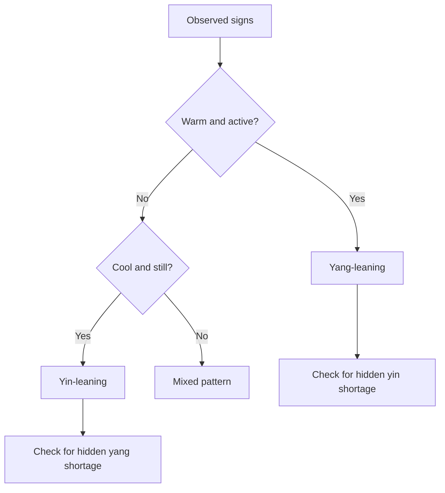
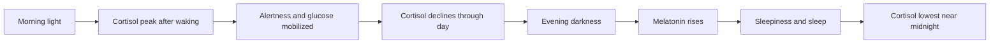
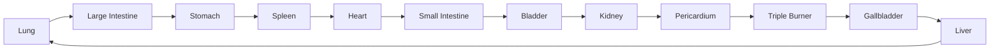

# Concept-Book Run

domain: /home/papagame/projects/digital-duck/cb-meta-health/public/domains/meta_health_ch08/input/graph.yaml
target: personal_daily_rhythm_schedule
started: 2026-11-24T12:35:30

## Teaching order (18 concepts)

- circadian_clock
- yin_yang
- day_night_yin_yang
- cortisol_melatonin_rhythm
- sleep_architecture
- five_phase_correspondences
- sleep_and_metabolic_repair
- twelve_primary_meridians
- chrononutrition
- four_seasons_regimen
- light_entrainment
- organ_clock_ziwu_liuzhu
- exercise_timing
- seasonal_organ_care
- breakfast_in_chenshi
- seasonal_food_and_movement
- sleep_before_zishi
- personal_daily_rhythm_schedule

### circadian_clock (13.3s)

## The Circadian Clock

**Definition.** The circadian clock is the body's internal timer, which runs on a cycle of roughly 24 hours (*circa* = about, *dies* = day). The master clock is the suprachiasmatic nucleus (SCN), a cluster of about 20,000 neurons in the hypothalamus, just above where the optic nerves cross. Nearly every other tissue, including liver, muscle, fat, and gut, also has its own peripheral clock. These are cells whose clock genes switch on and off in a self-sustaining cycle. The SCN synchronizes them, mainly through hormone signals such as cortisol and melatonin and through body temperature.

The clock is not exactly 24 hours long. In people shielded from time cues, the average intrinsic period is about 24.2 hours. Daily **zeitgebers** ("time-givers") reset it, and the strongest is light. Specialized retinal cells containing melanopsin respond most to blue-rich light and report it directly to the SCN. Meal timing, exercise, and social routine act as weaker zeitgebers, mostly for peripheral clocks.

**Worked example.** Suppose a person's intrinsic period is 24.2 hours and no zeitgebers reset it. The clock then drifts later by

$$24.2 - 24 = 0.2 \text{ hours} = 12 \text{ minutes per day}.$$

After 30 days the drift is $30 \times 12 = 360$ minutes, or 6 hours. Bedtime would slide from 11 p.m. to 5 a.m. Real people don't drift like this because morning light nudges the clock earlier by about the same 12 minutes each day. Light at the wrong time can push the clock the wrong way. Bright light late in the evening delays it. Bright light in the early morning advances it.

**Problem-solving application: jet lag.** A traveler flies east from New York to Paris, a 6-hour shift. Their clock still runs on New York time, so Paris bedtime at 11 p.m. feels like 5 p.m. to the body, and falling asleep is hard. Because the clock must advance, the useful strategy is to seek bright light in the morning and avoid it late in the evening. Adjustment is typically about 1 hour per day for eastward travel. Westward travel requires a delay, which is slightly easier because the clock's natural period is already a little over 24 hours. Estimated recovery for this trip is therefore roughly 6 days.

The same reasoning applies to shift work and to teenagers' late schedules. Eating at night, when the liver and pancreas clocks expect fasting, is associated with poorer glucose handling than the same meal in daytime. To work with your clock, keep consistent sleep and wake times, get outdoor light soon after waking, and dim screens and lights in the hours before bed.

**Evidence note.** TCM describes an organ clock in which qi is said to peak in a different organ every two hours. That scheme has no support in circadian biology, which measures timing through clock genes, melatonin, cortisol, and core body temperature.

### yin_yang (13.6s)

## Yin and Yang (阴阳)

**Definition.** In Traditional Chinese Medicine (TCM), yin and yang are a pair of opposing but interdependent categories used to describe the body and its changes. Yin is associated with what is cool, quiet, nourishing, and structural. Yang is associated with what is warm, active, and functional. TCM holds that health is a dynamic relationship between the two, and that illness reflects a shift in that relationship. Yin-yang is a classification framework, not a measurement. It has no units, and it cannot be written as a ratio or an equation.

**How the framework sorts things.** The pairs below are examples of how TCM texts classify observations.

| Observation | Typically classed as yang | Typically classed as yin |
|---|---|---|
| Time of day | Daytime, activity | Night, rest |
| Body region | Back, upper body | Front, lower body |
| Symptom quality | Fever, restlessness, flushed face | Chills, stillness, pale face |
| Pace of illness | Sudden onset, rapid course | Gradual onset, slow course |

TCM also says that each pole contains a seed of the other, and that either can change into the other at an extreme. For example, a prolonged fever may be described as eventually exhausting the body's fluids.

**Worked example.** A patient reports a dry mouth, night sweats, a warm feeling in the palms and soles, and trouble falling asleep. A TCM practitioner would read these as signs of "deficient yin": too little cooling, nourishing substance, so the warm, active side looks relatively prominent. A second patient reports cold hands, pale skin, loose stools, and tiredness that is worse in the cold. This pattern would be read as "deficient yang": too little warmth and function.

**Problem-solving application.** Suppose you are given the following case and asked to classify it.

*A student feels hot and restless in the afternoon, sleeps poorly, and has a dry throat. Their appetite and digestion are normal.*

1. List each symptom and ask whether it is warm and active or cool and still. Here, heat, restlessness, and poor sleep lean yang. Dryness suggests a shortage of moisture, which is yin.
2. Check what is absent. Normal digestion and no cold signs argue against yang deficiency.
3. State the pattern in words: warm and active signs alongside dryness suggest yin deficiency.
4. Translate the pattern into a testable, modern question. Does the student's sleep schedule, caffeine intake, or hydration explain the same symptoms? Checking these ordinary causes first is sound practice.

**Evidence status.** Yin-yang is a traditional interpretive framework, not an established physiological mechanism. No anatomical structure or lab value corresponds to "yin" or "yang." Its usefulness is as a way to organize symptoms in TCM practice. Treat clinical claims built on it as separate questions that need controlled evidence.

*A simplified decision flow showing how TCM sorts observed signs into yang-leaning, yin-leaning, or mixed patterns.*

### day_night_yin_yang (12.7s)

## Day–Night Yin and Yang

**Definition.** In Traditional Chinese Medicine (TCM), yin and yang are paired descriptions of the body's states, not substances you can measure. TCM holds that over each 24-hour day, yang grows from midnight to noon and yin grows from noon to midnight. Yang is associated with activity, warmth, and outward movement. Yin is associated with rest, storage, and repair. So activity belongs to the day, and storage and rest belong to the night. This is a framework for organizing daily routines. It is not a physiological law, and the ideas below are labeled in TCM's terms.

**Worked example.** Take a typical student's day and place each activity where TCM would put it.

| Time | TCM phase | Suggested activity |
|---|---|---|
| 6:00–12:00 | Yang rising | Wake, eat breakfast, do demanding mental work, exercise |
| 12:00–18:00 | Yang peaking, then yielding | Lunch, lighter tasks, moderate activity |
| 18:00–24:00 | Yin rising | Lighter dinner, winding down, dim light, sleep |
| 0:00–6:00 | Yin at its fullest | Deep sleep and overnight repair |

Modern physiology does track a daily rhythm that overlaps with this pattern. The body's circadian clock raises core temperature and cortisol through the morning and lowers them at night. Melatonin rises after dark. Insulin sensitivity is generally better earlier in the day. These findings agree with the broad outline of "active by day, resting by night." They do not confirm the specific TCM mechanism.

**Problem-solving application.** Suppose a student sleeps from 4:00 to 11:00, eats most calories after 9 p.m., and feels sluggish all day. A TCM reading would say the student has reversed the day–night pattern, with yang activity pushed into the yin hours.

Use the physiological evidence to turn this into a plan:

1. **Anchor the wake time.** Pick a fixed time, such as 7:00, and get bright light within an hour. Light is the strongest cue that sets the circadian clock.
2. **Move the heavy meal earlier.** Shift the largest meal to midday. For example, a 2,400 kcal day might put about 800 kcal at lunch and about 500 kcal at dinner. Eating late is associated with poorer glucose control in some studies.
3. **Protect the night.** Dim screens for the last hour before bed and keep a consistent bedtime. Adults generally need 7 to 9 hours of sleep.
4. **Track the result.** Record sleep duration, energy rating, and wake time for two weeks, and compare them with the baseline.

Note what the evidence supports. Regular sleep timing, morning light, and earlier eating are backed by sleep and circadian research. The claim that yin and yang rise and fall on this exact schedule is a TCM model, not something measured directly. Use the model as a memory aid for a routine, and use the measurements to check whether the routine works.

### cortisol_melatonin_rhythm (14.7s)

## The Cortisol–Melatonin Rhythm

**Definition.** Cortisol and melatonin are two hormones whose blood levels rise and fall on a roughly 24-hour cycle, set mainly by the brain's master clock (the suprachiasmatic nucleus) and by light exposure. Cortisol, released by the adrenal glands, peaks about 30–45 minutes after waking. This is the cortisol awakening response. It raises blood glucose and alertness so the body can meet the demands of the day. Cortisol then declines through the afternoon and reaches its lowest point around midnight. Melatonin, released by the pineal gland, stays very low in daylight. It begins to rise about 2 hours before habitual bedtime in dim light (dim-light melatonin onset) and peaks in the middle of the night. The two hormones are roughly mirror images. Cortisol is high when melatonin is low, and the reverse.

**Worked example.** Maya wakes at 6:30 a.m. and gets outside in daylight. A saliva test would show her cortisol rising to a peak near 7:00–7:15, then falling steadily. At 9:00 p.m. she sits in a bright kitchen, scrolls on her phone, and goes to bed at 11:00 p.m. Her melatonin onset is later than it would be in dim light, because bright light, especially blue-rich light from screens, suppresses melatonin. She lies awake for 40 minutes. Her cortisol level is not the cause. The light has pushed back the signal that says "night has begun."

| Time | Cortisol | Melatonin |
|---|---|---|
| 7:00 a.m. | Peak | Near zero |
| 3:00 p.m. | Moderate, falling | Near zero |
| 9:00 p.m. | Low | Rising (in dim light) |
| 2:00 a.m. | Lowest | Peak |

**Problem-solving application.** Suppose a student sleeps at 1:00 a.m. and wakes at 9:00 a.m., but must wake at 6:30 a.m. for a new class schedule. Follow these steps.

1. *Identify the target.* Melatonin should begin rising about 2 hours before the new bedtime. For an 11:00 p.m. bedtime, that means around 9:00 p.m.
2. *Shift the light.* Get bright outdoor light soon after waking. This anchors the cortisol peak earlier. Dim indoor lights and reduce screen use from about 8:30 p.m., so melatonin can rise on schedule.
3. *Shift gradually.* Move bedtime and wake time earlier by 15–30 minutes every few days.

A common mistake is to treat cortisol as simply "the stress hormone" and melatonin as "the sleep pill." Cortisol also follows a healthy daily pattern, and a morning peak is normal. Chronic stress, shift work, or late-night light can flatten or shift this pattern. Melatonin supplements can help in specific cases such as jet lag, but they are not a general sleep aid. Timing of light is usually the stronger lever.

*The daily sequence: light and waking trigger a cortisol peak, and evening darkness triggers melatonin to prepare the body for sleep.*

### sleep_architecture (12.9s)

## Sleep Architecture

**Sleep architecture** is the structure of a night's sleep: a repeating sequence of stages that together form **sleep cycles** of roughly 90 minutes. Sleep has two broad types. Non-REM (NREM) sleep includes light sleep (stages N1 and N2) and deep, or slow-wave, sleep (stage N3). REM (rapid eye movement) sleep is the stage with vivid dreaming, fast eye movements, and temporary muscle paralysis.

A healthy adult usually moves through the stages in this order in each cycle: light sleep, then deep sleep, then a brief return to light sleep, then REM. The mix changes across the night:

| Part of night | Dominant stage | Main role |
|---|---|---|
| First third | Deep sleep (N3) | Physical restoration, growth hormone release, memory consolidation |
| Middle | Light sleep (N2) | Largest share of total sleep time |
| Final third | REM | Emotional processing, memory integration, dreaming |

Early cycles have long deep-sleep phases and REM periods of only about 5–10 minutes. By the fourth or fifth cycle, deep sleep has nearly disappeared, and REM periods can last 30–60 minutes.

### Worked example

A person sleeps from 11:00 p.m. to 6:30 a.m. That is 7.5 hours, or 450 minutes. Dividing by a 90-minute cycle gives:

$$\frac{450\ \text{min}}{90\ \text{min/cycle}} = 5\ \text{cycles}$$

Most of the deep sleep falls in cycles 1–2 (about 11:00 p.m. to 2:00 a.m.). Most of the REM sleep falls in cycles 4–5 (about 4:30 a.m. to 6:30 a.m.).

### Problem-solving application

Suppose a student must wake at 6:30 a.m. and wants to choose a bedtime. Two goals matter: complete cycles, and waking from light sleep rather than deep sleep. Waking from deep sleep often causes grogginess, called sleep inertia.

Allow about 15 minutes to fall asleep. Counting back five cycles (450 minutes) plus those 15 minutes gives a target bedtime of 10:45 p.m.

Next, consider the cost of cutting sleep short. If the student sleeps only from 1:00 a.m. to 6:30 a.m., that is 5.5 hours, or about 3.7 cycles. The student keeps most of the deep sleep, which comes early in the night. They lose most of the late-night REM sleep, so they can expect worse mood regulation and weaker memory integration. The reverse also holds. Going to bed on time but being woken at 2:00 a.m. cuts into deep sleep.

The 90-minute figure is an average. Individual cycles run roughly 70–120 minutes, and they vary within a night. Treat the calculation as a planning estimate. Use how you feel on waking to adjust it.

**Key takeaway:** Sleep is not a uniform block. Deep sleep is concentrated early in the night and REM late, so the length of sleep determines which stages you get.

### five_phase_correspondences (14.4s)

## Five-Phase Correspondences

**Definition.** In Traditional Chinese Medicine (TCM), the Five Phases (五行, *wǔxíng*: Wood, Fire, Earth, Metal, Water) are a classification scheme. TCM sorts many things into five groups: seasons, organs, tissues, sense organs, emotions, tastes, and climates. Items in the same group are said to *correspond*, meaning TCM treats them as related and uses the grouping to organize observation and treatment. The scheme is a filing system with a traditional rationale. It is not a physiological law, and the correspondences cannot be written as equations.

**The table.** One notable feature is the fifth season. TCM adds "late summer" (长夏), a humid transitional period, so that the four seasons fit five groups. Some texts instead treat it as the last 18 days of each season.

| Phase | Season | Climate | Zang organ | Fu organ | Sense organ | Tissue | Emotion | Taste |
|---|---|---|---|---|---|---|---|---|
| Wood | Spring | Wind | Liver | Gallbladder | Eyes | Tendons | Anger | Sour |
| Fire | Summer | Heat | Heart | Small intestine | Tongue | Vessels | Joy | Bitter |
| Earth | Late summer | Dampness | Spleen | Stomach | Mouth | Muscle | Pensiveness | Sweet |
| Metal | Autumn | Dryness | Lung | Large intestine | Nose | Skin | Grief | Pungent |
| Water | Winter | Cold | Kidney | Bladder | Ears | Bone | Fear | Salty |

**Worked example.** A patient reports dry, itchy skin, a stuffy nose, and a dry cough, and the symptoms began in autumn. Reading across the Metal row, a TCM practitioner would link these because skin, nose, and Lung all fall under Metal, and autumn is associated with dryness. The reasoning moves from a shared season and climate to a shared group of body parts. It then suggests a treatment direction, such as moistening foods. A modern clinician would reach the same practical advice (hydrate, use a humidifier) from a different cause: low humidity dries the mucous membranes and skin.

**Problem-solving application.** Suppose someone gets recurring eye irritation each spring and is easily irritable. Use the table in three steps:

1. Find the common thread. Eyes, anger, and spring all sit in the Wood row.
2. Name the associated organ. TCM would point to the Liver.
3. Check the pattern against modern knowledge. Spring eye irritation matches seasonal allergy from pollen, which is well documented. The mood link is unsupported.

This third step matters. The seasonal timing and the body-part groupings are sometimes useful as a memory aid, and a seasonal pattern really can prompt a sensible question, such as what changes in the environment. Many specific links have no support in anatomy or physiology. The Liver does not control tendons, and the Kidney does not govern bone in the way TCM describes. The TCM "Liver" and "Kidney" are functional categories that do not match the anatomical organs of the same name. Evidence that treatments chosen using these correspondences work better than standard care is limited. Never delay diagnosis of a serious symptom, such as persistent cough, blood in urine, or vision loss, because a table suggested a seasonal explanation.

**Takeaway.** Use the table to read and interpret TCM sources. Use physiology and medical testing to decide what is actually happening in the body.

### sleep_and_metabolic_repair (13.9s)

## Sleep and Metabolic Repair

**Definition.** Sleep is not idle time for the body. During deep sleep (slow-wave, or stage N3 sleep), the body releases most of its daily growth hormone, and this supports tissue repair, muscle recovery, and the maintenance of bone and immune function. Sleep also helps regulate how the body handles glucose and hunger. Cutting sleep short disrupts both: glucose tolerance worsens, and appetite hormones shift toward eating more. Leptin, which signals fullness, falls. Ghrelin, which stimulates hunger, rises.

**How a night is organized.** A typical adult cycles through light sleep, deep sleep, and REM sleep in cycles of about 90 minutes. Deep sleep is concentrated in the first half of the night, so going to bed late is less damaging than getting up early. The reverse is true of REM sleep, which dominates the second half. A short night mainly costs REM and light sleep. It also compresses and fragments the whole pattern.

**Worked example.** In controlled studies, healthy young adults restricted to about 4 hours of sleep for several nights showed clearly reduced glucose tolerance. Their blood glucose after a standard sugar drink stayed elevated longer than it did after full nights of sleep. Some measurements looked like those of prediabetes, although the effect reversed with recovery sleep. The same studies reported lower leptin, higher ghrelin, and increased hunger, particularly for calorie-dense foods. Suppose a student sleeps 5 hours instead of 8 and eats an extra 300 kcal the next day because of stronger appetite. Over a 7-day week that adds up to

$$300 \times 7 = 2100 \text{ kcal},$$

which is roughly 0.27 kg of body fat, using the common approximation of about 7700 kcal per kg. The estimate is rough because actual intake varies by person.

**Problem-solving application.** Suppose a person is training for a 10 km race and wants to recover well while keeping weight stable. Apply the following steps.

1. **Protect the deep-sleep window.** Fix the wake time, then set the bedtime 7.5 to 9 hours earlier. Deep sleep comes early, so a regular bedtime protects it better than sleeping in on weekends.
2. **Time the meals.** Avoid a large meal or alcohol in the 2 to 3 hours before bed. Both disrupt sleep architecture, and alcohol in particular suppresses REM sleep.
3. **Manage the light.** Dim lights and screens in the evening, and get bright light soon after waking. This stabilizes the circadian rhythm that governs when growth hormone and the appetite hormones are released.
4. **Use data carefully.** If a night is short, do not rely on willpower to hold appetite steady. Plan a protein-rich breakfast and keep the intensity of the next day's workout moderate, since glucose handling and recovery are both reduced.

**Common misconception.** Catching up on sleep at the weekend only partly reverses the damage from a short week. Repeated short sleep is not fully compensated by one long night, so a consistent schedule works better than occasional recovery.

**Check your understanding.** A person sleeps 6 hours on weeknights and 10 on weekends. Name two ways the weekday pattern could still affect glucose and appetite, and one change that would help the most.

### twelve_primary_meridians (13.2s)

## The Twelve Primary Meridians

**Definition.** In Traditional Chinese Medicine (TCM), the twelve primary meridians (十二正经) are the main channels along which qi is said to circulate through the body. Each meridian is named for the organ system it is linked to, the limb it runs along, and its yin or yang character. No structure matching these channels has been found in anatomical studies, so the meridians are best treated as a traditional map used to organize symptoms and choose acupuncture points, not as a measured physiological pathway.

The twelve divide into six pairs, one yin and one yang meridian per pair. Yin meridians run along the inner, front surfaces of the limbs. Yang meridians run along the outer, back surfaces. Three meridians belong to the arm and three to the leg in each category, which gives 12.

| Limb | Yin meridians | Yang meridians |
|---|---|---|
| Hand | Lung, Pericardium, Heart | Large Intestine, Triple Burner, Small Intestine |
| Foot | Spleen, Liver, Kidney | Stomach, Gallbladder, Bladder |

TCM describes qi as flowing through them in a fixed order, forming one continuous circuit. Beginning at the Lung meridian, the sequence is:

Lung → Large Intestine → Stomach → Spleen → Heart → Small Intestine → Bladder → Kidney → Pericardium → Triple Burner → Gallbladder → Liver → (back to Lung)

*The traditional circulation order of the twelve primary meridians, forming a closed loop that returns from Liver to Lung.*

**Worked example.** Suppose a patient has pain along the outer edge of the forearm and the back of the shoulder. Locate the area first. The outer, back surface of the arm is yang territory, and the hand yang meridians are Large Intestine, Triple Burner and Small Intestine. In TCM, the back of the forearm is associated with the Triple Burner and the pinky-side edge with the Small Intestine. A practitioner would therefore consider points on those meridians.

**Problem-solving application.** Using the table, try a second case. A patient reports pain along the inner side of the lower leg and the inside of the thigh. The inner leg is yin and belongs to the foot, so the candidates are Spleen, Liver and Kidney. Next, use the circuit order to see which meridians are neighbors. The Spleen follows the Stomach and precedes the Heart. This tells a practitioner which yin-yang partner (Stomach) to consider alongside it.

The method for any such problem is to (1) identify the body surface, (2) decide yin or yang, (3) decide hand or foot, and (4) narrow to three candidates. This is a classification exercise. It does not show that acupuncture at these points works for the complaint. Evidence for acupuncture is mixed: it is better for some kinds of pain than for others, and some benefit may come from non-specific effects.

### chrononutrition (14.7s)

## Chrononutrition

**Chrononutrition** is the study of how the *timing* of eating, not just the amount or content, affects health. Its core observation is that the body does not process food the same way at all hours. Metabolism follows the circadian clock, the roughly 24-hour internal rhythm set largely by light and darkness. In the morning, tissues respond more strongly to insulin, the hormone that moves glucose from blood into cells. In the evening and at night, insulin sensitivity declines, and the same meal produces a larger, longer-lasting rise in blood glucose.

Two practical rules follow from this:

1. **Front-load energy.** Eat more of the day's calories earlier, with breakfast and lunch at least as substantial as dinner.
2. **Finish eating a few hours before bed.** A common target is 2–3 hours, so digestion and the glucose response are mostly complete before sleep.

Controlled studies, mostly short-term and in small groups, have found that identical meals eaten in the evening raise glucose more than the same meals eaten in the morning. Long-term outcome evidence is still limited, so treat the rules as sensible defaults rather than guarantees.

### Worked example

Two people each eat 2,000 kcal per day, with the same foods.

| | Breakfast | Lunch | Dinner | Last bite |
|---|---|---|---|---|
| Person A | 400 kcal | 600 kcal | 1,000 kcal | 11:30 pm |
| Person B | 600 kcal | 800 kcal | 600 kcal | 7:00 pm |

Person A takes 50% of daily energy in the evening, when insulin sensitivity is lowest, and eats 30 minutes before a bedtime of midnight. The share of energy at dinner is

$$\frac{1000}{2000} = 50\%$$

Person B's is $\frac{600}{2000} = 30\%$, and the last meal ends 5 hours before a midnight bedtime. Total energy is identical, but Person B's schedule fits the clock better.

### Problem-solving application

**Problem.** A night-shift nurse works 10 pm to 6 am and sleeps 8:30 am to 4:30 pm. How should they apply chrononutrition?

**Solution.** Do not copy a daytime schedule. The rules are anchored to *sleep*, not to the wall clock:

- Treat waking (4:30 pm) as "morning." Eat the largest meal soon after, around 5 pm, before the shift.
- Take a moderate meal near the middle of the shift, such as 1 am.
- Keep the last meal 2–3 hours before sleep. Here, that means finishing by about 6 am. Choose a light snack, such as yogurt and fruit, over a heavy meal.

Shift work is a known challenge for glucose regulation, because eating and light exposure conflict with the internal clock. Timing meals this way is a reasonable way to reduce the mismatch, but it does not remove it.

**Check yourself.** If your usual bedtime is 11 pm, what is your latest sensible finishing time for dinner? (Answer: about 8 pm.) What single change would most improve a day on which you currently skip breakfast and eat 60% of your energy after 7 pm?

### four_seasons_regimen (14.9s)

## The Four-Seasons Regimen (四时养生)

**Definition.** The four-seasons regimen (四时养生) is a Traditional Chinese Medicine (TCM) approach to health that adjusts sleep, activity and diet to the time of year. TCM summarizes it as 春生夏长秋收冬藏: spring for growth, summer for expansion, autumn for gathering, winter for storing. The idea is that daily habits should follow the changing daylight, temperature and food supply instead of staying the same all year.

The table shows the traditional pattern, with the modern physiological link beside it.

| Season | TCM emphasis | Typical advice | Modern counterpart |
|---|---|---|---|
| Spring | Growth | Rise early, walk outdoors, add fresh greens | Longer days, rising activity |
| Summer | Expansion | Stay active, drink fluids, avoid midday heat | Higher sweat loss, higher fluid needs |
| Autumn | Gathering | Sleep earlier, moisten dry air, eat in moderation | Shorter days, cooling temperatures |
| Winter | Storing | Sleep longer, keep warm, favor warm, nourishing meals | Less daylight, higher heat demand |

**Worked example.** Consider an adult who needs about 2,200 kcal/day in summer and trains outdoors for 45 minutes. A seasonal adjustment in winter might look like this:

- **Sleep:** Move bedtime from 23:00 to 22:30 and wake at 06:30, which gives 8 hours. This matches the longer night.
- **Activity:** Shift the run from the dark early morning to midday, when it is lighter and warmer. Add a 10-minute warm-up, because cold muscles are more injury-prone.
- **Diet:** Replace cold salads with soups, cooked grains and root vegetables. Hold energy intake near maintenance. If daily activity falls by 150 kcal, trim intake by about the same amount.

**Problem-solving application.** Suppose a student feels sluggish and sleeps badly in late autumn, with an 18:00 sunset and a 07:00 alarm. Work through it in steps:

1. **Identify the mismatch.** Evening light is short, but the student still studies under bright screens until 01:00.
2. **Apply the seasonal principle.** Autumn is the "gathering" season, so reduce evening stimulation.
3. **Make testable changes.** Dim lights after 21:00, set bedtime at 23:00, and get 20 minutes of outdoor light before 10:00.
4. **Measure.** Record sleep time, wake time and morning alertness (1–5) for two weeks, then compare with the baseline.

The measurement step matters because the regimen is a framework for self-experiment, not a set of guaranteed outcomes. Parts of it agree with mainstream science. Circadian biology supports regular sleep timing and morning light, and sensible fluid intake in heat and warm clothing in cold are standard health advice. The claims that seasonal eating or sleeping rules prevent specific diseases have little rigorous trial support. Use the advice that fits your climate, health and schedule. Someone in a tropical region, a night-shift worker or a person with a medical condition should adapt it or follow their clinician's guidance.

**Key takeaway.** The regimen turns "match your habits to the season" into concrete choices about sleep, movement and meals. Test each choice against your own measurements.

### light_entrainment (13.2s)

## Light Entrainment

**Definition.** Entrainment is the process by which an internal rhythm is synchronized to an external cue. The human circadian clock, located in the suprachiasmatic nucleus of the hypothalamus, runs on an intrinsic period close to 24.2 hours, not exactly 24. Without daily correction, it would drift later each day. Light is the strongest correcting signal, or *zeitgeber* ("time giver"). Specialized retinal ganglion cells containing the pigment melanopsin are most sensitive to short-wavelength (blue, about 480 nm) light. They send signals directly to the clock, and these signals do not depend on forming a visual image.

The effect of light depends on *when* it arrives. Light in the late evening and early night pushes the clock later (a phase delay). Light in the early morning, after the body's temperature minimum, pushes the clock earlier (a phase advance). This timing dependence is what physiologists plot as a phase response curve.

**Worked example.** Consider a student whose clock runs 24.2 hours per day.

- Daily drift without correction: $24.2 - 24 = 0.2$ h, or 12 minutes later each day.
- Over one week: $7 \times 12 = 84$ minutes.

Morning daylight supplies an advance of about 12 minutes, which cancels the drift. Outdoor light is typically 10,000 lux or more, even on an overcast day, while ordinary indoor lighting is often 100–300 lux. That large gap is why a few minutes outside does more than hours under room lighting.

Now add a habit: scrolling on a bright phone or laptop in bed until midnight. Evening light delays the clock and suppresses melatonin, the hormone that signals biological night. If this delays the clock by even 30 minutes, the student feels sleepy later, wakes later, and gets less morning light the next day. This weakens the correcting signal and reinforces the delay.

**Problem-solving application.** A student must wake at 6:30 a.m. for class but cannot fall asleep before 1:00 a.m. Use light as a tool to shift the clock earlier.

1. **Add morning light.** Spend 20–30 minutes outdoors within an hour of waking. Do not wear sunglasses if it is safe not to. This gives the advance signal.
2. **Reduce evening light.** Starting about two hours before the target bedtime, dim overhead lamps, switch devices to night mode, and lower screen brightness. Night mode reduces blue light, but brightness and duration of exposure matter too.
3. **Shift gradually.** Move bedtime and wake time earlier by 15–30 minutes every few days rather than in one jump.
4. **Keep wake time fixed on weekends.** A two-hour lie-in with bright afternoon light partly undoes the week's progress, much like mild jet lag.

Check your result by noting when you feel naturally sleepy after about a week. If sleepiness has moved earlier, the clock has shifted. If it has not, look for hidden sources of late light, such as bright bathroom lights or a television.

**Key point.** Time of day determines whether light advances or delays the clock. Bright light early anchors it, and bright or blue light late pushes it back.

### organ_clock_ziwu_liuzhu (14.3s)

## The Meridian Organ Clock (子午流注)

**Definition.** In Traditional Chinese Medicine (TCM), the meridian organ clock (子午流注, *zǐ wǔ liú zhù*) is a daily schedule. TCM holds that qi flows through the twelve main meridians in a fixed order, and that each meridian is most active during one two-hour window. The order starts at the Lung and ends at the Liver, then repeats the next day. The windows are listed below.

| Time | Meridian | Time | Meridian |
|---|---|---|---|
| 3–5 | Lung | 15–17 | Bladder |
| 5–7 | Large Intestine | 17–19 | Kidney |
| 7–9 | Stomach | 19–21 | Pericardium |
| 9–11 | Spleen | 21–23 | Triple Burner |
| 11–13 | Heart | 23–1 | Gallbladder |
| 13–15 | Small Intestine | 1–3 | Liver |

The twelve windows are 24 hours divided by 12, which gives 2 hours each. The name 子午 refers to midnight (子) and noon (午), the two points where the cycle is said to turn between its yin and yang phases.

**Worked example.** A person wakes at 3 a.m. almost every night. In clock practice, 3 a.m. sits at the boundary between the Liver window (1–3) and the Lung window (3–5). A practitioner using the clock would link the waking to one of those two meridians. They might ask about stress or irritability for the Liver, or about breathing and cough for the Lung. They might also suggest eating lightly in the evening and keeping a regular bedtime. The clock gives the practitioner a list of questions to ask. It does not give a diagnosis.

**Problem-solving application.** Suppose you want to plan a day around the clock. The clock's own suggestions are:

1. Eat breakfast during 7–9 (Stomach).
2. Take a short rest around 11–13 (Heart).
3. Be in bed by about 23:00, when the Gallbladder window begins.

Each suggestion matches a sensible habit: a regular breakfast, a midday break, and a consistent bedtime. You can follow these habits without believing the meridian explanation. The habits are the useful part.

**Evidence status.** The explanation itself is not supported. Studies have not found organs that are more active in their assigned two-hour windows, and nothing in anatomy corresponds to a meridian. Real biology does give daily rhythms, and these are measured differently:

- Cortisol peaks in the early morning.
- Core body temperature reaches its lowest point in the early morning and its highest point in the late afternoon.
- Melatonin rises in the evening.
- Digestion, blood pressure, and liver enzyme activity all vary over the day.

These rhythms are controlled by the body's circadian clock, and chronobiology studies them. Their timing varies from person to person, and it does not follow twelve equal windows.

Treat the organ clock as a traditional framework for organizing questions and habits. Do not use it to decide when to take medication, or to explain night waking in place of seeing a clinician. Persistent sleep problems have many causes, such as sleep apnea, anxiety, and caffeine. A clinician can evaluate these causes, and the clock cannot.

```mermaid
flowchart LR
    A["Lung 3-5"] --> B["Large Intestine 5-7"]
    B --> C["Stomach 7-9"]
    C --> D["Spleen 9-11"]
    D --> E["Heart 11-13"]
    E --> F["Small Intestine 13-15"]
    F --> G["Bladder 15-17"]
    G --> H["Kidney 17-19"]
    H --> I["Pericardium 19-21"]
    I --> J["Triple Burner 21-23"]
    J --> K["Gallbladder 23-1"]
    K --> L["Liver 1-3"]
```

*The twelve two-hour windows of the organ clock in order. After the Liver window the cycle returns to the Lung.*

### exercise_timing (13.1s)

## Exercise Timing

**Definition.** Exercise timing is the choice of *when* in the day to be active. The body runs on a roughly 24-hour circadian rhythm that controls body temperature, hormone release, alertness, and sleepiness. Light is the strongest signal that keeps this clock aligned with the day, and exercise can add a smaller signal of its own. So the same workout can have different effects on sleep and energy depending on the hour.

In TCM, morning activity in daylight is said to "raise yang," meaning to build the body's active, warming energy for the day. That is a traditional description, not a measured mechanism. The physiological account is simpler. Bright morning light shifts the clock earlier and strengthens the wake-sleep contrast.

**Worked example.** Compare two people who each do 30 minutes of running.

- *Ana* runs at 7:00 a.m. outdoors. She gets about 30 minutes of daylight, which is far brighter than indoor light. Her core temperature and heart rate rise, then settle over the next hours. She feels sleepy at her usual 10:30 p.m. bedtime.
- *Ben* runs hard at 10:00 p.m. His heart rate may stay elevated for an hour or more afterward, and his core temperature stays raised. Hard exercise also triggers adrenaline release. He falls asleep around 12:15 a.m., about 90 minutes later than usual.

Both did the same workout. The timing changed its effect on sleep.

**Problem-solving application.** Use a short decision routine when planning a week of training.

1. **Set the goal.** If it is to anchor your sleep schedule or lift morning alertness, schedule activity within about 1–2 hours of waking, outdoors if you can.
2. **Check the intensity.** Vigorous work (intervals, heavy lifting, hard runs) is best finished at least 2–3 hours before bed. Individual sensitivity varies, and some people sleep fine after evening training. Test your own response and keep a simple log of workout time, bedtime, and time to fall asleep.
3. **Match the evening to the task.** Evening is a good slot for calmer practice such as walking, stretching, yoga, or tai chi. These lower arousal and fit a wind-down routine.
4. **Adjust for constraints.** If work limits you to evenings, keep the intensity moderate, finish earlier, cool down, and get bright light exposure the next morning.

Suppose a student wakes at 6:30 a.m. and sleeps at 11:00 p.m. A hard session at 8:00 p.m. leaves 3 hours before bed, which is usually enough. A 9:45 p.m. session leaves only 1.25 hours, so move it earlier or make it a gentle stretching session.

**Key takeaway.** Put daylight and vigorous effort earlier in the day and calmer practice later, then adjust using your own sleep data.

### seasonal_organ_care (13.0s)

## Caring for the Organ of Each Season

**Definition.** Traditional Chinese Medicine (TCM) holds that the body should be matched to the season. Each season is linked to one organ system to be "nourished" (养) with suitable food, activity, and sleep: Liver in spring (春养肝), Heart in summer (夏养心), Spleen in late summer (长夏养脾), Lung in autumn (秋养肺), and Kidney in winter (冬养肾). TCM organ names refer to functional systems, not exactly to the anatomical organs of Western physiology. Seasonal organ care is a framework for organizing habits, not a measured clinical procedure.

**Worked example.** The table pairs each season's TCM advice with the physiological reasoning a modern student can check.

| Season | TCM focus | Typical advice | Checkable physiology |
|---|---|---|---|
| Spring | Liver | Rise early, get outdoors, eat fresh greens, avoid heavy alcohol | Alcohol is processed mainly by the liver; daylight and activity help regulate sleep and mood |
| Summer | Heart | Stay hydrated, avoid midday heat, rest at midday | Heat dilates blood vessels and increases sweat loss, so the heart works harder to maintain blood pressure |
| Late summer | Spleen | Eat warm, cooked, easily digested food; limit cold, greasy meals | Humid weather raises food-spoilage risk, and large cold meals can aggravate digestive upset |
| Autumn | Lung | Keep the throat and chest warm, stay humidified, eat pears and other moist foods | Dry, cool air irritates airways; respiratory infections rise as people spend more time indoors |
| Winter | Kidney | Sleep longer, keep the lower back and feet warm, avoid excess salt | Cold stresses circulation; high sodium raises blood pressure, which strains the kidneys |

Several of these suggestions are sound for ordinary reasons: hydration in heat, limiting alcohol and salt, and sleeping enough. Other claims are not supported by modern physiology. For example, eating a specific food does not "strengthen" a specific organ, and the seasonal assignments themselves come from TCM theory, not from experiments.

**Problem-solving application.** Suppose a 45-year-old office worker with mild high blood pressure asks how to apply this framework in winter. A practical approach follows these steps:

1. **Identify the real risk.** Cold weather narrows blood vessels and often brings saltier, heavier meals, so blood pressure tends to rise.
2. **Keep the useful advice.** Limit sodium (guidelines suggest under about 2,300 mg per day, and lower for hypertension), keep warm, and keep a regular sleep schedule.
3. **Check the claims.** A "kidney-tonifying" soup is fine as a meal, but it should not replace blood pressure monitoring or prescribed medication.
4. **Measure the outcome.** Take home blood pressure readings each morning for two weeks. If readings stay above the target the doctor set, the seasonal routine is not enough, and medical follow-up is needed.

The same method works in any season. Translate the traditional recommendation into a concrete, measurable habit, keep it if it is safe, and let measurements, not tradition, decide whether it works.

### breakfast_in_chenshi (12.7s)

## Breakfast in Chenshi (辰时)

**Definition.** In Traditional Chinese Medicine (TCM), the day is divided into twelve two-hour periods, and 辰时 (chenshi, 7–9 a.m.) is the period assigned to the Stomach. TCM holds that digestion is strongest in this window, so a substantial breakfast fits it well. Chrononutrition, the study of how meal timing interacts with the body's circadian rhythms, reaches a similar practical conclusion from different evidence. Morning insulin sensitivity is generally higher and the thermic effect of food is larger than in the evening. A "real" breakfast means a meal that supplies roughly 20–30% of daily energy, with protein, fiber, and some complex carbohydrate, rather than coffee alone or a pastry.

**Worked example.** Suppose a student's daily target is 2,000 kcal. A breakfast at 25% of that target is

$$0.25 \times 2000\ \text{kcal} = 500\ \text{kcal}.$$

A plate that meets this might be:

| Food | Energy (kcal) | Protein (g) |
|---|---|---|
| Two eggs | 140 | 12 |
| Oatmeal (1 cup cooked) with berries | 180 | 7 |
| Plain yogurt (3/4 cup) | 110 | 8 |
| Whole-grain toast (1 slice) | 80 | 4 |
| **Total** | **510** | **31** |

This is close to the 500 kcal target and supplies about 30 g of protein. That amount is commonly recommended per meal to support satiety and muscle maintenance.

**Problem-solving application.** Consider a student who wakes at 6:45, skips breakfast, drinks coffee, and eats a 900 kcal lunch at 1 p.m. Mid-morning hunger, poor focus, and a large lunch are typical results. To fix this:

1. **Set the window.** Eat between 7 and 9 a.m., within about two hours of waking.
2. **Set the size.** Use 20–30% of daily energy, which is 400–600 kcal at 2,000 kcal per day.
3. **Build the plate.** Include a protein source, a high-fiber carbohydrate, and a fruit or vegetable.
4. **Handle low appetite.** If you don't feel hungry, start with 200–250 kcal, such as yogurt with fruit, and increase it over a few weeks as your morning appetite adjusts.
5. **Check the result.** Track hunger and energy at 10 a.m. and at lunch. If the lunch is now closer to 600–700 kcal and the 10 a.m. slump has eased, the change is working.

On evidence: the observational link between regular breakfast eating and better metabolic markers is real but partly confounded by other healthy habits. Controlled trials on weight loss are mixed. Breakfast is therefore a sensible default for most people, not a universal requirement. Shift workers, people who practice time-restricted eating, and people with medical conditions such as diabetes should adjust the timing with their clinician. The two traditions agree on the practical advice: when you eat the first meal of the day should be deliberate, and it should not be trivial.

### seasonal_food_and_movement (12.8s)

## Seasonal Food and Movement

**Definition.** Seasonal food and movement is the practice of adjusting what you eat and how you exercise as the year changes. In Traditional Chinese Medicine (TCM), the idea is that people should follow the season: lighter, cooling foods and early-morning activity in summer; warming, nourishing foods and gentler, shorter practice in winter. TCM also pairs each season with an organ system and encourages exercise that emphasizes that organ's season (for example, the heart in summer). These pairings are traditional, not established physiology. The practical parts, which are heat management, hydration, energy balance and injury risk, do match well-studied science.

**Worked example.** Compare two days for a recreational runner.

| | Summer | Winter |
|---|---|---|
| Training time | 6:00 a.m., before the heat | Midday, when it is warmest |
| Session | 40 min easy run | 25 min brisk walk plus mobility work |
| Food | Salads, cucumber, watermelon, fish, cold soups | Soups, stews, oats, root vegetables, cooked meats |
| Fluids | Extra water with a pinch of salt | Warm drinks, regular water |

The physiology behind the table is sound. Heat raises heart rate at the same pace, so an easy run at 30 °C feels harder than the same run at 15 °C. Sweat losses of 0.5–1.5 L per hour are common in hot weather, and a loss of about 2% of body mass impairs performance. Cold air stiffens muscles, so a longer warm-up lowers strain risk. Staying warm also takes energy, and a heartier winter meal can help cover that.

**Problem-solving application.** Suppose a 70 kg person runs 40 minutes in summer and loses 0.9 kg of sweat. How much should they drink?

1. Percent body mass lost: $\frac{0.9}{70} \times 100 \approx 1.3\%$. That is below the 2% threshold but already meaningful.
2. A common sports-nutrition guideline is to replace about 125–150% of the weight lost over the next few hours, because some of what you drink is lost in urine.
3. Target intake: $0.9 \times 1.25 \approx 1.1$ L up to $0.9 \times 1.5 \approx 1.35$ L, taken in over a few hours with a little salt or food.

Now adapt the plan for winter. Sweat loss may fall to about 0.4 kg, so fluid needs are smaller. The main goals shift to a longer warm-up, layered clothing and enough carbohydrate to fuel the session.

**Evidence note.** Adjusting for temperature, daylight and hydration is well supported. The claim that eating for a season strengthens a particular organ has no good clinical evidence. Treat it as a cultural framework, and don't let it replace a measured plan. People with heart disease, diabetes or kidney problems should confirm any change in food or exercise with a clinician.

### sleep_before_zishi (13.2s)

## Sleeping Before Zishi (子时)

**Definition.** 子时 (zishi) is the two-hour window from 23:00 to 01:00 in the Chinese double-hour system. Traditional Chinese Medicine (TCM) pairs the hours of the day with organs. 23:00–01:00 belongs to the Gallbladder, and 01:00–03:00 belongs to the Liver. TCM holds that "blood returns to the Liver when one lies down" (人卧则血归于肝). In this view, resting lying down during these hours lets the Liver store and replenish blood. The practical advice is to be asleep by about 23:00 instead of merely getting into bed then.

The organ-clock mechanism is a traditional framework, not an established physiological finding. The behavioral advice behind it has good modern support: a regular, earlier bedtime is linked to better sleep quality and health.

**What modern research says.** Human sleep is organized into cycles of roughly 90 minutes. Slow-wave (deep) sleep is concentrated in the first half of the night. Growth hormone secretion peaks during this early deep sleep, and it is tied to sleep onset rather than to the clock. Melatonin typically begins rising in the evening, around 21:00–22:00 in people with ordinary schedules. Going to bed very late tends to shorten the night or push it into the part of the circadian cycle that is poorly suited to sleep. Irregular bedtimes are also associated with higher blood pressure and poorer glucose control.

**Worked example.** Suppose you need to wake at 06:30 and want about 8 hours of sleep. Allow roughly 15–20 minutes to fall asleep.

- Target sleep onset: 06:30 − 8 h = 22:30
- Get into bed: about 22:10–22:15

Under this plan you are asleep before 23:00, and you complete about five 90-minute cycles (7.5 hours) before waking. A student who instead gets into bed at 00:30 and wakes at 06:30 has only 6 hours, or four cycles. Their sleep also starts after the zishi window has closed.

**Problem-solving application.** A student studies until midnight and sleeps from 00:30 to 07:30. They want to shift to a pre-23:00 sleep time without losing sleep or becoming anxious about it.

1. **Shift gradually.** Move bedtime 15–30 minutes earlier every few days. Large jumps usually fail because the body clock cannot follow them.
2. **Fix the wake time first.** A consistent wake time, even on weekends, anchors the circadian rhythm and makes earlier sleepiness come naturally.
3. **Build a wind-down routine.** Dim the lights and put screens away 30–60 minutes before bed. Bright light and screens suppress melatonin.
4. **Move late work earlier.** Do the hardest studying before dinner, and keep the last hour for light tasks.
5. **Track the result.** Record when you fell asleep, when you woke, and how alert you felt at midday over two weeks.

If you sometimes miss 23:00, the answer is not to worry. The point of the advice is a regular, sufficient night's sleep that starts early. Anxiety about the exact minute defeats the purpose.

### personal_daily_rhythm_schedule (13.9s)

## Your Personal Rhythm Plan

A **personal rhythm plan** is a written schedule that places your daily activities (light exposure, movement, meals, and sleep) at consistent clock times, then adjusts them as the seasons change. In Traditional Chinese Medicine (TCM), the day is divided into twelve two-hour periods called 时辰 (shíchén), each associated with an organ. Modern chronobiology supports a related idea: a regular schedule of light, food, and sleep helps keep your circadian clock (an internal cycle of about 24 hours) in step with the day. The organ-by-hour assignments are TCM's framework, and they have not been validated as physiology. Treat them as a way to organize the day, not as a medical claim.

### Worked example: a baseline day

| Time | Activity | Reason |
|---|---|---|
| 06:30 | Outdoor light and Baduanjin (8 gentle exercises) | Morning light anchors the circadian clock |
| 07:30 (辰时, 7–9) | Breakfast | In TCM this is the stomach's period, so eat then |
| 12:00 | Main meal | Largest meal while activity is highest |
| 12:30 | 15-minute walk | Gentle movement after meals |
| 17:30 | Light dinner | Finishing 4–5 hours before bed |
| 21:00 | Wind-down: dim lights, no screens | Lower light supports melatonin release |
| 22:30 | In bed (before 23:00) | Allows 7–9 hours of sleep |

Calorie targets help you size the meals. Suppose your estimated daily need is 2,000 kcal. A plan that puts about 30% at breakfast, 40% at midday and 30% at dinner gives:

$$0.30 \times 2000 = 600 \text{ kcal},\quad 0.40 \times 2000 = 800 \text{ kcal},\quad 0.30 \times 2000 = 600 \text{ kcal}$$

These percentages are a convenient planning choice, not a fixed standard. Your needs vary with body size, age, and activity.

### Problem-solving application: adjusting for the season

Suppose you must adapt the baseline for winter. TCM associates winter with the kidney and with storing energy, and recommends going to bed earlier and rising later. Sunrise in winter may be around 07:15, so a 06:30 outdoor session happens in the dark.

Work through it step by step:

1. **Keep the anchor, move the time.** Shift wake-up to 07:00 and do Baduanjin at 07:15, so your first light exposure is still daylight.
2. **Shift the dependent items.** Breakfast moves to 08:00, still within 辰时 (7–9).
3. **Keep fixed points.** Midday meal and bedtime before 23:00 stay unchanged, because they do not depend on sunrise.
4. **Adjust content, not just timing.** Choose warm, cooked foods and keep the walk after lunch, since that is when daylight and temperature are best.

In summer, the reverse applies: you might rise at 06:00, take an earlier walk, and stay awake a little later in the long evening.

### Checking your plan

A good plan passes three tests. It is **specific**, with clock times rather than intentions. It is **consistent**, within about an hour on weekdays and weekends. It is **adjustable**, with a stated rule for each season. Keep it for two weeks, note when you feel sleepy or alert, and revise the times that don't fit your life.

## Run complete

total: 268.7s
