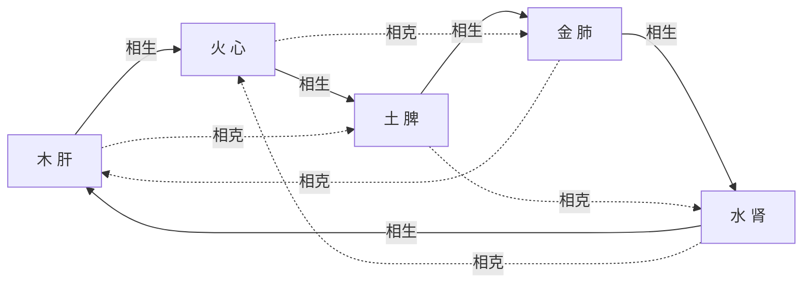
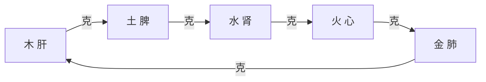
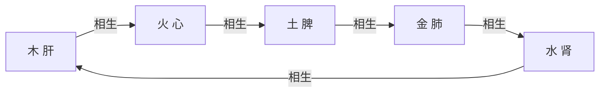
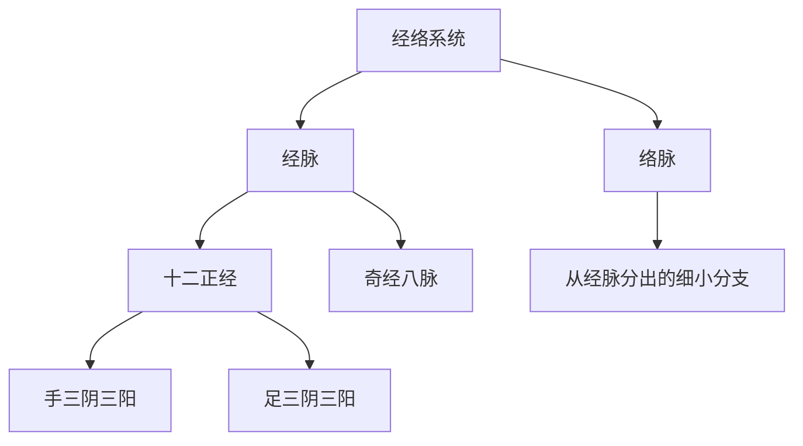
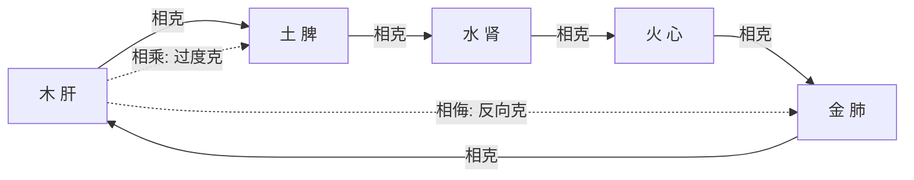
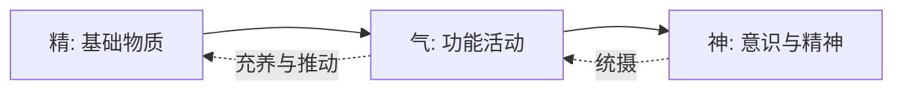
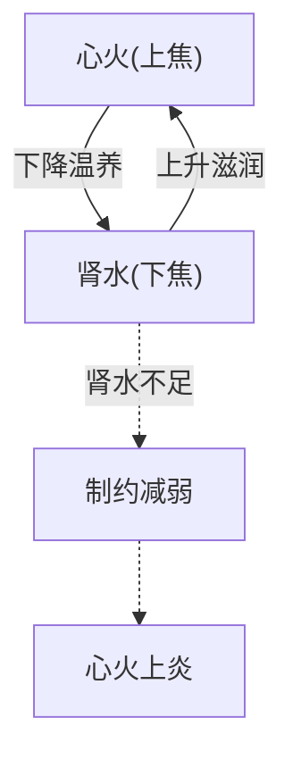
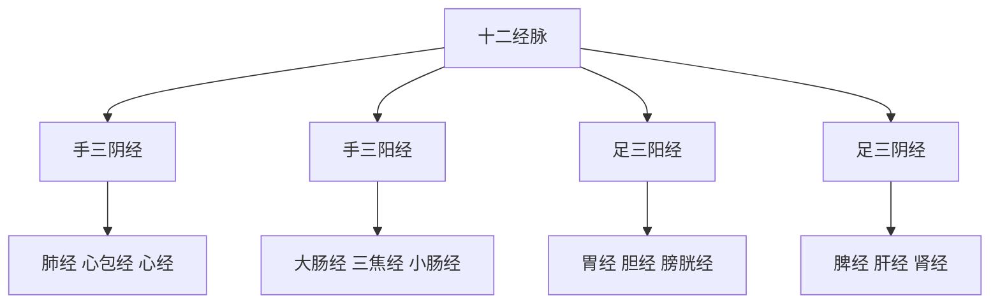

# Concept-Book Run

domain: /home/papagame/projects/digital-duck/cb-meta-health/public/domains/meta_health_ch01/input/graph.yaml
target: five_phase_body_map
started: 2026-11-24T12:44:48

## Teaching order (26 concepts)

- qi
- five_phases_wuxing
- blood_xue
- essence_jing
- five_zang_organs
- body_fluids_jinye
- controlling_cycle_xiangke
- six_fu_organs
- generating_cycle_xiangsheng
- meridian_jingluo
- qi_blood_relationship
- spirit_shen
- yin_yang
- overacting_and_insulting
- qi_stagnation_blood_stasis
- three_treasures_jing_qi_shen
- zang_fu_pairing
- dantian
- five_phase_correspondences
- harmony_as_health
- heart_kidney_interaction
- liver_spleen_relationship
- prenatal_postnatal_qi
- triple_burner_sanjiao
- twelve_primary_meridians
- five_phase_body_map

### qi (0.6s)

## 气

**定义。** 气(qì)是中医(Traditional Chinese Medicine,TCM)用来概括"生命活动"的核心概念。TCM 认为,人体不只是一堆静止的结构,更是一套持续运转的功能:呼吸、消化、循环、体温维持、抵御外邪,都被视为"气在运动"。可以粗略理解为"处于运动中的生理功能"。气不是现代生理学中某种可单独测量的物质或能量,所以不能把它换算成 kcal、毫伏或其他实验室数值;它是一种解释和归纳临床表现的语言。

**气的五类功能。** TCM 把气的作用分为:

| 功能 | 含义 | 现代生理中可对照的现象(仅作类比) |
|---|---|---|
| 推动 | 促进生长、血液与津液的运行 | 心脏泵血、胃肠蠕动 |
| 温煦 | 维持体温、使身体温暖 | 产热与体温调节 |
| 防御 | 抵御外邪、保护机体 | 皮肤黏膜屏障、免疫反应 |
| 固摄 | 约束血液、汗液、尿液等不随意流失 | 括约肌控制、血管完整性 |
| 气化 | 物质的转化与代谢 | 消化吸收、新陈代谢 |

这个对照只是帮助理解,二者并不等同。

**例题。** 一位患者自述:容易疲乏、说话声音低、稍一活动就出汗、常常感冒,舌淡,脉弱。

分析步骤:
1. 把症状按功能归类:疲乏、声低,是推动不足的表现;活动即出汗,是固摄不足;常感冒,是防御不足。
2. 这些表现都指向同一类功能的整体偏弱,中医称之为"气虚"。
3. TCM 的治疗思路是补气,常用方剂如四君子汤,并配合饮食与作息调整。

**问题解决应用。** 请判断下列两种情形各对应气的哪类功能失常:
- (a)老年人夜间尿频、咳嗽时尿液不自主漏出;
- (b)手脚长期冰凉、畏寒。

解答:(a)是固摄失常,TCM 称为"气不固摄";(b)是温煦不足,常称"阳气不足"。

解题的方法是:先列出症状,再逐一问"这是哪种运动或保护功能出了问题",最后归类。这样做能把零散的描述整理成一个有条理的判断。

**需要注意的边界。** 气的概念为临床描述提供了一套系统语言,但气本身没有被现代科学证实为一种可检测的实体,"补气"的具体疗效也需逐项由临床研究检验。症状如持续疲乏、反复出汗、尿失禁,可能由贫血、甲状腺功能异常、糖尿病、感染或泌尿系统疾病引起,应先由医生做出检查,不要仅凭"气虚"的判断自行用药或延误就诊。

### five_phases_wuxing (0.7s)

## 五行

**定义。** 五行（木、火、土、金、水）是中国古代用来归类事物及其相互关系的五种“过程类别”。中医（TCM，即传统中医学，Traditional Chinese Medicine）借用这一框架，把脏腑、季节、情志、五味等现象分组，并用来解释它们之间的联系。五行描述的是动态的功能特征，而不是五种具体的物质：

| 五行 | 特征 | 脏 | 季节 | 五味 |
|---|---|---|---|---|
| 木 | 生发、舒展 | 肝 | 春 | 酸 |
| 火 | 温热、上升 | 心 | 夏 | 苦 |
| 土 | 化生、承载 | 脾 | 长夏 | 甘 |
| 金 | 收敛、肃降 | 肺 | 秋 | 辛 |
| 水 | 寒润、闭藏 | 肾 | 冬 | 咸 |

五行之间有两类基本关系。**相生**是促进：木生火，火生土，土生金，金生水，水生木。**相克**是制约：木克土，土克水，水克火，火克金，金克木。这些关系用文字和图示表达，并不是数学等式。

**例题。** 一位患者长期情绪抑郁，同时食欲差、腹胀、大便稀溏。中医认为情志不畅属“肝（木）”的问题，消化功能属“脾（土）”，木克土，所以肝气郁结可以“乘”脾，导致脾失运化。这类分析会得出“疏肝健脾”的治疗思路。

**应用练习。** 用五行关系回答下面的问题：

*问题：* 某人秋天反复干咳（肺，金），按“相生”关系，中医会考虑补哪一脏来帮助肺？

*解法：*
1. 找出目标脏所属的行：肺属金。
2. 找出“生我者”：土生金，所以土是金的“母”，对应脾。
3. 得出思路：培土生金，即通过调理脾胃来改善肺的功能。

*再练一题：* 若心火过旺，哪一行可以制约它？按相克关系，水克火，所以中医会考虑滋养肾水来制约心火。

*图：五行的相生（实线，沿圆环顺时针）与相克（虚线，隔一位）关系。*

**如何看待它。** 五行是一种分类与推理的模型，不是解剖学或生理学的发现。上表中的对应（例如“肝属木”）并没有被现代生理学证实，用它推导出的治疗方案，应以临床试验的证据为准。把它当作理解中医术语和思路的“语法”是有用的，但不能替代诊断和检查。例如，上面例题中的腹胀和腹泻，仍需要排查感染、乳糜泻、甲状腺疾病等明确的医学原因。

### blood_xue (0.7s)

## 血

**定义。** 中医认为，血是在脉管中运行、具有营养和滋润作用的红色液体物质。它与现代解剖学所说的血液有大量重叠：二者都在管道中循环，都向全身组织供应所需物质。但中医的"血"概念更宽，它同时承担着滋养眼、筋、皮肤、脑等组织，以及为"神"（精神意识活动）提供物质基础的功能。因此，中医讨论血的问题时，常常同时涉及视力、肢体活动、月经、睡眠和情绪。

**来源与运行。** 中医认为，血主要由脾胃运化的水谷精微化生，并与营气密切相关。血的运行涉及三个脏的分工：

| 脏 | 中医所述的作用 |
|---|---|
| 心 | 主血脉，推动血液在脉中运行 |
| 肝 | 藏血，并调节不同状态下的血量分配 |
| 脾 | 统血，使血液循行于脉内而不外溢 |

**对应的现代概念。** 现代生理学中，与"血的营养功能"关系最密切的是血红蛋白及其携氧能力。成年男性血红蛋白的参考范围约为 $130\text{–}175\ \text{g/L}$，成年女性约为 $115\text{–}150\ \text{g/L}$。血红蛋白低于参考范围下限即诊断为贫血。

**例题。** 一位 28 岁女性，近三个月面色偏白、头晕、心悸、夜间多梦，月经量多。血常规显示血红蛋白为 $98\ \text{g/L}$。

*现代解读：* 该值低于女性下限 $115\ \text{g/L}$，属贫血。月经量多提示可能存在失血，应检查血清铁蛋白，判断是否缺铁。

*中医解读：* 中医会把这组表现归为"血虚"：面色淡白、头晕和心悸被认为是血不能濡养头面和心神的表现。

*问题求解：* 比较两种视角，可以得到以下结论。

1. 两者在症状层面有明显重合。缺铁性贫血确实会引起头晕和心悸，原因是携氧能力下降，心脏代偿性加快搏动。
2. 但"血虚"是一种证候归纳，并不等于"贫血"。有些人化验结果正常，却被辨为血虚；也有人血红蛋白偏低，却无明显血虚表现。
3. 判断必须以检查为准。如果仅凭"补血"的说法自行服用食物或补品，可能掩盖需要处理的失血来源，例如子宫肌瘤或消化道出血，从而延误诊治。

**应用要点。** 学习这一概念时，应分清两个层次：血红蛋白、铁蛋白、失血量是可测量的指标，可用于诊断和疗效评估；"血虚""血瘀"等是中医的辨证分类，用于描述症状组合。用后者解释前者，或用前者简单取代后者，都容易出错。遇到头晕、乏力、月经异常等表现时，应先做血常规等检查，再讨论调养方式。

### essence_jing (0.8s)

## 精

**定义。** 精是中医(Traditional Chinese Medicine,TCM)中指人体内储藏的、构成生命基础的精微物质。TCM 认为,精支撑生长、发育、生殖和衰老的全过程,可分为两类:

| 类别 | 来源 | 特点 |
|---|---|---|
| 先天之精 | 父母,受孕时禀受 | 总量有限,主要藏于肾 |
| 后天之精 | 饮食经脾胃化生 | 可持续补充,用来充养先天之精 |

先天之精的盈亏决定体质的“底子”,后天之精则决定这个底子能否得到维持。“精”是一个传统概念,并非解剖学或生化学上的某种物质。它与现代医学中的几种事实大致对应:遗传背景、生殖细胞与性激素水平、营养状况、年龄相关的组织功能变化。但这种对应只是类比,不能当作等同。

**经典的生命阶段描述。** 《黄帝内经》以女子七年、男子八年为一个节律来描述精气的盛衰。例如,女性约 14 岁“天癸至”(相当于青春期开始,可对应月经初潮),约 49 岁“天癸竭”(相当于绝经前后);男性约 16 岁精气渐盛,约 64 岁精气渐衰。这里的年龄是原文给出的粗略节点,现代人群的月经初潮和绝经年龄存在个体与时代差异,不能当作精确标准。

**例题。** 一位 17 岁学生长期节食,每日只摄入约 1000 kcal,同时每天训练约 2 小时,结果身高停止增长,月经紊乱。请用 TCM 的“精”和现代营养学两种角度分析。

**第一步,TCM 的解释。** TCM 会认为后天之精来源不足,而生长发育正需要大量精的供养,于是先天之精被过度消耗,表现为发育迟滞、月经不调。

**第二步,现代解释。** 这位学生很可能处于相对能量缺乏(RED-S)状态。青少年女性每日基础能量需求通常已在 1500 kcal 以上,再加上运动消耗,实际摄入远低于需要。能量不足会抑制下丘脑—垂体—性腺轴,导致雌激素下降、月经紊乱,并影响骨密度和生长。

**第三步,处理。** 两种解释指向同一条可操作的结论:先恢复足够的能量与蛋白质摄入,减少过量训练,并就医排查。需要强调,月经紊乱和生长停滞是需要医学评估的症状,不能只靠“补精”的食物或药物处理。

**应用要点。**

1. 判断“精”的说法时,先区分它指的是体质、生殖功能还是衰老,再分别寻找可检验的指标(身高、月经、激素、骨密度)。
2. TCM 的“补精”类食物(如黑芝麻、核桃、枸杞)本质上是普通食物,有营养价值,但目前没有可靠证据表明它们能延缓衰老或提高生育力。
3. 熬夜、长期过劳、过度节食,在 TCM 中被视为“耗精”;其中睡眠不足和能量不足对健康的危害,在现代研究中确有支持。

**小结。** 精是 TCM 用来概括“先天禀赋加后天营养”的储备概念。它有助于理解为什么营养和作息对生长与衰老重要,但具体的健康问题仍应依靠可测量的指标和规范的医疗来判断。

### five_zang_organs (0.8s)

## 五脏

**定义。** 中医认为，人体的核心功能系统有五个，称为五脏：肝、心、脾、肺、肾。（"中医"即传统中医学，英文为 Traditional Chinese Medicine，简称 TCM。）按 TCM 的说法，五脏的共同特点是"藏精气而不泻"，即主要负责贮藏和化生气、血、精（生命的基本物质），并各自与五行中的一行对应。需要特别注意：五脏是**功能系统**，不等同于解剖学上的同名器官。例如，TCM 所说的"脾"主管饮食的消化吸收和水液运化，涵盖了现代解剖学中胃肠、胰腺等多个器官的部分功能，而不是单指位于左上腹的脾脏。

**五脏的主要功能与对应关系**

| 五脏 | 五行 | TCM 所述主要功能 | 常联系的部位或表现 |
|---|---|---|---|
| 肝 | 木 | 主疏泄，调畅气机；藏血 | 目、筋 |
| 心 | 火 | 主血脉；主神志 | 舌、面色 |
| 脾 | 土 | 主运化，化生气血 | 口、肌肉 |
| 肺 | 金 | 主气，司呼吸；宣发肃降 | 鼻、皮毛 |
| 肾 | 水 | 藏精；主水；主纳气 | 耳、骨、发 |

**例题。** 一位学生长期熬夜备考，出现食欲差、饭后腹胀、大便偏稀、容易疲倦。按 TCM 的辨证思路，这些表现被归入"脾失健运"：消化吸收（运化）功能减弱，导致气血化生不足，所以既有消化症状，又有乏力。

**分析步骤：**
1. 先找症状集中在哪个功能上：食欲、腹胀、便溏，都与"运化"有关。
2. 再对应到五脏：运化属脾。
3. 最后看伴随症状：疲倦对应"气血化生不足"，与脾的功能相符。

**应用练习。** 判断下列说法是否正确，并说明理由：

*"某人被诊断为'肾虚'，说明他的肾脏（解剖器官）有病变，应做肾功能检查。"*

**解答：** 这一说法不准确。TCM 的"肾"是功能系统，涵盖生殖、生长发育、水液代谢、骨骼等方面，"肾虚"是 TCM 的辨证概念，并不等于现代医学中的肾脏疾病。因此，"肾虚"的诊断不能直接推出肾脏器官有病变。反过来，如果出现水肿、尿量异常、血压升高等症状，应当按现代医学检查血肌酐、尿常规等指标，而不能只依据 TCM 的名称下结论。

**使用时的要点：**
- 阅读 TCM 资料时，先分清它说的是"功能系统"还是"解剖器官"。
- 五脏与五行的对应是 TCM 的理论框架，用来归纳症状和功能，并不是可测量的生理定律。就证据而言，五脏理论本身没有得到现代生理学的验证；针对具体疗法的疗效，需要逐一用临床试验评价。
- 出现持续或严重的症状时，应优先寻求现代医学的诊断，不应仅凭 TCM 术语自行判断。

### body_fluids_jinye (0.7s)

## 津液

**定义。** 中医认为,人体一切正常的液体统称为津液(津指津,液指液)。津质地清稀、流动性强,分布于皮肤、肌肉和孔窍,起滋润作用,汗液、尿液中的水分和泪液多与之相关。液质地较稠、流动较缓,灌注于关节、脏腑、脑髓和骨髓,起濡养、润滑作用,例如关节腔内的滑液。二者可相互转化,常合称"津液"。

两者的区别见下表:

| 项目 | 津 | 液 |
|---|---|---|
| 质地 | 清稀 | 较稠厚 |
| 流动性 | 强 | 弱 |
| 主要部位 | 皮肤、肌肉、孔窍 | 关节、脏腑、脑髓 |
| 主要作用 | 滋润 | 濡养、润滑 |

中医认为,津液来源于饮食,经脾的运化、肺的宣发肃降和肾的蒸腾气化,得以输布与排泄。排泄的途径包括汗、尿、呼气和粪便。这是中医的理论框架,与现代生理学中的体液分布并不一一对应。

**工作示例。** 现代生理学能用可测量的量来描述"水的进出"。设一名成人某日的水分收支如下:

| 摄入 | 量(mL) | 排出 | 量(mL) |
|---|---|---|---|
| 饮水 | 1200 | 尿液 | 1500 |
| 食物含水 | 700 | 粪便 | 100 |
| 代谢产生的水 | 300 | 皮肤蒸发与出汗 | 500 |
| | | 呼吸蒸发 | 300 |
| 合计 | 2200 | 合计 | 2400 |

净变化为:

$$2200 - 2400 = -200\ \text{mL}$$

当天水分出入相差 200 mL,为负平衡。若连续数日如此,身体会出现口渴、尿少色深、口唇干燥等表现。中医会把这类表现归为"津液不足"(伤津),同时常见舌红少津、大便干结。

**问题解决应用。** 下面用一个情境练习如何辨别。

情境:一名学生在高温下长跑,大量出汗,只喝了少量水。他口渴、尿黄量少、嘴唇干裂。

1. **分析原因。** 大量出汗使水分和电解质丢失,摄入又不足,所以水分负平衡。中医称之为汗出伤津。
2. **估算缺水。** 假设体重由 60 kg 降到 59 kg。1 kg 约对应 1 L 水,所以出汗造成约 1000 mL 的净水分损失,约占体重的:

$$\frac{1}{60}\times 100\% \approx 1.7\%$$

3. **处理。** 在轻度脱水阶段,应分次补充含少量电解质的液体,不宜一次猛灌。
4. **警惕。** 如果出现头晕、意识模糊、持续呕吐或几乎无尿,说明脱水较重,应及时就医,不能只靠饮食调理。

**小结。** 津液是中医对体内正常液体的总称,津偏清稀、主滋润,液偏稠厚、主濡养关节与脏腑。判断体液是否充足时,最可靠的做法是记录摄入与排出的水量,再结合口渴、尿量等表现作出判断。

### controlling_cycle_xiangke (0.9s)

## 五行相克

**定义。** 在中医（Traditional Chinese Medicine，TCM）的五行学说中，相克指五行之间的制约关系：木克土，土克水，水克火，火克金，金克木。每一行都制约另一行，同时又被另一行制约，因此没有哪一行可以不受约束地增强。TCM 把这套关系作为一种解释模型，用来归纳脏腑功能之间的相互制约。它是一个类比框架，不是可以测量的定律，所以下文用文字和表格说明，不用公式。

**与脏腑的对应。** TCM 把五行配属五脏：

| 五行 | 五脏 | 所克 | 所不胜（克它者） |
|---|---|---|---|
| 木 | 肝 | 土（脾） | 金（肺） |
| 火 | 心 | 金（肺） | 水（肾） |
| 土 | 脾 | 水（肾） | 木（肝） |
| 金 | 肺 | 木（肝） | 火（心） |
| 水 | 肾 | 火（心） | 土（脾） |

“我克”称为“所胜”，“克我”称为“所不胜”。例如木的所胜是土，所不胜是金。

**例题。** 一位患者长期情绪紧张，随后出现食欲差、腹胀、大便稀溏。请用相克理论解释，并提出相应的调理思路。

*分析：*
1. 情绪紧张在 TCM 中归于“肝”（木）。
2. 木克土。肝的功能过亢，会过度制约脾（土）。
3. 脾主运化，被抑制后就出现食欲差、腹胀、便溏。TCM 称此为“木旺乘土”，或“肝气犯脾”。
4. 调理思路是两方面并行：一方面疏肝，削弱过强的木；另一方面健脾，增强受制的土。

**解题应用。** 判断相克类病变时，可按以下步骤：

1. 先找出症状集中在哪一脏。
2. 查表，看哪一脏是它的“克我者”，哪一脏是它的“我克者”。
3. 区分两种异常。“相乘”是克制过度，例如木旺乘土。“相侮”是反向克制，例如木过盛时反而欺凌本应克它的金。
4. 根据判断确定治疗方向：抑制过强的一方，扶助过弱的一方。

*再练一题：* 一个人咳嗽、胸闷，同时易怒、胁肋胀痛。请判断。按 TCM 的说法，这属于肺（金）本应克肝（木），但木过盛反过来制约金，即“木火刑金”或“相侮”。调理需要同时清肝，并润肺。

**证据说明。** 相克是 TCM 的理论模型，用于组织临床思路。它没有被现代生理学证实为脏器之间的因果机制。例如，情绪压力确实会影响消化功能，这有现代研究支持，但“肝克脾”这一具体的解释并没有被检验证实。因此，学习时应把它当作理解 TCM 辨证推理的工具，不应当作人体运行的客观规律。

*图：五行相克的循环。箭头由“克者”指向“被克者”，每一行都制约一行，也被一行制约。*

### six_fu_organs (0.8s)

## 六腑

**定义。** 六腑是中医(TCM)对胆、小肠、胃、大肠、膀胱、三焦六个"腑"的合称。中医认为,腑的共同特点是中空、传化物而不藏:饮食和水液像过一条通道,依次被接纳、转化、传送和排出,所以中医常说"六腑以通为用"。这里的"腑"是功能单位,不完全等同于现代解剖器官。其中三焦在中医里指全身水液和气化通路,现代解剖学中没有对应的单一器官。

| 腑 | 中医所述主要功能 | 现代生理中的对应过程 |
|---|---|---|
| 胃 | 受纳、腐熟水谷 | 储存食物,胃酸与胃蛋白酶初步消化 |
| 小肠 | 分清别浊 | 消化并吸收营养,剩余残渣下送 |
| 大肠 | 传导糟粕 | 吸收水分,形成粪便 |
| 胆 | 贮存、排泄胆汁 | 胆囊浓缩并释放胆汁,帮助脂肪消化 |
| 膀胱 | 贮尿、排尿 | 储尿和排尿 |
| 三焦 | 通调水道 | 无单一对应器官,常被类比为全身水液代谢通路 |

**例题。** 一顿饭从入口到排出,经过哪些腑?

按中医的说法,顺序是:胃受纳腐熟,形成食糜;小肠分清别浊,"清"者(营养物质和水液)被吸收,"浊"者继续下行;糟粕入大肠,再被传导排出;被吸收的水液经三焦通路运行,多余部分由膀胱排出。胆汁则在小肠段参与消化。现代生理学的对应路径是:胃,小肠(胆汁、胰液参与),大肠,肛门排出;水分则经血液循环,由肾生成尿液,再入膀胱。可以看出,中医的"分清别浊"与现代所说的"小肠吸收营养、残渣下送"大体相当。

**应用:用"以通为用"分析症状。**

*情境:* 一位同学考试周连续三天吃得少、喝水少、很少活动,出现腹胀、排便困难。

*分析步骤:*
1. 定位症状所在环节。腹胀和便秘属于"传导糟粕"受阻,对应大肠。
2. 找上游原因。进食少、纤维摄入不足、饮水少、久坐,都会使肠内容物减少、变干、推进变慢。这一点与现代营养学一致:膳食纤维和水分能增加粪便体积和含水量,活动能促进肠蠕动。
3. 提出措施。每日增加蔬菜、水果、全谷物,补足水分,适度步行。成年人膳食纤维推荐量大约为每天 25 至 30 克,可作为目标。
4. 判断是否需要就医。如果便秘伴有便血、体重不明原因下降、剧烈腹痛,或持续超过数周,应就医检查,不能只靠调整饮食。

*要点:* 六腑理论提供了一条按"通道"思考消化和排泄问题的思路,便于把症状定位到环节。但具体诊断和治疗应以现代医学的检查结果为准。

### generating_cycle_xiangsheng (0.7s)

## 五行相生

**定义。** 在 Traditional Chinese Medicine(TCM,中医)中,五行指木、火、土、金、水五种功能属性。中医认为,五行之间存在"相生"关系:每一行都对后一行起滋养、促进作用。相生的顺序是:木生火,火生土,土生金,金生水,水生木,首尾相接,形成闭环。

古人用母子关系比喻这一过程:"生我者为母,我生者为子"。例如,木生火,则木是火之"母",火是木之"子";同时火又生土,所以火既是"子",也是"母"。需要说明,这是一种解释框架,不是可以测量的生理定律。

| 相生关系 | 传统取象 | 中医的脏腑对应 |
|---|---|---|
| 木生火 | 木头燃烧生火 | 肝(木)藏血,养心(火) |
| 火生土 | 火烬成灰化土 | 心(火)之阳气温煦脾(土) |
| 土生金 | 土中蕴藏矿物 | 脾(土)运化水谷精微,充养肺(金) |
| 金生水 | 金属凝结水汽 | 肺(金)之清肃下行,助肾(水) |
| 水生木 | 水滋润树木 | 肾(水)藏精,滋养肝(木) |

**示例:用相生分析一个病例。** 假设一位患者长期食欲差、大便偏稀、容易疲倦,同时常感气短、易感冒。中医的解释思路如下:

1. 食欲差、便稀、疲倦,归为脾(土)功能不足。
2. 气短、易感冒,归为肺(金)功能不足。
3. 按相生次序,土生金,脾为肺之母。中医称此为"母病及子":母脏虚弱,无力充养子脏。
4. 因此治疗不单治肺,而是先健脾,即"培土生金"。常用的方法包括调整饮食,如规律进食、少食生冷,并配合中药(如以党参、白术、茯苓为主的方剂,须由执业中医师辨证开方)。

**问题求解:反向与顺向的推理。** 相生关系给出两种推理路径:

- **补母:** 子脏虚,可补其母。例如肺虚久咳,用培土生金。
- **泻子:** 母脏过亢,可泻其子。例如肝火旺(木)出现烦躁、头痛,按"实则泻其子"的思路,清泻心火(火)。

练习:一位患者失眠、心悸、健忘,并伴有眼睛干涩、头晕。请问:(1) 心属哪一行?肝属哪一行?(2) 按相生关系,哪一脏是哪一脏之母?(3) 中医会提出怎样的调养思路?

参考答案:(1) 心属火,肝属木。(2) 木生火,肝为心之母。(3) 肝血不足,无以养心,属"母病及子",思路是养肝血以安心神,同时规律作息。

**证据状况。** 五行相生是一套归纳性的类比模型,用于组织经验和指导辨证。现代医学并不以它解释器官间的关系,其具体治法的疗效需靠针对各方药、各疗法的临床试验来检验,不能由相生理论本身推出。因此,出现持续的食欲、呼吸或睡眠问题时,应首先就医明确诊断。

*五行相生循环图:木、火、土、金、水依次滋养下一行,水再回过头生木,首尾相连成环。*

### meridian_jingluo (0.9s)

## 经络

**定义。** 经络是中医(TCM)用来描述人体"通路网络"的概念。中医认为,气血沿这些通路运行,把脏腑与体表、四肢连成一个整体。经络分为两类:**经脉**是纵向的主干,包括十二正经和奇经八脉中的任脉、督脉等;**络脉**是从经脉分出的细小分支,遍布全身。需要说明的是,现代解剖学至今没有找到与经络对应的独立结构,所以它是一套用来归纳症状和指导治疗的理论框架,而不是已被证实的解剖实体。

**十二正经的命名规则。** 每条正经的名称包含三个信息:手或足(循行的肢体)、阴或阳(循行在肢体内侧或外侧)、所属脏腑。

| 名称 | 肢体 | 位置 | 所属脏腑 |
|---|---|---|---|
| 手太阴肺经 | 上肢 | 内侧(前缘) | 肺 |
| 手阳明大肠经 | 上肢 | 外侧(前缘) | 大肠 |
| 足阳明胃经 | 下肢 | 外侧(前面) | 胃 |
| 足太阴脾经 | 下肢 | 内侧(前面) | 脾 |

**例题:读懂一个名称。** 请判断"足少阴肾经"的循行部位和所属脏腑。

1. "足"表示这条经走在下肢。
2. "少阴"表示它属阴经,走在下肢内侧(偏后)。
3. "肾"表示它与肾脏相连。

答案:这是一条走在下肢内侧、归属肾的经脉。

**应用:用经络理论分析一个情景。** 一位久坐的学生肩颈酸痛,疼痛沿上臂外侧一直放射到食指。

- 第一步,定位:疼痛位于上肢外侧的前缘。
- 第二步,对照:按中医的循行描述,这个位置与手阳明大肠经的走向相符。
- 第三步,得出结论:中医会把这条经作为调理的重点,并取这条经上的穴位,如合谷、曲池。

**用现代知识评估。** 上述疼痛沿手臂外侧放射,更常见的现代解释是颈椎神经根受压或肌筋膜触发点。做判断时可以先排查这些原因:疼痛是否伴有手指麻木、无力,或在转头时加重。如果有,应先就医做神经学检查,而不是只依靠经络理论自行处理。

**图示。**

*经络系统的分类:经脉是主干,分为十二正经与奇经八脉,络脉是遍布全身的分支。*

**小结。** 学习经络时,应掌握名称规则(手足、阴阳、脏腑),用它定位症状,同时记住它是一套传统理论框架。出现神经症状等警示信号时,应优先寻求现代医学评估。

### qi_blood_relationship (1.0s)

## 气血关系

**定义。** 气血关系指气与血在生成、运行和功能上相互依存、相互作用的关系。中医认为：“气为血之帅，血为气之母”（气为血之帅，血为气之母）。前半句指气能生血、行血、摄血；后半句指血能载气、养气。这是中医的解释框架，不等同于现代生理学中的具体机制，但可以用来理解中医如何分析临床表现。

**两个方向的作用：**

| 方向 | 作用 | 常见表现举例 |
|---|---|---|
| 气对血 | 生血：气化功能参与血的生成 | 气虚日久，面色淡白、乏力 |
| | 行血：气的推动使血液运行 | 气滞则血瘀，出现胀痛、刺痛 |
| | 摄血：气固摄血液于脉中 | 气不摄血，出现皮下瘀斑、月经量多 |
| 血对气 | 载气：气依附于血而运行 | 大出血后气随血脱，出现冷汗、脉微 |
| | 养气：血为气提供营养 | 血虚者常伴气短、懒言 |

**示例：月经量多伴乏力。** 一位女性连续数月月经量多、色淡，平时容易疲倦，稍动即气短，面色苍白。中医的分析步骤如下：

1. 先看主症：出血量多，属“血”的问题。
2. 再看伴随症：乏力、气短，属“气”虚的表现。
3. 判断因果：中医认为这可能是气不摄血，即气虚而不能固摄血液，导致出血；失血又使血虚，血不养气，气更虚，形成循环。
4. 治则：补气以摄血，同时补血，常用方剂如归脾汤，即气血并补。

**应用：同一症状，不同的气血关系。**

| 情形 | 表现 | 中医的辨证思路 |
|---|---|---|
| 气滞血瘀 | 胸胁固定刺痛，情绪抑郁时加重，舌暗 | 气行不畅，血随之停滞，治以理气活血 |
| 气虚血瘀 | 肢体麻木乏力，伴气短 | 气推动无力，治以补气为主，兼活血 |
| 气随血脱 | 大出血后四肢厥冷、冷汗、脉微欲绝 | 血失则气无所依，急需止血并回阳固脱 |

练习：某人久病后面色萎黄、心悸、气短、懒言。请判断主要是气虚还是血虚，二者如何相互影响？
参考思路：面色萎黄、心悸偏向血虚（血不养心）；气短、懒言偏向气虚；两者并见，称气血两虚。血虚使气失所养，气虚使生血无力，因此治疗时通常兼顾两方面，而不是只补其一。

**需要注意的现实边界。** 现代医学中，大出血、严重贫血、异常出血等属于需要及时检查和处理的情况，例如月经量过多可能由子宫肌瘤、凝血异常或甲状腺疾病引起，应先明确诊断。气血关系可作为中医理解症状的框架，但不能替代对出血原因的检查，更不应延误急症救治。

### spirit_shen (0.7s)

## 神

**神**(shén)是中医(TCM)的核心概念之一,通常译作"神"或"精神",指意识、思维活动和生命活力的总体表现。TCM 认为,神主要体现在两个层面:广义的神,是整个人的生命活力在眼神、面色、表情、言语、动作和反应上的外在表现;狭义的神,是指意识、思维和情志活动。中医认为神与心关系最密切(即"心藏神"),并依赖精和气的充养。

在现代医学语言里,神大致对应"意识水平、精神状态和整体生命体征的观察印象"。它不是可以测量的单一数值,因此不用公式表示,而是通过望诊来判断。

### 神的三种常见状态

| 状态 | 中医称法 | 典型表现 |
|---|---|---|
| 有神 | 得神 | 目光明亮灵活,神志清楚,面色荣润,反应灵敏,语言清晰,动作协调 |
| 少神 | 神气不足 | 精神不振,目光少采,倦怠少言,反应偏慢 |
| 失神 | 无神 | 目光呆滞,神志模糊,或语言错乱、循衣摸床,反应迟钝或消失 |

此外还有"假神",指久病重病者突然精神好转、思维清晰、想进食,但这是病情恶化的假象。中医形象地称之为"回光返照"。

### 示例:两位发热患者的对比

患者甲:体温 $38.5\ ^\circ\mathrm{C}$,诉头痛、乏力,但眼神明亮,回答切题,能自己走进诊室,面色微红。
患者乙:体温同为 $38.5\ ^\circ\mathrm{C}$,但目光呆滞,叫名字反应迟缓,说话含糊,需要人搀扶。

两人体温相同,但按中医望诊,甲属有神,乙属失神,提示乙病情更重。这个判断与现代急诊的做法相通:温度相同时,意识状态是否改变,往往比体温数值更能反映危重程度。

### 问题解决应用

**问题**:一位老年患者肺炎住院数日,原本神志淡漠、不思饮食。某天傍晚家属发现他突然精神很好,谈笑自如,还主动要吃东西。该如何解读?

**分析步骤**:

1. **对比基线**:这位患者此前处于少神甚至失神状态,这次好转与病程趋势不一致。
2. **检查是否有客观支持**:看体温、血氧饱和度、呼吸频率、血压和化验是否同步改善。如果这些指标没有好转,单靠精神变好不可信。
3. **判断**:若客观指标没有改善,应考虑假神。中医认为这是重病末期的警示,临床上也要警惕谵妄、代谢紊乱或病情短暂波动等原因。
4. **行动**:不能因为"精神好了"而放松观察,应立即通知医护人员复查生命体征。

**要点**:神的观察是辅助判断,必须与测量结果合并分析。实际中,护理人员用格拉斯哥昏迷评分(GCS,总分 3~15 分)量化意识水平,中医的得神、少神、失神可看作对同一问题的定性描述,两者不能互相替代。

需要说明的是,TCM 对"神"的分类是经验性描述,其中"假神"与临床上"终末期短暂好转"的观察有相似之处,但并无严格的诊断标准。

### yin_yang (0.7s)

## 阴阳

**定义。** 阴阳(yin-yang)是中医(TCM)用来描述身体功能的一对概念。中医认为,身体中的各种现象都可以分成两类相互对立、又相互依存的方面:偏静、偏凉、偏内、偏物质的归为"阴",偏动、偏热、偏外、偏功能的归为"阳"。这种分类是相对的,同一事物与不同对象比较,归属可以改变。例如,白天相对夜晚属阳,而上午相对下午又属阳中之阴。

阴阳有四个基本关系,可以用日常语言说明:

| 关系 | 含义 | 例子 |
|---|---|---|
| 对立 | 两方面性质相反、互相制约 | 活动使体温上升,休息使其回落 |
| 互根 | 一方是另一方存在的前提 | 没有能量物质(阴),就无法产生运动(阳) |
| 消长 | 一方增多时,另一方相应减少 | 剧烈运动时产热增多,出汗散热随之增加 |
| 转化 | 发展到极端时向对立面转变 | 长时间高强度运动后,疲劳取代了兴奋 |

**示例分析。** 以一天的作息为例。清晨起床,心率升高,体温上升,人变得活跃,中医将这一阶段归为阳的一面。夜间入睡,心率降低,体温下降,身体进入修复状态,则归为阴的一面。现代生理学可以测量其中的部分现象:健康成年人静息心率约为 60–100 次/分,睡眠时可降至 50 次/分左右;体温通常在清晨最低、傍晚最高,日内波动约 0.5–1 °C。这些数据能描述"动与静"的节律,但阴阳本身是一种分类语言,并不是可以测量的物理量。

**问题应用。** 小李连续一周熬夜,白天容易困倦,晚上却精神亢奋,难以入睡。请用阴阳语言描述,并提出现代生理学的对应解释。

1. 先分类:白天本应属阳(清醒、活动),夜间本应属阴(休息、恢复)。小李的昼夜节律颠倒,白天"阳不足",夜间"阳不入阴"。
2. 再看关系:中医强调阴阳互根,夜间休息不足,会影响次日白天的精力,而白天精力不足又使夜间更难安睡,形成循环。
3. 再对应生理学:熬夜会使睡眠节律紊乱,夜间光照抑制褪黑素分泌,皮质醇节律后移。这些是可以检测的指标,也是对"阴阳失调"更具体的描述。
4. 最后给出做法:固定起床时间,白天接受光照并适度运动,夜间减少屏幕光照。这些做法的依据来自睡眠医学,有对照研究支持。

**使用提示。** 阴阳是描述和归类的框架,不能替代诊断。例如,"阴虚""阳亢"这类说法没有统一的客观检测标准,出现持续失眠、心悸或明显体重变化时,应通过血压、血糖、甲状腺功能等检查寻找具体原因,而不是只依据阴阳分类作出判断。

### overacting_and_insulting (0.8s)

## 相乘相侮

**定义。** 在中医五行学说中,"相克"(控制关系)是正常的制约:木克土,土克水,水克火,火克金,金克木。TCM 认为,当这种制约失常时,失衡会沿着克的方向在脏腑间传递,常见两种形式:

| | 相乘 | 相侮 |
|---|---|---|
| 含义 | 克的一方过强或被克的一方过弱,制约"过了头" | 制约方向反转,被克者反过来欺负克者 |
| 方向 | 顺着相克方向 | 逆着相克方向 |
| 两种成因 | 一方太强;或一方太弱 | 克者太弱;或被克者太强 |

"乘"有凌驾之意,"侮"有欺凌之意。二者常同时出现:木过强既可乘土,也可反侮金。

**例题一:肝木乘脾土。** 一位学生考试期间压力大,出现胁肋胀痛、易怒,同时食欲差、腹胀、大便稀溏。

分析步骤:
1. 确定五行对应:肝属木,脾属土。
2. 判断方向:木克土,症状先有肝郁(胁胀、易怒),后有脾运化失常(腹胀、便溏),顺克的方向。
3. 判断类型:肝气过强而制约脾,属"相乘"(中医称"肝气犯脾"或"木旺乘土")。
4. 治法思路:疏肝与健脾并用,如逍遥散一类方剂的组方思路。

**例题二:木火刑金(相侮)。** 患者长期情绪郁怒,出现烦躁易怒、胁痛,随后干咳少痰、咳时牵引胸胁。

分析步骤:
1. 肝属木,肺属金,正常是金克木。
2. 此处肝火过盛,反过来冲犯肺,方向与相克相反。
3. 类型:被克者太强,反克其克者,属"相侮"(中医称"木火刑金")。
4. 治法思路:清肝泻火为主,兼润肺。

**应用:判断三步法。**
1. 先列出症状,按脏腑归入五行。
2. 比较先后与方向:顺克的方向为乘,逆克的方向为侮。
3. 区分"谁过强、谁过弱",再决定是"抑强"还是"扶弱"。

**练习。** 某人平素脾胃虚弱,近来情绪不畅后腹痛即泻,泻后痛减。请判断:涉及哪两脏?属相乘还是相侮?它是"一方过强"还是"一方过弱"导致的?
(提示:木与土,顺克方向,属相乘;既有肝旺,也有脾虚的基础。)

*图:实线为正常相克,虚线表示肝木过强时的两种异常:顺克方向过度制约脾土(相乘),逆克方向反欺肺金(相侮)。*

**使用提醒。** 相乘相侮是中医用于归纳病机、指导辨证的解释框架,并非经现代生理学证实的器官间作用机制。上述"肝""脾"也是中医的功能系统概念,不等同于解剖学上的肝脏与脾脏,实际诊治应由合格医师结合现代检查判断。

### qi_stagnation_blood_stasis (0.7s)

## 气滞血瘀

### 定义

在传统中医(TCM)理论中,**气滞**指气的运行不畅、停留郁结;**血瘀**指血液运行迟滞、停积不散。中医认为"气为血之帅",气推动血液运行,气一旦阻滞,血与津液随之停聚,于是出现胀、痛、肿块或功能失调。因此两者常连称为"气滞血瘀",描述的是一条由"气"到"血"的因果链。

这是一套解释性的说理框架,并非可以直接测量的生理量,所以不用公式表示。本节只用文字和表格说明它如何被用来归纳症状。

### 气滞与血瘀的区别

| 比较项 | 气滞 | 血瘀 |
|---|---|---|
| 疼痛性质 | 胀痛、窜痛,部位不固定 | 刺痛、固定不移,夜间加重 |
| 与情绪的关系 | 情绪波动时明显,叹息后稍舒 | 与情绪关系较弱 |
| 可见体征 | 多无明显形态改变 | 舌质紫暗或有瘀斑,肿块,皮肤色暗 |
| 触摸 | 按之不定 | 按之痛甚、位置固定 |

### 例题:辨别一位患者

某 35 岁的办公室职员,近三个月工作压力大。主诉:两侧胁肋胀痛,时轻时重,常叹气,月经前乳房胀痛;近来经期小腹刺痛,经色暗并夹血块,舌质暗红,舌边有瘀点。

**分析步骤:**

1. **先找"气滞"的线索**:胁肋、乳房胀痛,部位游走,随情绪起伏,常叹气。这些都符合气滞的特点。
2. **再找"血瘀"的线索**:刺痛、经血暗而有块、舌有瘀点。这些符合血瘀的特点。
3. **判断先后**:胀痛在先、刺痛在后,压力是诱因。中医据此认为是气滞日久、影响血行,即由气滞发展为血瘀。
4. **治则**:TCM 的治则是"行气活血",即同时疏通气机和血行。常用的方药思路是柴胡疏肝散合血府逐瘀汤一类的方剂。

### 问题应用:判断主次

下面三种情况,哪一种更偏向"气滞"、哪一种更偏向"血瘀"?

- **A**:胀痛时有时无,心情好转后缓解。
- **B**:跌打损伤后,局部青紫,疼痛固定如针刺。
- **C**:既胀又刺痛,舌暗,且压力大时加重。

**解答:** A 偏气滞;B 偏血瘀,因为有明确的外伤导致血行受阻;C 是两者并见,即气滞血瘀。

这类思路的要点是:先看疼痛是"胀"还是"刺",再看是否固定、是否与情绪相关,最后看舌象和有无肿块,然后判断以气为主还是以血为主。

### 现代视角

"气滞血瘀"是中医的辨证概念,"气"并没有被现代生理学证实为一种可测量的物质。胸痛、经期疼痛、肿块等症状背后可能是心血管疾病、子宫内膜异位症、肿瘤等需要现代医学检查的疾病,不能仅凭上述归纳自行判断。出现持续或剧烈的疼痛、不明肿块或胸痛,应及时就医检查。

### three_treasures_jing_qi_shen (0.5s)

## 精气神三宝

### 定义

中医认为,人的生命活力可以分为三个由粗到细的层次,合称"三宝":

| 层次 | 含义 | 常见的对应表现 |
|---|---|---|
| 精 | 构成身体、维持生长发育与生殖的基础物质 | 体质、生长、生殖能力、骨髓与脑的充养 |
| 气 | 推动与温煦全身的功能活动 | 呼吸、消化、抵抗力、精力 |
| 神 | 统摄意识、思维与情志的整体表现 | 神志、反应、睡眠、目光与精神状态 |

中医认为,精可以化为气,气可以养神,神又反过来统领精与气。养生实践(如节制作息、调息、静坐、导引)的目标,被表述为"积精、养气、守神":先少耗损,再逐步"炼"成更高一层的状态。这是一套描述性的传统框架,不是可以用公式计算的量。现代研究能测量的是睡眠时长、心率、体能等具体指标,不能直接测出"精"或"气"。

### 例题:把三宝当作观察框架

小李是大三学生,连续两周每天只睡5小时,靠咖啡和夜宵撑着复习。他的情况如下:

- 白天容易疲倦,稍微爬楼就喘,感冒后好得慢;
- 注意力涣散,情绪易烦躁,夜里反而难以入睡。

用三宝框架归类:

1. **精**:长期熬夜、饮食不规律,被认为是"耗精"的方式。对应的现实问题是恢复不足。
2. **气**:疲倦、气短、易感冒,属于"气虚"一类的描述。
3. **神**:注意力差、烦躁、失眠,属于"神不守舍"一类的描述。

框架把一串零散的症状整理成"从基础到表现"的层次,提示干预应从最底层开始,而不是只靠提神饮料处理"神"的问题。

### 问题解决应用

**任务**:为小李设计一周的调整方案,并说明每项对应哪一层、可以用什么指标检验。

| 措施 | 对应层次 | 可检验的现实指标 |
|---|---|---|
| 每晚23:00前入睡,睡足7到8小时 | 积精 | 睡眠时长、晨起精神评分 |
| 每天快走30分钟、饭后不久不久坐 | 养气 | 静息心率、爬楼梯后的恢复时间 |
| 睡前10分钟缓慢腹式呼吸或静坐 | 守神 | 入睡所需时间、白天注意力自评 |

**检验步骤**:

1. 记录调整前三天的基线:睡眠时长、静息心率(晨起测1分钟)、入睡所需时间。
2. 执行一周后,用同样方法再记录三天。
3. 比较:若睡眠增加、静息心率不升反降、入睡更快,说明方案有效;若无改善,应考虑其他原因(如焦虑、睡眠呼吸暂停、贫血),必要时就医,而不是继续在框架内"补"。

**注意**:睡眠充足、规律运动、放松训练对健康的益处有现代研究支持;但"精化气、气化神"这一转化过程本身并没有可测量的证据。因此,三宝最适合作为整理生活习惯的思路,而不能替代对疾病的诊断与治疗。

*三宝的层次关系示意:中医认为精化气、气养神,神又反过来统领气与精。*

### zang_fu_pairing (0.7s)

## 脏腑表里

**定义。** 中医认为,五脏(心、肝、脾、肺、肾)属阴,主"藏"精气;六腑(小肠、胆、胃、大肠、膀胱、三焦)属阳,主"传化"饮食水谷。"表里"是一种配对关系:一脏一腑相互对应,脏为里,腑为表,二者由经络相互络属,生理上相互配合,病理上相互影响。

经典的配对如下:

| 脏(里) | 腑(表) | 一个直观的联系 |
|---|---|---|
| 心 | 小肠 | 心火过旺时,可见口舌生疮、小便短赤 |
| 肝 | 胆 | 胆汁的排泄被认为依赖肝的疏泄 |
| 脾 | 胃 | 胃受纳腐熟,脾运化转输 |
| 肺 | 大肠 | 肺失宣降时,可伴大便不通 |
| 肾 | 膀胱 | 肾主水,膀胱贮尿、排尿 |
| 心包 | 三焦 | 两经相互络属 |

"络属"指:脏的经脉属于本脏、络于相配的腑,腑的经脉则相反。例如手太阴肺经属肺、络大肠,手阳明大肠经属大肠、络肺。

**例题。** 一位患者数日来大便干结、排便困难,同时有咳嗽、胸闷、痰少而黏。按表里思路,如何分析?

1. 找出症状所在的脏腑:大便干结属大肠,咳嗽胸闷属肺。
2. 判断两者是否构成一对:肺与大肠正是表里配对。
3. 推断关联:肺气不降,可能影响大肠传导,使大便不通;反过来,腑气不通也可能让肺气上逆,加重咳喘。
4. 确定治疗思路:既可宣降肺气,也可通腑泄热,两头兼顾。

**问题求解应用。** 表里思路的实用价值在于:遇到一个脏或腑的症状,先检查与它配对的另一个脏腑。可按下面的步骤练习:

- 第一步:把症状归到具体脏腑。
- 第二步:查表中的配偶脏腑,看是否也有症状。
- 第三步:若两者都有,先判断哪一方是起因,再决定先治脏、先治腑,还是脏腑同治。

练习:某人食欲差、腹胀、大便稀溏、四肢乏力。请回答:(1) 哪两个脏腑最先被考虑?(2) 若同时还有恶心、胃脘胀满,表里关系提示什么?

参考思路:(1) 脾与胃。腹胀、便溏、乏力多归脾,食欲差、恶心多归胃。(2) 脾胃表里相关,脾不运化与胃失和降常同时出现,治疗常脾胃同调。

**一点说明。** 脏腑表里是中医用来组织症状和指导辨证的框架,并不等同于现代解剖学的器官联系。比如"肺与大肠相表里"在解剖和生理上并没有直接的结构依据,所以不能把它当作已证实的机制,而应把它看作临床推理的工具。遇到持续的咳嗽或排便异常,应首先做规范的医学检查,以免延误诊断。

### dantian (0.8s)

## 丹田

**定义。** 丹田(“丹”指炼养之物,“田”指可以耕耘的场所)是气功和道家内丹修炼中的一个术语,常译作“elixir field”。中医和气功传统通常讲“上、中、下”三个丹田,分别在两眉之间(印堂附近)、胸部正中(膻中附近)和下腹部。其中最常用的是下丹田。多数气功教材把它定位在脐下约三指宽(常说一寸半到三寸)、再向体内深入的位置,大致相当于针灸穴位关元、气海一带。

需要先说明:丹田不是解剖结构。在 TCM 和气功的说法中,它是“意守”的目标:练习者把注意力放在此处,让呼吸变得深长,气便“沉”下来、聚起来。现代研究尚未发现与“气”对应的独立物质,所以丹田最稳妥的理解是一个**注意力与呼吸的定位点**。它真实的生理基础,是腹式呼吸和下腹、盆底、腰部的肌肉协调。

**例题。** 学习“丹田呼吸”的一个常见步骤如下:

1. 坐或站,双脚与肩同宽,放松肩颈。
2. 把一只手的食指、中指、无名指并拢,横放在肚脐下方,小指边缘贴着的位置,就是下丹田的大致高度。
3. 用鼻缓慢吸气,感觉手下的腹壁轻轻向外隆起,而不是胸口上抬。
4. 缓慢呼气,腹壁回落,注意力仍留在手下。
5. 保持每次呼吸约 6 秒(吸 3 秒、呼 3 秒),持续 5 分钟。

这样的节律是每分钟 5 次呼吸,低于静息成人的常见范围(每分钟 12–20 次)。这类慢呼吸可以增强膈肌的参与,许多人会感到心率变慢、情绪平稳。这些效果有生理学解释(膈肌运动、迷走神经张力改变),并不需要借助“气”的概念来说明。

**问题解决应用。** 

*情境 1:练习时胸口发紧、头晕。* 这通常说明吸气过猛或过长,出现了过度通气。应缩短呼吸,吸气只到七分满,并停止“用力把气压下去”的做法。丹田练习的要领是放松,不是憋气或使劲下压。

*情境 2:分不清自己是胸式还是腹式呼吸。* 把一只手放在胸口,另一只手放在丹田位置。吸气时下方的手先动、动得更多,说明方法基本正确。

*情境 3:如何判断练习是否有效?* 可以做简单记录:练习前后各数 1 分钟脉搏。比如练习前每分钟 78 次,练习后 70 次,下降 8 次。连续记录两周,比单次感觉更可靠。

*需要谨慎的人群。* 孕妇、有严重心肺疾病或近期腹部手术的人,练习前应先咨询医生,不宜长时间屏息或用力收腹。如果练习中出现明显不适,应停止并就医。

**小结。** 丹田是气功中的意守定位点,实用价值体现在它引导人做缓慢的腹式呼吸并放松注意力;这一效果可以用呼吸频率和脉搏来观察,而不必依赖对“气”的解释。

### five_phase_correspondences (0.7s)

## 五行归类

**定义。** 五行归类是中医(Traditional Chinese Medicine,TCM)用木、火、土、金、水五个类别,把脏腑、季节、情志、五味、五色、五官和形体组织归并成若干组的方法。TCM 认为,同一组内的事物彼此"相应",可用来解释和归纳身体与外界的联系。这是一套分类框架,不是定量模型,所以用表格和文字说明,不用公式。

| 五行 | 脏 | 季节 | 情志 | 五味 | 五色 | 五官 | 形体 |
|---|---|---|---|---|---|---|---|
| 木 | 肝 | 春 | 怒 | 酸 | 青(绿) | 目 | 筋 |
| 火 | 心 | 夏 | 喜 | 苦 | 赤 | 舌 | 脉 |
| 土 | 脾 | 长夏 | 思 | 甘 | 黄 | 口 | 肌肉 |
| 金 | 肺 | 秋 | 悲(忧) | 辛 | 白 | 鼻 | 皮毛 |
| 水 | 肾 | 冬 | 恐 | 咸 | 黑 | 耳 | 骨 |

**归类的依据。** 这套表按"取象比类"的方式建立:古人观察事物的功能或形态特征,把相似者放进同一类。例如春天草木生发、向上舒展,与肝"主疏泄、喜条达"的特点相类,于是肝归木;冬天寒冷收藏,与肾"主藏精"相类,于是肾归水。归类依据是类比,不是实验测量。

**例题。** 一位同学说:"每到春天我就容易烦躁易怒,眼睛干涩,还爱抽筋。"请用五行归类整理这些信息。

1. 把症状逐个定位:烦躁易怒对应情志"怒",眼睛对应五官"目",抽筋涉及"筋"。
2. 查表:怒、目、筋都在"木"这一行;季节"春"也在同一行;脏为"肝"。
3. 结论:按 TCM 的归纳,这些表现被统一归入"肝(木)"的范畴,与春季相应。

**问题解决应用。** 再看一个反向的题目:某人长期"悲忧",常感皮肤干燥、易患鼻炎,秋季加重。查表可见悲、皮毛、鼻、秋同属金,故 TCM 会优先考虑"肺"的问题。

使用这张表时要注意两点。第一,它只是整理线索的索引,不能代替诊断。现代医学中,春季烦躁、眼干、肌肉痉挛各有不同的原因,比如睡眠不足、屏幕用眼过久或电解质失衡,需要分别排查。第二,这些对应关系多数没有得到现代生理学的验证,肝并不"主管"眼睛或肌腱,情绪与器官的一一对应也缺乏证据。因此,学习五行归类的目的,是读懂 TCM 的理论语言,而不是把它当作解剖或病因的事实。

**练习。** 先写出"水"行的全部七项对应,再说明"口苦、易怒、目赤"在表中分别落在哪一行。(提示:口苦属火,易怒、目赤与木相关,所以你需要想一想,TCM 为何会把它们联系起来讨论。)

### harmony_as_health (0.7s)

## 阴平阳秘：以平衡为健康

**定义。** 《黄帝内经》提出“阴平阳秘，精神乃治”。中医（Traditional Chinese Medicine，TCM）认为，健康不是“查不出病”，而是一种动态的平衡状态：阴与阳相互制约、相互依存，处于协调之中；五行（木、火、土、金、水）所对应的脏腑功能彼此生克，气血运行通畅。一旦平衡被打破，如阳亢、阴虚、气滞，就进入“失衡”，即使化验指标尚属正常，TCM 也可能判断为“不健康”或“亚健康”。

这里的“平衡”不是静止的“五五开”。人体随昼夜、季节、饮食和情绪不断波动，健康是在波动中维持稳定。这一点与现代生理学的“稳态”（如体温约 $37\,^\circ\mathrm{C}$、空腹血糖约 $3.9\text{–}6.1\ \mathrm{mmol/L}$ 的调节范围）有相似的思路，但 TCM 的阴阳、五行是描述功能状态的概念，不是可直接测量的数值，不能写成等式。现代研究尚未证实阴阳、五行是对应的具体生理实体，所以应把它们看作一套解释和分类的语言。

**两种思路的对比。**

| 比较点 | 以“无病”为健康 | 以“平衡”为健康（TCM） |
|---|---|---|
| 判断依据 | 有无明确诊断、指标是否超标 | 寒热、虚实、睡眠、食欲、二便、精神等整体表现 |
| 关注时间点 | 病出现之后 | 病出现之前的偏差 |
| 处理方式 | 针对病变 | 调整偏向，如“热者寒之，寒者热之” |

**例题。** 小李，22岁，考试周连续熬夜，近一周口干、手心发热、夜间盗汗、入睡困难，体检各项均正常。

1. 症状归类：口干、手心热、盗汗、失眠，在 TCM 中常归为“阴虚内热”，即阴不制阳，阳相对偏亢。
2. 找出诱因：长期熬夜耗伤阴液，作息失序是主因。
3. 调整方向：先恢复作息，如 23:00 前入睡；饮食少辛辣、烧烤，多喝水，适量吃梨、百合等偏润的食物。TCM 辨证用药须由执业中医师判断。
4. 复查：一至两周后重新评估症状；如果仍持续，或出现体重下降、持续发热、心悸等，应就医做现代检查，排除甲状腺功能亢进、感染等器质性疾病。

**问题求解应用。** 请对下面情形判断“失衡的方向”，并提出一个生活层面的调整：

- 情形：小王长期久坐，饭后腹胀、大便偏稀，爱吃冷饮，常觉疲乏。
- 分析：TCM 会把它归为“脾虚湿困”，即五行中“土”的运化功能偏弱，进而影响气血生成。调整方向是减少生冷、规律三餐、增加步行。
- 检验：如果症状 2–4 周后无改善，或伴有黑便、体重明显下降，应排除胃肠疾病，而不是继续自行调理。

**小结。** 阴平阳秘把健康看作随时可能偏离、又可以被调回的过程，其实用价值在于提醒人们关注早期的偏差和生活方式。但这套框架不能替代诊断：出现警示症状时，应以现代医学检查为准。

### heart_kidney_interaction (0.7s)

## 心肾相交

**定义。** 在中医(TCM)理论中,心属火,位居上焦;肾属水,位居下焦。中医认为,心火应当下降,温养肾水,使肾水不致过寒;肾水应当上升,滋润心火,使心火不致过亢。这种上下相互制约、相互协助的关系称为"心肾相交",又称"水火既济"。若这一关系失常,表现为肾水不足、不能制约心火,心火独亢于上,称为"心火上炎"(也属"心肾不交"的一种类型)。这是一套解释症状的理论框架,"心火""肾水"并不等同于现代解剖学中心脏和肾脏的功能。

**与现代生理的对照。** 现代医学中,心脏与肾脏确有紧密联系:心输出量决定肾脏的灌注,肾脏通过调节水钠和血压反过来影响心脏负荷。但这是另一套机制,不能与中医的"相交"直接画等号。下面的示例只做对照,不作等同。

**图示。**

*心火下降、肾水上升构成循环;肾水不足时,心火失去制约而上炎。*

**例题(辨别症状组合)。** 某人长期熬夜,近来出现心烦、入睡困难、口舌生疮,同时伴有腰膝酸软、夜间盗汗、手足心热。问:按中医理论,如何归纳其病机?

分析步骤:
1. 把症状按"上"与"下"分组。上部(心火偏亢):心烦、失眠、口舌生疮。下部(肾水偏虚):腰膝酸软、盗汗、手足心热。
2. 判断因果。中医认为,长期熬夜耗伤肾阴,肾水不能上济,心火便失去制约,于是上部出现"火"象。
3. 归纳:这是"心肾不交"中"心火上炎、肾水不足"的类型。

中医常用的调治思路是"滋肾阴、清心火",并改善作息;常用方剂有黄连阿胶汤、交泰丸等。

**问题应用。** 下表帮助区分不同的组合:

| 表现 | 偏向的判断 |
|---|---|
| 仅有心烦、口舌生疮,无下部虚象 | 单纯心火亢盛,以清心火为主 |
| 上述上部症状加下部虚象 | 心肾不交,上清下滋并用 |
| 仅有腰膝酸软、畏寒,无上部火象 | 偏肾虚,不属心肾不交 |

**练习。** 某人入睡困难、心悸心烦,同时夜尿频多、畏寒肢冷。请判断:这更像"心火上炎、肾水不足",还是另一类寒象为主的组合?理由是什么?

*提示:*畏寒肢冷属寒象,与"火象偏亢、水象偏虚"的组合不同,不宜直接套用滋阴降火的思路。

**证据说明。** 心肾相交是中医的理论模型,其中个别方剂(如交泰丸)的失眠疗效有少量临床研究,但证据质量有限。出现持续失眠、心悸、水肿或夜尿异常时,应先就医排除甲状腺疾病、心律失常、肾脏疾病等明确病因,不要仅凭此理论自行判断。

### liver_spleen_relationship (0.6s)

## 肝脾关系

**定义。** 中医认为,肝主疏泄,即肝气的舒展、条达有助于全身气机的运行,其中包括脾胃对饮食的消化和运化。脾主运化,负责把饮食转化为可被利用的精微物质;胃主受纳,负责接收食物。肝与脾在功能上相互配合:肝气疏泄正常,脾胃的升降才顺畅。

若肝气郁结(例如长期情绪压抑、精神紧张),肝气失去条达之性,就会"横逆"而影响脾胃,这在五行理论中称为"木克土"或"肝木乘脾土"(肝气过度制约脾胃)。这里的"克"在正常范围内是一种制约关系,"乘"则指制约太过,成为病理状态。这些都是用于说明临床表现的概念框架,并非可用公式计算的量。

**常见表现。** 肝郁乘脾时,中医常描述为:

| 肝的表现 | 脾胃的表现 |
|---|---|
| 胸胁胀闷、易怒、叹气 | 食欲下降、腹胀 |
| 情绪波动后症状加重 | 腹痛即泻,泻后痛减 |
| 脉弦 | 大便时干时稀、舌苔白 |

**例题(辨析)。** 一位大学生在考试周连续三周睡眠不足、压力很大,出现以下情况:胸胁胀满、爱叹气、烦躁;吃饭没胃口,饭后腹胀;每逢紧张就腹痛腹泻,排便后疼痛缓解;脉弦。

分析步骤:
1. 先找诱因:情绪压力是起点,对应"肝气郁结"。
2. 再看肝的表现:胸胁胀满、叹气、烦躁、脉弦。
3. 再看脾胃的表现:食欲差、腹胀、腹泻,症状随情绪波动。
4. 判断:压力先于消化症状出现,且二者同步起伏,符合中医所说的"肝郁乘脾"(也称肝脾不和)。

**问题解决应用。** 中医的思路是"抑木扶土":疏解肝气,同时健运脾胃。常用方剂如痛泻要方,具体用药需由执业中医师辨证。日常层面,可以做的包括:规律作息与适度运动以缓解压力;饮食规律、清淡,避免压力大时暴饮暴食或过量辛辣;出现持续腹泻、便血、体重下降等情况,应先就医排除器质性疾病。

**练习。**
1. 某人腹胀、便溏,但没有情绪因素,也无胁胀、脉弦。他更可能属于肝郁乘脾,还是单纯脾虚?请说明理由。
2. 现代医学中,压力与肠易激综合征的症状相关,这一现象与中医的肝脾不和有何相似与不同?(提示:现代医学从肠–脑相互作用和神经内分泌角度研究,中医则按症状群归纳。)

**参考思路。** 第1题:缺少肝郁的线索,更倾向脾虚,治法重在健脾而非疏肝。第2题:二者都注意到情绪与消化的联系;但肠–脑轴有可测量的生理机制,而肝脾不和是以症状归类的理论框架,两者不能直接等同。

### prenatal_postnatal_qi (0.7s)

## 先天之本与后天之本

中医认为,人的生命力有两个来源。**先天之本**指肾:肾藏精,其中的"先天之精"来自父母,在受孕时就已确定。**后天之本**指脾胃:脾胃负责受纳和运化饮食,把饮食变成"后天之精"(水谷精微),再化生为气和血。

两者的分工可以用银行账户来类比。先天之精像一笔初始存款,数额有限,会随年龄增长慢慢消耗。后天之精像每天的收入,由脾胃日复一日地提供。中医又说"先天生后天,后天养先天":肾中阳气温煦脾胃,帮助消化,脾胃化生的精微又不断补充肾精。这是一个传统的解释框架,并不是经过现代医学检验的生理学结论。

| 方面 | 先天之本(肾) | 后天之本(脾胃) |
|---|---|---|
| 来源 | 父母遗传,受孕时定下 | 每天的饮食 |
| 特点 | 总量有限,只能节省,难以大量增补 | 可以每天补充,能通过生活方式调整 |
| 常见表现 | 生长发育迟缓、早衰、腰膝酸软 | 食欲差、腹胀、便溏、乏力 |

### 例题

**情景**:小李,22岁,长期熬夜,三餐不规律,常吃冷饮。近两个月常觉得饭后腹胀、大便偏稀、浑身没力气。腰膝没有不适,没有发育方面的问题。

**分析**:

1. 找出症状集中在哪里。腹胀、便溏、乏力都与消化吸收有关,属于脾胃功能的表现。
2. 排除先天问题。小李年轻,没有发育迟缓、腰膝酸软等表现,所以中医不会首先考虑肾精不足。
3. 找出诱因。饮食不规律和过食冷饮损伤脾胃,中医称为"脾胃虚弱"。
4. 确定调理重点:先从后天入手,也就是规律进餐、少吃生冷、保证睡眠。这些生活方式调整对大多数人是安全的,也符合现代营养学的一般建议。

### 应用练习

**题目**:一位70岁的老人,腰膝酸软、夜尿多、听力下降,但食欲和消化都正常。他的问题更偏向先天还是后天?

**解答**:中医把腰膝酸软、夜尿多、耳聋耳鸣归为肾精亏虚,这与衰老相关,属于先天之本逐渐减弱。他的消化正常,说明后天之本尚可。调理上,中医强调保养肾精,避免过度劳累。同时,脾胃功能正常,有利于吸收营养,维持身体状态。

**判断要点**:先看症状集中在消化系统(偏后天),还是生长、生殖、骨骼和衰老方面(偏先天)。大多数人两方面都有一些影响,所以实际判断要综合起来看。需要提醒的是,出现持续腹胀、明显消瘦、夜尿增多等症状时,应先就医检查,排除糖尿病、前列腺疾病等明确的疾病,不能只靠这个框架自行判断。

### triple_burner_sanjiao (0.6s)

## 三焦

**定义。** 三焦(sānjiāo)是中医(Traditional Chinese Medicine,TCM)脏腑理论中的一个概念。中医认为,三焦是贯通胸腹的"通道",气和水液经由它在躯干内上下运行。它不是一个可以单独解剖出来的器官,而是按部位把躯干分为三段:

| 部位 | 范围 | 对应脏腑 | 中医所述的主要功能 |
|---|---|---|---|
| 上焦 | 胸部,膈以上 | 心、肺 | 宣发气血,如"雾"般布散 |
| 中焦 | 上腹部 | 脾、胃 | 消化饮食,化生气血,如"沤"(发酵、浸泡) |
| 下焦 | 下腹部与盆腔 | 肝、肾、膀胱、肠 | 分清泌浊,排泄二便,如"渎"(沟渠) |

这一分类沿用了《黄帝内经》"上焦如雾、中焦如沤、下焦如渎"的比喻。需要说明的是,三焦在现代解剖学中没有对应的独立结构,它更接近一种对躯干功能分区的描述框架。这里的"焦"并不是温度单位,不能用数字衡量。

**例题。** 一位患者晨起面部水肿,同时伴有食欲差、饭后腹胀、大便稀溏、夜尿增多。试按三焦分析。

*分析步骤:*
1. 把症状按部位归类:面部水肿、可能伴随的气短属于上焦(肺主通调水道);食欲差、腹胀、便溏属于中焦(脾胃运化失常);夜尿增多、水肿属于下焦(肾与膀胱的气化)。
2. 找出起始环节。该患者以中焦症状最突出。中医认为,脾运化水液的能力下降,水液就停聚,向上影响肺的宣发,向下影响肾与膀胱的排泄。
3. 得出辨证思路:以中焦为主,兼顾上下,即"健脾利水"为主,再配合宣肺、温肾。

**问题解决应用。** 三焦的价值在于提供一套定位和排序的方法,用来整理多系统同时出现的症状。可以用下面三步来处理类似问题:

1. **分段:** 把每个症状归入上、中、下三段。
2. **找主段:** 看哪一段症状最集中、出现最早。
3. **看通路:** 判断水液或气的运行是在哪一段"受阻"或"不足",再决定先处理哪里。

*练习:* 某人咳嗽、咽痛,同时胸闷、心悸,但食欲、二便正常。这些症状集中在哪一焦?(答案:集中在上焦,涉及肺与心;中、下焦未见异常,因此不必按"多焦同病"处理。)

三焦这一框架在中医临床中仍被用于组织思路,但它是一种理论模型。现代医学并不承认"三焦"作为独立的解剖或生理实体,因此,水肿、腹胀、夜尿增多等症状仍应通过心、肝、肾功能和血液检查等现代方法排查具体病因,不能仅凭三焦分类来判断。

### twelve_primary_meridians (0.7s)

## 十二经脉

**定义。** 在传统中医学(Traditional Chinese Medicine,TCM)中,十二经脉(十二经脉)是 TCM 描述的十二条主要"通路"。TCM 认为,气血沿这些通路运行,并联系脏腑与四肢、躯干和头面。需要说明,现代解剖学尚未找到与经脉对应的独立结构,所以它是一套理论框架,不是解剖事实。

十二经脉的命名由三部分组成:**手或足 + 阴阳(太阴、少阴等)+ 所属脏腑**。

- 手三阴经:肺经、心包经、心经,走在上肢内侧。
- 手三阳经:大肠经、三焦经、小肠经,走在上肢外侧。
- 足三阳经:胃经、膽经、膀胱经,走在下肢外侧、前侧和后侧,并经过头面和躯干。
- 足三阴经:脾经、肝经、肾经,走在下肢内侧。

脏属阴,腑属阳,所以互为表里的脏腑,经脉也两两配对:

| 脏(阴经) | 腑(阳经) |
|---|---|
| 肺 | 大肠 |
| 心包 | 三焦 |
| 心 | 小肠 |
| 脾 | 胃 |
| 肝 | 胆 |
| 肾 | 膀胱 |

**worked example 拆解名称。** 以"手太阴肺经"为例:

1. "手"表示主要循行在上肢。
2. "太阴"表示阴经中的第一层,走在上肢内侧的前缘。
3. "肺"表示它属于肺脏。

TCM 描述其路线是从胸部外上方(中府穴附近)出发,沿上臂内侧前缘下行,到达拇指末端(少商穴)。

再看"足少阴肾经":"足"表示走下肢,"少阴"表示阴经,"肾"表示属肾。它起于足底(涌泉穴),沿小腿和大腿内侧上行,经腹部和胸部,终于锁骨下方。

**问题应用。** 判断下面的情景,用名称就能推断路线:

*问题 1:某经脉名为"手阳明大肠经",它大致走在手臂的哪一侧?*
答:"手"说明在上肢,"阳"说明阳经,阳经走外侧,因此是上肢外侧(前缘)。TCM 描述其起于食指末端。

*问题 2:足三阴经走在下肢的哪一侧?与足三阳经有何不同?*
答:足三阴经走内侧,足三阳经走外侧、前侧与后侧。

*问题 3:肝的表里配对经脉是什么?*
答:查表,肝与胆互为表里,所以是足少阳胆经。

这三步,即"看手足、看阴阳、看脏腑",可以让你从名称读出一条经脉的基本位置和归属。

*图:十二经脉按手足与阴阳分为四组,每组各含三条经脉。*

### five_phase_body_map (0.7s)

## 五行身体地图

**定义。** 五行身体地图,是把中医(TCM)的几套框架叠在一起,把身体当作一个相互联系的整体来“读”的方法。中医认为:五行(木、火、土、金、水)分别对应肝、心、脾、肺、肾;三焦把躯干分为上焦(胸,心肺)、中焦(脘腹,脾胃)、下焦(下腹,肝肾);丹田(下丹田在脐下)是储藏精气之处;先天之本指肾中所藏的父母之精,后天之本指脾胃化生的水谷精微,二者相互补充。需要说明:这是一套历史上形成的解释模型,其中的脏腑关系并不等同于现代解剖学的器官功能,临床证据也有限。

**两条关系线索。** 相生:木生火,火生土,土生金,金生水,水生木。相克:木克土,土克水,水克火,火克金,金克木。用文字理解即可:相生是“滋养、支持”,相克是“制约、调节”,两者互相配合,才被认为能维持平衡。

| 五行 | 脏 | 常见表现(中医说法) | 所在三焦 |
|---|---|---|---|
| 木 | 肝 | 情绪起伏、胁肋胀 | 下焦 |
| 火 | 心 | 睡眠、心神 | 上焦 |
| 土 | 脾 | 食欲、消化 | 中焦 |
| 金 | 肺 | 呼吸、皮肤 | 上焦 |
| 水 | 肾 | 腰膝、二便 | 下焦 |

**例题:易怒且食欲差。** 一位学生考试期间常烦躁,饭后腹胀,胃口不好。如何用地图读它?

1. 定位症状:烦躁对应木(肝),食欲差、腹胀对应土(脾),位于中焦。
2. 选关系:木克土。中医认为肝气郁结(压力、情绪不畅)会“过度制约”脾,使运化变弱,称为“肝郁乘脾”。
3. 推出因果链:压力 → 肝气不舒 → 脾失健运 → 食欲差。
4. 对应调理思路:先疏解情绪与压力(规律运动、休息、与人交谈),再规律饮食、少量多餐,而不是只“补脾”。

**问题应用。** 另一个人长期熬夜,白天乏力,腰酸,容易感冒。请练习:

- 腰酸属水(肾),下焦;乏力、易感冒涉及肺(金)和脾(土)。
- 相生线索:土生金、金生水,脾弱则肺失所养;肾为先天之本,长期熬夜被认为消耗先天之精。
- 结论:调理重点是作息(先保证睡眠),同时饮食养后天之本。

**重要提醒。** 这样的推理是在“用中医语言整理线索”,不是诊断。现代医学上,易怒伴食欲差可能源于焦虑、甲状腺问题、胃肠疾病等;乏力腰酸也可能是贫血或泌尿问题。症状持续超过两周、体重明显下降、发热或剧痛时,应先就医检查,而不是自行套用地图。

**小结。** 读图的步骤是:定位症状所属的脏与三焦,选相生或相克关系,写出因果链,再分清哪些是生活调整、哪些需要医学检查。

## Run complete

total: 36.1s
