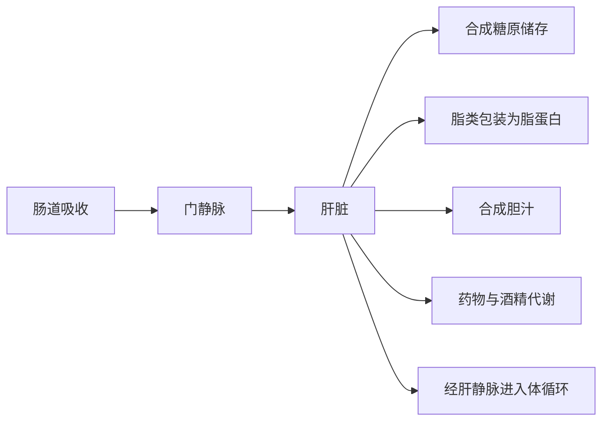

# Concept-Book Run

domain: /home/papagame/projects/digital-duck/cb-meta-health/public/domains/meta_health_ch05/input/graph.yaml
target: mindful_meal_protocol
started: 2026-11-24T12:46:34

## Teaching order (25 concepts)

- gastrointestinal_tract
- sympathetic_parasympathetic_balance
- regional_blood_flow_distribution
- splanchnic_circulation
- spleen_stomach_system
- prenatal_postnatal_qi
- smooth_muscle
- peristalsis_and_motility
- postprandial_hyperemia
- spleen_transformation_transport
- cardiovascular_load_of_digestion
- cephalic_phase_digestion
- liver_metabolic_role
- mastication
- eating_as_internal_exercise
- hepatic_first_pass_processing
- stomach_receiving_ripening
- ascending_clear_descending_turbid
- postprandial_glucose_response
- satiety_signaling
- digestive_load_pacing
- digestive_overtraining
- digestive_warm_up
- post_meal_gentle_movement
- mindful_meal_protocol

### gastrointestinal_tract (0.6s)

## 消化道

**定义。** 消化道(胃肠道)是一条从口腔到肛门、长约 $9\ \text{m}$ 的连续管道,依次为口腔、咽、食管、胃、小肠(十二指肠、空肠、回肠)和大肠。肝脏和胰腺不是管道本身,而是**附属消化器官**:它们通过导管把胆汁和胰液排入十二指肠。消化道的任务有两项:一是**消化**,把食物分解成可吸收的小分子;二是**吸收**,把营养物质、水和电解质送入血液或淋巴。

各段分工如下:

| 部位 | 主要功能 |
|---|---|
| 口腔 | 咀嚼;唾液淀粉酶开始分解淀粉 |
| 食管 | 蠕动推送食团,约 $10\text{–}15$ 秒到达胃 |
| 胃 | 盐酸($\text{pH}\approx 1.5\text{–}3.5$)与胃蛋白酶初步消化蛋白质 |
| 小肠 | 消化的主要场所,也是吸收的主要场所;绒毛和微绒毛使吸收面积大大增加 |
| 大肠 | 吸收水和电解质,形成粪便,容纳肠道菌群 |
| 肝脏 | 分泌胆汁,帮助脂肪乳化 |
| 胰腺 | 分泌胰淀粉酶、胰蛋白酶、胰脂肪酶和碳酸氢盐 |

**例题。** 一份午餐含 $60\ \text{g}$ 碳水化合物、$30\ \text{g}$ 蛋白质、$20\ \text{g}$ 脂肪。请追踪各营养素的消化位置,并估算能量。

1. **碳水化合物:** 口腔中唾液淀粉酶开始分解淀粉;进入胃后,胃酸使该酶失活;在小肠中由胰淀粉酶继续分解,最终由小肠刷状缘的酶变成葡萄糖并被吸收。
2. **蛋白质:** 胃蛋白酶先将其切成大的肽段,小肠中胰蛋白酶等进一步分解为氨基酸和短肽。
3. **脂肪:** 胃里仅有少量消化。到十二指肠后,胆汁将脂肪乳化成小滴,胰脂肪酶再将其分解为脂肪酸和单酸甘油酯。
4. **能量:** 按常用的能量换算系数(碳水化合物和蛋白质约 $4\ \text{kcal/g}$,脂肪约 $9\ \text{kcal/g}$):

$$60\times4+30\times4+20\times9=240+120+180=540\ \text{kcal}$$

**问题解决应用。** 把部位与功能对应起来,就能推断症状的来源。

*情境一:* 一位患者做了胆囊切除术,吃了油腻食物后容易腹泻、大便油腻。分析:肝脏仍分泌胆汁,但胆囊不再浓缩和储存,胆汁无法在进食时集中排出,脂肪乳化不充分,未消化的脂肪进入大肠,引起脂肪泻。因此建议少量多餐、减少单次脂肪摄入。

*情境二:* 乳糖不耐受者喝牛奶后腹胀。分析:小肠刷状缘乳糖酶不足,乳糖不能被分解吸收,进入大肠后被细菌发酵产气,并通过渗透作用把水拉入肠腔。判断时应注意,问题出在小肠的消化环节,而不是胃酸或胰腺。

*情境三:* 严重胰腺炎或胰腺切除后,胰酶分泌不足,三大营养素都难以消化,尤其是脂肪,常需口服胰酶制剂。

解题思路:先问"食物此刻走到了哪一段",再问"这一段缺少了什么酶、胆汁或吸收面积",症状的原因通常就清楚了。

### sympathetic_parasympathetic_balance (0.7s)

## 交感与副交感神经平衡

**定义。** 自主神经系统分为两大分支,它们对同一器官常常产生相反的作用。交感神经(常称"战或逃"系统)在应激、运动或危险时被激活:心率加快、支气管扩张、瞳孔放大、血糖升高,消化活动被抑制。副交感神经(常称"休息与消化"系统)在安静时占优势:心率减慢、胃肠蠕动和消化液分泌增加、能量被储存。两者并非"一开一关",而是同时持续发放冲动,身体状态取决于二者**当下的相对优势**,称为自主神经张力。

**心脏是最直观的例子。** 心脏自身的窦房结在不受神经影响时,固有节律约为 100 次/分。静息时迷走神经(副交感)的抑制性影响占主导,所以健康成年人静息心率约为 60–80 次/分。运动时,迷走神经张力下降,同时交感神经兴奋,心率可升至接近最大心率。常用的估算公式为:

$$HR_{\max} \approx 220 - \text{年龄}$$

心率还通过心输出量影响全身供血:

$$CO = HR \times SV$$

其中 $CO$ 为心输出量(L/min),$HR$ 为心率(次/分),$SV$ 为每搏输出量(mL/次,计算时换算为 L)。

**例题。** 一名 20 岁学生静息心率 70 次/分,每搏输出量 70 mL。剧烈运动时心率升至 180 次/分,每搏输出量升至 100 mL。求心输出量的变化,并估算其最大心率。

- 静息:$CO = 70 \times 0.070 = 4.9\ \text{L/min}$
- 运动:$CO = 180 \times 0.100 = 18\ \text{L/min}$
- 增加约 3.7 倍。
- 估算最大心率:$220 - 20 = 200$ 次/分,运动时的 180 次/分约为其 90%。

这一变化主要由交感神经兴奋与迷走神经张力撤退共同完成。

**应用:用心率恢复判断平衡状态。** 运动停止后,副交感神经重新占优势,心率会迅速下降。运动后第 1 分钟心率下降幅度较小(例如少于约 12 次/分)与较差的心血管预后相关,因此常被用作自主神经调节能力的指标。

*问题:* 上述学生运动结束时心率为 180 次/分,1 分钟后降至 150 次/分。心率恢复量是多少?

*解答:* $180 - 150 = 30$ 次/分,明显高于 12 次/分的参考界限,提示副交感神经"刹车"反应良好。

另一个常用指标是心率变异性(HRV),即相邻心跳间隔的波动程度。一般而言,静息时 HRV 较高提示副交感调节能力较强,长期压力、睡眠不足时 HRV 往往降低。需要注意,HRV 受年龄、呼吸、测量方法影响很大,个体之间不宜直接比较,更适合与自己的基线对照。

**要点。** 健康并不是让某一分支"永远占优势",而是能够根据情境灵活切换:需要时迅速动员,结束后及时恢复。长期处于交感兴奋状态(慢性压力)而难以恢复,才是需要关注的问题。

### regional_blood_flow_distribution (0.9s)

## 血流的区域分配

**定义。** 心输出量(每分钟由心脏泵出的血量)并不平均分给全身各处,而是按各器官当下的需要分配。这种分配主要靠局部小动脉的收缩与舒张来调节:某器官的小动脉舒张,流经它的血量增加;收缩则减少。静息时,成年人心输出量约为 $5\ \text{L/min}$,大致分配为:肝脏和消化道约 $25\%$,肾脏约 $20\%$,脑约 $15\%$,骨骼肌约 $15\%\text{–}20\%$,心肌约 $5\%$,皮肤及其他约 $10\%$ 以上。

血流量、压力与阻力之间有一个确定的关系:

$$Q=\frac{\Delta P}{R}$$

其中 $Q$ 为某器官的血流量,$\Delta P$ 为该器官动脉端与静脉端的压力差,$R$ 为血管阻力。各器官并联在同一个动脉压力下,因此某器官的 $R$ 变小,它得到的 $Q$ 就增大。

**运动时的重新分配。** 运动时,交感神经兴奋,内脏和皮肤的小动脉收缩;同时骨骼肌因代谢产物(如腺苷、二氧化碳、氢离子)积累而局部舒张。脑血流基本保持稳定。心输出量增加,其中更大的份额流向工作的肌肉。

| 器官 | 静息血流(mL/min) | 剧烈运动血流(mL/min) |
|---|---|---|
| 骨骼肌 | 约 1000 | 约 22000 |
| 肝脏及消化道 | 约 1400 | 约 600 |
| 肾脏 | 约 1100 | 约 600 |
| 脑 | 约 750 | 约 750 |
| 总心输出量 | 约 5000 | 约 25000 |

(表中数值为典型的约数,个体差异较大。)

**例题。** 一名运动员静息时心输出量为 $5\ \text{L/min}$,骨骼肌分得 $20\%$;剧烈运动时心输出量升至 $25\ \text{L/min}$,骨骼肌分得 $85\%$。求骨骼肌血流量增加了多少倍。

解:静息时骨骼肌血流量为 $5\times 0.20=1\ \text{L/min}$。运动时为 $25\times 0.85=21.25\ \text{L/min}$。

$$\frac{21.25}{1}\approx 21\text{ 倍}$$

可见其中心输出量增加贡献了 $5$ 倍,而份额提高($20\%\to 85\%$)又贡献约 $4$ 倍,两者相乘得到总增幅。

**问题应用。** 饭后立即剧烈运动为什么容易不适?消化道此时需要较多血流来吸收营养,而运动又要求把血液分给肌肉。两者竞争有限的心输出量,消化道血流被压缩,可能引起腹胀、恶心或腹痛。因此,较大的一餐之后,通常建议间隔一段时间(常见建议为 1–2 小时)再进行高强度运动。

再如,炎热环境中运动时,皮肤也需要大量血流散热。此时肌肉与皮肤同时争夺血液,若再脱水导致血容量下降,心输出量不足以满足两者,运动能力会明显下降,甚至发生热衰竭。所以补水对维持血流分配十分关键。

**小结。** 血流的区域分配是在心输出量有限的前提下,按需求动态调整各器官的血流份额。理解这一点,就能解释运动、进食、高温等情境下身体的反应,并据此安排训练与饮食。

### splanchnic_circulation (0.7s)

## 内脏循环

**定义。** 内脏循环(splanchnic circulation)是指供应胃、肠、胰腺、脾和肝的血液循环。腹腔干、肠系膜上动脉和肠系膜下动脉这三条主要动脉先把血液送入消化器官的毛细血管网。静脉血随后汇入门静脉,**再流经肝脏**,最后经肝静脉回到下腔静脉。因此肝脏有双重供血:门静脉提供约 $70\%$ 的入肝血流,肝动脉提供其余部分。

静息时,内脏循环约获得心输出量的 $20\%$–$25\%$。以静息心输出量 $5\ \text{L/min}$ 计,约为 $1.0$–$1.25\ \text{L/min}$。内脏静脉系统顺应性高,容纳了大量血液,可以作为"血液储存库"。

**与其他器官的关系。** 内脏循环与骨骼肌循环共用同一份有限的心输出量。进食后,肠道血流可增加约 $30\%$–$100\%$。剧烈运动时,交感神经兴奋使内脏小动脉收缩,血液被重新分配给工作的肌肉。

**例题。** 一名运动员静息心输出量为 $5.0\ \text{L/min}$,内脏血流占 $24\%$。运动时心输出量升至 $20\ \text{L/min}$,内脏血流降至 $6\%$。问内脏血流的绝对值如何变化?

静息时:

$$Q_{\text{静息}} = 5.0 \times 0.24 = 1.2\ \text{L/min}$$

运动时:

$$Q_{\text{运动}} = 20 \times 0.06 = 1.2\ \text{L/min}$$

可见内脏血流的**绝对值几乎不变**。比例下降主要是因为总心输出量增大。有些学生会误以为"比例下降就是血流量下降",这个例子说明要先换算成绝对值,再下结论。

在更强烈或更持久的运动中,内脏血流可降至静息值的约 $20\%$–$30\%$。

**问题解决应用。** 门静脉血流约为 $1.0\ \text{L/min}$,其中约 $70\%$ 入肝。

1. 门静脉入肝血流:$1.0 \times 0.70$ 不能直接使用,因为这里的 $70\%$ 是指占入肝总血流的比例,而不是占门静脉血流的比例。门静脉血流本身就是入肝的门脉部分。
2. 设入肝总血流为 $Q$,则门静脉部分为 $0.70\,Q = 1.0\ \text{L/min}$,于是

$$Q = \frac{1.0}{0.70} \approx 1.43\ \text{L/min}$$

3. 肝动脉血流为 $1.43 - 1.0 \approx 0.43\ \text{L/min}$。

这类计算在临床上有实际用途。例如,门静脉高压或肝硬化时,门静脉血流受阻,血液可能经侧支循环绕过肝脏。肝脏接触到的肠道吸收物质因此减少,药物和毒素的清除也随之改变。

**与饮食的联系。** 餐后消化吸收需要更多血流。高强度运动前立即大量进食,会让肌肉和肠道争夺血液。这可能引起腹胀、恶心或腹痛,因此运动员常把大餐安排在训练前数小时。

*小结:内脏循环在静息时占心输出量约四分之一,其血流可在进食与运动之间重新分配。分析问题时要同时看比例和绝对值。*

### spleen_stomach_system (0.6s)

## 脾胃

**定义。** 脾胃是中医(Traditional Chinese Medicine,TCM)脏腑理论中的一个功能组合。中医认为,胃主“受纳”和“腐熟”,即接收食物并初步消化;脾主“运化”,即把饮食转化为可被身体利用的“水谷精微”,并输布全身。在五行(五种功能类型的分类)中,脾胃属“土”,位于身体中部,对应三焦中的“中焦”,所以常被称为“后天之本”。需要注意:中医所说的“脾”是功能概念,不等同于解剖学中的脾脏(免疫与血液滤过器官)。解剖学上的消化功能,大致对应胃、小肠、胰腺等器官的共同作用。

**脾胃的功能分工。**

| 项目 | 胃 | 脾 |
|---|---|---|
| 中医的核心功能 | 受纳、腐熟 | 运化、升清 |
| 气机方向 | 和降(向下) | 升举(向上) |
| 中医认为失调时的表现 | 胃脘胀痛、嗳气、恶心 | 食少、腹泻、乏力、大便稀溏 |
| 现代医学中的大致对应 | 胃的容纳、研磨与胃酸消化 | 小肠消化吸收、胰酶分泌等 |

**例题。** 一位大学生连续两周熬夜复习,三餐不规律,常吃冷饮和外卖。他出现饭后腹胀、食欲差、大便偏稀、容易疲倦。请按中医思路分析,并给出现代医学的补充判断。

*解答。*
1. **辨别症状属于哪一类。**饭后腹胀、食欲差,中医归入“胃失和降”或“脾失健运”;大便稀、疲倦,则指向“脾虚”。
2. **找诱因。**中医认为饮食不节、过食生冷、思虑过度、作息紊乱都会损伤脾胃,与该生活方式吻合。
3. **提出生活调整。**规律进餐(每日三餐定时)、减少冷饮和油腻食物、保证睡眠、适度运动。这些建议本身与现代消化健康指导一致。
4. **现代医学排查。**腹泻若持续超过 2 周,或出现体重下降、黑便、便血、夜间腹痛、发热,应就医检查,排除感染、乳糜泻、炎症性肠病等疾病,不应只靠调理。

**问题求解应用。**判断时可按三步进行:

- **先分“升”与“降”:**以上腹胀满、嗳气、恶心为主,偏向胃;以便溏、乏力、食少为主,偏向脾。
- **再看有无“警示信号”:**如持续呕吐、吞咽困难、不明原因消瘦、消化道出血,这些需要优先做胃镜、血液或影像学检查。
- **最后落实可测量的行动:**记录一周内的进餐时间、食物种类、症状出现时间与大便次数,比较调整前后的变化。若症状在 2–4 周的规律饮食后明显改善,说明生活方式因素很可能是主要原因。

在证据方面,“脾胃”的功能分类是中医的理论框架,而非解剖学结论;其中规律饮食、避免暴饮暴食等建议有现代营养学支持,但“脾虚”“土”等概念本身并未被现代医学证实为独立的病理实体。

**小结。**脾胃体现的是中医对“消化—吸收—输布”过程的整体归类。用它来组织生活习惯是有益的,但遇到警示症状,必须以现代医学检查为准。

### prenatal_postnatal_qi (0.6s)

## 先天之本与后天之本

**定义。** 中医认为,人体之气有两个主要来源。**先天之气**(先天之精所化)禀受于父母,在受孕时形成,储藏于肾,所以称"肾为先天之本"。**后天之气**则来自出生之后:脾胃把饮食中的水谷转化为气和血,每天都在重新生成,所以称"脾胃为后天之本"。简单说,先天之气像出生时带来的"启动资金",量有限,主要决定体质的基础;后天之气像每天的"收入",靠饮食和脾胃的运化持续补充。中医还认为,后天之气充足时,可以滋养并保护先天之气,所以两者相互依赖。需要说明的是,这是中医的理论框架,不是现代生理学的结论。

**对照表。**

| 项目 | 先天之气 | 后天之气 |
|---|---|---|
| 来源 | 父母之精,受孕时禀受 | 饮食水谷,经脾胃运化 |
| 相关脏腑 | 肾 | 脾、胃 |
| 更新方式 | 不能新增,只能珍惜、减少消耗 | 每天可以补充 |
| 日常调养 | 规律作息,避免过度劳累 | 规律饮食,不暴饮暴食 |

**例题。** 小李 20 岁,是大学生。他连续两个月熬夜赶项目,早餐常常不吃,午饭和晚饭靠外卖,吃得又快又凉。后来他出现乏力、饭后腹胀、大便偏稀,舌淡苔白。请用本节概念分析。

**解析。**

1. *找线索:* 乏力、腹胀、便溏都与消化吸收有关,而且起因是饮食不规律,发生在出生之后。
2. *判断归属:* 中医会把这些表现归为后天之气不足,即"脾胃运化失常",气血生成不够。
3. *区分先天:* 小李以前体质一直不错,症状是近两个月才出现,病因明确,因此不必归因于先天不足。
4. *调养方向:* 先恢复规律三餐,吃温热、易消化的食物,细嚼慢咽,再保证睡眠。这是在改善"每天的收入",而不是去"补"先天。

**应用题。** 下面两种情况,哪一种更接近"先天不足",哪一种更接近"后天失养"?

- 甲:一个孩子自幼生长发育偏慢,家中几位成员体质相近。
- 乙:一位上班族长期靠零食和饮料代替正餐,近半年消瘦、没有食欲。

*思路:* 甲从小就有、带有家族倾向,中医会倾向于先天禀赋不足,重点在长期、细致的调护。乙的起因是近期的饮食习惯,属于后天失养,首先要纠正饮食。注意,两种情况都应先就医排除疾病。孩子发育慢可能涉及内分泌或营养问题,持续消瘦、食欲差也可能是疾病的信号,不能只靠"调养"来解决。

**小结。** 先天之本和后天之本不是两个互不相干的系统。先天之气决定起点,后天之气决定日常的补给。实际问题中,先问症状是"从小就有"还是"后来才出现",再看与饮食作息的关系,就能找到调养的重点。

### smooth_muscle (0.7s)

## 平滑肌

**定义。** 平滑肌是不受意识支配的肌肉,分布于胃肠壁、血管壁、支气管、膀胱和子宫等器官。它的细胞呈梭形,只有一个细胞核,肌丝排列不整齐,因此在显微镜下看不到骨骼肌那样的横纹。平滑肌由自主神经、激素和局部化学信号调节,并且部分平滑肌能自发地节律性收缩。

**与骨骼肌的关键差异。** 骨骼肌的收缩由钙离子与肌钙蛋白结合触发。平滑肌细胞没有肌钙蛋白,而是靠钙离子与钙调蛋白结合,激活肌球蛋白轻链激酶,使肌球蛋白磷酸化后才能与肌动蛋白相互作用。平滑肌收缩较慢,但耗能低,能长时间维持张力而不易疲劳。这正是血管能持续保持张力、括约肌能长时间关闭的原因。

| 特征 | 骨骼肌 | 平滑肌 |
|---|---|---|
| 控制方式 | 随意(躯体神经) | 不随意(自主神经、激素) |
| 横纹 | 有 | 无 |
| 钙离子的作用对象 | 肌钙蛋白 | 钙调蛋白 |
| 收缩速度 | 快 | 慢 |
| 抗疲劳能力 | 较弱 | 强 |

**工作示例:血管平滑肌与血流。** 血管阻力对半径极为敏感。泊肃叶定律表明,在其他条件不变时,血流阻力 $R$ 与半径 $r$ 的四次方成反比:

$$R \propto \frac{1}{r^{4}}$$

设某小动脉的血管平滑肌舒张,使半径增至原来的 $1.2$ 倍,则阻力变为原来的

$$\frac{1}{1.2^{4}} \approx \frac{1}{2.07} \approx 0.48$$

即阻力约降为原来的一半。反之,平滑肌收缩使半径缩小到 $0.8$ 倍,阻力约增至原来的 $\frac{1}{0.8^{4}} \approx 2.44$ 倍。因此,小动脉平滑肌的微小舒缩,就足以显著改变血压和器官的血流分配。

**问题求解应用。** 平均动脉压可由心输出量 $CO$ 与总外周阻力 $TPR$ 估算:

$$MAP = CO \times TPR$$

题目:某人静息时 $CO = 5\ \text{L/min}$,$MAP = 90\ \text{mmHg}$,求 $TPR$。再设服用血管扩张药后小动脉平滑肌舒张,$TPR$ 降低 $20\%$,心输出量不变,求新的 $MAP$。

解:$TPR = \frac{90}{5} = 18\ \text{mmHg·min/L}$。降低 $20\%$ 后 $TPR = 18 \times 0.8 = 14.4$,所以

$$MAP = 5 \times 14.4 = 72\ \text{mmHg}$$

这说明了一些降压药(如钙通道阻滞剂)的作用机制:阻断钙离子进入平滑肌细胞,使血管舒张,外周阻力下降,血压随之降低。

**消化道中的节律性收缩。** 胃肠壁平滑肌分为环形肌和纵行肌两层。部分细胞(如卡哈尔间质细胞)产生缓慢的电节律,引发节段性收缩和蠕动,把食物向前推送并与消化液混合。肠道蠕动的强弱受副交感神经促进、交感神经抑制,这解释了为什么紧张时常出现消化不适。

### peristalsis_and_motility (0.6s)

## 胃肠蠕动

**定义。** 胃肠蠕动是消化道平滑肌有协调的收缩波，它既能搅拌食物，也能把食物向前推送。消化道从口腔到肛门全长约 7–9 米（活体肌肉有张力，实际较短）。蠕动主要有两种形式：

- **推进性蠕动**：环形肌在食团上方收缩，纵行肌在食团下方收缩，食团被向肛侧推进。
- **分节运动**：相隔的肠段交替收缩和舒张，把食糜切分、混合，使它与消化液和肠黏膜充分接触。

肠神经系统（肠壁内的神经网络）能独立产生这些节律。副交感神经（主要是迷走神经）兴奋时，会增强收缩、加快推进。应激时交感神经占优势，肠道运动被抑制，所以紧张时常出现食欲下降或便秘。也有人在应激时腹泻，这说明应激对肠道的影响并不单一。

**数据举例。** 不同肠段的推进速度差别很大。一餐混合食物的大致通过时间如下：

| 部位 | 大致停留时间 |
|---|---|
| 胃（排空） | 2–4 小时 |
| 小肠 | 3–5 小时 |
| 结肠 | 12–48 小时 |

全肠道通过时间为 $T = T_{\text{胃}} + T_{\text{小肠}} + T_{\text{结肠}}$，这是对各段时间的求和。

**例题。** 某人早餐后，胃排空用了 3 小时，小肠通过用了 4 小时，结肠通过用了 30 小时。求全肠道通过时间，并判断它是否在常见范围内。

解：

$$T = 3 + 4 + 30 = 37 \text{ 小时}$$

这个值落在上表三段范围合计的约 17–96 小时之内，也在一般 24–72 小时的常见范围内，属于正常。

**问题解决应用。** 某人连续一周考试，每天排便一次的习惯变为每 3–4 天一次，同时食欲下降。可以按以下步骤分析：

1. **找机制**：考试压力使交感神经兴奋，副交感活动相对减弱，结肠蠕动变慢，粪便在结肠中停留更久，水分被吸收更多，大便变硬。
2. **选对策**：
   - 增加膳食纤维，成人推荐每日约 25–30 g，以增加粪便体积和对肠壁的刺激。
   - 保证每日饮水充足，避免粪便过干。
   - 安排规律的进餐时间。进食后胃结肠反射会增强结肠蠕动，早餐后尝试排便最容易成功。
   - 适度运动，并用放松呼吸等方式降低交感兴奋。
3. **识别警示信号**：若出现便血、不明原因的体重下降、持续腹痛，或症状超过数周，应就医检查，不能只当作"压力问题"。

中医认为"脾主运化"，胃肠功能与情志相关。这一说法与上述应激和肠道运动的关系有一定的相似之处，但它是传统理论的表述，不能代替现代的生理机制。

**小结。** 胃肠蠕动由平滑肌的推进波和分节运动共同完成，受肠神经系统调节，副交感神经使之增强，应激使之减弱。分析肠道问题时，可以先估算各段通过时间，再判断是哪个环节出了问题。

### postprandial_hyperemia (0.7s)

## 餐后充血

**定义。** 餐后充血(postprandial hyperemia)是指进食后胃肠道血流量显著增加的生理反应。食物进入消化道后,肠系膜上动脉的血流量可升至空腹时的约 2 倍,持续约 1–3 小时,峰值常出现在进餐后 30–90 分钟。与此同时,心率和每搏输出量上升,心输出量随之增加,以保证全身其他器官的供血不被明显挤占。

**机制。** 主要有三方面:(1)食物的化学成分(尤其是脂肪、糖和蛋白质的消化产物)刺激肠黏膜,引起局部血管舒张;(2)胃肠激素和局部代谢产物(如腺苷)参与扩张肠道小动脉;(3)自主神经调节使心率加快、心输出量增加。

心输出量(CO)的定义为:

$$\text{CO} = \text{HR} \times \text{SV}$$

其中 HR 为心率,SV 为每搏输出量。

**例题。** 某成年人空腹时心率为 70 次/分,每搏输出量为 70 mL;一顿大餐后心率升至 80 次/分,每搏输出量升至 75 mL。肠系膜上动脉血流从 0.6 L/min 升到 1.2 L/min。求心输出量的变化,以及肠系膜上动脉增加的血流占心输出量增加量的比例。

空腹时:

$$\text{CO}_1 = 70 \times 70\ \text{mL} = 4900\ \text{mL/min} \approx 4.9\ \text{L/min}$$

餐后:

$$\text{CO}_2 = 80 \times 75\ \text{mL} = 6000\ \text{mL/min} = 6.0\ \text{L/min}$$

心输出量增加 $6.0 - 4.9 = 1.1$ L/min。肠系膜上动脉血流增加 $1.2 - 0.6 = 0.6$ L/min,所以:

$$\frac{0.6}{1.1} \approx 0.55$$

也就是说,增加的心输出量中约 55% 流向了肠道;其余约 0.5 L/min 的增量供给其他器官,同时其他血管床也会发生部分血流重新分配。

**问题求解应用。** 

*情境一:餐后血压。* 肠道血管床大量开放,外周阻力下降。健康人靠心输出量增加和交感神经兴奋来代偿,血压基本稳定。但部分老年人或自主神经功能受损者(如糖尿病神经病变、帕金森病)代偿不足,餐后 1–2 小时血压会明显下降,称为餐后低血压(通常指收缩压下降 ≥20 mmHg),可出现头晕甚至跌倒。建议这类人群少量多餐、减少一次性大量碳水化合物的摄入,餐后避免立刻起身活动。

*情境二:餐后运动。* 运动时骨骼肌同样需要大量血流。饱餐后立即剧烈运动,肠道和肌肉对血流形成竞争,可能引起腹胀、恶心或腹痛。因此较大一餐后,通常建议间隔 1.5–3 小时再进行高强度运动;轻度活动如散步一般不受影响。

*情境三:血流估算。* 若已知餐后心输出量和肠系膜血流,可用上例的比例方法判断一次进餐对循环系统的负担,以及哪些人群需要注意餐后血流动力学变化。

**要点。** 餐后充血是正常的适应性反应:肠道血流增加,心输出量上调,使消化吸收与全身供血得以同时进行。

### spleen_transformation_transport (0.9s)

## 脾主运化

中医认为,脾主运化,是指脾负责把摄入的饮食和水液转化为可用的营养物质,并将其输送到全身。这里的"运"指运输,"化"指转化。具体包括两方面:**运化水谷**,即从饮食中提取水谷精微(refined essence),作为生成气和血的原料;**运化水液**,即吸收、输布水液,防止其在体内停聚。这项功能由脾阳(脾的温煦、推动作用)提供动力。脾阳充足,运化顺畅;脾阳不足,则运化减弱。这里的"脾"是中医的功能概念,不等同于现代解剖学中的脾脏。

### 对照现代生理

脾的运化与现代消化吸收、物质代谢大致对应,但不能一一等同。可以这样理解:

| 中医说法 | 现代生理中的近似对应 |
|---|---|
| 运化水谷 | 消化、吸收营养,以及能量代谢 |
| 运化水液 | 肠道吸收水分,体液分布与排泄 |
| 脾阳不足 | 消化功能减弱、产热不足等表现 |

这种对应只是帮助理解,并不意味着两套体系的概念可以互相替换。

### 例题

**情境**:小李近两个月常吃冷饮、饮食不规律。他逐渐出现饭后腹胀、大便稀溏、四肢发凉、容易疲倦,舌体胖大,舌边有齿痕。

**分析步骤**:

1. **识别症状属于哪类功能**:饭后腹胀、便溏,说明水谷未能被正常消化吸收和传输。
2. **判断水液是否受影响**:大便稀溏、舌体胖大有齿痕,在中医看来是水湿停聚的表现,属运化水液失常。
3. **寻找动力环节**:四肢发凉、喜暖,提示脾阳不足,推动与温煦作用减弱。
4. **推导后果**:水谷精微生成不足,气血缺乏来源,所以出现疲倦乏力。
5. **确定调养方向**:中医通常主张健脾温中,生活上少食生冷、饮食规律、适量温热熟食。

**结论**:此例可归为"脾阳不足,运化失职",并伴水湿内停。

### 解题应用

遇到类似题目,可按固定顺序思考:

- **先看"运化水谷"**:有无食欲差、腹胀、消化不良?
- **再看"运化水液"**:有无便溏、水肿、身体困重、舌胖有齿痕?
- **后看"脾阳"**:有无畏寒、肢冷、喜温喜按?
- **最后看"后果"**:气血生化不足,表现为乏力、面色少华。

**练习**:某人长期节食减肥,常觉乏力、食后腹胀,但不怕冷,也没有水肿。他的问题更偏向运化水谷不足,而非脾阳虚水停。请思考:为什么没有怕冷和水肿,就不能直接判为脾阳不足?(提示:脾阳不足的判断需要有寒象和水湿的证据支撑。)

需要注意的是,上述分析属于中医辨证思路,并非现代医学诊断。若出现持续腹泻、体重明显下降、便血等症状,应先就医排查器质性疾病,而不应仅凭中医概念自行判断。

### cardiovascular_load_of_digestion (0.7s)

## 消化的心血管负荷

**定义。** 消化的心血管负荷,是指进食后胃肠道为吸收营养而需要更多血流,心血管系统因此承担的额外工作。大餐之后,内脏(胃、小肠、肝、胰)的血流量可增加约 50%–100%,持续 1–3 小时。要满足这一需求,心率上升,每搏输出量增加,心输出量随之升高。心输出量的定义是:

$$CO = HR \times SV$$

其中 $CO$ 为心输出量(L/min),$HR$ 为心率(次/分),$SV$ 为每搏输出量(L/次)。

**为什么运动会与消化“争血”。** 静息时心输出量约 5 L/min,其中内脏约占 25%。剧烈运动时,骨骼肌需要大量血流,身体会通过交感神经收缩内脏血管,把血液调往肌肉。如果餐后立即剧烈运动,两边同时需要血液,心脏必须更努力地工作,同时胃肠血流不足,容易出现腹胀、恶心、腹痛或反流。

**例题。** 某人静息心率 70 次/分,每搏输出量 70 mL。大餐后心率升至 80 次/分,每搏输出量升至 75 mL。求心输出量的变化。

餐前:$CO = 70 \times 70\ \text{mL} = 4900\ \text{mL/min} \approx 4.9\ \text{L/min}$。

餐后:$CO = 80 \times 75\ \text{mL} = 6000\ \text{mL/min} = 6.0\ \text{L/min}$。

增加量为 $6.0 - 4.9 = 1.1$ L/min,增幅约 $\frac{1.1}{4.9} \approx 22\%$。可见心率只升了约 14%,但每搏输出量同时上升,总效应更大。

**问题应用一:餐后运动安排。** 大餐(高脂肪、高蛋白)消化时间较长,通常建议间隔 2–3 小时再做剧烈运动。小份清淡的加餐可缩短到 30–60 分钟。散步等低强度活动对肌肉血流需求小,一般可以在餐后进行。

**问题应用二:餐后低血压。** 餐后低血压(postprandial hypotension)通常定义为进食后 2 小时内收缩压下降 $\geq 20$ mmHg,或降至 90 mmHg 以下。内脏血管大量扩张后,健康年轻人可靠心率加快和外周血管收缩来代偿,把血压维持住。老年人压力感受器反射减弱,血管弹性变差,常常代偿不足,血压下降,出现头晕、乏力,甚至跌倒。糖尿病、帕金森病患者及服用降压药者风险更高。

常用的应对办法有:

- 少量多餐,减少一次性大餐。
- 降低单餐碳水化合物比例,因为快速吸收的糖类会加重血压下降。
- 餐前适量饮水(约 300–500 mL)。
- 餐后坐或躺 30–60 分钟,起身时动作放慢。

若餐后反复头晕或晕厥,应就医评估,而不是自行调整降压药。

**小结。** 进食本身就是一项心血管任务:心输出量上升,血液向内脏倾斜。健康人能轻松应对。需要关注的是两类情形:餐后立即剧烈运动,以及代偿能力下降的老年人。

### cephalic_phase_digestion (0.7s)

## 消化的头期

**定义。** 消化的头期(cephalic phase)是指食物尚未进入胃之前,由看到、闻到、尝到食物,或想到食物、咀嚼动作所引发的消化反应。这些感觉信号传到脑干和下丘脑,再经迷走神经向消化器官发出指令,使唾液腺分泌唾液,胃壁分泌胃酸和胃蛋白酶原,胰腺的 β 细胞释放少量胰岛素,胰腺外分泌部也开始分泌消化酶。这些反应相当于身体提前做好准备。

**为什么有意义。** 胃酸的分泌通常分为头期、胃期和肠期三个阶段。在进食的过程中,头期大约贡献了全部胃酸分泌量的 30%。它的意义在于,食物到达时,消化液已经备好,血糖的上升也已经有了应对。

**例题。** 一位受试者空腹时胃液基础分泌量为每小时 20 mL。研究者让这位受试者闻、看一份烤肉,但不吞咽。假设一小时内胃液分泌升至 60 mL。

1. 头期引起的增量为 $60 - 20 = 40\ \text{mL}$。
2. 这部分增量完全由迷走神经介导,因为食物没有接触胃壁,胃内没有机械牵张,也没有化学刺激。
3. 如果在实验前给受试者注射阿托品(一种阻断迷走神经末梢毒蕈碱受体的药物),分泌量大多会停留在基础水平附近。这支持迷走神经是主要通路的结论。

**问题解决应用。** 下面三个情境可以用头期原理来分析。

*情境一:口干与进食前后的血糖。* 一位 2 型糖尿病患者发现,餐前闻到饭香时,血糖有时会轻微下降。解释:头期引起第一时相胰岛素的少量释放(通常只有餐后总量的很小一部分),使肝脏输出葡萄糖略受抑制,并为随后的血糖上升做好准备。

*情境二:仔细咀嚼。* 咀嚼本身是头期的刺激之一。咀嚼更久,唾液淀粉酶有更多时间开始分解淀粉,迷走神经的反馈也更充分。需要注意的是,咀嚼时间对体重的长期影响,目前的研究证据并不一致,不宜夸大。

*情境三:鼻饲或静脉营养。* 通过管道直接把营养送入胃肠的患者,绕过了口腔和嗅觉,头期反应缺失。这是临床上让能够经口进食的患者尽量保留口腔刺激的原因之一。

**常见误解。** 有人认为"想到食物就会让胃酸腐蚀胃壁"。实际上,头期分泌的胃酸量有限,胃黏膜表面有黏液和碳酸氢盐保护层。但对已有胃溃疡的人,长期的情绪紧张与不规律进食可能增加不适,应在医生指导下管理。

**小结。** 头期的核心是"先于食物的准备":感觉与咀嚼信号经迷走神经,提前启动唾液、胃酸和胰岛素的分泌。它解释了为什么食物的气味会让人"流口水",也说明了进食方式如何影响消化的开端。

### liver_metabolic_role (0.7s)

## 肝脏的代谢作用

**定义。** 肝脏是人体最大的内脏器官,也是营养物质进入全身循环前的"中转站"。肠道吸收的营养物质(除大部分脂类经淋巴入血外)先经门静脉进入肝脏,由肝细胞加工后再送往全身。肝脏的代谢作用主要包括四项:

- **处理营养物质**:调节血糖,把氨基酸合成血浆蛋白(如白蛋白),合成胆固醇和脂蛋白。
- **储存糖原**:饭后把多余葡萄糖合成糖原;空腹时分解糖原释放葡萄糖,并通过糖异生补充血糖。
- **制造胆汁**:每天约分泌 $500\text{–}1000\ \text{mL}$ 胆汁,帮助小肠消化和吸收脂肪。
- **清除毒物**:把药物、酒精、氨等转化为更易排出的物质。氨在肝内合成尿素,再经肾脏排出。

**工作示例。** 一位成年人晚餐摄入 $90\ \text{g}$ 碳水化合物,血糖上升。门静脉血携带葡萄糖进入肝脏,肝细胞把一部分合成糖原。成人肝糖原总量约 $80\text{–}100\ \text{g}$。葡萄糖每克约提供 $4\ \text{kcal}$ 能量,所以这些糖原约相当于:

$$
90\ \text{g} \times 4\ \text{kcal/g} \approx 360\ \text{kcal}
$$

这一数量级与肝糖原全部储备的能量接近。夜间进食停止后,血糖由肝糖原分解维持。肝糖原消耗殆尽后,肝脏转而用乳酸、甘油和氨基酸合成葡萄糖。

**问题解决应用。**

*问题 1:* 一名患者长期大量饮酒,化验显示血氨升高、白蛋白降低、空腹易低血糖。请判断是肝脏哪些功能受损。

*分析:*
1. 血氨升高:肝内合成尿素的能力下降,毒物清除受损。
2. 白蛋白降低:蛋白质合成减少。
3. 空腹低血糖:糖原储备不足,糖异生能力下降。

三项指标分别对应清除毒物、处理营养物质和储存糖原,说明肝脏代谢功能受到广泛损害。

*问题 2:* 为什么某些药物需要根据肝功能调整剂量?

*分析:* 许多药物经肝脏转化后才被清除。肝功能下降时,药物清除变慢,血药浓度升高,常规剂量可能造成蓄积中毒,因此需要减量或换药。

**中医视角。** 中医认为"肝主疏泄",与情志和消化的调畅有关。这是中医理论中的功能概念,与现代解剖学意义上的肝脏代谢功能并不等同,不能互相替代。临床上评估肝脏代谢功能,仍应依据转氨酶、胆红素、白蛋白等检验指标。

**小结。** 肝脏位于消化道与全身循环之间,负责加工、储存、分泌和解毒。分析临床现象时,可以先问:是加工营养、储存糖原、分泌胆汁,还是清除毒物出了问题。

### mastication (0.8s)

## 咀嚼

**定义。** 咀嚼(mastication)是由咀嚼肌(咬肌、颞肌、翼内肌、翼外肌)带动下颌,配合牙齿与舌头,把食物切碎、磨细的过程。它同时完成三件事:

1. **机械破碎**:增大食物的表面积,让消化酶更容易接触食物。
2. **化学启动**:食物与唾液混合。唾液中的唾液淀粉酶开始把淀粉分解为麦芽糖等较小的分子;舌脂肪酶也开始作用于脂肪。
3. **信息反馈**:口腔感受食物的质地与味道,饱腹信号需要一定时间才会传到大脑,咀嚼放慢了进食速度,为这一过程留出时间。

**worked example:同一份饭,两种吃法。** 小明吃一份约 600 kcal 的午餐。

- 快速进食:10 分钟吃完,平均摄入速度为 $\dfrac{600\ \text{kcal}}{10\ \text{min}} = 60\ \text{kcal/min}$。
- 细嚼慢咽:每口咀嚼约 20–30 次,25 分钟吃完,平均速度为 $\dfrac{600\ \text{kcal}}{25\ \text{min}} = 24\ \text{kcal/min}$。

摄入的总能量相同,但后者的速度只有前者的 $\dfrac{24}{60}=40\%$。若饱腹信号大约在进食 20 分钟后才明显增强(这是常用的粗略说法,个体差异大),快速进食者在信号到来前已经吃完甚至吃多,慢速进食者则有机会在中途感到"够了"。一些研究发现,放慢进食、增加咀嚼次数与较低的单餐摄入量相关,但效果的大小因人而异。

**问题解决应用。** 下面三个情境,可以用咀嚼的原理来分析。

*情境一:吃米饭时,越嚼越甜。* 原因是唾液淀粉酶把淀粉分解成了麦芽糖。这也说明:咀嚼时间越长,淀粉与酶接触越充分。不过胃酸会使淀粉酶失活,所以口腔中的淀粉消化只是整个过程的开端,主要的淀粉消化仍在小肠完成。

*情境二:牙齿缺失或义齿不合适的老人,常常食物嚼不烂。* 食物颗粒较大时,小肠的消化吸收效率会下降,同时老人可能因咀嚼困难而回避肉类、蔬菜和坚果,导致蛋白质与膳食纤维摄入不足。对策是:把食物做得更软更小(切碎、炖煮),并及时就医修复牙齿,而不是只依赖流食。

*情境三:你想控制进食速度。* 可行的做法包括:每口放下餐具、每口咀嚼约 20 次、一餐至少用 20 分钟,并减少边看屏幕边吃的分心。这些方法的目的是给大脑时间接收饱腹信号,不必追求固定的次数。

在 TCM 中,也有"细嚼慢咽有助脾胃运化"的说法,这与上述现代生理学的结论方向一致:充分咀嚼减轻了后续消化的负担。

**小结。** 咀嚼不只是"把食物弄碎":它启动了消化,也调节了进食速度。在日常饮食中,吃得慢一点,往往是最容易做到、成本最低的饮食调整之一。

### eating_as_internal_exercise (0.8s)

## 饮食即内脏运动

**定义。** 饮食即内脏运动,是把一顿饭看作内脏的一次"训练"。进食时,胃肠平滑肌节律性收缩,胃液、胆汁、胰液大量分泌,血液被调往消化道,肝脏则要处理从门静脉涌入的营养物质。中医认为,这相当于启动脾胃这台"发动机"。这个比喻的价值在于:它提醒我们,和任何运动一样,进食也需要准备、合适的负荷和恢复。

**生理依据。** 餐后,内脏血流量可明显增加,常见说法是由静息时约占心输出量的 20%–25%升至约 30%–35%,个体差异较大。以静息心输出量 5 L/min 计算:

- 餐前内脏血流约 $5 \times 0.25 = 1.25$ L/min;
- 餐后约 $5 \times 0.33 \approx 1.65$ L/min。

增加的约 0.4 L/min 来自其他器官和心脏的再分配,心率也常轻度上升。

**例题。** 小林中午吃了一顿约 900 kcal 的大餐,然后立刻冲去打篮球。请分析问题所在。

*分析:* 大餐使内脏需要更多血流,而剧烈运动又要求肌肉获得更多血流,两者争夺有限的心输出量。结果可能是腹胀、恶心、腹痛,消化也变慢。再看负荷:若他平时一餐约 600 kcal,这次多出 300 kcal,即多出一半,相当于突然加重训练量。

**问题解决应用。** 把"训练"的三原则用于饮食:

1. **准备(热身)。** 规律的进餐时间会使消化液分泌提前启动;细嚼慢咽可以减轻胃的机械负担。一般不建议饥饿时暴食,也不建议餐前剧烈运动。
2. **合适的负荷。** 按总能量需求分配三餐,避免某一餐明显超载。例如一天需要 2100 kcal,可按早 30%、午 40%、晚 30% 分配,分别约为 630、840、630 kcal。晚餐过饱尤其容易加重睡眠中的消化负担。
3. **恢复。** 餐后宜安静或轻度活动,如散步 10–15 分钟,避免立即剧烈运动或躺下。一般建议餐后 1–2 小时再进行高强度运动。

**对照小林的方案:** 午餐控制在约 600–700 kcal,吃完休息并散步,约 90 分钟后再打球,既保证消化,也保证运动表现。

中医常以"脾胃为后天之本"来强调规律、适量饮食的重要性,并把暴饮暴食、饥饱无常称为"伤脾胃"。需要说明的是,这一比喻是帮助理解的类比,并不等于脾胃与消化系统在解剖上完全对应;餐后血流再分配、胃肠运动等则是有实测依据的生理现象。

### hepatic_first_pass_processing (0.6s)

## 肝脏首过代谢

**定义。** 肠道吸收的大部分营养物质(除大部分脂类经淋巴入血外)并不直接进入体循环,而是先经**门静脉**汇入肝脏。肝脏在这些血液流向全身之前先"过滤、加工、分配",这一过程称为肝脏首过代谢。它有三项核心任务:把多余的葡萄糖合成**糖原**储存;把脂类重新包装成脂蛋白运出;合成**胆汁**,帮助脂肪消化吸收。同样,口服药物和酒精也要先经过肝脏,一部分在到达全身前就被代谢掉。

**为什么重要。** 进餐后门静脉血中的葡萄糖浓度可远高于外周血,肝脏吸收其中相当一部分(常估计约三分之一到一半),使餐后血糖不至于过度升高;空腹时,肝脏又分解糖原、释放葡萄糖,维持血糖稳定。

**例题。** 一名成年人进食后,肠道吸收了 80 g 葡萄糖。假设肝脏首过摄取其中 30%,问进入体循环的葡萄糖有多少?若这部分被合成为糖原,相当于储存了多少能量?(葡萄糖约 4 kcal/g)

解:

- 肝脏摄取量:$80 \times 0.30 = 24\ \text{g}$
- 进入体循环:$80 - 24 = 56\ \text{g}$
- 储存的能量:$24 \times 4 = 96\ \text{kcal}$

肝糖原总储量通常仅约 70–100 g,因此这 24 g 已占相当比例。

*图:营养物质经门静脉进入肝脏,在肝内被储存、包装或代谢后,再进入体循环。*

**问题解决应用。** 某口服药的口服剂量为 100 mg,其中 90 mg 被肠道吸收,经肝脏首过后只有 45 mg 以原形进入体循环。求肝脏提取率与生物利用度。

- 肝脏提取率:$\frac{90-45}{90} = 0.5$,即 50% 被肝脏清除。
- 生物利用度:$F = \frac{45}{100} = 0.45$,即 45%。

这就是为什么有些药(如硝酸甘油)口服几乎无效,而改为舌下含服:舌下黏膜的血液不经门静脉,可绕过首过效应。同理,肝功能受损或门静脉分流(如肝硬化)时,首过清除下降,同样剂量的药物或酒精会产生更强、更持久的作用,用药时需要调整剂量。

**小结。** 判断首过效应时,先问两个问题:物质经哪条途径吸收(经门静脉还是绕过它)?肝脏对它的提取率有多高?这两个答案决定了进入全身的量。

### stomach_receiving_ripening (0.6s)

## 胃主受纳腐熟

**定义。** 中医(Traditional Chinese Medicine,TCM)认为,胃主受纳,是指胃接受并容纳从口而入、经食管下传的饮食;胃主腐熟,是指胃将饮食初步消化,变成“食糜”,再交给小肠继续处理。“腐熟”形容食物在胃中被“腐化”并“煮熟”的过程,是一种比喻。这两项功能合称胃的“受纳腐熟”,被视为消化的第一阶段。TCM 还认为,胃以“降”为顺,即胃气应向下通降;胃气不降反上逆,就会出现恶心、呕吐、嗳气。

**与现代生理的对照。** 这一说法与现代生理学的描述大体对应,但并不等同:

| 中医说法 | 现代生理学中的对应过程 |
|---|---|
| 受纳 | 胃底和胃体舒张(容受性舒张),容纳食物;成人空腹容量约 50 mL,进食后可扩张到 1 L 以上 |
| 腐熟 | 胃酸(盐酸,胃内 pH 约 1.5–3.5)使蛋白质变性,胃蛋白酶初步分解蛋白质,胃的蠕动把食物研磨、搅拌成食糜 |
| 降 | 幽门间歇开放,食糜被少量送入十二指肠(胃排空) |

TCM 的“胃”是功能概念,范围比解剖学的胃更广。现代生理学中,胃只启动蛋白质消化,淀粉和脂肪的主要消化与几乎全部营养吸收,都在小肠完成。

**例题。** 一位同学吃完一顿约 600 kcal 的混合餐后,胃排空大约需要 3–4 小时。若他在午餐后 1 小时就感到上腹胀满、嗳气,中医会如何分析,又该怎样判断?

*分析步骤:*

1. 先看“受纳”:是否食量过大?胃容量有限,过量进食会使胃过度扩张,引起饱胀。
2. 再看“腐熟”:食物是否油腻、难消化?脂肪含量高的食物排空更慢,会延长胃内停留时间。
3. 最后看“降”:是否有嗳气、反酸、恶心?中医称之为“胃气上逆”;现代医学则要考虑胃排空延缓、胃食管反流等。

**问题解决应用。** 针对这种情况,可以先做生活方式调整,这些做法与现代营养建议一致:

- 少量多餐,每餐吃到七八分饱;
- 减少高脂、油炸食物,细嚼慢咽;
- 饭后不立即平躺,先散步 10–15 分钟。

中医常配合山楂、神曲等消食药,疗效证据有限,不应当作确证的治疗。更重要的是识别警示信号:如果胀满、呕吐持续超过两周,或伴有体重下降、黑便、吞咽困难、持续剧烈腹痛,就需要尽快就医做胃镜等检查,不能自行用“消食”来处理。

**小结。** 胃主受纳腐熟,可以理解为“先容纳,再初步消化,最后向下传送”。这个框架有助于把症状拆成容量、消化、通降三个环节逐一排查,但判断是否有器质性疾病,仍需要现代检查手段。

### ascending_clear_descending_turbid (0.8s)

## 升清降浊

**定义。** 升清降浊是中医(TCM)对消化与水谷输布的一种概括。中医认为,脾主升,负责把饮食中的精微(“清”)向上输送,供养全身;胃主降,负责使食物下行、糟粕(“浊”)向下传导排出。两者一升一降、方向相反,各司其职。若方向紊乱,即清阳不升或浊阴不降,就会出现相应症状。

用现代生理学的话说,这大致对应:胃的容受与排空、小肠的蠕动和吸收、结肠的传导。这是一种功能上的类比,不是严格的一一对应。

**症状对照。**

| 失常类型 | 中医描述 | 常见表现 |
|---|---|---|
| 脾气不升 | 清气不能上行 | 乏力、头昏沉、大便稀溏、身体困重 |
| 胃气不降 | 浊气不能下行,反而上逆 | 腹胀、嗳气、恶心、反酸、便秘 |

**例题。** 一位大学生连续两周熬夜复习,晚餐常吃油腻外卖,且进食很快。近来他饭后上腹胀满,频繁嗳气,早晨起床觉得四肢沉重,大便偏稀。

分析步骤:

1. 把症状分组。上腹胀、嗳气属于“浊气不降”(胃气上逆);四肢沉重、便稀属于“清气不升”(脾失健运)。
2. 找诱因。油腻、过快进食会加重胃的负担;熬夜、压力会干扰消化节律。
3. 判断方向。这是升降两方面同时失调,而不是单一问题。

**问题解决应用。** 针对上述情况,可从生活方式入手:

- 减慢进食速度,每餐约 20 分钟,减少吞入空气(嗳气的常见原因之一)。
- 晚餐减少油脂,避免饭后立即平卧,以利胃排空。一般的胃排空需要数小时,富含脂肪的餐食更慢。
- 保持规律作息与适度活动,如饭后散步 10 到 15 分钟。
- 记录症状日志:饭后 1 小时的胀气程度(0 到 10 分)、嗳气次数、大便性状,持续一到两周,观察是否随饮食改变而变化。

需要注意,TCM 的方剂和针灸调理升降的疗效,高质量证据有限;而上述饮食与作息调整,在功能性消化不良中有较好的支持。

**就医提示。** 若出现体重不明原因下降、吞咽困难、呕血或黑便、持续呕吐、夜间痛醒或症状持续超过数周,应尽快就医检查,不能仅以“升降失调”解释。这些是现代医学中的警示信号,可能提示溃疡、反流性疾病或更严重的病变。

**小结。** 升清降浊是描述消化功能“上输精微、下排糟粕”的框架。它的实用价值在于帮助人把症状按方向分类,再对照饮食与作息逐项排查;而是否存在器质性疾病,需要现代医学检查来判断。

### postprandial_glucose_response (0.7s)

## 餐后血糖反应

**定义。** 餐后血糖反应是指进食后血糖浓度随时间上升、达峰、再回落至基线的过程。健康成年人的血糖通常在进食后约30–60分钟达到峰值,约2小时内回到接近空腹水平(空腹正常值约为3.9–5.6 mmol/L)。峰值高低和回落快慢主要取决于四个因素:

| 因素 | 对血糖曲线的影响 |
|---|---|
| 餐食成分 | 精制碳水化合物升糖快;蛋白质、脂肪、膳食纤维使升糖变缓 |
| 进食速度 | 吃得快,葡萄糖短时间内集中进入血液,峰值更高 |
| 胃排空速度 | 胃排空越慢,葡萄糖进入小肠的速度越慢,曲线越平缓 |
| 肌肉活动 | 肌肉收缩可不依赖胰岛素摄取葡萄糖,餐后散步能降低峰值 |

长期反复出现大幅度的血糖波动,与胰岛素分泌负担增加、胰岛素抵抗和血管内皮损伤风险上升有关,即所谓"代谢压力"。

**例题。** 小李用连续血糖监测仪记录了两天早餐后的血糖(空腹值均为5.0 mmol/L):

- 第一天:白粥加白面包,10分钟吃完,餐后静坐。峰值9.8 mmol/L,出现在餐后40分钟。
- 第二天:鸡蛋、蔬菜和全麦面包,20分钟吃完,餐后散步15分钟。峰值7.2 mmol/L,出现在餐后60分钟。

峰值增幅(峰值减空腹值)分别为:

- 第一天:$9.8 - 5.0 = 4.8\ \text{mmol/L}$
- 第二天:$7.2 - 5.0 = 2.2\ \text{mmol/L}$

第二天的增幅不到第一天的一半,而且峰值出现得更晚,说明曲线更平缓。原因是多个因素叠加:蛋白质和纤维延缓胃排空,进食较慢减少了集中吸收,散步又增加了肌肉对葡萄糖的摄取。

**问题解决应用。** 假设你要为一位午餐后常犯困、血糖波动大的同学调整饮食,可按下面的步骤处理:

1. **找出主要问题。** 他午餐是一大碗白米饭配少量菜,吃饭只用8分钟。主要问题是精制碳水占比高,而且进食快。
2. **逐项调整。** 把一部分白米饭换成杂粮饭;先吃蔬菜和蛋白质,再吃主食(有研究显示这种顺序可降低餐后血糖峰值);把用餐时间延长到15–20分钟。
3. **加入活动。** 餐后10–15分钟轻快步行,不要立刻久坐。
4. **验证效果。** 用血糖仪或连续血糖监测仪比较调整前后的餐后1小时和2小时数值。若餐后2小时血糖仍持续高于7.8 mmol/L,或空腹血糖多次达到或超过7.0 mmol/L,应就医做进一步检查,不要只靠饮食自行判断。

需要注意,同样的食物在不同人身上的血糖反应可以差别很大,睡眠、压力和肠道菌群等因素都会影响结果。因此,个人的实测数据比通用的食物排行榜更有参考价值。

### satiety_signaling (0.7s)

## 饱腹信号

**定义。** 饱腹信号是消化道在进食过程中向大脑传递"已经吃了多少"的一套反馈系统,主要由两类信息构成:一是胃壁的牵张感受器,它感知胃被食物撑开的程度,并经迷走神经上传;二是小肠在接触食物后分泌的肠道激素,如缩胆囊素(CCK)、胰高血糖素样肽-1(GLP-1)和酪酪肽(PYY)。这些信号汇集到下丘脑和脑干,抑制食欲、促使人停止进食。关键特点是**滞后**:从开始吃到大脑明确"饱了",通常需要约 15–20 分钟。

**为什么会滞后。** 食物先要离开胃、进入小肠,才能刺激肠道内分泌细胞;激素再经血液和神经到达脑部并起作用,这一过程需要时间。因此,进食速度快时,大脑的"饱了"信号还没到,食物已经进了嘴里。

**例题。** 小明吃一份 800 kcal 的快餐,5 分钟吃完;小红同样吃 800 kcal,用 25 分钟。假设两人的饱腹信号都在进食开始后约 20 分钟才充分生效,且两人仍想再吃一份 300 kcal 的甜点。

- 小明:吃完正餐时(第 5 分钟),饱腹信号尚未充分到位,食欲仍高,很容易接着吃甜点。若他吃了,总摄入为 $800+300=1100\ \text{kcal}$。
- 小红:吃到第 20 分钟起,信号已逐渐生效,到第 25 分钟吃完时,对甜点的欲望往往已明显下降。若她放弃甜点,总摄入为 $800\ \text{kcal}$。

两人相差 $1100-800=300\ \text{kcal}$。这是一个说明性的情景,真实的个体差异很大,但它展示了进食速度如何影响摄入量。

**问题解决应用。** 如何利用滞后时间控制食量?

1. **拉长进食时间。** 把一餐的用时延长到 20 分钟以上,例如放下餐具、多咀嚼、每口之间喝水。
2. **先吃高体积、高纤维的食物。** 汤、蔬菜和全谷物能更好地撑开胃,激活牵张感受器;蛋白质也有助于刺激 CCK、GLP-1 和 PYY 的分泌。
3. **设置"等待规则"。** 吃完正餐后先等 15–20 分钟,再决定是否添加食物。这段时间正好让信号赶上进食。
4. **避免分心进食。** 边看屏幕边吃时,人容易忽略身体信号,吃得更快、更多。

**小结。** 饱腹感不是"吃进去就立刻有",而是一个有延迟的反馈回路。理解这一点,就能通过放慢速度、调整食物结构和主动等待,让大脑的判断与实际摄入保持同步。

### digestive_load_pacing (0.7s)

## 控制消化负荷：七分饱

**定义。** 控制消化负荷，是指通过放慢进食速度、在大约七到八成饱时停筷，让身体的饱足信号来得及传到大脑，避免一餐摄入过多。中医认为，脾胃负责受纳和运化饮食，一次吃得过多过急，就是"饮食自倍，肠胃乃伤"（《素问》），表现为胀满、嗳气、食欲下降。日本冲绳的"腹八分目"（hara hachi bu）与中文的"七分饱"说的是同一种做法。

现代生理学可以解释其中的时间问题。进食后，胃扩张、肠道激素（如胆囊收缩素、肽YY）和血糖上升会逐步产生饱足信号，一般需要约15到20分钟才能充分起作用。吃得越快，在信号到达之前就越容易多吃。目前研究较一致地显示，进食速度较慢与较低的单餐摄入量相关；"七分饱"是否能延长寿命，证据仍不充分。

**例题。** 小林午餐吃饭很快，约8分钟吃完，共摄入约900 kcal。假设他把用餐时间延长到25分钟，并在感到七八成饱时停下，实际摄入约700 kcal。

- 每餐少摄入：$900-700=200\ \text{kcal}$。
- 若一天有两餐这样调整，每天约少摄入 $400\ \text{kcal}$。
- 脂肪的能量约为 $7700\ \text{kcal/kg}$，因此若其他条件不变，约 $\frac{400\times 7}{7700}\approx 0.36\ \text{kg}$ 每周的潜在差异。

这只是粗略估算，实际体重变化还受活动量、代谢适应等因素影响。

**问题解决应用。** 面对一餐饭，可以按下面的步骤操作：

1. **定时：** 把一餐控制在不少于20分钟，用手机计时一周，作为基线。
2. **放慢：** 每口咀嚼至较细，放下餐具再咽下；每吃几口停顿喝一口水或汤。
3. **分份：** 先盛平时分量的约四分之三。吃完后等待10到15分钟，若仍然饥饿再少量添加。
4. **自评：** 用0到10分给饱腹感打分（0为极饿，10为撑胀），在约7到8分时停止。
5. **复盘：** 记录餐后2小时是否有胀满、困倦或反酸。若这些症状减少，说明负荷更合适；若很快又很饿，可适当增加蛋白质和蔬菜的比例，而不是加大主食。

**注意事项。** 七分饱是一种行为策略，不是节食。儿童、孕妇、体重过低者、运动量很大的人以及有进食障碍史的人，不应机械追求"少吃"，应以充足的营养和医生或营养师的建议为准。

**小结。** 七分饱的核心，是给饱足信号留出时间：吃慢一点、停早一点，用可记录、可检验的方式调整每餐的量。

### digestive_overtraining (0.7s)

## 消化的过度训练

**定义。** 运动过度训练是指训练量超过身体的恢复能力,肌肉因此受伤。消化系统同样会"过度训练":一次吃得太多、吃得太快、或在夜里吃得太重,胃肠、胰腺和肝脏的负担就超过了它们的处理能力。TCM 把这种情况称为食积(积食),认为饮食过量会使脾胃运化失职,食物停滞在中焦。中医认为,长期如此会使脾气变弱,更容易再次积食。

生理学的描述更具体:胃被撑大后,食管下括约肌更容易松弛,胃内容物反流入食管,引起烧心。餐后血糖的升高也与进食量和吸收速度有关。

**例题。** 小林晚上 11 点吃了一顿夜宵,约 1200 kcal,并在 10 分钟内吃完。他的日常需要量约为 2200 kcal。

1. 这一餐占全天需要量的比例:$\frac{1200}{2200}\approx 55\%$。
2. 吃饭很快,饱腹信号(通常需要约 20 分钟才能充分传到大脑)来不及起作用,所以他吃得比自己需要的更多。
3. 进食后马上躺下,胃内容物容易反流,他会感到烧心。
4. 这一餐含大量精制碳水,血糖在 1 至 2 小时内快速升高,随后下降,他会感到困倦,第二天早上也没有食欲。TCM 会把这些表现描述为腹胀、嗳腐吞酸、舌苔厚腻的食积。

**问题解决应用。** 像安排训练计划一样,逐步增加负荷、保证恢复,来"训练"消化系统。下面是几个常用的调整:

| 过载来源 | 调整办法 |
|---|---|
| 一餐太多 | 每餐约占全天需要量的 25% 至 35%,吃到七八分饱 |
| 吃得太快 | 一餐至少花 20 分钟,多咀嚼 |
| 睡前重餐 | 晚餐在睡前至少 2 至 3 小时吃完,并减少油腻食物 |
| 血糖大幅波动 | 主食搭配蛋白质、蔬菜和膳食纤维,放慢吸收 |

**练习。** 小玲每天早餐 300 kcal,午餐 500 kcal,晚餐 1100 kcal,总量与需要量(1900 kcal)相符。

- 晚餐占全天的比例是 $\frac{1100}{1900}\approx 58\%$,明显超过 35%。
- 可以把晚餐降到约 700 kcal,再把 400 kcal 移到早餐和午餐,例如两餐各加 200 kcal。
- 总量不变,但晚间的负荷减轻了,睡前反流和夜间血糖波动的风险也随之降低。

食积是 TCM 的传统说法。反流、餐后血糖波动与饮食量和速度的关系,有生理学研究支持。多数轻度的饭后不适可以通过调整饮食习惯改善。如果出现持续的胸痛、吞咽困难、体重下降或黑便,应及时就医,不要自行归为"积食"。

### digestive_warm_up (0.6s)

## 消化的热身

**定义。** 消化的热身,是指在吃第一口之前先用几次慢呼吸和放松的状态让身体切换到"休息与消化"模式,然后在进食时充分咀嚼。它的生理基础是消化的头相(cephalic phase):食物的气味、外观、对进食的预期,甚至只是坐下来准备吃饭,就会通过迷走神经(副交感神经的主要通路)促使唾液、胃酸和胰液开始分泌,胃也开始舒张以容纳食物。这很像运动前的热身:先让系统进入工作状态,再承担负荷。

相反,紧张、匆忙或边看屏幕边吞咽时,交感神经占优势,头相的分泌准备不足,而且人容易吞入更多空气、咀嚼更少。

**咀嚼的作用。** 咀嚼把食物机械地磨碎,增加与消化液接触的表面积,同时唾液淀粉酶开始分解淀粉。咀嚼还延长了进食时间,让饱腹信号(如胃扩张和肠道激素)有时间到达大脑。研究提示,更多的咀嚼次数与进食量略微减少相关,但效果因人而异,不能当作减重的保证。

**Worked example(算一算)。** 小李午餐通常 8 分钟吃完 600 kcal,平均摄入速度为:

$$\frac{600\ \text{kcal}}{8\ \text{min}} = 75\ \text{kcal/min}$$

饱腹信号通常需要约 15–20 分钟才充分显现。若他先做 1 分钟慢呼吸(例如吸气 4 秒、呼气 6 秒,约 6 次/分钟),再把进食延长到 20 分钟,速度变为:

$$\frac{600\ \text{kcal}}{20\ \text{min}} = 30\ \text{kcal/min}$$

同样的食物,摄入速度降到原来的 $\frac{30}{75}=0.4$ 倍,饱腹信号在他吃完前就有机会起作用。

**问题解决应用。** 假设你每天午餐时间只有 15 分钟,想落实消化的热身,可以这样安排:

1. **第 0–1 分钟**:坐下,放下手机,做 6 次慢呼吸,同时留意食物的气味和外观(这正是在激活头相)。
2. **第 1–14 分钟**:每口食物放入口中后放下餐具,咀嚼到质地变软、不再有明显颗粒(常见建议是 20–30 次,但以质地为准,不必机械计数)。
3. **第 14–15 分钟**:停一下,问自己"还饿吗?"再决定是否添加食物。

若你有胃食管反流、进食时容易呛咳或吞咽困难,应先咨询医生,因为进食姿势和速度的调整需要个体化。

**小结。** 消化的热身并非神秘的仪式,而是借助头相这一真实的生理机制:放松让副交感神经占优势,气味与预期启动分泌,充分咀嚼完成机械消化并放慢速度。它代价很低,可以在任何一餐里立即练习。

### post_meal_gentle_movement (0.7s)

## 饭后温和活动

**定义。** 饭后温和活动(饭后百步走)指进餐后约10至40分钟内进行的低强度活动,例如慢走,或八段锦中的第三式"调理脾胃须单举"和第四式"五劳七伤往后瞧"等柔和招式。强度以能正常交谈、微微发热但不气喘为准。

从生理上看,进食后血糖上升,骨骼肌收缩时无需太多胰岛素就能摄取葡萄糖,因此餐后轻度活动能降低血糖峰值。研究(包括对2型糖尿病患者的试验)显示,餐后散步10至15分钟,餐后血糖的升幅通常明显小于久坐。中医认为,脾主运化,饭后适度活动有助于"运化"水谷,避免食滞。这是中医的解释框架,而血糖方面的效果有较直接的实验证据。

**例题。** 小李午餐摄入约700 kcal,其中碳水化合物约90 g。他有两种选择:

- 方案A:饭后坐着看手机。餐后1小时血糖可能升至约9.5 mmol/L。
- 方案B:饭后15分钟起慢走15分钟,速度约4 km/h。同类研究中,餐后1小时的血糖常可低约1至2 mmol/L,即约7.5至8.5 mmol/L(个体差异大,此处仅为示意)。

慢走的能耗可粗略估算:体重60 kg、慢走的代谢当量约为3.0 MET时,每小时耗能约为 $3.0 \times 60\ \text{kg} \times 1\ \text{kcal/(kg·h)} = 180\ \text{kcal}$,15分钟约45 kcal。能量不多,但对降低血糖峰值已经有用。

**问题解决应用。** 面对具体情境,可以按下面几步判断:

1. **确定时间窗。** 血糖通常在餐后30至60分钟达到峰值,所以活动最好在进餐后10至40分钟内开始,以便赶在峰值之前。
2. **选择强度。** 以慢走、八段锦等为主。剧烈运动(跑步、力量训练、高强度间歇训练)应推迟到餐后1.5至2小时以后。原因是胃里还有食物时,血液要同时供应消化道和肌肉,容易出现腹胀、恶心、反流,也可能出现腹痛。
3. **匹配人群。** 血糖偏高者、糖尿病前期人群,最适合把每餐后10至15分钟的散步固定下来。使用胰岛素或磺脲类药物者,应监测血糖,防止低血糖。
4. **特殊情形。** 有明显胃食管反流、刚做完腹部手术或有心脏病者,应先遵医嘱,再决定活动的方式和时间。

**练习题。** 王阿姨晚餐在18:30结束,想晚饭后快跑30分钟。请给出更合理的安排。

*参考答案:* 先在18:40至18:55慢走约15分钟,以控制血糖峰值。快跑安排到20:00至20:30以后,此时食物已大部分离开胃部,消化不适的风险低得多。

**要点。** 饭后温和活动的核心是"早一点、轻一点":时间上抢在血糖峰值之前,强度上以不影响消化为限。

### mindful_meal_protocol (0.6s)

## 正念用餐方案

**正念用餐方案**是一套把每顿饭当作一次"内部训练"来安排的实用流程,分为餐前、餐中、餐后三个阶段。它不是节食法,不规定吃什么,只规定怎么吃。其生理依据是:饱腹信号(胃的牵张感、肠道激素、血糖变化)通常需要约20分钟才能被大脑充分整合,吃得太快,感觉会滞后于摄入量。

**三个阶段**

| 阶段 | 做法 | 目的 |
|---|---|---|
| 餐前 | 放下屏幕,做3–5次缓慢腹式呼吸 | 让身体从应激状态转入进食状态,把注意力带到饥饿感上 |
| 餐中 | 每口充分咀嚼,放下餐具再咀嚼,吃到七八分饱 | 放慢速度,给饱腹信号留出时间 |
| 餐后 | 先静坐休息10–15分钟,再散步等轻度活动 | 避免饭后立刻剧烈运动,同时帮助血糖平稳 |

"七八分饱"可用10分制自评:1分为极度饥饿,10分为撑胀不适,在7–8分时停下。

**例题:把一顿快饭改成正念饭**

小李午餐常边看视频边吃,约8分钟吃完一份约700 kcal 的盖饭,吃完仍觉得没饱,常再加一份小食。现按方案调整:

1. 餐前:关闭手机,做4次呼吸,自评饥饿程度为3分。
2. 餐中:每口咀嚼约20次,每吃几口就放下筷子,用时延长到约20分钟。吃到自评7–8分时停下,剩下约四分之一。
3. 餐后:静坐10分钟,再慢走10分钟。

计算摄入:剩余约四分之一,则实际摄入约为

$$700\ \text{kcal} \times \left(1-\frac{1}{4}\right) = 525\ \text{kcal}$$

少摄入约175 kcal,同时省去了额外加的小食。

**问题解决应用**

遇到困难时,按"哪一阶段出了问题"来排查:

- **总在饱后才发觉吃多**:问题多在餐中。试着每吃5口就暂停,做一次1–10分的饱腹自评。
- **餐前过度饥饿(1–2分),吃得又急又猛**:问题在餐前。把用餐时间提前,或在饥饿到达此程度之前先吃一份小加餐。
- **饭后犯困、腹胀**:检查餐后环节。把剧烈运动改为散步,并确认是否吃得超过八分饱。
- **工作午餐无法完全离开屏幕**:退而求其次,保留"前三口不看屏幕,专心咀嚼"的最小版本。

**练习建议**

不必一开始每餐都做到。先选一餐(如晚餐)连续练习一周,记录用餐时长和停筷时的饱腹分数,再逐步推广。对于有进食障碍史、需要遵医嘱控制饮食的人,"吃到七八分饱"的目标应先与医生或营养师商量,不宜自行套用。

## Run complete

total: 33.0s
