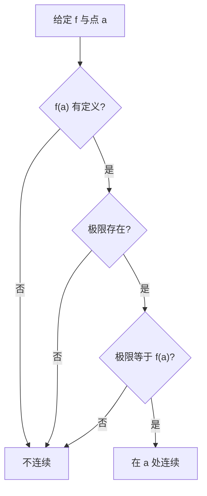

# Concept-Book Run

domain: /home/papagame/projects/digital-duck/cb-calculus/public/domains/calculus_ch02/input/graph.yaml
target: intermediate_value_theorem
started: 2026-11-24T13:05:58

## Teaching order (4 concepts)

- limit
- continuity_at_a_point
- continuity_over_an_interval
- intermediate_value_theorem

### limit (0.7s)

## 极限

**定义**

极限（limit）描述当自变量 $x$ 无限接近某一点 $a$ 时，函数 $f(x)$ 所趋近的值，记作：
$$\lim_{x \to a} f(x) = L$$

这并不要求 $f(a)$ 本身存在或等于 $L$，只关心 $x$ 靠近 $a$ 时函数值的趋势。严格定义（$\varepsilon$-$\delta$ 定义）为：对任意 $\varepsilon > 0$，存在 $\delta > 0$，使得当 $0 < |x - a| < \delta$ 时，恒有 $|f(x) - L| < \varepsilon$。换句话说，只要把 $x$ 限制得足够靠近 $a$（但不等于 $a$），就能让 $f(x)$ 任意接近 $L$。极限是微积分的基石：导数（瞬时变化率）和积分（连续求和）都建立在极限运算之上。

**范例**

考虑 $f(x) = \dfrac{x^2 - 1}{x - 1}$。在 $x = 1$ 处，函数本身没有定义（分母为零）。但因式分解得：
$$f(x) = \frac{(x-1)(x+1)}{x-1} = x + 1 \quad (x \neq 1)$$

所以当 $x \to 1$ 时，$f(x) \to 2$，即
$$\lim_{x \to 1} \frac{x^2 - 1}{x - 1} = 2$$

图像上看，这是一条直线 $y = x+1$，只是在 $x=1$ 处挖去了一个点——极限告诉我们，即使这一点“缺失”，函数仍然明确地趋向 $2$。

**问题解决应用**

极限的核心用途是处理“$\frac{0}{0}$”型的不定式，这类表达式无法直接代入求值，必须通过代数变形（因式分解、有理化、通分）消去零因子后再取极限。例如求
$$\lim_{x \to 0} \frac{\sqrt{x+4} - 2}{x}$$
分子分母同乘以共轭式 $\sqrt{x+4}+2$，化简得
$$\lim_{x \to 0} \frac{1}{\sqrt{x+4}+2} = \frac{1}{4}$$

这一技巧正是导数定义 $f'(a) = \lim_{h \to 0} \dfrac{f(a+h)-f(a)}{h}$ 的核心步骤：先构造出恒为 $\frac{0}{0}$ 型的差商，再通过代数化简求出真实的变化率。掌握极限的计算，是理解瞬时速度、切线斜率乃至一切“连续变化”问题的必经之路。

### continuity_at_a_point (0.7s)

## 点处的连续性

**定义。** 函数 $f(x)$ 在点 $x=a$ 处**连续**,当且仅当同时满足三个条件:

1. $f(a)$ 有定义;
2. $\displaystyle\lim_{x\to a} f(x)$ 存在(左、右极限都存在且相等);
3. $\displaystyle\lim_{x\to a} f(x) = f(a)$。

直观上,连续意味着图像在 $x=a$ 处"不断开、不跳跃、不留洞"。检验时按顺序逐条核对,任何一条失败,函数在该点就**不连续**。

**常见的三类间断。**

- **可去间断**:极限存在,但 $f(a)$ 无定义或 $f(a)\ne\lim_{x\to a}f(x)$(图像上有一个"洞")。
- **跳跃间断**:左右极限都存在但不相等。
- **无穷间断**:极限为 $\pm\infty$(如垂直渐近线)。

**例题。** 设
$$
f(x)=\begin{cases}\dfrac{x^2-4}{x-2}, & x\neq 2\\[2mm] k, & x=2\end{cases}
$$
问 $k$ 取何值时,$f$ 在 $x=2$ 处连续?

*解。* 当 $x\ne2$ 时,
$$
\frac{x^2-4}{x-2}=\frac{(x-2)(x+2)}{x-2}=x+2,
$$
所以
$$
\lim_{x\to 2} f(x)=\lim_{x\to2}(x+2)=4 .
$$
条件 2 成立。要满足条件 3,必须 $f(2)=k=4$。因此 $k=4$ 时 $f$ 在 $x=2$ 处连续;若 $k\ne4$,则是可去间断。

**问题求解应用。** 判断分段函数
$$
g(x)=\begin{cases}x+1, & x<1\\ 3-x^2, & x\ge 1\end{cases}
$$
在 $x=1$ 处是否连续。

- 条件 1:$g(1)=3-1=2$,有定义。
- 条件 2:左极限 $\displaystyle\lim_{x\to1^-}(x+1)=2$,右极限 $\displaystyle\lim_{x\to1^+}(3-x^2)=2$,二者相等,极限存在且为 $2$。
- 条件 3:极限 $=2=g(1)$。

三条全部满足,所以 $g$ 在 $x=1$ 处连续。

**解题策略。**
1. 分别求左、右极限,比较是否相等;
2. 与函数值 $f(a)$ 比较;
3. 若题目要求"使函数连续的参数",令左极限 = 右极限 = 函数值,列方程求解。

*判断函数在一点连续性的三步检验流程:任何一步失败即为不连续。*

**小结。** 连续性把"函数值"与"极限值"联系起来:在连续点,趋近的结果与实际取值一致,因此可以直接代入求极限。

### continuity_over_an_interval (0.5s)

## 区间上的连续性

**定义。** 设函数 $f$ 定义在区间 $I$ 上。若 $f$ 在 $I$ 的每一点处都连续,则称 $f$ **在区间 $I$ 上连续**。具体规定如下:

- 对开区间 $(a,b)$ 内的每一点 $c$,要求 $\displaystyle\lim_{x\to c} f(x)=f(c)$。
- 对闭区间 $[a,b]$,除内部各点外,还需在端点处满足**单侧连续**:
$$\lim_{x\to a^+} f(x)=f(a),\qquad \lim_{x\to b^-} f(x)=f(b).$$

在端点处只能从区间内部一侧逼近,所以只能使用单侧极限。

**例题。** 判断 $f(x)=\sqrt{4-x^2}$ 在 $[-2,2]$ 上是否连续。

*第一步:内部各点。* 当 $-2<c<2$ 时,$4-c^2>0$。多项式连续,而平方根函数在正数处连续,所以复合函数在 $c$ 处连续,即
$$\lim_{x\to c}\sqrt{4-x^2}=\sqrt{4-c^2}.$$

*第二步:左端点。* 
$$\lim_{x\to -2^+}\sqrt{4-x^2}=\sqrt{0}=0=f(-2).$$

*第三步:右端点。* 
$$\lim_{x\to 2^-}\sqrt{4-x^2}=0=f(2).$$

三项都成立,因此 $f$ 在 $[-2,2]$ 上连续。它的图像是上半圆,一笔画成,中间没有断点。

**反例。** 设
$$g(x)=\begin{cases}x+1, & 0\le x<1,\\ 3-x, & 1\le x\le 2.\end{cases}$$
在 $x=1$ 处,$\displaystyle\lim_{x\to1^-}g(x)=2$,而 $\displaystyle\lim_{x\to1^+}g(x)=2$,且 $g(1)=2$,所以 $g$ 在 $x=1$ 处连续。再检验端点:$\lim_{x\to0^+}g(x)=1=g(0)$,$\lim_{x\to2^-}g(x)=1=g(2)$。因此 $g$ 在 $[0,2]$ 上连续。

若把第二段改为 $4-x$,则 $\lim_{x\to1^+}g(x)=3\ne 2$,$g$ 在 $x=1$ 处不连续,也就不在 $[0,2]$ 上连续。

**问题求解应用。** 已知 $h(x)=\begin{cases}kx+1, & x<2,\\ x^2-k, & x\ge 2\end{cases}$ 在 $(-\infty,\infty)$ 上连续,求 $k$。

两段各自都是多项式,在各自的区间内部已连续,只需在分界点 $x=2$ 处使左右极限相等:
$$\lim_{x\to2^-}h(x)=2k+1,\qquad \lim_{x\to2^+}h(x)=4-k=h(2).$$
令 $2k+1=4-k$,得 $3k=3$,即 $k=1$。

**为什么这个概念重要?** 区间上的连续性是**介值定理**与**最值定理**的前提:若 $f$ 在**闭区间** $[a,b]$ 上连续,则 $f$ 取到 $f(a)$ 与 $f(b)$ 之间的每一个值,并且在 $[a,b]$ 上取得最大值与最小值。若漏掉端点处的单侧连续条件,这些结论可能失效。

**小结。** 判断区间上的连续性分三步:(1)内部逐点用极限检验,或借助"连续函数的和、积、商、复合仍连续"这一事实;(2)闭端点用单侧极限检验;(3)分段函数在分界点处令左右极限与函数值相等。

### intermediate_value_theorem (0.7s)

## 介值定理

**定义。** 若函数 $f$ 在闭区间 $[a,b]$ 上连续,且 $N$ 是介于 $f(a)$ 与 $f(b)$ 之间的任意一个数,则存在 $c\in[a,b]$,使得
$$f(c)=N.$$
直观地说:连续函数的图像"不能跳跃",从一个高度走到另一个高度,必然经过中间的所有高度。

**两个条件缺一不可。**
- 连续性:若 $f$ 在区间内有跳跃间断点,就可能"跳过"某些值。例如 $f(x)=\begin{cases}-1,&x<0\\1,&x\ge 0\end{cases}$ 在 $[-1,1]$ 上取不到 $0$。
- 闭区间:定理保证的是 $[a,b]$ 内存在这样的 $c$,条件要求端点处的函数值已知。

**证明思路(确界法)。** 不妨设 $f(a)<N<f(b)$。令
$$S=\{x\in[a,b] : f(x)\le N\},\quad c=\sup S.$$
$S$ 非空(含 $a$)且有上界,所以 $c$ 存在。若 $f(c)<N$,由连续性,$c$ 右侧附近仍有 $f<N$,与 $c$ 是上确界矛盾。若 $f(c)>N$,则 $c$ 左侧附近 $f>N$,于是 $S$ 中的点都在 $c$ 左侧更远处,与 $c$ 是最小上界矛盾。因此 $f(c)=N$。

**例题:证明方程有根。** 证明 $x^3+x-1=0$ 在 $(0,1)$ 内至少有一个实根。

令 $f(x)=x^3+x-1$,它是多项式,在 $[0,1]$ 上连续。计算端点:
$$f(0)=-1<0,\qquad f(1)=1>0.$$
$0$ 介于 $f(0)$ 与 $f(1)$ 之间,由介值定理,存在 $c\in(0,1)$ 使 $f(c)=0$。

**应用:二分法求近似根。** 介值定理不仅保证根存在,还能把它找出来。取中点 $m=\tfrac12$:
$$f(0.5)=0.125+0.5-1=-0.375<0,$$
所以根在 $(0.5,1)$。再取 $m=0.75$:$f(0.75)=0.421875+0.75-1\approx0.172>0$,根在 $(0.5,0.75)$。每次区间长度减半,$n$ 步后误差不超过 $\dfrac{b-a}{2^n}$。重复下去即可达到任意精度,真实根约为 $0.682$。

**常见应用题型。**
1. 证明方程 $g(x)=h(x)$ 有解:令 $f=g-h$,找到使 $f$ 异号的两点。
2. 不动点存在性:若 $f:[0,1]\to[0,1]$ 连续,令 $g(x)=f(x)-x$,则 $g(0)\ge0$,$g(1)\le0$,故存在 $c$ 使 $f(c)=c$。
3. 现实情形:某人一天内体温从 $36.5^\circ\mathrm{C}$ 升到 $39^\circ\mathrm{C}$,则必有某一时刻体温恰为 $38^\circ\mathrm{C}$。

**小结。** 使用介值定理的步骤是:构造函数、验证连续、检查端点函数值异号(或夹住目标值)、得出存在性结论。注意它只保证"存在",不说明"唯一"或"具体位置"。

## Run complete

total: 7.2s
