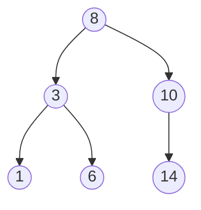
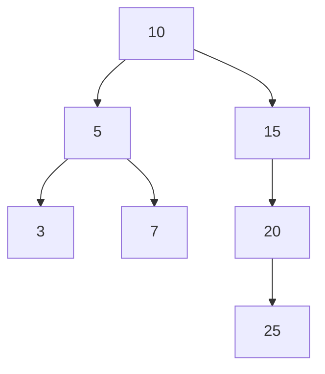
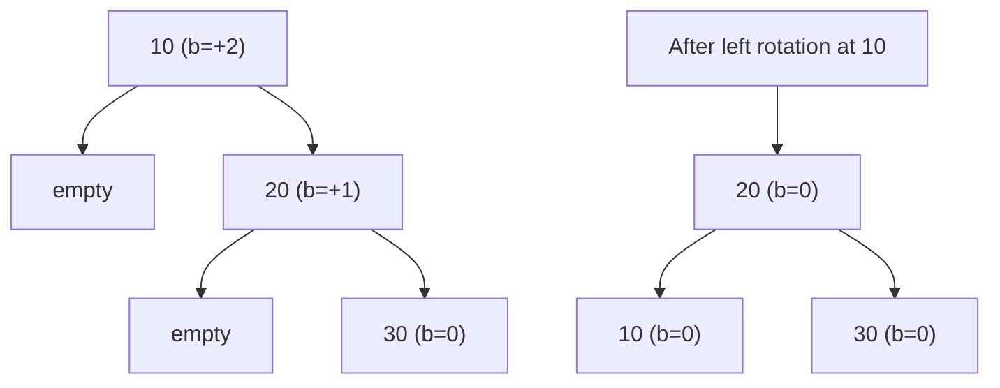

# Concept-Book Run

domain: /home/papagame/projects/digital-duck/cb-data-structure/public/domains/data_structure_ch09/input/graph.yaml
target: avl_tree
started: 2026-11-24T13:09:44

## Teaching order (3 concepts)

- binary_search_tree
- tree_height
- avl_tree

### binary_search_tree (0.7s)

## Binary Search Tree

**Definition.** A *binary search tree* (BST) is a binary tree whose nodes store keys from a total order, such that for every node $x$ with key $k(x)$:

$$
\forall\, y \in \text{left}(x):\; k(y) < k(x), \qquad \forall\, z \in \text{right}(x):\; k(z) > k(x).
$$

The property applies to *entire subtrees*, not just immediate children. Assuming distinct keys, an inorder traversal (left, node, right) visits keys in sorted order, which is the structure's central consequence.

**Search and insertion.** To find key $q$, start at the root. If $q$ equals the node's key, stop. If $q$ is smaller, go left. Otherwise go right. Reaching a null link means $q$ is absent. Insertion follows the same path and attaches a new leaf at the null link where the search ended. Each step discards a whole subtree, so the cost is $O(h)$, where $h$ is the tree's height.

**Worked example.** Insert the keys $8, 3, 10, 1, 6, 14$ into an empty BST, in that order.

- $8$ becomes the root.
- $3 < 8$, so it goes left of $8$.
- $10 > 8$, so it goes right of $8$.
- $1 < 8$, then $1 < 3$, so it goes left of $3$.
- $6 < 8$, then $6 > 3$, so it goes right of $3$.
- $14 > 8$, then $14 > 10$, so it goes right of $10$.


*The BST after inserting 8, 3, 10, 1, 6, 14. Every left subtree holds smaller keys and every right subtree holds larger ones.*

Now search for $6$. Compare with $8$ and go left. Compare with $3$ and go right. Compare with $6$, which matches. That took 3 comparisons, not 6.

**Problem-solving application.** The height $h$ decides performance, and it depends on insertion order. Inserting $1, 3, 6, 8, 10, 14$ in sorted order produces a chain of height $n-1 = 5$, so search degrades to $O(n)$. A balanced tree on $n$ keys has height $\lceil \log_2(n+1)\rceil - 1$, giving $O(\log n)$. For random insertion orders, the expected height is $O(\log n)$. To avoid the worst case, self-balancing variants such as AVL and red-black trees restructure the tree during updates.

**Deletion** has three cases for the node $x$ being removed:

1. *Leaf:* remove it.
2. *One child:* replace $x$ with that child.
3. *Two children:* replace $k(x)$ with its inorder successor, which is the minimum of the right subtree. Then delete that successor, which has at most one child.

For example, deleting the root $8$ above replaces it with $10$, the minimum of its right subtree. The old $10$ node has only a right child, $14$, so $14$ takes its place. The result is still a valid BST.

**Check yourself.** If a tree of $n = 1000$ keys is perfectly balanced, search needs at most about $\lceil\log_2 1001\rceil = 10$ comparisons. If the same keys were inserted in sorted order, search could need up to $1000$. This gap is why balance matters in practice.

### tree_height (0.7s)

## Tree Height

### Definition

The **height** of a tree is the number of edges on the longest path from the root down to a leaf. A tree with only a root has height $0$, and by convention an empty tree has height $-1$. This gives a clean recursive definition:

$$h(T) = \begin{cases} -1 & T = \varnothing \\ 1 + \max\big(h(T_L),\, h(T_R)\big) & \text{otherwise} \end{cases}$$

where $T_L$ and $T_R$ are the left and right subtrees. (Some texts count nodes instead of edges, which adds $1$. Always check which convention is in use.)

Height matters because searching, inserting, and deleting in a binary search tree (BST) each follow a single root-to-leaf path. The worst-case cost is therefore $O(h)$.

### Worked example

Insert the keys $10, 5, 15, 3, 7, 20, 25$ into an empty BST in that order. The resulting structure is:


*A BST built from the keys 10, 5, 15, 3, 7, 20, 25. The longest path is 10 → 15 → 20 → 25.*

Apply the recursion bottom-up:

- Leaves $3$, $7$, $25$: $h = 0$.
- Node $20$: $1 + \max(-1, 0) = 1$.
- Node $5$: $1 + \max(0, 0) = 1$.
- Node $15$: $1 + \max(-1, 1) = 2$.
- Root $10$: $1 + \max(1, 2) = 3$.

So $h = 3$. Searching for $25$ takes $3$ edge-steps, which is the worst case for this tree.

### Problem-solving application

**Bounds on height.** A binary tree with $n$ nodes satisfies

$$\lfloor \log_2 n \rfloor \le h \le n - 1.$$

The lower bound occurs when the tree is as full as possible. A tree of height $h$ holds at most $2^{h+1}-1$ nodes, so $n \le 2^{h+1}-1$, which gives $h \ge \log_2(n+1) - 1$. The upper bound occurs when each node has one child, making the tree a linked list.

**Problem.** A BST receives $1023$ keys. What are the best-case and worst-case search costs?

*Best case:* a perfectly balanced tree has $n = 2^{h+1}-1$, so $1023 = 2^{10}-1$ gives $h = 9$. A search needs at most $9$ edge-steps.

*Worst case:* inserting the keys in sorted order produces a chain, so $h = 1022$. A search may need $1022$ steps.

The same data can therefore cost $O(\log n)$ or $O(n)$ per search, depending only on insertion order. Self-balancing trees such as AVL and red-black trees address this by keeping $h = O(\log n)$ after every update, which guarantees logarithmic worst-case search.

**Implementation:**

```python
def height(node):
    if node is None:
        return -1
    return 1 + max(height(node.left), height(node.right))
```

This visits each node once, so it runs in $O(n)$ time. It uses $O(h)$ stack space for the recursion.

### avl_tree (0.5s)

## Avl Tree

### Definition

An **AVL tree** is a binary search tree (BST) in which every node satisfies the *balance condition*: the heights of its left and right subtrees differ by at most one. Define the height of an empty tree as $-1$ and a leaf as $0$. The **balance factor** of a node $v$ is

$$b(v) = h(\text{right}(v)) - h(\text{left}(v)) \in \{-1, 0, +1\}.$$

If an insertion or deletion makes some $b(v) = \pm 2$, the tree is repaired with **rotations**, which are local pointer rearrangements that preserve the BST ordering.

### Why the height is at most $1.44\log_2 n$

Let $N(h)$ be the minimum number of nodes in an AVL tree of height $h$. The sparsest such tree has a root with one subtree of height $h-1$ and one of height $h-2$, so

$$N(h) = N(h-1) + N(h-2) + 1,\qquad N(0)=1,\ N(1)=2.$$

This is the Fibonacci recurrence shifted by one: $N(h) = F_{h+3} - 1$. Since $F_k \approx \varphi^k/\sqrt5$ with $\varphi = \frac{1+\sqrt5}{2}$, we get $n \ge N(h) \gtrsim \varphi^{h+3}/\sqrt5 - 1$. Taking logarithms gives

$$h < \frac{1}{\log_2 \varphi}\log_2 n \approx 1.44\,\log_2 n.$$

So search, insert, and delete all cost $O(\log n)$ in the worst case. An unbalanced BST can degrade to $O(n)$.

### Worked example: rebalancing

Insert the keys 10, 20, 30 in order. After 30 is added, node 10 has $b = +2$ because its right subtree is a chain 20 → 30. This is the **right-right** case, fixed by one **left rotation** at 10:

- 20 becomes the root.
- 10 becomes 20's left child.
- 30 stays as 20's right child.

The result is a perfectly balanced tree of height 1. The four cases are:

| Case | Imbalance | Fix |
|---|---|---|
| Left-Left | $b=-2$, left child $b\le 0$ | Right rotation |
| Right-Right | $b=+2$, right child $b\ge 0$ | Left rotation |
| Left-Right | $b=-2$, left child $b=+1$ | Left rotation on child, then right rotation |
| Right-Left | $b=+2$, right child $b=-1$ | Right rotation on child, then left rotation |


*Inserting 10, 20, 30 creates a right-leaning chain. One left rotation at 10 restores balance.*

### Problem-solving application

**Problem.** Insert 30, 20, 10, 25 into an empty AVL tree and describe the result.

1. Insert 30, then 20 (left child). The tree is balanced.
2. Insert 10 as the left child of 20. Node 30 now has $b=-2$ and its left child 20 has $b=-1$. This is Left-Left, so we apply a right rotation at 30. The root is now 20 with children 10 and 30.
3. Insert 25. It goes left of 30 (25 > 20, 25 < 30). Node 30 has $b=-1$, node 20 has $b=+1$, and the root's balance is within bounds. No rotation is needed.

**Final tree:** root 20, left child 10, right child 30 with left child 25. Its height is 2, and $2 < 1.44\log_2 4 + \text{const}$ is consistent with the bound.

**Strategy.** After each insertion, walk back up the path toward the root and update heights. At the first node with $|b|=2$, identify the case from the child's balance factor and apply one single or double rotation. For insertion, that one repair restores the height the subtree had before the insertion, so no further rotations are needed. Deletion may require rotations at several ancestors, but still only $O(\log n)$ in total.

## Run complete

total: 6.0s
