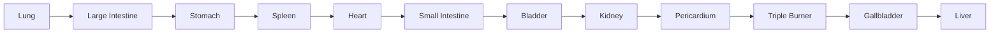
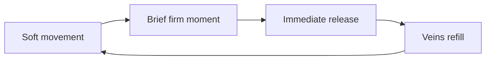

# Concept-Book Run

domain: /home/papagame/projects/digital-duck/cb-meta-health/public/domains/meta_health_ch04/input/graph.yaml
target: daily_baduanjin_practice_plan
started: 2026-11-24T13:12:47

## Teaching order (27 concepts)

- daoyin_tradition
- baduanjin_overview
- diaphragmatic_breathing
- twelve_primary_meridians
- three_regulations
- triple_burner_sanjiao
- yongquan_point
- form8_heel_bounce
- heart_kidney_interaction
- breath_movement_coordination
- dantian
- evidence_quality
- five_organ_movement_matrix
- form1_hold_up_heavens
- form2_draw_the_bow
- form3_single_arm_raise
- form4_look_back
- form5_sway_head_and_tail
- form6_touch_toes
- form7_clench_fists_glare
- tension_relaxation_cycling
- baduanjin_evidence_base
- baduanjin_five_organ_mapping
- closing_form_shougong
- practice_dose
- tension_release_rhythm
- daily_baduanjin_practice_plan

### daoyin_tradition (0.6s)

## The Daoyin Tradition (导引)

**Definition.** Daoyin (导引) is an ancient Chinese tradition of guided stretching, posture, and breathing exercises practiced for health. The name combines 导 ("to guide") and 引 ("to draw out" or "to extend"): the practitioner guides the breath and draws the limbs through deliberate movements. Traditional Chinese Medicine (TCM) holds that these exercises keep the body's circulation open and prevent stiffness. In modern terms, Daoyin is a low-intensity form of mobility and breathing training.

The earliest surviving evidence is a silk scroll excavated from the Mawangdui tombs (sealed 168 BCE), which illustrates dozens of figures in exercise postures. Later practices such as Wuqinxi ("Five Animal Frolics") and Baduanjin ("Eight Pieces of Brocade") descend from this tradition. Baduanjin, the best known today, condenses it into eight short movements. Its name is often rendered "Eight Pieces of Brocade."

**Common elements.** Most Daoyin routines combine three components:

| Component | What it involves | Modern physiological reading |
|---|---|---|
| Posture and stretch | Slow reaching, bending, and twisting | Joint range of motion, muscle length |
| Breath control | Slow, deliberate inhalation and exhalation | Lower breathing rate, greater tidal volume |
| Focused attention | Following the movement and breath | Reduced stress response |

**Worked example.** Suppose a student sits through a three-hour study session and then does a short Baduanjin-style sequence. One such movement, "Holding the Hands High to Regulate the Body," goes like this:

1. Stand with feet shoulder-width apart.
2. Interlace the fingers and press the palms upward overhead while inhaling for about 4 seconds.
3. Hold briefly, rising slightly onto the toes.
4. Lower the arms while exhaling for about 6 seconds.

Each cycle lasts about 12 seconds. Six cycles take about 72 seconds. The breathing rate during the slow phases is about 5 breaths per minute (60 s ÷ 12 s). A typical resting adult breathes about 12–20 times per minute, so this pattern is clearly slower than normal.

**Problem-solving application.** Suppose you want a 10-minute Daoyin-style break routine for a desk worker. Work through the design as follows:

1. *Identify the problem.* Prolonged sitting stiffens the shoulders, neck, and lower back.
2. *Match movements to regions.* Use overhead reaches for the shoulders and spine, side bends for the torso, gentle twists for the lower back, and a forward fold for the hamstrings.
3. *Budget the time.* With 8 movements at about 75 seconds each, the routine takes 600 seconds, or 10 minutes.
4. *Set a safe intensity.* Keep movements below the point of pain. People with osteoporosis, recent injury, or uncontrolled blood pressure should consult a clinician first.

**Evidence note.** Randomized trials and reviews of Baduanjin report modest benefits for balance, flexibility, and some measures of quality of life. The traditional explanations in terms of circulating qi have not been verified by physiological measurement. Judge Daoyin-style practice by measurable outcomes such as range of motion, resting heart rate, and how you feel afterward.

### baduanjin_overview (0.6s)

## Baduanjin: An Overview (八段锦)

**Definition.** Baduanjin (八段锦) is a standing routine of eight movements, often translated as "Eight Pieces of Brocade." It is first recorded in the Song dynasty. In 2003 it was standardized as a national Health Qigong (健身气功) set. The standardized version is the one most studied and taught today. One round takes about 10–12 minutes. It needs no equipment and little space. The movements are slow and are coordinated with relaxed, even breathing. In TCM, practice is said to move qi and harmonize the organ systems. Research on Baduanjin instead measures ordinary outcomes: balance, flexibility, resting heart rate, blood pressure, and self-reported sleep and mood. Controlled trials suggest modest benefits for some of these, especially in older adults. Study quality varies.

**The eight movements.** The names below are the traditional ones. Each is paired with its main physical demand.

| # | Movement (traditional name) | Main physical demand |
|---|---|---|
| 1 | Two hands hold up the heavens | Overhead reach, spine extension, shoulder mobility |
| 2 | Drawing the bow to shoot the eagle | Wide stance, chest opening, leg and arm strength |
| 3 | Raise a single arm | Alternating arm stretch, trunk lengthening |
| 4 | Wise owl gazes backward | Gentle neck and upper-spine rotation |
| 5 | Sway the head and shake the tail | Deep stance, lateral trunk movement |
| 6 | Two hands climb the feet | Forward bend, hamstring and low-back stretch |
| 7 | Clench fists and glare | Stance strength, punching, grip |
| 8 | Bounce on the toes | Rising on the toes, then a light heel drop |

**Worked example: sizing the workout.** Suppose a 70 kg adult does Baduanjin for 11 minutes. Compendium-style tables give a slow, low-intensity qigong session roughly 2.5 to 3 METs. A MET is a multiple of resting energy use. The standard estimate is:

$$
\text{kcal} \approx \text{MET} \times \text{body mass (kg)} \times \text{time (h)}
$$

With 3 METs and $\frac{11}{60}$ h:

$$
3 \times 70 \times \frac{11}{60} \approx 38.5 \text{ kcal}
$$

That is about 38 kcal per round. It is far less than a brisk 11-minute walk, which is around 4 METs or higher. The estimate shows that Baduanjin is not a calorie-burning routine. Its likely value lies in mobility, balance, and regularity.

**Problem-solving application.** Consider a 68-year-old who sits most of the day. They have stiff shoulders and a mild fear of falling. They want a routine they can keep doing. Use three questions.

1. **Fit.** Movements 1, 3, and 6 target shoulder and low-back stiffness. Movements 2 and 5 train the legs in wide stances. Those stances load the legs and challenge balance. The person can start with a higher, narrower stance and deepen it over weeks.
2. **Dose.** One round per day, five days a week, gives about 55 minutes weekly. Many trials use sessions of 30 to 60 minutes, three to five times a week. A beginner can reach that by repeating rounds.
3. **Safety.** Stand next to a wall or sturdy chair for the first sessions. Skip deep forward bends (movement 6) if there is uncontrolled high blood pressure, dizziness, or a recent back injury, and ask a clinician first.

**Check your understanding.** Estimate the energy cost of three rounds (33 minutes) for a 60 kg person at 2.5 METs. The answer is $2.5 \times 60 \times \frac{33}{60} = 82.5$ kcal. Then say which outcome you would track instead of calories, and how you would measure it. One example is the number of seconds you can stand on one leg.

### diaphragmatic_breathing (0.9s)

## Diaphragmatic Breathing

**Definition.** Diaphragmatic breathing (also called abdominal or belly breathing) is a pattern in which the diaphragm, the dome-shaped muscle beneath the lungs, does most of the work of inhalation. On inhalation the diaphragm contracts and flattens, moving downward. This enlarges the chest cavity, lowers the pressure inside the lungs below atmospheric pressure, and draws air in. The abdominal contents are pushed down and outward, so the belly rises. On exhalation the diaphragm relaxes and recoils upward, and the belly falls. In contrast, shallow chest breathing relies more on the rib muscles and the neck and shoulder muscles, and it often moves less air per breath.

**Worked example.** Compare two people at rest, each breathing 12 times per minute. Person A takes shallow breaths of about 350 mL. Person B breathes diaphragmatically at about 500 mL. About 150 mL of each breath fills the anatomical dead space (the airways where no gas exchange occurs). Alveolar ventilation is

$$\dot V_A = (V_T - V_D)\times f$$

where $V_T$ is tidal volume, $V_D$ is dead-space volume, and $f$ is breathing rate.

- Person A: $(350-150)\times 12 = 2400$ mL/min
- Person B: $(500-150)\times 12 = 4200$ mL/min

Person B moves 75% more fresh air to the alveoli at the same rate. Deeper breaths therefore ventilate the lungs more efficiently, because the fixed dead space takes up a smaller share of each breath.

**Problem-solving application.** Suppose you want to practice the technique before an exam or a race, when your heart is pounding and your breathing is quick and shallow.

1. **Position.** Lie on your back with knees bent, or sit upright. Put one hand on your chest and the other on your belly.
2. **Inhale.** Breathe in slowly through the nose for about 4 seconds. The belly hand should rise while the chest hand stays mostly still.
3. **Exhale.** Breathe out through pursed lips for about 6 seconds. Longer exhalations are commonly used to slow the breathing rate.
4. **Repeat.** Do 5 to 10 minutes of this, then check your pulse for 15 seconds and multiply by 4.

If your resting heart rate was 90 beats per minute before and the 15-second count is 18 afterward, your rate is now $18\times 4 = 72$ beats per minute. Slow breathing tends to increase vagal (parasympathetic) activity, which lowers heart rate. In TCM, a similar practice is described as sinking the breath to the dantian (丹田, the lower abdomen). That is a traditional description, and the physiological account above stands on its own.

**Check your understanding.** A patient breathes at 15 breaths per minute with a 400 mL tidal volume and 150 mL of dead space. Their alveolar ventilation is $(400-150)\times 15 = 3750$ mL/min. If training raises the tidal volume to 550 mL and lowers the rate to 10 breaths per minute, the new value is $(550-150)\times 10 = 4000$ mL/min. Ventilation rises slightly even though the person breathes less often. This is why slow, deep breathing can be both calming and efficient.

**Caution.** People with certain lung or heart conditions should ask a clinician before practicing prolonged breathing exercises. If you feel dizzy, return to normal breathing.

### twelve_primary_meridians (0.6s)

## The Twelve Primary Meridians

**Definition.** In Traditional Chinese Medicine (TCM), the twelve primary meridians (十二经脉) are the main channels along which *qi* is said to circulate through the body. TCM holds that each meridian is linked to one organ system (such as the Lung, Heart, or Liver) and runs along a characteristic path on the body surface. Meridians are a traditional framework for organizing symptoms and choosing acupuncture points. Modern anatomy has not identified them as distinct physical structures, and clinical evidence for acupuncture varies by condition. Treat them as a classification system, not as measured anatomy.

The twelve are paired by limb and by the yin or yang character TCM assigns to them:

| Pathway | Meridians | Typical course |
|---|---|---|
| Hand yin | Lung, Pericardium, Heart | Chest to fingertips, along the inner arm |
| Hand yang | Large Intestine, Triple Burner, Small Intestine | Fingertips to head, along the outer arm |
| Foot yang | Stomach, Gallbladder, Bladder | Head to toes, along the front, side, and back of the body |
| Foot yin | Spleen, Liver, Kidney | Toes to chest, along the inner leg |

In TCM, qi flows through them in a fixed sequence beginning with the Lung meridian and ending with the Liver meridian, which then connects back to the Lung. Each yin meridian is paired with a yang meridian that shares the same limb and an organ partner. The Lung is paired with the Large Intestine, for example.

**Worked example.** A student has a tension headache at the back of the head, with a stiff upper neck and upper back. Using the table:

1. Locate the symptom on the body. The back of the head and neck lie along the Bladder meridian's course, a foot yang pathway that runs down the back.
2. Name the associated meridian: Bladder.
3. Identify its yin partner: Kidney, a foot yin meridian on the inner leg.
4. List candidate acupuncture points. A practitioner might choose points on the Bladder meridian near the neck. They might also choose a distal point on the same meridian, such as one near the ankle.

This is the reasoning TCM uses to turn a symptom location into a treatment plan. It rests on tradition, not on a measured physiological pathway.

**Problem-solving application.** Classify each complaint by the meridian whose course it follows:

- Pain along the inner forearm toward the thumb: Lung meridian (hand yin).
- Pain along the outer arm, ending at the index finger: Large Intestine meridian (hand yang).
- Aching along the inner leg and groin: the foot yin group (Spleen, Liver, or Kidney). A practitioner would narrow it further by exact location.

Two questions help you work through a case. First, is the symptom on the inner or outer surface of the limb? Inner suggests yin and outer suggests yang. Second, is it on the arm or the leg? That separates hand meridians from foot meridians. Together, these two questions narrow twelve candidates to three. The exact location then decides among those three.

Pay attention to the limits of this approach. Pain along a "meridian" can have ordinary causes, such as a pinched nerve, a muscle strain, or a joint problem. A persistent or severe symptom, or one that comes with numbness or weakness, calls for a medical evaluation. Do not rely on meridian reasoning alone.

*The traditional TCM circulation order of the twelve primary meridians. After the Liver, the sequence returns to the Lung.*

### three_regulations (0.8s)

## The Three Regulations (三调)

**Definition.** In qigong, the three regulations (三调, *sān tiáo*) are three skills practiced together: regulating the body (调身, posture and movement), regulating the breath (调息, breathing pattern), and regulating the mind (调心, where attention rests). TCM holds that qigong differs from ordinary calisthenics because it trains all three at once. A set of squats trains only the body. A qigong exercise adds a prescribed way of breathing and a deliberate focus of attention.

| Regulation | What you control | Typical instruction |
|---|---|---|
| Body (调身) | Posture, alignment, tension | Feet shoulder-width apart, knees soft, shoulders dropped, spine upright |
| Breath (调息) | Rate, depth, route of air | Slow, quiet, abdominal breathing through the nose |
| Mind (调心) | Focus of attention | Follow the breath, or rest attention on the lower abdomen |

Evidence for these practices comes from studies of relaxation and slow breathing. Claims about qi circulation are not established by physiology.

**Worked example.** Take a beginner's standing session of 10 minutes. 

1. *Body.* Stand with feet shoulder-width apart, knees slightly bent, arms hanging loose. Check that your shoulders are not raised and your jaw is relaxed. This reduces unnecessary muscle tension.
2. *Breath.* Breathe in through the nose and let the belly expand. Breathe out slowly. A common starting pace is 6 breaths per minute, about 10 seconds per cycle, versus a typical resting rate of 12 to 20 breaths per minute. Over 10 minutes that is:

$$6 \text{ breaths/min} \times 10 \text{ min} = 60 \text{ breaths}$$

3. *Mind.* Count each exhale from 1 to 10, then restart. When you notice your attention has drifted, return to the count without judging yourself.

Slow breathing like this is associated with a lower resting heart rate and a shift toward parasympathetic ("rest and digest") activity in some studies. You can check it yourself by counting your pulse for 30 seconds before and after, then doubling the result.

**Problem-solving application.** The three regulations also work as a troubleshooting checklist. When a practice session feels wrong, find which regulation is failing:

- *Dizziness or tingling.* The breath is probably too forceful or too fast. Return to a natural breathing rhythm. Over-breathing lowers blood carbon dioxide and can cause these symptoms.
- *Aching shoulders or lower back.* The body is the problem. Reduce the stance depth, drop the shoulders, and shorten the session.
- *Constant distraction.* The mind is the problem. Shorten the counting cycle or use a simpler anchor, such as the feeling of air at the nostrils.

Consider a student who feels tense and breathless during a 10-minute standing posture. Applying the checklist: the shoulders are raised (body), the breath is held at the top of each inhale (breath), and the student is thinking about an exam (mind). Fix them in order, since posture and breath are easier to correct than attention. Lower the shoulders, exhale fully, then return to counting. Most beginners find the mind settles last. Treat it as a skill that improves with practice. It is not a test that you pass or fail.

### triple_burner_sanjiao (0.6s)

## The Triple Burner (Sanjiao, 三焦)

**Definition.** In Traditional Chinese Medicine (TCM), the triple burner (三焦, *sanjiao*) is a functional system, not a single organ you can point to on an anatomical chart. TCM holds that it links the other organs and serves as the passageway through which qi (vital activity) and body fluids travel. It is divided into three regions:

| Region | Location | Main organs involved | Main function in TCM |
|---|---|---|---|
| Upper burner | Chest, above the diaphragm | Heart, lungs | Distributes qi and fluids outward and downward, like a mist |
| Middle burner | Upper abdomen, between the diaphragm and the navel | Stomach, spleen | Digests food and turns it into usable nutrients |
| Lower burner | Lower abdomen, below the navel | Kidneys, bladder, intestines | Separates fluids, then excretes waste |

The name "burner" refers to warmth and transformation. Each region is a stage in processing what the body takes in.

**Worked example.** Follow a glass of water and a meal through the three regions.

1. *Upper burner:* Breathing and the lungs bring in air. In TCM, the lungs spread fluids to the skin and upper body.
2. *Middle burner:* The meal is received in the stomach and broken down. The spleen extracts nutrients and sends them upward.
3. *Lower burner:* Fluid that is not needed is passed to the bladder. Solid waste moves through the intestines.

Modern physiology describes the same journey with different structures. Digestion and absorption occur in the stomach and small intestine, and the kidneys filter blood. A healthy adult's kidneys filter about 180 L of plasma per day, yet only 1 to 2 L leaves as urine, because the tubules reabsorb over 99% of the filtrate. The triple burner does not correspond to any one anatomical structure, so it is best read as a map of three stages of intake, processing and elimination. It is not a described organ.

**Problem-solving application.** TCM practitioners use the three regions to organize symptoms by location. Consider three cases and how a TCM practitioner would classify each:

- A persistent dry cough with shortness of breath is classified as an upper burner problem.
- Bloating and poor appetite after meals is classified as a middle burner problem.
- Frequent urination or swelling in the legs is classified as a lower burner problem.

In each case the classification tells the practitioner where to look first, and it is then paired with other TCM diagnostic information.

You can apply the same reasoning to everyday health questions. Suppose a person drinks plenty of water but reports puffy ankles. Modern medicine would check for causes such as heart, kidney or venous problems, while TCM would point to the lower burner. The two descriptions overlap in where they look, but only the modern work-up uses measurable tests, such as blood pressure, kidney function labs and an ultrasound. Leg swelling that is new, one-sided or accompanied by chest pain or breathlessness needs prompt medical evaluation, not a TCM classification.

The triple burner is a useful framework for organizing symptoms by body region. It has no established anatomical basis, and its claims have not been validated by controlled trials.

### yongquan_point (0.7s)

## The Yongquan Point (涌泉, KI-1)

**Definition.** Yongquan (涌泉, "gushing spring") is the first point on the Kidney channel, which is why it is labeled KI-1. It is on the sole of the foot, in the depression that appears in the front third of the sole when the toes curl. In TCM, it is the lowest point of the body and the place where Kidney channel qi begins to rise. TCM holds that stimulating it supports the Kidney, calms the mind, and draws "excess" energy downward from the head. Practitioners use it for insomnia, dizziness, and cold feet. Clinical evidence for these uses is limited. Small trials of foot massage and acupressure report some benefit for sleep and relaxation, but they are generally low quality and cannot separate the point's effect from the effect of any pleasant foot massage.

**Locating the point.** Use a repeatable method rather than guessing:

1. Sit and rest one ankle on the opposite knee, with the sole facing you.
2. Curl the toes firmly downward. A V-shaped hollow appears in the sole.
3. The point lies at the upper (heel-side) end of that hollow. It sits about one third of the way from the base of the second toe to the heel, between the second and third metatarsal bones.

**Worked example.** The sole's length does not matter if you measure in proportions. Suppose the distance from the base of the second toe to the back of the heel is 21 cm. One third of that distance is:

$$\frac{21\ \text{cm}}{3} = 7\ \text{cm}$$

You would therefore look about 7 cm back from the base of the second toe, then confirm the spot by finding the hollow when the toes curl. The calculation gives a starting estimate. The hollow is the final check, because foot shapes vary.

**Problem-solving application.** A student has trouble falling asleep after evening study and wants to try acupressure as a wind-down routine. A sensible protocol is:

- Wash and warm the feet first, since cold, tense tissue is uncomfortable to press.
- Locate the point with the curled-toe method above.
- Press with the thumb using firm but tolerable pressure, in slow circles, for 1–2 minutes per foot.
- Pair it with slow breathing, at about 6 breaths per minute, which independently promotes relaxation.

To judge whether it helps, keep a simple log: record the time you get into bed and the time you fall asleep each night for a week without the routine, then a week with it. Compare the average *sleep-onset latency* (minutes to fall asleep) across the two weeks. A drop of several minutes is encouraging, but a single person's two-week comparison cannot separate the point's effect from relaxation, routine, or chance. It is a low-risk personal experiment, not a controlled test.

**Safety notes.** Avoid heavy pressure on broken skin, infection, or injury. Take extra care with diabetic neuropathy, where reduced sensation can hide damage. Do not use acupressure as a substitute for evaluation of persistent insomnia, dizziness, or other symptoms.

### form8_heel_bounce (0.8s)

## Form 8: Bouncing on the Heels (背后七颠百病消)

**Definition.** Form 8 is the final move of the Eight Brocades (Baduanjin) sequence. You stand with feet together, rise onto the balls of your feet, then let your heels drop a short distance to the floor, repeating this seven times. The name 背后七颠百病消 means roughly "seven bounces behind the back dispel a hundred illnesses." In TCM, the drop is said to stimulate Yongquan (the point on the sole of the foot) and to support the Kidney, which TCM associates with the Water phase and with the lower body. Physiologically, the movement is a gentle, repeated, low-impact loading of the legs, ankles, and spine.

**What the body actually does.** Three mechanisms are well established:

- **Calf muscle pump.** When the calf muscles (gastrocnemius and soleus) contract as you rise, they squeeze the deep veins and push blood toward the heart. One-way valves stop it from falling back. This helps venous return, especially after long sitting.
- **Bone loading.** A small, quick impact on the heels produces mechanical stress on the legs and hip. Bone responds to such stress by maintaining or increasing density, which is why weight-bearing impact is used in osteoporosis prevention. The effect depends on impact size, and a soft heel drop is mild, so treat it as a low-dose stimulus.
- **Balance and ankle control.** Rising onto the toes trains the calf and the small stabilizing muscles of the foot.

Claims that seven bounces cure "a hundred illnesses" are not supported by evidence. The reasonable claims are the circulatory, skeletal, and balance benefits above.

**Worked example.** Suppose a 70 kg office worker has been seated for 90 minutes and feels heaviness in the lower legs. They do one set of seven bounces.

1. Stand tall, feet together, hands at the sides, eyes forward.
2. Inhale and rise slowly onto the toes for about 2 seconds, lifting the crown of the head as if suspended.
3. Exhale and lower for about 1 second, letting the heels touch the floor lightly, without a hard slam.
4. Repeat seven times, then stand quietly for a few breaths.

At roughly 3 seconds per repetition, the set takes about 21 seconds. Each repetition engages the calf pump once, so the set gives seven pump cycles. The sensation of warmth in the legs afterward reflects improved circulation to the lower limbs.

**Problem-solving application.** Match the adjustment to the person:

| Situation | Adjustment |
|---|---|
| Desk worker with leg heaviness | Do one set every hour, as a break from sitting |
| Poor balance or older adult | Hold a chair or wall and lower the heels slowly |
| Osteoporosis, recent fracture, or severe spinal disease | Skip the drop; do slow rises only, and consult a clinician |
| Knee, hip, or heel pain | Reduce the drop height to a few millimeters |
| Sensitive after a long meal or dizzy | Wait, or do it seated with toe raises |

A useful self-check is to ask whether the movement is smooth and the landing quiet. A loud thud means the drop is too hard, so shorten it. Done this way, Form 8 works as a short, safe closing exercise that cools down the sequence and returns the body to rest.

### heart_kidney_interaction (0.6s)

## Heart–Kidney Interaction (心肾相交)

**Definition.** In Traditional Chinese Medicine (TCM), the heart is associated with "fire": warmth, activity, and the mind. The kidney is associated with "water": cooling, reserve, and structure. TCM holds that health requires these two to communicate. Heart fire descends to warm the kidney, and kidney water rises to cool the heart. This exchange is called 心肾相交 (heart–kidney interaction), or 水火既济 (water and fire in mutual completion). When it fails, TCM calls the pattern 心肾不交 (heart–kidney disharmony). The typical picture is difficulty falling asleep, a racing mind, night sweats, heart palpitations, and lower-back soreness. These are descriptive clinical categories. They are not measurements, so they have no equation.

The idea is a metaphor, not an anatomical description. Modern physiology does not find a "fire" that travels from heart to kidney. It does show real, measurable heart–kidney coupling. This is the field of cardiorenal physiology.

**Worked example: a physiological parallel.** The heart pumps about 5 L/min at rest (cardiac output). The kidneys receive roughly 20–25% of it, about 1.0–1.25 L/min. Consider someone whose heart weakens and pumps only 3.5 L/min. If the kidneys still get 20%, they receive 0.7 L/min, which is much less than before. Renal filtration falls, the body retains salt and water, blood volume rises, and the struggling heart must work against a heavier load. Each organ then worsens the other. Clinicians call this cardiorenal syndrome.

The reverse direction also occurs. Failing kidneys release too little of the hormone erythropoietin and retain fluid. They also over-activate the renin–angiotensin system, which raises blood pressure. All of these strain the heart.

**Problem-solving application.** Suppose a patient reports poor sleep, palpitations, and night sweats, and the symptoms began after a stressful period.

1. *TCM framing.* A practitioner might describe this as heart–kidney disharmony and use it to organize treatment, such as calming the mind and nourishing the kidney. Evidence that these treatments work is limited and mixed.
2. *Physiological screening.* A clinician should first rule out measurable causes. Palpitations call for an ECG and a thyroid test. Night sweats and fatigue call for a blood count, blood glucose, and kidney function tests, such as serum creatinine and estimated glomerular filtration rate (eGFR). Swollen ankles and rising blood pressure would raise concern for cardiorenal disease.
3. *Decision.* If the tests find atrial fibrillation, anemia, or reduced eGFR, treat that condition directly. A traditional label should never delay testing for a heart or kidney problem.

| Aspect | TCM concept | Physiological counterpart |
|---|---|---|
| Link | Fire and water exchange | Circulation, filtration, hormones |
| Failure | Heart–kidney disharmony | Cardiorenal syndrome |
| Evidence | Descriptive framework | Measurable and testable |

**Takeaway.** The TCM idea expresses, in symbolic language, that the heart and kidney influence each other. Physiology supports a real, measurable version of that link, but not the specific fire-and-water mechanism. Use the traditional framework as a vocabulary for symptoms, and rely on measurements to diagnose and treat.

### breath_movement_coordination (0.6s)

## Coordinating Breath and Movement

**Definition.** Coordinating breath and movement means pairing each phase of breathing with a phase of the movement. In most exercise traditions, including qigong, tai chi, yoga and Pilates, the rule is simple: breathe in as the body rises, lengthens or opens (arms lifting, chest expanding), and breathe out as it sinks, folds or closes (arms lowering, bending forward). The breath is continuous. It never stops, and you never hold it at the top or bottom of the motion.

**Why it works physiologically.** Opening the chest and lifting the arms stretch the rib cage and make room for the diaphragm to descend, so inhaling is mechanically easier there. Folding forward or lowering the arms compresses the abdomen and chest, which helps push air out. The pairing therefore works with the body's mechanics. Holding the breath is the main thing to avoid. Straining against a closed airway (the Valsalva maneuver) raises pressure in the chest and can briefly reduce blood return to the heart. It can also raise blood pressure sharply. This matters most for people with hypertension or heart disease. In TCM, the same pairing is described as guiding qi with the breath. That is a traditional framework, not a measured mechanism. The mechanical explanation above is what physiology supports.

**Worked example: a slow arm raise.** Suppose you stand and raise both arms from your sides to overhead, then lower them, over a 12-second cycle.

| Phase | Movement | Breath | Duration |
|---|---|---|---|
| 1 | Arms rise, chest opens | Inhale through the nose | 5 s |
| 2 | Arms float at the top | Inhale tapers into exhale, no pause | 1 s |
| 3 | Arms lower, body settles | Exhale slowly | 6 s |

The cycle takes 12 s, so the breathing rate is 60 s ÷ 12 s = 5 breaths per minute. That is slower than the typical resting rate of 12 to 20 breaths per minute, and it is a pace commonly used in slow-breathing practice. Notice that the exhale is slightly longer than the inhale, which many people find calming.

**Problem-solving application.** Suppose you are learning a movement and feel lightheaded, or you catch yourself holding your breath during the hardest part. Use this checklist:

1. **Find the hold.** Do the movement slowly and notice where the breath stops. It is usually at the point of greatest effort.
2. **Slow the movement, not the breath.** Lengthen the phase until the breath fits comfortably. The breath sets the tempo, not the reverse.
3. **Check the direction.** If the pairing feels forced, reverse the assignment for that movement. In weight training, for example, the usual advice is to exhale during the effortful phase, such as pushing or lifting. This differs from some qigong forms, where the effortful push may pair with an inhale. Choose the version that keeps the breath flowing.
4. **Use the talk test.** If you cannot speak a short sentence during the movement, it is too fast or too strenuous for coordinated breathing.

Try this on a simple side bend: inhale as you reach one arm overhead, exhale as you bend sideways, inhale as you return to upright. Count your breaths per minute and confirm the movement never forced a pause.

**Key point:** the rule is a guide to continuous, unforced breathing. Smooth flow matters more than perfect pairing.

### dantian (0.7s)

## Dantian (丹田)

**Definition.** In Traditional Chinese Medicine (TCM), the *dantian* ("elixir field") is a region of the body regarded as a center where qi is gathered and stored. TCM describes three: upper (between the eyebrows), middle (the chest), and lower. The **lower dantian** (下丹田) is the one most often meant. It lies in the lower abdomen, roughly 2 to 3 finger-widths below the navel and deep to the surface. It is a location used in practice, not a discrete organ. Anatomists find no separate structure there, and qi itself has no established physiological measurement. Dantian is best understood as a *focus of attention and posture* in qigong, tai chi, and meditation.

**What practitioners do with it.** The practical core is a breathing and posture skill:

| Step | Instruction | Physiological effect |
|---|---|---|
| 1 | Sit or stand with the spine long and shoulders relaxed | Reduces neck and shoulder tension |
| 2 | Rest attention (or the hands) on the lower abdomen | Directs awareness to the belly wall |
| 3 | Inhale slowly through the nose so the abdomen expands | Diaphragm descends, increasing lung volume |
| 4 | Exhale slowly so the abdomen gently draws in | Diaphragm relaxes upward |

Physiologically, "breathing into the dantian" is diaphragmatic (abdominal) breathing. Slow breathing at about 6 breaths per minute is associated with increased heart rate variability and reduced stress ratings in several small studies. These are modest, short-term effects. Claims that the dantian stores a literal energy, or that the practice cures disease, are not supported by evidence.

**Worked example.** A student wants to calm down before an exam. At rest she breathes 16 times per minute, each breath moving about 0.5 L of air:

$$\dot{V}_E = f \times V_T = 16 \times 0.5\ \text{L} = 8\ \text{L/min}$$

where $\dot V_E$ is minute ventilation, $f$ is breathing rate, and $V_T$ is tidal volume. She then practices dantian breathing at 6 breaths per minute with deeper breaths of 1.0 L:

$$\dot{V}_E = 6 \times 1.0\ \text{L} = 6\ \text{L/min}$$

Total ventilation falls slightly, yet each breath is larger. Deeper, slower breaths reach more of the lungs' gas-exchange surface. Some air only fills the airways, about 150 mL per breath (anatomical dead space). The air reaching the alveoli is therefore

$$\dot{V}_A = f \times (V_T - V_D)$$

At 16 breaths per minute: $16 \times (0.5 - 0.15) = 5.6$ L/min. At 6 breaths per minute: $6 \times (1.0 - 0.15) = 5.1$ L/min. Alveolar ventilation is about equal, achieved with far fewer, calmer breaths.

**Problem-solving application.** Suppose someone's breathing is shallow, with $f = 20$ and $V_T = 0.4$ L.

1. Alveolar ventilation: $20 \times (0.4 - 0.15) = 5.0$ L/min.
2. Slow to $f = 8$ with $V_T = 0.9$ L: $8 \times (0.9 - 0.15) = 6.0$ L/min.

Alveolar ventilation improves by 1.0 L/min with fewer breaths, which shows why slow, deep abdominal breathing is more efficient than rapid shallow breathing.

**Practical caution.** Keep the breathing comfortable. Straining, breath-holding, or forcing the abdomen out can cause dizziness or discomfort. People with respiratory or cardiovascular conditions should consult a clinician before starting breathing practices.

### evidence_quality (0.7s)

## Judging Evidence Quality

**Definition.** Evidence quality describes how much confidence a piece of research deserves when it claims that a food, exercise, supplement, or therapy works. It depends mainly on study design, because design determines how well a study can rule out other explanations for an observed result. A rough ladder, from weakest to strongest, is:

| Design | What it is | Main weakness |
|---|---|---|
| Case report | A clinician describes one patient or a few patients | No comparison group; may be coincidence |
| Observational study | Researchers record what people already do and what happens to them | Confounding: people who choose a habit differ in other ways |
| Randomized controlled trial (RCT) | Participants are randomly assigned to treatment or control | Can be small, short, or unblinded |
| Meta-analysis of RCTs | Pools results from several trials | Only as good as the trials it combines |

Random assignment is what makes an RCT powerful. It spreads both known and unknown differences (age, diet, motivation) roughly evenly across groups, so a difference in outcome is more likely due to the treatment itself.

**Worked example.** Suppose a cohort study finds that people who drink green tea daily have lower blood pressure. Tea drinkers may also exercise more, smoke less, and eat more vegetables, so tea may not be the cause. Now suppose a small RCT of 20 people, in which participants know whether they received tea, reports a 10 mmHg drop in systolic pressure. Two problems arise:

- **Small sample.** With few participants, chance alone can produce large differences between groups. Small trials that happen to show big effects are the ones most likely to be published, so effect sizes tend to be overstated.
- **No blinding.** If participants know they are receiving the treatment, expectation can change behavior and even measured outcomes such as blood pressure, through the placebo effect. If the assessors also know, their measurements may drift toward the expected result.

A later double-blind trial of 400 people finding a 2 mmHg drop would be a much more reliable estimate. A meta-analysis pooling several such trials would be more reliable still, provided the trials are of decent quality.

**Problem-solving application.** When you meet a health claim, work through these questions in order:

1. What was the design? A case report or a single observational study can suggest a hypothesis but cannot establish cause.
2. Was there random assignment and a control group?
3. Was blinding possible, and was it used? Some interventions, such as exercise, cannot be blinded to participants, but outcome assessors can still be blinded.
4. How many participants were there, and how large is the effect? A very large effect in a very small trial deserves suspicion.
5. Do independent trials agree? Replication matters more than any single result.

Apply this to a headline such as "Herbal extract cuts cholesterol by 30%." If the source is one 25-person unblinded trial, the evidence is weak, and the correct conclusion is "promising, needs confirmation," not "proven." If it comes from a meta-analysis of blinded RCTs showing a 5% reduction, the claim is smaller but far more trustworthy.

Design is a guide, not a guarantee. A well-run observational study can outweigh a flawed RCT, and a meta-analysis of poor trials remains poor evidence. Ask what the design could and could not rule out.

### five_organ_movement_matrix (0.6s)

## The Five-Organ Movement Matrix

**Definition.** The five-organ movement matrix is a set of five exercises, each paired with one of the five zang organs in TCM: chest expansion (扩胸), rib fanning (扇肋), torso lift (提身), twisting (扭转), and deep squat (深蹲). In TCM, each organ is associated with a body region, so each movement is meant to load that region. The matrix is a practical routine. Its value depends on whether each movement trains the muscles and joints it targets, and you can test that with ordinary exercise physiology.

| Movement | TCM organ pairing | Region loaded | Physiological effect |
|---|---|---|---|
| Chest expansion (扩胸) | Lung | Chest, upper back | Thoracic mobility, scapular retraction |
| Rib fanning (扇肋) | Liver | Side ribs, obliques | Lateral rib-cage mobility, intercostal stretch |
| Torso lift (提身) | Spleen | Core, spine extensors | Trunk stability, posture |
| Twisting (扭转) | Kidney | Lumbar spine, obliques | Rotational mobility |
| Deep squat (深蹲) | Heart | Hips, legs | Large-muscle work, raised heart rate |

The organ pairings are TCM concepts, not anatomical findings. The movements work as mobility and strength exercises whether or not you accept the pairings.

**Worked example.** Suppose you do one round of the matrix: 10 repetitions of each movement, about 3 seconds per repetition, with 10 seconds of rest between movements.

- Time per movement: $10 \times 3 = 30$ s
- Total movement time: $5 \times 30 = 150$ s
- Total rest time: $4 \times 10 = 40$ s (rest falls between movements only)
- Round time: $150 + 40 = 190$ s, about 3 minutes

Three rounds take about 9.5 minutes. The deep squat is the most demanding movement, so it is the one that most raises your heart rate. If your resting heart rate is 70 bpm and it reaches 100 bpm by the end of the squats, the round counts as light activity. The common estimate of maximum heart rate is $220 - \text{age}$. For a 20-year-old that is 200 bpm, so 100 bpm is only about 50% of maximum.

**Problem-solving application.** A student sits at a desk for six hours and reports stiff shoulders, a tight lower back, and tired legs. Choose an emphasis for a 10-minute session.

1. Match each complaint to a region. Stiff shoulders point to chest expansion, a tight lower back to twisting and torso lift, and tired legs to the deep squat.
2. Allocate time. Of the 10 minutes, give 2 each to chest expansion, twisting, and torso lift, and 2 to the squat. Use the remaining 2 minutes for rib fanning.
3. Check the load. Mobility movements (chest expansion, rib fanning, twisting) should feel like a gentle stretch, not pain. The squat should stay within a pain-free range, with knees tracking over the toes.

If the session is meant to raise fitness, not just relieve stiffness, add rounds or reduce rest until your heart rate reaches 50–70% of maximum, the usual moderate-intensity range. Anyone with a back, knee, or heart condition should check with a clinician first.

The matrix is a convenient way to cover the whole body in one routine, and each movement can be evaluated by its measurable effects.

### form1_hold_up_heavens (0.7s)

## Form 1: Holding Up the Heavens (两手托天理三焦)

**Definition.** Form 1 is the opening movement of the eight-form Baduanjin sequence. You rise onto your toes while pressing both palms upward, fingers interlaced, and then lower your heels and hands together. In Traditional Chinese Medicine (TCM), the "triple burner" (三焦) names three zones of the trunk: the upper (chest), middle (upper abdomen), and lower (lower abdomen and pelvis). TCM holds that the zones work together to move fluids and energy through the body. Anatomy has no organ called the triple burner, so treat the concept as a traditional map of the trunk. The physical effects of the movement are real and measurable. It lengthens the spine, opens the chest, and lifts the ribs. It also coordinates deep breathing with a slow full-body stretch.

**Mechanics.** Stand with your feet shoulder-width apart and your knees soft.

1. Let your hands hang, then cross them in front of your lower abdomen with the fingers interlaced.
2. Inhale slowly as you raise your hands past the chest. At face height, turn the palms outward.
3. Press the palms toward the ceiling, straighten the elbows, and rise onto the balls of your feet. Pause for one to two seconds, looking slightly upward.
4. Exhale as you release the fingers, lower your arms in a wide arc, and settle your heels.

Each repetition takes about 10 to 15 seconds. The usual practice is 6 to 8 repetitions.

**Worked example.** Suppose you sit at a desk for 8 hours, and your breathing is shallow at about 16 breaths per minute with a tidal volume near 0.4 L. Your minute ventilation is then:

$$\dot V_E = f \times V_T = 16 \times 0.4 = 6.4\ \text{L/min}$$

During a slow Form 1 cycle you breathe about 5 times per minute, but each breath is much deeper, perhaps 1.0 L. Then:

$$\dot V_E = 5 \times 1.0 = 5.0\ \text{L/min}$$

Total ventilation drops slightly, but each breath reaches the lungs more fully. The reason is that a fixed part of every breath, the anatomical dead space of about 150 mL, only fills the airways and never reaches the alveoli. Alveolar ventilation is $(V_T - V_D) \times f$:

- Shallow breathing: $(0.4 - 0.15) \times 16 = 4.0$ L/min
- Slow, deep breathing: $(1.0 - 0.15) \times 5 = 4.25$ L/min

Slow, deep breathing therefore delivers more fresh air to the alveoli, even though total ventilation is lower. The numbers are illustrative, and individual values vary.

**Problem-solving application.** Use Form 1 as a quick reset during long periods of sitting, and adapt it to your situation:

- **Tight shoulders:** Keep the hands apart at shoulder width, with palms facing forward, instead of interlacing the fingers.
- **Balance problems or dizziness:** Skip the heel raise and stay flat-footed. Stand near a wall or chair for support.
- **High blood pressure or shoulder injury:** Keep the arms below head height, and check with a clinician before overhead work.
- **Timing the breath:** Spend about 4 seconds inhaling on the way up and 4 to 6 seconds exhaling on the way down. This gives roughly 5 to 6 breaths per minute.

The stretch itself is ordinary exercise physiology, and Form 1 is gentle enough to repeat several times a day. It also works as a warm-up that prepares the spine, shoulders, and breathing for Forms 2 through 8. TCM's "master key" description is traditional imagery for that role as the opening movement.

### form2_draw_the_bow (0.7s)

## Form 2: Drawing the Bow (左右开弓似射雕)

**Definition.** Form 2 of the Eight Pieces of Brocade (Baduanjin) is a horse stance combined with an alternating bow-drawing arm action. You stand with feet wide, knees bent, and torso upright. One arm extends sideways with the index finger raised and the thumb extended. The other arm pulls back with the elbow bent, as if drawing a bowstring. The chest opens and the shoulder blades draw together. You then switch sides. In Traditional Chinese Medicine (TCM), this movement is said to stretch the Lung and Large Intestine meridians, which TCM traces along the arms and chest. In physiological terms, it is a chest-expansion exercise. It combines a static lower-body hold with dynamic upper-body mobility.

**Worked example.** Take one repetition on the left side, counted in a slow, steady rhythm.

1. Step out to a stance about 1.5 shoulder-widths wide. Bend the knees until the thighs are roughly parallel to the floor, or as close as is comfortable.
2. Cross the forearms in front of the chest, right arm outside.
3. Inhale as you extend the left arm out to the side. Turn the head to look over the left index finger.
4. Pull the right elbow back until it is level with the shoulder. Hold for 2–3 seconds with the shoulder blades squeezed together.
5. Exhale as you return the arms to the center. Repeat on the right side.

Practice 6 repetitions per side, 12 in total. At about 8 seconds per repetition, that is roughly 1.5 minutes of work.

**Problem-solving application.** Suppose a student who studies at a desk for hours has rounded shoulders and shallow breathing. The following reasoning shows how the form addresses each problem.

| Problem | How the form addresses it |
|---|---|
| Tight pectoral muscles | The extended arm and retracted elbow stretch the front of the chest |
| Weak upper-back muscles | Squeezing the shoulder blades together works the rhomboids and mid-trapezius |
| Shallow breathing | Inhaling while the ribcage opens encourages fuller lung expansion |
| Weak legs | Holding the stance builds quadriceps and gluteal endurance |

In TCM, the chest-opening and deep breathing are linked to the Lung (Metal) system. This is why Form 2 is described as the natural counterpart of chest expansion. Evidence for the meridian claims is limited. The musculoskeletal and breathing benefits above are supported by the mechanics of the movement.

To troubleshoot, check three common errors.

- **Knees collapsing inward.** Push them outward, in line with the toes.
- **Raised shoulders.** Keep them relaxed and down.
- **Leaning back.** Keep the spine vertical.

If the stance is too demanding, raise the hips slightly. Start with 3 repetitions per side and add 1 each week. If you feel sharp pain in the shoulder, neck, or knee, stop and reduce the range of motion.

### form3_single_arm_raise (0.6s)

## Form 3: Raising One Arm (调理脾胃须单举)

**Definition.** Form 3 of Baduanjin (八段锦, "Eight Pieces of Brocade") is a slow, standing movement in which one palm presses upward while the opposite palm presses downward, then the sides switch. In Traditional Chinese Medicine (TCM), the Spleen and Stomach govern digestion and sit in the "middle burner" (中焦), the region between the diaphragm and the navel. TCM describes the aim of this form as 升清降浊, "raising the clear and lowering the turbid." That is a traditional way of describing digestion: nutrients are drawn upward and distributed, and waste is moved downward and out. In physiological terms, the movement is a sustained lateral trunk stretch combined with controlled breathing. It lengthens the abdominal wall and gently massages the abdominal organs through changes in pressure.

**Worked example: performing one repetition.**

1. Stand with feet shoulder-width apart, knees slightly soft, arms relaxed.
2. Inhale. Turn the left palm up and raise it along the midline to chest height. Continue upward with the fingers pointing right, until the arm is overhead and the palm presses toward the ceiling.
3. At the same time, press the right palm down beside the hip, fingers pointing forward. You should feel the left side of the waist lengthen and the right side compress slightly.
4. Hold for one to two seconds, then exhale and return the hands to the lower abdomen.
5. Repeat on the other side. A full set is six repetitions per side.

At a typical resting breathing rate of 12 breaths per minute, each breath lasts 5 seconds. A single repetition takes one inhale and one exhale, about 10 seconds. A set of 12 repetitions (6 per side) therefore lasts about 2 minutes.

**Problem-solving application.** Suppose a student has mild bloating after sitting through a long study session. Use these steps to adapt the form.

- *Diagnose the posture problem.* Prolonged sitting folds the trunk and compresses the abdomen. Form 3 does the opposite, since it elongates the trunk and opens the waist.
- *Adjust the technique.* Keep the pressing palm's elbow slightly bent, so the shoulder stays down and the stretch comes from the side of the waist and not from the neck. Keep the lower palm pressing firmly, because that opposing push is what produces the stretch.
- *Check the evidence.* Gentle movement is known to support gastrointestinal motility, so a short walk or this form can plausibly ease mild bloating after sitting. There is no strong evidence for the specific TCM claim that this form treats Spleen and Stomach disorders. Persistent pain, vomiting, or blood in the stool needs medical evaluation, not exercise.
- *Make safe modifications.* If you have a shoulder injury, raise the arm only to chest height. If you have high blood pressure or dizziness, avoid holding your breath and keep the head level. If you have a recent abdominal surgery or a hernia, ask a clinician before stretching the abdominal wall.

**Practice question.** You practice 3 sets daily, 5 days a week. Each set takes 2 minutes. How many minutes do you spend on Form 3 in 4 weeks?

*Solution.* $3 \times 2 \times 5 \times 4 = 120$ minutes, or 2 hours. Even this small time commitment is enough to build a consistent habit of interrupting long periods of sitting.

### form4_look_back (0.6s)

## Form 4: Looking Back (五劳七伤往后瞧)

**Definition.** Form 4 of the Eight Pieces of Brocade (Baduanjin) is a slow, controlled rotation of the head and upper trunk to look over one shoulder, then the other. The movement is mainly rotation of the cervical spine (neck) and thoracic spine (mid-back). In Traditional Chinese Medicine (TCM), the form is said to relieve the "five strains and seven injuries" (五劳七伤), a traditional catch-all for chronic fatigue and overuse, and it is paired with the Spleen and the Earth phase. In modern terms, its measurable effect is mobility and postural muscle endurance in the neck and upper back.

**Anatomy in brief.** About half of the neck's rotation comes from a single joint, the atlas-axis joint at the top of the cervical spine. Healthy adults rotate the neck roughly 70–90° to each side. The thoracic spine adds about 30–40° of rotation per side. Its ribs limit it, so it moves less than the neck. Desk work and phone use lock this region into a forward-flexed posture, and rotation is usually the first range to shrink.

**How to perform it.**
1. Stand with feet shoulder-width apart, knees soft, arms relaxed at your sides.
2. Inhale and lengthen the spine. Exhale as you turn the head and chest to the left, letting the eyes lead.
3. Keep the pelvis facing forward. Turn only as far as you can without pain or lifting a shoulder.
4. Hold for one slow breath, return to center, and repeat on the right.
5. Do 6 repetitions per side.

**Worked example.** A student wants to check whether the exercise helps. Seated, they turn to look behind them and note where the chin lines up with the shoulder, or have a friend measure with a phone inclinometer. Suppose the baseline is 60° left and 55° right, and after 4 weeks of daily practice (5 minutes a day) it is 68° left and 64° right. The gains are 8° and 9°, so the change is

$$\frac{(68-60)+(64-55)}{2} = 8.5^\circ$$

on average. That is a plausible improvement in mobility. A single reading is not enough, because measurement error is often 3–5°. Take each measurement three times and use the average.

**Problem-solving application.** Suppose someone gets neck stiffness after a long day at a computer.

- *Diagnose the pattern.* If they can turn only 45° toward one side, the stiffness is asymmetric. That asymmetry is common if the monitor sits off-center.
- *Adjust the dose.* Start with a smaller range and add 1–2 repetitions per week.
- *Fix the cause.* Re-center the screen. Stretching cannot offset 8 hours of fixed posture.
- *Know the limits.* Stop if the movement causes sharp pain, tingling or numbness in the arms, dizziness, or a headache that gets worse. These signs need a clinician's evaluation, not more stretching.

In TCM, the form is also believed to help regulate the Spleen. No physiological evidence supports that claim, though gentle trunk rotation does mobilize the spine and may ease the effects of prolonged sitting.

### form5_sway_head_and_tail (0.7s)

## Form 5: Swaying Head and Tail (摇头摆尾去心火)

### Definition

Swaying Head and Tail is a deep horse stance combined with a slow, circling lean of the trunk. The feet are set wider than the shoulders, the knees bend until the thighs approach parallel to the floor, and the upper body tilts to one side, rotates forward, and sweeps across to the other side in a continuous arc. The head and tailbone move in opposite directions, so the spine traces a smooth circle.

In Traditional Chinese Medicine (TCM), this form is said to "lead Heart Fire down." TCM uses Heart Fire to describe a pattern of restlessness, flushed face, poor sleep, and irritability. The idea is that lowering the body's center of gravity draws that "upward" heat toward the legs. This is a traditional explanatory image, not an established physiological mechanism. What the form measurably does is physical: it is a loaded deep squat plus rotation, with slow breathing, and those effects can be described with ordinary physiology.

### Worked example

Consider a 70 kg person holding the deep stance. Standing, the legs bear the body's weight, about $70 \times 9.8 \approx 686\ \text{N}$. In a deep squat, the center of mass sits lower and the knee and hip joints carry a larger torque, so the thigh muscles work harder to hold the position. This is why the stance feels demanding after only a minute.

Estimate the energy cost. Quiet standing uses roughly 1.5 METs, and a slow, deep-stance movement sequence of this kind is commonly estimated at about 3 to 4 METs. Using the standard relation

$$\text{kcal/min} \approx \frac{\text{MET} \times 3.5 \times \text{body mass (kg)}}{200}$$

at 3.5 METs for 70 kg:

$$\frac{3.5 \times 3.5 \times 70}{200} \approx 4.3\ \text{kcal/min}$$

Ten slow repetitions, about 2 minutes, therefore cost roughly 8 to 9 kcal. That is modest, but heart rate typically rises 15 to 30 beats per minute above resting during the sequence, then settles during the slow breathing at the end.

### Problem-solving application

**Problem.** A student feels wound up after studying and wants to use this form as a two-minute reset. How should they perform it safely and judge whether it helped?

1. **Set the depth to the knees.** Keep the knees tracking over the toes and do not let them collapse inward. If the heels lift or the lower back rounds, reduce the depth. A half squat with good alignment is better than a deep squat with poor alignment.
2. **Slow the circle.** Take about 6 seconds per full sway, breathing out as the trunk sweeps across and in as it returns. Slow, extended exhalation is what shifts the body toward a calmer state, as shown by a falling heart rate.
3. **Measure the outcome.** Take the resting pulse for 30 seconds and double it before the form, then again 2 minutes after finishing. If the pulse is lower, or the student reports less tension, the reset worked in practical terms.

**Cautions.** People with knee or hip injury, uncontrolled high blood pressure, or dizziness on standing should use a shallower stance or skip the form. Sustained deep squats raise blood pressure temporarily.

**Takeaway.** The form works as a lower-body strengthening exercise, a spinal mobility drill, and a paced-breathing practice. The "Heart Fire" language is TCM's description of the experience, and the heart rate and tension measurements are how you check the result.

### form6_touch_toes (0.6s)

## Form 6: Reaching for the Feet (两手攀足固肾腰)

### Definition

Form 6 of the Eight-Section Brocade is a standing forward fold. You slide both palms down the backs of your legs toward the feet, then return upright, often with a small backward bend at the start. In Traditional Chinese Medicine (TCM), the name means "both hands reach the feet to strengthen the Kidney and waist." TCM holds that the movement stretches the Bladder and Kidney meridians, which run along the back of the body.

In anatomical terms, the exercise lengthens the posterior chain: the calves (gastrocnemius), hamstrings, gluteals, and the erector spinae muscles along the spine. The hip joint is the hinge. The spine should lengthen rather than collapse.

### Worked example

Suppose a student stands with feet shoulder-width apart and folds forward with straight knees. Her fingertips stop at shin height, about 20 cm above the floor. She can tell where the limit comes from by changing one variable at a time:

1. **Bend the knees slightly.** If her hands now reach the floor, tight hamstrings were the limit.
2. **Keep the knees straight but tilt the pelvis forward first.** If she reaches farther, the limit was the way she moved. She was rounding her back instead of hinging at the hips.
3. **Rest with her hands on her thighs.** If her low back feels strained, the spinal muscles are working hard to support her torso.

The three tests separate three possible limits: hamstring length, hip-hinge technique, and low-back endurance. Each calls for a different fix.

### Problem-solving application

A common problem is low-back discomfort when folding. You can troubleshoot it in order:

- **Check the hinge.** Push the hips backward as you fold. The movement should come from the hip crease, not from a rounded lower back.
- **Soften the knees.** Hamstrings that pull on the pelvis force the lumbar spine to round. A slight knee bend removes that pull.
- **Slide slowly.** Move the hands down the legs over 4 to 5 seconds. Control matters more than depth.
- **Return upright with a flat back.** Stand by pushing through the legs, not by swinging the torso up.

Safety matters here. People with high blood pressure, glaucoma, or a recent disc injury should avoid deep or prolonged head-down positions. They can fold only to the thighs, or use a chair for support.

The claim about the Kidney needs a distinction. In TCM, "Kidney" names a functional system, not only the organ. The idea that this form strengthens the Kidney organ itself has no established physiological support. What the evidence does support is modest: regular forward folds can improve hamstring flexibility, and gentle trunk movement may ease stiffness in the low back.

### Quick practice

Hold your hands at shin height for three slow breaths. Then ask which sensation limits you: a pulling feeling behind the thighs, a pinch in the hips, or tiredness in the low back. Adjust the knees or the hip hinge to match your answer. Repeat for 6 to 8 repetitions, as the Eight-Section Brocade is traditionally practiced.

### form7_clench_fists_glare (0.6s)

## Form 7: Clenched Fists, Glaring Eyes (攒拳怒目增气力)

### Definition

Form 7 of the Eight Brocades (八段锦, Ba Duan Jin) is performed from a horse stance (马步): feet about twice shoulder-width apart, knees bent, thighs near parallel to the floor. Both hands are held as fists at the waist. One fist at a time is driven forward in a slow, controlled punch while the eyes open wide and fix on the fist. The fist then opens, rotates, and is pulled back as a grasp. The sequence alternates sides.

In Traditional Chinese Medicine (TCM), the Liver is said to "open into the eyes" (肝开窍于目) and to govern the smooth flow of qi. TCM holds that suppressed anger stagnates Liver qi, and that the glare and the outward thrust vent it. This is the counterpart of rib fanning in Form 6 (Liver/Wood). The emotional-venting claim has no established physiological mechanism. The measurable benefits come from the physical work described below.

### Worked example

A 70 kg person holds a horse stance with the hips about 40 cm lower than in normal standing. Each rep has these parts:

| Phase | What the body does | Physiological effect |
|---|---|---|
| Sink into stance | Quadriceps and glutes hold a sustained isometric contraction | Leg strength and endurance |
| Punch and glare | Shoulder, triceps and core brace; grip is tight; gaze is fixed | Upper-body and grip tension |
| Open and pull back | Fingers spread, forearm rotates, grasp is drawn back | Forearm mobility, relaxation |

If a set is 8 punches per side at about 6 seconds each, the stance is held for roughly

$$16 \times 6\ \text{s} = 96\ \text{s}.$$

That is a real isometric load for the legs. A practitioner doing three sets with rest has about 5 minutes of leg work, enough to raise heart rate noticeably.

### Problem-solving application

**Problem.** A student who studies long hours reports tight shoulders, a clenched jaw, and tired eyes by evening. Decide how to use Form 7 and how to adapt it.

1. **Identify the useful components.** Alternating tension (fist, brace) and release (open hand) is similar to progressive muscle relaxation. It is a documented method for lowering muscle tension. The gaze shift from near work to a distant fist also gives the focusing muscles of the eye a break from screen distance.
2. **Check the limits.** Holding the breath while tensing can raise blood pressure transiently (the Valsalva effect). The student should exhale during each punch and breathe continuously. Anyone with hypertension, knee injury, or glaucoma should use a higher stance and consult a clinician.
3. **Adapt the dose.** Begin with a shallow stance (knees bent about 30°), 6 punches per side, and add depth over several weeks.
4. **Interpret results.** Success is lower shoulder tension, better leg endurance, and a calmer feeling after practice. Do not judge it by whether anger "vents". Treat that as a TCM framing, not a measured outcome.

**Takeaway.** Form 7 combines a strength-endurance stance with rhythmic tension and release. Practice it with continuous breathing and a depth matched to your fitness.

### tension_relaxation_cycling (0.6s)

## Tension–Relaxation Cycling

**Definition.** Tension–relaxation cycling is the rhythmic alternation of muscle contraction (tension) and release (relaxation) that helps move blood and lymph back toward the heart. It works because veins, unlike arteries, have no pump of their own. Blood returns through them under low pressure, and two features make the cycling effective: one-way venous valves and the muscles that surround the deep veins. This mechanism is called the skeletal muscle pump. In TCM, rhythmic stretching and release practices are often described as "moving" the circulation. The physiological account below does not depend on that idea.

**How it works.** When a calf muscle contracts, it squeezes the deep veins and pushes blood upward. The valves below the squeeze close, so blood cannot fall back. When the muscle relaxes, pressure in the vein drops, the valves above close, and the vein refills from below. One tension–relaxation cycle therefore moves one small packet of blood toward the heart.

The volume moved per contraction is the stroke volume of the muscle pump, and the total flow is a standard product:

$$
\text{flow} = \text{volume per cycle} \times \text{cycles per minute}
$$

**Worked example.** Suppose each calf contraction ejects about 40 mL of blood from the leg veins. A person walking at roughly 100 steps per minute contracts each calf about 50 times per minute.

$$
40\ \text{mL} \times 50\ \text{min}^{-1} = 2000\ \text{mL/min} = 2\ \text{L/min}
$$

Both legs together would move about 4 L/min. This is a sizable share of resting cardiac output, which is about 5 L/min. The numbers are illustrative, but they show why muscle activity matters for venous return. Compare a person standing still for the same minute. With almost no cycles, almost nothing is pumped, and blood pools in the legs.

**Problem-solving application.** Consider a long-haul flight of 8 hours. Seated and immobile, a passenger's calf muscle pump is nearly idle. Venous blood moves slowly, and the risk of a clot in the deep veins (deep vein thrombosis) rises.

*Problem:* Design a simple routine that restores pumping, then estimate its benefit.

*Solution:* Use ankle pumps, alternately pointing the toes and flexing the feet, for 1 minute every 30 minutes. At 30 cycles per minute and a conservative 15 mL per cycle:

$$
15\ \text{mL} \times 30\ \text{min}^{-1} = 450\ \text{mL/min}
$$

That is 450 mL of venous blood moved in each minute of exercise. Over an 8-hour flight, the routine adds about 16 sessions. Walking the aisle every hour or two does better, because it recruits the whole calf muscle rather than the ankle alone.

**Key points.**

| Phase | Muscle | Vein valves | Blood movement |
|---|---|---|---|
| Tension | Contracts, squeezes vein | Lower valves close | Pushed toward the heart |
| Relaxation | Releases | Upper valves close | Vein refills from below |

Cycling works only if both phases occur. Sustained tension, as in a static tight clench, compresses the veins continuously and does not pump. The benefit comes from the alternation.

### baduanjin_evidence_base (0.8s)

## The Evidence for Baduanjin

**Definition.** Baduanjin ("Eight Pieces of Brocade") is a series of eight slow, coordinated movements combined with relaxed breathing and attention to posture. The evidence base is the body of randomized controlled trials (RCTs) and systematic reviews that test whether practicing it changes measurable outcomes. In practice, Baduanjin is low-intensity, mostly standing exercise with weight shifts, stretching, and gentle squatting. Researchers therefore usually compare it with usual care, no intervention, or another exercise such as walking.

**What the trials report.** Trials and meta-analyses, mostly in middle-aged and older adults, report improvements in:

| Outcome | Typical measure |
|---|---|
| Balance and falls risk | Single-leg stance time, Berg Balance Scale |
| Flexibility | Sit-and-reach distance (cm) |
| Blood pressure | Systolic and diastolic pressure (mmHg) |
| Sleep quality | Pittsburgh Sleep Quality Index (PSQI) |
| Mood and quality of life | Depression and well-being questionnaires |

The main limitation is that many trials are small. Participants usually know which group they are in, because nobody can be "blinded" to whether they are doing slow exercise. Outcomes such as sleep and mood are self-reported, so expectation can inflate them.

**Worked example.** A meta-analysis pools 10 trials of 12 weeks of Baduanjin in adults with mild hypertension. It reports an average systolic reduction of 8 mmHg compared with controls. Suppose a participant starts at 144 mmHg. A fall of 8 mmHg gives:

$$144 - 8 = 136 \text{ mmHg}$$

This is a real improvement, but it is still above the 130 mmHg threshold used by some guidelines. It is also an average. Individuals vary, and the pooled estimate may be exaggerated if the small, unblinded trials are biased toward positive results.

**Problem-solving application.** Suppose a community center asks whether to offer Baduanjin to residents over 65. Work through three steps.

1. **Match the claim to the outcome.** Balance, flexibility, and mood have the most support, so these are reasonable goals. Pair the class with the usual medical care instead of replacing it. A blood-pressure drop of a few mmHg supplements medication and does not substitute for it.
2. **Check the study quality.** Ask how many participants were enrolled, whether there was a comparison group, and whether the outcome was measured by an instrument (a balance test) or by self-report (a mood survey). Instrument-based results are more reliable.
3. **Separate measured claims from traditional ones.** In TCM, each of the eight movements is said to benefit specific organs, such as "regulating the triple burner" or "strengthening the kidneys." These organ-specific claims come from traditional theory. They have not been tested directly, and the trials above do not support them.

**Conclusion.** The reasonable position is that Baduanjin is a safe, low-cost exercise with modest, plausible benefits for balance, flexibility, and well-being in older adults. Larger, better-designed trials are still needed. The organ-specific explanations are best treated as traditional descriptions, not demonstrated mechanisms.

### baduanjin_five_organ_mapping (0.6s)

## Baduanjin and the Five-Organ Exercises

**Definition.** Baduanjin ("Eight Pieces of Brocade") is a traditional Chinese exercise sequence of eight forms. In Traditional Chinese Medicine (TCM), the body is described through five organ systems, each paired with one of the Five Phases: Wood, Fire, Earth, Metal and Water. The five-organ exercises are five simple isolation drills. Each drill trains one movement pattern that appears inside the more complex Baduanjin forms. This mapping is a teaching tool. Practice the drill first, then recognize the same movement inside the compound form.

| Organ system (TCM) | Five-organ drill | Baduanjin form(s) |
|---|---|---|
| Wood | Rib fanning | Form 7 |
| Fire | Deep squat | Form 5 |
| Earth | Torso twist | Form 4 (and 3) |
| Metal | Chest expansion | Form 2 (and 1, 3) |
| Water | Body lifting | Form 8 (and 6) |

Form 1 acts as the overall regulator. It is a whole-body stretch with slow breathing, so it is not tied to one drill.

**Worked example: Fire and the deep squat.** Form 5 combines a wide stance, a lowered sway of the torso and head, and slow breathing. Beginners often fail it because several things are going on at once. The deep squat isolates the hips, knees and ankles:

1. Stand with feet slightly wider than shoulder width.
2. Lower for 4 seconds until the thighs approach parallel to the floor, with the knees tracking over the toes and the heels flat.
3. Hold for 2 seconds, then rise for 4 seconds.
4. Repeat for 8 repetitions, about 80 seconds in total.

Once this feels stable, return to form 5. The lower body is now a solid base, so you can add the torso sway and the breathing.

**Problem-solving application.** Use the map to diagnose and fix problems in your practice. Suppose your breathing in form 7 feels shallow and you cannot widen your ribs while you rotate. Form 7 maps to rib fanning, so drill that pattern alone: place your hands on the lower ribs and breathe slowly so that the ribs expand sideways. Do 10 breaths. Then return to form 7 and check whether the rotation feels freer.

Suppose instead that your lower back aches in form 4. The map points to the torso twist drill. Practice rotating through the upper back while the hips stay square. In many people, back strain during a twist comes from turning at the lumbar spine instead of the thoracic spine. The isolated drill lets you correct that without the other movements to distract you.

A useful routine is to spend 5 minutes on the drill that matches your weakest form, then run the full sequence of 8 forms once. Over several weeks, track whether the weak form improves, for example in balance, depth or smoothness.

**Evidence note.** Baduanjin has been studied as low-intensity exercise, and some trials report benefits for balance, flexibility and perceived stress. The organ-by-organ pairings come from TCM theory. They are not physiological findings, and no evidence shows that a given drill acts on a specific organ. Treat the map as a practical way to organize and teach the movements.

### closing_form_shougong (0.6s)

## Closing the Practice (收功)

**Definition.** Closing the practice (收功, *shōugōng*) is the short final phase of a qigong or similar standing-and-breathing session. In it, the practitioner stands still, rests both hands over the lower abdomen, and takes three to five slow breaths before moving on. The hands usually cover the lower dantian (下丹田), a point in the lower abdomen a few centimeters below the navel. In TCM, the lower dantian is regarded as the place where qi is gathered and stored. TCM holds that qi mobilized during practice should be "collected" there rather than left scattered. Practitioners also say that sitting down at once or reaching for a phone undoes the practice.

**What can be said physiologically.** Qi has no established physiological measurement, so the "storing" idea is a traditional description, not a demonstrated mechanism. The closing phase does have a plain physiological counterpart. After any sustained, low-intensity exercise, heart rate and breathing are slightly elevated. Moving abruptly from activity to stillness or to a stimulating task can leave you feeling lightheaded or jittery. A short cool-down lets heart rate and breathing settle gradually. Slow breathing at about 6 breaths per minute is also associated with increased vagal tone and lower arousal.

**Worked example.** Suppose your resting heart rate is 64 beats per minute. After 15 minutes of standing practice it is 78. Five slow breaths at 6 breaths per minute take

$$5 \times \frac{60\ \text{s}}{6} = 50\ \text{s}.$$

If your heart rate drops to 68 by the end of those 50 seconds, you have recovered

$$\frac{78 - 68}{78 - 64} = \frac{10}{14} \approx 71\%$$

of the way back to baseline before doing anything else. Checking your pulse for 15 seconds and multiplying by 4 gives a usable estimate.

**The closing sequence.**

1. Finish the last movement and let your arms come down.
2. Place one palm over the other on the lower abdomen. Men are traditionally taught to place the left hand underneath and women the right, though no evidence supports this distinction.
3. Inhale slowly through the nose and let the abdomen expand under your hands.
4. Exhale fully. Repeat for three to five breaths.
5. Rub your palms together, lightly pass them over your face, and open your eyes if they were closed.
6. Then sit, drink water, or check your phone.

**Problem-solving application.** Suppose you practice at 6:30 a.m. and notice you feel foggy and restless whenever you skip straight to email. Design a test: for one week, do the closing sequence, and for another week, skip it. Each day, record your pulse right after practice and a 1-to-5 rating of calmness ten minutes later. Compare the two weeks. If the closing weeks show a lower pulse and higher calmness ratings, you have personal evidence that the pause helps, whatever the explanation. The data cannot show whether qi is being stored, but they can show whether a 50-second pause makes your mornings better. Because the pause costs under a minute and carries no risk for most healthy people, it is a reasonable habit to keep either way.

**Caution.** Anyone who feels dizzy, chest discomfort, or breathlessness that does not settle during closing should stop and seek medical advice.

### practice_dose (0.5s)

## How Much to Practice

**Definition.** Practice dose is the amount of a movement routine you do per session and per day. The recommended dose here is about 10 minutes, made up of one or two rounds of the sequence, done once or twice a day. The target is moderate effort: enough to mobilize the joints and raise circulation, but not enough to cause fatigue or heavy sweating. In Traditional Chinese Medicine (TCM), heavy sweating is said to "consume qi," so the routine is kept gentle on purpose. Exercise science reaches a similar practical conclusion for gentle mobility work. Light effort is easy to repeat daily, and a routine you keep up beats a hard one you drop.

**Timing.** TCM associates morning with rising yang, so a morning round is meant to wake the body up. An evening round is meant to release the tension built up during the day. Physiologically, morning movement raises heart rate and alertness, and evening movement lets muscles unwind before sleep.

**Worked example.** Suppose one round of the sequence takes 4.5 minutes.

- *One session, two rounds:* $2 \times 4.5 = 9$ minutes, which fits the 10-minute target.
- *Two sessions a day:* $9 + 9 = 18$ minutes per day.
- *Weekly total:* $18 \times 7 = 126$ minutes.

You can check intensity with the talk test and a heart-rate estimate. A common estimate of maximum heart rate is $220 - \text{age}$ beats per minute. For a 20-year-old this gives $200$ bpm. Gentle mobility work should stay well below 60% of that, which is $0.60 \times 200 = 120$ bpm. If your pulse stays under about 120 bpm and you can speak full sentences, the dose is on target.

**Problem-solving application.** Use this checklist to adjust your dose.

| Observation after a session | Interpretation | Adjustment |
|---|---|---|
| Soaked in sweat, breathless, tired | Intensity too high | Slow down, reduce to one round |
| No change in warmth or looseness | Dose too low | Add a second round |
| Stiff in the morning, restless at night | Timing mismatch | Do one round on waking and one in the evening |
| Time-pressed day | Duration limit | One 5-minute round still counts |

*Scenario:* A student sits for 6 hours of classes and feels wound up at bedtime. They do one round at 7:00 a.m. and two slow rounds at 9:30 p.m. The morning round takes about 4.5 minutes and the evening session about 9 minutes, so the total is under 14 minutes. After a week, they find they fall asleep faster and wake less stiff. If they began to feel tired after sessions, they would cut back rather than push through, since the goal is to feel more energized afterward, not drained.

Start at the low end of the dose and add rounds only when the routine feels easy.

### tension_release_rhythm (0.6s)

## The Tension–Release Rhythm (松紧结合)

**Definition.** The tension–release rhythm (松紧结合, "loose and tight combined") is a pattern in which a movement stays soft and relaxed through most of its length, then adds a brief firm moment at the end of the form (pressing up, drawing the bow, clenching the fist). The body softens again immediately afterward. The firm moment is short, usually under a second, and the release follows at once. Muscle is never held tight for long.

In TCM, this alternation is said to move qi and blood. Physiology gives a more concrete account. Skeletal muscle contraction squeezes the veins that run through and beside it. One-way valves in those veins allow blood to move only toward the heart. When the muscle relaxes, the veins refill from below. This "muscle pump" works only if contraction and relaxation alternate. A sustained clench does the opposite. It keeps pressure high inside the muscle, compresses the vessels, and restricts flow.

**Worked example.** Consider a forearm flexor during a slow movement.

| Phase | Muscle state | Effect on veins and flow |
|---|---|---|
| Soft movement (about 3 s) | Low, relaxed tone | Veins refill; arterial flow is unobstructed |
| Firm moment (about 0.5 s) | Brief contraction | Veins squeezed; blood pushed toward the heart |
| Release (immediate) | Muscle softens | Valves close; veins refill from below |

At 6 repetitions per minute, the muscle makes 6 short pumping contractions. Total contraction time is about $6 \times 0.5 = 3$ s out of 60 s, so the muscle is under tension only about 5% of the time. A continuous isometric grip at the same effort would be tensed 100% of the time and could raise blood pressure noticeably.

**Problem-solving application.** Suppose a practitioner reports that their forearms tire and their hands feel cold during a slow form. Diagnose the problem with these steps:

1. **Check the duration of the firm moment.** If the grip or press is held for several seconds, the rhythm has turned into a sustained contraction. Shorten it to a quick accent.
2. **Check for residual tension.** If the shoulders or forearms stay tight between accents, the "soft" phase is not soft. Cue the release: let the hand open and the arm hang heavy for a moment.
3. **Check the breath.** Holding the breath during the firm moment raises pressure in the chest and can impede venous return. Exhale gently through the accent.
4. **Re-test.** Perform 10 repetitions and compare. Warmer hands and less forearm fatigue suggest the pumping pattern is working.

**Evidence note.** The muscle-pump mechanism is established physiology. The TCM claim that the rhythm "moves qi" is a traditional framework. It has no independent physiological test beyond the measurable circulatory effects described above.

*The cycle repeats: a short squeeze pushes blood toward the heart, and release lets the veins refill.*

**Takeaway.** Keep the firm moment brief and the release complete. The pumping benefit comes from the alternation of the two, not from tensing harder or for longer.

### daily_baduanjin_practice_plan (0.6s)

## Your Daily Baduanjin Plan

**Definition.** A daily Baduanjin plan is a fixed, repeatable routine built around the full set of eight movements (Baduanjin, "Eight Pieces of Brocade"), performed with slow breathing, alternating tension and release, and a deliberate closing. The goal is consistency: a modest session done every day matters more than a long session done occasionally. In TCM, each movement is associated with particular organ systems; those associations guide which extras you add, but they are not a substitute for medical care.

**A 25-minute template**

| Phase | Time | What to do |
|---|---|---|
| Opening | 3 min | Stand with feet shoulder-width apart, knees soft, shoulders dropped. Breathe slowly through the nose into the lower abdomen. |
| Full set | 12 min | Eight movements, 6 repetitions each (about 1.5 min per movement). |
| Targeted extras | 6 min | Repeat 2–3 movements chosen from the mapping (see below). |
| Closing | 4 min | Hands rest over the lower abdomen; slow breaths; gentle walking in place. |

**Breath and tension–release.** Inhale as you rise, lift, or open. Exhale as you lower, press, or close. Tension comes from the held phase of a movement, such as the upward press in the first piece or the clenched-fist glare in the seventh. Release comes as you exhale back to neutral. Aim for roughly 4 seconds in and 6 seconds out; if you feel lightheaded, shorten the breath and slow down.

**Worked example.** Suppose Maya sits at a desk 8 hours daily and has neck stiffness and occasional digestive discomfort. Her plan:

1. Full set each morning (12 min).
2. Extras: "Raising the hands to regulate the spleen and stomach" (movement 1–2 region of the mapping, TCM's digestive association) and "Looking backward" (movement 5, neck and upper-back mobility), 3 minutes each.
3. Closing: 4 minutes.

Total: 25 minutes. A note on the extras: the physical benefits come from mobility, gentle loading, and relaxed breathing, which are measurable. The organ-specific claims are TCM's framework and have not been shown to work as a targeted treatment.

**Problem-solving: adjusting the plan.**

- *Only 10 minutes?* Do the full set at 3 repetitions each, skip the extras, keep a 2-minute closing. Never drop the closing; it lowers your heart rate gradually and ends the session calmly.
- *Knee pain?* Reduce squat depth, keep knees over the toes, and shorten the held phase.
- *Plateau?* Increase repetitions or slow the tempo rather than adding force.

**Realistic expectations.** Randomized trials and systematic reviews of Baduanjin report modest improvements in balance, flexibility, sleep quality, and mood, and small improvements in blood pressure and fasting glucose when practiced several times per week for 8–12 weeks. Study quality varies, and many trials are small. Expect gradual change: better ease of movement within 2–4 weeks, and measurable changes in sleep or blood pressure over months. Baduanjin complements, but does not replace, aerobic exercise, medication, or medical treatment for chronic conditions. Check with a clinician before starting if you have uncontrolled hypertension, recent surgery, or balance problems.

**Track it.** Keep a simple log: date, minutes, and a 1–5 rating for stiffness and energy. After four weeks, compare your averages. That is your own evidence of whether the plan is working.

## Run complete

total: 32.6s
